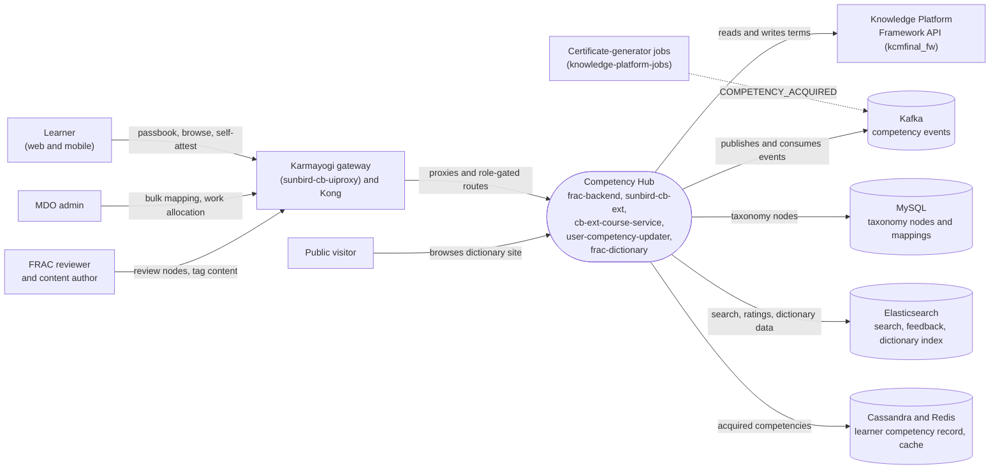

# Competency Hub — Context Diagram

## System boundary

Inside the feature are the competency-taxonomy system of record (`frac-backend`), the
learner competency read API and its acquired-competency updater job, the browse/search and
bulk-mapping backend in `sunbird-cb-ext`, and the public read-only dictionary site. Outside
it are the learners, MDO admins, FRAC reviewers and content authors who use it, the Karmayogi
gateway and Kong in front of it, Knowledge Platform's generic Framework API (which hosts the
second, `kcmfinal_fw` taxonomy), the certificate-generator jobs that raise acquisition
events, and the Cassandra, Redis, MySQL, Elasticsearch and Kafka stores it depends on.

## Diagram

## Elements

| Element | Role | Detailed in |
|---|---|---|
| Competency Hub | Central system: `frac-backend` taxonomy and review workflow, browse/search and ODCS processing, learner competency API, acquisition updater, public dictionary | [hld.md](hld.md) |
| Learner (web and mobile) | Opens the Passbook, browses by competency, self-attests current and desired competencies | [use-cases.md](use-cases.md) |
| MDO admin | Bulk-uploads designation-to-competency mappings and maps competencies onto Work Allocation roles | [use-cases.md](use-cases.md) |
| FRAC reviewer and content author | Reviewers approve nodes through L1 and L2; authors tag content with competencies | [use-cases.md](use-cases.md) |
| Public visitor | Browses the public read-only FRAC dictionary site | [use-cases.md](use-cases.md) |
| Karmayogi gateway and Kong | Routes client calls, two hand-written FRAC routers plus pass-through routes | [apis.md](apis.md) |
| Knowledge Platform Framework API | Hosts the separate `kcmfinal_fw` taxonomy read by most clients and written by ODCS processing | [hld.md](hld.md) |
| Certificate-generator jobs | Raise `COMPETENCY_ACQUIRED` events on certificate issuance | [apis.md](apis.md) |
| MySQL | Taxonomy nodes and parent/child mappings for `frac-backend` | [hld.md](hld.md) |
| Elasticsearch | Node search, feedback, review logs and the index mirrored by the dictionary site | [apis.md](apis.md) |
| Cassandra and Redis | Learner's acquired-competency table and its read cache | [apis.md](apis.md) |
| Kafka | Acquisition events, bulk-upload queue and audit events | [apis.md](apis.md) |

> **Verification boundary:** elements and interactions come from the feature's own pages,
> read in full: index, use cases, APIs and HLD. The LLD, operations manual and as-built
> requirements were not read for this diagram. Spot-checks in the read-only source were
> light: `frac-backend`, `frac-dictionary`, `sunbird-cb-ext`, `cb-ext-course-service`
> and `sunbird-cb-uiproxy` are present in the workspace, and the `COMPETENCY_ACQUIRED`
> event constant exists in `cb-ext-course-service`. Kafka topic names, route paths and
> the lack of any sync between the two taxonomies were not re-verified in source. The
> dashed arrow is an asynchronous event, not a direct call.
