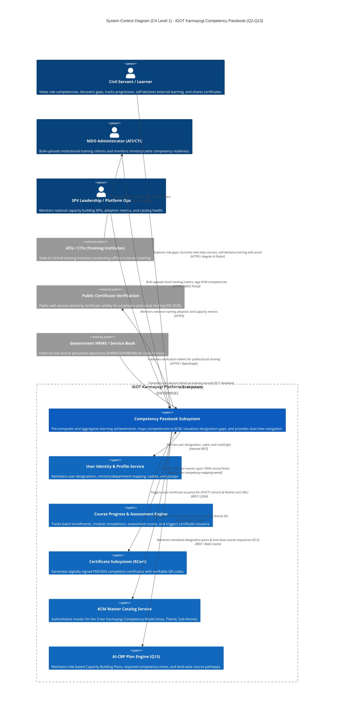
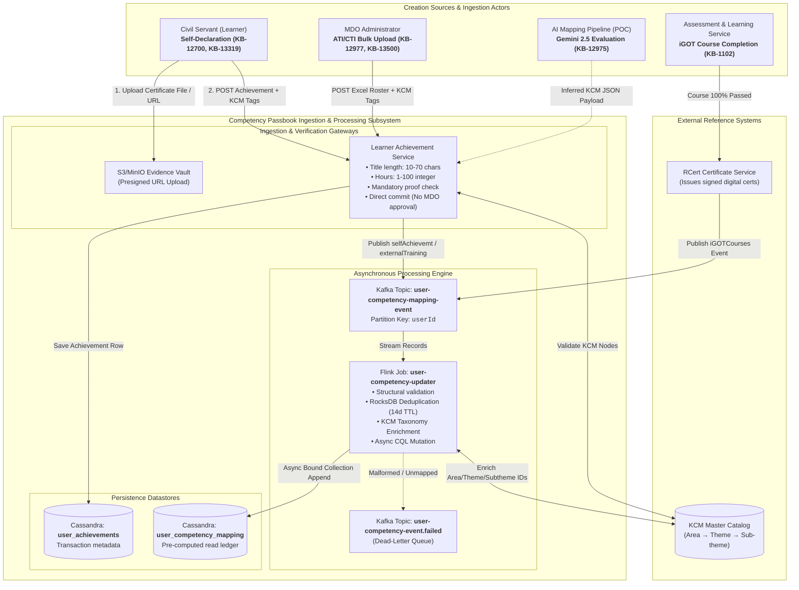
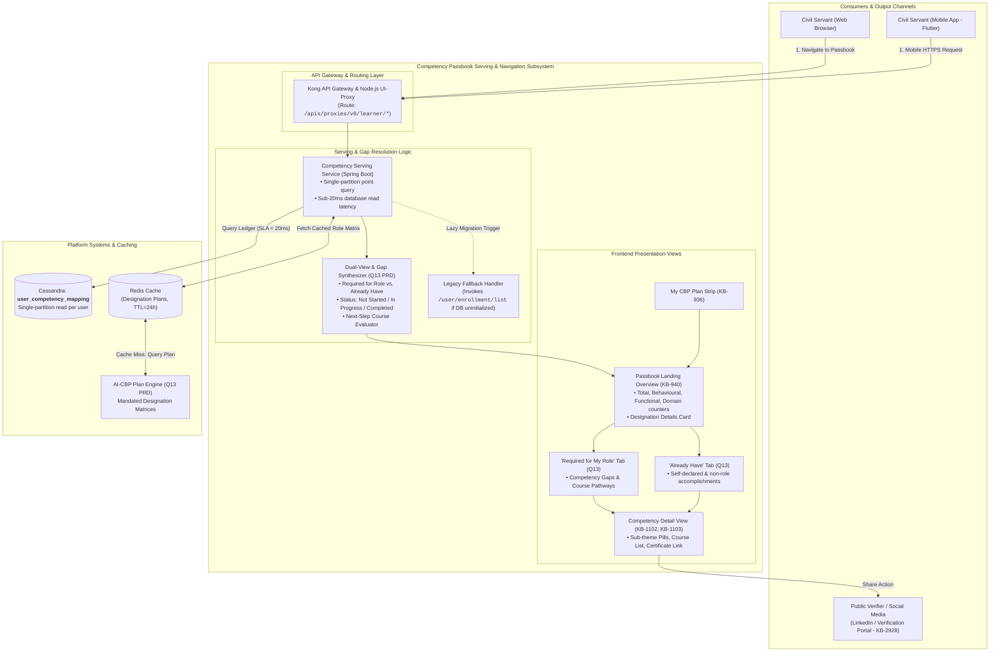

# Competency Passbook — Context Diagrams

This page presents the **System Context Diagrams (C4 Level 1)** for the **Competency Passbook / Learner Passbook** platform, scoped strictly to the **Q2–Q13** baseline (incorporating `KB-293`, `KB-936`, `KB-940`, `KB-1102`, `KB-1103`, `KB-2928`, `KB-12698`, `KB-12699`, `KB-12975`, `KB-13285`, `KB-13319`, `KB-13500`, and Confluence specifications `684195843`, `684949506`, `777682945`, `705757206`, `760381444`, `1001783322`).

### 1. Overall System Context Diagram (C4 Level 1)

This diagram establishes the **System Boundary** of the Competency Passbook, identifying all human actors, internal platform collaborating services, and external integrations across both **Creation (Ingestion)** and **Consumption (Serving)** tracks.

### 2. Creation-Side Context Diagram: Ingestion, Validation & Streaming

This diagram focuses strictly on the **Write / Ingestion boundary**, illustrating how internal courses, institutional offline batches, self-declared achievements, and AI-mapped records flow into the persistent ledger.

### 3. Consumption-Side Context Diagram: Serving, Gap Analysis & Navigation

This diagram isolates the **Read / Serving boundary**, capturing how the civil servant experiences the Passbook, how role gaps are dynamically resolved via the AI-CBP engine, and how certificates are shared.

### Key Contextual Boundaries & Interfaces Summary

| Interface / Boundary | Interacting Entities | Protocol & Format | Business Function & Link Reference |
|---|---|---|---|
| **Self-Declaration Input** | Learner Passbook Ingestion Service | HTTPS / Multipart Form | Submits external training metadata, selects KCM hierarchy, and uploads evidence files (`KB-12700`, `KB-13285`, `KB-13319`). |
| **Institutional Bulk Input** | MDO Admin Passbook Ingestion Service | HTTPS / Excel Batch | Bulk ingestion of ATI/CTI participant rosters with auto-generated iGOT certificates (`KB-12977`, `KB-13500`, `FRS FR-6`). |
| **Internal Completion Ingestion** | Course Engine Kafka Bus | Kafka Stream (JSON) | Asynchronous ingestion of completed iGOT courses (`user-competency-mapping-event`, `KB-13445`). |
| **Stream Processing Boundary** | Kafka Flink Cassandra | CQL / Binary Protocol | Deduplication (14d TTL), KCM resolution, and bound collection appends into `sunbird.user_competency_mapping` (`KB-13316`, `Page ID: 777781250`). |
| **Role Gap Integration** | Passbook Service AI-CBP / Redis | REST / JSON | Retrieves designation competency targets, proficiency levels, and level-wise course pathways (`Q13 PRD 1001783322`). |
| **Learner Serving Boundary** | Frontend Kong Cassandra | HTTPS / REST | Single-partition point query returning complete user competency ledger with database execution (`KB-940`, `API Contract 722206728`). |
| **Public Social** **Share** | Passbook Detail View Public Internet | HTTPS / OpenGraph | Generates social preview cards and public verification URLs for earned certificates (`KB-2928`). |
