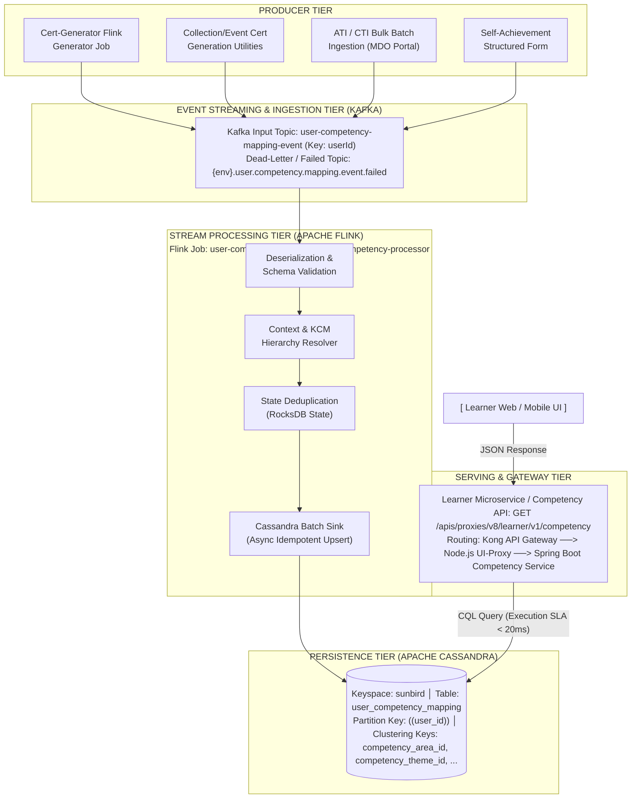
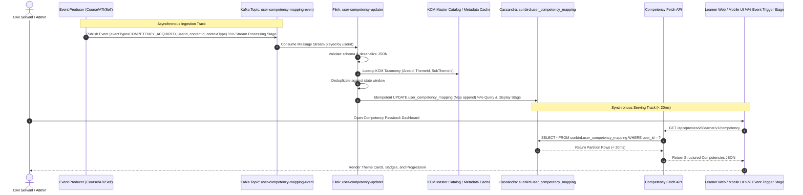
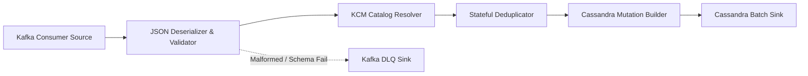
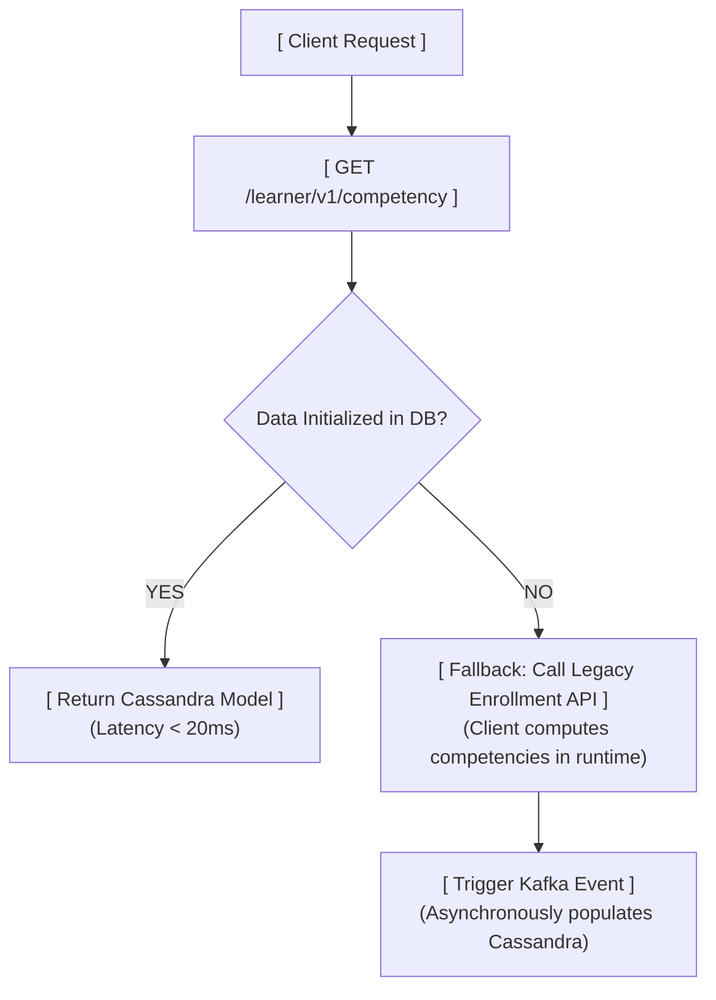

# Competency Passbook — High-Level Design (HLD)

**Asynchronous Competency Streaming & Persistence Architecture**

## 1. Executive Summary & Architecture Drivers

### 1.1 Business Context & Problem Statement

In the legacy implementation of the iGOT Karmayogi platform, user competencies were dynamically derived on the client side at runtime. Whenever a learner accessed their profile or passbook, the web/mobile frontend:

1. Executed a synchronous call to the **Enrollment List API** (`/apis/proxies/v8/user/enrollment/list`), pulling large, uncompressed payloads containing the learner’s entire historical course consumption records.
2. Iterated over each enrollment on the client side, parsing course identifiers and associated taxonomy tags.
3. Evaluated business logic and hierarchy rules in browser memory to compute earned Competency Areas, Themes, and Sub-themes.

#### Critical Architecture Deficiencies of Legacy Design:

- **High Latency & Bandwidth Degradation:** Incurred round-trip times exceeding for civil servants with long enrollment histories.
- **Redundant Computational Overhead:** Every page refresh forced full recalculation of static, historically earned credentials on client devices.
- **Tight Coupling:** Business rules governing competency eligibility were baked into client-side JavaScript, complicating catalog and policy updates.
- **Absence of Dedicated Persistence:** Competency attainments lacked a dedicated, query-optimized datastore, precluding real-time organizational analytics and role-gap analysis.

### 1.2 Architectural Drivers & Target Goals

- **Sub-20ms Read Latency:** Dedicated low-latency serving endpoint (`GET /apis/proxies/v8/learner/v1/competency`) executing single-partition reads against Apache Cassandra.
- **Decoupled Asynchronous Ingestion:** Event-driven architecture utilizing **Apache Kafka** to ingest completion events from disparate internal and external training producers without blocking user transactions.
- **Exactly-Once / Idempotent Processing:** Stream-based aggregation powered by **Apache Flink** (`user-competency-updater`) with checkpointed state management, deduplication, and resilient Cassandra upserts.
- **Zero-Downtime Migration & Resilient Fallback:** Phased batch hydration for over Monthly Active Users (MAUs) coupled with client-side dual-read fallback to guarantee continuous availability.

## 2. End-to-End System Architecture



### 2.1 Sequence Architecture Flow



## 3. Data Storage Architecture (Apache Cassandra)

### 3.1 Keyspace and Table Definition

The target Cassandra datastore uses the primary `sunbird` keyspace. The table `user_competency_mapping` persists pre-computed, hierarchical competency attainments mapped to context sources.

```sql
CREATE KEYSPACE IF NOT EXISTS sunbird WITH replication = { 'class': 'NetworkTopologyStrategy', 'datacenter1': 3 };
CREATE TABLE IF NOT EXISTS sunbird.user_competency_mapping (
    user_id text,
    competency_area_id text,
    competency_theme_id text,
    competency_subtheme_id text,
    competency_details map<text,
    frozen<list<frozen<map<text, text>>>>>,
    PRIMARY KEY ( (user_id), competency_area_id, competency_theme_id, competency_subtheme_id )
) WITH CLUSTERING ORDER BY ( competency_area_id ASC, competency_theme_id ASC, competency_subtheme_id ASC ) AND compaction = { 'class': 'LeveledCompactionStrategy' } AND comment = 'Pre-computed user competency ledger for instantaneous Passbook serving';
```

### 3.2 Primary Key Design Rationale

- **Partition Key:** `(user_id)`:
  - Guarantees that **all** competencies acquired by a user across all themes, areas, and courses reside on a **single physical partition**.
  - Eliminates cross-node distributed scatter-gather queries, enabling point lookups to complete in under .

- **Clustering Columns:** `(competency_area_id, competency_theme_id, competency_subtheme_id)`:
  - Enforces deterministic lexicographical ordering according to the 3-tier Karmayogi Competency Model (KCM).
  - Enables high-speed range queries by area or theme directly within the partition.

- **Frozen Nested Collection:** `competency_details`:
  - Map structure: `map<text, frozen<list<frozen<map<text, text>>>>>`.
  - The outer Map key represents the `contextType` (e.g., `iGOTCourses`, `selfAchievemt`, `externalTraining`, `externalContent`).
  - The nested list holds immutable maps containing contextual provenance:
    - `acquiredContextId`: The course identifier (`do_1138...`), batch identifier, or external program ID.
    - `certificateId`: Unique digital certificate UUID or verifiable document URL.
    - `acquired_at`: Standard ISO-8601 UTC timestamp (`YYYY-MM-DD HH:mm:ss.SSS+0000`).

## 4. Kafka Streaming & Ingestion Architecture

### 4.1 Topic Topology & Configuration

- **Primary Ingestion Topic:** `user-competency-mapping-event`
- **Dead Letter Queue (DLQ):** `{env}.user.competency.mapping.event.failed`
- **Partitioning Strategy:** Keyed strictly by `userId`. Keyed partitioning guarantees in-order event sequencing per learner while distributing traffic evenly across cluster brokers.
- **Replication Factor:** (across distinct availability zones).
- **Min In-Sync Replicas** (`min.insync.replicas`): .
- **Producer Acknowledgment:** `acks=all` (ensures zero data loss for completed credentials).

### 4.2 Message Schema Contract

Events emitted to `user-competency-mapping-event` conform to the following JSON schema:

```json
{
  "$schema": "http://json-schema.org/draft-07/schema#",
  "title": "UserCompetencyMappingEvent",
  "type": "object",
  "properties": {
    "eventType": {
      "type": "string",
      "enum": [
        "COMPETENCY_ACQUIRED",
        "COMPETENCY_REVOKED"
      ]
    },
    "userId": {
      "type": "string",
      "description": "Unique platform user UUID"
    },
    "contentId": {
      "type": "string",
      "description": "Unique course, assessment, or content identifier"
    },
    "batchId": {
      "type": "string",
      "description": "Course batch execution ID"
    },
    "contextType": {
      "type": "string",
      "enum": [
        "iGOTCourses",
        "selfAchievemt",
        "externalContent",
        "externalTraining"
      ]
    },
    "certificateId": {
      "type": "string",
      "description": "UUID of generated certificate or proof document reference"
    },
    "completedOn": {
      "type": "string",
      "format": "date-time"
    }
  },
  "required": [
    "eventType",
    "userId",
    "contentId",
    "contextType"
  ]
}
```

#### Event Context Classification:

- `iGOTCourses`: Native platform course completions validated by the assessment engine.
- `selfAchievemt`: Learner-entered external achievements validated via structured forms (`KB-12700`).
- `externalTraining`: Institutional cohort batches uploaded by accredited ATIs/CTIs (`KB-12977`).
- `externalContent`: Curated marketplace or integrated external MOOCs (e.g., NPTEL, Coursera).

## 5. Apache Flink Processing Engine (`user-competency-updater`)

### 5.1 Pipeline Stages & Execution Graph



1. **Kafka Consumer Source:**
  - Reads from `user-competency-mapping-event` using `FlinkKafkaConsumer` / `KafkaSource`.
  - Enforces watermarking based on event timestamp (`completedOn`).

2. **Schema Deserialization & Structural Validation:**
  - Validates non-null constraints on `userId`, `contentId`, and `contextType`.
  - Invalid or unparsable payloads are routed to `{env}.user.competency.mapping.event.failed` via side outputs.

3. **KCM Catalog Resolution:**
  - Enriches the event by querying an in-memory broadcast cache of the KCM Master Catalog.
  - Maps `contentId` to its associated `competency_area_id`, `competency_theme_id`, and `competency_subtheme_id`.
  - If mapping metadata is missing for a course, Flink queries the metadata read-service with a bounded retry policy.

4. **Stateful Deduplication:**
  - Uses RocksDB state backend keyed by `userId + competency_subtheme_id + contentId`.
  - Prevents repeated certificate updates or redundant writes from duplicate Kafka messages.

5. **Cassandra Mutation Builder & Async Sink:**
  - Employs the `CassandraSink` utilizing Datastax Java Driver with `TokenAwarePolicy` and `DCAwareRoundRobinPolicy`.
  - Executes idempotent CQL updates using collection appends:

```sql
UPDATE sunbird.user_competency_mapping
SET competency_details[?] = competency_details[?] + ?
WHERE user_id = ?
  AND competency_area_id = ?
  AND competency_theme_id = ?
  AND competency_subtheme_id = ?;
```

### 5.2 Fault Tolerance, Checkpointing, and State Management

- **State Backend:** Embedded RocksDB with incremental checkpointing enabled.
- **Checkpoint Interval:** ().
- **Checkpoint Timeout:** ().
- **Min Pause Between Checkpoints:** .
- **Max Concurrent Checkpoints:** .
- **Restart Strategy:** Fixed-delay restart configuration:
  - Attempts: .
  - Delay Interval: .

## 6. Serving Tier & API Contract

### 6.1 Unified Competency Fetch API

- **Endpoint:** `GET /apis/proxies/v8/learner/v1/competency`
- **Transport:** HTTPS / REST
- **Headers:** `Authorization: Bearer {token}`, `x-authenticated-user-token: {jwt}`, `Accept: application/json`
- **SLA Performance:** End-to-end response time at the database layer; at the client gateway layer.

### 6.2 Response Payload Schema

```json
{
  "id": "api.learner.competency.read",
  "ver": "v1",
  "ts": "2026-10-29T06:21:40.120Z",
  "params": {
    "resmsgid": "89ab10fe-290c-4311-b0e2-d5e67fa89012",
    "status": "SUCCESS"
  },
  "responseCode": "OK",
  "result": {
    "competencies": [
      {
        "competencyAreaId": "COMAREA-0001",
        "competencyThemeId": "COMTHEME-000034",
        "competencySubThemeId": "COMSUBTHEME-000034",
        "competencyDetails": {
          "iGOTCourses": [
            {
              "acquiredContextId": "do_123444444444",
              "certificateId": "adadadadad-vbvbvbv-faffaf",
              "acquired_at": "2025-11-18 03:31:30.151000+0000"
            }
          ],
          "selfAchievemt": [
            {
              "acquiredContextId": "do_987654321000",
              "certificateId": "https://storage.karmayogi.gov.in/evidence/cert-998.pdf",
              "acquired_at": "2026-01-20 10:15:00.000000+0000"
            }
          ],
          "externalTraining": [
            {
              "acquiredContextId": "ATI-BATCH-2026-Q1",
              "certificateId": "cert-ati-881273-igot",
              "acquired_at": "2026-02-14 14:20:10.000000+0000"
            }
          ],
          "externalContent": []
        }
      }
    ]
  }
}
```

## 7. Migration, Hydration & Fallback Strategy



### 7.1 Historical Hydration for Monthly Active Users (MAUs)

To transition the platform smoothly without downtime or bulk re-computation storms:

1. **Batch Spark/Flink Migration Job:** A dedicated offline data migration pipeline reads existing course completion records from the relational/enrollment store for all **Monthly Active Users (MAUs)**.
2. **Pre-population Phase:** The migration job constructs valid `user_competency_mapping` rows and bulk-loads them directly into Cassandra via SSTableLoader to bypass cluster write overhead.
3. **Delta Ingestion:** Real-time Kafka processing handles all new completions concurrently.

### 7.2 Graceful Dual-Read Fallback Architecture

For inactive or long-tail users whose records were not pre-populated in the batch hydration run:

1. The client portal invokes `GET /apis/proxies/v8/learner/v1/competency`.
2. If Cassandra returns an empty dataset or an uninitialized flag:
  - The UI catches the empty response and seamlessly invokes the legacy **Enrollment List API** (`/apis/proxies/v8/user/enrollment/list`).
  - The client dynamically evaluates the legacy rules to display the user's data without service disruption.
  - Concurrently, the backend gateway dispatches a lazy re-computation event to Kafka (`user-competency-mapping-event`), ensuring that subsequent requests by that user are served directly from Cassandra.

## 8. Non-Functional Requirements (NFRs) & Operational Design

### 8.1 Performance & Scalability

- **Read SLA:** Cassandra read operations for `/learner/v1/competency` shall execute in at the 99th percentile ().
- **End-to-End Event Processing Lag:** Time elapsed between course certificate generation and Cassandra ledger persistence shall be under standard load ().
- **Throughput Capacity:** Kafka partitions and Flink operators shall be scaled to handle sustained bursts of concurrent course completion events during national training drives.

### 8.2 High Availability & Disaster Recovery

- **Cassandra Replication:** Replication Factor (RF) of across three distinct availability zones with `LOCAL_QUORUM` read and write consistency.
- **Flink Resiliency:** Kubernetes deployment using native Flink Operator with JobManager high availability backed by ZooKeeper / Kubernetes consensus and persistent volume storage for checkpoints.
- **RPO & RTO:**
  - Recovery Point Objective (RPO): (bounded by Flink checkpoint interval).
  - Recovery Time Objective (RTO): for automated TaskManager failure recovery and state replay.

### 8.3 Observability & Telemetry Metrics

**OBSERVABILITY & MONITORING TIER**

| Prometheus Metrics | Grafana Dashboards | ELK / Graylog Alerts |
|---|---|---|
| Flink checkpoint lag | Consumer Lag Monitor | Deserialization err |
| Cassandra read p99 | TPS & Ingestion Rate | DLQ write volume |
| Kafka consumer lag | Read Latency Trends | Cluster status |

- **Core Prometheus Gauges & Counters:**
  - `flink_job_user_competency_updater_lastCheckpointDuration`: Alert if .
  - `kafka_consumergroup_lag{topic="user-competency-mapping-event"}`: Alert if lag exceeds messages for .
  - `cassandra_read_latency_p99{table="user_competency_mapping"}`: Alert if latency exceeds .
  - `competency_mapping_dlq_count`: Alert on any non-zero rate of growth in the dead-letter topic.
