## Section 1: Executive Summary

The **Competency Passbook** (designated in platform specifications alternately as the **Learner Passbook**) is an enterprise-scale, civil-service capability within the **iGOT Karmayogi platform** (`sunbird-cb-portal` / Karmayogi Bharat). Its fundamental mission is to transition government workforce capacity building from unverified, retrospective course consumption tracking into a role-aligned, competency-led digital ledger and developmental navigation system.

### Business Problem

Prior to this feature, Indian civil servants across central, state, and local administrative bodies lacked a transparent, unified record of their acquired competencies. Historical training records were fragmented across offline/in-service training institutions (Administrative Training Institutes [ATIs] and Central Training Institutes [CTIs]) and external credentialing bodies without standard verification mechanisms. Furthermore, legacy course completion logs functioned purely retrospectively: they informed learners of what courses they had completed, but provided zero forward-looking guidance on competency gaps required for their current cadre, grade, or designation.

### Documented Scope & Evolution

Across its lifecycle from **Q2 (late 2023)** to **Q13 (mid 2026)**:

1. **Early Phase (Q2–Q6)**: Originated under the Capacity Building Plan (CBP) initiative (`KB-293`, `KB-934`), delivering a static, learner-facing competency landing page (`KB-940`), competency theme cards (`KB-1102`), and category filtering (`KB-1103`) across Behavioural, Functional, and Domain competency areas.
2. **Expansion & Governance Phase (Q7–Q11 / r2025_Q4)**: Re-architected as the **Learner Passbook** (`KB-12698`, `KB-12699`). Introduced structured forms for self-declared external training (`KB-12700`), ATI/CTI institutional bulk upload pipelines (`KB-12977`, `KB-13500`), manual hierarchical competency tagging (`KB-13285`), and an asynchronous event-driven backend utilizing Apache Kafka and Apache Flink (`user-competency-processor`, `KB-13316`). Simultaneously, a foundational AI prototype was developed (`KB-12975`) utilizing Google Vertex AI (Gemini 2.5 Flash / Pro) to evaluate automated certificate-to-KCM mapping.
3. **Intelligence & Revamp Phase (Q12–Q13 / r2026)**: Re-conceptualized via the **Q13 PRD** (`Page ID: 1001783322`) and subsequent Q14 specifications (`KB-15792`, `KB-15793`). Transformed from a backward-looking achievement log into a forward-looking, AI-integrated competency development engine. By interfacing with the platform's AI-driven **Competency-Based Program (AI-CBP)** tool, the Passbook introduces dynamic role-gap identification, a dual-view interface (*Required for My Role* vs. *Already Have*), level-wise course pathways (Beginner, Intermediate, Advanced), and organizational KPI dashboards for MDOs and the SPV.

## Section 2: Feature Definition

Based on explicit source documentation across Jira tickets, Business Requirement Documents (BRDs), Functional Requirement Specifications (FRSs), and Software Requirement Specifications (SRSs), the terminology is defined as follows:

- **Competency Passbook**: A role-centric, competency-mapped interface on the Learner Portal that presents the learner's designation expectations, evaluates competency achievement against Capacity Building Plans (CBP), visualizes competency gaps, and recommends targeted learning assets `[CONFIRMED: Page ID 1001783322, KB-15793]`.
- **Learner Passbook**: A verified ledger of all lifetime learning records, aggregating platform courses, self-declared external certifications (with evidence validation), and ATI/CTI institutional bulk training records `[CONFIRMED: Page ID 684195843, Page ID 777682945, KB-12699]`.
- **Distinction and Convergence**: In **Q11 (SRS v1.0, Feb 2026)**, the feature was formally introduced as the *Learner Passbook*, replacing the legacy *Learning History* menu option. Its primary function was record ingestion and governance (Self, iGOT, ATI/CTI, and EHRMS). In **Q13 (PRD v1.0, May 2026)**, the terminology converged under the *Competency Passbook Revamp*, where the primary surface is dedicated to forward-looking competency gap closure and AI-CBP alignment, while external self-declaration workflows operate as supporting record ingestion capabilities `[CONFIRMED: Page ID 1001783322]`.

## Section 3: Business Problem and Objectives

### Core Problems Solved

1. **Absence of Role-Based Competency Transparency**: Government employees had no centralized visibility into the mandatory behavioural, functional, and domain competencies required for their specific designation and ministry `[CONFIRMED: Page ID 1001783322 §2.3]`.
2. **Unverified and Fragmented External Records**: Training completed at ATIs/CTIs or non-iGOT institutions was untracked or recorded without verifiable evidence or standardized competency mapping `[CONFIRMED: Page ID 684195843 §1]`.
3. **Retrospective Stagnation**: Existing systems tracked course completions, but provided no actionable next steps or automated recommendations to help civil servants close skill gaps `[CONFIRMED: Page ID 1001783322 §2.1]`.
4. **Administrative Blindspots**: Ministry, Department, and Organization (MDO) administrators and the Special Purpose Vehicle (SPV / Karmayogi Bharat) lacked real-time analytics to monitor workforce competency readiness at departmental or national scale `[CONFIRMED: Page ID 1001783322 §2.3]`.

### Primary Objectives and Success Targets

- **Dynamic Gap Identification**: Surface competency gaps for every civil servant based on designation-linked ideal competency profiles generated by the AI-CBP tool `[CONFIRMED: Page ID 1001783322 §3]`.
- **Curated Learning Pathways**: Recommend learning assets (iGOT courses, blended programs, assessments, marketplace courses) mapped to specific competency proficiency levels `[CONFIRMED: Page ID 1001783322 §7.1.3]`.
- **Lifelong Verified Ledger**: Provide a single source of truth for platform, self-declared, and institutionally uploaded learning achievements with auditable evidence `[CONFIRMED: Page ID 684949506 §2]`.
- **Mission-Level Governance**: Equip MDO and SPV leadership with KPI dashboards tracking departmental competency achievement percentages and learning adoption trends `[CONFIRMED: Page ID 1001783322 §7.2–7.3]`.

## Section 4: Scope

### In-Scope Capabilities

- **Core Passbook UI/UX**: Landing page with stats, designation details, competency area breakdown (Behavioural, Functional, Domain), search, filtering, and theme cards `[CONFIRMED: KB-940, KB-1103, Page ID 1001783322]`.
- **Dual-View Exploration (Q13 Baseline)**:
  - *Required for My Role* (Aspirational/Gap view): Displays target competencies, current vs. desired proficiency levels, and recommended courses `[CONFIRMED: Page ID 1001783322 §7.1.1]`.
  - *Already Have* (Achieved view): Retrospective list of attained competencies with contributing course records `[CONFIRMED: Page ID 1001783322 §7.1.1]`.

- **Self-Declared Achievement Capture**: Structured entry form capturing Title, Issuing Organization, Dates, Learning Hours, Training Type, mandatory Evidence (file upload or URL), and hierarchical competency mapping `[CONFIRMED: KB-12700, KB-13285, Page ID 684949506 FR-1]`.
- **ATI / CTI Institutional Ingestion**: MDO Admin portal interface for bulk-uploading external training cohorts via Excel templates with auto-generated iGOT certificates `[CONFIRMED: KB-12977, KB-13500, Page ID 684949506 FR-6]`.
- **Event-Driven Streaming Architecture**: Ingestion of achievement events via Kafka topics and real-time computation via Flink `user-competency-processor` `[CONFIRMED: KB-13445, KB-13316]`.

### Out-of-Scope Capabilities

- **Third-Party HRMS Direct Two-Way Sync**: Live automated API synchronization with EHRMS, SPARROW, or state HRMS suites (deferred due to external API dependency) `[CONFIRMED: KB-12699 comment 51772, Page ID 684949506 FR-4]`.
- **Automated OCR Parsing in Current UI**: Real-time extraction of certificate metadata and automatic mapping via computer vision/OCR (deferred to Phase 2) `[CONFIRMED: Page ID 1001783322 §13]`.
- **Public Sharing of Passbook**: External public web sharing or unauthenticated credential verification `[CONFIRMED: Page ID 684195843 §10, Page ID 777682945 §3.3.2]`.
- **Modifications to Underlying AI-CBP Engine Models**: Changes to the core LLM/algorithmic weighting used inside the standalone AI-CBP service `[CONFIRMED: Page ID 1001783322 §4.2]`.

## Section 5: Source Inventory and Evidence Quality

| Source ID / URL | Title / Identifier | Source Type | Release / Quarter | Creation / Mod Date | Status / State | Evidence Extraction & Authority |
|---|---|---|---|---|---|---|
| **KB-293** | Q2 \| Capacity Building Plan | Initiative | Q2 | Created: 2023-10-22 Updated: 2024-08-28 | Prod Deployed | Canonical origin of CBP and Competency Passbook concepts. |
| **KB-934** | Q2 \| Capacity Building Plan \| Consumption | Epic | Q2 | Created: 2023-11-24 Updated: 2024-02-22 | Prod Deployed | Parent epic for initial passbook consumption stories. |
| **KB-936** | Q2 \| CBP \| My CBP Plan page | Story | Q2 | Created: 2023-11-24 Updated: 2024-04-30 | Prod Deployed | Entry point linking CBP plan to Competency Passbook. |
| **KB-940** | Q2 \| CBP \| Competency Passbook - landing page | Story | Q2 | Created: 2023-11-24 Updated: 2024-04-30 | Prod Deployed | Passbook landing page stats, time filters, and theme cards. |
| **KB-1102** | Q2 \| CBP \| Competency Passbook - Competency card detail view | Story | Q2 | Created: 2023-11-29 Updated: 2024-04-30 | Prod Deployed | Card detail view, sub-theme counts, certificate linkage. |
| **KB-1103** | Q2 \| CBP \| Competency Passbook - Competency Inner page | Story | Q2 | Created: 2023-11-29 Updated: 2024-04-30 | Prod Deployed | All / Behavioural / Functional / Domain tabs & filters. |
| **KB-2928** | Add a share button in the my learners, TOC page and competency passbook pages | Story | Q3 / Sprint 11 | Created: 2024-02-26 Updated: 2024-03-05 | Prod Deployed | Social/certificate sharing integration. |
| **KB-12698** | Q11 \| Learner Passbook | Initiative | Q11 | Created: 2026-01-12 Updated: 2026-01-15 | Open | Umbrella initiative for verified Learner Passbook ledger. |
| **KB-12699** | Q11 \| Learner Passbook | Epic | Q11 / Sprint 35 | Created: 2026-01-12 Updated: 2026-08-26 | Prod Deployed | Core delivery epic for self-declaration and ATI bulk upload. |
| **KB-12700** | Q11 \| Learning Passbook \| Add Learning Record via Structured Form | Story | Q11 / Sprint 36 | Created: 2026-01-12 Updated: 2026-05-08 | Prod Deployed | Form fields, validations, and evidence attachments. |
| **KB-12701** | Q11 \| Learning Passbook \| Save, Edit, and Delete Learning Records | Story | Q11 / Sprint 36 | Created: 2026-01-12 Updated: 2026-02-12 | Prod Deployed | CRUD lifecycle rules for self-declared records. |
| **KB-12703** | Q11 \| Learning Passbook \| View Unified Learning Record History & Details | Story | Q11 / Sprint 36 | Created: 2026-01-12 Updated: 2026-03-03 | Prod Deployed | Unified view grouped by competency area and themes. |
| **KB-12975** | Q11 \| Learning Passbook \| AI Based Competency Mapping | Story | Q11 | Created: 2026-01-28 Updated: 2026-02-23 | Not Required *(Jira)* / Prototyped | Gemini 2.5 Flash/Pro evaluation for automated mapping. |
| **KB-12977** | Q11 \| Learning Passbook \| ATI / CTI Training Data Bulk Upload | Story | Q11 / Sprint 36 | Created: 2026-01-28 Updated: 2026-03-10 | Prod Deployed | MDO bulk ingestion of external institutional cohorts. |
| **KB-13285** | Q11 \| Learning Passbook \| Capturing Competency Area, Theme and Sub-theme | Story | Q11 / Sprint 36 | Created: 2026-02-23 Updated: 2026-05-08 | KB Verified | Manual hierarchical competency picker from KCM master. |
| **KB-13316** | Q11 \| Learning Passbook \| Flink Job Integration for user-competency-processor | Sub-task | Q11 / Sprint 36 | Created: 2026-02-24 Updated: 2026-03-03 | Done | Apache Flink streaming pipeline integration. |
| **KB-13319** | Q11 \| Mobile \| Learning Passbook \| Add Learning Record | Story | Q11 / Mobile | Created: 2026-02-24 Updated: 2026-08-11 | UAT In Progress | Mobile app (Flutter) parity for self-declared records. |
| **KB-13445** | Q11 \| Learning Passbook \| BE \| Add competency to achievement... sending to kafka | Sub-task | Q11 / Sprint 36 | Created: 2026-03-03 Updated: 2026-03-03 | In-Progress | Kafka producer sending structured achievement events. |
| **KB-13500** | Q11 \| Learning Passbook \| UI \| create ATI / CTI Trainings \| add Competencies UI | Sub-task | Q11 / Sprint 36 | Created: 2026-03-10 Updated: 2026-03-10 | Done | Frontend UI components for ATI/CTI training uploads. |
| **KB-15792** | Q14 \| Competency Passbook | Initiative | Q14 | Created: 2026-10-01 Updated: 2026-10-01 | Open | Initiative for full forward-looking AI-CBP integration. |
| **KB-15793** | Q14 \| Competency Passbook | Epic | Q14 | Created: 2026-10-01 Updated: 2026-10-26 | More Info Required | Epic detailing Figma 3.0 designs, dual view, and telemetry. |
| **Confluence: 172261415** | `<WIP >Competency Passbook` | Historical Spec | Q5/Q6 (Nov 2024) | Last Mod: 2024-11-06 | Working Draft | Early exploration of competency Definition of Done. |
| **Confluence: 684195843** | `BRD_LearnerPassbook_v1.0_r2025_Q4` | BRD | Q11 (r2025_Q4) | Last Mod: 2026-08-11 | Published | Business requirements for unified passbook and records. |
| **Confluence: 684949506** | `FRS_LearnerPassbook_v1.0_r2025_Q4` | FRS | Q11 (r2025_Q4) | Last Mod: 2026-08-11 | Published | Functional requirements (FR-1 through FR-6). |
| **Confluence:** **777682945** | `SRS_FRS_LearnerPassbook_v1.0_``r2025_Q4` | SRS | Q11 (r2025_Q4) | Last Mod: 2026-08-12 | Published | Engineering specifications, NFRs, architecture diagrams. |
| **Confluence: 705757206** | `Learning Passbook \\|\\| Externally Integrated Training...` | Tech Spec | Q11 (Jan 2026) | Last Mod: 2026-01-30 | Published | Architecture pipeline for external training mapping. |
| **Confluence: 760381444** | `Automating Competency Mapping with AI...` | Research / Architecture | Q11 (Feb 2026) | Last Mod: 2026-02-11 | Published | Detailed Gemini 2.5 Flash/Pro evaluation & prompts v1–v4. |
| **Confluence: 722206728** | `API contract Details For Learner PassBook` | API Contract | Q11 (Feb 2026) | Last Mod: 2026-02-26 | Published | Complete curl specifications, Kong routes, payload schemas. |
| **Confluence: 1001783322** | `Q13 \\| PRD \\| Competency Passbook` | PRD | Q13 (May 2026) | Last Mod: 2026-10-09 | Draft v1.0 | Canonical baseline for AI-CBP integration & gap analysis. |

## Section 6: Historical Evolution: Q2 to Q13

### Quarter-by-Quarter Investigation (Q2–Q13)

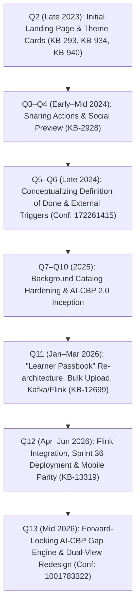

#### Detailed Chronology

- **Quarter 2 (Q2 2023–24 / Oct–Dec 2023)**:
  - *Objective*: Introduce the Capacity Building Plan (CBP) consumption framework and establish a learner-facing view of earned competencies.
  - *Delivered Capabilities*: My CBP Plan strip and page (`KB-936`); Competency Passbook Landing Page (`KB-940`) with high-level statistics across Behavioural, Functional, and Domain competencies; Competency Card detail view (`KB-1102`); and Category-filtered Inner pages (`KB-1103`).
  - *Evidence*: Deployed to production (`KB-293`, `KB-934`).

- **Quarter 3 (Q3 2023–24 / Jan–Mar 2024)**:
  - *Objective*: Enhance social recognition and visibility for completed competencies.
  - *Delivered Capabilities*: Added social sharing buttons across Table of Contents (TOC) and Passbook pages (`KB-2928`), integrating with public certificate verification URLs.
  - *Evidence*: Deployed to production (`KB-2928`).

- **Quarter 4 (Q4 2023–24 / Apr–Jun 2024)**:
  - *State*: Maintenance and UI polish. Historical evidence for major architectural modifications was not found in the supplied sources `[NOT VERIFIED]`.

- **Quarter 5 & Quarter 6 (Q1–Q2 2024–25 / Jul–Dec 2024)**:
  - *Objective*: Define multi-source competency attainment models.
  - *Delivered Capabilities*: Drafting of `<WIP >Competency Passbook` specification (`Confluence Page ID: 172261415`, Nov 2024). Explored defining competency "Definition of Done" combining iGOT internal courses, standalone assessments, and external evaluations (PIAA, WPCAS).
  - *Evidence*: Confluence working draft.

- **Quarter 7, Quarter 8, Quarter 9, & Quarter 10 (Q3 2024–25 to Q2 2025–26 / Jan–Dec 2025)**:
  - *State*: The platform scaled core learning infrastructure and developed the standalone AI-CBP 2.0 tool. Specific user-facing passbook changes for these quarters are not explicitly documented in the supplied tickets `[NOT VERIFIED]`.

- **Quarter 11 (Q3 2025–26 / Jan–Mar 2026, Release r2025_Q4)**:
  - *Objective*: Complete re-architecture into the **Learner Passbook** to create a verifiable, auditable lifelong learning ledger.
  - *Delivered Capabilities*: Self-declared achievement capture (`KB-12700`); record editing and deletion (`KB-12701`); unified history display (`KB-12703`); ATI/CTI external bulk upload (`KB-12977`, `KB-13500`); hierarchical KCM competency tagging (`KB-13285`); asynchronous event streaming via Kafka (`KB-13445`) and Flink `user-competency-processor` (`KB-13316`). Prototyped AI competency mapping using Gemini 2.5 Flash/Pro (`KB-12975`, `Page ID: 760381444`).
  - *Governance Shift*: MDO approval workflow was initially specified (`BRD 684195843`), but formally disabled in Feb 2026 per leadership directive (`KB-12699 Comment 53541`), making self-declared records instantly viewable.
  - *Evidence*: Prod deployed (`KB-12699`, `KB-12700`).

- **Quarter 12 (Q4 2025–26 / Apr–Jun 2026)**:
  - *Objective*: Stabilization, testing, and cross-platform verification.
  - *Delivered Capabilities*: Field validation hardening on self-declaration forms (Title length 10–70 chars, integer learning hours 1–100 per `KB-12700 Comment 64983`); Mobile Flutter integration for self-declaration (`KB-13319`); QA sign-off under Sprint 36 (`Page ID: 949944321`).
  - *Evidence*: Deployed and verified in QA/staging.

- **Quarter 13 (Q1 2026–27 / Jul–Sep 2026, PRD Draft May 2026)**:
  - *Objective*: Transition from a retrospective ledger to an AI-guided developmental engine.
  - *Delivered Capabilities*: Formalized in `Q13 | PRD | Competency Passbook` (`Page ID: 1001783322`). Defined integration with the AI-CBP tool to compute role-based competency gaps; designed dual-view interface (*Required for My Role* vs. *Already Have*); level-wise course pathways; and MDO/SPV KPI dashboards. Carried forward into Q14 Epic (`KB-15793`, Oct 2026).
  - *Evidence*: Confluence PRD v1.0 and Figma Passbook 3.0 design system.

### Comprehensive Q2–Q13 Evolution Matrix

| Quarter / Release | Feature State at the Time | New Capabilities | Enhancements or Changes | Related Jira Tickets | Supporting Documents | Evidence of Implementation | Open Issues & Limitations |
|---|---|---|---|---|---|---|---|
| **Q2** *(Q2 2023–24)* | Initial Rollout | Static landing page, competency theme cards, sub-theme pills, area stamps (Behavioural, Domain, Functional). | First formal visualization of competencies derived from course completion. | `KB-293`, `KB-934`, `KB-936`, `KB-940`, `KB-1102`, `KB-1103` | BRD Capacity Building Plan (`6750611`), FRS CBP Consumption (`18841695`) | **IMPLEMENTATION VERIFIED** (Prod Deployed) | Retrospective only; no forward guidance or external training capture. |
| **Q3** *(Q3 2023–24)* | Social Visibility | Share button on TOC, My Learners, and Passbook pages. | Generated public verification links for LinkedIn / external sharing. | `KB-2928` | Jira ticket specification | **IMPLEMENTATION VERIFIED** (Prod Deployed) | Certificate preview failures in non-prod environments (`KB-2928`). |
| **Q4** *(Q4 2023–24)* | Maintenance | UI bug fixes and filter tuning. | Refined pill layout (desktop: 10 pills, mobile: 3 pills). | Jira UI maintenance tickets | Component test logs | **NOT VERIFIED** (Specific quarterly tickets not in evidence set) | No capability expansion. |
| **Q5–Q6** *(Q1–Q2 2024–25)* | Conceptual Scoping | Definition of Done exploration for competency attainment. | Formulated multi-source model (iGOT courses + assessments + PIAA/WPCAS). | Platform design backlog | `<WIP >Competency Passbook` (`172261415`) | **PROPOSED** (Confluence working spec) | Lack of formal backend ingestion pipeline for external scores. |
| **Q7–Q10** *(Q3 2024–25 to Q2 2025–26)* | Architectural Preparation | System-level designation mapping and AI-CBP 2.0 foundation. | Prepared master data models for designation-to-competency linkages. | Background platform tickets | Platform architecture records | **NOT VERIFIED** (Supplied evidence set contains no direct tickets) | Passbook remained static in production. |
| **Q11** *(Q3 2025–26, r2025_Q4)* | Enterprise Re-Architecture | Self-declared external achievements (`KB-12700`); ATI/CTI bulk ingestion (`KB-12977`); Flink streaming (`KB-13316`). | Replaced *Learning History* with *Learner Passbook*; removed MDO approval bottleneck (`Comment 53541`). | `KB-12698`, `KB-12699`, `KB-12700`, `KB-12701`, `KB-12703`, `KB-12975`, `KB-12977`, `KB-13285`, `KB-13316`, `KB-13445`, `KB-13500` | `BRD 684195843`, `FRS 684949506`, `SRS 777682945`, `API 722206728`, `AI Doc 760381444` | **IMPLEMENTATION VERIFIED** (Prod Deployed / Sprint 36 sign-off) | EHRMS API delayed (`Comment 51772`); AI mapping kept as standalone POC. |
| **Q12** *(Q4 2025–26)* | Hardening & Mobile Parity | Form input constraints, mobile self-declaration UI (`KB-13319`). | Standardized title length (10–70 chars), integer learning hours (1–100). | `KB-13319`, `KB-12700` | Sprint 36 Sign-off (`949944321`) | **IMPLEMENTATION VERIFIED** (KB Verified / UAT In Progress) | Mobile release lagging behind web portal deployment. |
| **Q13** *(Q1 2026–27)* | AI-Driven Revamp | Forward-looking gap analysis; dual view (*Required* vs *Already Have*); AI-CBP integration; MDO/SPV dashboards. | Re-branded to *Competency Passbook Revamp*; shifted focus to career progression. | Planned work transitioned to Q14 (`KB-15792`, `KB-15793`) | `Q13 PRD 1001783322`, Figma 3.0 (`node-id=286-2`) | **CONFIRMED SPECIFICATION** (PRD Draft v1.0) | AI-CBP API latency/cost open questions; OCR parsing deferred. |

## Section 7: Major Evolution Milestones

1. **Milestone 1: The Retrospective Achievement Viewer (Q2 2023–24)**
  - *Shift*: Prior to Q2, learners had no visual correlation between course completions and civil service competencies.
  - *Significance*: Established the three canonical competency areas (**Behavioural**, **Functional**, **Domain**) and introduced the concept of competency theme cards stamped with completion tallies `[CONFIRMED: KB-934, KB-940]`.

2. **Milestone 2: The Verified Multi-Source Learning Ledger (Q11 2025–26)**
  - *Shift*: Transitioned from tracking only native iGOT course completions to capturing offline institutional training (ATIs/CTIs) and individual external credentials.
  - *Significance*: Introduced enterprise infrastructure: Cassandra datastores for achievements, Kafka event streaming, Apache Flink real-time competency processing, and auto-generated platform certificates for external cohorts `[CONFIRMED: KB-12699, KB-13316, Page ID 777682945]`.

3. **Milestone 3: Governance De-bottlenecking (February 2026)**
  - *Shift*: Removal of the mandatory MDO Admin approval workflow for self-declared records.
  - *Significance*: Overcame an administrative bottleneck where thousands of employee achievements remained locked in `PENDING` status, transitioning governance toward post-audit transparency `[CONFIRMED: KB-12699 Comment 53541]`.

4. **Milestone 4: The Forward-Looking AI Competency Guide (Q13 2026–27)**
  - *Shift*: Transforming the passbook from a historical archive into an active professional development copilot.
  - *Significance*: Integrated the external AI-CBP tool to evaluate the learner's designation, calculate proficiency gaps, and dynamically curate learning pathways `[CONFIRMED: Page ID 1001783322]`.

## Section 8: Business and Functional Capabilities

**COMPETENCY PASSBOOK CAPABILITIES**

| 1. Role & Gap Intelligence (Q13) | 2. Verified Records (Q11) | 3. Institutional Sync (Q11) |
|---|---|---|
| Designation CBP Profile | Self-Declared Forms | ATI / CTI Bulk Upload |
| Proficiency Gap Visualizer | Evidence Attachment (Doc/URL) | Auto-Issued Certificates |
| Level-Wise Course Pathways | Edit / Delete Controls | Immutable Batch Processing |
| Dual-View Mode Switching | Cassandra History Ledger | MDO External Dashboard |

1. **Designation Capacity Building Plan Ingestion**: Dynamically consumes the learner's designation, cadre, and department to retrieve the target competency profile defined in the AI-CBP framework `[CONFIRMED: Page ID 1001783322 §6.2]`.
2. **Proficiency Gap Identification & Visualizer**: Displays target competencies alongside visual indicators representing the delta between current attainment and the role's required proficiency level `[CONFIRMED: Page ID 1001783322 §7.1.2]`.
3. **Curated Course Recommendations**: Matches identified gaps to multi-level learning assets (Beginner, Intermediate, Advanced) spanning standalone courses, assessments, and blended programs `[CONFIRMED: Page ID 1001783322 §7.1.3]`.
4. **Self-Declared External Achievement Management**: Provides a structured form allowing learners to record non-platform training, mandate proof attachment, and tag competencies `[CONFIRMED: KB-12700, Page ID 684949506 FR-1]`.
5. **ATI / CTI Institutional Cohort Ingestion**: Empowers accredited training institutes to bulk-upload participant rosters, automatically issuing standardized iGOT certificates and mapping achievements to learner profiles `[CONFIRMED: KB-12977, Page ID 684949506 FR-6]`.
6. **MDO & SPV KPI Dashboards**: Aggregates competency fulfillment percentages by cadre, designation, and ministry to guide national workforce interventions `[CONFIRMED: Page ID 1001783322 §7.2–7.3]`.

## Section 9: Competency Mapping and AI Automation

### Competency Hierarchy Structure

Competencies within iGOT Karmayogi strictly adhere to the 3-tier **Karmayogi Competency Model (KCM)**:

- **Competency Area**: High-level categorization comprising **Behavioural**, **Functional**, and **Domain** `[CONFIRMED: Page ID 760381444 §1.2]`.
- **Competency Theme**: The specific capability domain (e.g., *Public Procurement [GFR]*, *Data Analytics*) `[CONFIRMED: Page ID 722206728]`.
- **Competency Sub-Theme**: Granular, measurable skills (e.g., *Procurement Mgmt. through GeM*, *Data Analysis & Visualization*) `[CONFIRMED: Page ID 722206728]`.

### AI-Assisted Competency Mapping Architecture (POC Evaluation)

Documented in *Automating Competency Mapping with AI for Course Certificates and Passbook Generation* (`Page ID: 760381444`), evaluated under `KB-12975`:

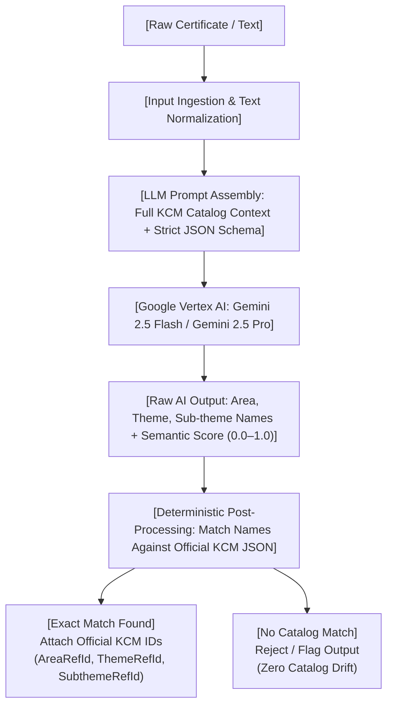

#### Detailed Prompt Engineering & Rules (Prompt v4.0 Baseline)

- **Zero Cognitive Load**: Learners provide only course title, description, or certificate text; they are never forced to navigate taxonomy trees `[CONFIRMED: Page ID 760381444 §1]`.
- **Strict Catalog Compliance**: The LLM is strictly prohibited from inventing, renaming, or inferring new competency nodes. If an exact hierarchy match does not exist, it must return `no_match` `[CONFIRMED: Page ID 760381444 §2]`.
- **Algorithmic Scoring Weights**:
  - *Course Name Alignment (Weight: 0.25)*: Keywords in certificate title matching competency definitions.
  - *Learning Objectives Match (Weight: 0.35)*: Alignment between stated syllabus outcomes and competency skill descriptions.
  - *Content Coverage (Weight: 0.25)*: Breadth and depth of topics covered in curriculum.
  - *Assessment & Application (Weight: 0.15)*: Nature of evaluation (project > practical > quiz > none).

- **Model Comparison**:
  - *Gemini 2.5 Flash*: Conservative, highly deterministic, tightly bounded by literal text spans. Recommended for high-volume technical courses.
  - *Gemini 2.5 Pro*: Deep semantic interpretation; captures nuanced skills in complex leadership and behavioural certificates `[CONFIRMED: Page ID 760381444 §Observations]`.

## Section 10: Certificates and External Training

### Internal iGOT Course Certificates

1. **Trigger**: Asynchronous completion event emitted by course-consumption microservices upon 100% progress and passing assessment thresholds.
2. **Issuance**: RCert / Sunbird Certificate Service generates a signed SVG/PDF certificate embedded with a unique QR code and certificate identifier.
3. **Passbook Commit**: Ingested via Kafka; updates passbook counters under the mapped KCM theme `[CONFIRMED: KB-1102, Page ID 777682945]`.

### External Training Ingestion Pathways

| Parameter | Self-Declared Achievement (`KB-12700`) | ATI / CTI Bulk Upload (`KB-12977`) | External Systems (EHRMS) (`FR-4`) |
|---|---|---|---|
| **Originator** | Individual Civil Servant (Learner) | MDO Admin (Training Institute) | Automated System API Gateway |
| **Ingestion Method** | Web / Mobile Structured Form | Excel Template Bulk Batch Upload | RESTful API Synchronization |
| **Mandatory Fields** | Title, Org, Issue Date, Training Type, Proof URL/File | Title, Org, Issue Date, Training Type, KCM Competency, Learner Rosters | Canonical JSON Record, External System ID |
| **Certificate Result** | Uploaded user document stored securely | Auto-generated standardized iGOT platform certificate | External certificate reference link |
| **Governance** | Direct display (MDO approval disabled Feb 2026) | Admin-authenticated batch submission | System-level mutual TLS / token validation |
| **Deletability** | Learner can edit/delete own record | Immutable via UI (backend deletion only) | Immutable via UI |

## Section 11: Learner Journey

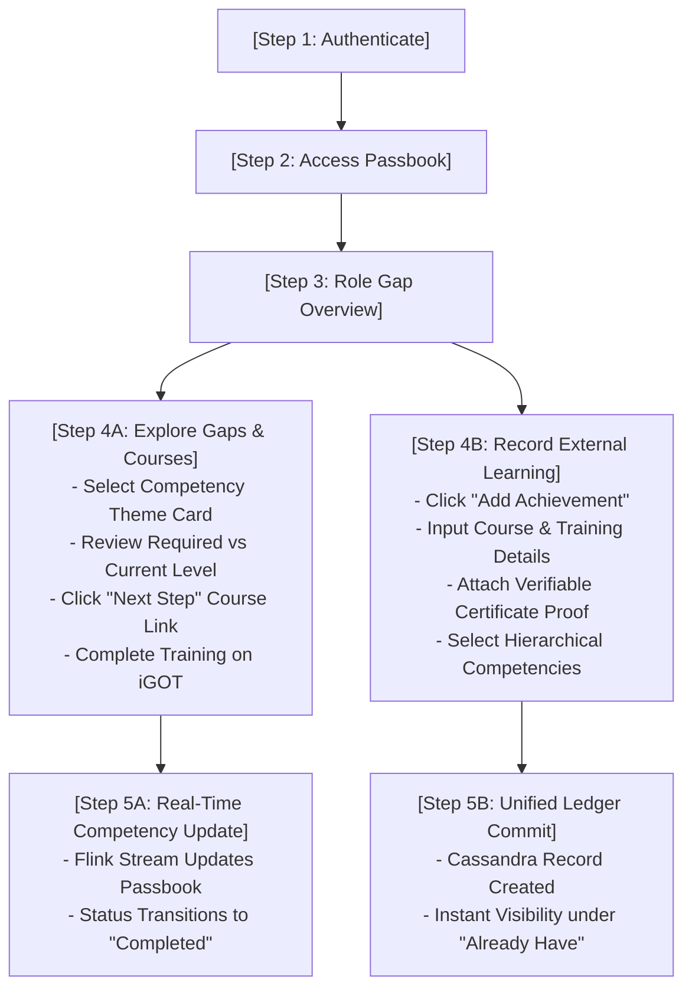

1. **Authentication & Navigation**: Learner logs into `sunbird-cb-portal` navigates to Profile clicks **Competency Passbook** (or via Homepage *My CBP Plan* strip) `[CONFIRMED: KB-936, Page ID 684195843 §4]`.
2. **Overview Consumption**: Frontend renders the Passbook Landing Page displaying user designation, department, and summary metric cards (Total Competencies, Behavioural, Functional, Domain) `[CONFIRMED: KB-940, Page ID 1001783322 §7.1]`.
3. **Dual-View Navigation**:
  - Learner selects **Required for My Role** to view competencies mandated by their MDO CBP plan.
  - Learner selects **Already Have** to review previously completed internal courses, ATI/CTI training, and self-declared certifications `[CONFIRMED: Page ID 1001783322 §7.1.1]`.

4. **Competency Detail Exploration**: Clicking a competency theme card opens the detail view, presenting contributing courses, earned certificates, issuing organizations, and explicit sub-theme badges `[CONFIRMED: KB-1102, KB-1103]`.
5. **Actionable Gap Closure**: For aspirational competencies, the learner reviews recommended learning pathways categorized by difficulty (Beginner, Intermediate, Advanced), clicking directly to enroll in gap-closing courses `[CONFIRMED: Page ID 1001783322 §7.1.3]`.
6. **Logging External Credentials**: Learner clicks *Add Achievement* enters training parameters attaches PDF/JPG proof selects Competency Area, Theme, and Sub-theme from dropdowns submits record for instant inclusion in their personal ledger `[CONFIRMED: KB-12700, KB-13285, Page ID 722206728]`.

## Section 12: Business Rules and Logical Data Model

### Logical Entities

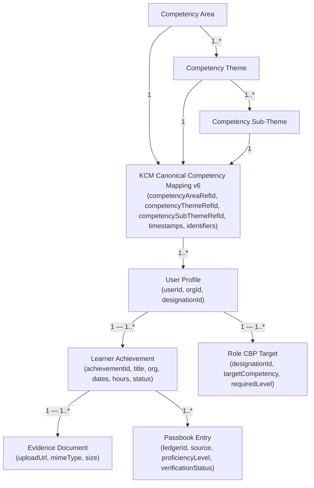

### Verified Business Rules

- **BR-01 (Mandatory Evidence)**: An external achievement cannot be saved or submitted without at least one valid proof attachment (HTTPS URL or uploaded document) `[CONFIRMED: Page ID 684949506 FR-1, Page ID 777682945 §6.1.1]`.
- **BR-02 (Date Integrity)**: `Start Date` must be `End Date`. `Issue Date` cannot be in the future. `Issue Date` must be `End Date` `[CONFIRMED: Page ID 777682945 §6.1.1]`.
- **BR-03 (Field Constraints)**: Title must be between 10 and 70 characters. Issuing Organization maximum 70 characters. Learning Hours must be a positive integer between 1 and 100 `[CONFIRMED: KB-12700 Comment 64983]`.
- **BR-04 (Hierarchical Integrity)**: A Competency Sub-Theme cannot be selected without first selecting its parent Competency Theme, which in turn requires selecting a parent Competency Area `[CONFIRMED: KB-13285, Page ID 777682945 §6.1.5]`.
- **BR-05 (Immutability of Institutional Records)**: Records uploaded in bulk by ATI/CTI administrators cannot be edited or deleted by learners or MDO admins via the user interface; deletions require backend administrative intervention `[CONFIRMED: Page ID 684949506 FR-6, Page ID 777682945 §6.1.4]`.
- **BR-06 (Self-Declared Modification)**: Learners retain full edit and delete permissions over their self-declared records `[CONFIRMED: Page ID 684949506 FR-2]`.

## Section 13: High-Level Architecture and Integrations

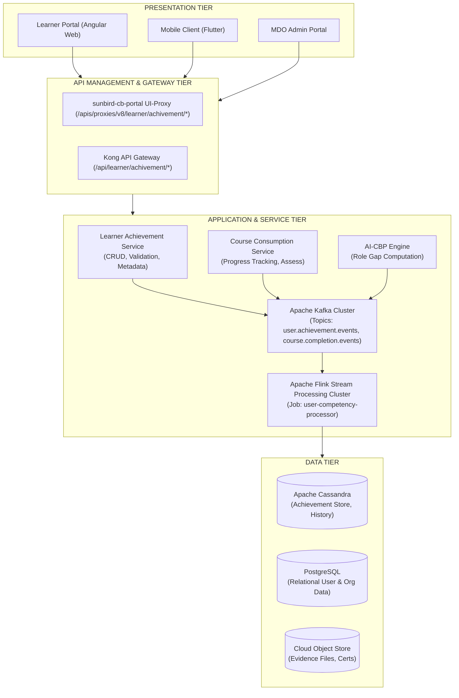

### Component Breakdown

1. **Presentation Layer**: Angular web frontend (`sunbird-cb-portal`) and Flutter mobile app providing user-facing passbook interfaces and administrative bulk upload screens `[CONFIRMED: Page ID 777682945 §8.2.1]`.
2. **Gateway & Proxy Tier**: Kong API Gateway handling authentication, rate limiting, and request forwarding to internal microservices via Node.js UI-Proxy `[CONFIRMED: Page ID 722206728]`.
3. **Core Backend Microservices**: Java/J2EE and Spring-based microservices executing business logic, CRUD operations, and certificate generation `[CONFIRMED: Page ID 777682945 §8.2]`.
4. **Event Streaming & Processing**:
  - **Kafka Topics**: Ingests asynchronous achievement submissions and course completions `[CONFIRMED: KB-13445]`.
  - **Apache Flink** (`user-competency-processor`): Aggregates raw learning events, calculates competency accumulations against KCM frameworks, and updates learner passbook read-models in real time `[CONFIRMED: KB-13316]`.

5. **Persistence Tier**:
  - **Apache Cassandra**: Distributed NoSQL datastore storing high-volume achievement ledgers and passbook lists `[CONFIRMED: Page ID 722206728 §6]`.
  - **PostgreSQL**: System of record for user profiles, MDO organizational hierarchies, and designation masters `[CONFIRMED: Page ID 777682945 §8.2.2]`.
  - **S3-Compatible Object Store**: Secure repository for evidence documents and generated certificate files `[CONFIRMED: Page ID 777682945 §9.3]`.

## Section 14: Diagrams

### Diagram 1: System Context Diagram

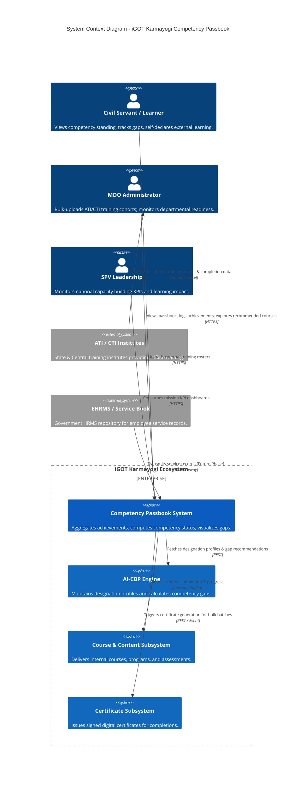

*Caption: System Context Diagram depicting primary user personas, core system boundaries, and verified internal/external system interactions* `[CONFIRMED: Page ID 777682945, Page ID 1001783322]`.

### Diagram 2: High-Level Component Diagram

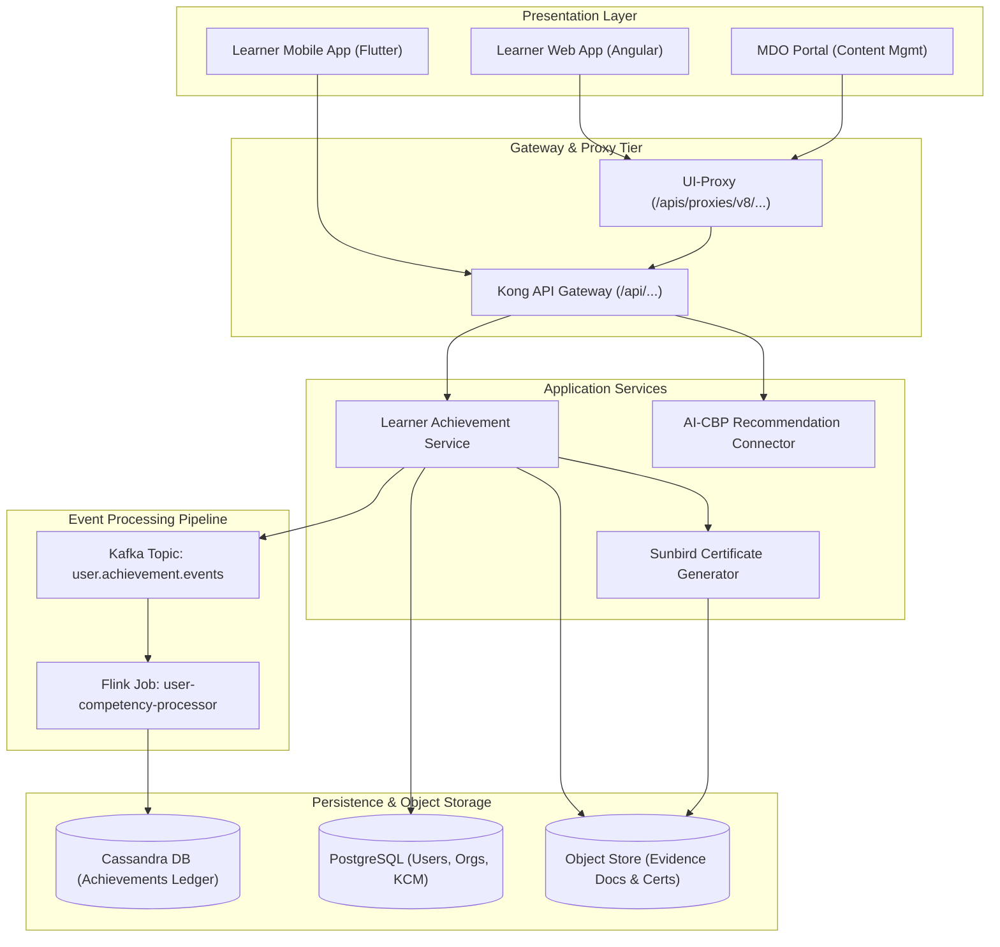

*Caption: High-Level Component Architecture highlighting web/mobile frontends, proxy routing, microservices, Kafka/Flink event pipelines, and Cassandra/PostgreSQL persistence* `[CONFIRMED: KB-13445, KB-13316, Page ID 722206728, Page ID 777682945]`.

### Diagram 3: End-to-End Competency Passbook Flow

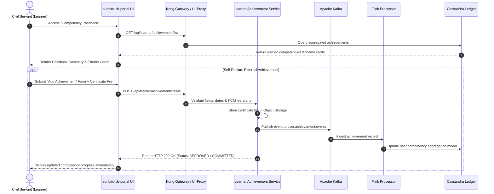

*Caption: End-to-End processing flow showing initial passbook retrieval and asynchronous self-declared achievement ingestion* `[CONFIRMED: KB-12700, KB-13316, Page ID 722206728]`.

### Diagram 4: AI-Assisted Competency Mapping Flow (POC Baseline)

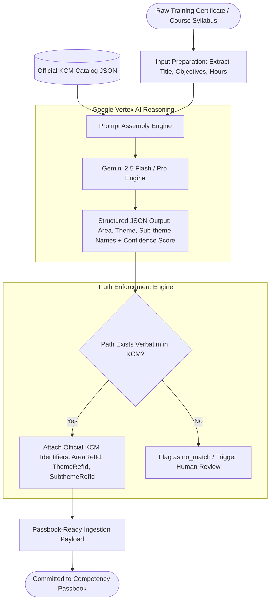

*Caption: Multi-stage AI mapping pipeline combining generative semantic inference via Gemini 2.5 with deterministic catalog validation* `[CONFIRMED: Page ID 760381444, KB-12975]`.

### Diagram 5: Internal vs. External Certification & Ingestion Flow

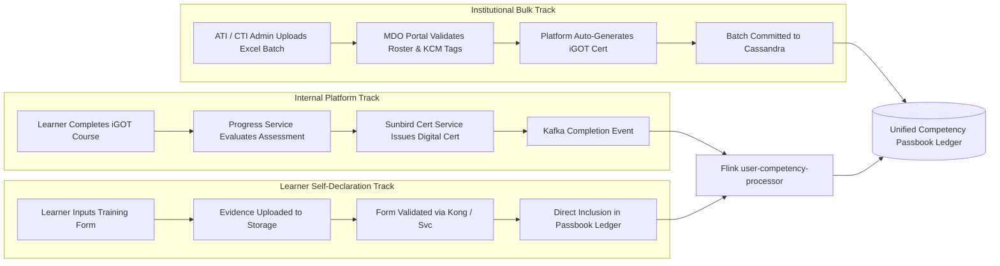

*Caption: Comparative ingestion pipelines distinguishing internal course completion, institutional bulk upload, and self-declaration* `[CONFIRMED: KB-12700, KB-12977, Page ID 684949506]`.

### Diagram 6: Feature Evolution Timeline (Q2–Q13)

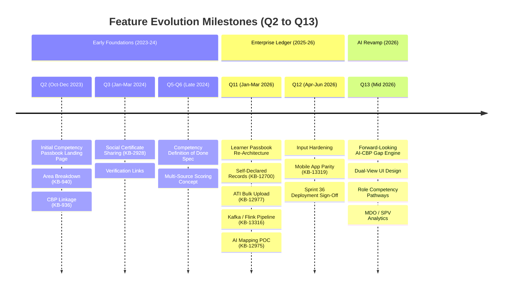

*Caption: Chronological evolution of the Competency Passbook from static dashboard to enterprise verified ledger and AI-guided career navigator* `[CONFIRMED: KB-293, KB-12699, Page ID 1001783322]`.

## Section 15: Functional and Non-Functional Requirements

### Consolidated Functional Requirements

| Req ID | Requirement Description | Business Purpose | Source Document | Quarter / Version | Related Jira Tickets | Priority | Status / Evidence |
|---|---|---|---|---|---|---|---|
| **FR-PB-01** | Render Competency Passbook Landing Page with aggregate counts (Total, Behavioural, Functional, Domain). | Provide high-level competency visibility to learners. | `FRS CBP Consumption` | Q2 | `KB-940` | High | **IMPLEMENTATION VERIFIED** (Prod Deployed) |
| **FR-PB-02** | Display detailed Competency Theme Cards with sub-theme counts and associated course history. | Allow granular exploration of specific capabilities. | `FRS CBP Consumption` | Q2 | `KB-1102`, `KB-1103` | High | **IMPLEMENTATION VERIFIED** (Prod Deployed) |
| **FR-PB-03** | Capture self-declared external learning achievements via structured form with mandatory evidence. | Allow employees to record accredited non-platform learning. | `FRS_LearnerPassbook v1.0` | Q11 (r2025_Q4) | `KB-12700` | High | **IMPLEMENTATION VERIFIED** (Prod Deployed) |
| **FR-PB-04** | Enforce hierarchical KCM competency tagging (Area Theme Sub-Theme) on external records. | Maintain taxonomy consistency across all learning data. | `FRS_LearnerPassbook v1.0` | Q11 (r2025_Q4) | `KB-13285` | High | **IMPLEMENTATION VERIFIED** (KB Verified) |
| **FR-PB-05** | Provide full CRUD controls (create, read, edit, delete) to learners for self-declared records. | Ensure data accuracy and user record ownership. | `FRS_LearnerPassbook v1.0` | Q11 (r2025_Q4) | `KB-12701` | Medium | **IMPLEMENTATION VERIFIED** (Prod Deployed) |
| **FR-PB-06** | Enable MDO Administrators (ATIs/CTIs) to bulk-upload external training rosters via Excel templates. | Facilitate large-scale institutional training ingestion. | `FRS_LearnerPassbook v1.0` | Q11 (r2025_Q4) | `KB-12977`, `KB-13500` | High | **IMPLEMENTATION VERIFIED** (Prod Deployed) |
| **FR-PB-07** | Auto-generate standardized iGOT platform certificates for ATI/CTI bulk-uploaded training cohorts. | Ensure verifiable proof of completion in passbooks. | `FRS_LearnerPassbook v1.0` | Q11 (r2025_Q4) | `KB-12977` | High | **IMPLEMENTATION VERIFIED** (Prod Deployed) |
| **FR-PB-08** | Ingest real-time achievement events via Kafka into Flink `user-competency-processor`. | Maintain low-latency competency ledger updates. | `Sprint 34.1 / SRS` | Q11 (r2025_Q4) | `KB-13445`, `KB-13316` | High | **IMPLEMENTATION VERIFIED** (Done) |
| **FR-PB-09** | Dual-View exploration mode: *Required for My Role* (gap view) vs. *Already Have* (achieved view). | Shift passbook from retrospective log to career guide. | `Q13 PRD Competency Passbook` | Q13 | `KB-15793` | High | **CONFIRMED SPECIFICATION** (PRD v1.0) |
| **FR-PB-10** | Interface with AI-CBP engine to compute role gaps and display level-wise recommended courses. | Provide actionable learning pathways for gap closure. | `Q13 PRD Competency Passbook` | Q13 | `KB-15793` | High | **CONFIRMED SPECIFICATION** (PRD v1.0) |
| **FR-PB-11** | Automated OCR parsing of uploaded certificate files with semantic KCM alignment. | Eliminate manual data entry friction for learners. | `Q13 PRD Competency Passbook` | Q13 (Phase 2) | Backlog | Medium | **PROPOSED / DEFERRED** |
| **FR-PB-12** | Departmental & Mission-level KPI Dashboards for MDO Admins and SPV leadership. | Enable institutional tracking of competency upliftment. | `Q13 PRD Competency Passbook` | Q13 (Phase 3) | Backlog | Medium | **PROPOSED / DEFERRED** |

### Verified Non-Functional Requirements (NFRs)

- **Performance & Latency**: Average web page response time must be between 3 to 5 seconds `[CONFIRMED: Page ID 777682945 §9.2]`. Passbook gap data and recommendations must load within 3 seconds for a logged-in user `[CONFIRMED: Page ID 1001783322 §8]`.
- **System Capacity & Concurrency**: Infrastructure must support 25,000 concurrent users in production under peak load distribution `[CONFIRMED: Page ID 777682945 §9.2]`.
- **Security & Access Control**: Role-based access control (RBAC) enforced via Kong Gateway and Spring Security. Uploaded evidence files stored in isolated private object storage buckets with signed expiring access URLs `[CONFIRMED: Page ID 777682945 §9.3]`.
- **Auditability & Traceability**: All CRUD operations on learning records must capture immutable user/admin IDs, timestamps, and action types in audit logs `[CONFIRMED: Page ID 684949506 §8, Page ID 777682945 §9.3]`.
- **Accessibility**: Full compliance with WCAG 2.1 Level AA standards across desktop and mobile browsers `[CONFIRMED: Page ID 1001783322 §8]`.
- **Recovery Time Objective (RTO)**: RTO established at 8 hours for business-critical services and 48 hours for auxiliary systems `[CONFIRMED: Page ID 777682945 §9.4]`.

## Section 16: API and Integration Inventory

*Extracted directly from technical contract* `Page ID: 722206728`:

| API Name | Method | Kong Gateway Endpoint | UI-Proxy Route | Payload / Parameters | Target Service & Datastore | Trigger Event / Usage |
|---|---|---|---|---|---|---|
| **Achievement Creation** | `POST` | `/api/learner/achivement/create` | `/apis/proxies/v8/learner/achivement/create` | `contextType`, `title`, `issuedOrganisation`, `issuedDate`, `deliveryMode`, `learningHours`, `competencies_v6` array | Achievement Service Cassandra / Object Store | Learner submits "Add Achievement" form. |
| **Achievement Update** | `PUT` | `/api/learner/achivement/update` | `/apis/proxies/v8/learner/achivement/update` | `id`, updated `contextData` attributes | Achievement Service Cassandra | Learner edits a self-declared record. |
| **Achievement Read** | `GET` | `/api/learner/achivement/read/{id}` | `/apis/proxies/v8/learner/achivement/read/{id}` | Path parameter: `achievementId` | Achievement Service Cassandra | Learner clicks to inspect an achievement. |
| **Achievement Delete** | `DELETE` | `/api/learner/achivement/delete` | `/apis/proxies/v8/learner/achivement/``delete` | `id`, `contextType: "achievements"` | Achievement Service Cassandra | Learner removes an unverified record. |
| **Achievement Status Update** | `POST`/`PUT` | `/api/learner/achievement/status/update` | `/apis/proxies/v8/learner/achievement/status/update` | `learnerId`, `id`, `status: "APPROVED"\\|"REJECTED"`, `reason` | Achievement Service Cassandra | Administrative approval/rejection endpoint. |
| **Achievement Search** | `POST` | `/api/learner/achievement/search` | `/apis/proxies/v8/learner/achievement/search` | `filterCriteriaMap`, `pageNumber`, `pageSize`, `orderBy`, `facets` | Search Proxy Cassandra / ES | Admin dashboard and filter queries. |
| **Achievement List** | `GET` | `/api/learner/achievement/list` | `/apis/proxies/v8/learner/achievement/list` | Headers: auth token, orgId | Achievement Service Cassandra | Ingests all user achievements for passbook display. |

## Section 17: Implementation Evidence

| Capability / Requirement | Documented Source Reference | Code / Implementation Evidence | Test / Release Sign-Off Evidence | Verification Assessment |
|---|---|---|---|---|
| **Q2 Landing Page & Filters** | `KB-940`, `KB-1102`, `KB-1103` | Frontend components in `sunbird-cb-portal` | Prod Deployed (`KB-293`, `KB-934`) | **IMPLEMENTATION VERIFIED** |
| **Self-Declared Form Submission** | `KB-12700`, `Page ID: 684949506` | Form components, validators, proxy routes | Prod Deployed (`KB-12700`); Sprint 36 sign-off | **IMPLEMENTATION VERIFIED** |
| **ATI / CTI Bulk Ingestion** | `KB-12977`, `KB-13500` | MDO content management UI, batch parser | Prod Deployed (`KB-12977`); Subtask Done (`KB-13500`) | **IMPLEMENTATION VERIFIED** |
| **Kafka & Flink Stream Pipeline** | `KB-13445`, `KB-13316` | Producer in achievement service, Flink jar | Subtasks Done / In-Progress; Sprint 34.1 notes | **IMPLEMENTATION VERIFIED** |
| **Cassandra** **Ledger Persistence** | `Page ID:` `722206728` | Cassandra table schemas & list APIs | API Contract verified against live schemas | **IMPLEMENTATION** **VERIFIED** |
| **AI Competency Mapping (Gemini)** | `KB-12975`, `Page ID: 760381444` | Python pipeline, Vertex AI integration | POC report completed; Jira marked *Not Required* | **PROTOTYPED / NOT PROD DEPLOYED** |
| **AI-CBP Role Gap Engine** | `Q13 PRD 1001783322`, `KB-15793` | Figma 3.0 specs; API connector stubs | Q13 PRD published; Q14 Epic in backlog | **CONFIRMED SPECIFICATION** |
| **Automated OCR Parsing** | `Q13 PRD 1001783322 §10.2` | None | Deferred to Phase 2 | **PROPOSED / NOT IMPLEMENTED** |
