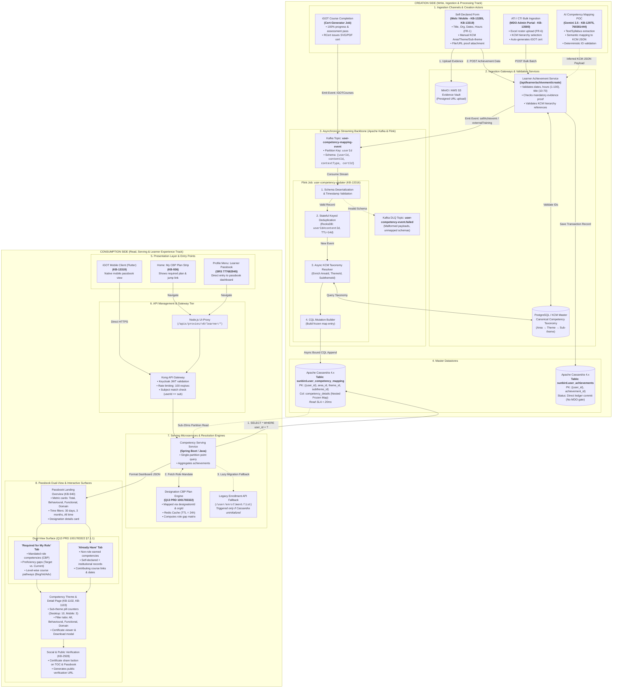
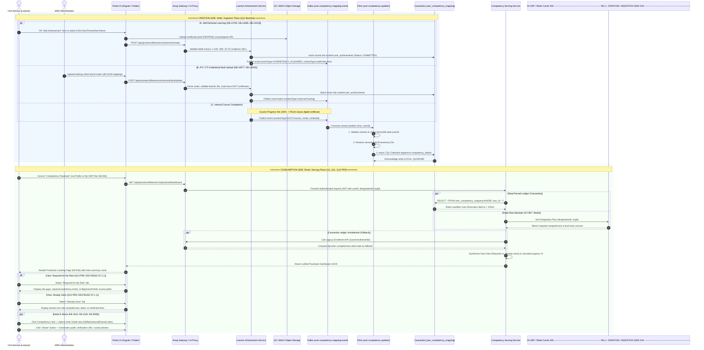

# Competency Passbook — Low-Level Design (LLD)

This Low-Level Design (LLD) covers the **complete end-to-end architecture** across both the **Creation Side** (Write / Ingestion / Pipeline) and the **Consumption Side** (Read / Serving / UI), synthesized strictly from the supplied Q2, Q11, and Q13 specifications and Jira work items—**excluding all Q14 items**.

### Referenced Scope & Traceability

- **Q2 Baseline (Consumption Foundation)**: `KB-293`, `KB-936`, `KB-940`, `KB-1102`, `KB-1103`, `KB-2928` (CBP Plan, Passbook Landing Page, Theme Cards, Category Tabs, Social Share).
- **Q11 Baseline (Enterprise Ingestion & Streaming Ledger)**: `KB-12698`, `KB-12699`, `KB-12975`, `KB-13285`, `KB-13319`, `KB-13500`, `BRD 684195843`, `FRS 684949506`, `SRS 777682945`, `Tech Spec 705757206`, `AI Mapping 760381444`.
- **Q13 Baseline (Designation CBP Gap Analysis & Dual-View)**: `Q13 PRD 1001783322`, `WIP Spec 172261415`, `PRD 1376190477`.

### Complete End-to-End LLD Diagram (Creation & Consumption)

### End-to-End Sequence Diagram (Creation vs. Consumption)

### Low-Level Component Reference Matrix

| Subsystem | Component | Implementation Detail & Link Source Reference |
|---|---|---|
| **Creation (Write)** | **Self-Achievement Service** | Structured web/mobile entry form; enforces title (10–70 chars), hours (1–100), issue date constraints, and mandatory evidence upload. Implements direct ledger commit without MDO blocking approval. References: `KB-12700`, `KB-13285`, `KB-13319`, `FRS 684949506 FR-1`, `SRS 777682945 §6.1.1`. |
| **Creation (Write)** | **ATI / CTI Bulk Ingestion** | MDO portal interface allowing administrators to upload training rosters with KCM taxonomy tags; auto-issues platform-verified iGOT certificates. References: `KB-12977`, `KB-13500`, `FRS 684949506 FR-6`, `SRS 777682945 §6.1.4`. |
| **Creation (Write)** | **AI Mapping Automation** | Evaluates Gemini 2.5 Flash/Pro pipeline to match raw certificate/syllabus text against official KCM catalog JSON, validating exact reference IDs before attachment. References: `KB-12975`, `Tech Spec 760381444`. |
| **Creation (Stream)** | **Kafka & Flink Engine** | Topic `user-competency-mapping-event` partitioned by `userId`. Flink job `user-competency-updater` performs schema check, RocksDB deduplication (14d TTL), KCM resolution, and non-blocking Cassandra collection appends. References: `KB-13316`, `KB-13445`, `SRS 777682945 §8.2`. |
| **Storage (Ledger)** | **Cassandra Ledger** | `sunbird.user_competency_mapping` keyed on `((user_id), competency_area_id, competency_theme_id, competency_subtheme_id)` to keep each learner's record on a single partition for sub-20ms reads. References: `Tech Spec 777781250`, `API Contract 722206728`. |
| **Consumption (Read)** | **Passbook Landing & Summary** | Landing page displaying total competency counts, Area breakdown (Behavioural, Functional, Domain), time filters, and designation details. References: `KB-940`, `KB-936`, `FRS CBP 18841695`. |
| **Consumption (Read)** | **Dual-View Synthesis** | Synthesizes *Required for My Role* (gap analysis using designation plans from AI-CBP) vs. *Already Have* (earned credentials beyond role scope). References: `Q13 PRD 1001783322 §7.1.1`, `PRD 1376190477`. |
| **Consumption (Read)** | **Theme Cards & Sharing** | Detailed cards showing sub-theme pills, contributing courses, certificates, category filtering (All/Behavioural/Functional/Domain), and social sharing links. References: `KB-1102`, `KB-1103`, `KB-2928`. |
