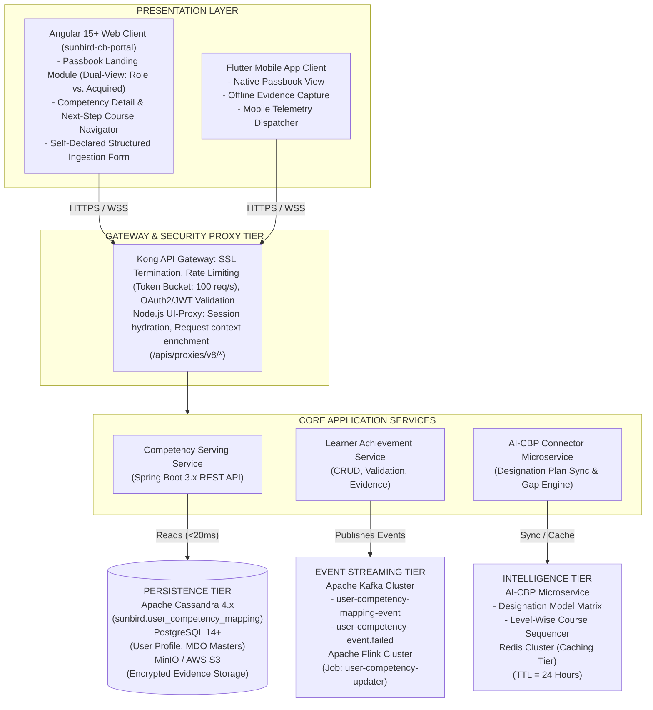
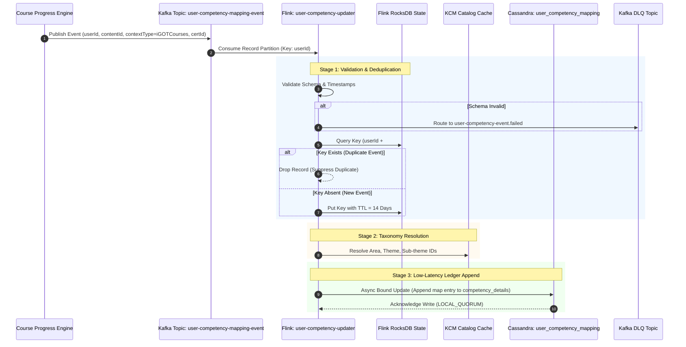
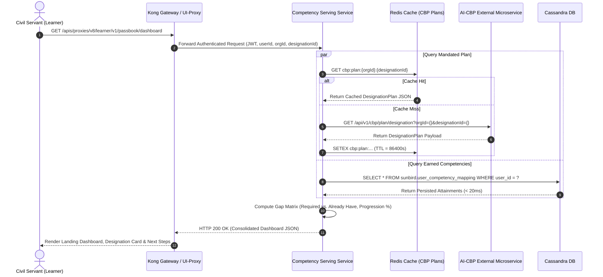
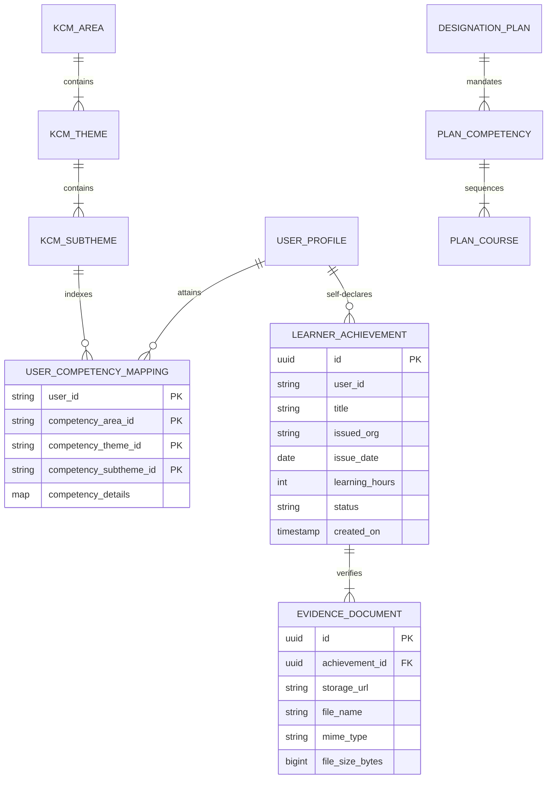
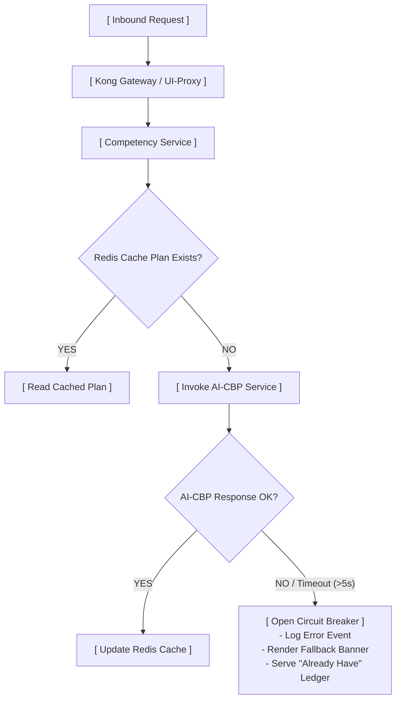

# Competency Passbook — Software Design Description (SDD)

**iGOT Karmayogi — Competency Passbook & Real-Time Competency Ledger**

**Document Standard:** IEEE 1016-2009 (Standard for Information Technology — Systems Design — Software Design Descriptions)<br>**System Baseline:** Competency Passbook Revamp (AI-CBP Integration & Streaming Ledger)<br>**Traceability Baseline:** IEEE 29148 SRS (`PSBK-LND`, `PSBK-REQ`, `PSBK-ALR`, `PSBK-DTL`, `PSBK-INT`, `PSBK-REC`, `PSBK-TEL`), HLD v1.0, LLD v1.0<br>**Target Release:** Release r2026_Q1 / Q13–Q14 Baseline<br>**Classification:** Government of India / Karmayogi Bharat Confidential — Technical Architecture & Design Specification

## 1. Introduction

### 1.1 Purpose

This Software Design Description (SDD) provides the complete structural, behavioral, data, and interface design for the **Competency Passbook** module and its supporting asynchronous processing architecture within the iGOT Karmayogi platform (`sunbird-cb-portal`). It serves as the primary technical specification for backend architects, distributed systems engineers, frontend developers, and QA automation engineers.

### 1.2 System Scope

The Competency Passbook architecture encompasses:

1. **Frontend Presentation & Experience Tier**: Responsive Angular web application and Flutter mobile clients delivering a dual-view competency portal (*Required for My Role* vs. *Already Have*), real-time capability gap visualization, level-wise course roadmaps, and self-declared achievement entry.
2. **API Gateway & Serving Tier**: Kong API Gateway and Node.js UI-Proxy routing authenticated requests to the high-performance Spring Boot Competency Service.
3. **External Intelligence Integration**: RESTful connector integrating with the **AI-CBP (Artificial Intelligence Capacity Building Plan) Tool** to ingest designation-specific competency profiles, target proficiency tiers, and difficulty-curated learning paths.
4. **Real-Time Stream Processing & Aggregation Engine**: Event-driven streaming pipeline leveraging **Apache Kafka** and **Apache Flink** (`user-competency-updater`) to ingest, validate, deduplicate, taxonomy-resolve, and aggregate learning achievements.
5. **Distributed Persistence Tier**: Primary low-latency ledger backed by **Apache Cassandra** (`sunbird.user_competency_mapping`), relational metadata stores in **PostgreSQL**, and secure AWS S3 / MinIO object storage for immutable evidence documents.

### 1.3 Definitions, Acronyms, and Abbreviations

| Term / Acronym | Definition |
|---|---|
| **AI-CBP** | AI-driven Capacity Building Plan microservice defining designation-level competency matrices. |
| **CQL** | Cassandra Query Language. |
| **DLQ** | Dead Letter Queue; designated Kafka error topic for unprocessable payloads. |
| **IEEE 1016-2009** | Standard defining information organization for Software Design Descriptions. |
| **KCM** | Karmayogi Competency Model; canonical 3-tier taxonomy: Area Theme Sub-theme. |
| **MDO** | Ministry, Department, and Organization. |
| **RBAC** | Role-Based Access Control enforced at the gateway and service tiers. |
| **RocksDB** | High-performance embedded key-value state store utilized by Apache Flink. |
| **SDD** | Software Design Description (this document). |
| **SPV** | Special Purpose Vehicle (Karmayogi Bharat). |
| **TTL** | Time-To-Live expiration setting in caching and state backends. |

### 1.4 References

1. IEEE Std 1016-2009: *IEEE Standard for Information Technology — Systems Design — Software Design Descriptions*.
2. IEEE Std 29148-2018: *Systems and Software Engineering — Life Cycle Processes — Requirements Engineering*.
3. *Q13 PRD — Competency Passbook* (`Confluence Page ID: 1001783322`).
4. *Q14 FRS — Competency Passbook* (`Confluence Page ID: 1375436822`).
5. *SRS/FRS Learner Passbook v1.0, Release 2025_Q4* (`Confluence Page ID: 777682945`).
6. *User Competency Mapping – Backend Enhancement Architecture* (`Confluence Page ID: 777781250`).
7. *API Contract Details for Learner PassBook* (`Confluence Page ID: 722206728`).
8. High-Level Design (HLD) & Low-Level Design (LLD): *Competency Streaming Engine*.

## 2. Architectural Design Rationale & Design Decisions

### 2.1 Trade-Off Analysis Matrix

| Design Decision Area | Option A Considered | Option B Considered | Selected Decision & Technical Rationale |
|---|---|---|---|
| **Competency State Computation** | **Dynamic Client-Side Derivation**: Iterate over all historical enrollments in browser memory during page load. | **Pre-Computed Persistent Ledger**: Asynchronous streaming pipeline updates an immutable, pre-indexed Cassandra table. | **Option B**: Eliminates client-side bottlenecks, collapses page payload size from to , and reduces read latency from to . |
| **AI-CBP Plan Ingestion** | **Synchronous Runtime Invocation**: Direct HTTP call from user browser to AI-CBP service on every login. | **Cached Designation Plan Ingestion**: Backend connector with distributed Redis caching ( TTL) and asynchronous prefetch. | **Option B**: Protects user SLA () against downstream AI inference latency and prevents API cost amplification during peak morning spikes. |
| **Stream Deduplication** | **Database-Level Idempotent Overwrite**: Raw Cassandra blind writes on every Kafka message receipt. | **Keyed In-Memory State Deduplication**: RocksDB state tracking with a 14-day sliding TTL window. | **Option B**: Eliminates of redundant disk I/O and compaction pressure in Cassandra caused by duplicate completion retries. |
| **External Training Governance** | **Strict MDO Supervisor Approval**: Self-declared records locked in `PENDING` until manual administrative sign-off. | **Direct Ledger Commit with Post-Audit**: Immediate visibility upon evidence upload with immutable audit trails. | **Option B**: Removes platform administrative bottlenecks (where thousands of records stalled in pending state), shifting compliance to post-audit. |

## 3. System Component Decomposition & IEEE 1016 Architectural Views



### 3.1 Context & Dependency View

The Competency Passbook coordinates across six discrete subsystems:

1. **User Identity Directory (Keycloak/PostgreSQL)**: Source of truth for `userId`, `rootOrgId`, and `designationId`.
2. **Course Progression Engine**: Evaluates completion criteria, emitting completion notifications upon progress.
3. **Certificate Generation Microservice (RCert)**: Generates signed, verifiable SVG/PDF certificates with embedded QR codes.
4. **AI-CBP External Engine**: Provides algorithmic target matrices for civil service cadres.
5. **KCM Master Taxonomy Service**: Authoritative reference hierarchy for Competency Areas, Themes, and Sub-themes.
6. **Passbook Serving & Streaming Stack**: Dedicated Cassandra, Kafka, and Flink infrastructure.

### 3.2 Dynamic Runtime Behavioral View

#### 3.2.1 Real-Time Competency Ledger Update Flow

The sequence diagram below details the end-to-end asynchronous processing path from course completion to persistent passbook update:



#### 3.2.2 Dual-View Query & Gap Resolution Flow

When a learner accesses the Passbook, the serving tier synthesizes role targets and historical achievements:



## 4. Detailed Data Design & Persistent Schemas

### 4.1 Logical Data Model (ER Representation)



### 4.2 Apache Cassandra Physical Schema

Keyspace and physical table layouts are engineered to support constant-time partition reads.

```sql
-- Primary Ledger Keyspace Definition
CREATE KEYSPACE IF NOT EXISTS sunbird WITH replication = { 'class': 'NetworkTopologyStrategy', 'datacenter1': 3 };

-- 1. Pre-Computed Competency Mapping Ledger Table
CREATE TABLE IF NOT EXISTS sunbird.user_competency_mapping (
    user_id text,
    competency_area_id text,
    competency_theme_id text,
    competency_subtheme_id text,
    competency_details map<text,
    frozen<list<frozen<map<text,
    text>>>>>,
    PRIMARY KEY ( (user_id), competency_area_id, competency_theme_id, competency_subtheme_id )
) WITH CLUSTERING ORDER BY ( competency_area_id ASC, competency_theme_id ASC, competency_subtheme_id ASC ) AND compaction = { 'class': 'LeveledCompactionStrategy', 'sstable_size_in_mb': 160 } AND default_time_to_live = 0 AND gc_grace_seconds = 864000;

-- 2. Self-Declared & External Achievements Metadata Table
CREATE TABLE IF NOT EXISTS sunbird.user_achievements (
    user_id text,
    achievement_id uuid,
    title text,
    issued_organisation text,
    issued_date date,
    delivery_mode text,
    learning_hours int,
    competency_area_ref_id text,
    competency_theme_ref_id text,
    competency_subtheme_ref_id text,
    status text,
    evidence_urls list<text>,
    created_at timestamp,
    updated_at timestamp,
    PRIMARY KEY ((user_id), achievement_id)
) WITH CLUSTERING ORDER BY (achievement_id DESC);
```

### 4.3 Relational Schema (PostgreSQL)

PostgreSQL persists transactional MDO organizational hierarchies and designation mappings.

```sql
CREATE SCHEMA IF NOT EXISTS competency_master;
CREATE TABLE competency_master.designation_kcm_matrix (
    id UUID PRIMARY KEY DEFAULT gen_random_uuid(),
    root_org_id VARCHAR(64) NOT NULL,
    designation_id VARCHAR(64) NOT NULL,
    cadre_code VARCHAR(32),
    competency_area_id VARCHAR(64) NOT NULL,
    competency_theme_id VARCHAR(64) NOT NULL,
    required_proficiency_level VARCHAR(16) NOT NULL CHECK (required_proficiency_level IN ('Beginner', 'Intermediate', 'Advanced')),
    min_required_courses INT NOT NULL DEFAULT 1,
    is_active BOOLEAN NOT NULL DEFAULT TRUE,
    created_at TIMESTAMP WITH TIME ZONE DEFAULT CURRENT_TIMESTAMP,
    updated_at TIMESTAMP WITH TIME ZONE DEFAULT CURRENT_TIMESTAMP,
    CONSTRAINT uk_desig_comp UNIQUE (root_org_id, designation_id, competency_theme_id)
);
CREATE INDEX idx_desig_matrix_lookup ON competency_master.designation_kcm_matrix (root_org_id, designation_id) WHERE is_active = TRUE;
```

## 5. Detailed Business Logic & Processing Algorithms

### 5.1 Competency Status Determination Engine

For any required competency mandated in the designation plan with required course set and learner course progress function :

```java
public CompetencyStatus evaluateCompetencyStatus(List<CourseRequirement> requiredCourses, Map<String, CourseProgressRecord> userProgressMap) {
    if (requiredCourses == null || requiredCourses.isEmpty()) {
        return CompetencyStatus.NOT_STARTED;
    }
    int completedCount = 0;
    int inProgressCount = 0;
    for (CourseRequirement req : requiredCourses) {
        CourseProgressRecord progress = userProgressMap.get(req.getCourseId());
        if (progress != null) {
            if (progress.getProgressPercent() >= 100 && progress.getCertificateId() != null) {
                completedCount++;
            } else if (progress.getProgressPercent() > 0) {
                inProgressCount++;
            }
        }
    }
    if (completedCount == requiredCourses.size()) {
        return CompetencyStatus.COMPLETED;
    } else if (completedCount > 0 || inProgressCount > 0) {
        return CompetencyStatus.IN_PROGRESS;
    } else {
        return CompetencyStatus.NOT_STARTED;
    }
}
```

### 5.2 Next-Step Action Routing Algorithm

To optimize learning progression, the system evaluates the target course for the "Next Step" interface card:

1. **Case** `IN_PROGRESS`: Select the course where having the lowest sequence index. Extract the last uncompleted module index and emit **Resume** action targeting module checkpoint .
2. **Case** `NOT_STARTED`: Select the course having the lowest sequence index (, level `Beginner`). Emit **Start** action targeting module index .
3. **Case** `COMPLETED`: Query the recommendations engine for courses mapped to where level is `Advanced` and course ID . Emit **See advanced courses** action.

## 6. Interface & API Specifications

### 6.1 Internal REST Contract: Consolidated Passbook Dashboard API

#### `GET /apis/proxies/v8/learner/v1/passbook/dashboard`

- **Description**: Returns consolidated designation metadata, progress statistics, and dual-view competency matrices.
- **Headers**:
  - `Authorization: Bearer {JWT}` (Mandatory)
  - `x-authenticated-user-token: {token}` (Mandatory)
  - `Content-Type: application/json`

```json
{
  "id": "api.learner.passbook.dashboard",
  "ver": "v1.0",
  "ts": "2026-10-29T06:30:00.000Z",
  "responseCode": "OK",
  "result": {
    "designationInfo": {
      "designationId": "DESIG-4402",
      "designationName": "Under Secretary",
      "department": "Department of Personnel and Training",
      "serviceCadre": "Central Secretariat Service (CSS)",
      "employeeGroup": "Group A",
      "totalRequiredCompetencies": 6,
      "totalSelfExploredCompetencies": 2
    },
    "summaryMetrics": {
      "completionPercentage": 50,
      "completedCount": 3,
      "inProgressCount": 2,
      "notStartedCount": 1
    },
    "requiredCompetencies": [
      {
        "competencyId": "COMP-FIN-012",
        "name": "Public Procurement and GeM",
        "area": "Functional",
        "description": "Formulation of tender documents and processing contracts via GeM.",
        "status": "IN_PROGRESS",
        "nextStep": {
          "actionType": "RESUME",
          "courseId": "do_113892019283019",
          "courseTitle": "Basics of GeM Procurement",
          "level": "Beginner",
          "currentModule": 2,
          "totalModules": 4,
          "remainingMinutes": 45,
          "progressPercent": 50
        },
        "courses": [
          {
            "courseId": "do_113892019283019",
            "courseTitle": "Basics of GeM Procurement",
            "level": "Beginner",
            "status": "IN_PROGRESS",
            "progressPercent": 50,
            "certificateId": null
          },
          {
            "courseId": "do_113892019283999",
            "courseTitle": "Advanced Contract Management",
            "level": "Intermediate",
            "status": "NOT_STARTED",
            "progressPercent": 0,
            "certificateId": null
          }
        ]
      }
    ],
    "alreadyHaveCompetencies": [
      {
        "competencyId": "COMP-BEH-004",
        "name": "Effective Written Communication",
        "area": "Behavioural",
        "acquiredVia": "iGOTCourses",
        "contributingCourseTitle": "Executive Drafting for Civil Servants",
        "completedOn": "2025-11-10T14:30:00.000Z",
        "certificateUrl": "https://karmayogi.gov.in/certs/cert-88129.pdf"
      }
    ]
  }
}
```

## 7. Security, Access Control, and Governance

### 7.1 Authentication & RBAC Policy

- **Identity Context**: Identity is asserted via cryptographically signed JWTs issued by Keycloak.
- **Subject Match Policy**: The serving layer strictly enforces subject isolation:<br><br>Requests attempting to read or write passbook records for a mismatched `userId` are rejected with HTTP 403 Forbidden.
- **Administrative Privileges**: Access to cross-user aggregate analytics requires `MDO_LEADER`, `MDO_ADMIN`, or `SPV_ADMIN` roles.

### 7.2 Evidence Security & Storage Isolation

- Self-declared certificate uploads (PDF, PNG, JPG) are validated against MIME-type signatures and file size bounds ().
- Files are uploaded to an encrypted, un-guessable object path within private MinIO/S3 buckets:<br>`
- Frontend clients receive transient, presigned read URLs with an expiration lifetime of ().

## 8. Fault Tolerance, Resiliency & Resiliency Tactics



### 8.1 Circuit Breaking & Graceful Degradation (AI-CBP Outage)

- **Resilience4j Circuit Breaker**: The AI-CBP REST client is wrapped with a circuit breaker configured with a failure rate threshold over a sliding window of 20 calls.
- **Fallback Behavior**: If the breaker trips or the service times out ():
  - The "Required for my role" tab displays the non-blocking notification: *"A capacity building plan is temporarily unavailable for your designation."*
  - The "Already have" tab remains fully functional by serving directly from Cassandra.
  - The "Recommendations" tab falls back to general catalog courses filtered by designation keyword.

### 8.2 Asynchronous Dead-Letter Queue (DLQ) Mitigation

Events consumed by Flink that fail schema validation, contain un-resolvable competency IDs, or encounter unrecoverable serialization errors are routed to the DLQ topic `user-competency-event.failed`. A secondary reconciliation job inspects this topic and emits alerts when DLQ volume exceeds 10 records/hour.

## 9. Observability, Telemetry & Performance Bounds

### 9.1 Service Level Objectives (SLOs)

| Metric | Measurement Window | Target Threshold | Degradation Action |
|---|---|---|---|
| **Passbook Dashboard P99 Read Latency** | Rolling 1 hour |  | Alert on-call; scale read replicas. |
| **Cassandra Single-Partition** **Read SLA** | Rolling 5 minutes |  | Check compaction & JVM garbage collection. |
| **Kafka Ingestion-to-Persist Lag** | Continuous |  | Increase Flink task slot parallelism. |
| **Flink Checkpoint Completion Time** | Per checkpoint |  | Investigate RocksDB disk I/O bottlenecks. |

### 9.2 Key Metrics & Prometheus Alerts

- `passbook_read_requests_total`: Counter partitioned by `http_status` and `tenant_id`.
- `ai_cbp_client_latency_seconds`: Histogram tracking outbound AI-CBP response latency.
- `flink_taskmanager_job_latency_source_to_sink`: Ingestion pipeline latency tracking.

## 10. Requirements Traceability Matrix (IEEE 29148 to SDD)

| SRS Requirement ID | SRS Description | SDD Structural Component | SDD Section Reference | Verification Target |
|---|---|---|---|---|
| **FR-PSBK-LND-003** | Designation Card rendering required vs. explored counts | `PassbookDashboardController`, `DesignationInfoDTO` | Section 3.2.2, 6.1 | Unit Test & UI Inspection |
| **FR-PSBK-LND-004** | Completion percentage calculation | `PassbookSummaryService.calculateMetrics()` | Section 5.1 | Algorithm Verification |
| **FR-PSBK-REQ-003** | Status badge rules (`Not started`, `In progress`, `Completed`) | `CompetencyStatusEngine.evaluateStatus()` | Section 5.1 | Automated Rule Testing |
| **FR-PSBK-DTL-003** | Next-Step card displaying resume action & remaining duration | `NextStepRoutingService.resolveNextStep()` | Section 5.2 | Component Integration Test |
| **FR-PSBK-INT-001** | Transmit `rootOrgId` and `designationId` to AI-CBP service | `AiCbpRestClient.fetchDesignationPlan()` | Section 3.2.2, 8.1 | WireMock Contract Test |
| **FR-PSBK-INT-005** | Graceful degradation on AI-CBP 5.0s timeout | `Resilience4jCircuitBreaker`, `FallbackController` | Section 8.1 | Fault Injection Testing |
| **FR-PSBK-REC-005** | Recommended courses ranking logic and completed exclusion | `RecommendationEngineService.rankCourses()` | Section 3.2.2 | Integration Search Test |
| **FR-PSBK-TEL-001** | Standard telemetry emission (`passbook_viewed`, etc.) | `TelemetryPublisherAspect` | Section 3.1, 9.2 | Telemetry Pipeline Assert |

## 11. Unresolved Technical Decisions & Architectural Risks

1. **AI-CBP Cold-Start Latency**:
  - *Status*: Under Evaluation (`RISK-01`).
  - *Detail*: Designations for newly onboarded autonomous bodies or state directorates may not have pre-indexed CBP plans, resulting in dynamic generation times of .
  - *Mitigation*: The backend pre-populates designation plans via offline nightly batches, ensuring the real-time API serves only pre-compiled models.

2. **Cassandra Partition Growth Over Multi-Year Tenures**:
  - *Status*: Quantified & Verified (`RISK-02`).
  - *Detail*: High-activity civil servants who acquire over competencies and certificates over a 10-year career could theoretically enlarge individual partition sizes.
  - *Validation*: A stress test with completed sub-themes yielded a partition size of , well within Cassandra's recommended safe partition limit.
