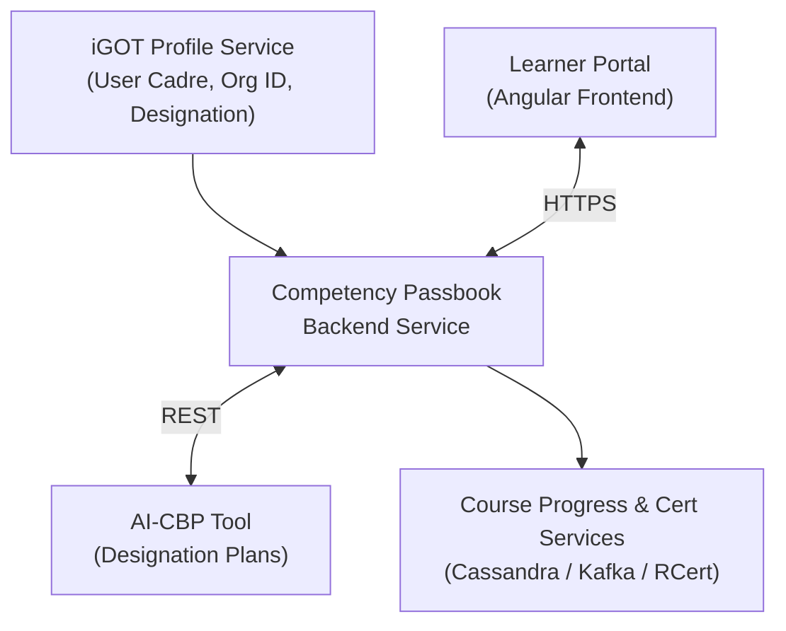

# Competency Passbook — Software Requirements Specification (SRS)

**iGOT Karmayogi — Competency Passbook Revamp**

## 1. Introduction

### 1.1 Purpose

This Software Requirements Specification (SRS) establishes the formal, binding technical and functional requirements for the **Competency Passbook Revamp** within the iGOT Karmayogi digital learning infrastructure (`sunbird-cb-portal`). It specifies the software behaviors, user-interface workflows, external microservice interfaces, telemetry contracts, data validation rules, and non-functional quality attributes governing the integration between the **Learner Portal** and the **AI-CBP (Artificial Intelligence Capacity Building Plan) Tool**.

### 1.2 Scope

The scope of this software release encompasses:

1. Revamping the civil servant learner interface from a retrospective completion log into an interactive, role-aligned competency navigation engine.
2. Direct integration with the AI-CBP microservice to retrieve designation-mandated competency frameworks, required course catalogs, and difficulty-sequenced learning paths.
3. Dual-view competency exploration (*Required for My Role* vs. *Already Have*).
4. Automated progression tracking, status determination, and "Next Step" actionable course routing.
5. Unified catalog-wide course recommendation and multidimensional filtering.
6. Client-side and server-side telemetry capture for learning analytics and KPI reporting.

Explicitly excluded from the scope of this baseline release are:

- Native self-assessment test engines ("Start test" / "Retake test" workflows).
- Direct OCR extraction of uploaded external certificates in the active UI.
- In-progress attainment attestation badges by MDO supervisors.
- Bi-directional synchronization with external HRMS (e.g., SPARROW, EHRMS).

### 1.3 Definitions, Acronyms, and Abbreviations

| Term / Acronym | Definition |
|---|---|
| **AI-CBP Tool** | Standalone AI-powered microservice that generates and maintains Capacity Building Plans per Ministry, Department, and Designation. |
| **BRD** | Business Requirements Document. |
| **CBP** | Capacity Building Plan; a structured mandate specifying the competency mix required for a civil service position. |
| **FRS** | Functional Requirements Specification. |
| **iGOT** | Integrated Government Online Training platform (Karmayogi Bharat). |
| **KCM** | Karmayogi Competency Model; the 3-tier taxonomy of Competency Area, Theme, and Sub-theme. |
| **MDO** | Ministry, Department, and Organization. |
| **NFR** | Non-Functional Requirement. |
| **RBAC** | Role-Based Access Control. |
| **SPV** | Special Purpose Vehicle (Karmayogi Bharat). |
| **SRS** | Software Requirements Specification (IEEE 29148). |
| **TBD** | To Be Determined; indicates an exact numerical or technical boundary requiring final operational sign-off. |
| **UI/UX** | User Interface / User Experience. |

### 1.4 References

1. *Q13 PRD — Competency Passbook*, Karmayogi Bharat Technical Documentation (`Confluence Page ID: 1001783322`).
2. *Q14 FRS — Competency Passbook*, Karmayogi Bharat Technical Documentation (`Confluence Page ID: 1375436822`).
3. *Q14 BRD — Competency Passbook*, Karmayogi Bharat Business Analysis (`Confluence Page ID: 1375141911`).
4. *SRS/FRS Learner Passbook v1.0, Release 2025_Q4*, Technical Architecture (`Confluence Page ID: 777682945`).
5. *API Contract Details for Learner PassBook*, Architecture Interface Contract (`Confluence Page ID: 722206728`).
6. *Automating Competency Mapping with AI for Course Certificates and Passbook Generation* (`Confluence Page ID: 760381444`).
7. Jira Epic `KB-15793` (*Q14 | Competency Passbook*) and child user stories `KB-16062` through `KB-16081`.
8. Figma Design Workspace: *Competency Passbook 3.0* (`node-id=286-2`).

## 2. Overall Description

### 2.1 Product Perspective

The Competency Passbook functions as a core module of the `sunbird-cb-portal` frontend web application and the Flutter mobile client. It interfaces with upstream identity and profile directories, downstream course-consumption trackers, the Sunbird Certificate Generation Service (RCert), the centralized Kong API Gateway, and the external AI-CBP service.



### 2.2 User Characteristics and Personas

- **Civil Servant (Learner)**: Primary end user across Central and State ministries. Interacts with the portal to understand mandated role competencies, check learning progress, identify capability gaps, and launch recommended courses.
- **MDO Administrator**: Administrative personnel monitoring departmental capacity metrics, verifying compliance against annual training mandates, and tracking aggregate competency readiness.
- **SPV Administrator**: Platform-wide operational administrators tracking national adoption, catalog effectiveness, and AI-CBP recommendation performance.

### 2.3 General Constraints

1. **Design System Adherence**: All client interfaces shall conform strictly to the Figma 3.0 tokenized layout system (`node-id=286-2`).
2. **Catalog Immutability**: The Passbook module shall consume competency taxonomies defined in the Karmayogi Competency Model (KCM) master repository and shall not mutate, append, or reclassify competency identifiers.
3. **Stateless Gateway Routing**: All client calls shall be proxied through the Kong Gateway `/apis/proxies/v8/` routing tier, requiring valid Bearer tokens and active session contexts.

### 2.4 Assumptions and Dependencies

- **DEP-01**: The learner's user profile contains an active, valid `designationId` and `rootOrgId`.
- **DEP-02**: The AI-CBP service exposes high-availability RESTful endpoints returning JSON payloads conforming to the `DesignationPlan_v1` schema within guaranteed latency thresholds.
- **DEP-03**: Course consumption and progress microservices accurately emit completion telemetry to Kafka within real-time streaming tolerances.

## 3. Specific Functional Requirements

All requirements in this section are testable, uniquely identified, and formulated using normative "shall" statements.

### 3.1 Subsystem 1: Passbook Landing & Summary Interface (PSBK-LND)

- **FR-PSBK-LND-001**: The system shall provide an entry point labeled "Competency Passbook" in the left-hand portal navigation bar that defaults to the Passbook dashboard view.
- **FR-PSBK-LND-002**: The landing interface shall present a primary toggle control allowing the learner to switch between "Competency Passbook" and "Recommendations". The interface shall initialize with "Competency Passbook" as the active selection.
- **FR-PSBK-LND-003**: The system shall render a Designation Card displaying:
  - The learner’s official designation string.
  - The count of required competencies formatted as: `"{n} required competencies for your role"`.
  - The count of self-explored competencies formatted as: `"{n} self-explored"`.

- **FR-PSBK-LND-004**: The system shall calculate and render an aggregate progress indicator displaying:<br><br>where represents the count of plan-required competencies completed, and represents the total count of required competencies mandated by the AI-CBP plan.
- **FR-PSBK-LND-005**: The progress summary shall render a segmented horizontal progress bar displaying three mutually exclusive counts:
- **FR-PSBK-LND-006**: The system shall provide an interactive information icon on the Designation Card that, upon click or hover, displays an overlay panel containing:
  - Official Designation.
  - Ministry / Department / Organization name.
  - Service / Cadre.
  - Employee Group (e.g., Group A, Group B).
  - Competency mix distribution breakdown by Area (`Functional`, `Domain`, `Behavioural`) with associated integer counts.
  - A deep-link hyperlink labeled "Not your designation? Update profile" directing the user to `/app/person-profile/me`.

- **FR-PSBK-LND-007**: The system shall render two top-level view tabs: "Required for my role ({n})" and "Already have ({n})". "Required for my role" shall be selected by default upon page load.
- **FR-PSBK-LND-008**: When the user switches to the "Already have" tab, the system shall replace the segmented progress bar with the designated achievement banner illustration.
- **FR-PSBK-LND-009**: If the user profile lacks an associated designation, the system shall suppress the standard progress dashboard and render an empty-state banner stating: *"We couldn't find your designation. Update your profile to see required competencies."* accompanied by a primary call-to-action button labeled **Update profile**.
- **FR-PSBK-LND-010**: If the AI-CBP microservice returns an HTTP 404 or an empty plan array for the user's designation and organization, the system shall display an alert notification stating: *"A capacity building plan isn't available for your designation yet."* The "Already have" tab and the "Recommendations" toggle shall remain fully interactive.
- **FR-PSBK-LND-011**: The system shall not display the legacy "External learning" submission button, the rejected-certificate banner, or any "Attested" progress state within the landing dashboard.

### 3.2 Subsystem 2: Required Competencies Exploration (PSBK-REQ)

- **FR-PSBK-REQ-001**: The system shall render the list of all competencies mandated by the retrieved AI-CBP plan under the section header `"Required competencies ({n})"`.
- **FR-PSBK-REQ-002**: Each competency row in the required list shall present:
  - Canonical competency icon.
  - Competency display name.
  - Competency type tag (`Functional`, `Domain`, or `Behavioural`).
  - One-line plain-text competency description.
  - Derived status badge (`Not started`, `In progress`, or `Completed`).
  - Navigation chevron indicator.

- **FR-PSBK-REQ-003**: The system shall derive the status badge for each required competency using the following business rules:
  - **Rule REQ-STAT-1 (Not Started)**: No course mapped to the competency within the CBP plan has been commenced by the learner (Progress = 0%).
  - **Rule REQ-STAT-2 (In Progress)**: At least one course mapped to the competency within the CBP plan has been started (Progress > 0%), and at least one mapped course remains incomplete (Progress < 100%).
  - **Rule REQ-STAT-3 (Completed)**: Every course mandated by the CBP plan for that competency evaluates to 100% completion with an issued completion certificate.

- **FR-PSBK-REQ-004**: The system shall provide category filter tabs labeled "All", "Functional", "Domain", and "Behavioural", displaying exact integer item counts. The sum of the individual category counts shall equate to the total required competency count .
- **FR-PSBK-REQ-005**: The system shall provide a real-time, case-insensitive text search input that filters competency rows by display name. If zero rows match the search query, the system shall render: *"No competencies found."*
- **FR-PSBK-REQ-006**: The system shall provide a multi-select dropdown filter labeled "Status: All" containing options `In progress`, `Not started`, and `Completed` with item tallies. The filter shall execute upon clicking **Apply** and clear upon clicking **Reset**.
- **FR-PSBK-REQ-007**: Clicking anywhere on a competency row shall navigate the user to the Competency Detail interface for that specific competency identifier.

### 3.3 Subsystem 3: "Already Have" Competency Ledger (PSBK-ALR)

- **FR-PSBK-ALR-001**: The system shall render under the "Already have" view only those competencies that the learner has earned through course completions or approved external records that are **not** present in the active designation's required CBP plan.
- **FR-PSBK-ALR-002**: The view shall display the primary header `"Competencies you already have ({n})"` and the descriptive subtitle: *"Earned on your own through courses — beyond your role's required list."*
- **FR-PSBK-ALR-003**: Each competency card in this view shall display the competency name, competency type tag, and the title of the contributing completed course.
- **FR-PSBK-ALR-004**: The system shall provide category filter chips (`All`, `Functional`, `Behavioural`, `Domain`) to filter the displayed cards.
- **FR-PSBK-ALR-005**: Clicking an "Already have" card shall navigate the user to the Competency Detail view, updating the top back-link to display `"Back to Already have"`.
- **FR-PSBK-ALR-006**: If the user has earned zero competencies outside their mandated role plan, the system shall render the empty-state message: *"You haven't earned any additional competencies yet."*
- **FR-PSBK-ALR-007**: The system shall suppress legacy cards indicating `"via External certificate"` from rendering in this view.

### 3.4 Subsystem 4: Competency Detail & Next-Step Navigation (PSBK-DTL)

- **FR-PSBK-DTL-001**: The header of the Competency Detail view shall render a back-link navigating to the originating list (`"Back to Competency Passbook"` or `"Back to Already have"`), competency icon, competency name, type tag, and status badge (`Not started`, `In progress`, `Completed`, or `Earned`).
- **FR-PSBK-DTL-002**: For competencies in the designation plan, the header shall render the label `"Required for your role"`. For self-acquired competencies, the header shall render the labels `"Already yours"` and `"Self-explored • Not part of your role's required list"`.
- **FR-PSBK-DTL-003 (Next Step — In Progress)**: If the competency status is `In progress`, the system shall render a "Continue where you left off" card displaying:
  - Course thumbnail image.
  - Course title.
  - Difficulty level tag (`Beginner`, `Intermediate`, `Advanced`).
  - Module completion counter: `"Module {x} of {y}"`.
  - Estimated duration remaining (e.g., `"{t} mins left"`).
  - Overall course progress percentage bar.
  - A primary action button labeled **Resume** that launches the course player at the last completed telemetry checkpoint.

- **FR-PSBK-DTL-004 (Next Step — Not Started)**: If the competency status is `Not started`, the system shall render a "Start here" card featuring the first course in the CBP plan sequencing (lowest difficulty level, sequence index 0) displaying course metadata, 0% progress, and a primary action button labeled **Start**.
- **FR-PSBK-DTL-005 (Next Step — Completed)**: If the competency status is `Completed`, the system shall render a "Competency completed" card stating: *"You've finished all {y} courses for this competency."* with a static 100% progress indicator and a secondary card titled "Want to go further?" featuring an action button labeled **See advanced courses**.
- **FR-PSBK-DTL-006**: Clicking **See advanced courses** shall redirect the user to the Recommendations view with pre-populated filters: `Competency = {current_competency}` and `Level = Advanced`.
- **FR-PSBK-DTL-007**: The detail interface shall render a "Courses for {competency}" list section displaying the header `"{x} of {y} completed • from beginner to advanced"` and interactive filter chips (`All`, `Beginner`, `Intermediate`, `Advanced`) with integer counts.
- **FR-PSBK-DTL-008**: The course rows in the detail list shall present: thumbnail, title, level badge, content type (`Course` or `Program`), duration, and contextual action buttons:
  - For `In progress`: displays progress % and **Resume** button.
  - For `Not started`: displays **Start** button.
  - For `Completed`: displays "Completed" green badge and **View certificate** button launching the certificate viewer.

- **FR-PSBK-DTL-009**: The system shall suppress the "Add external learning" modal trigger, the self-assessment trigger links ("Already confident?", "Start test", "Retake test"), and the "Attested" state from the detail view.

### 3.5 Subsystem 5: AI-CBP Tool Integration (PSBK-INT)

- **FR-PSBK-INT-001**: Upon initializing the Passbook dashboard, the backend shall dispatch a secure REST request to the AI-CBP service transmitting the authenticated user's `rootOrgId` and `designationId`.
- **FR-PSBK-INT-002**: The system shall parse the incoming `DesignationPlan_v1` payload to extract the mandatory competency array, associated KCM taxonomy keys, required course identifiers, and course difficulty level designations.
- **FR-PSBK-INT-003**: The system shall strictly maintain plan sequencing: courses mapped within each competency shall be indexed by difficulty level (`Beginner` `Intermediate` `Advanced`) and secondary integer sort weights defined by the AI-CBP tool.
- **FR-PSBK-INT-004**: The system shall aggregate data across the AI-CBP plan and the user's live course progress datastore to synthesize real-time competency completion states.
- **FR-PSBK-INT-005**: If the AI-CBP service returns an HTTP 5xx error or connection timeout (> 5.0 seconds), the system shall render an error card stating: *"We couldn't load your capacity building plan. Please try again."* containing an interactive **Retry** button. The "Already have" tab shall remain functional using local datastores.
- **FR-PSBK-INT-006**: When an updated AI-CBP plan is deployed for an organization, the system shall apply the updated requirements upon the next user session refresh. Any competency previously marked `Completed` shall retain its `Completed` status permanently.

### 3.6 Subsystem 6: Course Recommendations Engine (PSBK-REC)

- **FR-PSBK-REC-001**: The system shall provide a dedicated Recommendations view accessible via the top-level toggle, displaying the header `"Recommended for you"` and subtitle: *"Courses picked for your role and skills."*
- **FR-PSBK-REC-002**: The recommendations interface shall provide multidimensional filtering across: `Competency Area`, `Competency Theme`, `Competency Sub-theme`, `Content Provider`, `Duration`, and `Difficulty Level`.
- **FR-PSBK-REC-003**: Selecting a `Competency Area` shall dynamically restrict the options available in the `Competency Theme` dropdown to child themes belonging to that area in the KCM catalog.
- **FR-PSBK-REC-004**: Active filter parameters shall render as dismissible chips above the course grid. Clicking an "x" on a chip or clicking **Clear all** shall instantly recalculate the result set.
- **FR-PSBK-REC-005**: Recommendation search results shall execute the following ranking logic:
  - Courses mandated by the learner's active AI-CBP plan shall occupy the highest sort tier, ordered by level (`Beginner` to `Advanced`).
  - Uncompleted catalog courses matching the learner's designation shall occupy the second sort tier.
  - General platform courses matching active filters shall occupy the third sort tier.
  - Courses already completed by the learner (100% progress) shall be excluded from the recommendation results.

- **FR-PSBK-REC-006**: Each recommendation card shall present: provider tag (e.g., `iGOT`, `Coursera`, `NPTEL`), thumbnail image, course title, difficulty level, duration, competency attribution string (`"Builds {competency_name}"`), a contextual tag (`Required` or `Self-explored`), and a primary button labeled **Start learning**.
- **FR-PSBK-REC-007**: A course card shall display the tag `Required` if the course ID is present in the learner's designation plan; otherwise, it shall display `Self-explored`.
- **FR-PSBK-REC-008**: If the result set yields zero matching courses, the system shall render the empty-state container: *"No courses match your filters."* with an inline **Clear all** link.

### 3.7 Subsystem 7: Telemetry & Event Logging (PSBK-TEL)

The system shall generate and transmit standardized JSON telemetry events conforming to the Karmayogi Telemetry Specification v3.1 for all discrete learner interactions:

| Event Identifier | Trigger Condition | Mandatory Payload Parameters |
|---|---|---|
| `passbook_viewed` | Page load of `/app/competency-passbook` | `user_id`, `root_org_id`, `designation_id`, `active_tab`, `timestamp` |
| `passbook_tab_switched` | Click on "Required for my role" or "Already have" | `user_id`, `previous_tab`, `selected_tab`, `timestamp` |
| `designation_info_opened` | User clicks or hovers info icon on Designation Card | `user_id`, `designation_id`, `cadre`, `timestamp` |
| `competency_list_filtered` | User applies Area, Search, or Status filter | `user_id`, `filter_type`, `filter_values_applied`, `result_count`, `timestamp` |
| `competency_opened` | User clicks a competency row or card | `user_id`, `competency_id`, `competency_type`, `derived_status`, `timestamp` |
| `course_start_clicked` | User clicks "Start" button on a 0% course | `user_id`, `course_id`, `competency_id`, `level`, `is_plan_course`, `timestamp` |
| `course_resume_clicked` | User clicks "Resume" button | `user_id`, `course_id`, `competency_id`, `last_module_index`, `progress_percent`, `timestamp` |
| `certificate_viewed` | User clicks "View certificate" | `user_id`, `course_id`, `certificate_id`, `timestamp` |
| `recommendations_viewed` | User toggles to Recommendations view | `user_id`, `designation_id`, `result_count`, `timestamp` |
| `recommendation_filter_applied` | User applies filter chip in Recommendations | `user_id`, `filter_category`, `selected_value`, `remaining_count`, `timestamp` |
| `recommendation_course_clicked` | User clicks "Start learning" on recommended card | `user_id`, `course_id`, `provider`, `tag_type`, `rank_index`, `timestamp` |
| `ai_cbp_plan_loaded` | Microservice receives response from AI-CBP API | `user_id`, `root_org_id`, `designation_id`, `http_status`, `competency_count`, `latency_ms`, `timestamp` |

## 4. External Interface Requirements

### 4.1 User Interfaces (UI/UX)

- **UI-RESP-001**: The user interface shall provide responsive layouts optimized for desktop displays ( width) and tablet/mobile viewports ( width) in accordance with the Figma Passbook 3.0 specifications.
- **UI-ACC-001**: All UI controls, interactive buttons, progress bars, and modal panels shall provide ARIA attributes (`aria-expanded`, `aria-label`, `role="tab"`) satisfying WCAG 2.1 Level AA accessibility standards.

### 4.2 Software Interfaces

#### 4.2.1 AI-CBP Microservice Interface

- **Endpoint Route**: `GET /api/v1/cbp/plan/designation`
- **Transport**: HTTPS / REST
- **Headers**: `Authorization: Bearer {token}`, `X-Consumer-ID: {consumer_id}`, `Content-Type: application/json`
- **Request Query Parameters**:
  - `orgId`: String (Mandatory) — Target Ministry/Department identifier.
  - `designationId`: String (Mandatory) — Official designation code.

- **Expected Response Schema (200 OK)**:

```json
{
  "responseCode": "OK",
  "result": {
    "planId": "cbp-plan-desig-78901",
    "designationId": "DESIG-4402",
    "designationName": "Under Secretary",
    "orgId": "ORG-MOP-001",
    "totalCompetencies": 8,
    "competencies": [
      {
        "competencyId": "COMP-FIN-012",
        "competencyName": "Public Procurement and GeM",
        "competencyType": "Functional",
        "description": "Formulation of tender documents and processing contracts via Government e-Marketplace.",
        "sequenceOrder": 1,
        "requiredCourses": [
          {
            "courseId": "do_113892019283019",
            "courseName": "Basics of GeM Procurement",
            "provider": "iGOT",
            "level": "Beginner",
            "sequence": 1,
            "durationMinutes": 120
          },
          {
            "courseId": "do_113892019283999",
            "courseName": "Advanced Contract Management",
            "provider": "iGOT",
            "level": "Intermediate",
            "sequence": 2,
            "durationMinutes": 240
          }
        ]
      }
    ]
  }
}
```

#### 4.2.2 Course Progress and Ingestion Microservice

- **Endpoint Route**: `GET /apis/proxies/v8/learner/course/progress/v2`
- **Transport**: HTTPS / JSON
- **Function**: Retrieves user completion percentages, last accessed modules, and certificate IDs for course arrays.

## 5. Non-Functional Requirements (NFRs)

### 5.1 Performance & Latency

- **NFR-PERF-001**: The Passbook dashboard interface shall achieve a Total Page Load Time of seconds on desktop connections and seconds on standard mobile 4G networks under median payload conditions.
- **NFR-PERF-002**: The backend API client connecting to the AI-CBP microservice shall enforce a strict connection timeout of seconds.
- **NFR-PERF-003**: In-memory caching (Redis cluster) shall cache retrieved designation plans for a Time-to-Live (TTL) of seconds (), invalidating automatically upon receipt of a Kafka `cbp.plan.updated` topic broadcast.

### 5.2 Concurrency & System Capacity

- **NFR-CAP-001**: The Passbook microservice architecture shall support a sustained peak load of concurrent active learner sessions without degrading HTTP 200 response rates below .
- **NFR-CAP-002**: The database and caching tier shall handle up to read transactions per second (TPS) during nationwide training drive periods.

### 5.3 Reliability & Availability

- **NFR-REL-001**: The Competency Passbook service shall maintain an operational Monthly Uptime Percentage of , excluding scheduled national maintenance windows.
- **NFR-REL-002 (Graceful Degradation)**: In the event of a total downstream outage of the AI-CBP service, the frontend shall degrade gracefully by serving the "Already have" ledger and displaying a non-blocking retry alert on the "Required for my role" tab.

### 5.4 Security & Data Privacy

- **NFR-SEC-001**: All data in transit between client browsers, Kong API Gateway, and backend microservices shall enforce TLS 1.3 encryption.
- **NFR-SEC-002**: Access to passbook data shall be restricted using strict Role-Based Access Control (RBAC). A learner shall strictly access only their personal passbook records (`userId == token.sub`). Administrative queries shall require authenticated `MDO_ADMIN` or `SPV_ADMIN` roles.
- **NFR-SEC-003**: The system shall log zero personally identifiable information (PII) into plain-text application or container log streams.

### 5.5 Maintainability & Auditability

- **NFR-MNT-001**: Every modification to competency completion status shall write an immutable audit log entry containing `userId`, `competencyId`, `triggerType`, `courseId`, and `timestamp` to secure audit storage.

## 6. Verification & Traceability Matrix

The following matrix maps each functional requirement to its originating Business Requirement (BRD/FRS), Jira Work Item, target verification method, and verification criteria.

| Requirement ID | Source Document & Reference | Jira Work Item | Verification Method | Pass / Verification Criteria |
|---|---|---|---|---|
| **FR-PSBK-LND-001** | Q14 FRS `PSBK_BR1_FR1` | `KB-16062` | Demonstration | Left navigation link opens Passbook with toggles visible. |
| **FR-PSBK-LND-002** | Q14 FRS `PSBK_BR1_FR1` | `KB-16062` | Inspection | Default toggle initializes to "Competency Passbook". |
| **FR-PSBK-LND-003** | Q14 FRS `PSBK_BR1_FR2` | `KB-16062` | Test | Designation Card renders correct strings and integer counts. |
| **FR-PSBK-LND-004** | Q14 FRS `PSBK_BR1_FR3` | `KB-16062` | Test | Percentage accurately computes . |
| **FR-PSBK-LND-005** | Q14 FRS `PSBK_BR1_FR3` | `KB-16062` | Test | Completed + In Progress + Not Started counts sum to . |
| **FR-PSBK-LND-006** | Q14 FRS `PSBK_BR1_FR4` | `KB-16062` | Demonstration | Info icon opens overlay with Cadre, Ministry, and profile link. |
| **FR-PSBK-LND-007** | Q14 FRS `PSBK_BR1_FR5` | `KB-16062` | Inspection | Tabs render counts; "Required for my role" defaults active. |
| **FR-PSBK-LND-008** | Q14 FRS `PSBK_BR1_FR5` | `KB-16064` | Demonstration | Switching to "Already have" displays graphic banner. |
| **FR-PSBK-LND-009** | Q14 FRS `PSBK_BR1_FR6` | `KB-16062` | Test (Negative) | Null designation renders empty-state banner and update button. |
| **FR-PSBK-LND-010** | Q14 FRS `PSBK_BR1_FR8` | `KB-16068` | Test (Negative) | 404/Empty plan renders notification; leaves other tabs open. |
| **FR-PSBK-LND-011** | Q14 FRS `PSBK_BR1_FR7` | `KB-16062` | Inspection | Verifies legacy external buttons and attestation states absent. |
| **FR-PSBK-REQ-001** | Q14 FRS `PSBK_BR2_FR1` | `KB-16063` | Demonstration | Required competencies render under correct header with count. |
| **FR-PSBK-REQ-002** | Q14 FRS `PSBK_BR2_FR1` | `KB-16063` | Inspection | Row includes icon, title, type tag, description, and status badge. |
| **FR-PSBK-REQ-003** | Q14 FRS `PSBK_BR2_FR8` | `KB-16063` | Test | Status badges adhere strictly to Rules REQ-STAT-1, 2, and 3. |
| **FR-PSBK-REQ-004** | Q14 FRS `PSBK_BR2_FR3` | `KB-16063` | Test | Sum of Area category counts equals total required count. |
| **FR-PSBK-REQ-005** | Q14 FRS `PSBK_BR2_FR4` | `KB-16063` | Test | Case-insensitive search filters rows; invalid query shows empty. |
| **FR-PSBK-REQ-006** | Q14 FRS `PSBK_BR2_FR5` | `KB-16063` | Demonstration | Status dropdown filters rows upon clicking Apply; resets cleanly. |
| **FR-PSBK-REQ-007** | Q14 FRS `PSBK_BR2_FR6` | `KB-16063` | Demonstration | Row click opens Competency Detail view for target ID. |
| **FR-PSBK-ALR-001** | Q14 FRS `PSBK_BR3_FR1` | `KB-16064` | Test | Only non-plan earned competencies render in this view. |
| **FR-PSBK-ALR-002** | Q14 FRS `PSBK_BR3_FR2` | `KB-16064` | Inspection | Header and descriptive subtitle render exact wording. |
| **FR-PSBK-ALR-003** | Q14 FRS `PSBK_BR3_FR3` | `KB-16064` | Inspection | Card displays name, type tag, and contributing course title. |
| **FR-PSBK-ALR-004** | Q14 FRS `PSBK_BR3_FR4` | `KB-16064` | Test | Category filter chips restrict visible cards correctly. |
| **FR-PSBK-ALR-005** | Q14 FRS `PSBK_BR3_FR5` | `KB-16064` | Demonstration | Card click opens detail view with "Back to Already have" link. |
| **FR-PSBK-ALR-006** | Q14 FRS `PSBK_BR3_FR6` | `KB-16064` | Test (Negative) | 0 earned extra competencies renders verified empty state. |
| **FR-PSBK-ALR-007** | Q14 FRS `PSBK_BR3_FR7` | `KB-16064` | Inspection | External certificate badges verified suppressed. |
| **FR-PSBK-DTL-001** | Q14 FRS `PSBK_BR4_FR1` | `KB-16065` | Inspection | Header renders back-link, icon, name, tag, and status badge. |
| **FR-PSBK-DTL-002** | Q14 FRS `PSBK_BR4_FR1` | `KB-16065` | Inspection | Displays "Required for your role" or "Already yours" tag. |
| **FR-PSBK-DTL-003** | Q14 FRS `PSBK_BR4_FR2` | `KB-16065` | Test / Demo | In-progress displays module, % bar, and working Resume CTA. |
| **FR-PSBK-DTL-004** | Q14 FRS `PSBK_BR4_FR3` | `KB-16065` | Test / Demo | Not-started displays level 1 course, 0% progress, Start CTA. |
| **FR-PSBK-DTL-005** | Q14 FRS `PSBK_BR4_FR4` | `KB-16065` | Test / Demo | Completed displays 100% card and "See advanced courses". |
| **FR-PSBK-DTL-006** | Q14 FRS `PSBK_BR4_FR4` | `KB-16071` | Demonstration | Advanced CTA navigates to Recommendations with filters set. |
| **FR-PSBK-DTL-007** | Q14 FRS `PSBK_BR4_FR6` | `KB-16066` | Demonstration | Course list renders level chips (Beginner, Intermediate, Adv). |
| **FR-PSBK-DTL-008** | Q14 FRS `PSBK_BR4_FR8` | `KB-16066` | Test | Resume, Start, and View certificate buttons execute per status. |
| **FR-PSBK-DTL-009** | Q14 FRS `PSBK_BR4_FR9` | `KB-16065` | Inspection | Add external learning and test triggers verified removed. |
| **FR-PSBK-INT-001** | Q14 FRS `PSBK_BR5_FR1` | `KB-16068` | Test | Backend transmits `rootOrgId` and `designationId` to AI-CBP. |
| **FR-PSBK-INT-002** | Q14 FRS `PSBK_BR5_FR2` | `KB-16068` | Test | Accurately parses payload into required list and mix metrics. |
| **FR-PSBK-INT-003** | Q14 FRS `PSBK_BR5_FR4` | `KB-16068` | Test | Strict ordering enforced: Beginner Intermediate Advanced. |
| **FR-PSBK-INT-004** | Q14 FRS `PSBK_BR5_FR5` | `KB-16068` | Analysis | Merges plan with live course progress to derive status. |
| **FR-PSBK-INT-005** | Q14 FRS `PSBK_BR5_FR8` | `KB-16068` | Test (Negative) | 5.0s timeout triggers error banner with working Retry CTA. |
| **FR-PSBK-INT-006** | Q14 FRS `PSBK_BR5_FR7` | `KB-16068` | Test | Plan update retains previously completed status. |
| **FR-PSBK-REC-001** | Q14 FRS `PSBK_BR6_FR1` | `KB-16070` | Demonstration | Recommendations page displays correct headers and subtitle. |
| **FR-PSBK-REC-002** | Q14 FRS `PSBK_BR6_FR2` | `KB-16070` | Demonstration | Filters across Area, Theme, Sub-theme, Provider, Level work. |
| **FR-PSBK-REC-003** | Q14 FRS `PSBK_BR6_FR3` | `KB-16070` | Test | Selecting Area restricts Theme dropdown to child themes. |
| **FR-PSBK-REC-004** | Q14 FRS `PSBK_BR6_FR2` | `KB-16070` | Demonstration | Active filters render as chips; Clear all clears all criteria. |
| **FR-PSBK-REC-005** | Q14 FRS `PSBK_BR6_FR4` | `KB-16070` | Test / Analysis | Mandatory plan courses rank first; completed courses excluded. |
| **FR-PSBK-REC-006** | Q14 FRS `PSBK_BR6_FR5` | `KB-16070` | Inspection | Cards render provider, title, duration, tag, and Start CTA. |
| **FR-PSBK-REC-007** | Q14 FRS `PSBK_BR6_FR6` | `KB-16070` | Test | "Required" tag assigned if course in plan; else "Self-explored". |
| **FR-PSBK-REC-008** | Q14 FRS `PSBK_BR6_FR8` | `KB-16070` | Test (Negative) | Empty filter match renders empty state and Clear all CTA. |
| **FR-PSBK-TEL-001** | Q14 FRS `PSBK_BR7_FR1` | `KB-16080` | Test | `passbook_viewed`, `passbook_tab_switched` emit valid JSON. |
| **FR-PSBK-TEL-002** | Q14 FRS `PSBK_BR7_FR2` | `KB-16080` | Test | Competency filtering and row click emit valid telemetry. |
| **FR-PSBK-TEL-003** | Q14 FRS `PSBK_BR7_FR3` | `KB-16080` | Test | `ai_cbp_plan_loaded` emits latency, status, and item counts. |
