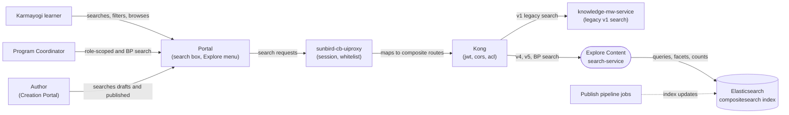

# Explore Content — Context Diagram

## System boundary

Inside the feature is the search path: `search-service`, which parses requests, applies its
visibility and role/org guards and builds the Elasticsearch query. Outside it are the people
who search and browse, the portal, the uiproxy and Kong in front of it, the legacy
`knowledge-mw-service` relay, the Elasticsearch `compositesearch` index, and the publish
pipeline that keeps that index current.

## Diagram

## Elements

| Element | Role | Detailed in |
|---|---|---|
| Explore Content (`search-service`) | Central system: parses search requests, guards visibility, scopes by JWT role and org, builds the index query | [lld.md](lld.md) |
| Karmayogi learner | Searches, filters and browses the catalogue | [use-cases.md](use-cases.md) |
| Program Coordinator | Gets role-aware results and the dedicated BP search | [use-cases.md](use-cases.md) |
| Author (Creation Portal) | Searches drafts and published content while authoring | [use-cases.md](use-cases.md) |
| Portal | Search UI, facet rail and Explore menu | [hld.md](hld.md) |
| sunbird-cb-uiproxy | Session-to-token handling, API whitelist, path mapping | [hld.md](hld.md) |
| Kong | Routes composite calls to upstreams; applies jwt, cors and acl | [apis.md](apis.md) |
| knowledge-mw-service | Upstream for the legacy v1 search used by older strips | [apis.md](apis.md) |
| Elasticsearch (`compositesearch`) | Read-side index holding denormalised content | [hld.md](hld.md) |
| Publish pipeline jobs | Update the index after content goes live (eventual consistency) | [hld.md](hld.md) |

> **Verification boundary:** elements and interactions come from the feature's own pages,
> read in full: index, use cases, APIs, HLD, LLD and the operations manual (a stub with no
> content to draw from). Spot-checked read-only in `sunbird-cb-uiproxy` (search routes
> present in the v8 proxy and whitelist). The search-service route table was not
> re-checked in this pass. Not re-verified: the publish pipeline's indexing jobs and the
> relay target of `knowledge-mw-service`, which the HLD and LLD themselves mark as
> unverified.
