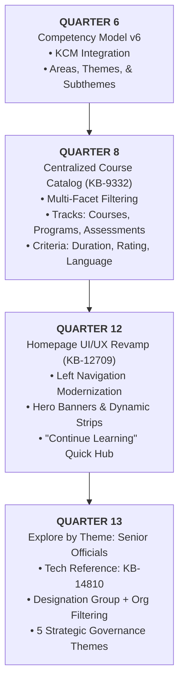
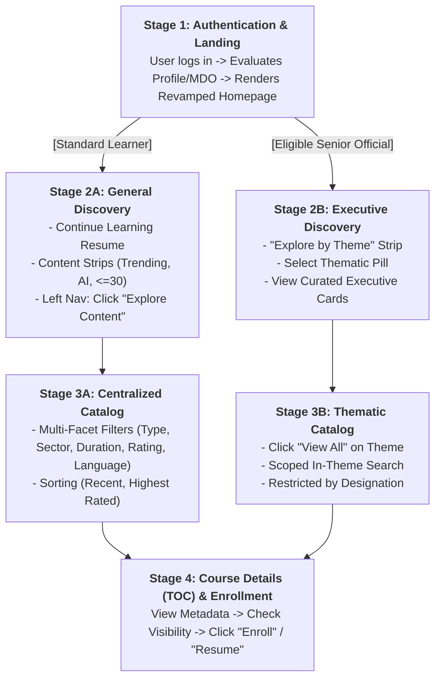

## 2. Executive Summary

The **iGOT Karmayogi Learner Discovery & Portal Experience** feature group encompasses an evolutionary overhaul of how civil servants discover, evaluate, and consume learning content across Web, Mobile Web (M-site), and Native Mobile applications. Spanning four key delivery horizons—**Q6 (Competency-Driven Taxonomy)**, **Q8 (Centralized Course Catalog)**, **Q12 (Homepage UI/UX Revamp)**, and **Q13 (Strategic Explore by Theme for Senior Officials)**—this suite transitions the platform from a fragmented repository into an intelligent, role-aware, structured learning workplace.

**QUARTERLY EVOLUTION ROADMAP (Q6 ➔ Q8 ➔ Q12 ➔ Q13)**

### Why These Capabilities Are Required

In earlier iterations of iGOT Karmayogi, learners encountered substantial friction discovering courses matching their domain competencies, operational constraints (e.g., short bite-sized learning), and administrative seniority. The Learn Hub served disparate content types without centralized faceted filtering or uniform sorting.

### What This Feature Group Delivers

1. **Centralized Course Catalog (**[**KB-9332**](https://karmayogibharat.atlassian.net/browse/KB-9332)**):** A dedicated full-page discovery index across Web, M-Site, and Mobile App that unifies Courses, Programs (Curated, Blended, Moderated, Invite-only), Standalone Case Studies, and Assessments under exhaustive multi-facet filtering (Duration, Rating, Language, Sector, Competency) and sorting (`Recently Added`, `Highest Rated`).
2. **Unified Homepage Architecture (**[**KB-12709**](https://karmayogibharat.atlassian.net/browse/KB-12709)**):** A streamlined landing portal featuring a standardized collapsible Left Navigation Panel, Top Navigation with categorized search, personalized learning sections (APAR, Mandatory Training Plans, Scheduled Assessments), a "Continue Where You Left Off" resume widget, and dynamic content strips (`Trending on iGOT`, `Featured AI Courses`, `30 Minutes or Less`).
3. **Role-Aware Theme Exploration (**[**KB-14810**](https://karmayogibharat.atlassian.net/browse/KB-14810)**):** A homepage strip tailored for senior leadership (Deputy Secretaries up to Secretaries) mapping curated courses across five national governance themes while strictly enforcing organizational boundaries and existing backend access controls.

## 3. Business Context and Problem Statement

Based directly on the source BRDs, FRSs, and Jira ticket specifications, the platform historically suffered from several structural discovery and usability bottlenecks:

| Documented Problem | Impact on Civil Servant / Platform |
|---|---|
| **Fragmented Content Discovery** ([KB-9332](https://karmayogibharat.atlassian.net/browse/KB-9332) Description) | Learners lacked a single page to view all offerings. The Learn Hub lacked multi-facet filtering across delivery formats. |
| **Cluttered Desktop & Mobile UI** ([KB-12709](https://karmayogibharat.atlassian.net/browse/KB-12709) / Q12 BRD Section 2) | The legacy homepage experience across mobile and desktop was cluttered and fragmented, making it difficult to locate relevant actions quickly. |
| **Lack of Senior Leadership Relevance** (Q13 BRD Section 3 / [KB-14810](https://karmayogibharat.atlassian.net/browse/KB-14810)) | Senior officials (DS to Secretary) have focused governance needs. Exposing them to an unfiltered general catalog caused low discovery and relevance. |
| **Cross-Platform Inconsistencies** (Q12 BRD / [KB-9337](https://karmayogibharat.atlassian.net/browse/KB-9337) / [KB-13889](https://karmayogibharat.atlassian.net/browse/KB-13889)) | Disparate interaction patterns existed between Desktop Web, M-site, and Native Mobile (Android/iOS), requiring harmonized design patterns. |
| **Competency v6 Integration** ([KB-6446](https://karmayogibharat.atlassian.net/browse/KB-6446)) | The Karmayogi Competency Model (KCM) required systemic mapping so learners could browse by Competency Area, Theme, and Sub-Theme. |

## 4. Business Objectives

The business objectives defined across the Q8, Q12, and Q13 specifications are categorized below into **Explicitly Documented** and **Analytically Inferred** objectives:

### Explicitly Documented Objectives

- **Unified Landing & Navigation Efficiency:** Provide a single, role-aware entry point connecting learning, achievements, community, and administrative portals (Q12 BRD Section 3).
- **Targeted Executive Discovery:** Establish a structured thematic framework across five strategic governance areas for senior officials without requiring separate disconnected portals (Q13 BRD Section 2).
- **Comprehensive Content Indexing:** Provide centralized catalog browsing with multi-dimensional filtering across all learning formats (Course, Program, Case Study, Assessment) ([KB-9332](https://karmayogibharat.atlassian.net/browse/KB-9332), [KB-9202](https://karmayogibharat.atlassian.net/browse/KB-9202)).
- **Preservation of Governance & Access Controls:** Ensure that role-tailored and theme-based views do not bypass underlying MDO access boundaries or content visibility restrictions (Q13 BRD Section 2, BR-006; Q13 FRS FR-008).
- **Device Harmony:** Ensure uniform functionality, telemetry tracking, and layout across Desktop Web, Mobile Browser (M-site), and Mobile Applications ([KB-9202](https://karmayogibharat.atlassian.net/browse/KB-9202), [KB-13889](https://karmayogibharat.atlassian.net/browse/KB-13889)).

### Analytically Inferred Objectives

- **Reduction of Search Friction:** Transitioning users from unguided free-text search to structured facet filters (duration, rating, sector) to lower bounce rates on content discovery.
- **Executive Adoption via Curation:** Increasing engagement among senior administrative cadres by reducing browsing fatigue through high-trust, curated catalog subsets.

## 5. Scope of the Feature Group

The logical capabilities across the source documents are organized into five primary functional categories:

**PORTAL DISCOVERY CAPABILITY SCOPE**

- **A. COURSE CATALOG** ([KB-9332](https://karmayogibharat.atlassian.net/browse/KB-9332), [KB-9202](https://karmayogibharat.atlassian.net/browse/KB-9202), [KB-9333](https://karmayogibharat.atlassian.net/browse/KB-9333), [KB-9334](https://karmayogibharat.atlassian.net/browse/KB-9334))
  - Centralized Course/Program/Assessment Index
  - Content Hierarchy: Courses, Programs, Case Studies, Assessments
  - Facet Filters: Duration, Rating, Language, 8 Governance Sectors, Providers
  - Sorting: Recently Added, Highest Rated
- **B. LEARNER PORTAL** ([KB-12709](https://karmayogibharat.atlassian.net/browse/KB-12709), [KB-12710](https://karmayogibharat.atlassian.net/browse/KB-12710), Q12 BRD/FRS)
  - Standardized Left Nav Panel (Home, Explore Content, My Learning, Passbook, etc.)
  - Top Nav: Search with Category Pills, Static English Language, Homepage Light/Dark
  - Hero Carousel Banner (3-4 items), Welcome Message, Continue Learning Widget
  - Personalized Rows: APAR, Comp Assessment, Training Plans, Scheduled Assessments
- **C. MOBILE APP & M-SITE** ([KB-9202](https://karmayogibharat.atlassian.net/browse/KB-9202), [KB-9337](https://karmayogibharat.atlassian.net/browse/KB-9337), [KB-13889](https://karmayogibharat.atlassian.net/browse/KB-13889), [KB-14890](https://karmayogibharat.atlassian.net/browse/KB-14890))
  - Responsive Mobile Catalog & Faceted Filters
  - Native QR Code Launchers for Mobile App download
  - Parity of In Spotlight & Explore by Theme on Mobile
- **D. UI/UX REVAMP** ([KB-12709](https://karmayogibharat.atlassian.net/browse/KB-12709), Q12 BRD/FRS)
  - Collapse/Expand widgets (Achievements: Rank, Karma, Badges; Quick Actions)
  - Discovery Strips: Trending on iGOT (7-day rolling), Featured AI, <=30 Mins
  - Decoupled Modular Rendering (resilient to service timeouts)
- **E. EXPLORE BY THEME FOR SENIOR OFFICIALS** ([KB-14810](https://karmayogibharat.atlassian.net/browse/KB-14810), [KB-14889](https://karmayogibharat.atlassian.net/browse/KB-14889), Q13 BRD/FRS)
  - Eligibility Gating: User Designation + Organization
  - Cadre Groups: Group 1 (DS & Director), Group 2 (JS, AS & Secretary)
  - 5 Strategic Themes: Public Leadership (Default), Tech & Data, Climate, Economy, Governance & Public Policy
  - Complete Thematic Listing & Scoped In-Theme Search

### Detailed Breakdown by Category

### A. Course Catalog

- **Dedicated Route & Catalog View (**[**KB-9202**](https://karmayogibharat.atlassian.net/browse/KB-9202)**):** Introduces a global `Catalog` menu item navigating to a dedicated catalog page displaying all available learning content.
- **Content Categorization Hierarchy (**[**KB-9333**](https://karmayogibharat.atlassian.net/browse/KB-9333)**):** Default display preference: Courses (Course, Moderated Course), Programs (Curated, Blended, Invite-Only, Moderated), Case Studies, and Assessments (Standalone, Competency, Moderated).
- **Faceted Filtering Structure (**[**KB-9333**](https://karmayogibharat.atlassian.net/browse/KB-9333)**):**
  - *Sectors:* Human Capital & Skill Dev; Science, Tech & Innovation; Agriculture & Natural Resources; Governance & Public Admin; Infrastructure & Transportation; Economic Dev & Industry; Culture, Media & Communication; Social Dev & Welfare.
  - *Duration Buckets:* `0-30 Mins`, `30-60 Mins`, `60-90 Mins`, `90 mins and above`.
  - *Rating Thresholds:* `4.5 & Above`, `4.0 & Above`, `3.5 & Above`, `3.0 & Above`.
  - *Language Facets:* English, Hindi, and regional languages with real-time content counts.
  - *Taxonomy:* Competency Area, Theme, and Sub-Theme ([KB-6446](https://karmayogibharat.atlassian.net/browse/KB-6446)) and Content Provider name.

- **Sorting Engine (**[**KB-9334**](https://karmayogibharat.atlassian.net/browse/KB-9334)**):** Supports ordering by `Recently Added` and `Highest Rated`.

### B. Learner Portal (Web Homepage)

- **Structural Framework (Q12 BRD/FRS M1–M5):** Redesigned three-zone layout: Left Navigation Panel, Top Navigation Header, and Modular Homepage Body.
- **Left Navigation (FR-02 to FR-07):** Direct links to *Home*, *Explore Content*, *My Learning*, *Learner Passbook*, *iGOT Community*, *Events*, and *Peer Validation*. Features vertical "View More" overflow expansion.
- **Widgets:** Collapsible *My Achievements* (Rank, Karma Points, Badges) and role-gated *Quick Actions* (Help Center, MDO Portal, Content Portal, SPV Portal).
- **Top Navigation (FR-08 to FR-12):** Scoped category search (removal of the confusing "All" pill), theme toggle (Light/Dark mode restricted to homepage), static English selector, 2–4 hour scheduled notification polling, and profile summary widget.

### C. Mobile App & Mobile Web (M-site)

- **Cross-Device Parity (**[**KB-9202**](https://karmayogibharat.atlassian.net/browse/KB-9202)**,** [**KB-9337**](https://karmayogibharat.atlassian.net/browse/KB-9337)**,** [**KB-13889**](https://karmayogibharat.atlassian.net/browse/KB-13889)**,** [**KB-14890**](https://karmayogibharat.atlassian.net/browse/KB-14890)**):** Brings catalog browsing, sorting, filtering, and theme exploration to mobile form factors.
- **App Acquisition (Q12 FR-07):** Web portal integrates bottom left launcher triggering dynamic modal QR codes for Android and iOS app stores.

### D. UI/UX Revamp

- **Homepage Body Components (Q12 FR-13 to FR-16):** Hero carousel (3–4 banners showing 1 active and partial adjacent slides), conditional personalized Welcome greeting (`Welcome <Name>` vs `Welcome Back <Name>`), and "Continue Where You Left Off" card with progress tracking and direct Resume action.
- **Dynamic Content Strips (Q12 FR-24 to FR-27):**
  - *Trending on iGOT:* Highest enrollments over a rolling 7-day window.
  - *Featured AI Courses:* Curated catalog maintained by the platform Knowledge Base team.
  - *30 Minutes or Less:* Micro-learning modules ($\le 30$ minutes).
  - *Discovery Spotlights (FR-23):* Navigational gateways to iGOT Marketplace, Specialisation, MDO Channels, and Amrit Gyan Kosh (AGK).

### E. Explore by Theme (Senior Officials Learning Discovery)

- **Executive Strip (**[**KB-14810**](https://karmayogibharat.atlassian.net/browse/KB-14810)**, Q13 BRD/FRS):** Homepage section visible strictly to authorized designation cadres within participating Organizations.
- **Designation Groups (Q13 FR-001, FR-002, FR-014):**
  - *Group 1 (DS & Director):* Deputy Secretary, Director.
  - *Group 2 (JS, AS & Secretary):* Joint Secretary, Additional Secretary, Secretary.

- **Five Strategic Themes (Q13 FR-003):** Public Leadership (Default), Technology & Data Governance, Environment & Climate, Economy & Public Finance, and Governance & Public Policy.
- **Dedicated Listing & Scoped Search (Q13 FR-009 to FR-011):** "View All" redirects to a dedicated thematic catalog with in-theme full-text search governed by designation mapping and backend access rules.

## 6. Target Users and Stakeholders

The platform defines distinct operational and consumption roles:

| Target User / Stakeholder | Primary Role & Capabilities Accessed |
|---|---|
| **Learner (Civil Servant)** (General Cadre) | Accesses Learner Portal, Course Catalog, Faceted Filters, Search, Continue Learning widget, and General Content Strips. |
| **Senior Official** (Executive Cadre) | Deputy Secretary to Secretary cadres in eligible MDOs. Accesses the specialized "Explore by Theme" homepage section and tailored executive course catalog. |
| **MDO / SPV / Content Portal Users** (Role-Gated) | Administrative personnel accessing privileged backend portals via the Left Navigation Quick Actions widget based on RBAC. |
| **Knowledge Base / Content Team** | Manages course curation, theme associations, featured AI course lists, and designation-to-theme mapping tables. |
| **Platform / Engineering / QA** | Maintains Form-Config service mappings, Elasticsearch indices, Teams telemetry pipelines, and validates cross-device parity. |

## 7. Key Functional Capabilities

| Capability ID | Capability Name | Description | Primary User | Related Jira Tickets | Source Document |
|---|---|---|---|---|---|
| **CAP-CAT-01** | Centralized Catalog Navigation | Direct global navigation route to full learning index across web and mobile | Learner | [KB-9202](https://karmayogibharat.atlassian.net/browse/KB-9202), [KB-9332](https://karmayogibharat.atlassian.net/browse/KB-9332), [KB-9337](https://karmayogibharat.atlassian.net/browse/KB-9337) | Q8 PRD |
| **CAP-CAT-02** | Multi-Facet Catalog Filtering | Multi-dimensional filtering by Content Type, Sectors, Duration, Rating, Language, and Provider | Learner | [KB-9333](https://karmayogibharat.atlassian.net/browse/KB-9333) | Q8 PRD |
| **CAP-CAT-03** | Catalog Sorting | Dynamic ordering of catalog items by `Recently Added` and `Highest Rated` | Learner | [KB-9334](https://karmayogibharat.atlassian.net/browse/KB-9334) | Q8 PRD |
| **CAP-CAT-04** | Competency v6 Taxonomy | Browse and filter content structured by KCM Competency Area, Theme, and Sub-theme | Learner | [KB-6446](https://karmayogibharat.atlassian.net/browse/KB-6446) | Jira Ticket |
| **CAP-NAV-01** | Left Navigation & Expansion | Standardized left drawer for primary navigation with "View More" overflow and portal shortcuts | Learner, Admin | [KB-12709](https://karmayogibharat.atlassian.net/browse/KB-12709), [KB-12710](https://karmayogibharat.atlassian.net/browse/KB-12710) | Q12 BRD/FRS (FR-02, FR-03, FR-05) |
| **CAP-NAV-02** | Top Navigation & Search Revamp | Header containing category-specific search (removal of "All" pill), static language, and light/dark theme toggle | Learner | [KB-12709](https://karmayogibharat.atlassian.net/browse/KB-12709), [KB-12710](https://karmayogibharat.atlassian.net/browse/KB-12710) | Q12 BRD/FRS (FR-08, FR-09, FR-10) |
| **CAP-HOM-01** | Hero Banner & Welcome Widget | Responsive carousel of 3–4 promotional banners and registration-aware greeting | Learner | [KB-12709](https://karmayogibharat.atlassian.net/browse/KB-12709), [KB-12710](https://karmayogibharat.atlassian.net/browse/KB-12710) | Q12 BRD/FRS (FR-13, FR-14) |
| **CAP-HOM-02** | Continue Where You Left Off | Homepage card displaying latest active course progress with one-click Resume | Learner | [KB-12709](https://karmayogibharat.atlassian.net/browse/KB-12709), [KB-12710](https://karmayogibharat.atlassian.net/browse/KB-12710) | Q12 BRD/FRS (FR-15) |
| **CAP-HOM-03** | Personalized Learning Sections | Conditional homepage rows for APAR, Training Plans, Learning Paths, and Assessments | Learner | [KB-12709](https://karmayogibharat.atlassian.net/browse/KB-12709), [KB-12710](https://karmayogibharat.atlassian.net/browse/KB-12710) | Q12 BRD/FRS (FR-17 to FR-22) |
| **CAP-HOM-04** | Dynamic Content Strips | Curated strips for Trending on iGOT (rolling 7 days), Featured AI Courses, and $\le 30$ Mins micro-courses | Learner | [KB-12709](https://karmayogibharat.atlassian.net/browse/KB-12709), [KB-12710](https://karmayogibharat.atlassian.net/browse/KB-12710) | Q12 BRD/FRS (FR-24 to FR-27) |
| **CAP-THM-01** | Senior Officials Eligibility Gating | RBAC and Form-Config gating to restrict Explore by Theme visibility to DS–Secretary cadres within eligible MDOs | Senior Official | [KB-14810](https://karmayogibharat.atlassian.net/browse/KB-14810), [KB-14889](https://karmayogibharat.atlassian.net/browse/KB-14889), [KB-14890](https://karmayogibharat.atlassian.net/browse/KB-14890) | Q13 BRD/FRS (FR-001, FR-002, FR-014) |
| **CAP-THM-02** | Five Governance Thematic Areas | Interactive homepage carousel/pills for Public Leadership, Tech/Data, Climate, Finance, and Public Policy | Senior Official | [KB-14810](https://karmayogibharat.atlassian.net/browse/KB-14810), [KB-14889](https://karmayogibharat.atlassian.net/browse/KB-14889) | Q13 BRD/FRS (FR-003, FR-004, FR-005) |
| **CAP-THM-03** | Thematic Catalog & Scoped Search | Dedicated "View All" thematic catalog page with in-theme keyword search respecting designation mapping | Senior Official | [KB-14810](https://karmayogibharat.atlassian.net/browse/KB-14810), [KB-14889](https://karmayogibharat.atlassian.net/browse/KB-14889) | Q13 BRD/FRS (FR-009 to FR-012) |
| **CAP-TEL-01** | Telemetry & Interaction Tracking | Instrumentation of clicks, impressions, filter toggles, resume events, and course visits | Analytics / System | [KB-9484](https://karmayogibharat.atlassian.net/browse/KB-9484), [KB-13959](https://karmayogibharat.atlassian.net/browse/KB-13959), [KB-13960](https://karmayogibharat.atlassian.net/browse/KB-13960), [KB-14891](https://karmayogibharat.atlassian.net/browse/KB-14891) | Q12/Q13 FRS |

## 8. End-to-End User Journey

**END-TO-END LEARNER DISCOVERY FLOW**

### Step-by-Step Execution Journey

1. **Authentication & Role Evaluation:**
  - *User Action:* Civil servant authenticates via single sign-on / credentials.
  - *System Behavior:* Backend inspects the user profile for registration status (Welcome vs Welcome Back), designations, and associated Organization ID (`orgId`).
  - *Rules & References:* Q12 FRS FR-01, FR-14; Q13 FRS FR-002, FR-014.

2. **Homepage Landing & Role-Gated Section Rendering:**
  - *General Learner:* Left Nav is rendered with Quick Actions tailored to user roles (Help Center; plus MDO/Content/SPV portals if authorized). If active learning exists, the "Continue Where You Left Off" card renders with percentage completion and a Resume button.
  - *Senior Official:* If the user's designation and organization match an active Form-Config rule (Group 1: DS & Director; Group 2: JS, AS & Secretary), the "Explore by Theme" section displays above/between content strips, pre-selecting the default theme **Public Leadership**.
  - *Rules & References:* Q12 FRS FR-02 to FR-05, FR-15; Q13 FRS FR-003, FR-004.

3. **Thematic Exploration (Senior Officials):**
  - *User Action:* User clicks through the five thematic pills (*Public Leadership*, *Technology & Data Governance*, *Environment & Climate*, *Economy & Public Finance*, *Governance & Public Policy*).
  - *System Behavior:* The course card carousel dynamically refreshes to display courses matching the selected theme intersecting the user's designation group and organization mapping.
  - *Rules & References:* Q13 FRS FR-005, FR-007; Q13 BRD BR-004.

4. **Catalog Navigation:**
  - *User Action:* Learner clicks "Explore Content" in the Left Navigation, or an executive clicks "View All" within an Explore by Theme section.
  - *System Behavior:*
    - If navigating from Left Nav: Redirects to the Centralized Course Catalog page ([KB-9202](https://karmayogibharat.atlassian.net/browse/KB-9202)). Displays all courses, programs, and assessments, defaulting to "All" with multi-facet filters.
    - If navigating from "View All" in Explore by Theme: Redirects to the dedicated Thematic Listing page (Q13 FR-010) retaining the selected theme filter and designation restrictions.

5. **Faceted Filtering & Sorting:**
  - *User Action:* Learner refines results by selecting duration (e.g., `0-30 Mins`), rating threshold (`4.0 & Above`), sector, or toggles sorting to `Highest Rated`.
  - *System Behavior:* Search API evaluates facet parameters, re-queries the content index, and updates card listings with total match counts without breaking layout.
  - *Rules & References:* [KB-9333](https://karmayogibharat.atlassian.net/browse/KB-9333), [KB-9334](https://karmayogibharat.atlassian.net/browse/KB-9334).

6. **Course Inspection & Enrollment:**
  - *User Action:* Learner clicks on an individual Course Card.
  - *System Behavior:* System navigates to the Course Table of Contents (TOC) / detail page. Underlying course visibility and enrollment access controls are validated before displaying the enrollment action.
  - *Rules & References:* Q13 FRS FR-008, FR-010; Q12 FRS FR-02.

## 9. Feature Relationships and Dependencies

| Feature / Jira ID | Primary Responsibility | Related Capabilities | Dependencies | Supporting Documentation |
|---|---|---|---|---|
| [**KB-6446**](https://karmayogibharat.atlassian.net/browse/KB-6446) | Competency v6 Content Discovery | Competency filtering in Catalog | KCM Competency framework v6, SPV Portal KCM service | Ticket Description & Attachment |
| [**KB-9332**](https://karmayogibharat.atlassian.net/browse/KB-9332) *(Parent Epic)* | Course Catalog Module Framework | [KB-9202](https://karmayogibharat.atlassian.net/browse/KB-9202), [KB-9333](https://karmayogibharat.atlassian.net/browse/KB-9333), [KB-9334](https://karmayogibharat.atlassian.net/browse/KB-9334), [KB-9337](https://karmayogibharat.atlassian.net/browse/KB-9337) | Content indexing service, Search API | Q8 PRD |
| [**KB-9202**](https://karmayogibharat.atlassian.net/browse/KB-9202) | Course Catalog Web & M-site Page | Global navigation, Search page design | Search layout framework, Elasticsearch backend | Q8 PRD, Figma Catalog Prototype |
| [**KB-9333**](https://karmayogibharat.atlassian.net/browse/KB-9333) | Catalog Facet Filters Implementation | Content categorization, KCM v6 ([KB-6446](https://karmayogibharat.atlassian.net/browse/KB-6446)) | Taxonomy metadata in Content table | Q8 PRD |
| [**KB-9334**](https://karmayogibharat.atlassian.net/browse/KB-9334) | Catalog Sorting Implementation | Recently Added, Highest Rated sorts | Course rating engine, Publish timestamp metadata | Q8 PRD, Explore API Sorting Guide |
| [**KB-12709**](https://karmayogibharat.atlassian.net/browse/KB-12709) *(Parent Epic)* | Q12 Homepage UI/UX Revamp Framework | [KB-12710](https://karmayogibharat.atlassian.net/browse/KB-12710), [KB-13889](https://karmayogibharat.atlassian.net/browse/KB-13889), [KB-13959](https://karmayogibharat.atlassian.net/browse/KB-13959) | User Profile Service, Achievement Service, Recommendation Service | Q12 BRD, Q12 FRS |
| [**KB-14810**](https://karmayogibharat.atlassian.net/browse/KB-14810) *(Parent Epic)* | Q13 Custom Section for Senior Officials | [KB-14889](https://karmayogibharat.atlassian.net/browse/KB-14889), [KB-14890](https://karmayogibharat.atlassian.net/browse/KB-14890), [KB-14891](https://karmayogibharat.atlassian.net/browse/KB-14891) | Form-Config Service ([KB-15120](https://karmayogibharat.atlassian.net/browse/KB-15120)), Profile Designation Mapping, Course Visibility Engine | Q13 BRD, Q13 FRS |

### Cross-Feature Dependency Analysis

1. **Catalog Filter & Competency v6 Integration:** [KB-9333](https://karmayogibharat.atlassian.net/browse/KB-9333) directly incorporates the competency hierarchy delivered in [KB-6446](https://karmayogibharat.atlassian.net/browse/KB-6446). If the KCM taxonomy API exhibits latency or errors, competency filtering fails across the catalog.
2. **Homepage Revamp as an Enabler for Thematic Discovery:** [KB-14810](https://karmayogibharat.atlassian.net/browse/KB-14810) (Q13) depends structurally on the modular homepage strip framework introduced in [KB-12709](https://karmayogibharat.atlassian.net/browse/KB-12709) (Q12). Q12 FRS explicitly specified FR-27 ("Future Strips") to permit injecting role-aware strips like Explore by Theme without redesigning the homepage container.
3. **Form-Config Backend Dependency:** Production evidence reveals that Explore by Theme ([KB-14810](https://karmayogibharat.atlassian.net/browse/KB-14810) / [KB-14889](https://karmayogibharat.atlassian.net/browse/KB-14889)) depends heavily on the **Form-Config Service** (`application-config-web`). Caching or data schema errors in Form-Config directly prevented State and L0 Org users from loading theme strips (see defects [KB-15071](https://karmayogibharat.atlassian.net/browse/KB-15071), [KB-15334](https://karmayogibharat.atlassian.net/browse/KB-15334), [KB-15120](https://karmayogibharat.atlassian.net/browse/KB-15120)).

## 10. Business Rules and Functional Constraints

| Rule Category | Rule Identifier & Operational Logic | Source Reference |
|---|---|---|
| Content Eligibility & Access Control | **RULE-THM-01: Intersected Course Visibility** Displayed Courses = Theme Mapping ∩ Designation & Org Mapping ∩ Existing Course Visibility ∩ Existing Access Rules. Thematic exploration cannot bypass MDO private publishing. | Q13 BRD BR-006; Q13 FRS FR-008 |
| Designation Cadre Integrity | **RULE-THM-02: Organization-Designation Uniqueness** Within an organization, a user's designation maps to exactly one designation group. Overlapping group assignments for the same organization-designation pair are rejected. | Q13 FRS FR-014; [KB-14911](https://karmayogibharat.atlassian.net/browse/KB-14911) |
| Default Thematic State | **RULE-THM-03: Default Landing State** "Public Leadership" must load as the default highlighted theme whenever the Explore by Theme strip initializes. | Q13 BRD BR-008; Q13 FRS FR-004 |
| Resume Widget Display | **RULE-HOM-01: Latest Consumed Progress** Only the single most recently consumed in-progress item is rendered. If no in-progress content exists, the widget is hidden. | Q12 BRD Section 6.3; Q12 FRS FR-15 |
| Trending Window Calculation | **RULE-HOM-02: Rolling 7-Day Window** Trending on iGOT courses are calculated using highest enrollments over a strict rolling 7-day period. | Q12 BRD Section 6.6; Q12 FRS FR-24 |
| Top Nav Category Search | **RULE-NAV-01: Scoped Category Search** The generic "All" search filter pill is permanently removed; users must execute searches scoped by content categories. | Q12 BRD Section 6.2; Q12 FRS FR-08 |
| Theme Support Boundary | **RULE-NAV-02: Scoped Theme Scope** Dark/Light mode toggling is restricted strictly to the homepage; inner course players and deep portal pages retain system default. | Q12 BRD Section 6.2; Q12 FRS FR-10 |
| Notification Polling | **RULE-NAV-03: Asynchronous Refresh Schedule** Notifications refresh every 2–4 hours; real-time push polling is explicitly unsupported. | Q12 BRD Section 6.2; Q12 FRS FR-11 |

## 11. User Experience and Business Value

### Learner Experience

- **Elimination of Discovery Friction:** Centralizing courses, programs, and assessments into a single catalog with duration filters ($\le 30$ mins, 30–60 mins) enables busy officers to find bite-sized learning matching immediate workplace needs.
- **Frictionless Learning Continuity:** The "Continue Where You Left Off" widget eliminates navigation overhead, allowing learners to resume active courses directly upon logging in.
- **Cadre-Relevant Executive Learning:** Senior officials are spared wading through foundational or irrelevant coursework. Their homepage immediately highlights strategic policy, climate, leadership, and finance content curated for their seniority.
- **Predictable Navigation Hierarchy:** Collapsible Left Navigation, categorized search, and clear breadcrumbs establish a consistent interaction model across devices.

### Business & Organizational Value

- **Alignment with Mission Karmayogi Mandates:** Directly supports competency-based capacity building by tying course discovery to the Karmayogi Competency Model (KCM v6) and organizational APAR goals.
- **Higher Resource Utilization:** Categorized discovery strips (`Trending on iGOT`, `Featured AI Courses`) surface high-value national assets, driving higher enrollment and completion rates across ministries.
- **Targeted Executive Capacity Building:** Equips leadership cadres (Directors, Joint Secretaries, Secretaries) with governance tools tailored to national priority domains (Public Finance, Data Governance, Climate Policy).
- **Robust Governance & Compliance:** Preserves MDO data privacy and access control boundaries, ensuring confidential or restricted training modules remain protected.

## 12. Requirements Traceability Matrix

| Requirement ID / Description | Requirement Type | Source Document | Related Jira Ticket | Expected Capability | Traceability Status |
|---|---|---|---|---|---|
| **Q8-REQ-01** Centralized Course Catalog page | Functional | Q8 PRD ([KB-9332](https://karmayogibharat.atlassian.net/browse/KB-9332)) | [KB-9202](https://karmayogibharat.atlassian.net/browse/KB-9202) | Centralized catalog index for web & m-site | **Fully mapped** |
| **Q8-REQ-02** Multi-facet filtering (Duration, Rating, Language, Sectors) | Functional | Q8 PRD ([KB-9332](https://karmayogibharat.atlassian.net/browse/KB-9332)) | [KB-9333](https://karmayogibharat.atlassian.net/browse/KB-9333) | Faceted catalog search filters | **Fully mapped** |
| **Q8-REQ-03** Catalog sorting (Recently Added, Highest Rated) | Functional | Q8 PRD ([KB-9332](https://karmayogibharat.atlassian.net/browse/KB-9332)) | [KB-9334](https://karmayogibharat.atlassian.net/browse/KB-9334) | Sorting engine for catalog results | **Fully mapped** |
| **Q8-REQ-04** Mobile App Course Catalog | Functional | Q8 PRD ([KB-9332](https://karmayogibharat.atlassian.net/browse/KB-9332)) | [KB-9337](https://karmayogibharat.atlassian.net/browse/KB-9337) | Native mobile catalog interface | **Fully mapped** |
| **Q8-REQ-05** Catalog Telemetry & Data Tracking | Technical | Q8 PRD ([KB-9332](https://karmayogibharat.atlassian.net/browse/KB-9332)) | [KB-9484](https://karmayogibharat.atlassian.net/browse/KB-9484) | Interaction telemetry event logging | **Fully mapped** |
| **Q6-REQ-01** KCM v6 Competency Exploration | Functional | Jira Scope | [KB-6446](https://karmayogibharat.atlassian.net/browse/KB-6446) | Explore by competency area, theme, sub-theme | **Fully mapped** |
| **Q12-FR-02** Left Navigation Primary Links | Functional | Q12 BRD/FRS | [KB-12710](https://karmayogibharat.atlassian.net/browse/KB-12710) | Standardized left navigation menu | **Fully mapped** |
| **Q12-FR-05** Role-based Quick Actions (MDO/SPV/CP) | Functional / Security | Q12 BRD/FRS | [KB-12710](https://karmayogibharat.atlassian.net/browse/KB-12710) | Role-gated portal shortcuts | **Fully mapped** |
| **Q12-FR-08** Top Nav Category Search (Remove "All") | Functional | Q12 BRD/FRS | [KB-12710](https://karmayogibharat.atlassian.net/browse/KB-12710) | Category-specific search bar | **Fully mapped** |
| **Q12-FR-10** Homepage Light/Dark Theme Selection | Non-Functional | Q12 BRD/FRS | [KB-12710](https://karmayogibharat.atlassian.net/browse/KB-12710) | Homepage theme toggle | **Fully mapped** |
| **Q12-FR-15** Continue Where You Left Off Card | Functional | Q12 BRD/FRS | [KB-12710](https://karmayogibharat.atlassian.net/browse/KB-12710) | Active learning progress resume widget | **Fully mapped** |
| **Q12-FR-24** Trending on iGOT (7-Day Rolling) | Functional | Q12 BRD/FRS | [KB-12710](https://karmayogibharat.atlassian.net/browse/KB-12710) | Trending courses carousel | **Fully mapped** |
| **Q12-FR-26** 30 Minutes or Less Content Strip | Functional | Q12 BRD/FRS | [KB-12710](https://karmayogibharat.atlassian.net/browse/KB-12710) | Micro-learning content row | **Fully mapped** |
| **Q12-FR-28** Mobile Homepage Revamp | Functional | Q12 BRD/FRS | [KB-13889](https://karmayogibharat.atlassian.net/browse/KB-13889) | Parity mobile homepage layout | **Fully mapped** |
| **Q13-BR-001** Senior Officials Designation Eligibility | Security / Governance | Q13 BRD/FRS | [KB-14810](https://karmayogibharat.atlassian.net/browse/KB-14810), [KB-14889](https://karmayogibharat.atlassian.net/browse/KB-14889) | Designation group gating (DS–Secretary) | **Fully mapped** |
| **Q13-BR-003** Five Strategic Thematic Areas | Functional | Q13 BRD/FRS | [KB-14889](https://karmayogibharat.atlassian.net/browse/KB-14889) | Thematic carousel and pills | **Fully mapped** |
| **Q13-BR-006** Preserved Course Visibility & RBAC | Security / Architecture | Q13 BRD/FRS | [KB-14889](https://karmayogibharat.atlassian.net/browse/KB-14889) | Intersected access control enforcement | **Fully mapped** |
| **Q13-BR-009** View All Thematic Catalog Page | Functional | Q13 BRD/FRS | [KB-14889](https://karmayogibharat.atlassian.net/browse/KB-14889) | Full listing page for selected theme | **Fully mapped** |
| **Q13-BR-011** In-Theme Scoped Course Search | Functional | Q13 BRD/FRS | [KB-14889](https://karmayogibharat.atlassian.net/browse/KB-14889) | Scoped full-text search within theme | **Fully mapped** |
| **Q13-FR-014** Organization-Designation Uniqueness | Data Integrity | Q13 FRS | [KB-14911](https://karmayogibharat.atlassian.net/browse/KB-14911) | Form-Config designation uniqueness validation | **Fully mapped** |
| **Q12-NFR-01** Homepage Performance $\le 3\text{s}$ load | Non-Functional | Q12 BRD Section 10 | *None explicitly linked* | Fast homepage bundle load | **Documentation available; Jira mapping missing** |

## 13. Current Implementation Status

| Jira ID | Feature Name | Jira Status | Implementation Evidence | Known Limitations | Verification Needed |
|---|---|---|---|---|---|
| [**KB-6446**](https://karmayogibharat.atlassian.net/browse/KB-6446) | Explore content by Competency v6 | **Prod Deployed** | Sub-tasks [KB-7225](https://karmayogibharat.atlassian.net/browse/KB-7225) (Design), [KB-7226](https://karmayogibharat.atlassian.net/browse/KB-7226) (Execution) Done; verified in release. | Earlier defect [KB-7335](https://karmayogibharat.atlassian.net/browse/KB-7335) deferred; resolved in subsequent builds. | Verify production display of competency sub-themes for newly added KCM competencies. |
| [**KB-9202**](https://karmayogibharat.atlassian.net/browse/KB-9202) | Course catalog (Portal & M-site) | **Prod Deployed** | Deployed; linked Figma prototype; QA test execution page `Course Catalog-Learner Portal` exists. | Desktop and M-site only. | Verify whether Standalone Assessments are displayed by default or filtered out. |
| [**KB-9332**](https://karmayogibharat.atlassian.net/browse/KB-9332) | Ad-Hoc Course Catalog (Epic) | **KB Approved** | Parent Epic container; all child stories are implemented or deployed. | Umbrella tracking container. | Verify operational sign-off to transition epic status from `KB Approved` to `Closed`. |
| [**KB-9333**](https://karmayogibharat.atlassian.net/browse/KB-9333) | Implement Course Catalog Filters | **Prod Deployed** | Code deployed to production; regression testing signed off. | Multi-select behavior on content types required defect fix [KB-9555](https://karmayogibharat.atlassian.net/browse/KB-9555). | Confirm facet content counts sync accurately with live Elasticsearch indices. |
| [**KB-9334**](https://karmayogibharat.atlassian.net/browse/KB-9334) | Implement Sorting Options for Catalog | **Prod Deployed** | Sorting by Recently Added & Highest Rated live in production. | Limited to two explicit sort parameters. | Confirm if relevance search sorting is completely suppressed on the catalog page. |
| [**KB-12709**](https://karmayogibharat.atlassian.net/browse/KB-12709) | UI/UX Homepage Revamp (Epic) | **Prod Deployed** | Child stories [KB-12710](https://karmayogibharat.atlassian.net/browse/KB-12710) (Web), [KB-13889](https://karmayogibharat.atlassian.net/browse/KB-13889) (Mobile), [KB-13959](https://karmayogibharat.atlassian.net/browse/KB-13959) (Telemetry) marked Prod Deployed. | Multiple responsive M-site landscape defects logged and closed post-launch. | Verify accessibility screen-reader compliance ([KB-13973](https://karmayogibharat.atlassian.net/browse/KB-13973) was marked "Not Required"). |
| [**KB-14810**](https://karmayogibharat.atlassian.net/browse/KB-14810) | Custom Section for Senior Officials (Epic) | **Prod Deployed** | Child stories [KB-14889](https://karmayogibharat.atlassian.net/browse/KB-14889) (Web), [KB-14890](https://karmayogibharat.atlassian.net/browse/KB-14890) (Mobile), [KB-14891](https://karmayogibharat.atlassian.net/browse/KB-14891) (Telemetry) Prod Deployed. | State user visibility bug [KB-15334](https://karmayogibharat.atlassian.net/browse/KB-15334) logged in backlog; Form-Config cache enhancement deployed ([KB-15120](https://karmayogibharat.atlassian.net/browse/KB-15120)). | Validate if State Users under L0 organizations can view the theme strip in current production. |
