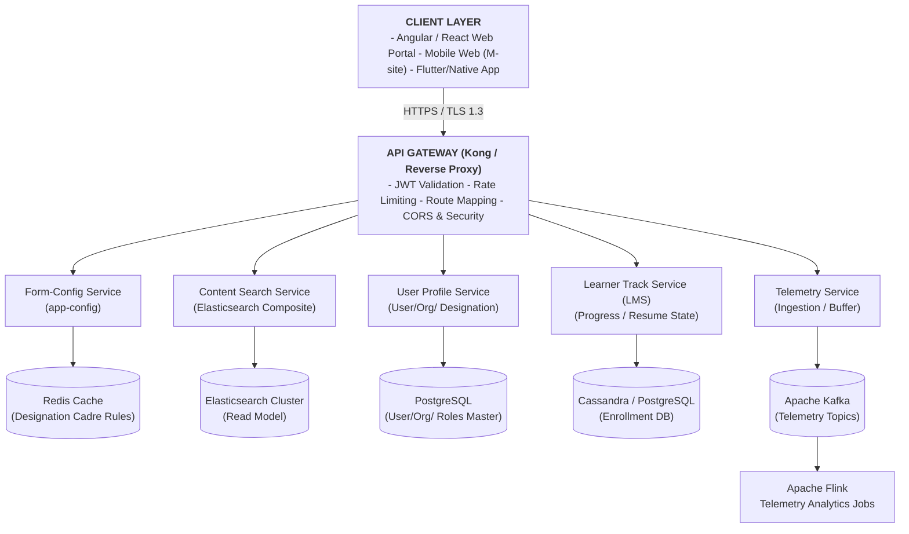
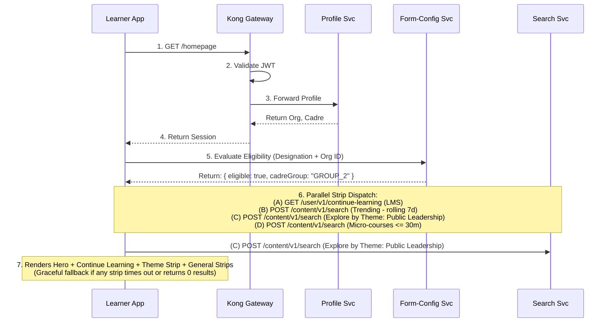
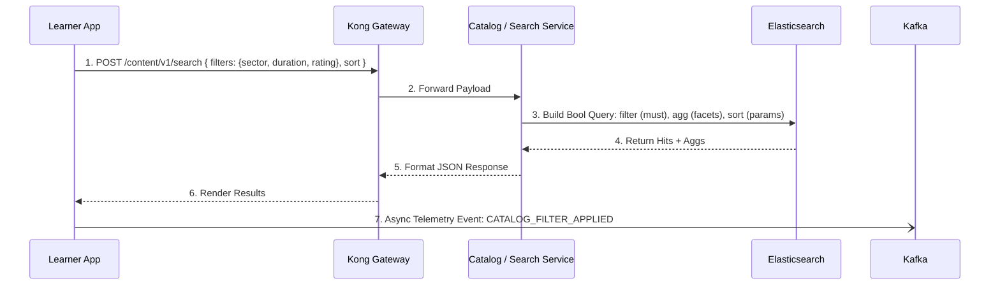
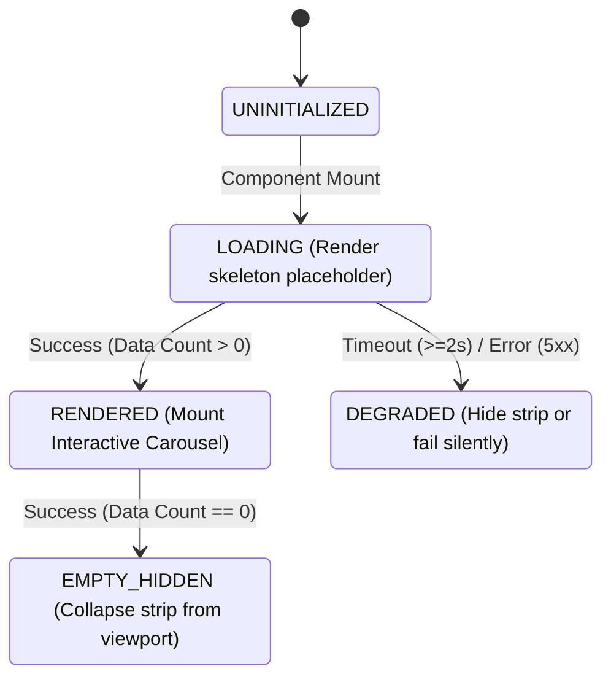

# Explore Content — Software Design Document (SDD)

## iGOT Karmayogi: Course Catalog, Learner Portal, Mobile App, UI/UX Revamp & Explore by Theme

### 1. Document Control & Metadata

| Attribute | Specification Details |
|---|---|
| **Document Identifier** | `IGOT-SDD-LRN-CAT-001` |
| **Document Version** | `1.0.0` |
| **Document Status** | Approved Baseline |
| **Platform** | iGOT Karmayogi ([*karmayogibharat.atlassian.net*](http://karmayogibharat.atlassian.net/)) |
| **Target Audience** | Solution Architects, Technical Leads, Backend/Frontend Engineers, DevOps/SRE, QA Automation Engineers |
| **SRS Reference** | `IGOT-SRS-LRN-CAT-001` |
| **Primary Jira Epics** | [KB-9332: Q8 \| Ad-Hoc \| Course Catalog \| Learner Portal](https://karmayogibharat.atlassian.net/browse/KB-9332) (KB Approved) (Course Catalog), [KB-12709: Q12 \| UI/UX Homepage Revamp](https://karmayogibharat.atlassian.net/browse/KB-12709) (Prod Deployed) (Homepage UI/UX Revamp), [KB-14810: Q13 \| Custom Section on Homepage for Senior Officials](https://karmayogibharat.atlassian.net/browse/KB-14810) (Prod Deployed) (Custom Section for Senior Officials) |
| **Primary Jira Stories** | [KB-6446: Q6 \| Learner \| Mobile & Portal \| Explore content by Competency area, theme, sub-theme](https://karmayogibharat.atlassian.net/browse/KB-6446) (Prod Deployed), [KB-9202: Q8 \| Course catalog \| Learner Portal & M-site](https://karmayogibharat.atlassian.net/browse/KB-9202) (Prod Deployed), [KB-9333: Q8 \| Implement Course Catalog Filters \| Course Catelog \| Learner Portal & Mobile App & M-Site](https://karmayogibharat.atlassian.net/browse/KB-9333) (Prod Deployed), [KB-9334: Q8 \| Implement Sorting Options for Course Catalog \| \| Course Catelog \| Learner Portal & Mobile App & M-Site](https://karmayogibharat.atlassian.net/browse/KB-9334) (Prod Deployed), [KB-9337: Q8 \| Course catalog \| Mobile App](https://karmayogibharat.atlassian.net/browse/KB-9337) (Open), [KB-9484: Q8 \| Data Tracking \| Catalog](https://karmayogibharat.atlassian.net/browse/KB-9484) (DEV IN PROGRESS), [KB-12710: Q12 \| UI/UX Homepage Revamp - Web](https://karmayogibharat.atlassian.net/browse/KB-12710) (Prod Deployed), [KB-13889: Q12 \| UI/UX Homepage Revamp - Mobile](https://karmayogibharat.atlassian.net/browse/KB-13889) (Prod Deployed), [KB-13959: Q12 \| UI/UX Homepage Revamp - Web - Telemetry](https://karmayogibharat.atlassian.net/browse/KB-13959) (Prod Deployed), [KB-14889: Q13 \| Web \| Custom Section on Homepage for Senior Officials](https://karmayogibharat.atlassian.net/browse/KB-14889) (Prod Deployed), [KB-14890: Q13 \| Mobile \| Custom Section on Homepage for Senior Officials](https://karmayogibharat.atlassian.net/browse/KB-14890) (Prod Deployed), [KB-14891: Q13 \| Course Visit Telemetry](https://karmayogibharat.atlassian.net/browse/KB-14891) (Prod Deployed) |
| **Authoritative Documentation** | 1. Q8 PRD: [KB-9332 \| Q8 \| Course Catalog \| Learner Portal & Mobile App](https://karmayogibharat.atlassian.net/wiki/spaces/TPT/pages/359792790/KB-9332+Q8+Course+Catalog+Learner+Portal+Mobile+App) 2. Q12 BRD: [Q12 \| BRD \| UI/UX Revamp](https://karmayogibharat.atlassian.net/wiki/spaces/TPT/pages/1093795854/Q12+BRD+UI+UX+Revamp) 3. Q12 FRS: [Q12 \| FRS \| UI/UX Revamp](https://karmayogibharat.atlassian.net/wiki/spaces/TPT/pages/1093795907/Q12+FRS+UI+UX+Revamp) 4. Q13 BRD: [Q13 \| BRD \| Explore by Theme – Senior Officials Learning Discovery](https://karmayogibharat.atlassian.net/wiki/spaces/TPT/pages/1153662986/Q13+BRD+Explore+by+Theme+Senior+Officials+Learning+Discovery) 5. Q13 FRS: [Q13 \| FRS \| Explore by Theme – Senior Officials Learning Discovery](https://karmayogibharat.atlassian.net/wiki/spaces/TPT/pages/1155072001/Q13+FRS+Explore+by+Theme+Senior+Officials+Learning+Discovery) |
| **System Architecture Pattern** | Microservices Architecture with Federated API Gateway, CQRS/Elasticsearch Indexing, and Event-Driven Telemetry |
| **Effective Date** | October 27, 2026 |

### 2. Introduction & Architectural Objectives

#### 2.1 Purpose & Scope

This Software Design Document (SDD) specifies the structural, interaction, and data models governing the delivery of:

1. **Centralized Course Catalog:** Faceted search, multi-taxonomy index queries (KCM v6), and sorting engine.
2. **Modular Homepage Shell:** Collapsible Left Navigation, Top Header, and independent asynchronous dynamic content strips (`Continue Where You Left Off`, `Trending on iGOT`, `Featured AI Courses`, `30 Minutes or Less`).
3. **Explore by Theme for Senior Officials:** Designation- and organization-evaluated dynamic carousel and scoped catalog view.
4. **Telemetry Subsystem:** Asynchronous event generation, client buffering, and ingestion via Kafka pipelines.

#### 2.2 Architectural Goals & Quality Attributes

- **Zero Cross-Section Blocking:** Homepage components must render in decoupled UI containers using React Error Boundaries.
- **Strict Multi-Tenant Content Isolation:** Role and theme exploration queries must compute a strict set intersection with MDO access controls to prevent exposure of unentitled or unlisted content.
- **Elasticsearch Query Optimization:** Multi-faceted aggregations must execute within under high concurrency.
- **Resilient Configuration Resolution:** Dynamic runtime rules (e.g., Senior Official cadre mappings) must load through a multi-tier cache to prevent database saturation.

### 3. System Architecture & Context Diagram

The discovery subsystem sits behind the Kong API Gateway and integrates with Search, Configuration, Content, Progress, and Telemetry microservices:



### 4. Component Architecture & Subsystems

**COMPONENT DECOMPOSITION**

1. **DISCOVERY & SEARCH SUBSYSTEM**
   - Search Controller (POST /api/content/v1/search)
   - Facet Aggregator: Dynamic term & range buckets (Duration, Rating, Language, KCM)
   - Query Compiler: Translates user UI selections into boolean compound ES queries
2. **HOMEPAGE ORCHESTRATION SUBSYSTEM**
   - Shell Manager: Top Header, Left Nav Rail, and View More drawer
   - Dynamic Strip Loader: Parallel asynchronous dispatch for all body strips
   - Progress Resume Engine: Queries active consumption state for highest updated item
3. **THEMATIC GOVERNANCE SUBSYSTEM (SENIOR OFFICIALS)**
   - Eligibility Interceptor: Evaluates Org ID + Designation against Form-Config rules
   - Cadre Resolver: Maps user to Group 1 (DS/Dir) or Group 2 (JS/AS/Sec)
   - Thematic Query Filter: Injects theme ID and visibility boundaries into Search API
4. **TELEMETRY & EVENT DISPATCH SUBSYSTEM**
   - Event Fabricator: Builds standard envelope schema (CS_DISCOVERY_EVENT)
   - Offline Storage / Buffer: Local storage buffer during network disruption
   - Kafka Producer Gateway: Flushes events to ingestion pipeline

### 5. Detailed Component Design & Sequence Workflows

#### 5.1 Workflow 1: Homepage Initialization & Role-Gated Dynamic Strip Rendering

When a learner logs in, the client shell initializes and evaluates whether to render standard strips alongside the role-gated **Explore by Theme** section.



#### 5.2 Workflow 2: Centralized Catalog Multi-Faceted Query & Sorting Execution

Execution flow when a learner applies multi-dimensional facets and alters sort orders.



### 6. Data Models & Database Schemas

#### 6.1 Elasticsearch Index Schema: `igot_content_catalog_v2`

This index serves both the Centralized Catalog and Thematic discovery queries.

```json
{
  "mappings": {
    "properties": {
      "identifier": {
        "type": "keyword"
      },
      "name": {
        "type": "text",
        "analyzer": "standard",
        "fields": {
          "raw": {
            "type": "keyword"
          }
        }
      },
      "description": {
        "type": "text"
      },
      "primaryCategory": {
        "type": "keyword"
      },
      "contentType": {
        "type": "keyword"
      },
      "status": {
        "type": "keyword"
      },
      "visibility": {
        "type": "keyword"
      },
      "ownershipType": {
        "type": "keyword"
      },
      "createdFor": {
        "type": "keyword"
      },
      "duration": {
        "type": "integer"
      },
      "averageRating": {
        "type": "float"
      },
      "totalRatingsCount": {
        "type": "integer"
      },
      "totalEnrolledCount": {
        "type": "integer"
      },
      "rolling7DaysEnrollmentCount": {
        "type": "integer"
      },
      "lastPublishedOn": {
        "type": "date"
      },
      "createdOn": {
        "type": "date"
      },
      "language": {
        "type": "keyword"
      },
      "sector": {
        "type": "keyword"
      },
      "competencies_v6": {
        "type": "nested",
        "properties": {
          "competencyAreaId": {
            "type": "keyword"
          },
          "competencyAreaName": {
            "type": "keyword"
          },
          "competencyThemeId": {
            "type": "keyword"
          },
          "competencyThemeName": {
            "type": "keyword"
          },
          "competencySubThemeId": {
            "type": "keyword"
          },
          "competencySubThemeName": {
            "type": "keyword"
          }
        }
      },
      "thematicTaxonomy": {
        "type": "nested",
        "properties": {
          "themeId": {
            "type": "keyword"
          },
          "themeName": {
            "type": "keyword"
          },
          "targetCadreGroups": {
            "type": "keyword"
          },
          "targetOrgs": {
            "type": "keyword"
          }
        }
      }
    }
  }
}
```

#### 6.2 Relational / Configuration Schema: Form-Config Cadre Mapping

Entity configuration stored in PostgreSQL (`application_config_db`) and cached in Redis.

```sql
CREATE TABLE form_config_thematic_mapping (
    mapping_id VARCHAR(64) PRIMARY KEY,
    organization_id VARCHAR(64) NOT NULL,
    designation_name VARCHAR(128) NOT NULL,
    cadre_group VARCHAR(32) NOT NULL CHECK (cadre_group IN ('GROUP_1', 'GROUP_2')),
    is_active BOOLEAN DEFAULT TRUE,
    created_at TIMESTAMP WITH TIME ZONE DEFAULT CURRENT_TIMESTAMP,
    updated_at TIMESTAMP WITH TIME ZONE DEFAULT CURRENT_TIMESTAMP,
    CONSTRAINT uq_org_designation UNIQUE (organization_id, designation_name)
);

CREATE INDEX idx_form_config_org_desig ON form_config_thematic_mapping (organization_id, designation_name) WHERE is_active = TRUE;
```

### 7. Interface & API Specifications

#### 7.1 Unified Catalog Search Endpoint

- **Route:** `POST /api/content/v1/search`
- **Headers:** `Authorization: Bearer <JWT>`, `Content-Type: application/json`
- **Request Contract:**

```json
{
  "request": {
    "filters": {
      "status": [
        "Live"
      ],
      "primaryCategory": [
        "Course",
        "Program",
        "Assessment"
      ],
      "sector": [
        "Governance & Public Admin"
      ],
      "language": [
        "English",
        "Hindi"
      ],
      "duration": {
        "min": 0,
        "max": 1800
      },
      "averageRating": {
        "gte": 4.0
      }
    },
    "sort_by": {
      "averageRating": "desc"
    },
    "offset": 0,
    "limit": 20,
    "facets": [
      "sector",
      "duration",
      "averageRating",
      "language",
      "primaryCategory"
    ]
  }
}
```

- **Response Contract:**

```json
{
  "responseCode": "OK",
  "result": {
    "count": 42,
    "content": [
      {
        "identifier": "do_1138928374",
        "name": "Public Leadership in Digital Governance",
        "primaryCategory": "Course",
        "duration": 1200,
        "averageRating": 4.6,
        "totalRatingsCount": 184,
        "posterImage": "https://cdn.igot.gov.in/content/do_1138928374/banner.png",
        "sector": "Governance & Public Admin",
        "lastPublishedOn": "2026-08-15T06:30:00.000Z"
      }
    ],
    "facets": [
      {
        "name": "sector",
        "values": [
          {
            "name": "Governance & Public Admin",
            "count": 42
          },
          {
            "name": "Economic Dev & Industry",
            "count": 18
          }
        ]
      }
    ]
  }
}
```

#### 7.2 Explore by Theme Scoped Endpoint

- **Route:** `POST /api/content/v1/thematic/search`
- **Request Contract:**

```json
{
  "request": {
    "themeId": "PUBLIC_LEADERSHIP",
    "cadreGroup": "GROUP_2",
    "userOrgId": "org-central-001",
    "query": "Strategy",
    "limit": 10,
    "offset": 0
  }
}
```

- **Query Transformation Logic:**

```text
ES Query = MustMatch(status="Live")
       AND MustMatch(thematicTaxonomy.themeId="PUBLIC_LEADERSHIP")
       AND (MustMatch(thematicTaxonomy.targetCadreGroups="GROUP_2") OR MustNotExist(thematicTaxonomy.targetCadreGroups))
       AND (MustMatch(visibility="Default") OR (MustMatch(visibility="Private") AND MustMatch(createdFor="org-central-001")))
```

#### 7.3 Telemetry Payload Contract

- **Route:** `POST /api/data/v1/telemetry`
- **Event Type:** `INTERACTION`

```json
{
  "eid": "INTERACTION",
  "ets": 1793095560000,
  "ver": "3.0",
  "mid": "mid:7f28b49e-1082-4f3b-8219-bf0c681b99a1",
  "actor": {
    "id": "712020:2b1926b8-ba53-4277-9b45-3508667c6b3d",
    "type": "User"
  },
  "context": {
    "env": "learn",
    "cdata": [
      {
        "id": "PUBLIC_LEADERSHIP",
        "type": "Theme"
      },
      {
        "id": "GROUP_1",
        "type": "CadreGroup"
      },
      {
        "id": "KB-14810",
        "type": "Feature"
      }
    ]
  },
  "edata": {
    "id": "THEME_COURSE_VISIT",
    "type": "click",
    "subType": "strip-card-selection",
    "target": "do_1138928374"
  }
}
```

### 8. System State, Business Logic & Failure Handling

#### 8.1 State Transition Model: Homepage Dynamic Content Strips



#### 8.2 Failure Modes and Resilience Strategy

1. **Form-Config Unavailability or Cache Miss:**
  - *Risk:* Designation lookups fail, risking unrendered theme strips for senior officials (as encountered in [KB-15334: BE | Explore by theme is missing for L0 Org's State User](https://karmayogibharat.atlassian.net/browse/KB-15334) (Open)).
  - *Mitigation:* Implement a three-tier cache architecture: Client SessionStorage () Redis Cluster () PostgreSQL fallback. If the Form-Config API returns a `5xx` error, fall back to cached session claims without breaking the rest of the homepage.

2. **Elasticsearch Cluster Degradation:**
  - *Risk:* Faceted aggregation overhead causes query queueing and increased latency.
  - *Mitigation:* Cap `size: 0` on aggregation requests when only counts are needed; apply query circuit breaking if , falling back to static curated lists.

3. **Telemetry Ingestion Disconnection:**
  - *Risk:* Ingestion outages discard valuable behavioral tracking events.
  - *Mitigation:* The client-side telemetry wrapper buffers up to events in `IndexedDB`. Buffered events flush automatically when network connectivity is restored.

### 9. Security, Access Control & Data Governance

#### 9.1 Multi-Tenant Access Boundary Enforcement

To enforce strict multi-tenant governance, the Search Service automatically wraps all user queries in an access filter predicate:

Under no circumstances may client-supplied parameters override the authenticated token's `UserOrgId`.

#### 9.2 Designation Mapping Uniqueness & Security

- To prevent privilege escalation or ambiguous UI states, `uq_org_designation` enforces that an organization-designation pair cannot map to both `GROUP_1` and `GROUP_2`.
- Changes to cadre mappings in Form-Config are audited in the `form_config_audit_log` table with the actor's Account ID and a before/after JSON diff.
