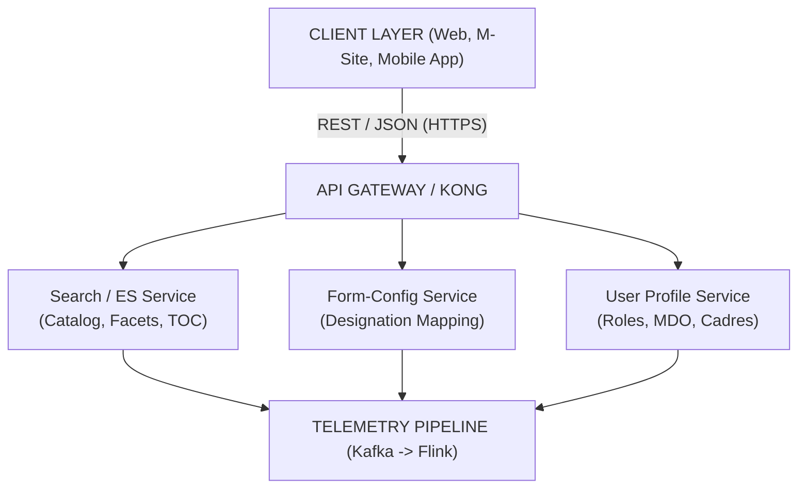

# Explore Content — Software Requirements Specification (SRS)

## iGOT Karmayogi: Course Catalog, Learner Portal, Mobile App, UI/UX Revamp & Explore by Theme

### 2. Introduction

#### 2.1 Purpose

This Software Requirements Specification (SRS) establishes the complete, authoritative functional, architectural, and non-functional requirements for the Learner Discovery, Centralized Course Catalog, Homepage UI/UX Revamp, and Role-Gated Thematic Exploration modules across the iGOT Karmayogi platform. It translates higher-level business definitions (BRD/PRD) into verifiable technical specifications for development and quality engineering.

#### 2.2 Scope

The scope encompasses all learner-facing discovery endpoints across Desktop Web, Mobile Browser (M-site), and Native Mobile applications:

1. **Centralized Course Catalog:** Unified indexing, multi-faceted filtering, and sorting of Courses, Programs, Case Studies, and Assessments.
2. **Homepage UI/UX Architecture:** Three-zone layout (collapsible Left Navigation, Top Header, modular Homepage body with dynamic strips).
3. **Explore by Theme for Senior Officials:** Role-gated discovery for Deputy Secretary through Secretary cadres across five national governance themes.
4. **Telemetry & Event Ingestion:** Standardized telemetry pipelines capturing user discovery and consumption interactions.

#### 2.3 Definitions, Acronyms, and Abbreviations

- **APAR:** Annual Performance Appraisal Report.
- **CBP:** Capacity Building Plan.
- **DS / DIR / JS / AS / SEC:** Deputy Secretary, Director, Joint Secretary, Additional Secretary, Secretary.
- **Form-Config Service:** Dynamic runtime JSON configuration management service (`application-config-web`).
- **FRS:** Functional Requirements Specification.
- **GIGW:** Guidelines for Indian Government Websites.
- **KCM:** Karmayogi Competency Model (Taxonomy: Competency Area Theme Sub-theme).
- **MDO:** Ministry, Department, or Organization.
- **RBAC:** Role-Based Access Control.
- **SPV:** Special Purpose Vehicle (Karmayogi Bharat).
- **TOC:** Table of Contents (Course Detail / Syllabus view).

### 3. Overall Description

#### 3.1 Product Perspective & Context Architecture

The discovery subsystems interface directly with the core iGOT platform microservices:



#### 3.2 User Classes and Characteristics

- **General Learner:** Civil servants discovering foundational, domain, and behavioral courses.
- **Senior Official (Executive Cadre):** Officers categorized into Group 1 (DS/Director) and Group 2 (JS/AS/Secretary) requiring high-level strategic governance topics.
- **Privileged Admin (MDO/SPV/Content Admin):** Administrative personnel requiring access to specialized management consoles via Quick Action entry points.

#### 3.3 Operating Environment

- **Web Client:** Modern evergreen browsers (Chromium , Firefox , Safari , Edge ).
- **Mobile Web (M-site):** Webkit and Blink mobile engines at responsive viewports ( to ).
- **Native Mobile Apps:** Android (API Level 26+) and iOS (iOS 15.0+).

#### 3.4 Design & Implementation Constraints

- **Decoupled Strip Loading:** Failure or latency in an individual content strip must not block adjacent homepage modules or the core navigation shell.
- **Zero Access Escalation:** The Explore by Theme module must strictly intersect role-thematic mappings with existing MDO course visibility; private or restricted MDO content must never be visible to unentitled users.
- **Static Internationalization Baseline:** Top Navigation language selector remains locked to English as the primary operational baseline for Q12/Q13.

### 4. System Features & Functional Requirements

**MODULE 1: CENTRALIZED COURSE CATALOG & DISCOVERY**

#### 4.1 Feature: Centralized Catalog Navigation & Browsing

- **SRS-REQ-CAT-01: Global Catalog Route**
  - *Description:* The platform shall provide a persistent global route (`/app/learn/catalog`) accessible via the Left Navigation item "Explore Content".
  - *Input:* User click on "Explore Content" or direct URL navigation.
  - *Processing:* System queries the content repository for all published learning objects.
  - *Output:* Full-page catalog view with default sorting set to `Recently Added`.
  - *Traceability:* [KB-9202: Q8 | Course catalog | Learner Portal & M-site](https://karmayogibharat.atlassian.net/browse/KB-9202) (Prod Deployed), [KB-9332: Q8 | Ad-Hoc | Course Catalog | Learner Portal](https://karmayogibharat.atlassian.net/browse/KB-9332) (KB Approved).

#### 4.2 Feature: Multi-Faceted Catalog Filtering

- **SRS-REQ-CAT-02: Content Type Hierarchy**
  - *Description:* Catalog results shall be filterable across discrete learning formats:
    - `Courses` (Standalone Course, Moderated Course)
    - `Programs` (Curated Program, Blended Program, Invite-Only Program, Moderated Program)
    - `Case Studies` (Standalone Case Study)
    - `Assessments` (Standalone Assessment, Competency Assessment, Moderated Assessment)

  - *Traceability:* [KB-9333: Q8 | Implement Course Catalog Filters | Course Catelog | Learner Portal & Mobile App & M-Site](https://karmayogibharat.atlassian.net/browse/KB-9333) (Prod Deployed), Q8 PRD.

- **SRS-REQ-CAT-03: Multi-Dimension Facet Options**
  - *Description:* The filter drawer shall expose the following deterministic facet dimensions:
    - **Governance Sectors (8):** Human Capital & Skill Dev; Science, Tech & Innovation; Agriculture & Natural Resources; Governance & Public Admin; Infrastructure & Transportation; Economic Dev & Industry; Culture, Media & Communication; Social Dev & Welfare.
    - **Duration Buckets:** `0-30 Mins`, `30-60 Mins`, `60-90 Mins`, `90 mins and above`.
    - **User Ratings:** `4.5 & Above`, `4.0 & Above`, `3.5 & Above`, `3.0 & Above`.
    - **Language:** English, Hindi, and supported 8th Schedule regional languages.
    - **Competency Taxonomy (KCM v6):** Competency Area Competency Theme Sub-Theme.
    - **Content Provider:** Distinct published MDO / Knowledge Partner entities.

  - *Processing Logic:* Filters across different dimensions shall combine using boolean `AND`; multiple selections within the same dimension shall combine using boolean `OR`. Real-time content count badges must update on each facet toggle.
  - *Traceability:* [KB-9333: Q8 | Implement Course Catalog Filters | Course Catelog | Learner Portal & Mobile App & M-Site](https://karmayogibharat.atlassian.net/browse/KB-9333) (Prod Deployed), [KB-6446: Q6 | Learner | Mobile & Portal | Explore content by Competency area, theme, sub-theme](https://karmayogibharat.atlassian.net/browse/KB-6446) (Prod Deployed).

#### 4.3 Feature: Catalog Sorting Engine

- **SRS-REQ-CAT-04: Deterministic Sorting**
  - *Description:* The catalog shall provide an explicit sorting control supporting:
    - `Recently Added` (Primary: `lastPublishedOn DESC`, Secondary: `createdOn DESC`)
    - `Highest Rated` (Primary: `averageRating DESC`, Minimum threshold: 1 rating, Secondary: `totalRatingsCount DESC`)

  - *Traceability:* [KB-9334: Q8 | Implement Sorting Options for Course Catalog | | Course Catelog | Learner Portal & Mobile App & M-Site](https://karmayogibharat.atlassian.net/browse/KB-9334) (Prod Deployed).

**MODULE 2: LEARNER PORTAL & HOMEPAGE UI/UX REVAMP**

#### 4.4 Feature: Navigation Architecture

- **SRS-REQ-NAV-01: Collapsible Left Navigation Drawer**
  - *Description:* The primary application shell shall render a standardized left navigation rail containing:
    - Home (`/app/home`)
    - Explore Content (`/app/learn/catalog`)
    - My Learning (`/app/my-learning`)
    - Learner Passbook (`/app/passbook`)
    - iGOT Community (`/app/community`)
    - Events (`/app/events`)
    - Peer Validation (`/app/peer-validation`)

  - *Overflow Behavior:* Secondary links shall be grouped under a vertical "View More" disclosure control.
  - *Traceability:* [KB-12710: Q12 | UI/UX Homepage Revamp - Web](https://karmayogibharat.atlassian.net/browse/KB-12710) (Prod Deployed), Q12 FRS (FR-02, FR-03).

- **SRS-REQ-NAV-02: Role-Gated Quick Actions**
  - *Description:* The left navigation panel shall evaluate user JWT claims and render authorized management portal shortcuts:
    - `Help Center` (Default: All users)
    - `MDO Portal` (Requires `MDO_ADMIN` or `MDO_LEADER` role)
    - `Content Portal` (Requires `CONTENT_CREATOR` or `CONTENT_REVIEWER` role)
    - `SPV Portal` (Requires `SPV_ADMIN` role)

  - *Traceability:* [KB-12710: Q12 | UI/UX Homepage Revamp - Web](https://karmayogibharat.atlassian.net/browse/KB-12710) (Prod Deployed), Q12 FRS (FR-05).

- **SRS-REQ-NAV-03: Scoped Category Search**
  - *Description:* The Top Navigation search bar shall force search execution scoped by category pills (`Courses`, `Programs`, `Assessments`, `Providers`). The unguided "All" category pill is deprecated and permanently removed.
  - *Traceability:* [KB-12710: Q12 | UI/UX Homepage Revamp - Web](https://karmayogibharat.atlassian.net/browse/KB-12710) (Prod Deployed), Q12 FRS (FR-08).

- **SRS-REQ-NAV-04: Homepage Light / Dark Theme Boundary**
  - *Description:* A theme toggle control shall allow switching between Light Mode and Dark Mode. The application of the selected theme shall be strictly restricted to the homepage container; course players, assessments, and deeper administrative routes shall remain unaffected.
  - *Traceability:* [KB-12710: Q12 | UI/UX Homepage Revamp - Web](https://karmayogibharat.atlassian.net/browse/KB-12710) (Prod Deployed), Q12 FRS (FR-10).

#### 4.5 Feature: Homepage Dynamic Body & Content Strips

- **SRS-REQ-HOM-01: Hero Banner Carousel**
  - *Description:* The homepage shall render a hero banner carousel containing 3 to 4 curated slides (displaying 1 active central slide and partial views of adjacent slides). Slides must support rich media, descriptive text, and deep links.
  - *Traceability:* [KB-12710: Q12 | UI/UX Homepage Revamp - Web](https://karmayogibharat.atlassian.net/browse/KB-12710) (Prod Deployed), Q12 FRS (FR-13).

- **SRS-REQ-HOM-02: Personalized Welcome Greeting**
  - *Description:* The system shall evaluate user session metadata to render:
    - `Welcome, <First Name>` (For newly registered users without session history)
    - `Welcome Back, <First Name>` (For returning users with prior login timestamps)

  - *Traceability:* [KB-12710: Q12 | UI/UX Homepage Revamp - Web](https://karmayogibharat.atlassian.net/browse/KB-12710) (Prod Deployed), Q12 FRS (FR-14).

- **SRS-REQ-HOM-03: Continue Where You Left Off**
  - *Description:* The system shall render a dedicated progress card displaying the learner's most recently consumed in-progress learning object:
    - Displays: Thumbnail, Title, Content Type, Overall Progress percentage bar.
    - Primary CTA: "Resume" button routing directly to the last active leaf-node unit in the TOC player.
    - Exception Rule: If no in-progress courses exist, the widget is hidden from the DOM.

  - *Traceability:* [KB-12710: Q12 | UI/UX Homepage Revamp - Web](https://karmayogibharat.atlassian.net/browse/KB-12710) (Prod Deployed), Q12 FRS (FR-15).

- **SRS-REQ-HOM-04: Trending on iGOT Content Strip**
  - *Description:* The system shall display a horizontal card carousel populated by courses with the highest aggregate enrollment counts over a rolling 7-day calculation window (`currentTime - 7 days`).
  - *Traceability:* [KB-12710: Q12 | UI/UX Homepage Revamp - Web](https://karmayogibharat.atlassian.net/browse/KB-12710) (Prod Deployed), Q12 FRS (FR-24).

- **SRS-REQ-HOM-05: Micro-Learning Content Strip (30 Minutes or Less)**
  - *Description:* The system shall display a content carousel filtering published courses where the total duration attribute satisfies: .
  - *Traceability:* [KB-12710: Q12 | UI/UX Homepage Revamp - Web](https://karmayogibharat.atlassian.net/browse/KB-12710) (Prod Deployed), Q12 FRS (FR-26).

**MODULE 3: EXPLORE BY THEME FOR SENIOR OFFICIALS**

#### 4.6 Feature: Role Gating & Thematic Discovery

- **SRS-REQ-THM-01: Eligibility Verification Engine**
  - *Description:* The "Explore by Theme" strip shall render if and only if the authenticated learner's designation maps to an authorized Cadre Group within their Organization ID in the Form-Config service:
    - **Cadre Group 1:** Deputy Secretary, Director.
    - **Cadre Group 2:** Joint Secretary, Additional Secretary, Secretary.

  - *Failure Behavior:* If the designation is unmapped or the MDO is non-participating, the strip must not be rendered.
  - *Traceability:* [KB-14810: Q13 | Custom Section on Homepage for Senior Officials](https://karmayogibharat.atlassian.net/browse/KB-14810) (Prod Deployed), [KB-14889: Q13 | Web | Custom Section on Homepage for Senior Officials](https://karmayogibharat.atlassian.net/browse/KB-14889) (Prod Deployed), Q13 FRS (FR-001, FR-002, FR-014).

- **SRS-REQ-THM-02: Five National Governance Themes**
  - *Description:* The thematic strip shall present five structured selection tabs:
    - `Public Leadership` (**Default Selected Tab on Load**)
    - `Technology & Data Governance`
    - `Environment & Climate`
    - `Economy & Public Finance`
    - `Governance & Public Policy`

  - *Interaction:* Clicking a tab dynamically refreshes the associated horizontal course card list without a full page reload.
  - *Traceability:* [KB-14889: Q13 | Web | Custom Section on Homepage for Senior Officials](https://karmayogibharat.atlassian.net/browse/KB-14889) (Prod Deployed), Q13 FRS (FR-003, FR-004, FR-005).

- **SRS-REQ-THM-03: Preserved RBAC & Visibility Intersect**
  - *Description:* Course entities returned under any theme must strictly satisfy the intersection rule:<br><br>No private or restricted MDO coursework shall be exposed across organizational boundaries.
  - *Traceability:* [KB-14889: Q13 | Web | Custom Section on Homepage for Senior Officials](https://karmayogibharat.atlassian.net/browse/KB-14889) (Prod Deployed), Q13 BRD (BR-006), Q13 FRS (FR-008).

- **SRS-REQ-THM-04: Thematic Catalog View All & In-Theme Search**
  - *Description:* Clicking "View All" on any theme shall route to `/app/learn/theme-catalog?themeId=<ID>`.
  - *In-Theme Search:* The page shall include a dedicated search field that executes queries scoped strictly to the selected thematic subset and designation group.
  - *Traceability:* [KB-14889: Q13 | Web | Custom Section on Homepage for Senior Officials](https://karmayogibharat.atlassian.net/browse/KB-14889) (Prod Deployed), Q13 FRS (FR-009 to FR-012).

**MODULE 4: TELEMETRY & AUDIT INSTRUMENTATION**

#### 4.7 Feature: Telemetry Pipeline

- **SRS-REQ-TEL-01: Standard Interaction Telemetry**
  - *Description:* The platform client shall dispatch telemetry payloads to the Kafka intake pipeline capturing:
    - `CATALOG_FILTER_APPLIED` (Filter dimension, selected value, resulting match count)
    - `CATALOG_SORT_CHANGED` (Selected sort option)
    - `HOMEPAGE_RESUME_CLICKED` (Course ID, Unit ID, progress percentage at resume)
    - `THEME_TAB_SWITCH` (Previous Theme ID, New Theme ID, User Designation Group)
    - `THEME_COURSE_VISIT` (Course ID, Theme ID, Cadre Group, Source: Strip vs ViewAll)

  - *Traceability:* [KB-9484: Q8 | Data Tracking | Catalog](https://karmayogibharat.atlassian.net/browse/KB-9484) (DEV IN PROGRESS), [KB-13959: Q12 | UI/UX Homepage Revamp - Web - Telemetry](https://karmayogibharat.atlassian.net/browse/KB-13959) (Prod Deployed), [KB-14891: Q13 | Course Visit Telemetry](https://karmayogibharat.atlassian.net/browse/KB-14891) (Prod Deployed).

### 5. External Interface Requirements

#### 5.1 User Interfaces & Design System

- **Design Standards:** Interfaces must conform strictly to Karmayogi Bharat Design System guidelines.
- **Responsive Breakpoints:**
  - Desktop: (Left Nav persistent, multi-column grids).
  - Tablet: to (Left Nav collaspes into icon bar).
  - Mobile Web (M-site): (Left Nav becomes an off-canvas drawer; card carousels convert to single-item scroll).

- **Native QR Code Bridge:** Web Left Nav bottom bar must include a dynamic modal rendering verified Android Play Store and Apple App Store QR codes for native app onboarding.

#### 5.2 Software Interfaces & Backend Contracts

- **Search / Catalog Service (Elasticsearch):**
  - Protocol: `POST /api/content/v1/search`
  - Body Contract:

```json
{
  "request": {
    "filters": {
      "primaryCategory": [
        "Course",
        "Program",
        "Assessment"
      ],
      "sector": [
        "Governance & Public Admin"
      ],
      "duration": {
        "min": 0,
        "max": 1800
      },
      "status": [
        "Live"
      ]
    },
    "sort_by": {
      "lastPublishedOn": "desc"
    },
    "limit": 20,
    "offset": 0
  }
}
```

- **Form-Config Service** (`application-config-web`):
  - Protocol: `GET /api/form/v1/read`
  - Payload Contract (Designation Mapping):

```json
{
  "type": "exploreByThemeConfig",
  "orgId": "org-central-001",
  "data": {
    "cadreMappings": [
      {
        "designation": "Director",
        "cadreGroup": "GROUP_1"
      },
      {
        "designation": "Joint Secretary",
        "cadreGroup": "GROUP_2"
      }
    ],
    "activeThemes": [
      "PUBLIC_LEADERSHIP",
      "TECH_DATA",
      "CLIMATE",
      "ECONOMY",
      "GOVERNANCE"
    ]
  }
}
```

### 6. Non-Functional Requirements (NFRs)

#### 6.1 Performance & Scalability (NFR-PERF)

- **NFR-PERF-01 (Homepage Bundle & Load Latency):** The initial Paint (FCP) of the revamped homepage shall not exceed and Time to Interactive (TTI) shall not exceed over a standard mobile connection.
- **NFR-PERF-02 (Catalog Facet Query SLA):** Elasticsearch multi-facet queries must resolve with percentile response latency under a peak load of .
- **NFR-PERF-03 (Notification Refresh Decoupling):** Notification polling shall occur asynchronously on a timer; real-time push polling must be suppressed to avoid unneeded API load.

#### 6.2 Security, Privacy & Multi-Tenancy (NFR-SEC)

- **NFR-SEC-01 (Strict Multi-Tenant Isolation):** Inter-MDO content separation must be validated at the search query level. Private courses tagged to Organization must never return in search results or thematic carousels for learners belonging to Organization .
- **NFR-SEC-02 (Designation Mapping Integrity):** The Form-Config service must reject configuration schemas where a single designation within an organization is assigned to multiple cadre groups simultaneously.

#### 6.3 Reliability & Fault Tolerance (NFR-REL)

- **NFR-REL-01 (Graceful Strip Degradation):** All homepage sections (Hero Carousel, Continue Learning, Trending, Explore by Theme) must be wrapped in isolated React Error Boundaries. The failure or timeout () of any single strip must fail silently, allowing the remainder of the homepage to render seamlessly.
- **NFR-REL-02 (Telemetry Buffer Fallback):** Client-side telemetry failures must be buffered in IndexedDB (up to events) and retried with exponential backoff without disrupting the user interface.

#### 6.4 Usability & Accessibility (NFR-ACC)

- **NFR-ACC-01 (Contrast & Keyboard Navigation):** All visual components must meet WCAG 2.1 Level AA color contrast requirements ( for normal text) and support full keyboard tab traversal.

### 7. Requirements Traceability Matrix (RTM)

| SRS Requirement ID | Requirement Summary | Source Document | Related Jira Ticket | Verification Method | Traceability Status |
|---|---|---|---|---|---|
| **SRS-REQ-CAT-01** | Global Catalog Route & Default Sorting | Q8 PRD | [KB-9202: Q8 \| Course catalog \| Learner Portal & M-site](https://karmayogibharat.atlassian.net/browse/KB-9202) (Prod Deployed) | Test / Inspection | **Fully mapped** |
| **SRS-REQ-CAT-02** | Content Type Filtering Hierarchy | Q8 PRD | [KB-9333: Q8 \| Implement Course Catalog Filters \| Course Catelog \| Learner Portal & Mobile App & M-Site](https://karmayogibharat.atlassian.net/browse/KB-9333) (Prod Deployed) | Test / Verification | **Fully mapped** |
| **SRS-REQ-CAT-03** | Multi-Facet Dimensions & KCM v6 Taxonomy | Q8 PRD, Ticket Scope | [KB-9333: Q8 \| Implement Course Catalog Filters \| Course Catelog \| Learner Portal & Mobile App & M-Site](https://karmayogibharat.atlassian.net/browse/KB-9333) (Prod Deployed), [KB-6446: Q6 \| Learner \| Mobile & Portal \| Explore content by Competency area, theme, sub-theme](https://karmayogibharat.atlassian.net/browse/KB-6446) (Prod Deployed) | Test / Inspection | **Fully mapped** |
| **SRS-REQ-CAT-04** | Recently Added & Highest Rated Sorting | Q8 PRD | [KB-9334: Q8 \| Implement Sorting Options for Course Catalog \| \| Course Catelog \| Learner Portal & Mobile App & M-Site](https://karmayogibharat.atlassian.net/browse/KB-9334) (Prod Deployed) | Test / Verification | **Fully mapped** |
| **SRS-REQ-NAV-01** | Standardized Left Nav Rail & View More | Q12 BRD/FRS | [KB-12710: Q12 \| UI/UX Homepage Revamp - Web](https://karmayogibharat.atlassian.net/browse/KB-12710) (Prod Deployed) | Inspection / UI Test | **Fully mapped** |
| **SRS-REQ-NAV-02** | Role-Gated Quick Actions (MDO/SPV/CP) | Q12 BRD/FRS | [KB-12710: Q12 \| UI/UX Homepage Revamp - Web](https://karmayogibharat.atlassian.net/browse/KB-12710) (Prod Deployed) | Security Test | **Fully mapped** |
| **SRS-REQ-NAV-03** | Scoped Category Search (Removal of "All") | Q12 BRD/FRS | [KB-12710: Q12 \| UI/UX Homepage Revamp - Web](https://karmayogibharat.atlassian.net/browse/KB-12710) (Prod Deployed) | Test / UI Test | **Fully mapped** |
| **SRS-REQ-NAV-04** | Homepage-Scoped Light/Dark Toggle | Q12 BRD/FRS | [KB-12710: Q12 \| UI/UX Homepage Revamp - Web](https://karmayogibharat.atlassian.net/browse/KB-12710) (Prod Deployed) | Inspection / UI Test | **Fully mapped** |
| **SRS-REQ-HOM-01** | Hero Banner Carousel Interaction | Q12 BRD/FRS | [KB-12710: Q12 \| UI/UX Homepage Revamp - Web](https://karmayogibharat.atlassian.net/browse/KB-12710) (Prod Deployed) | UI Test | **Fully mapped** |
| **SRS-REQ-HOM-02** | Registration-Aware Welcome Greeting | Q12 BRD/FRS | [KB-12710: Q12 \| UI/UX Homepage Revamp - Web](https://karmayogibharat.atlassian.net/browse/KB-12710) (Prod Deployed) | Test / Demonstration | **Fully mapped** |
| **SRS-REQ-HOM-03** | Continue Where You Left Off Progress Card | Q12 BRD/FRS | [KB-12710: Q12 \| UI/UX Homepage Revamp - Web](https://karmayogibharat.atlassian.net/browse/KB-12710) (Prod)[Deployed](https://karmayogibharat.atlassian.net/browse/KB-12710) | Test / Verification | **Fully mapped** |
| **SRS-REQ-HOM-04** | Rolling 7-Day Trending Strip Calculation | Q12 BRD/FRS | [KB-12710: Q12 \| UI/UX Homepage Revamp - Web](https://karmayogibharat.atlassian.net/browse/KB-12710) (Prod Deployed) | Analysis / Test | **Fully mapped** |
| **SRS-REQ-HOM-05** | Micro-Learning Strip () | Q12 BRD/FRS | [KB-12710: Q12 \| UI/UX Homepage Revamp - Web](https://karmayogibharat.atlassian.net/browse/KB-12710) (Prod Deployed) | Test / Verification | **Fully mapped** |
| **SRS-REQ-THM-01** | Form-Config Senior Cadre Gating | Q13 BRD/FRS | [KB-14810: Q13 \| Custom Section on Homepage for Senior Officials](https://karmayogibharat.atlassian.net/browse/KB-14810) (Prod Deployed), [KB-14889: Q13 \| Web \| Custom Section on Homepage for Senior Officials](https://karmayogibharat.atlassian.net/browse/KB-14889) (Prod Deployed) | Security / Test | **Fully mapped** |
| **SRS-REQ-THM-02** | 5 National Thematic Tabs & Default Tab | Q13 BRD/FRS | [KB-14889: Q13 \| Web \| Custom Section on Homepage for Senior Officials](https://karmayogibharat.atlassian.net/browse/KB-14889) (Prod Deployed) | UI Test / Inspection | **Fully mapped** |
| **SRS-REQ-THM-03** | Intersected Course Visibility & RBAC | Q13 BRD/FRS | [KB-14889: Q13 \| Web \| Custom Section on Homepage for Senior Officials](https://karmayogibharat.atlassian.net/browse/KB-14889) (Prod Deployed) | Security / Audit | **Fully mapped** |
| **SRS-REQ-THM-04** | Thematic View All & Scoped Search | Q13 BRD/FRS | [KB-14889: Q13 \| Web \| Custom Section on Homepage for Senior Officials](https://karmayogibharat.atlassian.net/browse/KB-14889) (Prod Deployed) | Test / Verification | **Fully mapped** |
| **SRS-REQ-TEL-01** | Kafka Interaction Telemetry Ingestion | Q12/Q13 FRS | [KB-9484: Q8 \| Data Tracking \| Catalog](https://karmayogibharat.atlassian.net/browse/KB-9484) (DEV IN)[PROGRESS](https://karmayogibharat.atlassian.net/browse/KB-9484), [KB-13959: Q12 \| UI/UX Homepage Revamp - Web - Telemetry](https://karmayogibharat.atlassian.net/browse/KB-13959) (Prod Deployed), [KB-14891: Q13 \| Course Visit Telemetry](https://karmayogibharat.atlassian.net/browse/KB-14891) (Prod Deployed) | Test / Telemetry Audit | **Fully mapped** |

### 8. Verification and Quality Assurance Matrix

| Requirement ID | Verification Stage | Test Strategy & Acceptance Criteria |
|---|---|---|
| **SRS-REQ-CAT-03** | Functional / Regression | Apply overlapping facets (e.g., `0-30 Mins` + `Governance & Public Admin` + `Hindi`). Assert that returned courses satisfy all conditions and that the count badge reflects actual results without zero-result anomalies. |
| **SRS-REQ-HOM-03** | End-to-End Integration | User consumes 3 units of Course ( complete). Log out, log in. Verify that the homepage card displays Course at . Click "Resume"; confirm navigation directly to Unit 4 in the course player. |
| **SRS-REQ-THM-01** | Security / Role Testing | 1. Authenticate as a non-eligible user (e.g., Section Officer); verify absence of the Explore by Theme strip. 2. Authenticate as Director (Central MDO); verify presence of the strip. 3. Authenticate as Director (State L0 MDO); verify strip presence (confirming fix for [KB-15334: BE \| Explore by theme is missing for L0 Org's State User](https://karmayogibharat.atlassian.net/browse/KB-15334) (Open)). |
| **SRS-REQ-THM-03** | Boundary / Penetration | Associate a private, unlisted course to "Public Leadership" under MDO . Authenticate as a Secretary in MDO . Verify that MDO 's private course is omitted from both the carousel and the thematic "View All" page. |
| **NFR-REL-01** | Chaos / Fault Injection | Mock a `504 Gateway Timeout` on the Recommendation Service (`Trending on iGOT`). Load homepage. Verify that Hero Carousel, Continue Learning, and Left Nav render properly without a white screen error. |
|  |  |  |
