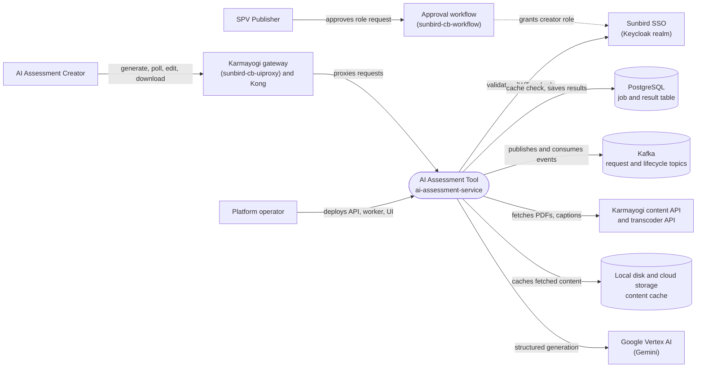

# AI Assessment Tool — Context Diagram

## System boundary

Inside the feature is `ai-assessment-service`: the API that validates callers and checks the
cache, the Kafka worker that builds prompts and calls Gemini, and the exporters that render
results. Outside it are the people who request and approve access, the gateway and Kong
route in front of it, the separate approval workflow that grants the creator role, Sunbird
SSO, the Karmayogi content and transcoder APIs, Vertex AI, and its Postgres, Kafka and
storage dependencies.

## Diagram

## Elements

| Element | Role | Detailed in |
|---|---|---|
| AI Assessment Tool (`ai-assessment-service`) | Central system: FastAPI API, Kafka worker, prompt/Gemini generation, exporters | [hld.md](hld.md) |
| AI Assessment Creator | Requests, polls, edits and downloads assessments; must hold the creator role | [use-cases.md](use-cases.md) |
| SPV Publisher | Approves or rejects requests for the creator role | [use-cases.md](use-cases.md) |
| Platform operator | Deploys and configures the API, worker and Streamlit UI workloads | [operations-manual.md](operations-manual.md) |
| Karmayogi gateway and Kong | Only network path into the service; multipart proxy with long timeout | [apis.md](apis.md) |
| Approval workflow (`sunbird-cb-workflow`) | `ai_assessment` approval state machine; grants the role asynchronously | [apis.md](apis.md) |
| Sunbird SSO | Issues JWTs carrying the role claim; supplies signing keys for validation | [hld.md](hld.md) |
| Karmayogi content API and transcoder API | Source of course PDFs, video captions and metadata | [apis.md](apis.md) |
| Google Vertex AI (Gemini) | Generates assessment JSON against a strict schema using a cached competency dataset | [lld.md](lld.md) |
| PostgreSQL | Job store and result cache, including cross-user clone lookup | [lld.md](lld.md) |
| Kafka | Carries generation requests to the worker and lifecycle events out | [hld.md](hld.md) |
| Local disk and cloud storage | Three-tier course-content and upload cache | [hld.md](hld.md) |

> **Verification boundary:** elements and interactions come from the feature's own pages
> (index, use cases, APIs, HLD), spot-checked against `ai-assessment-service` and
> `sunbird-cb-uiproxy` (Kafka topic names, `/ai/assessments/*` proxy routes). The dashed
> workflow-to-SSO link is the documented out-of-band role grant; no direct call between
> the workflow and the service exists. No authoring UI that triggers generation was found
> in the traced repos, so the Creator is shown reaching the service through the gateway
> only. Not re-verified: Keycloak realm internals and downstream Kafka consumers of
> lifecycle events.
