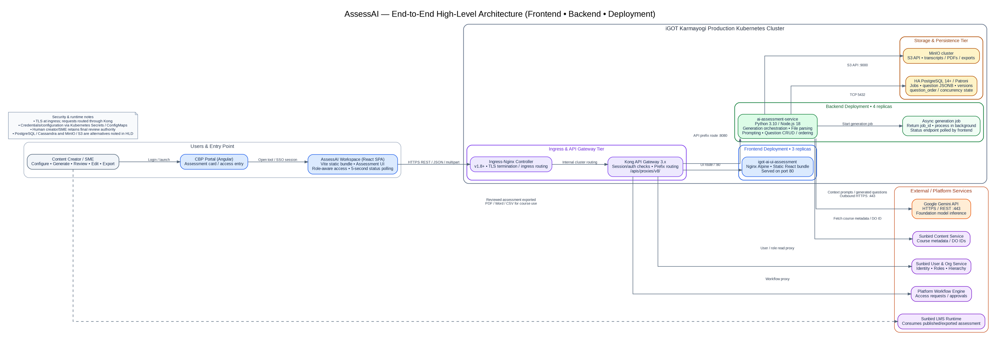

# AI Assessment Tool — High-Level Design

## 1. Purpose and scope

AssessAI (the iGOT AI Assessment Generator) generates curriculum-aligned assessments from course material or Karmayogi Competency Model (KCM) selections, and gives authorised creators a workspace to review, edit, add, delete and reorder questions before exporting them for the Sunbird LMS. This page describes the architecture at component level, end to end: frontend, backend and deployment. The feature itself is described in the [Overview](index.md).

**In scope:** the entry point in the CBP Portal, the AssessAI workspace, the ingress and API-gateway tier, the AI assessment service and its asynchronous generation jobs, storage, and the platform services the tool depends on.

**Out of scope:** the internals of Google Gemini and of the Sunbird platform services the tool calls.

## 2. Architecture overview

*Figure 1. AssessAI end-to-end high-level architecture (frontend, backend, deployment).*

Figure 1 reads left to right, the way a request travels.

A **content creator or SME** signs in to the **CBP Portal**, opens the AI Assessment card, and launches the **AssessAI workspace** (a React single-page app) with their SSO session. The workspace calls the platform over HTTPS (REST, JSON and multipart uploads). Requests enter the **iGOT Karmayogi production Kubernetes cluster** through the **Ingress-Nginx controller**, which terminates TLS, and the **Kong API Gateway**, which checks the session, authorises the request and routes it by path prefix.

Kong sends UI requests to the **frontend deployment** (the static React bundle) and API requests to the **backend deployment**, the **ai-assessment-service**. The service starts each generation as an **asynchronous job**, stores files in **MinIO** and job and question state in **PostgreSQL**, and calls **Google Gemini** for model inference. Kong also proxies user/role reads to the **Sunbird User & Org Service** and access requests to the **Platform Workflow Engine**. The reviewed assessment is exported as PDF, Word or CSV and consumed by the **Sunbird LMS runtime**.

## 3. Layers and components

### 3.1 Users and entry point

| Component | Role |
|---|---|
| Content Creator / SME | Configures, generates, reviews, edits and exports assessments. Retains final review authority over every question. |
| CBP Portal (Angular) | Shows the AI Assessment card: "Open Tool" for users with access, "Request Access" for others. |
| AssessAI Workspace (React SPA) | The assessment UI, built with Vite as a static bundle. Role-aware access; polls job status every 5 seconds. |

### 3.2 Ingress and API gateway tier

| Component | Role |
|---|---|
| Ingress-Nginx Controller (v1.8+) | TLS termination and ingress routing into the cluster. |
| Kong API Gateway (3.x) | Session and authorisation checks, prefix routing under `/apis/proxies/v8/`. Routes UI traffic to the frontend and API traffic to the backend; proxies user/role reads and workflow calls to platform services. |

### 3.3 Frontend deployment (3 replicas)

| Component | Role |
|---|---|
| igot-ai-ui-assessment | Nginx (Alpine) serving the static React bundle. |

### 3.4 Backend deployment (4 replicas)

| Component | Role |
|---|---|
| ai-assessment-service (Python 3.10 / Node.js 18) | Generation orchestration, file parsing (transcripts, PDFs), prompting, and question create / update / delete / reorder. |
| Async generation job | Returns a `job_id` immediately and processes the generation in the background; the frontend polls the status endpoint until the job completes or fails. |

### 3.5 Storage and persistence tier

| Store | Holds |
|---|---|
| MinIO cluster (S3 API) | Uploaded transcripts and PDFs, and generated exports. |
| HA PostgreSQL 14+ (Patroni) | Jobs, questions (JSONB), versions, the authoritative `question_order`, and concurrency state. |

### 3.6 External and platform services

| Service | Used for |
|---|---|
| Google Gemini API (HTTPS) | Foundation-model inference: context prompts in, generated questions out. |
| Sunbird Content Service | Course metadata and DO IDs. |
| Sunbird User & Org Service | Identity, roles and organisation hierarchy (user/role read proxy through Kong). |
| Platform Workflow Engine | Access requests and their approval. |
| Sunbird LMS Runtime | Consumes the published / exported assessment. |

## 4. End-to-end flow

1. The creator signs in to the CBP Portal with SSO. Without access, the AI Assessment card offers **Request Access**, which goes to the workflow engine for SPV Admin approval. With access (`AI_ASSESSMENT_CREATOR`), the card offers **Open Tool**.
2. The creator picks an assessment type (Practice, Final Course, Comprehensive, Standalone or Competency-based) and provides content: a course DO ID with transcripts or PDFs, or KCM Area → Theme → Sub-theme selections.
3. The creator configures question types and counts, difficulty, time limit and Bloom's distribution, then starts generation.
4. Through Ingress and Kong, the request reaches the ai-assessment-service. It stores uploads in MinIO, fetches course metadata from the Sunbird Content Service, records the job in PostgreSQL and returns a `job_id`.
5. The background job builds the prompts, calls Gemini, and saves the questions, their order and a version token in PostgreSQL. The workspace polls the job status every 5 seconds.
6. The creator reviews, edits, adds, deletes and reorders questions. Each change carries the current version token; a stale token is rejected with HTTP 409 and the workspace reloads the assessment.
7. The creator saves and exports the assessment as PDF, Word or CSV, then uploads it into the course in the Sunbird LMS.

## 5. Interfaces

| From → To | Protocol | Purpose |
|---|---|---|
| Workspace → Ingress / Kong | HTTPS, REST + JSON, multipart | All UI and API traffic. |
| Kong → frontend | HTTP (UI route) | Static React bundle. |
| Kong → ai-assessment-service | HTTP (API prefix route) | Generation, status polling, question editing, export. |
| ai-assessment-service → MinIO | S3 API | Transcripts, PDFs, exports. |
| ai-assessment-service → PostgreSQL | TCP | Jobs, questions, versions, order. |
| ai-assessment-service → Google Gemini | HTTPS | Model inference. |
| ai-assessment-service → Sunbird Content Service | HTTPS | Course metadata and DO IDs. |
| Kong → Sunbird User & Org Service | HTTPS (proxy) | User and role reads. |
| Kong → Platform Workflow Engine | HTTPS (proxy) | Access requests and approvals. |

## 6. Key design decisions

| Decision | Rationale |
|---|---|
| Asynchronous generation with status polling | Generation can take a while; returning a `job_id` keeps requests short and the UI responsive. |
| Edits as POST requests | Kong's prefix routing requires `jobId` to be the final URL segment, so update, create, delete and reorder use POST with Sunbird JSON bodies rather than PUT/DELETE. |
| Optimistic concurrency with version tokens | Concurrent edits never silently overwrite each other; a stale edit gets HTTP 409 and the client resynchronises. |
| Authoritative `question_order` on the server | The displayed order, the stored order and every export always match. |
| Human in the loop | Generated questions are reviewed and edited before export; nothing is published automatically. |
| Governed access | The tool opens only for approved creators; access requests go through the workflow engine and SPV Admin approval. |
| Export, not direct ingestion | Assessments reach the LMS as PDF, Word or CSV in the current release. |

## 7. Deployment and runtime

- Everything runs in the iGOT Karmayogi production Kubernetes cluster: the frontend with 3 replicas, the backend with 4 replicas.
- TLS terminates at the ingress, and all requests are routed through Kong.
- Credentials and configuration come from Kubernetes Secrets and ConfigMaps.
- Storage is MinIO (S3 API) for files and HA PostgreSQL with Patroni for state. PostgreSQL / Cassandra and MinIO / S3 are noted as alternatives.

## 8. Limits and constraints

- At most 100 questions per assessment, and at most 20 per question type.
- Multiple-choice questions have between 2 and 5 options.
- The last remaining question in an assessment cannot be deleted.
- JSON export is not offered in the UI.
