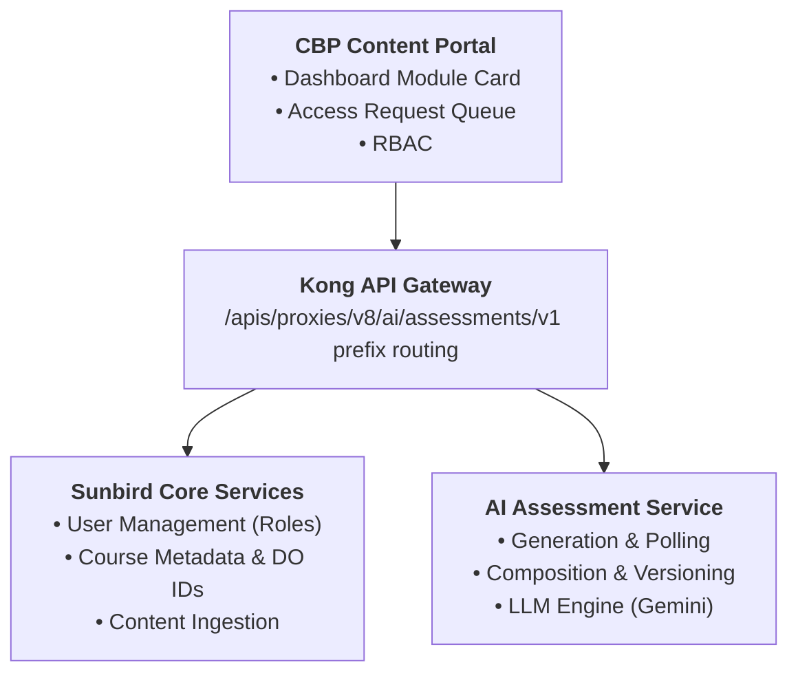

## Executive Summary

The AI Assessment Tools (branded natively as AssessAI / iGOT AI Assessment Generator) provide an end-to-end framework for rapidly generating, evaluating, refining, and governing curriculum-aligned assessments for civil service learners on the iGOT Karmayogi platform.

Historically, assessment authoring on iGOT was entirely manual, creating quality inconsistencies across ministries and slowing course release velocity. AssessAI automates the synthesis of course materials—including metadata, transcripts (.vtt, .txt), and reference policy PDFs—into structured question banks. These questions are mapped to defined competencies under the Karmayogi Competency Model (KCM), aligned with Bloom’s Taxonomy cognitive tiers, and assigned explicit answer rationales.

The system has progressed from an early generation prototype (Q10) and offline quality scoring framework (Q11) to an enterprise-governed tool integrated into the Content Portal (Q12, Sprint 37). In its current architecture (Q13), AssessAI functions not merely as an AI prompt generator, but as a full assessment composition workspace. Authorised creators can review, edit, add, delete, and reorder questions inline before publication, while enforcing optimistic concurrency controls and persisting authoritative question sequences across LMS export formats.

## 3. Business Background and Problem Statement

### 3.1 Background

The Mission Karmayogi initiative demands high-velocity capacity building across Indian government departments. To validate competency acquisition, courses must feature rigorous, role-relevant evaluations.

### 3.2 Problem Statement

- **Authoring Bottlenecks & Scalability Limits:** Manual test creation relies heavily on Subject Matter Experts (SMEs), resulting in prolonged course publishing cycles and limited question banks [P-01 §3.1].
- **Cognitive & Quality Disparities:** Assessments across different ministries exhibit wide variations in rigor. Lower-order recall questions predominate, while scenario-based and higher-order application questions are underrepresented [P-03 §Business Drivers, P-04 §CEGIS Feedback].
- **Misalignment with Competency Frameworks:** Questions frequently lack direct linkage to course learning outcomes and KCM competency definitions [P-01 §3.1, P-04 §1.1].
- **All-or-Nothing Regeneration Pitfall:** Prior to in-tool editing capabilities, identifying a single typo or inaccurate distractor in an otherwise acceptable 20-question AI assessment forced creators to regenerate the entire assessment. This discarded approved questions, consumed unnecessary LLM tokens, and prolonged the review cycle [P-08 §2, §3.2].
- **Unregulated AI Access:** Direct, ungoverned access to generative AI capabilities creates operational risks regarding content quality, cost tracking, and platform auditing [P-06 §Business Drivers].

## 5. Feature Scope

### 5.1 In Scope

- **5 Assessment Archetypes:** Practice (module-level), Final Course, Comprehensive (multi-course), Standalone (independent competency), and Competency-based assessments [P-04 §7, Index.tsx].
- **Multimodal Context Ingestion:** Ingestion of course DO IDs, topic tags, custom instructions, transcripts (.vtt, .txt), and reference materials (.pdf) [P-02 FR-08, ContentInputStep.tsx].
- **KCM Framework Integration:** Hierarchical navigation and validation of KCM triples (Area → Theme → Sub-theme) [P-04 §6, kcm-framework.ts].
- **Flexible Assessment Configuration:** Configurable counts for 5 question types (Single selection MCQ, Multiple selection MCQ, Fill in the blanks, Match the following, True / False), difficulty tiers, duration caps, and Bloom’s taxonomy sliders [P-02, P-04, ConfigurationStep.tsx].
- **Asynchronous Generation & Polling:** Non-blocking job processing via Kong gateway proxy with UI progress polling [P-07, Index.tsx].
- **Interactive Editing Workspace:** Inline modal editing of stems, options, correct answers, rationales, Bloom's levels, and KCM mappings; adding human-authored questions; deleting questions; and reordering [P-08, EditQuestionDialog.tsx, ResultsStep.tsx].
- **Optimistic Concurrency Control:** Version-token tracking preventing silent overwrites during concurrent edits (HTTP 409 Conflict) [assessment-api.ts].
- **Content Portal Access Governance:** Conditional dashboard card ("Open Tool" vs. "Request Access"), access request queues, and SPV Admin approval workflows [P-06, P-07, KB-12636].
- **Multi-Format Export:** Export of final saved assessments to PDF, Word (.docx), and CSV formatted for LMS ingestion [P-08 §18, ResultsStep.tsx].

### 5.2 Out of Scope

- Fully autonomous assessment publishing directly to production without human-in-the-loop review [P-01 §Scope].
- Real-time automated grading of subjective / descriptive essay answers [P-01 §Scope].
- Automated online proctoring or biometric anti-cheating mechanisms [P-01 §Scope].
- In-tool UI dashboard for offline AQS model comparison (AQS is maintained as an evaluation / audit framework) [P-03 §Scope].
- Direct end-to-end API ingestion into Sunbird without manual export/upload in current release [P-01 §Scope, Index.tsx].

### 5.3 Dependencies

- Sunbird Core User Management Service (`GET /apis/proxies/v8/api/user/v2/read`).
- Kong API Gateway routing for `/apis/proxies/v8/ai/assessments/v1/*`.
- Backend AI Assessment Microservice & LLM integration (Google Gemini family).
- Workflow engine for access transition states (`/workflow/aiAssessment/*`).

### 5.4 Limitations

- Maximum limit of 100 generated questions per assessment, capped at 20 questions per individual question type [P-08 BRQ-19].
- JSON export format is hidden from the user interface per product governance decisions [KB-12636].
- Deleting the final remaining question in an assessment is blocked by validation [P-08 BRQ-11, BR-04].

## 8. User Journey

### 8.1 Entry Point

- The user logs into the Content Portal (CBP Portal) via platform Single Sign-On (SSO).
- On the main dashboard, the user views the AI Assessment Generator module card [P-07 REQ-001].

### 8.2 Navigation & Access Evaluation

- **If Unauthorized:** The card displays a description and a "Request Access" CTA. Clicking this submits an access request to the administrative queue and updates the CTA to indicate pending status [P-07 REQ-004, REQ-028].
- **If Authorized (AI_ASSESSMENT_CREATOR):** The card displays an "Open Tool" CTA. Clicking it navigates the user to the AssessAI workspace (`/` or standalone URL) [P-07 REQ-002, App.tsx].

### 8.3 Main Actions

**Select Assessment Type:** The user chooses from Practice, Final Course, Comprehensive, Standalone, or Competency-based [AssessmentTypeSelector.tsx].

**Step 1 — Content Input:**

- **Course-based:** User enters Course DO ID/Name, topic tags, custom instructions, and uploads .vtt/.txt transcripts or .pdf materials [ContentInputStep.tsx].
- **Competency-based:** User selects the KCM Area, Theme, and Sub-theme from the hierarchical picker [CompetencyPicker.tsx].

**Step 2 — Configuration:**

- User enables question types and assigns counts (Single MCQ, Multi-choice MCQ, FTB, MTF, True/False).
- User sets assessment difficulty (Beginner, Intermediate, Advanced) and time limit.
- User toggles Bloom’s Taxonomy and adjusts distribution percentages [ConfigurationStep.tsx].

**Step 3 — Generation:** User clicks "Generate Assessment". The system initiates the generation job and displays a progress loader [GenerateLoaderDialog.tsx].

**Step 4 — Review & Editing:**

- The user reviews generated questions in the Results view [ResultsStep.tsx].
- **To edit:** Clicks the edit icon on any question, opening EditQuestionDialog.tsx to modify stems, options, correct answers, rationales, Bloom's tiers, or KCM mappings.
- **To compose:** Clicks "Add Question" to create a new human-authored question, clicks the trash icon to delete redundant questions, or drags/reorders questions into the desired sequence.

### 8.4 System Responses

- **Polling:** The client polls `GET /status/${jobId}` every 5 seconds until the job reaches `COMPLETED` or `FAILED` [Index.tsx].
- **Normalization:** The system applies `flattenInOrder` using the server’s `question_order` array, ensuring visual display matches database state [Index.tsx].
- **Concurrency Locking:** Edits send the current version token. If a conflict occurs, the system catches HTTP 409 and prompts a resynchronization (`reloadAssessment`) [assessment-api.ts].

### 8.5 Completion

The user saves the finalized assessment state and exports the question bank as PDF, Word, or CSV for upload into the Sunbird LMS course structure [ResultsStep.tsx].

## 10. Functional Capabilities

### 10.1 Multi-Archetype Assessment Generation

AssessAI implements distinct generation strategies tailored to specific learning contexts:

- **Practice Assessment:** Formative assessments focused on specific course modules, primarily using basic recall and comprehension tiers.
- **Final Course Assessment (End-of-Course / EOCA):** Comprehensive summative assessment covering all course learning outcomes, strictly tagged to course DO IDs.
- **Comprehensive Assessment:** Multi-course summative evaluations that enforce equal question distribution across all selected courses by default [P-08 §15].
- **Standalone Assessment:** Curriculum-independent evaluations measuring specific cross-functional competencies without requiring course DO ID linkage [P-04 §1.2].
- **Competency-Based Assessment:** Fully mapped against the Karmayogi Competency Model (KCM), generating contextual, workplace-relevant situational questions [P-04 §6, CompetencyPicker.tsx].

### 10.2 Supported Question Types

- **Single Selection MCQ:** Traditional multiple-choice with 1 correct option and 3 plausible distractors (`options: [{ label, text, index }]`).
- **Multiple Selection MCQ (Multi-Select):** Questions with multiple correct answers (`correct_option_index: number[]`).
- **Fill in the Blanks (FTB):** Text stem with missing word/phrase; correct answer stored as exact text string.
- **Match the Following (MTF):** Paired premises and responses (`pairs: [{ left, right }]`), carrying explicit matching context.
- **True / False:** Factual statements evaluated as boolean propositions.

### 10.3 In-Tool Question Composition Workspace

- **Stem & Option Editing:** Modifying prompt phrasing and adjusting option text.
- **Answer Key Management:** Reassigning the correct answer without breaking existing option indices.
- **Rationale & Explanation Authoring:** Reviewing and refining the underlying logic explaining why an answer is correct.
- **Metadata Re-Tagging:** Updating Bloom's cognitive tiers, relevance percentages, learning objectives, and KCM competency triples.
- **Question Reordering:** Interactive reordering that updates the authoritative `question_order` array.
- **Human-Authored Question Insertion:** Manually adding new questions that receive unique IDs and are flagged with human-authored provenance [P-08 BR-12].

## 18. Feature Dependencies and Constraints

**Constraints:**

- **Gateway Route Constraints:** The Kong API gateway enforces prefix matching where `jobId` must be the final URL segment. As a result, editing actions (update, create, delete, reorder) are implemented as POST requests with Sunbird JSON bodies rather than RESTful PUT/DELETE calls [assessment-api.ts].
- **Question Generation Bounds:** Generation requests are capped at 100 total questions and 20 questions per individual question type [P-08 BRQ-19, BRQ-20].
- **Option Limits:** Multiple-choice questions are constrained to between 2 and 5 options [P-08 BR-03].

## 22. Glossary

| Term | Definition |
|---|---|
| AQS | Assessment Quality Score: Evaluation rubric scoring assessments from 0 to 100 based on Difficulty (25%), Bloom’s Taxonomy (35%), and Course Fit (40%). |
| AssessAI | Native user-facing branding for the iGOT AI Assessment Generator application. |
| Bloom’s Taxonomy | Pedagogical framework categorizing cognitive educational goals into six levels: Remember, Understand, Apply, Analyze, Evaluate, and Create. |
| CBP Portal | Competency Building Plan Portal / Content Authoring Portal used by ministries and training institutions to manage learning programs on iGOT. |
| Course DO ID | Digital Object Identifier uniquely referencing a course asset within the Sunbird learning platform repository. |
| Distractor | An incorrect answer option designed to be plausible to learners who have not mastered the material. |
| EOCA | End-of-Course Assessment (Final Summative Assessment). |
| FTB | Fill in the Blank question type. |
| KCM | Karmayogi Competency Model: The standard competency taxonomy defining public service competencies across Areas, Themes, and Sub-themes. |
| MCQ | Multiple Choice Question (Single selection). |
| MTF | Match the Following question type (premise-response pairs). |
| Multi-Select | Multiple selection Multiple Choice Question (multiple correct options). |
| Optimistic Concurrency | Concurrency control method where transactions proceed without locking; before committing, the system validates that the version token has not changed, preventing lost updates. |
| SPV Admin | Special Purpose Vehicle Administrator; platform operations authority for Karmayogi Bharat responsible for access provisioning and governance. |
| Stem | The primary question prompt or problem statement presented to the learner. |
| WebVTT (.vtt) | Web Video Text Tracks format used to ingest video subtitles and audio transcripts for course content analysis. |

## Conclusion & Next Steps

This Complete Feature Overview consolidates all requirements, architecture touchpoints, user workflows, and implementation details for the AI Assessment Tools feature on iGOT Karmayogi across Q10 through Q13. It establishes a shared, traceable baseline for all platform stakeholders.
