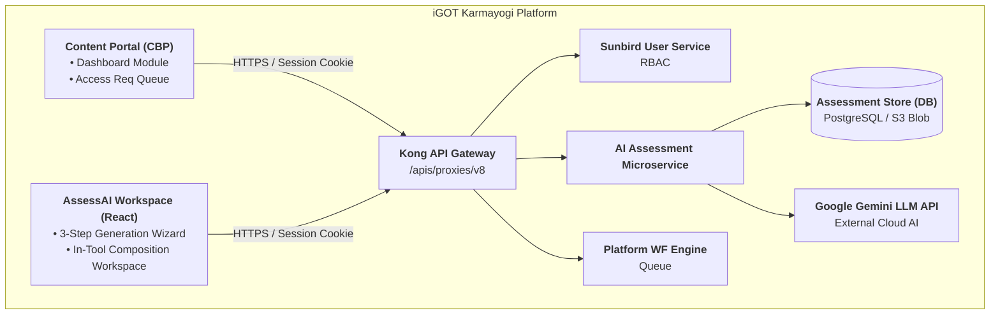
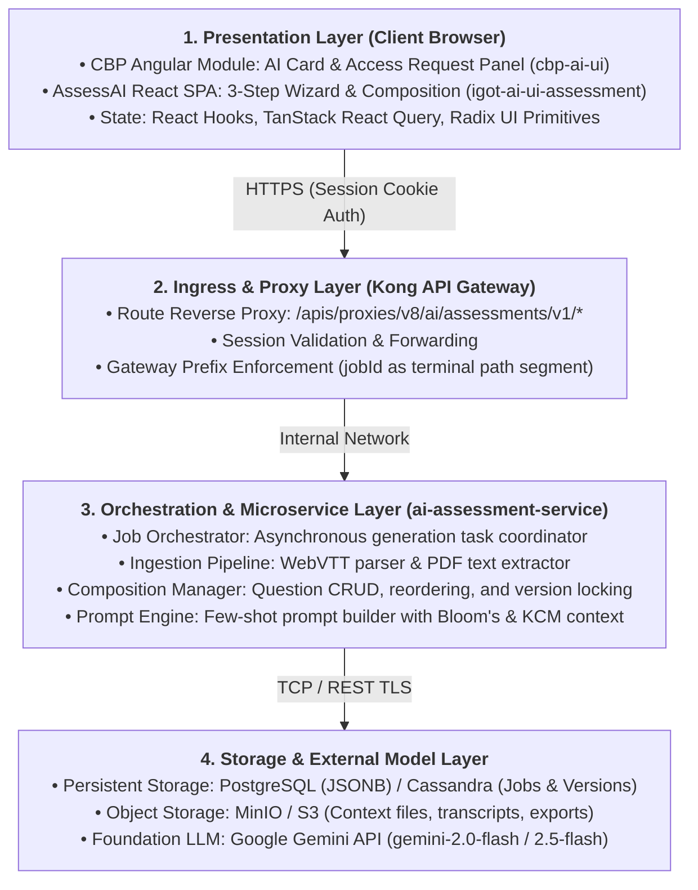
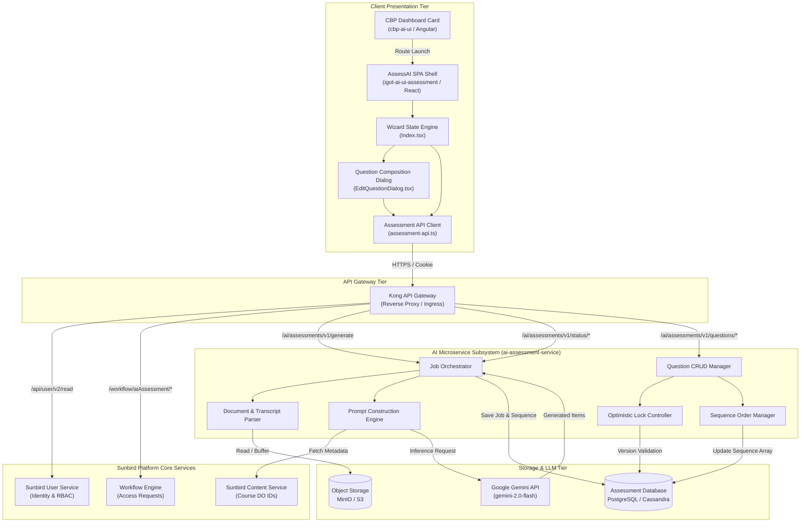

# AI Assessment Tool — Software Design Document (SDD)

## 1. Document Control

| Attribute | Details |
|---|---|
| Document Title | Software Design Document (SDD) — AI Assessment Tools (AssessAI / iGOT AI Assessment Engine) |
| Document Identifier | iGOT-ENG-SDD-ASSESSAI-V1.0 |
| System Code / Name | igot-assess-ai / AssessAI |
| Platform | iGOT Karmayogi Digital Workplace & Learning Platform |
| Author | Senior Software Engineer & Solution Architect, iGOT Karmayogi |
| Target Branch | cbrelease-4.8.41 (Sprint 37 Deployed Baseline; Q13 Composition In-Flight) |
| Document Version | 1.0 (Consolidated Technical Baseline) |
| Status | Approved Engineering Baseline |
| Classification | Internal Technical Specification |
| Traceable Epics | KB-9854 (Q10 Baseline), KB-12640 (Q11 AQS POC), KB-13434 (Q11 CEGIS Feedback), KB-12636 (Q12 Portal Integration), KB-14834 (Q13 Editing & Capacity) |

## 2. Introduction

This Software Design Document (SDD) provides a comprehensive technical specification for the implementation, integration, execution, and operation of the AI Assessment Tools subsystem (branded as AssessAI / iGOT AI Assessment Generator).

AssessAI transitions assessment creation on the iGOT Karmayogi platform from a manual, Subject Matter Expert (SME)-dependent bottleneck into an enterprise-governed, human-supervised AI workflow. It provides an interactive assessment composition workspace that allows content creators to synthesize, calibrate, inspect, edit, and export curriculum-aligned assessments for civil service learners.

## 3. Purpose and Scope

### 3.1 Purpose

The purpose of this SDD is to define the low-level component designs, API contracts, data models, concurrency control mechanisms, state machines, and deployment layouts necessary to build, test, and maintain AssessAI across engineering and DevOps teams.

### 3.2 Scope

**In-Scope Software Capabilities:**

- **Assessment archetype segregation:** Practice, Final Course (EOCA), Comprehensive (multi-course), Standalone (competency-focused), and Competency-based (KCM-mapped) [P-01, P-04].
- **Context ingestion:** Course DO IDs, topic tags, custom notes, WebVTT transcripts (.vtt), text transcripts (.txt), and reference document PDFs (.pdf) [P-02, ContentInputStep.tsx].
- **Question type support:** Single Selection MCQ, Multiple Selection MCQ, Fill in the Blanks (FTB), Match the Following (MTF), and True/False [P-02, question-types.ts].
- **Pedagogical calibration:** Bloom's Taxonomy cognitive distribution sliders, difficulty tiers (Beginner, Intermediate, Advanced), and mandatory answer rationales [P-02, P-04].
- **Interactive composition:** Granular question stem, option, answer key, rationale, and metadata editing; question insertion; deletion; and sequence reordering [P-08, ResultsStep.tsx, EditQuestionDialog.tsx].
- **Concurrency and sequence integrity:** Optimistic locking using numeric version tokens (version) and server-side sequence preservation via question_order [P-08, assessment-api.ts].
- **Access governance:** Role-Based Access Control (RBAC) enforcing AI_ASSESSMENT_CREATOR, dashboard conditional CTAs ("Open Tool" vs. "Request Access"), and SPV Admin approval workflows [P-06, P-07, KB-12636].
- **Multi-format export:** Final artifact generation in PDF, Word (.docx), and CSV [P-08, ResultsStep.tsx].

**Out-of-Scope Capabilities:**

- Fully autonomous assessment publishing directly to production without human-in-the-loop review [P-01 §Scope].
- Real-time automated grading of subjective/descriptive essay answers [P-01 §Scope].
- Automated online proctoring or biometric anti-cheating mechanisms [P-01 §Scope].
- Live runtime adaptive testing within the Sunbird LMS player [P-01 §Scope].
- Direct API ingestion into Sunbird LMS in current phase (manual upload of exported files required) [P-01 §Scope].

## 4. References

**Jira Feature Tickets:**

- **KB-9854:** Q10 | AI-driven Assessment Creation (status: KB Review)
- **KB-12640:** Q11 | AI Driven Assessment Quality Check for existing courses (POC) (status: In Progress)
- **KB-13434:** Assessment generation | POC portal | implementing CEGIS Feedbacks (status: Prod Deployed)
- **KB-12636:** Q12 | AI Assessment Integration with Content Portal (status: Prod Deployed)
- **KB-14834:** Q13 | AI Assessment Engine | Assessment editing Feature & New Enhancements (status: Open)

**Product Requirement Documents (PRDs) & Specifications:**

- BIABJw (P-01) — BRD | AI Driven Assessment Generation (V1.0).
- JoD-Jg (P-02) — FRS | AI Driven Assessment Creation (V1.1).
- AoDCLw (P-03) — Q11 | BRD | Assessment Quality Score (AQS).
- 811728907 / CwBiM (P-04 / P-05) — Detailed Requirements & CEGIS Feedback Consolidation.
- DQDYOQ (P-06) — BRD | AI Tool Access From CBP Portal (V1.0).
- AYDgOQ (P-07) — FRS | AI Tool Access From CBP Portal (V1.0).
- BADhS (P-08) — BRD | Assessment editing Feature & New Enhancements (V1.0).

## 5. System Overview

AssessAI operates as a satellite subsystem connected to the iGOT Karmayogi Content Portal (CBP). The application runs as an authenticated React 18 Single Page Application (SPA), interfacing through a Kong API Gateway proxy layer with underlying AI assessment microservices, the Sunbird platform identity provider, and external LLM foundation models (Google Gemini).

The system decouples asynchronous generation from real-time composition:

- **Generation:** Dispatched as an asynchronous multipart job returning a job_id, polled at 5000ms intervals by the client until completion.
- **Composition:** Operates over granular synchronous POST endpoints conforming to Sunbird JSON envelopes ({ request: ... }), using optimistic version locking to guarantee sequence and update integrity.

## 6. Design Goals and Constraints

### 6.1 Design Goals

- **G-01 (Pedagogical Alignment):** Enforce Bloom’s Taxonomy distributions, calibrated difficulty levels, and Karmayogi Competency Model (KCM) triples (Area → Theme → Sub-theme) across all generated items.
- **G-02 (Granular Composition):** Prevent unnecessary full-assessment regeneration by allowing creators to fix single questions, reorder items, add human-authored items, or delete questions directly.
- **G-03 (Sequence Parity):** Guarantee that the question order presented on-screen matches the order stored in the database and the sequence in exported documents.
- **G-04 (Safe Concurrency):** Prevent lost updates in multi-tab or collaborative review workflows through optimistic locking.
- **G-05 (Zero-Trust Gating):** Enforce strict RBAC validation at both the UI shell and the API gateway for the AI_ASSESSMENT_CREATOR role.

### 6.2 Design Constraints

- **C-01 (Gateway Route Structure):** Kong API Gateway prefix-matching requires jobId to form the terminal path segment (.../verb/:jobId). Sub-resources such as questionId must be passed in the request body, and mutations use HTTP POST rather than PUT or DELETE [assessment-api.ts].
- **C-02 (Sunbird Payload Envelopes):** Request payloads sent through the platform proxy must wrap parameters inside a { request: ... } JSON envelope with camelCase field naming [assessment-api.ts].
- **C-03 (Generation Capacity Limits):** Total assessment question count is capped at 100 questions, with a maximum of 20 questions per individual question type [P-08 BRQ-19].
- **C-04 (UI Export Surface):** JSON export options are hidden in the user interface per governance directives, maintaining Word, PDF, and CSV as the supported formats [KB-12636 comment 70744].

## 7. Design Principles

- **Authoritative Server Ordering:** Database JSONB key ordering is non-deterministic. The explicit question_order array of GUIDs is the single source of truth for item sequence across the UI and export artifacts.
- **Atomic Entity Versioning:** Entity state transitions advance a monotonically increasing integer (version). Mutation requests must supply their known version; mismatched tokens fail immediately with HTTP 409 Conflict.
- **Defensive Normalization:** The client normalizes raw API payloads (converting 0-based and 1-based option indexing, mapping matching pairs, normalizing KCM triples) before passing state to UI components.
- **Decoupled Asynchronous Polling:** Long-running multimodal AI generation jobs are decoupled from client HTTP connection lifecycles via short-lived polling against a job status endpoint.

## 8. Architecture Summary

AssessAI uses a layered presentation, gateway, orchestration, and persistence architecture:

## 9. System Decomposition

## 10. Component Design

### 10.1 Frontend Components (igot-ai-ui-assessment)

#### 1. Authentication Guard (src/App.tsx, src/contexts/AuthContext.tsx)

- **Purpose:** Evaluates incoming user sessions, requests profile details from /apis/proxies/v8/api/user/v2/read, and gates application access.

#### 2. Wizard & State Controller (src/pages/Index.tsx)

- **Purpose:** Central coordinator for the 3-step authoring workflow, status polling, and state normalization.

**Component State:**

- **currentStep:** "content" | "configuration" | "results".
- **assessmentType:** "practice" | "final" | "comprehensive" | "standalone" | "competency".
- **courseIds:** Array of course DO ID strings.
- **topics:** Array of topic strings.
- **questionTypes:** Configuration array tracking enabled types and counts.
- **bloomValues:** Map of Bloom's levels to percentages (remember, understand, apply, etc.).
- **assessmentVersion:** Tracks current integer version for optimistic locking.
- **questions:** Normalized, ordered array of Question domain objects.

#### 3. Question Normalization & Ordering Module (src/pages/Index.tsx)

- **Purpose:** Resolves raw JSONB database records into a flattened, properly sequenced array based on assessment_data.question_order.

#### 4. Inline Question Editor Modal (src/components/EditQuestionDialog.tsx)

- **Purpose:** Modal dialog allowing in-place edits to question stems, options, correct answers, rationales, Bloom's tiers, and KCM competency triples.

**Validation Guards:**

- Prevents submission if the stem is blank.
- Enforces that MCQs have between 2 and 5 options with at least one designated correct answer.
- Enforces complete KCM triples (Area, Theme, Sub-theme) when editing competency-mapped items.

#### 5. Gateway API Client (src/components/assessment-api.ts)

- **Purpose:** Handles HTTP communication with the Kong API Gateway. Wraps mutations in Sunbird envelopes, tracks optimistic locking version tokens, and normalizes errors.

## 11. Detailed Feature Design

### 11.1 Assessment Generation Dispatch

**Submission Packaging:** When the creator triggers generation in Index.tsx, inputs are serialized into a FormData multipart payload:

- Primitive fields (assessment_type, difficulty, time_limit, total_questions, language).
- Serialized configurations (question_type_counts, blooms_config, topic_names).
- **Files (files:** WebVTT transcripts, text transcripts, and PDFs).
- **Execution Contract:** POST /apis/proxies/v8/ai/assessments/v1/generate returns an immediate 200 OK response containing { job_id, status: "PROCESSING" }.

## 12. Interface Design

### 12.1 Presentation Interfaces

- **CBP Dashboard Card Component (cbp-ai-ui):** Renders the AssessAI module tile on the Content Portal dashboard. Evaluates whether the current user possesses AI_ASSESSMENT_CREATOR. If authorized, renders an "Open Tool" button navigating to the AssessAI route; otherwise, renders a "Request Access" button triggering an access request event.
- **Competency Picker Component (CompetencyPicker.tsx):** Cascading dropdown selecting KCM Area → Theme → Sub-theme from the structured competency framework (kcm-framework.ts).

### 12.2 External Service Interfaces

**Sunbird User Read Interface:**

- **Endpoint:** GET /apis/proxies/v8/api/user/v2/read
- **Protocol:** HTTPS / REST
- **Headers:** Standard session cookies (connect.sid)
- **Response:** Sunbird envelope containing result.response.roles.

**Platform Workflow Transitions:**

- **Endpoints:** GET /workflow/aiAssessment/getUserWF, POST /workflow/aiAssessment/transition
- **Purpose:** Evaluates user workflow state and processes access requests.

## 19. Security and Privacy Considerations

- **Transport Layer Security (TLS):** All communication between client browsers, the Kong API Gateway, microservices, and external LLM APIs enforces TLS 1.3 transport encryption.
- **Context Isolation:** Contextual text extracted from transcripts and PDFs is scoped to prompt templates within dedicated generation jobs, preventing cross-tenant leakage.
- **Prompt Injection Mitigations:** Uploaded reference materials are parsed and injected as plain-text contextual variables within system prompt templates, preventing user-supplied text from executing control-plane prompt instructions.
- **Audit Logging & Attribution:** Question-level mutations record editor account IDs, timestamps, and before/after diffs, maintaining accountability across both AI-assisted and human-authored content [P-08 §16].

## 20. Performance and Scalability Considerations

- **Asynchronous Decoupling:** Generation jobs execute in background worker processes, freeing Kong gateway proxy worker threads from maintaining long-lived connections during LLM inference.
- **Predictable Payload Bounds:** Restricting assessments to a maximum of 100 questions (max 20 per question type) maintains predictable database JSONB document sizes (≈ 150 KB) and prevents browser DOM degradation [P-08 BRQ-19].
- **Client-Side Document Rendering:** Export transformations (PDF, Word, CSV) are assembled client-side from in-memory question entities, offloading document generation CPU load from backend servers.
- **Horizontal Scaling:** Microservice worker pods scale horizontally based on CPU utilization and queue depth using Kubernetes Horizontal Pod Autoscalers (HPA).

## 21. Logging, Monitoring, and Observability

- **Application Logging:** Microservices log structured JSON events including job_id, user account ID, execution durations, and error stack traces.

**Telemetry KPIs:** The frontend instruments telemetry events for feature adoption and operational monitoring [P-08 §26]:

- **TEL-01:** Assessment Edit Opened.
- **TEL-03:** Question Edit Saved.
- **TEL-07:** Question Reordered.
- **TEL-12:** Validation Failed.
- **TEL-13:** Save Failed (tracks HTTP 409 and 422 rates).
- **TEL-15:** Assessment Downloaded (tracks format distributions).

## 25. Technical Debt and Known Limitations

- **Manual LMS Publishing Step:** AssessAI does not currently support direct one-click API publishing into Sunbird Content Service course structures. Assessments must be manually exported to PDF, Word, or CSV and uploaded via the course editor [P-01 §Scope].
- **AQS Integration Gap:** The Assessment Quality Score (AQS) framework exists as an offline evaluation tool (KB-12640, aqs_report.html) and is not yet surfaced as an automated pre-publish check in the AssessAI UI.
- **Gateway Method Uniformity:** The Kong gateway's terminal-path matching forces mutation endpoints to use HTTP POST with Sunbird envelopes rather than standard RESTful PUT and DELETE methods [assessment-api.ts].

## 26. Risks and Mitigations

| Risk ID | Risk Description | Severity | Impact | Mitigation Strategy |
|---|---|---|---|---|
| RSK-01 | LLM Non-Determinism & Distractor Quality: Generated distractors or rationales may occasionally be inaccurate. | High | Inaccurate questions published to learners. | Enforce mandatory human-in-the-loop review in AssessAI workspace before export. |
| RSK-02 | Stale Overwrite in Collaborative Review: Multiple creators editing simultaneously could overwrite changes. | Medium | Lost review work. | Optimistic version locking rejects stale submissions with HTTP 409 Conflict, triggering state refresh. |
| RSK-03 | Large Transcript Processing Delays: Multi-hour WebVTT files may cause extended generation times. | Medium | Extended generation wait times. | Decoupled asynchronous polling architecture prevents HTTP timeouts; UI displays progress modal. |
