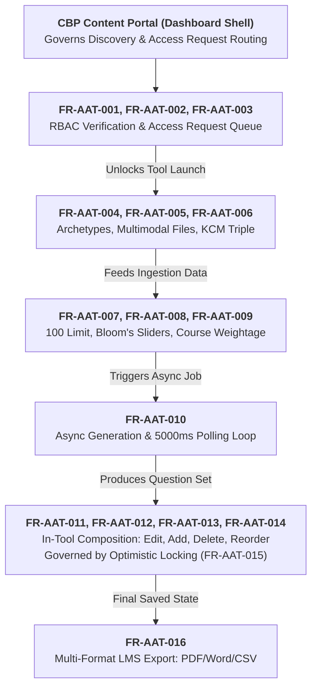

# AI Assessment Tool — Software Requirements Specification (SRS)

## 1. Document Control and Version History

### 1.1 Document Details

| Attribute | Details |
|---|---|
| Document Title | Software Requirements Specification (SRS) — AI Assessment Tools |
| Document Identifier | iGOT-ENG-SRS-AAT-V1.0 |
| Platform | iGOT Karmayogi Digital Workplace & Learning Platform |
| Specification Standard | IEEE/ISO/IEC 29148:2018 (Systems and software engineering — Life cycle processes — Requirements engineering) |
| Target Branch | cbrelease-4.8.41 (Sprint 37 Deployed Baseline; Q13 Composition In-Flight) |
| Document Version | 1.0 (Formal Engineering Baseline) |
| Status | Approved Engineering Specification |
| Traceable Epics | KB-9854 (Q10 Baseline), KB-12640 (Q11 AQS POC), KB-13434 (Q11 CEGIS Feedback), KB-12636 (Q12 Portal Integration), KB-14834 (Q13 Editing & Capacity) |

### 1.2 Version History

| Version | Date | Author / Role | Summary of Changes |
|---|---|---|---|
| 0.1 | 02-Dec-2025 | Manasvi Malav (Product Manager) | Initial Draft BRD for AI-driven assessment generation (BIABJw). |
| 0.2 | 23-Dec-2025 | Manasvi Malav (Product Manager) | Initial Functional Requirement Specification (JoD-Jg). |
| 0.3 | 26-Feb-2026 | Keshvam Sharma (Product Lead) | Addition of Assessment Quality Score (AQS) requirements (AoDCLw). |
| 0.4 | 23-Mar-2026 | Manasvi Malav (Product Manager) | Consolidated CEGIS enhancements & portal governance (811728907). |
| 0.5 | 11-May-2026 | Manasvi Malav (Product Manager) | Formal Portal Integration Specification REQ-001–REQ-038 (AYDgOQ). |
| 0.6 | 12-Jun-2026 | Sonu Gowda (Release Engineering) | Sprint 37 Production deployment sign-off (Jira KB-12636 comment 71469). |
| 0.7 | 20-Aug-2026 | Manasvi Malav (Product Manager) | Draft Specification for in-tool editing & 100-question capacity (BADhS). |
| 1.0 | October 2026 | Lead Architect / Senior Technical Writer | Consolidated, reconciled IEEE 29148-compliant engineering SRS baseline. |

## 2. Introduction

### 2.1 Purpose

This document establishes the official Software Requirements Specification (SRS) for the AI Assessment Tools feature (branded natively as AssessAI / iGOT AI Assessment Generator) within the iGOT Karmayogi digital learning platform. It defines complete, unambiguous, and verifiable functional, behavioral, user, data, interface, and non-functional requirements governing system development, test suite construction, and user acceptance.

### 2.2 Scope

- **Product Name:** AssessAI / iGOT AI Assessment Engine.

**Functional Scope:**

- Automated synthesis of curriculum-aligned assessments across 5 archetypes: Practice, Final Course (EOCA), Comprehensive (multi-course), Standalone (competency-focused), and Competency-based (KCM-mapped) [P-01, P-04].
- **Multimodal context ingestion:** Course DO IDs, topic tags, custom notes, WebVTT transcripts (.vtt), text transcripts (.txt), and reference document PDFs (.pdf) [P-02, ContentInputStep.tsx].
- **Question type support:** Single Selection MCQ, Multiple Selection MCQ, Fill in the Blanks (FTB), Match the Following (MTF), and True/False [P-02, question-types.ts].
- **Pedagogical calibration:** Bloom's Taxonomy cognitive distribution sliders, difficulty tiers (Beginner, Intermediate, Advanced), and mandatory answer rationales [P-02, P-04].
- **Interactive composition workspace:** In-tool stem, option, key, and rationale editing; adding human-authored questions; deleting questions; and drag-and-drop reordering [P-08, ResultsStep.tsx, EditQuestionDialog.tsx].
- **Concurrency and sequence integrity:** Optimistic locking using numeric version tokens (version) and server-side sequence preservation via question_order [P-08, assessment-api.ts].
- **Access governance:** Role-Based Access Control (RBAC) enforcing AI_ASSESSMENT_CREATOR, dashboard conditional CTAs ("Open Tool" vs. "Request Access"), and SPV Admin approval workflows [P-06, P-07, KB-12636].
- **Multi-format export:** Authoritative output generation in PDF, Word (.docx), and CSV formatted for LMS ingestion [P-08, ResultsStep.tsx].

**Exclusions:**

- Autonomous publishing directly to production without human-in-the-loop review [P-01 §Scope].
- Real-time automated grading of subjective/descriptive essay answers [P-01 §Scope].
- Automated online proctoring or biometric anti-cheating mechanisms [P-01 §Scope].
- Live runtime adaptive testing within the Sunbird LMS player [P-01 §Scope].
- Direct API ingestion into Sunbird LMS in the current phase (manual upload of exported files required) [P-01 §Scope].

### 2.3 Intended Audience

- **Product Managers & Business Analysts:** For milestone scope management and user story decomposition.
- **Software Engineers:** For component, interface, state machine, and data layer implementation.
- **QA & Test Automation Engineers:** For test plan generation, boundary analysis, and acceptance verification.
- **Platform Architects:** For evaluating enterprise conformance, security boundaries, and scalability limits.
- **DevOps & Infrastructure Teams:** For container deployment, ingress routing, and runtime sizing.

### 2.4 References

IEEE/ISO/IEC 29148:2018: Systems and software engineering — Life cycle processes — Requirements engineering.

- **Jira Feature Tickets:** KB-9854, KB-12640, KB-13434, KB-12636, KB-14834.

**Confluence PRDs & Specifications:**

- BIABJw (P-01) — BRD | AI Driven Assessment Generation (V1.0).
- JoD-Jg (P-02) — FRS | AI Driven Assessment Creation (V1.1).
- AoDCLw (P-03) — Q11 | BRD | Assessment Quality Score (AQS).
- 811728907 / CwBiM (P-04 / P-05) — Detailed Requirements & CEGIS Feedback Consolidation.
- DQDYOQ (P-06) — BRD | AI Tool Access From CBP Portal (V1.0).
- AYDgOQ (P-07) — FRS | AI Tool Access From CBP Portal (V1.0).
- BADhS (P-08) — BRD | Assessment editing Feature & New Enhancements (V1.0).

### 2.5 Definitions and Abbreviations

- **AQS:** Assessment Quality Score — an objective evaluation rubric (0–100 scale) based on Difficulty (25%), Bloom’s Taxonomy (35%), and Course Fit (40%).
- **AssessAI:** The user-facing software branding for the iGOT AI Assessment Generator.
- **CBP Portal:** Competency Building Plan Portal (Content Authoring Portal) on iGOT Karmayogi.
- **Course DO ID:** Digital Object Identifier uniquely referencing a course asset within the Sunbird repository.
- **Distractor:** An incorrect answer option in a multiple-choice question designed to be plausible.
- **EOCA:** End-of-Course Assessment (Final Summative Course Assessment).
- **FTB:** Fill in the Blank question type.
- **KCM:** Karmayogi Competency Model — the standard competency framework organized into Area → Theme → Sub-theme.
- **MCQ:** Multiple Choice Question (Single selection).
- **MTF:** Match the Following question type (premise-response pairs).
- **Multi-Select:** Multiple selection MCQ question type (multiple correct options).
- **Optimistic Locking:** Concurrency control method validating a version token prior to applying mutations.
- **RBAC:** Role-Based Access Control.
- **SME:** Subject Matter Expert.
- **SPV Admin:** Special Purpose Vehicle Administrator; platform operations authority for Karmayogi Bharat.
- **Stem:** The primary question prompt or problem statement presented to the learner.
- **WebVTT (.vtt):** Web Video Text Tracks format used for video subtitles and audio transcripts.

## 3. Overall Description

### 3.1 Product Perspective

AssessAI is an integrated capability within the iGOT Karmayogi content production lifecycle. It interfaces upstream with the Content Portal (CBP Portal) dashboard for user discovery and governance, queries core Sunbird services for user identities and course metadata, routes through a Kong API Gateway proxy layer, and communicates downstream with cloud-hosted Large Language Models (Google Gemini). Output assessments are exported in structured document formats (PDF, Word, CSV) for upload into the Sunbird LMS Course Editor.

### 3.2 Product Capabilities

- **Multi-Archetype Assessment Authoring:** Tailors question generation to 5 distinct educational scenarios.
- **Context-Driven Synthesis:** Extracts domain concepts from video transcripts, reference PDFs, and course metadata.
- **Pedagogical Calibration:** Enforces Bloom's Taxonomy cognitive distribution and question-level difficulty calibration.
- **Competency Alignment:** Enforces mapping of questions to the Karmayogi Competency Model (KCM) framework.
- **Interactive Question Composition:** Allows creators to edit stems, options, keys, and rationales, reorder items, add human-authored items, or delete questions directly without full regeneration.
- **Enterprise Governance:** Gated behind the AI_ASSESSMENT_CREATOR role with a self-service access request queue and administrative approval workflows.

### 3.3 User Classes and Characteristics

- **Content Creator / Course Author:** Technical proficiency: Intermediate. Frequency: High. Uses the tool to rapidly draft assessments from course content.
- **SME Reviewer:** Technical proficiency: Intermediate. Frequency: Moderate. Reviews draft questions, validates answer keys, refines pedagogical rationales, and adjusts Bloom's classifications.
- **SPV Administrator / Publisher:** Technical proficiency: Advanced. Frequency: Moderate. Governs access requests, assigns creator roles, and monitors platform usage.
- **Civil Service Learner:** Technical proficiency: Basic to Intermediate. End consumer attempting published assessments within the Sunbird LMS Player.

### 3.4 Operating Environment

- **Client Frontend:** Modern web browsers (Chrome, Edge, Firefox, Safari) running ECMAScript 2020+.
- **Ingress & Gateway:** Kong API Gateway 3.x with reverse proxy routing under /apis/proxies/v8/.
- **Platform Hosting:** Production Kubernetes Cluster running Linux-based container runtimes (Nginx Alpine for static UI; Python 3.10+ / Node.js 18+ for microservices).
- **External AI Engine:** Google Cloud Platform Vertex AI / Gemini API endpoints.

### 3.5 Constraints

- **CO-AAT-001 (Gateway Pathing):** Kong API Gateway prefix-matching requires jobId to form the terminal path segment (.../verb/:jobId). Sub-resource IDs (e.g., questionId) must be passed in the request body, and all mutations must execute as HTTP POST requests [assessment-api.ts].
- **CO-AAT-002 (Envelope Formatting):** All proxy request payloads must conform to the Sunbird { request: ... } JSON envelope with camelCase keys [assessment-api.ts].
- **CO-AAT-003 (Question Volume Bounds):** Total assessment question count shall not exceed 100 questions, and shall not exceed 20 questions for any single question type [P-08 BRQ-19, BRQ-20].
- **CO-AAT-004 (JSON Export Restriction):** JSON export shall remain hidden in the user interface per governance directives, maintaining Word, PDF, and CSV as the supported download formats [KB-12636 comment 70744].

### 3.6 Dependencies

- **DE-AAT-001 (Sunbird Identity Service):** Relies on GET /apis/proxies/v8/api/user/v2/read to retrieve user account IDs and role arrays.
- **DE-AAT-002 (Sunbird Content Service):** Relies on course metadata availability (DO IDs, titles, learning objectives) stored in the core repository.
- **DE-AAT-003 (Foundation LLM Availability):** Relies on Google Gemini model endpoints for asynchronous text inference and evaluation.
- **DE-AAT-004 (Platform Workflow Engine):** Relies on /workflow/aiAssessment/* endpoints for access request state transitions.

### 3.7 Assumptions

- **AS-AAT-001:** Course transcripts uploaded in .vtt format conform to standard WebVTT syntax.
- **AS-AAT-002:** The client browser maintains an active, valid platform session cookie (connect.sid).
- **AS-AAT-003:** In multi-course Comprehensive Assessments, remainder question allocations are distributed sequentially starting from the first course selected [P-08 §15].

## 4. System Context

### 4.1 External Actors

- **Content Creator:** Author seeking to generate and refine assessments.
- **SPV Admin:** Authority managing role access and approving access requests.
- **SME Reviewer:** Evaluator reviewing question validity and pedagogical depth.

### 4.2 External Systems

- **Sunbird User & Org Service:** Source of truth for platform identity and RBAC roles.
- **Sunbird Content Service:** Repository for course structures, DO IDs, and learning objectives.
- **Platform Workflow Service:** State machine managing access queues and role assignments.
- **Google Gemini LLM Service:** External generative engine producing questions and rationales.

### 4.3 System Boundary & High-Level Interactions

The AssessAI boundary encompasses the frontend client (igot-ai-ui-assessment), Content Portal card modules (cbp-ai-ui), the Kong API Gateway proxy routes, and the AI Assessment Microservice. All communications cross strict trust boundaries using TLS 1.3 transport encryption and session cookie verification.

## 5. Functional Requirements

### 5.1 Access Control and Portal Governance

#### FR-AAT-001: Dashboard Card Visibility and Access Evaluation

**Requirement Title:** Dashboard Card Visibility and Access Evaluation.

**Description:** The system shall display the AI Assessment Generator module card to all authenticated users on the Content Portal dashboard and conditionally render appropriate action controls based on assigned roles.

**Actor:** Authenticated Content Portal User.

**Preconditions:** User is logged into the Content Portal via Single Sign-On.

**Trigger:** User navigates to the Content Portal main dashboard.

**Main Behaviour:**

1. The system renders the AI Assessment Generator card displaying tool title and description.
1. The system checks the user's role profile via GET /apis/proxies/v8/api/user/v2/read.
1. If the user possesses the AI_ASSESSMENT_CREATOR role, the system displays an "Open Tool" CTA button.

**Alternative Behaviour:** If the user lacks the AI_ASSESSMENT_CREATOR role, the system displays a "Request Access" CTA button.

**Validation Rules:** Role evaluation shall verify the exact string "AI_ASSESSMENT_CREATOR" within result.response.roles.

**Expected Result:** Authorized users see "Open Tool"; unauthorized users see "Request Access".

**Failure Conditions:** If the user profile endpoint fails (HTTP 401/500), the system defaults to unauthorized state and displays an error toast.

**Source Reference:** Confluence AYDgOQ (REQ-001, REQ-002, REQ-003); Jira KB-12636; App.tsx.

**Verification Method:** Test (automated UI test simulating authorized and unauthorized sessions).

**Acceptance Criteria:**

- Authorized user dashboard renders "Open Tool" CTA.
- Unauthorized user dashboard renders "Request Access" CTA.

#### FR-AAT-002: Access Request Submission

**Requirement Title:** Access Request Submission.

**Description:** The system shall allow an unauthorized user to submit an access request for the AI_ASSESSMENT_CREATOR role from the dashboard card.

**Actor:** Unauthorized Content Portal User.

**Preconditions:** User is on the dashboard; card displays "Request Access".

**Trigger:** User clicks "Request Access".

**Main Behaviour:**

1. The system dispatches an access request event to the platform workflow engine.
1. The system records user ID, name, email, department, and submission timestamp.
1. The card updates the CTA to indicate pending request status (e.g., "Access Requested").
1. The system presents a confirmation toast alerting the user that the request was submitted.

**Alternative Behaviour:** If a pending request already exists for the user, the system prevents duplicate submission and informs the user.

**Validation Rules:** Duplicate active access requests from the same user ID are rejected.

**Expected Result:** Request is enqueued in the administrative queue; CTA updates to pending.

**Failure Conditions:** If the workflow API returns an error, the system shows an error message and keeps the "Request Access" button active.

**Source Reference:** Confluence AYDgOQ (REQ-004, REQ-005, REQ-012, REQ-024); Jira KB-12636.

**Verification Method:** Test (API & UI integration test).

**Acceptance Criteria:**

- Request creates a verifiable record in the administrative workflow queue.
- User receives visual confirmation and card CTA changes to disabled pending state.

#### FR-AAT-003: Administrative Access Request Adjudication

**Requirement Title:** Administrative Access Request Adjudication.

**Description:** The system shall provide an administrative interface allowing SPV Administrators to review, approve, or reject pending access requests.

**Actor:** SPV Administrator / SPV Publisher.

**Preconditions:** Administrator is logged in with SPV administrative privileges.

**Trigger:** Administrator navigates to the Access Request Panel in the Content Portal.

**Main Behaviour:**

1. The system lists all pending access requests with user details and timestamps.
1. The administrator selects "Approve" for a request.
1. The system assigns the AI_ASSESSMENT_CREATOR role to the target user account.
1. The system logs the approving administrator ID and timestamp in the audit trail.
1. The target user's card CTA updates to "Open Tool" on their next session refresh.

**Alternative Behaviour:** If the administrator selects "Reject", the system displays a modal requiring a rejection reason, updates the request status to rejected, and logs the decision.

**Validation Rules:** Rejection actions require a non-empty text justification.

**Expected Result:** Approved users receive the role; rejected requests are logged with justifications.

**Failure Conditions:** Workflow API failure results in transaction rollback and displays an administrative error toast.

**Source Reference:** Confluence AYDgOQ (REQ-006, REQ-007, REQ-008, REQ-038); Jira KB-12636, KB-14051, KB-14181.

**Verification Method:** Test (end-to-end administrative workflow test).

**Acceptance Criteria:**

- Approving a request grants the AI_ASSESSMENT_CREATOR role immediately.
- Rejecting without a reason is blocked by UI validation.

### 5.2 Content Ingestion and Archetype Configuration

#### FR-AAT-004: Assessment Archetype Selection

**Requirement Title:** Assessment Archetype Selection.

**Description:** The system shall allow creators to select from five distinct assessment types and dynamically reconfigure subsequent input steps accordingly.

**Actor:** Content Creator (AI_ASSESSMENT_CREATOR).

**Preconditions:** Creator has launched the AssessAI workspace (/).

**Trigger:** Creator clicks an assessment archetype option in the selector.

**Main Behaviour:**

**The system supports selection between:**

- Practice Assessment
- Final Course Assessment (End-of-Course)
- Comprehensive Assessment (Multi-course)
- Standalone Assessment
- Competency-Based Assessment
- Selecting "Competency-Based" enables the KCM framework picker in Step 1.
- Selecting "Comprehensive" enables multi-course selection and course weightage calculation.

**Alternative Behaviour:** If the creator changes archetype after results have been generated, the system prompts for confirmation before clearing previous results.

**Validation Rules:** Exactly one archetype must be active at any time.

**Expected Result:** Step 1 inputs dynamically update to match the selected archetype.

**Failure Conditions:** None (local state selection).

**Source Reference:** Confluence 811728907 §7.1; Confluence JoD-Jg (FR-01); AssessmentTypeSelector.tsx.

**Verification Method:** Test (UI component test).

**Acceptance Criteria:**

- All 5 archetypes are selectable.
- Form inputs dynamically update according to archetype requirements.

#### FR-AAT-005: Multimodal Context File Upload

**Requirement Title:** Multimodal Context File Upload.

**Description:** The system shall accept text transcripts, WebVTT subtitle files (.vtt), and reference document PDFs (.pdf) as contextual inputs for question generation.

**Actor:** Content Creator.

**Preconditions:** Creator is on Step 1 (Content Input).

**Trigger:** Creator drags/uploads files into the transcript or reference material dropzones.

**Main Behaviour:**

1. The system accepts .vtt and .txt files under the Transcript section.
1. The system accepts .pdf files under the Reference Material section.
1. The system validates MIME types and file extensions client-side.
1. The system stores valid files in local component state for multipart form submission.

**Alternative Behaviour:** If an invalid file format is uploaded (e.g., .docx, .exe), the system rejects the file and displays an error toast.

**Validation Rules:** Maximum single file size shall not exceed 50 MB [TBD: Product Lead confirmation]. Allowed extensions: .vtt, .txt, .pdf.

**Expected Result:** Valid files are attached and displayed in the file list with remove buttons.

**Failure Conditions:** Browser fails to read file buffer; displays read error toast.

**Source Reference:** Confluence JoD-Jg (FR-08); Jira KB-9854, KB-14066; ContentInputStep.tsx.

**Verification Method:** Test (boundary testing with valid and invalid file formats).

**Acceptance Criteria:**

- System accepts .vtt, .txt, and .pdf files.
- System rejects unsupported file types with user-friendly error messages.

#### FR-AAT-006: Hierarchical KCM Competency Selection

**Requirement Title:** Hierarchical KCM Competency Selection.

**Description:** The system shall enforce selection of Karmayogi Competency Model (KCM) triples (Area → Theme → Sub-theme) for competency-based assessments.

**Actor:** Content Creator.

**Preconditions:** Archetype is set to "Competency-Based Assessment".

**Trigger:** Creator navigates to Step 1 and interacts with the KCM dropdowns.

**Main Behaviour:**

1. The system renders the Competency Area dropdown (Behavioural, Functional, Domain).
1. Selecting an Area filters available Competency Themes.
1. Selecting a Theme filters available Competency Sub-themes.
1. The system captures the complete selected triple for API payload submission.

**Alternative Behaviour:** For non-competency archetypes, the KCM selector is disabled and hidden.

**Validation Rules:** A competency assessment cannot proceed to Step 2 without a complete triple (Area, Theme, Sub-theme).

**Expected Result:** Complete KCM triple is bound to the form state.

**Failure Conditions:** Incomplete selection displays a validation warning on clicking "Next".

**Source Reference:** Confluence 811728907 §6.1, §6.2; Jira KB-13434, KB-14124; CompetencyPicker.tsx, kcm-framework.ts.

**Verification Method:** Test (UI cascading dropdown test).

**Acceptance Criteria:**

- Cascading selection enforces valid Area → Theme → Sub-theme relationships.
- Form advancement is blocked if the triple is incomplete.

### 5.3 Assessment Calibration and Generation

#### FR-AAT-007: Question Type and Capacity Configuration

**Requirement Title:** Question Type and Capacity Configuration.

**Description:** The system shall allow creators to configure question counts across five question types, enforcing an assessment maximum of 100 questions and a per-type maximum of 20 questions.

**Actor:** Content Creator.

**Preconditions:** Creator has advanced to Step 2 (Configuration).

**Trigger:** Creator toggles question types and enters numerical counts.

**Main Behaviour:**

**The system displays counters for:**

- Single selection MCQs
- Multiple selection MCQs
- Fill in the blanks (FTB)
- Match the following (MTF)
- True/False
- Creator sets counts for enabled types.
- System dynamically calculates total questions.

**Alternative Behaviour:** If the creator enters a count > 20 for any type or total questions > 100, the system caps the value, displays an error message, and disables the generate button.

**Validation Rules:**

- 0 ≤ Count per type ≤ 20.
- 1 ≤ Total questions ≤ 100.

**Expected Result:** Total question count reflects the sum of enabled type counts.

**Failure Conditions:** Non-numeric input is blocked; total = 0 disables generation.

**Source Reference:** Confluence BADhS (BRQ-19, BRQ-20, BR-16); Jira KB-14036, KB-14834; ConfigurationStep.tsx.

**Verification Method:** Test (boundary value analysis: 0, 1, 20, 21, 100, 101).

**Acceptance Criteria:**

- Input values > 20 per type are rejected with validation error.
- Total counts > 100 are rejected with validation error.

#### FR-AAT-008: Bloom’s Taxonomy Percentage Calibration

**Requirement Title:** Bloom’s Taxonomy Percentage Calibration.

**Description:** The system shall allow creators to configure the distribution of cognitive levels across the six Bloom’s Taxonomy tiers or toggle Bloom’s distribution off entirely.

**Actor:** Content Creator.

**Preconditions:** Creator is on Step 2 (Configuration).

**Trigger:** Creator toggles Bloom's switch or adjusts percentage sliders.

**Main Behaviour:**

1. When enabled, sliders are displayed for: Remember, Understand, Apply, Analyze, Evaluate, Create.
1. Creator adjusts slider percentages.
1. System validates that the total sum equals 100%.
1. Serialized distribution is sent in the generation payload (blooms_config).

**Alternative Behaviour:** If toggled off, Bloom's configuration is bypassed and blooms_config is excluded from the API payload.

**Validation Rules:** When Bloom's is enabled, slider values must sum to exactly 100%.

**Expected Result:** Valid distribution is captured; disabled toggle omits Bloom's payload.

**Failure Conditions:** If sum ≠ 100%, system alerts user and blocks form advancement.

**Source Reference:** Confluence JoD-Jg (FR-07); Confluence 811728907 §3.2; Jira KB-14146; BloomsTaxonomyConfig.tsx.

**Verification Method:** Test (slider boundary and sum validation testing).

**Acceptance Criteria:**

- System requires percentages to sum to 100% when enabled.
- Toggling off omits Bloom's configuration from generation payload.

#### FR-AAT-009: Comprehensive Assessment Equal Course Allocation

**Requirement Title:** Comprehensive Assessment Equal Course Allocation.

**Description:** In multi-course Comprehensive Assessments, the system shall automatically distribute configured questions equally across selected courses using a deterministic remainder rule.

**Actor:** Content Creator.

**Preconditions:** Archetype is "Comprehensive Assessment"; multiple courses selected.

**Trigger:** Creator modifies total question count or modifies course selections.

**Main Behaviour:**

1. System calculates base questions per course: Base = ⌊Total / N⌋.
1. System calculates remainder: R = Total mod N.
1. System assigns Base + 1 questions to the first R courses, and Base questions to remaining courses.
1. System retains course-level allocation during generation dispatch.

**Alternative Behaviour:** If course count changes, allocation is automatically recalculated.

**Validation Rules:** Sum of allocated course questions must equal total configured questions.

**Expected Result:** Example (100 questions across 3 courses): Course 1 = 34, Course 2 = 33, Course 3 = 33.

**Failure Conditions:** Course count = 0 blocks calculation and displays validation error.

**Source Reference:** Confluence BADhS (BRQ-22–BRQ-28, §15); Jira KB-14126, KB-14834.

**Verification Method:** Test (algorithmic unit test covering divisible and non-divisible totals).

**Acceptance Criteria:**

- Allocation correctly calculates 34/33/33 for 100 questions across 3 courses.
- Allocation correctly calculates 25/25/25/25 for 100 questions across 4 courses.

#### FR-AAT-010: Asynchronous Generation and Status Polling

**Requirement Title:** Asynchronous Generation and Status Polling.

**Description:** The system shall initiate assessment generation asynchronously via multipart form upload, poll job status at 5000ms intervals, and render normalized results upon completion.

**Actor:** Content Creator.

**Preconditions:** Creator has completed Step 1 and Step 2 configurations.

**Trigger:** Creator clicks "Generate Assessment".

**Main Behaviour:**

1. System dispatches multipart POST /apis/proxies/v8/ai/assessments/v1/generate.
1. Backend responds with 200 OK containing { job_id, status: "PROCESSING" }.
1. UI displays GenerateLoaderDialog progress overlay.
1. System executes GET /apis/proxies/v8/ai/assessments/v1/status/:jobId every 5000ms.
1. Upon receiving status: "COMPLETED", system normalizes question ordering via flattenInOrder().
1. UI advances to Step 3 (Results), closes loader dialog, and displays success toast.

**Alternative Behaviour:** If the poller receives status: "FAILED", system halts polling, closes loader dialog, displays an error toast, and preserves entered configuration state.

**Validation Rules:** Polling interval shall remain fixed at 5000ms.

**Expected Result:** Questions are generated asynchronously without blocking the client browser.

**Failure Conditions:** Polling receives repeated HTTP 500 responses; halts after configurable retry threshold [TBD: Product Lead] and displays error message.

**Source Reference:** Confluence JoD-Jg (FR-09); Confluence AYDgOQ (REQ-015); Index.tsx.

**Verification Method:** Test (asynchronous integration test using mock server).

**Acceptance Criteria:**

- Polling runs at 5000ms intervals until terminal status is reached.
- Successful completion advances UI to Results view without page refresh.

### 5.4 Interactive In-Tool Composition Workspace

#### FR-AAT-011: Granular Question Stem and Option Editing

**Requirement Title:** Granular Question Stem and Option Editing.

**Description:** The system shall allow creators to edit an individual question's stem text, options, answer key, and rationale inline without regenerating the entire assessment.

**Actor:** Content Creator / SME Reviewer.

**Preconditions:** Creator is in Results view; assessment has at least one question.

**Trigger:** Creator clicks the "Edit" icon on a target question card.

**Main Behaviour:**

1. System opens EditQuestionDialog populated with current question metadata.
1. Creator edits stem text, modifies option text, reassigns correct answer, or edits rationale.
1. Creator clicks "Save Changes".
1. Client dispatches POST /apis/proxies/v8/ai/assessments/v1/questions/update/:jobId containing { request: { questionId, version, updates } }.
1. Backend updates the record, increments version, and returns SaveResult.
1. Client updates local state, advances local version token, closes dialog, and displays success toast.

**Alternative Behaviour:** Creator clicks "Cancel"; dialog closes without applying or persisting changes.

**Validation Rules:** Stem text cannot be empty; MCQ must retain between 2 and 5 options with a designated answer key.

**Expected Result:** Question is updated in-place; all other questions remain unchanged.

**Failure Conditions:** Backend version mismatch returns HTTP 409; triggers conflict workflow (FR-AAT-014).

**Source Reference:** Confluence BADhS (BRQ-01–BRQ-07, BR-02, BR-03); Jira KB-14834; EditQuestionDialog.tsx, assessment-api.ts.

**Verification Method:** Test (UI and API mutation test).

**Acceptance Criteria:**

- Question updates persist across page reloads.
- Cancelling an edit leaves original values unchanged.

#### FR-AAT-012: Human-Authored Question Insertion

**Requirement Title:** Human-Authored Question Insertion.

**Description:** The system shall allow creators to manually add a new question to an assessment, assigning it unique identifiers and human-authored provenance.

**Actor:** Content Creator.

**Preconditions:** Creator is in Results view; total questions < 100.

**Trigger:** Creator clicks "Add Question".

**Main Behaviour:**

1. System opens dialog initialized with a blank question scaffold (createBlankQuestion).
1. Creator selects question type, enters stem, options, correct answer, and rationale.
1. Creator clicks "Save Question".
1. Client dispatches POST /apis/proxies/v8/ai/assessments/v1/questions/create/:jobId with { request: { questionType, question, version } }.
1. Backend assigns unique GUID, tags provenance as "human_authored", appends GUID to question_order, increments version, and returns SaveResult.
1. UI renders the new question at the target position.

**Alternative Behaviour:** If total questions has reached 100, "Add Question" button is disabled.

**Validation Rules:** New question must satisfy standard validation rules (stem, options, answer key).

**Expected Result:** New question is created and appended to the assessment sequence.

**Failure Conditions:** Validation failure returns HTTP 422; displays error toast.

**Source Reference:** Confluence BADhS (BRQ-08, BR-12, AC-11, AC-23); Jira KB-14834; assessment-api.ts.

**Verification Method:** Test (functional creation test).

**Acceptance Criteria:**

- Added question receives unique ID and is persisted to backend.
- Adding is blocked when total questions reaches 100.

#### FR-AAT-013: Question Deletion with Last-Question Guard

**Requirement Title:** Question Deletion with Last-Question Guard.

**Description:** The system shall allow creators to delete a question after explicit confirmation, while strictly preventing deletion of the final remaining question.

**Actor:** Content Creator.

**Preconditions:** Creator is in Results view.

**Trigger:** Creator clicks the "Delete" trash icon on a target question card.

**Main Behaviour:**

1. If assessment contains > 1 question, system displays confirmation alert dialog.
1. Creator confirms deletion.
1. Client dispatches POST /apis/proxies/v8/ai/assessments/v1/questions/delete/:jobId with { request: { questionId, version } }.
1. Backend removes question, removes GUID from question_order, increments version, and returns SaveResult.
1. UI removes question from view and updates question numbering.

**Alternative Behaviour:** If assessment contains exactly 1 question, delete button is disabled and clicking it displays an alert stating the last question cannot be deleted.

**Validation Rules:** Assessment must maintain ≥ 1 question at all times.

**Expected Result:** Question is removed; remaining questions are renumbered sequentially.

**Failure Conditions:** Creator cancels confirmation; no deletion occurs.

**Source Reference:** Confluence BADhS (BRQ-09, BRQ-11, BRQ-12, BR-04, BR-05); Jira KB-14834; ResultsStep.tsx.

**Verification Method:** Test (boundary test deleting questions down to 1).

**Acceptance Criteria:**

- Deleting a question requires explicit user confirmation.
- Attempting to delete the final remaining question is blocked.

#### FR-AAT-014: Question Reordering and Sequence Preservation

**Requirement Title:** Question Reordering and Sequence Preservation.

**Description:** The system shall allow creators to reorder questions and persist the updated sequence to the backend question_order array.

**Actor:** Content Creator.

**Preconditions:** Creator is in Results view; assessment contains > 1 question.

**Trigger:** Creator drags a question card to a new position.

**Main Behaviour:**

1. UI updates visual question order immediately.
1. Client extracts array of question GUIDs in new sequence: [guid_A, guid_B, ...].
1. Client dispatches POST /apis/proxies/v8/ai/assessments/v1/questions/order/:jobId with { request: { questionOrder, version } }.
1. Backend updates question_order, increments version, and returns SaveResult.
1. Reordered sequence persists across page reloads and exports.

**Alternative Behaviour:** If the sequence is unchanged, backend returns code: "order_unchanged" without incrementing version.

**Validation Rules:** questionOrder array must contain every existing question ID exactly once.

**Expected Result:** Sequence is persisted to backend and reflected across all downloads.

**Failure Conditions:** Missing or duplicate IDs in payload return HTTP 422.

**Source Reference:** Confluence BADhS (BRQ-10, BR-13, BR-14, AC-14, AC-15); Jira KB-14834; assessment-api.ts.

**Verification Method:** Test (drag-and-drop reorder test verified against database and export).

**Acceptance Criteria:**

- New question sequence persists across page reload.
- Exported documents match the reordered sequence exactly.

#### FR-AAT-015: Optimistic Concurrency Conflict Recovery

**Requirement Title:** Optimistic Concurrency Conflict Recovery.

**Description:** The system shall validate version tokens on all mutation endpoints, reject stale submissions with HTTP 409, and automatically resynchronize the client state.

**Actor:** Content Creator.

**Preconditions:** Assessment is open in results workspace; a concurrent session has committed an update.

**Trigger:** Creator attempts to save a question edit, reorder, or deletion.

**Main Behaviour:**

1. Client sends mutation request containing outdated version: N.
1. Backend compares version against current database state (version: N+1).
1. Backend rejects request with HTTP 409 Conflict containing { errors: [{ code: "version_conflict", current_version: N+1 }] }.
1. Client catches AssessmentApiError with isVersionConflict = true.
1. Client automatically executes fetchAssessmentStatus(:jobId).
1. Client updates local state with fresh server data and updates local version token.
1. Client displays warning toast: "Assessment was modified by another session. Refreshed with latest changes."

**Alternative Behaviour:** None (safe conflict resolution).

**Validation Rules:** Mutation requests must supply a valid integer version token.

**Expected Result:** Stale writes are rejected; client state is refreshed to latest server version.

**Failure Conditions:** Resynchronization fetch fails (HTTP 500); displays connection error toast.

**Source Reference:** Confluence BADhS (NFR-10, NFR-11); assessment-api.ts, Index.tsx.

**Verification Method:** Test (simulated multi-client concurrent write test).

**Acceptance Criteria:**

- Stale submissions are rejected with HTTP 409.
- Client automatically reloads latest server data and informs user via toast.

### 5.5 Document Export and Delivery

#### FR-AAT-016: Multi-Format LMS Export

**Requirement Title:** Multi-Format LMS Export.

**Description:** The system shall export the final saved assessment state to Word (.docx), PDF, and CSV formats matching the authoritative question_order sequence.

**Actor:** Content Creator.

**Preconditions:** Creator is in Results view; all edits have been saved to the backend.

**Trigger:** Creator clicks "Download Word", "Download PDF", or "Download CSV".

**Main Behaviour:**

1. System compiles saved question entities in sequence specified by question_order.
1. Document includes stems, option letters and texts, correct answer keys, answer rationales, Bloom's tiers, and KCM competency tags.
1. Per KB-12636 review instructions, internal engine details (Prompt Version, API Version) are excluded from export files.
1. Browser initiates file download with sanitized filename: Assessment_<CourseName>_<Timestamp>.<ext>.

**Alternative Behaviour:** Per KB-12636 review directives, JSON export option is hidden from the UI.

**Validation Rules:** Export document must contain all saved items in exact order.

**Expected Result:** Clean, formatted document is downloaded for LMS course upload.

**Failure Conditions:** Browser memory exhaustion during export generation; displays export failure toast.

**Source Reference:** Confluence JoD-Jg (FR-15); Confluence BADhS (BR-14, §18); Jira KB-12636 comments 70744/70748; ResultsStep.tsx.

**Verification Method:** Test (export inspection across Word, PDF, and CSV files).

**Acceptance Criteria:**

- Exported files contain all saved questions in exact sequence.
- Internal engine metadata (prompt version, API version) is excluded from output.

## 6. User and Access Requirements

### 6.1 Role Definitions

- **PUBLIC / Normal User:** Default authenticated platform account. Possesses read access to standard platform surfaces. Unauthorized for AssessAI.
- **AI_ASSESSMENT_CREATOR:** Specific authoring role. Granted authority to launch AssessAI, configure assessment parameters, trigger AI generation jobs, edit questions, and export documents.
- **SPV_ADMIN / SPV_PUBLISHER:** Administrative governance authority. Granted authority to adjudicate access request queues, assign roles directly, and inspect platform audit logs.
- **PROGRAM_INSTRUCTOR:** Course instructor role. Subject to course-specific content authoring permissions.

### 6.2 Access Restrictions

Direct access to AssessAI application routes (/, /past-assessments) and backend generation APIs (/apis/proxies/v8/ai/assessments/v1/*) is restricted to accounts holding AI_ASSESSMENT_CREATOR.

Accounts lacking the role attempting to invoke backend proxy endpoints shall receive HTTP 403 Forbidden.

### 6.3 Authentication Dependencies

AssessAI relies entirely on platform Single Sign-On (Keycloak).

Authentication context must be supplied via secure, HTTP-only session cookies (connect.sid).

Session timeout shall be governed by platform SSO token expiration rules [TBD: Security Lead].

## 7. Business Rules

| Rule ID | Rule Statement | Source Reference |
|---|---|---|
| BR-AAT-001 | Only authenticated accounts holding the AI_ASSESSMENT_CREATOR role shall be permitted to launch AssessAI and invoke generation APIs. | Confluence AYDgOQ REQ-003; App.tsx |
| BR-AAT-002 | Every saved question shall possess non-empty stem text and at least one designated correct answer. | Confluence BADhS BR-02; EditQuestionDialog.tsx |
| BR-AAT-003 | Multiple Choice Questions (Single and Multi-select) shall maintain between 2 and 5 options inclusive. | Confluence BADhS BR-03; question-types.ts |
| BR-AAT-004 | An assessment shall maintain at least one question at all times; deleting the final remaining question is prohibited. | Confluence BADhS BR-04; ResultsStep.tsx |
| BR-AAT-005 | Question deletion shall require explicit user confirmation prior to execution. | Confluence BADhS BR-05; ResultsStep.tsx |
| BR-AAT-006 | Total assessment questions shall not exceed 100 questions, and shall not exceed 20 questions for any single question type. | Confluence BADhS BR-16; ConfigurationStep.tsx |
| BR-AAT-007 | In Comprehensive Assessments, default question allocation across selected courses shall be equal, distributing remainders sequentially to earlier courses in the selection array. | Confluence BADhS BR-18, BR-19; §15 |
| BR-AAT-008 | In Competency Assessments, KCM updates must supply the complete triple (Area, Theme, Sub-theme); partial updates are rejected. | assessment-api.ts; question-types.ts |
| BR-AAT-009 | All question mutations must provide the current entity version token; mismatched tokens shall be rejected with HTTP 409 Conflict. | Confluence BADhS NFR-11; assessment-api.ts |
| BR-AAT-010 | Saved edits shall become the authoritative version; exported files must reflect saved question text and sequence. | Confluence BADhS BR-08, BR-14; ResultsStep.tsx |

## 8. Data Requirements

### 8.1 Data Inputs

- **Course Context:** Course DO ID string (e.g., do_11388...), Course Title, Provider Name (e.g., LBSNAA), Course Learning Objectives.
- **Authoring Metadata:** Assessment Type (practice, final, comprehensive, standalone, competency), Difficulty Tier (beginner, intermediate, advanced), Time Duration Limit (integer minutes), Output Language (string).
- **Configuration Maps:** question_type_counts (JSON map of enabled types to integer counts), blooms_config (JSON map of percentages summing to 100).
- **Contextual Files:** Binary file streams for .vtt WebVTT transcripts, .txt transcripts, and .pdf reference documents.
- **Competency Framework:** KCM Competency Area, Competency Theme, and Competency Sub-theme strings.

### 8.2 Data Outputs

- **Job Record:** job_id (string GUID), status ("PROCESSING" | "COMPLETED" | "FAILED"), version (integer), created_at (ISO timestamp).

**Assessment Data Structure:**

- **question_order:** Array of question GUID strings defining authoritative display sequence.
- **questions:** Categorized buckets of question objects (MCQ, FTB, MTF, etc.).
- **Question Domain Entity:** question_id, question_type, blooms_level, relevance_percentage, question_text, options array ([{ label, text, index, right }]), correct_option_index, answer_rationale, reasoning object.
- **Export Artifacts:** Binary document streams for Word (.docx), PDF (.pdf), and CSV (.csv).

### 8.3 Data Validation Rules

Course DO ID must match platform format: ^do_[0-9]+$ [TBD: Architecture Lead confirmation].

Bloom's Taxonomy percentages must sum to exactly 100% when enabled.

Total questions must satisfy 1 ≤ Total ≤ 100.

Time limit must satisfy 5 ≤ Minutes ≤ 180 [TBD: Product Lead confirmation].

### 8.4 Data Retention and Ownership

- **Data Ownership:** All generated and edited assessment content belongs to Karmayogi Bharat / the sponsoring ministry or department.
- **Data Retention:** Draft assessment jobs shall be retained in database storage for a minimum of 90 days [TBD: Platform Operations confirmation].

### 8.5 Privacy Requirements

- **Zero PII in Generation:** Context files and prompt templates must not include learner personally identifiable information (PII).
- **Audit Logging:** Administrative audit trails must log only authorized user account IDs, masking sensitive email prefixes where required by platform privacy policies.

## 9. External Interface Requirements

### 9.1 User Interfaces

- **Responsive Layout:** React SPA layout optimized for desktop viewports (≥ 1280 × 720) with responsive adaptation for tablet screens (≥ 768 px).
- **Accessibility Conformance:** UI elements must comply with WCAG 2.1 Level AA standards, providing full keyboard accessibility and screen-reader labels for modal dialogs and reorder controls [P-08 NFR-03, NFR-04, NFR-05].
- **Design System Conformance:** Styling built using Tailwind CSS and Radix UI primitives (shadcn-ui), adhering to iGOT Karmayogi visual branding standards.

### 9.2 API Interfaces

All communication with backend microservices passes through the Kong API Gateway proxy using the prefix /apis/proxies/v8/ai/assessments/v1/.

- **API-01:** Ingest & Generate Job
- **Method & Path:** POST /apis/proxies/v8/ai/assessments/v1/generate
- **Content-Type:** multipart/form-data

**Response (200 OK):**

```json
{
  "job_id": "job_cbp_88412",
  "status": "PROCESSING"
}
```

- **API-02:** Status Polling Endpoint
- **Method & Path:** GET /apis/proxies/v8/ai/assessments/v1/status/:jobId

**Response (200 OK):**

```json
{
  "job_id": "job_cbp_88412",
  "status": "COMPLETED",
  "version": 1,
  "assessment_data": {
    "question_order": ["q_101", "q_102"],
    "questions": { "MCQ": [...], "FTB": [] }
  }
}
```

- **API-03:** Question Update Endpoint
- **Method & Path:** POST /apis/proxies/v8/ai/assessments/v1/questions/update/:jobId
- **Content-Type:** application/json

**Request Envelope:**

```json
{
  "request": {
    "questionId": "q_101",
    "version": 1,
    "updates": {
      "question_text": "Updated stem text",
      "blooms_level": "apply"
    }
  }
} Response (200 OK):


{
  "code": "saved",
  "status": "success",
  "job_id": "job_cbp_88412",
  "version": 2,
  "question_order": ["q_101", "q_102"],
  "total_questions": 2
}
```

### 9.3 Authentication Interfaces

- **Relies on platform SSO proxy route:** GET /apis/proxies/v8/api/user/v2/read. Session validated via HTTP-only cookie forwarding.

### 9.4 External Service Interfaces

- **Foundation LLM Interface:** Backend microservice connects via outbound HTTPS / TLS 1.3 to Google Gemini endpoints, passing structured prompt payloads and receiving JSON responses.

### 9.5 Error Response Contracts

All rejected API calls return standardized JSON error bodies:

```json
{
  "detail": "version_conflict",
  "current_version": 2,
  "errors": [
    {
      "code": "version_conflict",
      "field": "version",
      "params": { "current_version": 2 }
    }
  ]
}
```

## 10. Non-Functional Requirements

### 10.1 Performance

- **NFR-AAT-001 (Generation Latency):** The backend generation pipeline shall complete ingestion and question synthesis for a 20-question assessment within 45 seconds under standard load [TBD: Performance Lead confirmation].
- **NFR-AAT-002 (Polling Responsiveness):** Status polling requests (GET /status/:jobId) shall respond within 200 ms at the 95th percentile.
- **NFR-AAT-003 (UI Interaction Latency):** In-tool question editing dialogs shall render and save mutations within 500 ms under normal network conditions.

### 10.2 Scalability

- **NFR-AAT-004 (Concurrent Jobs):** The system shall support a minimum of 50 concurrent assessment generation jobs without job failure or timeout [TBD: Infrastructure Lead confirmation].
- **NFR-AAT-005 (Assessment Capacity):** The UI and backend shall support viewing and composing assessments containing up to 100 questions without memory exhaustion or browser tab crashes [P-08 NFR-01, NFR-02].

### 10.3 Availability and Reliability

- **NFR-AAT-006 (Subsystem Availability):** The AssessAI API Gateway proxy and microservice shall achieve 99.5% service availability during core business hours (08:00–20:00 IST) [TBD: Operations Lead confirmation].
- **NFR-AAT-007 (Data Persistence Reliability):** Saved question edits shall persist across browser hard refreshes, navigation events, and export operations [P-08 AC-15, AC-16].

### 10.4 Security and Privacy

- **NFR-AAT-008 (Transport Security):** All external and internal HTTP traffic shall enforce TLS 1.3 encryption.
- **NFR-AAT-009 (RBAC Enforcement):** Direct API access without AI_ASSESSMENT_CREATOR role credentials shall be rejected with HTTP 403 Forbidden.
- **NFR-AAT-010 (Zero PII Leakage):** System prompt construction shall strictly exclude user identity and learner personal data.

### 10.5 Accessibility and Usability

- **NFR-AAT-011 (Accessibility):** The AssessAI workspace shall comply with WCAG 2.1 Level AA accessibility standards, supporting full keyboard navigation for question editing and reordering [P-08 NFR-03, NFR-04].
- **NFR-AAT-012 (User Feedback):** All long-running operations and mutations shall provide visual status indicators (loaders, confirmation toasts, or validation alerts) [P-08 NFR-09].

### 10.6 Maintainability and Observability

- **NFR-AAT-013 (Audit Logging):** All question mutation actions (create, edit, delete, reorder) shall generate structured audit logs capturing editor ID, timestamp, before/after values, and question provenance [P-08 §16].
- **NFR-AAT-014 (Telemetry):** Frontend shall instrument user interaction telemetry events (TEL-01 to TEL-22) measuring edit frequency, validation failure rates, and download format distribution [P-08 §26].

## 11. Error Handling Requirements

- **EH-AAT-001 (Stale Version Conflict):** When an update fails with HTTP 409 Conflict, the client shall automatically invoke reloadAssessment(), refresh the workspace state, and inform the user via toast.
- **EH-AAT-002 (Target Question Missing):** When an update fails with HTTP 404 Not Found, the client shall flag the state as stale, refresh the assessment status, and alert the user.
- **EH-AAT-003 (Payload Validation Failure):** When the backend rejects a submission with HTTP 422 Unprocessable Content, the system shall extract field-level error messages and render them inline or via toast.
- **EH-AAT-004 (Transient Network Drop):** Transient network drops during polling shall not abort the generation job; the polling loop shall catch the exception and retry on the next 5000ms tick.
- **EH-AAT-005 (Generation Failure):** When status returns FAILED, the system shall halt polling, close the loader dialog, display a descriptive error toast, and preserve entered form inputs for retry.

## 12. Edge Cases and Negative Scenarios

- **EC-AAT-001 (Single Remaining Question Deletion):** Attempting to delete the only remaining question in an assessment is blocked by UI validation; the delete button is disabled.
- **EC-AAT-002 (Unequal Course Division Remainder):** In Comprehensive Assessments where question counts do not divide evenly across courses (e.g. 100 questions across 3 courses), remainders are distributed sequentially using deterministic rules (34, 33, 33).
- **EC-AAT-003 (Rapid Double Click on Save):** Rapid double-clicking on edit save buttons is mitigated by disabling the submit button on initial click; if a second request is transmitted, the backend rejects it with HTTP 409.
- **EC-AAT-004 (Empty File Upload):** Uploading zero-byte files is caught by client validation and rejected with an error toast prior to submission.
- **EC-AAT-005 (Special Characters in Transcripts):** Video transcripts containing malformed WebVTT timestamps or non-UTF8 characters are sanitized by the ingestion parser without crashing the generation worker.

## 13. Requirement Dependencies and Constraints



## 14. Acceptance Criteria and Verification Strategy

### 14.1 Acceptance Criteria

- **AC-AAT-01:** Authorized users holding AI_ASSESSMENT_CREATOR can launch the tool; unauthorized users see "Request Access".
- **AC-AAT-02:** System accepts and ingests valid .vtt, .txt, and .pdf files.
- **AC-AAT-03:** System enforces complete KCM triples for competency assessments.
- **AC-AAT-04:** Configured question counts cannot exceed 100 total, nor 20 per individual type.
- **AC-AAT-05:** Generation executes asynchronously with client polling at 5000ms intervals.
- **AC-AAT-06:** Creators can edit question stems, options, keys, and rationales without full regeneration.
- **AC-AAT-07:** Creators can add new human-authored questions and reorder existing questions.
- **AC-AAT-08:** Deleting the final remaining question in an assessment is blocked.
- **AC-AAT-09:** Concurrent edits with stale version tokens are rejected with HTTP 409 Conflict.
- **AC-AAT-10:** Exported documents contain all saved questions matching the authoritative question_order.

### 14.2 Verification Strategy

- **Automated Unit Tests:** Form validation, remainder allocation algorithms, option index mapping, and sequence normalization functions (flattenInOrder).
- **API Integration Tests:** Gateway contracts, Sunbird envelope wrapping, version token validation, and HTTP 409 conflict handling.
- **End-to-End System Tests:** Complete wizard flow from course input through asynchronous generation, in-tool editing, reordering, and final document export.
- **Security & Negative Tests:** Unauthenticated access attempts, role privilege escalation, malformed MIME file uploads, and boundary testing (0, 20, 21, 100, 101 questions).

## 15. Requirements Traceability Matrix

| Requirement ID | Jira Ticket | PRD / Detailed Requirement | Implementation Reference | Test Scenario ID | Verification Status |
|---|---|---|---|---|---|
| FR-AAT-001 | KB-12636 | AYDgOQ REQ-001, REQ-002 | App.tsx (role evaluation) | TC-SEC-001 | Verified (Sprint 37 Deployed) |
| FR-AAT-002 | KB-12636 | AYDgOQ REQ-004, REQ-012 | cbp-ai-ui (request CTA) | TC-WF-001 | Verified (Sprint 37 Deployed) |
| FR-AAT-003 | KB-12636, KB-14051 | AYDgOQ REQ-007, REQ-008 | /workflow/aiAssessment/* | TC-WF-002 | Verified (Sprint 37 Deployed) |
| FR-AAT-004 | KB-9854, KB-13434 | 811728907 §7.1; JoD-Jg FR-01 | AssessmentTypeSelector.tsx | TC-WIZ-001 | Verified in Code |
| FR-AAT-005 | KB-9854, KB-14066 | JoD-Jg FR-08; 811728907 §1 | ContentInputStep.tsx | TC-ING-001 | Verified in Code |
| FR-AAT-006 | KB-13434, KB-14124 | 811728907 §6.1; BADhS §11.1 | CompetencyPicker.tsx | TC-KCM-001 | Verified in Code |
| FR-AAT-007 | KB-14036, KB-14834 | BADhS BRQ-19, BRQ-20 | ConfigurationStep.tsx | TC-CFG-001 | Verified in Code |
| FR-AAT-008 | KB-9854, KB-14146 | JoD-Jg FR-07; 811728907 §3.2 | BloomsTaxonomyConfig.tsx | TC-CFG-002 | Verified in Code |
| FR-AAT-009 | KB-14126, KB-14834 | BADhS BRQ-22–28, §15 | Index.tsx (allocation logic) | TC-CALC-001 | Verified in Code |
| FR-AAT-010 | KB-9854, KB-12636 | JoD-Jg FR-09; AYDgOQ REQ-015 | Index.tsx (pollGenerationStatus) | TC-GEN-001 | Verified in Code |
| FR-AAT-011 | KB-14834 | BADhS BRQ-01–07 | EditQuestionDialog.tsx | TC-EDIT-001 | Verified in Code |
| FR-AAT-012 | KB-14834 | BADhS BRQ-08, BR-12 | ResultsStep.tsx, assessment-api.ts | TC-EDIT-002 | Verified in Code |
| FR-AAT-013 | KB-14834 | BADhS BRQ-09, BRQ-11, BR-04 | ResultsStep.tsx | TC-EDIT-003 | Verified in Code |
| FR-AAT-014 | KB-14834 | BADhS BRQ-10, BR-13, BR-14 | ResultsStep.tsx, assessment-api.ts | TC-ORD-001 | Verified in Code |
| FR-AAT-015 | KB-14834 | BADhS NFR-10, NFR-11 | assessment-api.ts (HTTP 409) | TC-CONC-001 | Verified in Code |
| FR-AAT-016 | KB-12636, KB-14834 | JoD-Jg FR-15; BADhS BR-14 | ResultsStep.tsx (downloads) | TC-EXP-001 | Verified in Code |

## 16. Assumptions and Open Questions

### 16.1 Documented Assumptions

- **AS-01:** Course DO IDs follow standard Sunbird format (do_<numeric_id>).
- **AS-02:** Platform session cookies (connect.sid) remain valid throughout active composition sessions.
- **AS-03:** Comprehensive assessment remainder distribution operates sequentially across the selected course array.

### 16.2 Open Questions Requiring Stakeholder Resolution

- **OQ-01 (AQS Runtime Integration):** What is the target timeline for integrating the Assessment Quality Score (AQS) service into the AssessAI UI as an automated pre-publish quality gate? (Assignee: Product Lead)
- **OQ-02 (Direct LMS Ingestion API):** What are the approved API contracts for direct publishing of finalized assessments into Sunbird Content Service course structures without requiring manual document export? (Assignee: Platform Architect)
- **OQ-03 (Polling Timeout Threshold):** What is the maximum duration threshold before the client polling loop terminates an unresponsive generation job? (Assignee: Lead Architect)

## 17. Glossary

| Term | Definition |
|---|---|
| AQS | Assessment Quality Score: Framework evaluating assessment quality across Question Difficulty (25%), Bloom’s Taxonomy (35%), and Course Fit (40%). |
| AssessAI | Native user-facing application branding for the iGOT AI Assessment Generator workspace. |
| Bloom’s Taxonomy | Pedagogical classification organizing cognitive objectives into six levels: Remember, Understand, Apply, Analyze, Evaluate, Create. |
| CBP Portal | Competency Building Plan Portal / Content Authoring Portal used by ministries and training institutions on iGOT Karmayogi. |
| Course DO ID | Digital Object Identifier uniquely referencing a course asset within the Sunbird learning platform repository. |
| Distractor | An incorrect answer choice in a multiple-choice question designed to be plausible to learners who have not mastered the material. |
| EOCA | End-of-Course Assessment (Final Summative Assessment). |
| FTB | Fill in the Blank question type. |
| KCM | Karmayogi Competency Model: The standard competency taxonomy defining public service competencies across Areas, Themes, and Sub-themes. |
| MCQ | Multiple Choice Question (Single selection). |
| MTF | Match the Following question type (premise-response pairs). |
| Optimistic Concurrency | Concurrency control mechanism where transactions complete without locking; writes validate that the version token has not changed, preventing lost updates. |
| Stem | The initial question prompt or problem statement presented to the learner. |
| Sunbird Envelope | Standard platform JSON request envelope formatted as { request: { ... } }. |
| WebVTT (.vtt) | Web Video Text Tracks format used to ingest video subtitles and audio transcripts for course content analysis. |
