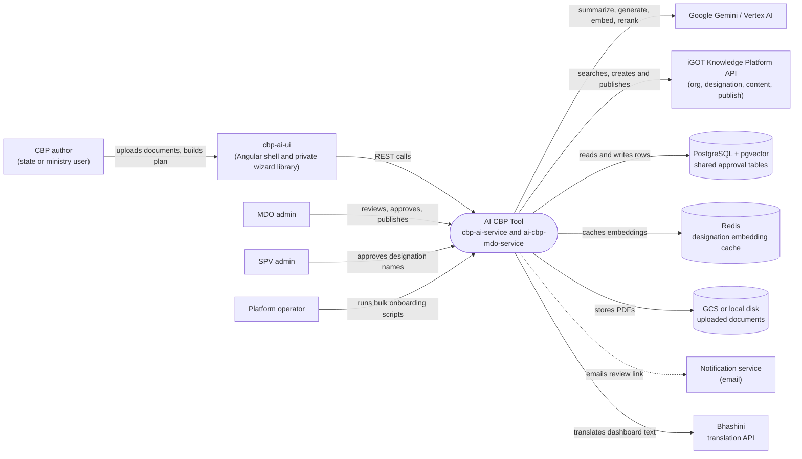

# AI CBP Tool — Context Diagram

## System boundary

Inside the feature are two FastAPI services, `cbp-ai-service` (the author-facing pipeline:
documents, role mappings, course recommendations, CBP plan, approval submission) and
`ai-cbp-mdo-service` (MDO approve/reject/publish and SPV designation-naming approval), plus
the thin `cbp-ai-ui` Angular shell. The two services never call each other; they integrate
through shared approval tables in Postgres. Outside are the CBP authors and MDO/SPV admins,
the iGOT Knowledge Platform APIs, Google Gemini / Vertex AI, Redis, document storage, the
notification service, Bhashini translation, and the operator-run bulk scripts.

## Diagram

## Elements

| Element | Role | Detailed in |
|---|---|---|
| AI CBP Tool (`cbp-ai-service`, `ai-cbp-mdo-service`) | Central system: document-to-CBP-plan pipeline plus MDO/SPV approval and publish | [hld.md](hld.md) |
| CBP author | Uploads documents, generates role mappings and course recommendations, builds and submits CBP plans | [use-cases.md](use-cases.md) |
| MDO admin | Reviews, edits, approves or rejects, and publishes submitted CBP plans | [use-cases.md](use-cases.md) |
| SPV admin | Approves or rejects escalated designation-naming requests | [use-cases.md](use-cases.md) |
| Platform operator | Runs the offline `bulk_scripts/` onboarding pipeline and operates the services | [operations-manual.md](operations-manual.md) |
| `cbp-ai-ui` | Angular shell (login, session, routing) around a private wizard library | [hld.md](hld.md) |
| iGOT Knowledge Platform API | Org, designation and content search; CBP plan create/publish; designation create; signing certs | [apis.md](apis.md) |
| Google Gemini / Vertex AI | Summaries, role mappings, embeddings and course reranking | [lld.md](lld.md) |
| Notification service | Sends review-link and status emails | [hld.md](hld.md) |
| Bhashini | Translation for dashboard output | [hld.md](hld.md) |
| PostgreSQL + pgvector | Pipeline data, vector search and the shared approval tables that integrate the two services | [lld.md](lld.md) |
| Redis | Designation embedding cache | [hld.md](hld.md) |
| GCS or local disk | Uploaded document storage | [hld.md](hld.md) |

> **Verification boundary:** elements and interactions come from the feature's own pages
> (index, use cases, APIs, HLD), spot-checked against the configuration of
> `cbp-ai-service` (Gemini/Vertex and Redis settings). The two services are drawn as one
> node because they share a boundary and database, not an API. The MDO/SPV admins' own
> frontend and the private `@sunbird-cb/cbp-ai` wizard library are not in the traced
> repos, so those actors are shown reaching the system directly and the author's wizard
> calls are assumed. The dashed notification link is a one-way email signal. Not
> re-verified: whether the bulk-script publish target and the MDO service's iGOT target
> are the same physical service.
