# AI CBP Tool — Context Diagrams

Feature-level context diagrams for the 18 steps of the CBP-AI Tool: for each, the system boundary, the actors, the external systems and data stores it touches, the main flow, the validation gates and example API calls.

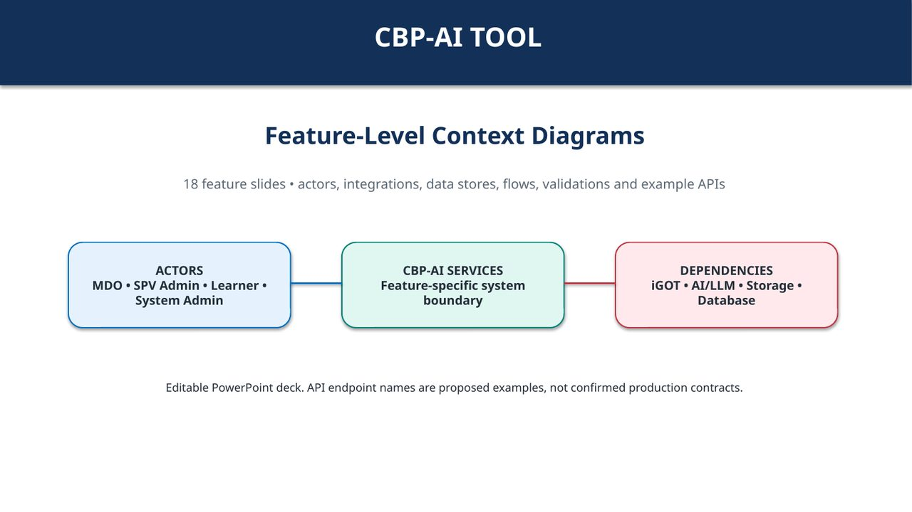

## Context Diagram 01: Login to the Platform

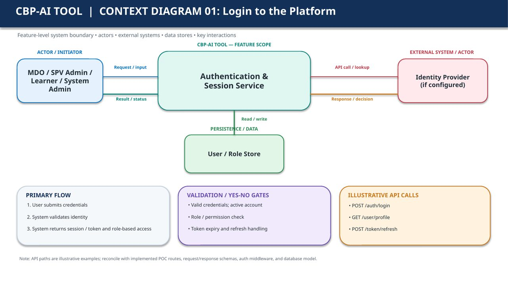

**Primary flow**

1. User submits credentials
2. System validates identity
3. System returns session / token and role-based access

**Validation / yes-no gates**

- Valid credentials; active account
- Role / permission check
- Token expiry and refresh handling

**Illustrative API calls**

- `POST /auth/login`
- `GET /user/profile`
- `POST /token/refresh`

## Context Diagram 02: Select Ministry / Department

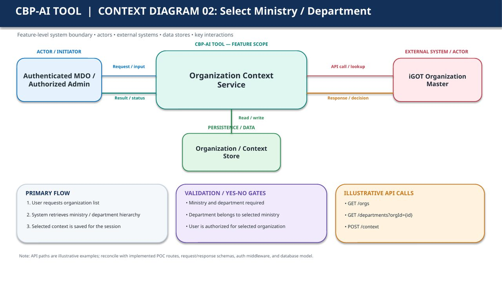

**Primary flow**

1. User requests organization list
2. System retrieves ministry / department hierarchy
3. Selected context is saved for the session

**Validation / yes-no gates**

- Ministry and department required
- Department belongs to selected ministry
- User is authorized for selected organization

**Illustrative API calls**

- `GET /orgs`
- `GET /departments?orgId={id}`
- `POST /context`

## Context Diagram 03: Manage Relevant Documents

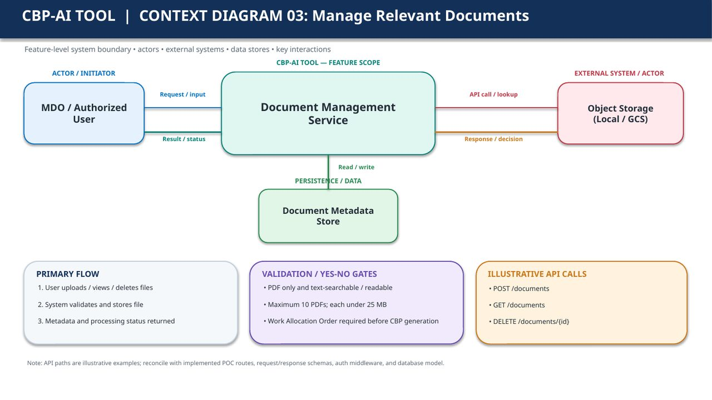

**Primary flow**

1. User uploads / views / deletes files
2. System validates and stores file
3. Metadata and processing status returned

**Validation / yes-no gates**

- PDF only and text-searchable / readable
- Maximum 10 PDFs; each under 25 MB
- Work Allocation Order required before CBP generation

**Illustrative API calls**

- `POST /documents`
- `GET /documents`
- `DELETE /documents/{id}`

## Context Diagram 04: Generate Initial CBP Draft

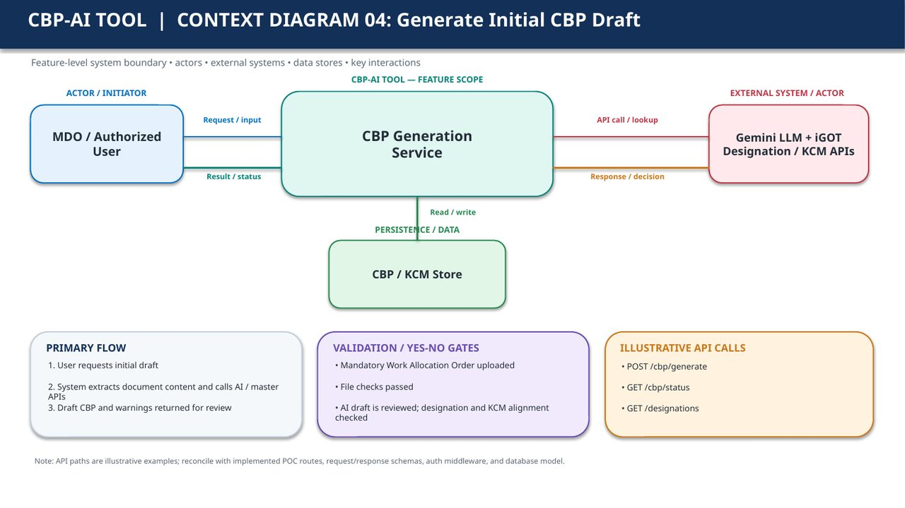

**Primary flow**

1. User requests initial draft
2. System extracts document content and calls AI / master APIs
3. Draft CBP and warnings returned for review

**Validation / yes-no gates**

- Mandatory Work Allocation Order uploaded
- File checks passed
- AI draft is reviewed; designation and KCM alignment checked

**Illustrative API calls**

- `POST /cbp/generate`
- `GET /cbp/status`
- `GET /designations`

## Context Diagram 05: Manage Unmatched Role Mapping

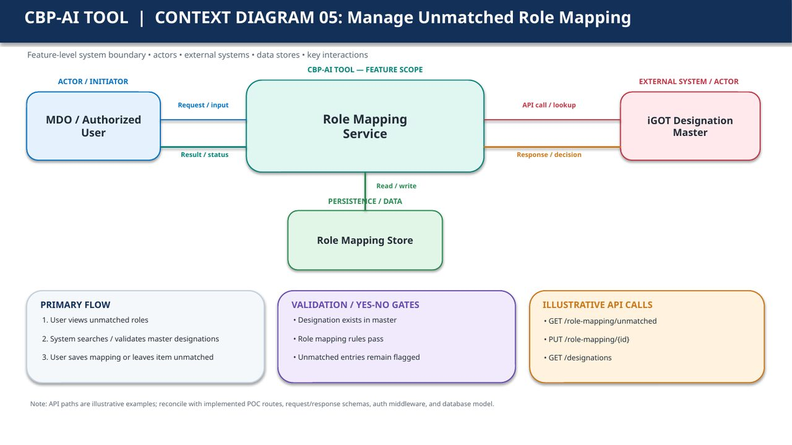

**Primary flow**

1. User views unmatched roles
2. System searches / validates master designations
3. User saves mapping or leaves item unmatched

**Validation / yes-no gates**

- Designation exists in master
- Role mapping rules pass
- Unmatched entries remain flagged

**Illustrative API calls**

- `GET /role-mapping/unmatched`
- `PUT /role-mapping/{id}`
- `GET /designations`

## Context Diagram 06: Request to Add New Designation

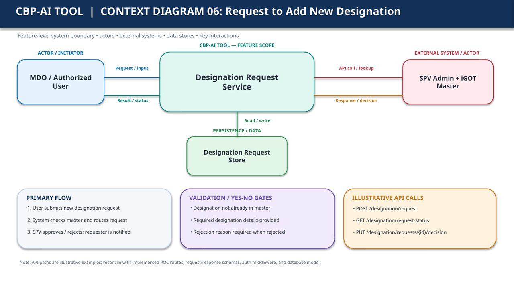

**Primary flow**

1. User submits new designation request
2. System checks master and routes request
3. SPV approves / rejects; requester is notified

**Validation / yes-no gates**

- Designation not already in master
- Required designation details provided
- Rejection reason required when rejected

**Illustrative API calls**

- `POST /designation/request`
- `GET /designation/request-status`
- `PUT /designation/requests/{id}/decision`

## Context Diagram 07: Manage Designation Hierarchy

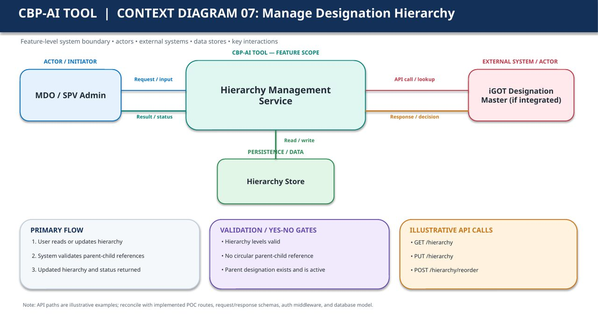

**Primary flow**

1. User reads or updates hierarchy
2. System validates parent-child references
3. Updated hierarchy and status returned

**Validation / yes-no gates**

- Hierarchy levels valid
- No circular parent-child reference
- Parent designation exists and is active

**Illustrative API calls**

- `GET /hierarchy`
- `PUT /hierarchy`
- `POST /hierarchy/reorder`

## Context Diagram 08: Add Designations from iGOT Master

**Primary flow**

1. User searches and selects designation
2. System retrieves master attributes
3. Designation is added to working set

**Validation / yes-no gates**

- Designation exists in master
- Duplicate entries prevented
- Required identifiers / attributes present

**Illustrative API calls**

- `GET /designations`
- `POST /designations`
- `POST /role-mapping`

## Context Diagram 09: Edit the CBP

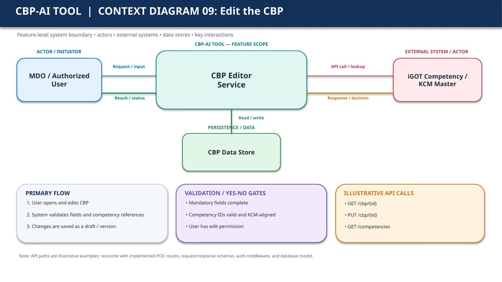

**Primary flow**

1. User opens and edits CBP
2. System validates fields and competency references
3. Changes are saved as a draft / version

**Validation / yes-no gates**

- Mandatory fields complete
- Competency IDs valid and KCM-aligned
- User has edit permission

**Illustrative API calls**

- `GET /cbp/{id}`
- `PUT /cbp/{id}`
- `GET /competencies`

## Context Diagram 10: Generate Course Recommendations

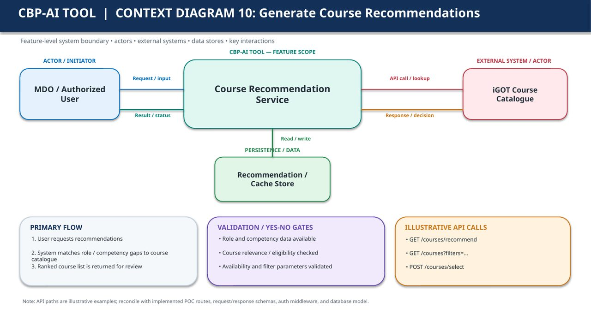

**Primary flow**

1. User requests recommendations
2. System matches role / competency gaps to course catalogue
3. Ranked course list is returned for review

**Validation / yes-no gates**

- Role and competency data available
- Course relevance / eligibility checked
- Availability and filter parameters validated

**Illustrative API calls**

- `GET /courses/recommend`
- `GET /courses?filters=...`
- `POST /courses/select`

## Context Diagram 11: Send Role Mappings for Approval

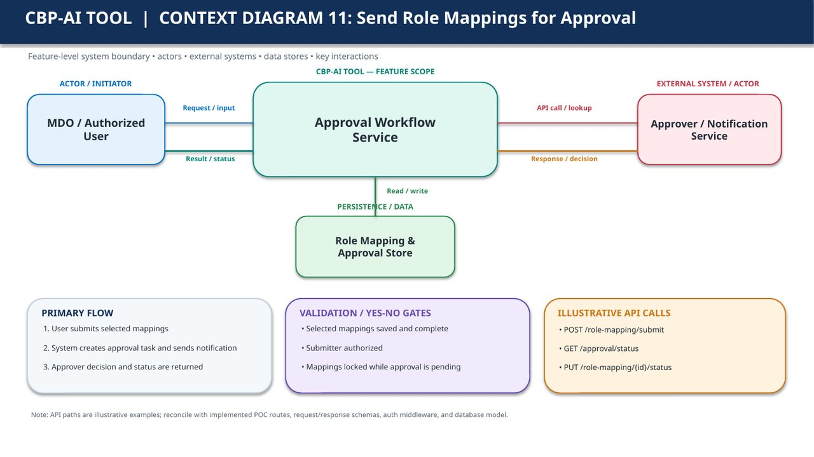

**Primary flow**

1. User submits selected mappings
2. System creates approval task and sends notification
3. Approver decision and status are returned

**Validation / yes-no gates**

- Selected mappings saved and complete
- Submitter authorized
- Mappings locked while approval is pending

**Illustrative API calls**

- `POST /role-mapping/submit`
- `GET /approval/status`
- `PUT /role-mapping/{id}/status`

## Context Diagram 12: Track / Revoke Approval Requests

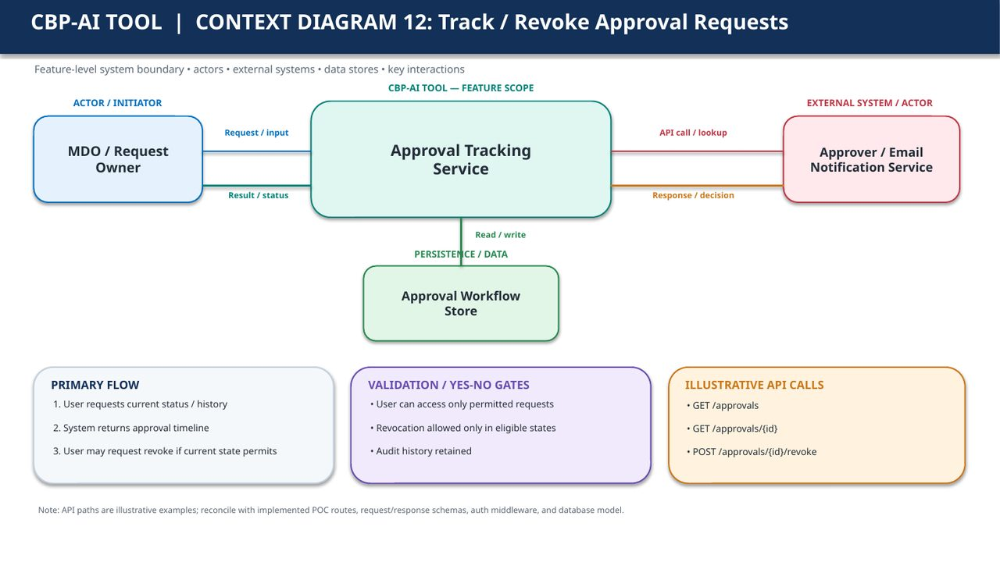

**Primary flow**

1. User requests current status / history
2. System returns approval timeline
3. User may request revoke if current state permits

**Validation / yes-no gates**

- User can access only permitted requests
- Revocation allowed only in eligible states
- Audit history retained

**Illustrative API calls**

- `GET /approvals`
- `GET /approvals/{id}`
- `POST /approvals/{id}/revoke`

## Context Diagram 13: View / Download Course List

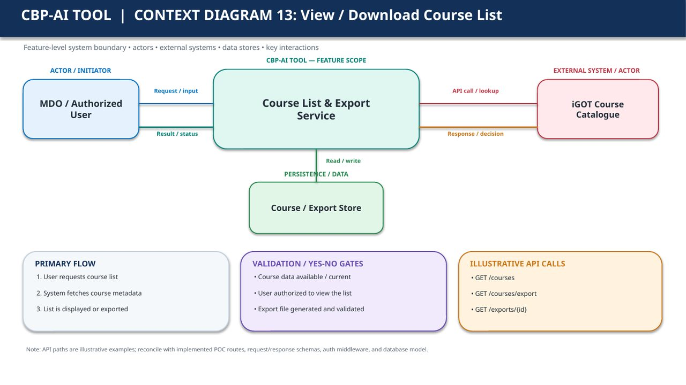

**Primary flow**

1. User requests course list
2. System fetches course metadata
3. List is displayed or exported

**Validation / yes-no gates**

- Course data available / current
- User authorized to view the list
- Export file generated and validated

**Illustrative API calls**

- `GET /courses`
- `GET /courses/export`
- `GET /exports/{id}`

## Context Diagram 14: Download Combined CBP & Courses

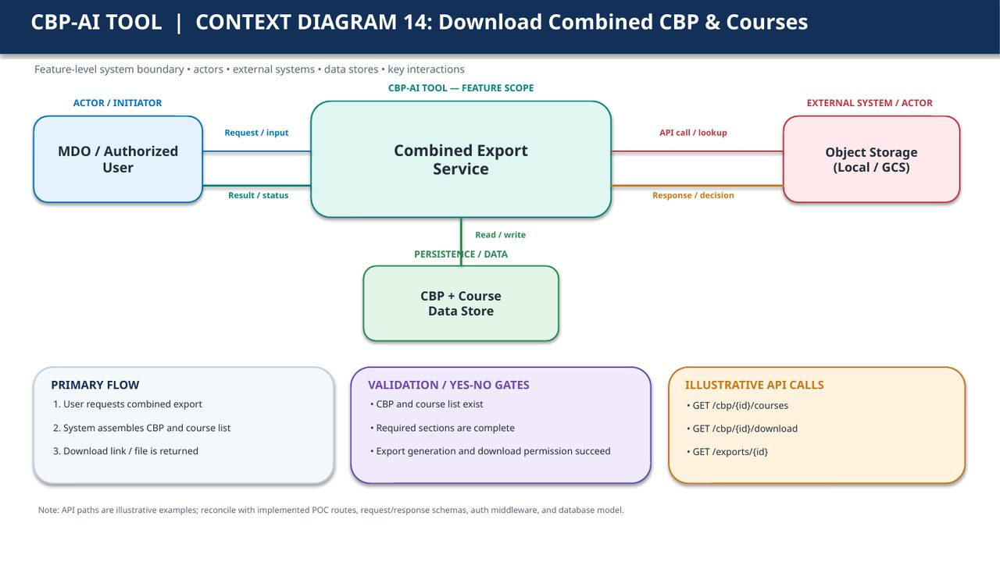

**Primary flow**

1. User requests combined export
2. System assembles CBP and course list
3. Download link / file is returned

**Validation / yes-no gates**

- CBP and course list exist
- Required sections are complete
- Export generation and download permission succeed

**Illustrative API calls**

- `GET /cbp/{id}/courses`
- `GET /cbp/{id}/download`
- `GET /exports/{id}`

## Context Diagram 15: Download in Multiple Languages

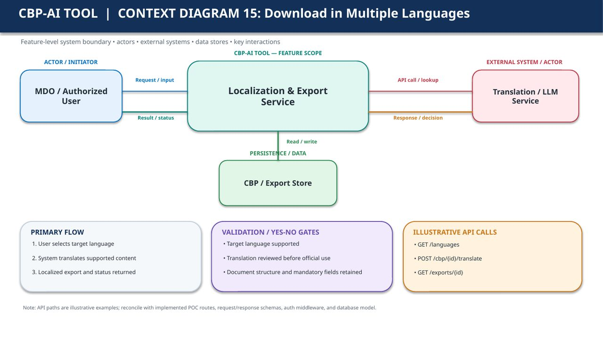

**Primary flow**

1. User selects target language
2. System translates supported content
3. Localized export and status returned

**Validation / yes-no gates**

- Target language supported
- Translation reviewed before official use
- Document structure and mandatory fields retained

**Illustrative API calls**

- `GET /languages`
- `POST /cbp/{id}/translate`
- `GET /exports/{id}`

## Context Diagram 16: Finalize / Download CBP

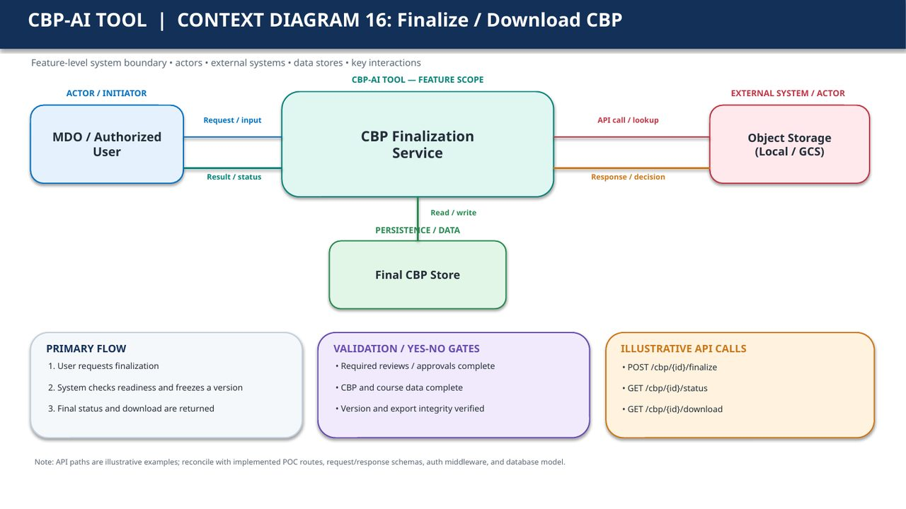

**Primary flow**

1. User requests finalization
2. System checks readiness and freezes a version
3. Final status and download are returned

**Validation / yes-no gates**

- Required reviews / approvals complete
- CBP and course data complete
- Version and export integrity verified

**Illustrative API calls**

- `POST /cbp/{id}/finalize`
- `GET /cbp/{id}/status`
- `GET /cbp/{id}/download`

## Context Diagram 17: MDO Admin / Leader Reviews Mapping

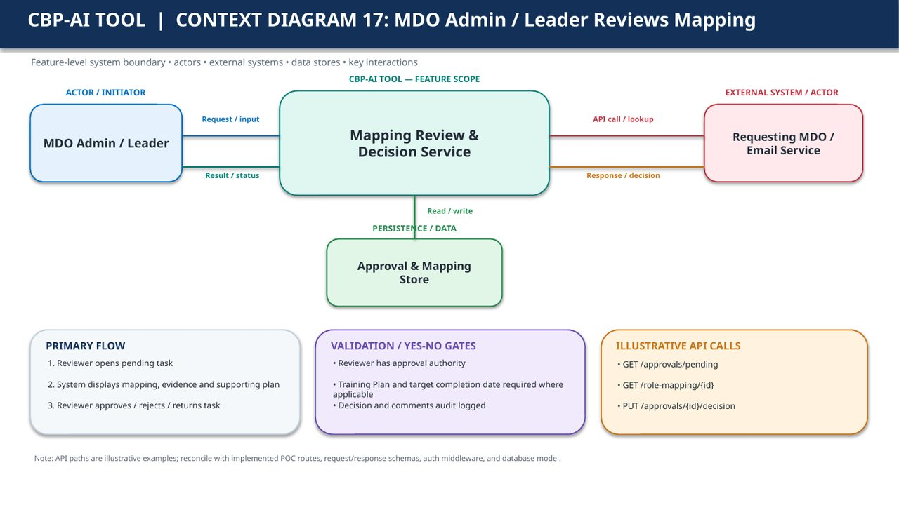

**Primary flow**

1. Reviewer opens pending task
2. System displays mapping, evidence and supporting plan
3. Reviewer approves / rejects / returns task

**Validation / yes-no gates**

- Reviewer has approval authority
- Training Plan and target completion date required where applicable
- Decision and comments audit logged

**Illustrative API calls**

- `GET /approvals/pending`
- `GET /role-mapping/{id}`
- `PUT /approvals/{id}/decision`

## Context Diagram 18: SPV Admin Approves / Rejects Designation

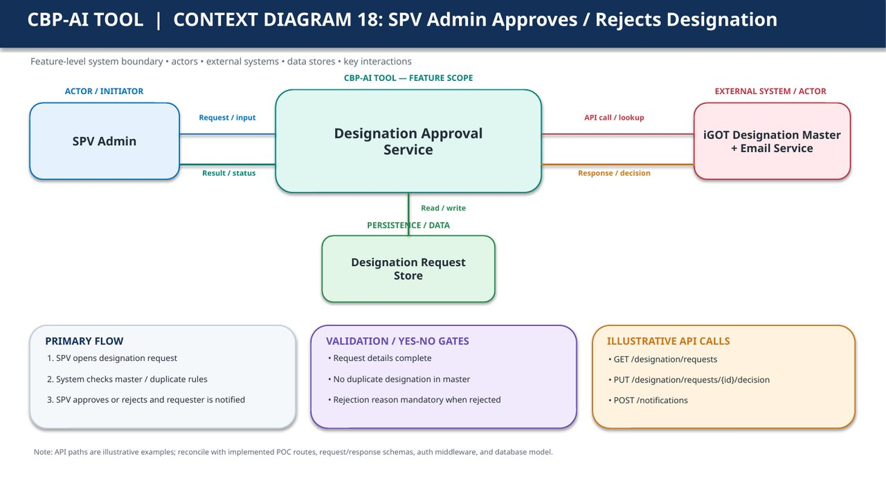

**Primary flow**

1. SPV opens designation request
2. System checks master / duplicate rules
3. SPV approves or rejects and requester is notified

**Validation / yes-no gates**

- Request details complete
- No duplicate designation in master
- Rejection reason mandatory when rejected

**Illustrative API calls**

- `GET /designation/requests`
- `PUT /designation/requests/{id}/decision`
- `POST /notifications`
