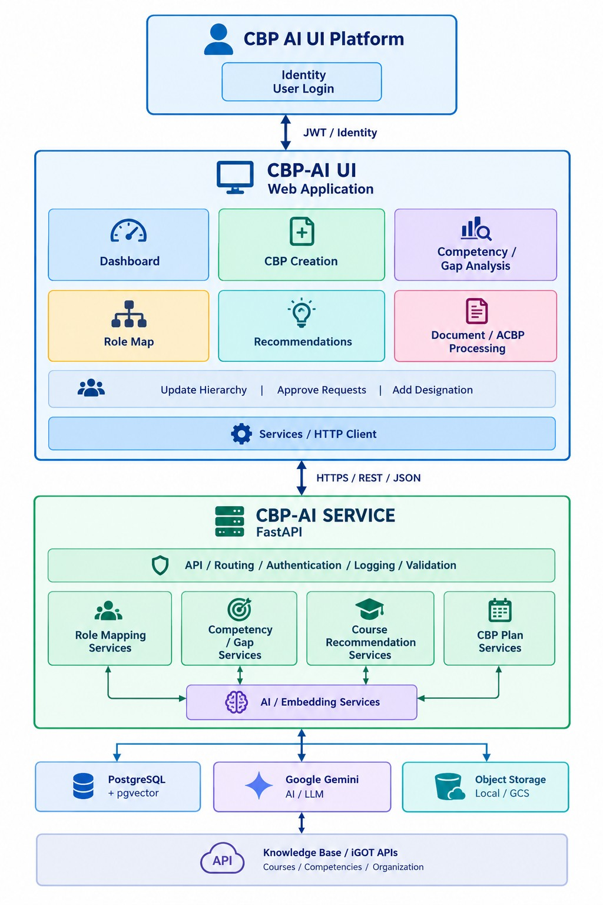

# AI CBP Tool — High-Level Design

## 1. Purpose and scope

The AI CBP Tool turns a department's official documents into a Capacity
Building Plan (CBP): designation-wise roles and competencies, matched course
recommendations, and a saved plan that an MDO Admin or Leader reviews and
publishes to iGOT. This page describes the architecture at component level.
Mechanics are in the [LLD](lld.md), endpoints in [APIs](apis.md) and the
screens in the [User Manual](use-cases.md).

**In scope:** the CBP-AI UI, the CBP-AI Service (`cbp-ai-service`) and the
approval service that works beside it (`ai-cbp-mdo-service`).
**Out of scope:** the internals of the iGOT platform APIs the tool calls.

## 2. Architecture overview

*Figure 1. High-level architecture, drawn top to bottom.*

Figure 1 has five layers. A user signs in and the identity layer issues a JWT
(top arrow). The **CBP-AI UI**, a web application, calls the **CBP-AI
Service** over HTTPS with REST and JSON (middle arrow). The service keeps its
data in **PostgreSQL with pgvector** and its uploaded files in **object
storage**, calls **Google Gemini** for the AI work, and reads course,
competency and organisation data from the **iGOT APIs** at the bottom.
Section 4 adds the components the diagram leaves out.

## 3. Layers and components

### 3.1 Identity and access

- The user logs in and the UI keeps the session; every call to the service
  carries the JWT (the "JWT / Identity" arrow).
- `cbp-ai-service` provides the login, refresh and logout calls.
- The approval endpoints of `ai-cbp-mdo-service` are role-gated to MDO Admin,
  MDO Leader and SPV Admin, and an MDO reviewer only sees requests assigned
  to them.

### 3.2 Presentation layer: CBP-AI UI

An Angular web application. A thin host shell owns login, session and routing
and contains the single "Services / HTTP client" that calls the service; the
feature screens come from a private component library loaded by the shell.

| Module in Figure 1 | What the user does | Served by (`cbp-ai-service`) |
|---|---|---|
| Dashboard | Views KPIs and gap analysis for the organisation or for themselves | Dashboard routes |
| CBP Creation | Chooses the ministry or department, generates the initial draft, edits the CBP | Role-mapping routes |
| Competency / Gap Analysis | Reads competency gaps, including the Gap Analysis tab beside course recommendations | Dashboard and recommendation routes |
| Role Map | Reviews matched and unmatched role mappings, edits and deletes them | Role-mapping routes, designation matching |
| Recommendations | Generates, filters and saves courses; suggests more from iGOT | Course recommendation, suggestion and user-added routes, CBP plan |
| Document / ACBP Processing | Uploads and summarises documents; downloads the final CBP or ACBP as PDF, in a chosen language | Document and report routes |
| Update Hierarchy | Rearranges the designation hierarchy from the profile menu | Role-mapping reorder route |
| Approve Requests | Sends role mappings for approval, tracks requests, revokes a pending one | Approval-request routes |
| Add Designation | Adds designations the AI missed; asks for a new designation in the iGOT master | Add-designation and designation-approval routes |

"Approve Requests" in Figure 1 is the author's side of approval: submit, track
and revoke. The approver's decision is taken in the MDO Admin Portal, served
by `ai-cbp-mdo-service` (section 4).

### 3.2.1 Excel and PDF export

PDF downloads are generated by the service. The Excel download on the final
CBP screen is produced in the browser by the UI (it depends on an `xlsx`
library) and has no service route behind it.

### 3.3 Application layer: CBP-AI Service

A FastAPI service. One cross-cutting layer handles API routing,
authentication, logging and request validation; behind it sit four groups of
services.

| Service group | Responsibility |
|---|---|
| Role Mapping Services | Turn document summaries into a designation hierarchy with roles, activities and competencies, and match each designation against the iGOT designation master (exact match first, then semantic). Three generations of the generator coexist; the shipped UI generates with the newest and edits through the first |
| Competency / Gap Services | Competency statistics, KPIs and gap analysis for dashboards and reports |
| Course Recommendation Services | Hybrid vector search plus Gemini reranking to produce a scored course list per role mapping, alongside two further course sources: iGOT search and manually added courses |
| CBP Plan Services | Merge the three course sources into one saved plan per role mapping, bundle completed plans into an approval request, and render the final CBP and course list as PDF |

Document upload, storage and summarisation sit at the start of this pipeline
and are part of the UI's "Document / ACBP Processing" module in Figure 1.

### 3.4 AI and embedding services

Google Gemini (through Vertex AI) is used for four jobs: summarising
documents, generating role mappings, producing embeddings for designations
and courses, and reranking recommended courses. Embeddings live in pgvector
tables and designation embeddings are also cached in Redis. The UI never
calls Gemini; every AI call goes through the service.

### 3.5 Data and storage

| Store | Holds |
|---|---|
| PostgreSQL with pgvector | Documents and summaries, role mappings, recommended courses, CBP plans, designation embeddings, approval requests and their items, users |
| Object storage (local disk or GCS, by deployment) | The uploaded PDF documents |
| Redis | Cached designation embeddings |

### 3.6 External integration: iGOT APIs

The Knowledge Base at the bottom of Figure 1 is the iGOT platform. The service
reads courses, competencies and organisation or designation data from it. The
approval service also calls it to create and publish a CBP plan and to create
a designation when an SPV Admin approves one.

## 4. Components not shown in Figure 1

| Component | Role |
|---|---|
| `ai-cbp-mdo-service` (FastAPI) | The approver side: an MDO Admin or Leader approves, rejects and publishes a request or one item; an SPV Admin approves or rejects a new designation name. It reads and writes the same approval tables the CBP-AI Service creates, and emails the outcome |
| MDO Admin Portal and SPV Admin Portal | The screens for the approver side; separate front ends |
| Notification service | Sends the approval-request, review-link and outcome emails |
| Redis | Embedding cache used by designation matching |
| Bhashini translation | Translates the CBP and ACBP PDF downloads into the chosen language |
| Playwright and Chromium | Render the HTML report templates into PDF |
| Offline bulk scripts | Operator-run tooling that runs the same pipeline stages in bulk for a state or ministry |

## 5. End-to-end flow

1. **Prepare.** The author selects a ministry or department and uploads the
   Work Allocation Order and optional supporting PDFs; each is stored and
   summarised.
2. **Generate.** Role mappings are generated in the background and each
   designation is matched to the iGOT master, with unmatched ones left for
   the author to fix or to request as new designations.
3. **Recommend.** Courses are recommended per role mapping, topped up from
   iGOT search or added by hand, and saved into the plan.
4. **Approve.** Completed plans are snapshotted into an approval request and
   the assigned MDO Admin or Leader is emailed a link.
5. **Publish.** The MDO reviewer approves or rejects in the MDO Admin Portal;
   on approval each item is published to iGOT and the author is emailed.

A request for a new designation follows the same path through the SPV Admin
Portal, which creates the designation in the iGOT master on approval.

## 6. Interfaces

| From | To | Protocol | Notes |
|---|---|---|---|
| User | Identity | Login | Issues the JWT |
| CBP-AI UI | CBP-AI Service | HTTPS, REST, JSON | JWT on every call |
| CBP-AI Service | PostgreSQL, Redis | Database connections | Own connection settings |
| CBP-AI Service | Object storage | Local disk or GCS client | Uploaded PDFs |
| CBP-AI Service | Google Gemini | Vertex AI API | Summaries, generation, embeddings, reranking |
| CBP-AI Service | iGOT APIs | HTTPS, REST | Course, competency, designation and organisation lookups |
| CBP-AI Service and MDO service | Notification service | HTTPS | Email, each configured independently |
| CBP-AI Service and MDO service | each other | Shared database tables | No API calls between the two |

## 7. Technology stack

| Layer | Technology |
|---|---|
| Presentation | Angular host shell with a private component library; `xlsx` for the Excel download |
| Application | Python with FastAPI, two services; background tasks run in the service process |
| AI | Google Gemini through Vertex AI; embeddings stored in pgvector |
| Data | PostgreSQL with pgvector; Redis for the embedding cache |
| Files and reports | Local disk or GCS; Jinja2 templates rendered to PDF with Playwright and Chromium |

## 8. Key design decisions

- **Layered and API-first.** The UI only talks REST and JSON to the service,
  and only the service talks to Gemini, the stores and iGOT.
- **Two services joined by a shared database.** The CBP-AI Service snapshots a
  plan into the approval tables and the MDO service treats those rows as its
  inbox, so the two never call each other's API. The row is the contract.
- **Thin UI shell, private feature library.** The feature screens ship as a
  versioned private library imported by the shell, so the shell stays small
  and the screens are released with the library.
- **AI work runs in the background.** Role-mapping generation and course
  recommendation run as background tasks, so a request returns at once and the
  UI follows the status.
- **Three generations of role mapping.** The generators differ in source data
  and output richness; the UI generates with the newest and edits through the
  first, so it must know which generation owns which action.
- **Approval is per item.** One publish call can leave a request approved with
  some items published and others failed, and a failed item can be retried on
  its own.

## 9. Quality attributes

- **Security.** JWT on every call; approval endpoints are role-gated and an
  MDO reviewer is limited to their own assigned requests. Users are asked to
  upload only official, publicly available documents.
- **Responsiveness.** Long AI steps return immediately and report progress.
- **Resilience.** A failed AI job or publish is recorded, not lost: documents
  and role mappings carry a failed status and a failed publish item can be
  retried individually.
- **Auditability.** Each approval request item stores a frozen copy of the
  plan data, and an approval or rejection records who acted.

## 10. Reading Figure 1 against the code

| Figure 1 shows | The traced code shows |
|---|---|
| One CBP-AI Service | Two services: `cbp-ai-service` for the author and `ai-cbp-mdo-service` for the approver, joined by shared database tables |
| "Approve Requests" inside the UI | The author submits, tracks and revokes there; approve, reject and publish happen in the MDO Admin Portal |
| Competency / Gap Services | Gap analysis and statistics in the dashboard and report routes |
| AI / Embedding Services as a sub-layer | Gemini calls inside the role-mapping, matching, recommendation and document services, with embeddings in pgvector and Redis |
| iGOT APIs below the AI layer | The service calls iGOT directly, and the approval service calls it to create and publish |
| Redis, notification and translation not drawn | Present; see section 4 |

See the [LLD](lld.md) for state machines and storage, and the
[Operations Manual](operations-manual.md) for day-two support.
