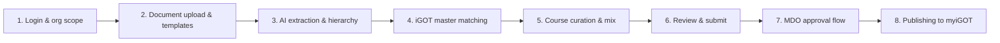

# AI CBP Tool — Overview

The AI CBP Tool under Mission Karmayogi is being transformed from an
isolated prototype into an enterprise-grade, governance-aligned and
automated competency ecosystem, integrated with the MDO Portals, the iGOT
Platform and SPV workflows.

## Key architectural and functional pillars

### Document Ingestion & Multi-Document Persistence

- **Persistence:** Appends newly extracted roles without overwriting
  previously parsed documents or session history across multiple uploads.
- **Work Allocation Order (WAO) Priority:** Gives the highest AI weightage
  to official WAOs for deriving designations, roles, responsibilities,
  activities and competencies.
- **Standardized Templates:** Provides downloadable standardized Word and
  PDF templates to maximize OCR/NLP extraction fidelity.

### Accurate Role Mapping & KCM Compliance

- **Strict Boundary:** Behavioural and Functional competencies must
  originate strictly from the Karmayogi Competency Model (KCM) catalogue;
  out-of-model suggestions are filtered.
- **Designation Hygiene:** Eliminates improper merging of similar
  designations, for example treating "Senior Section Officer" and "Section
  Officer" as distinct entities.
- **Hierarchy Definition:** Configurable L1 to L4 designation seniority
  sorting to structure the final CBP.

### iGOT Designation Master Matching & SPV Governance

- **Hybrid Matching:** Fuzzy matching (92% confidence threshold or higher)
  aligns extracted designations with the canonical iGOT Designation Master.
- **Two-Track Flow:**
  - **Matched designations:** move directly to CBP generation and MDO
    approval.
  - **Unmatched designations:** the author can manually override through a
    searchable dropdown, or trigger an SPV Admin workflow to add the missing
    designation to the central master.

### Next-Generation Course Recommendation Engine

- **Multi-Factor Weighted Ranking:** Replaces raw embedding similarity with
  a 100-point weighted scorecard: Competency match 30%, Role context 20%,
  Domain relevance 15%, Provider match 10%, Org match 10%, Difficulty 5%,
  Metadata 5%, Outcomes 5%.
- **Target Mix by Seniority:**
  - **Group A / B (Senior / Strategic):** 50% Domain, 25% Behavioural, 25%
    Functional.
  - **Group C / D (Field / Operational):** 40% Domain, 30% Behavioural, 30%
    Functional.
- **Business Rules & Constraints:** A cap of 50 total learning hours per
  recommendation set; mandatory default course injection (via locked
  DO_IDs); public courses removed or disabled; manual course additions
  default to 90% relevance.

### Approval Governance & iGOT Publishing

- **Lifecycle Statuses:** Draft → Pending Approval → Approved / Approved &
  Published / Rejected / Partially Published.
- **MDO Approval:** Review by mapped MDO Leaders and Admins, with inline
  editing and mandatory review remarks.
- **iGOT Publishing:** Published training plans (AI CBP – Non APAR for cycle
  2026–2027) surface on myiGOT within about 6 hours and notify learners with
  matching designations.

### Scale, User Management & Backend Automation

- **Nationwide Deployment:** Backend scripts, run under a dedicated service
  account, automate batch generation and cross-department copying by
  designation clusters for about 1,100 MDOs.
- **Human-in-the-Loop Validation:** An AMS team CSV export and validation
  loop runs before full-scale publishing.
- **Access & Inclusivity:** Keycloak SSO with RBAC, full audit logging, and
  multilingual CBP export across 11 Indic languages.

## How a CBP author experiences it: the author journey

A CBP Author, typically an MDO Content Creator, nodal officer or HR /
training coordinator, works through a structured 8-stage interactive
workflow.

### Step 1: Secure login & context setting

- **Single Sign-On:** The author signs into the AI CBP Portal via Keycloak
  SSO.
- **Scoping:** The author selects their organizational context: Centre or
  State → Ministry / Department → Organization (MDO).
- **Persistent State:** All subsequent documents, mappings and plans are
  scoped to this selected entity.

### Step 2: Document ingestion & template standardization

- **Template Guidance:** Under Manage Documents, the author can download a
  standardized Word or PDF template showing how roles, responsibilities,
  activities and competencies should be formatted.
- **Cumulative Uploads:** The author uploads one or more files, for example
  Work Allocation Orders, Gazette notifications and internal office orders.
- **No Data Overwrite:** Unlike earlier versions, a new upload does not
  clear previous results: newly extracted roles are appended to the existing
  session records, with clear document-source tags for traceability.

### Step 3: AI-driven role & competency generation

- **Designation Extraction:** The AI extracts all designations without
  conflating titles; "Under Secretary" is not merged with "Deputy
  Secretary".
- **Priority Weighting:** The author sees the system prioritize duties
  extracted from official Work Allocation Orders over generic competency
  frameworks.
- **KCM Validation:** Competencies appear structured under Behavioural,
  Functional and Domain. Out-of-model suggestions are blocked, ensuring
  standardization against Karmayogi master standards.
- **Hierarchy Sorting:** The author configures administrative seniority
  levels (L1 through L4), dictating the hierarchy of the final training
  plan.

### Step 4: iGOT master designation matching & handling exceptions

- **Classification:** For every extracted role, the author sees a
  classification status.
- **Exact / High Confidence Match:** Marked in green. The role is directly
  linked to an official iGOT Designation Master ID.
- **Unmatched / Low Confidence:**
  - **Option A (Manual Override):** the author opens a searchable dropdown
    containing the iGOT master list and selects the matching canonical
    title.
  - **Option B (Raise SPV Request):** if the designation is unique or newly
    created, the author clicks "Request Designation Addition", which sends
    an approval request to the central SPV Admin. Once the SPV approves it,
    the designation becomes available for mapping.

### Step 5: Course recommendation review & curation

- **Balanced Recommendations:** Opening the course recommendation screen for
  a designation shows a balanced Top-15 set tailored to the employee grade,
  not a random list of soft-skill modules.
  - Senior officers (Group A / B) receive about 50% strategic domain
    courses.
  - Operational staff (Group C / D) receive about 40% operational domain
    courses.
- **Explainable Scores:** Every course card shows why it was selected:
  competency alignment, domain fit and provider credibility.
- **Provider Prioritization:** Courses published by the author's own
  ministry or by relevant apex institutes (for example ISTM, LBSNAA) rank
  higher.
- **Editing & Adding Courses:**
  - The author can delete irrelevant courses or search the iGOT catalogue to
    add modules manually.
  - Any manually added course automatically receives a 90% relevance score,
    so it never shows 0%.
  - The system enforces a 50-hour total learning cap; if it is exceeded, the
    author is prompted to trim course durations before proceeding.
  - After saving or editing inline, the UI scrolls back to the active
    section.

### Step 6: Plan preview, language selection & submission

- **Check Validation:** Checkboxes next to designations become active only
  after course recommendations are generated and saved.
- **Multilingual Export:** The author can preview the CBP report and choose
  from 11 Indic languages (Hindi, Telugu, Kannada, Marathi, Tamil, Gujarati,
  Malayalam, Odia, Punjabi, Bengali, Assamese) or English, with clean KPI
  numbering and deduplicated competencies.
- **Send for Approval:**
  - The author checks off finalized designations and clicks "Send for
    Approval".
  - A modal asks for a mandatory Request Name (alphanumeric with - or _) and
    a searchable dropdown to select the designated MDO Leader / Admin.
  - On submission, a unique Request ID is generated, timestamped in IST, and
    set to Pending Approval.

### Step 7: MDO approval & revision loop

- **Author Tracking:** The author tracks progress in the Approval Requests
  Dashboard: Draft, Pending Approval, Approved, Rejected, Partially
  Published.
- **Revocation:** If the author notices a mistake while the request is still
  Pending Approval, they can revoke the submission, with confirmation.
- **Approver Interaction:**
  - If the MDO Leader approves, they define the official Training Plan Name
    and Target Completion Date (for example 31 March 2027).
  - If the MDO Leader rejects, the author receives an email notification
    with specific rejection remarks, and can adjust competencies or courses
    and resubmit.

### Step 8: Publishing & monitoring impact

- **Pushed to iGOT:** Once approved, the training plan is published to the
  MDO Portal and the Learner Portal (myiGOT). Within about 6 hours, mapped
  government officials see the CBP prominently on their myiGOT home screen.
- **Executive Dashboard:** The author visits the AI CBP Dashboard to track:
  - Total CBPs created across their department.
  - Gap Analysis: competencies without matching iGOT courses, highlighting
    training deficits where new courses should be commissioned.
  - Unique designations mapped versus remaining departmental roles.

See [Use Cases](use-cases.md), [APIs](apis.md), [HLD](hld.md), [LLD](lld.md) and the
[Operations Manual](operations-manual.md) for the detail behind each of these.
