# AI CBP Tool — Low-Level Design

This page details the design below the architecture level: the validation flow of each step, the data model, the main sequences, the state machines and the rules the services enforce. For the architecture see the [HLD](hld.md); for endpoints see [APIs](apis.md). Endpoint paths are relative to the service's `/api` prefix.

## 1. Feature validation and API flows

One subsection per step of the CBP-AI Tool: the validation flow, its decision points, the validation checklist and the endpoints involved. At every decision diamond, YES continues on the success path and NO validates, corrects or stops. Endpoints are served by `cbp-ai-service`, except steps 17 and 18, which are served by `ai-cbp-mdo-service`.

### 1.1 Login & Authentication

Validate credentials and establish an authenticated session.

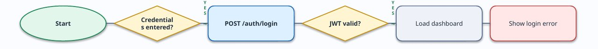

**Decision points**

1. Credentials entered?
2. JWT valid?

**Validation checklist**

- Required fields present
- Credentials valid
- Account active
- JWT signature / expiry valid

**API calls**

- `POST /v1/auth/login`
- `POST /v1/auth/refresh`
- `POST /v1/auth/logout`
- `GET /v1/users/me`

### 1.2 Select Ministry / Department

Resolve organisation context before document management.

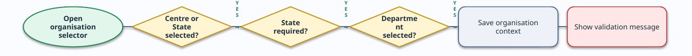

**Decision points**

1. Centre or State selected?
2. State required?
3. Department selected?

**Validation checklist**

- Organisation type is valid
- State required only for State
- Department belongs to selected organisation
- User is authorised for organisation

**API calls**

- `GET /v1/state-center/`
- `GET /v1/department/state-center/{state_center_id}`

### 1.3 Manage Documents

Upload official, searchable PDFs and track AI summary status.

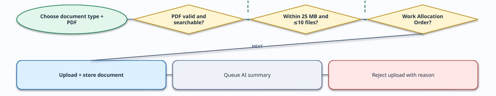

**Decision points**

1. PDF valid and searchable?
2. Within 25 MB and ≤10 files?
3. Work Allocation Order?

**Validation checklist**

- PDF only; text-searchable
- Each file <25 MB
- Maximum 10 PDFs
- Official/public; no confidential content
- Work Allocation Order flagged mandatory

**API calls**

- `POST /v1/files`
- `GET /v1/files`
- `GET /v1/files/{file_id}`
- `POST /v1/files/{file_id}/summary`
- `GET /v1/files/{file_id}/download`
- `PATCH /v1/files/document-type`
- `DELETE /v1/files/{file_id}`

### 1.4 Generate Initial CBP

Extract designations, match master roles and build draft CBP.

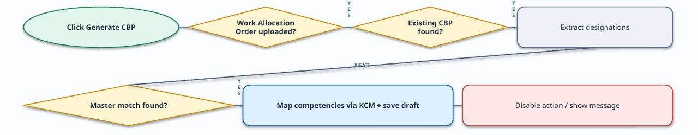

**Decision points**

1. Work Allocation Order uploaded?
2. Existing CBP found?
3. Master match found?

**Validation checklist**

- Mandatory Work Allocation Order exists
- Confirm overwrite before regeneration
- Persist matched and unmatched rows
- KCM mapping result is traceable

**API calls**

- `POST /v3/role-mapping/generate`
- `POST /v1/role-mapping/search`
- `POST /v1/role-mapping/match-designations`

### 1.5 Manage Unmatched Role Mapping

Manually resolve unmatched designation records.

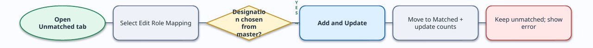

**Decision points**

1. Designation chosen from master?

**Validation checklist**

- Master designation exists
- Mapping belongs to current CBP
- Prevent duplicate mapping
- Update matched/unmatched status transactionally

**API calls**

- `POST /v1/role-mapping/search`
- `PUT /v1/role-mapping/{role_mapping_id}`
- `POST /v1/role-mapping/match-designations`
- `POST /v1/kb/designation/search`

### 1.6 Request New Designation

Send designation to SPV Admin for approval.

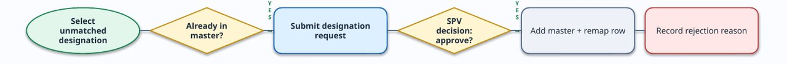

**Decision points**

1. Already in master?
2. SPV decision: approve?

**Validation checklist**

- Reject duplicate request if master already contains designation
- Only authorised SPV Admin can decide
- Rejection reason required
- Audit decision + notify requester

**API calls**

- `POST /v1/designation-approval/create`
- `GET /v1/designation-approval/search`

### 1.7 Manage Designation Hierarchy

Update the organisation's designation hierarchy.

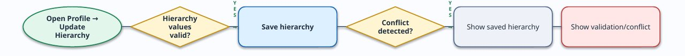

**Decision points**

1. Hierarchy values valid?
2. Conflict detected?

**Validation checklist**

- Parent-child links valid
- No circular hierarchy
- User authorised to edit
- Handle concurrent updates

**API calls**

- `GET /v1/role-mapping/reorder/list`
- `PUT /v1/role-mapping/reorder`

### 1.8 Add Designations from Master

Add missing designations and create role mappings.

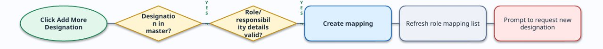

**Decision points**

1. Designation in master?
2. Role/responsibility details valid?

**Validation checklist**

- Selected designation must exist in master
- Required role/responsibility fields present
- No duplicate designation in same CBP

**API calls**

- `POST /v1/kb/designation/search`
- `POST /v2/role-mapping/add-designation`
- `POST /v1/role-mapping/search`

### 1.9 Edit CBP

Edit roles and competencies with KCM validation.

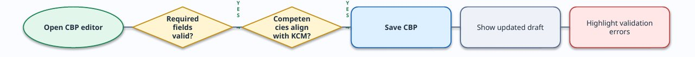

**Decision points**

1. Required fields valid?
2. Competencies align with KCM?

**Validation checklist**

- Validate designations, responsibilities, wings/divisions
- Competency IDs exist in KCM
- Record editor and update timestamp

**API calls**

- `GET /v1/role-mapping/{role_mapping_id}`
- `PUT /v1/role-mapping/{role_mapping_id}`
- `DELETE /v1/role-mapping/{role_mapping_id}`

### 1.10 Course Recommendations

Generate AI recommendations and allow manual course curation.

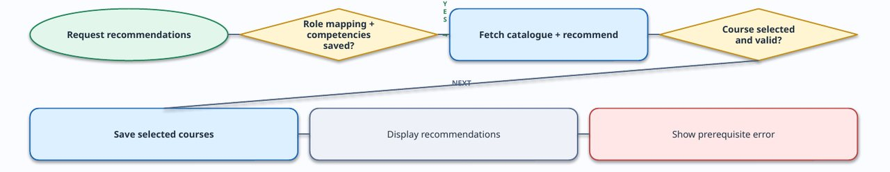

**Decision points**

1. Role mapping + competencies saved?
2. Course selected and valid?

**Validation checklist**

- Mapping and competency gaps exist
- Course IDs exist in catalogue
- Apply filters safely
- User confirms selected courses before save

**API calls**

- `POST /v1/course-recommendations/generate`
- `GET /v1/course-recommendations`
- `POST /v1/course/suggestions`
- `POST /v1/course/suggestions/save`
- `POST /v1/user-added-courses`
- `POST /v1/cbp-plan/save`

### 1.11 Send Role Mappings for Approval

Submit eligible mappings and lock them while pending.

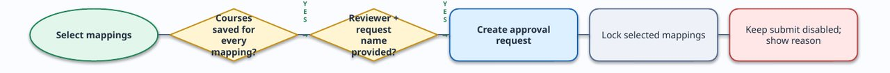

**Decision points**

1. Courses saved for every mapping?
2. Reviewer + request name provided?

**Validation checklist**

- At least one mapping selected
- Each selected mapping has saved courses
- Reviewer and request name required
- Atomic submission + lock; status Pending Approval

**API calls**

- `POST /v1/approval-requests/mdo-admins`
- `POST /v1/approval-requests/send`

### 1.12 Track / Revoke Approval Requests

View request status and revoke only pending requests.

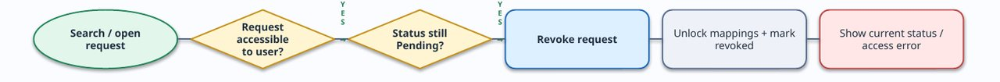

**Decision points**

1. Request accessible to user?
2. Status still Pending?

**Validation checklist**

- Requester or authorised reviewer only
- Revoke only while pending
- Unlock mappings after successful revoke
- Status transitions audited

**API calls**

- `GET /v1/approval-requests/list`
- `GET /v1/approval-requests/{request_id}`
- `POST /v1/approval-requests/revoke`

### 1.13 View / Download Course List

Review course recommendations and export PDF.

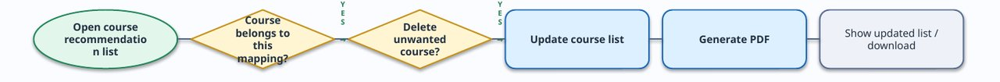

**Decision points**

1. Course belongs to this mapping?
2. Delete unwanted course?

**Validation checklist**

- Prevent deleting courses outside mapping
- Confirm destructive action
- Export reflects saved course list

**API calls**

- `GET /v1/reports/course-recommendations/download`
- `DELETE /v1/course-recommendations/{role_mapping_id}/course/{course_id}`

### 1.14 Download Combined CBP + Courses

Join final role mappings and course recommendations.

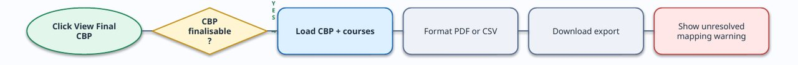

**Decision points**

1. CBP finalisable?

**Validation checklist**

- Required role mappings reviewed
- Unmatched designations clearly flagged
- Export format allowlisted

**API calls**

- `GET /v1/reports/cbp-plan/download`
- `GET /v1/reports/acbp-plan/download`

### 1.15 Download in Multiple Languages

Produce a language-specific final export.

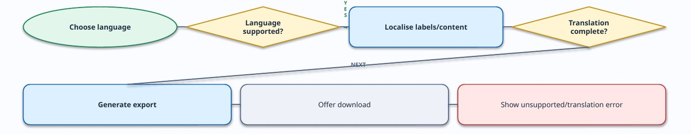

**Decision points**

1. Language supported?
2. Translation complete?

**Validation checklist**

- Locale on supported allowlist
- Preserve designation IDs and competency meaning
- Do not silently omit untranslated content

**API calls**

- `GET /v1/reports/cbp-plan/download?language={code}`
- `GET /v1/reports/acbp-plan/download?language={code}`

### 1.16 Finalize & Download CBP

Download official artefacts after review.

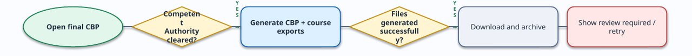

**Decision points**

1. Competent Authority cleared?
2. Files generated successfully?

**Validation checklist**

- Authority sign-off recorded according to policy
- Both exports correspond to same CBP version
- Secure download links expire

**API calls**

- `GET /v1/reports/cbp-plan/download`
- `GET /v1/reports/acbp-plan/download`
- `GET /v1/reports/course-recommendations/download`

### 1.17 MDO Review Role Mapping Requests

Approve and publish mappings, or reject with a reason.

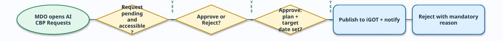

**Decision points**

1. Request pending and accessible?
2. Approve or Reject?
3. Approve: plan + target date set?

**Validation checklist**

- Only authorised MDO Admin/Leader
- Approve requires Training Plan and Target Completion Date
- Reject requires reason
- Audit and email requester

**API calls**

- `GET /v1/mdo/approval-requests/list`
- `GET /v1/mdo/approval-requests/read/{request_id}`
- `POST /v1/mdo/approval-requests/publish`
- `POST /v1/mdo/approval-requests/publish/retry`
- `POST /v1/mdo/approval-requests/reject`
- `POST /v1/mdo/approval-requests/items/reject`
- `PUT /v1/mdo/approval-requests/items/update`
- `POST /v1/mdo/approval-requests/course/add`
- `POST /v1/mdo/approval-requests/course/remove`

### 1.18 SPV Approve New Designation

Approve or reject designation-master change requests.

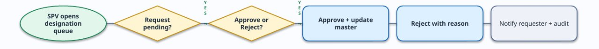

**Decision points**

1. Request pending?
2. Approve or Reject?

**Validation checklist**

- Only SPV Admin can decide
- Reject requires reason
- Approval adds designation to master and remaps eligible row
- Log reviewer + timestamp; email requester

**API calls**

- `GET /v1/designation/approval-requests/list`
- `POST /v1/designation/approval-requests/approve`
- `POST /v1/designation/approval-requests/reject`

## 2. Data design

### 2.1 CBP-AI Service tables

PostgreSQL with the pgvector extension. Two course-search tables built by an offline embedding pipeline sit alongside the application tables.

| Table | Key columns | Notes |
|---|---|---|
| `users` | `user_id` PK, `username` and `email` unique, `role_id` FK, `organization_ids` | The approval service mirrors a minimal read-only view of it |
| `roles` | `role_id` PK, `role_name` unique, `permissions` JSONB | |
| `user_sessions` | `id` PK, `user_id` FK, access and refresh token identifiers | Login-session records |
| `designation_embeddings` | `id` (the iGOT designation id), `designation`, `content`, `embedding` vector | Populated offline by an ingestion script; read by designation matching |
| `role_mappings` | `id` PK, `user_id`, `state_center_id`, `department_id`, `designation_name`, `role_responsibilities`, `activities` and `competencies` JSONB, `status`, `igot_designation_name` and `igot_designation_id`, `sort_order` | Parent of recommendations, plans, suggestions and user-added courses (cascade) |
| `recommended_courses` | `id` PK, `role_mapping_id` FK, `status`, `vector_query`, `embedding` JSONB, `actual_courses` and `filtered_courses` JSONB | One record per role mapping; `filtered_courses` is the scored list |
| `suggested_courses` | `id` PK, `role_mapping_id` FK, `course_identifiers` JSONB | Courses found through iGOT search, unscored |
| `user_added_courses` | `id` PK, `role_mapping_id` FK, `identifier` unique, `name`, `platform`, `public_link`, `relevancy`, `competencies` JSONB | Manually entered external courses |
| `cbp_plans` | `id` PK, `role_mapping_id` FK, `recommended_course_id` FK, `selected_courses` JSONB | The merged plan; copied into the approval items at submission |
| `documents` | `file_id` PK, `state_center_id`, `department_id`, `uploader_id`, `stored_path`, `document_type`, `summary_status`, `summary_text`, `summary_error` | Uploaded PDFs and their summaries |
| `meta_summaries` | `id` PK, `request_id` unique, `file_ids` JSONB, `status`, `summary_text` | Cross-document summaries |
| `state_center_data` | `id` PK, `state_center_id`, `department_id`, `acbp_plan_summary`, `work_allocation_order_summary`, `status` | Older document source, used by v1 role-mapping generation |
| `designation_approvals` | `id` PK, `rolemapping_id` FK, `user_id`, `designation_name`, `wing_division_section`, `status`, `actioned_by` | The same table the approval service updates when an SPV Admin decides |
| `approval_requests` | `id` PK, `user_id` FK, `mdo_id`, `designation_count`, `status` (enum), `published_by` | The approval service mirrors this table and updates its status columns |
| `approval_request_items` | `id` PK, `approval_request_id` FK, `source_role_mapping_id`, `designation_name`, `role_responsibilities`, `activities` and `competencies` JSONB, `cbp_plan_data` JSON, `status` (enum) | A frozen snapshot of a role mapping and its plan at submission time |
| `course_metadata_weightage` | keyword, description and combined embedding vectors, `competencies_v6`, `duration`, `organisation` | The primary course-recommendation search table |

### 2.2 Approval service tables

| Table | Key columns | Notes |
|---|---|---|
| `approval_requests` | As above, plus `rejected_at`, `revoked_at`, `reviewer_comments` | Shared table, declared in the approval service as a mirror |
| `approval_request_items` | As above, plus `igot_designation_name`, `igot_designation_id`, `reviewer_comments`, `rejected_at` | Shared table; the approval service writes the item `status` |
| `mdo_approval` | `id` PK, `approval_request_id` FK, `approval_request_item_id` FK, `plan_name`, `due_date`, `igot_cbp_plan_id`, `created_at` | Owned by the approval service. One row per publish attempt per item; `igot_cbp_plan_id` is set when the publish succeeds |
| `designation_approvals` | `id` PK, `user_id` FK, `rolemapping_id` FK, `designation_name`, `wing_division_section`, `status`, `reviewer_comments`, `actioned_by`, timestamps | Owned by the approval service |
| `users` | `user_id` PK, `username`, `email` | A three-column view used for email lookups |

### 2.3 How the records relate

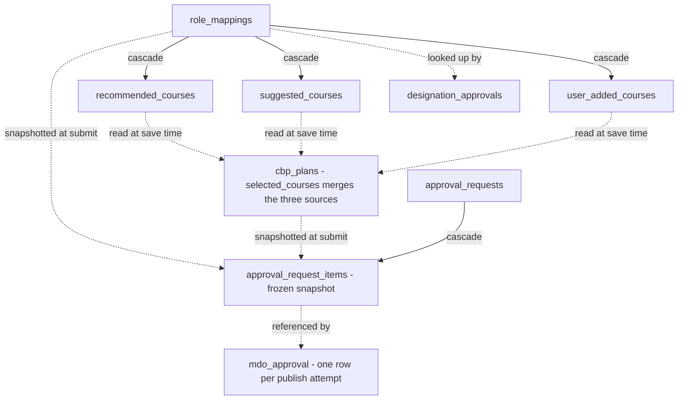

Solid lines are database relationships. Dashed lines are resolved by application code at one point in time, when a plan is saved or a request is submitted, and are not kept as live links.

## 3. Sequence flows

### 3.1 Role mapping generation (v3)

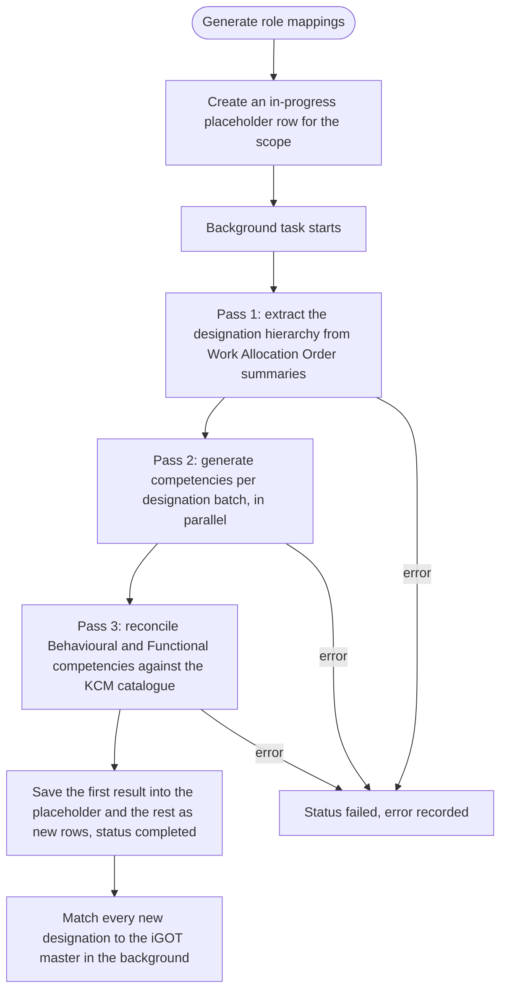

Domain competencies pass through the reconcile pass unchanged. Versions v1 and v2 use a single generation call instead of the three passes and retry a failed scope automatically on the next generate call. The shipped UI generates with v3.

### 3.2 Designation matching

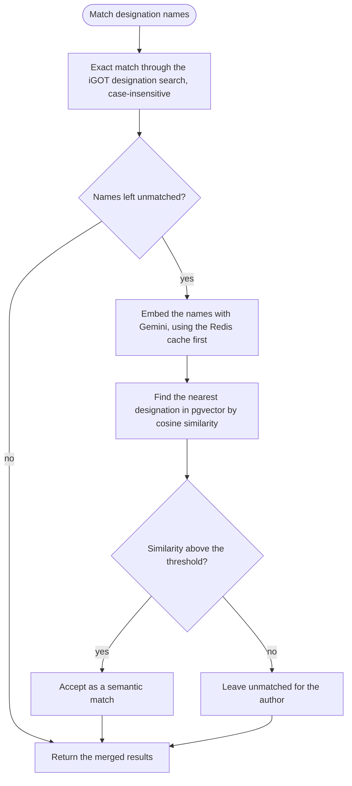

The designation embeddings are loaded offline and indexed for nearest-neighbour search; the live service only reads them.

### 3.3 Course recommendation

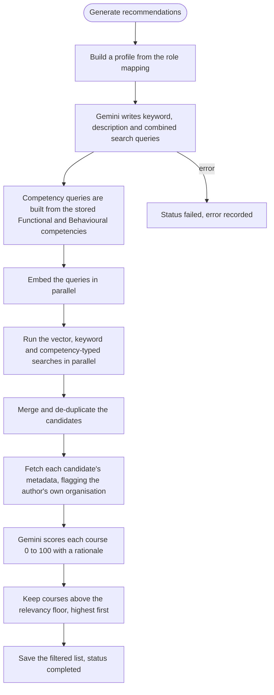

### 3.4 CBP plan save

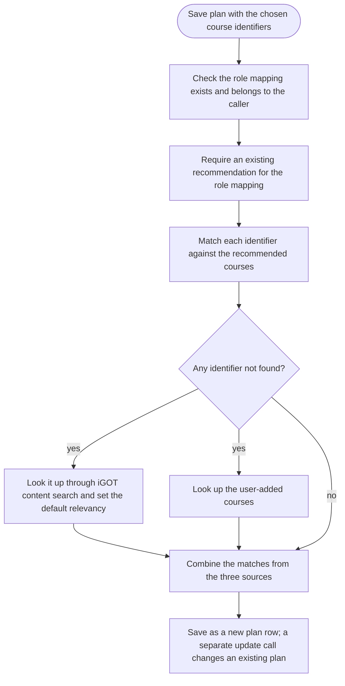

### 3.5 Send for approval

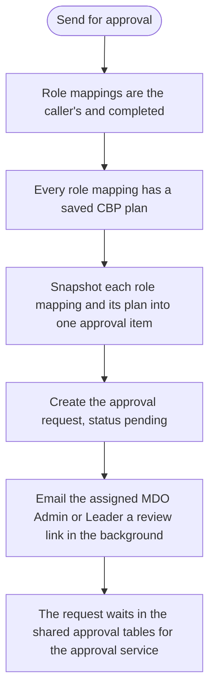

### 3.6 MDO publish (approval service)

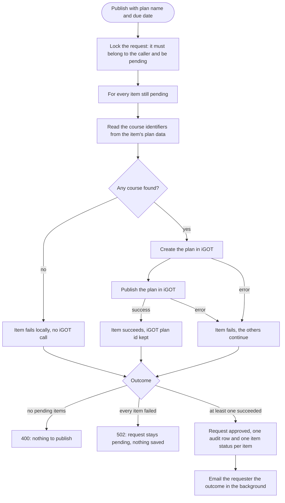

### 3.7 SPV designation approval (approval service)

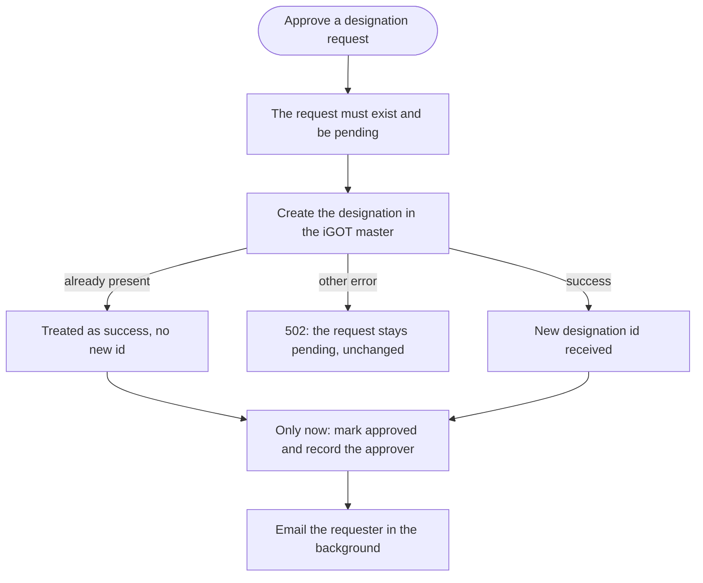

The SPV flow calls iGOT first and writes to the database only afterwards, while the MDO publish writes once, after every item's iGOT outcome is known.

## 4. State machines

**Role mapping status**

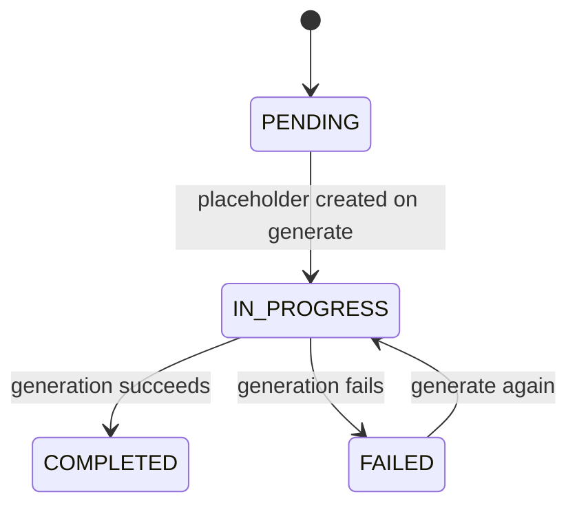

Recommendation status follows the same shape (pending, in progress, completed or failed); a failed or in-progress record is returned as it is and is deleted before regenerating.

**Approval request status** (`DRAFT`, `PENDING`, `APPROVED`, `REJECTED`): the CBP-AI Service creates and revokes the request, and the approval service decides it, against the same database row.

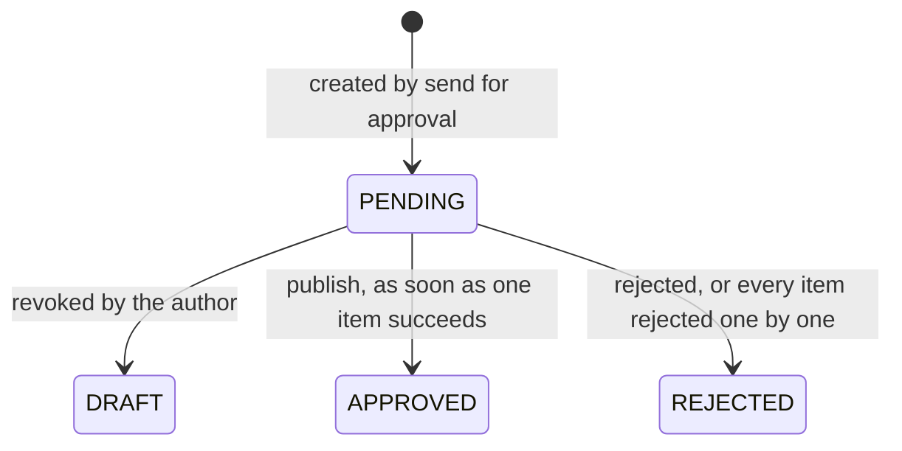

**Approval request item status** (`PENDING`, `APPROVED`, `REJECTED`, `FAILED`):

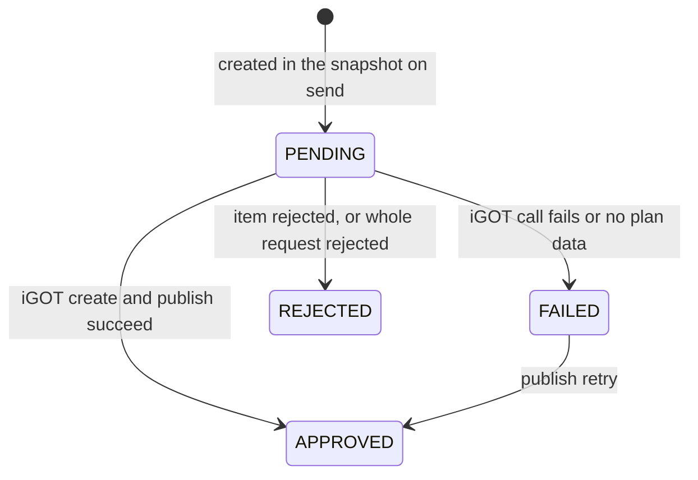

**Designation approval status** (`pending`, `approved`, `rejected`): the CBP-AI Service creates the request and the approval service decides it.

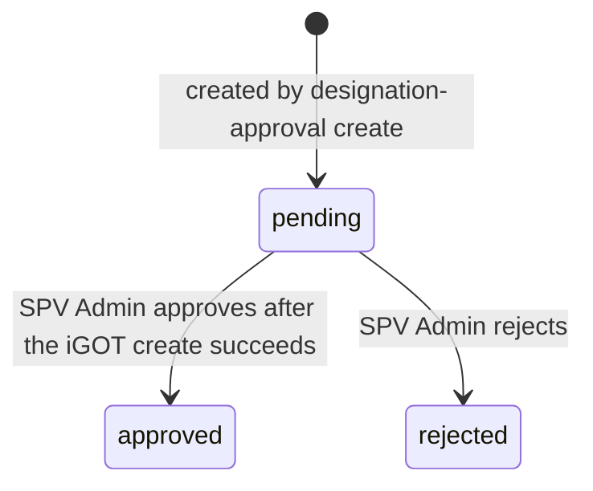

## 5. Rules enforced by the services

| Rule | Service |
|---|---|
| Course identifiers are required when saving a CBP plan | `cbp-ai-service` |
| A recommendation must exist before a CBP plan is created | `cbp-ai-service` |
| Role mappings must be completed and have a saved CBP plan before they are sent for approval | `cbp-ai-service` |
| A request can be revoked only while pending | `cbp-ai-service` |
| Publish and reject act only on a pending request owned by the caller's `mdo_id`, under a row lock | `ai-cbp-mdo-service` |
| Editing an item needs the item to be pending; adding or removing a course needs the parent request to be pending | `ai-cbp-mdo-service` |
| An SPV approval is saved only after the iGOT create succeeds or reports the designation already present | `ai-cbp-mdo-service` |
| A designation request is blocked once the role mapping has an iGOT match, and a duplicate request is rejected | `cbp-ai-service` |
| Uploads are PDF only, up to 10 files, within a per-file size cap | `cbp-ai-service` |
| A document cannot be deleted while its summary is in progress; a role mapping cannot be deleted, and the hierarchy cannot be reordered, while a mapping is in progress | `cbp-ai-service` |

