# AI CBP Tool — Use Cases

Traced across three repos: `cbp-ai-service` (`origin/cbrelease-4.8.39`,
commit `70d7175`), `ai-cbp-mdo-service` (`origin/cbrelease-4.8.39`, commit
`88040de`), and `cbp-ai-ui` (`origin/cbrelease-4.8.39`, commit `15a3b9a`).

`cbp-ai-service` endpoints below are relative to `/api` (mounted at
`src/api/__init__.py:8`), version-prefixed at `src/api/v{1,2,3}/__init__.py`.
`ai-cbp-mdo-service` endpoints are relative to `/v1` (`src/api/__init__.py:6-8`,
`src/api/v1/__init__.py:10-14`). `cbp-ai-ui`'s own client
(`src/app/modules/shared/services/shared.service.ts`) confirms
`cbp-ai-service` is actually reachable at a `cbp-tpc-ai/api/v{1,2,3}/...`
gateway path in at least one environment (`API_END_POINTS`,
`shared.service.ts:9-62`) — upgrading the older "not otherwise confirmed"
note to a cross-repo-verified fact. No client in any of the three repos
calls `ai-cbp-mdo-service` directly by host or under a discoverable gateway
prefix; its gateway path is unverified.

## User guide walkthrough (steps 01 to 18)

This section follows the AI CBP Tool How-to-Use Guide step by step, for a
CBP author, an MDO Admin/Leader and an SPV Admin. The code-traced use cases
further down (UC-1 to UC-26) are the reference for the services.

### Step 01 · Log in to the platform (CBP author)

**What the user does**

- Open the iGOT AI CBP Tool in the browser.
- Enter the credentials issued to the department.
- Sign in to reach the dashboard.

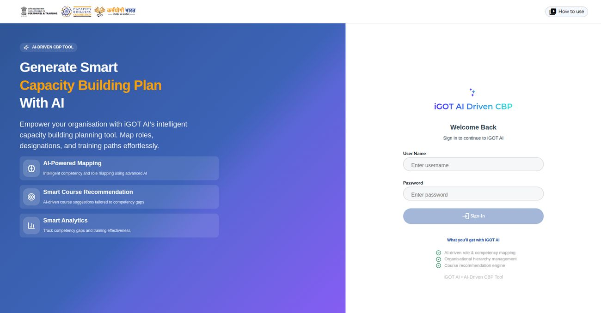

### Step 02 · Select ministry / department (CBP author)

**What the user does**

- Pick whether the organisation is Centre or State.
- For a State, choose the State name, then the Department from the dropdown.
- Tap **Manage Documents** to continue.

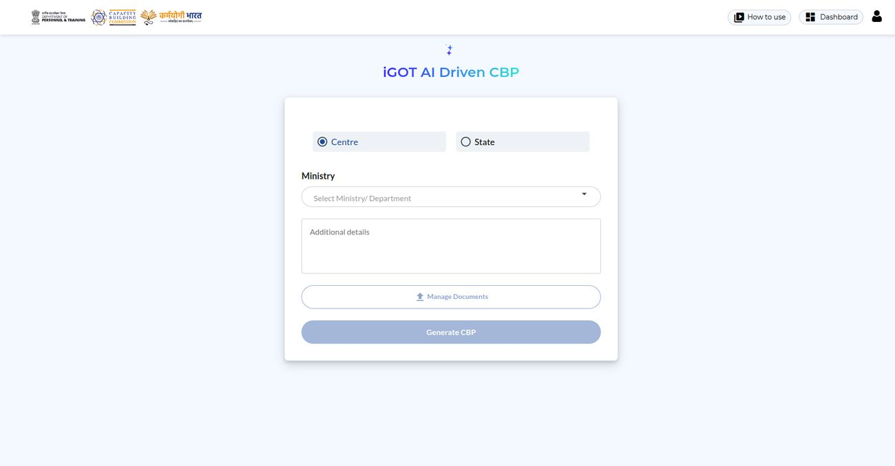

### Step 03 · Manage relevant documents (CBP author)

**What the user does**

- Upload the mandatory **Work Allocation Order** first; a live badge shows
  progress.
- Add optional supporting documents such as Annual Reports or other
  supporting documents to improve accuracy; download the sample formats
  before preparing files.
- Use **Upload Document**, choose the document type, then drag and drop or
  browse for the PDF.
- Preview, download or delete any file from the table, and search by name or
  type.
- Keep to up to 10 PDFs, each under 25 MB, official, publicly available and
  text-searchable; avoid confidential files.
- Watch the AI summary status go Pending, In Progress, then Completed.

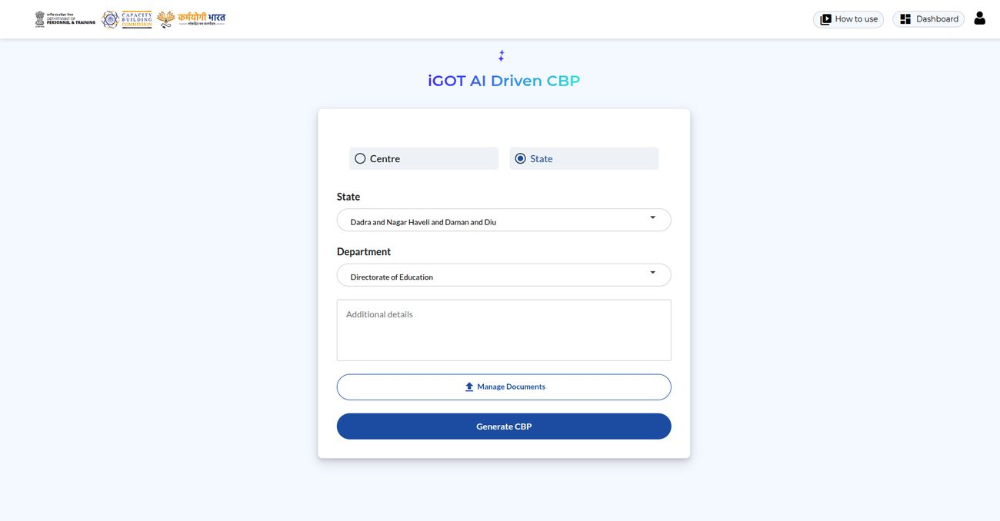

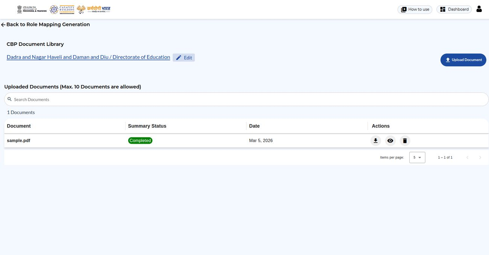

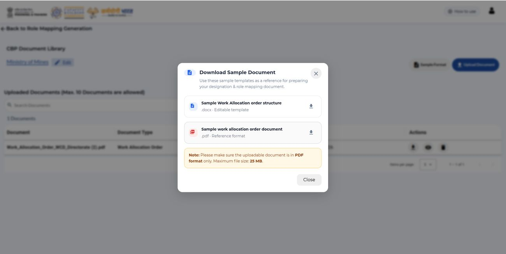

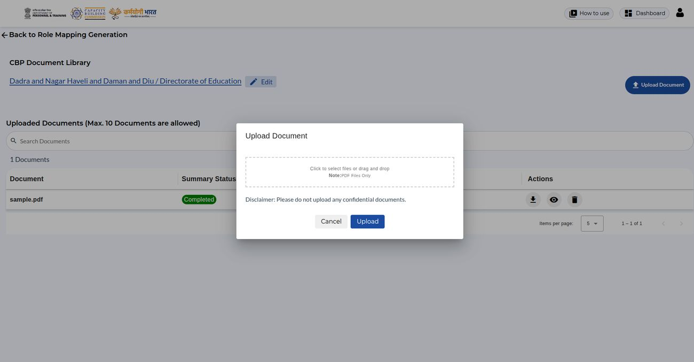

### Step 04 · Generate CBP: initial draft (CBP author)

**What the user does**

- Generate CBP reads every designation in the uploaded Work Allocation
  Order; without that document the action is disabled.
- Each designation is matched against the iGOT Designation Master; matches
  go to **Matched Role Mapping** with a live count and the rest to
  **Unmatched Role Mapping**.
- Roles and competencies are mapped with the KCM framework, giving the
  initial draft CBP.
- If a CBP already exists, Generate CBP opens a prompt: **View Existing
  CBP** opens the last one, **Yes** starts a new generation that overwrites
  the previous data.
- Treat the draft as a starting point and check both tabs.

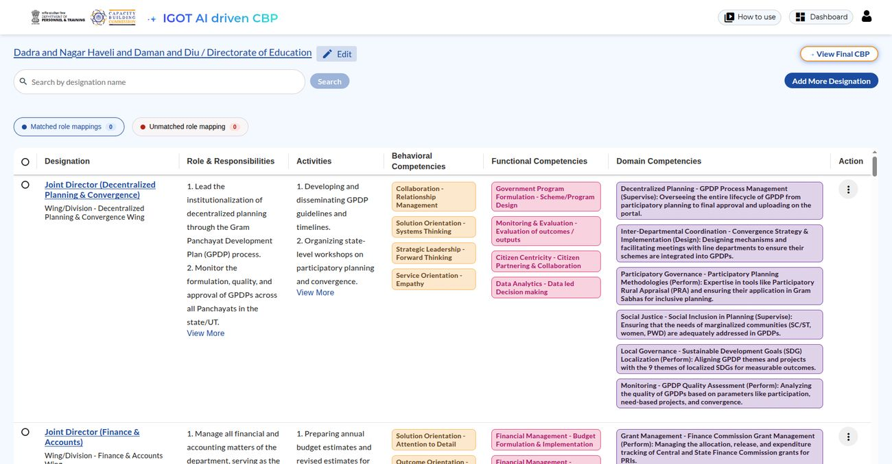

### Step 05 · Manage unmatched role mapping (CBP author)

**What the user does**

- Open the **Unmatched Role Mapping** tab to see designations that were not
  auto-matched.
- Use the 3-dot menu on a row and choose **Edit Role Mapping**.
- Pick the correct designation from the iGOT Designation Master dropdown and
  tap **Add and Update**.
- The row moves to Matched Role Mapping and the counts update at once.
- Clearing unmatched rows enables **View Final CBP** and **Send for
  Approval**.

### Step 06 · Request a new designation in the iGOT master (CBP author)

**What the user does**

- Request a new designation only when it genuinely does not exist in the
  iGOT Designation Master.
- From Unmatched Role Mapping, select the designation and tap **Send
  Designation Approval**; SPV Admins get an automatic email.
- The SPV Admin approves it or rejects it with a reason.
- On approval the designation joins the master and its row moves to Matched
  Role Mapping on its own.
- Follow the status under Unmatched Role Mapping; an email arrives when the
  SPV acts.

### Step 07 · Manage designation hierarchy (CBP author)

**What the user does**

- Tap the profile icon at the top right.
- Choose **Update Designation Hierarchy**.
- Rearrange the hierarchy with the dropdowns as needed.

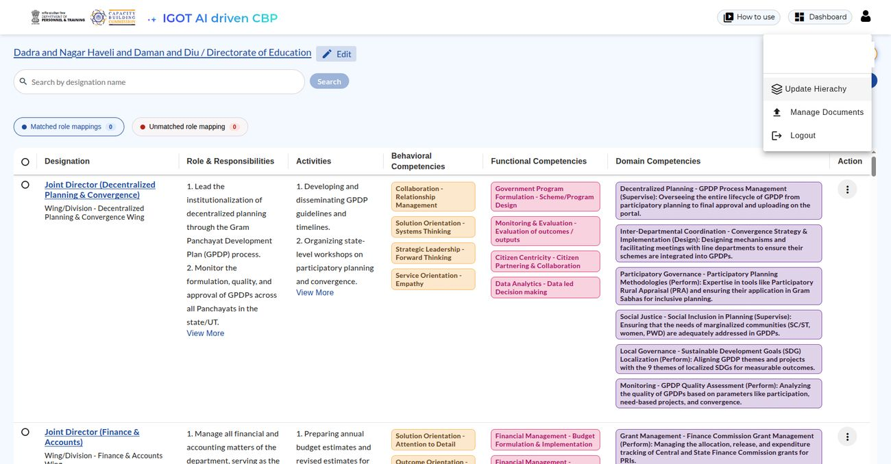

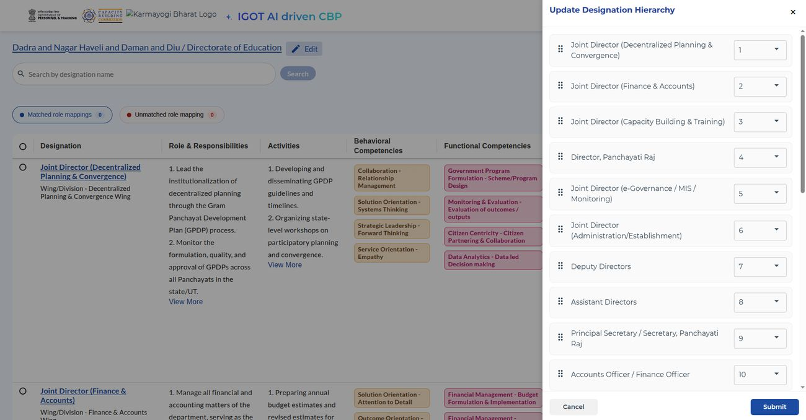

### Step 08 · Add new designations from the iGOT Designation Master (CBP author)

**What the user does**

- From the role-mapping page use **Add More Designation** to add any
  designation the AI missed from the iGOT Designation Master.
- Fill in roles, responsibilities and details for each, and tap Save after
  each addition.
- Role mappings are generated for the newly added designations as well.

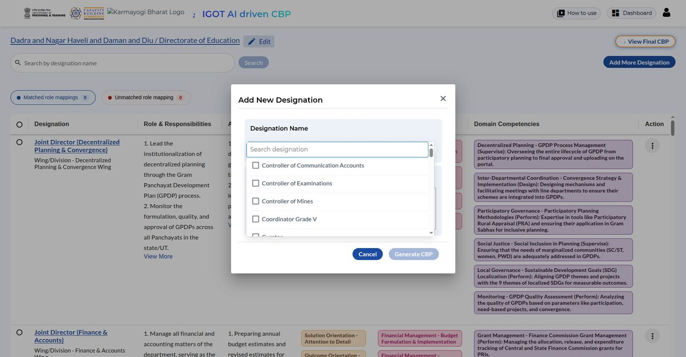

### Step 09 · Edit the CBP (CBP author)

**What the user does**

- Edit designations, responsibilities, wings or divisions in the built-in
  editor.
- Update Behavioural and Functional competencies so they align with KCM, and
  fine-tune Domain competencies for the role.
- Tap **Save CBP** when done.

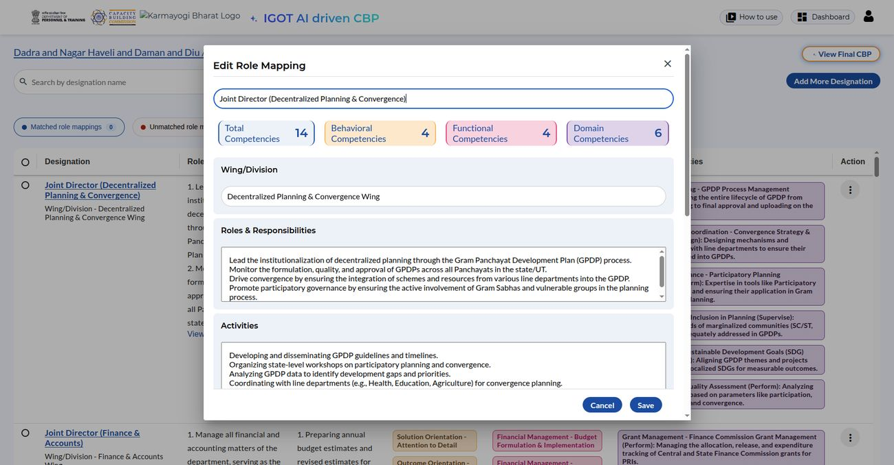

### Step 10 · Generate course recommendations (CBP author)

**What the user does**

- Open a role mapping and tap **Generate Course Recommendation**, or use the
  3-dot menu on a row.
- The tool suggests best-fit courses from the iGOT catalogue for the role's
  competency gaps.
- Narrow the list with Competencies, Ratings, Language, Duration and
  Provider filters, or search.
- Open each course on the iGOT platform to review it before adding it.
- Use **Add More Courses from iGOT** for relevant courses the AI missed.
- Tick the chosen courses and tap **Save Courses** to finalise the
  recommendation for that role.
- Blend AI suggestions with hand-picked courses.

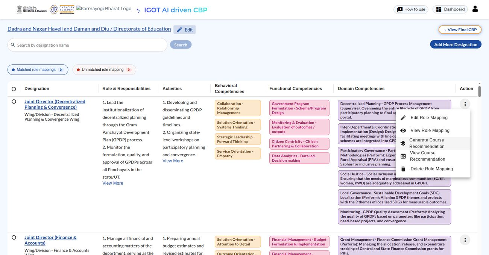

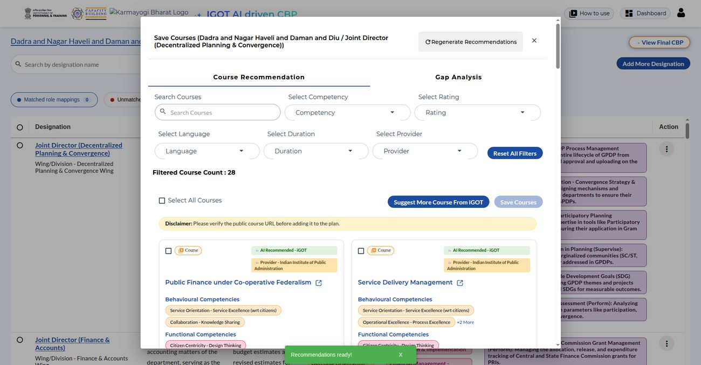

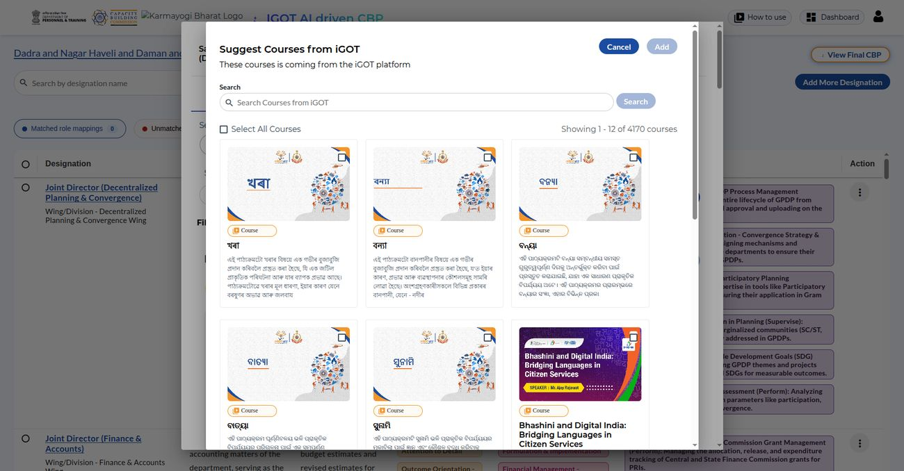

### Step 11 · Send role mappings for approval (CBP author)

**What the user does**

- Tick each role mapping to submit; the checkbox appears only after its
  course recommendations are saved.
- The **Send for Approval** button shows a live count, for example Send for
  Approval (3).
- Choose the MDO Admin or Leader who will review, give the request a clear
  **Request Name**, and tap Submit.
- A unique **Request ID** is generated at once and the status starts as
  **Pending Approval**; note the ID.
- Submitted role mappings lock for editing, so check everything first.

### Step 12 · Track role mapping approval requests (CBP author)

**What the user does**

- Open **Approval Requests** from the profile menu.
- Find a request by Request ID or use search and filters.
- Read the badge: Pending (yellow), Approved and Published (green) or
  Rejected (red).
- Tap **View** to see the submitted role mappings and course
  recommendations.
- Revoke a request while it is pending; this unlocks its role mappings for
  editing.
- Statuses update after the MDO acts; refresh if the latest badge is not
  showing.

### Step 13 · View and download the course list (CBP author)

**What the user does**

- Tap **View Course Recommendation** to see the full list.
- Remove any course with the delete icon.
- Export the list as a PDF with the Download button.

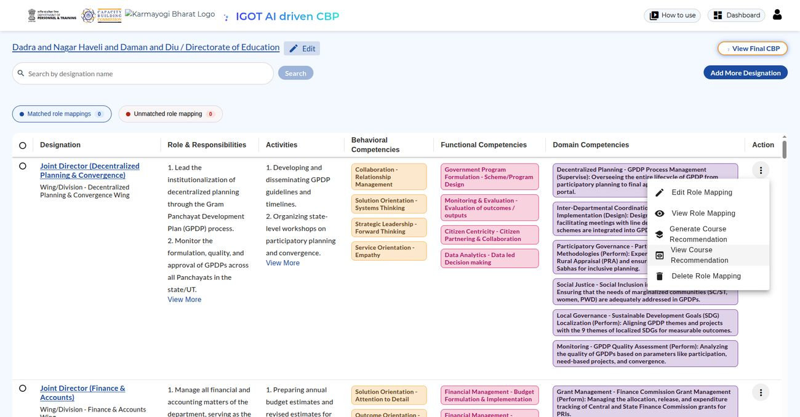

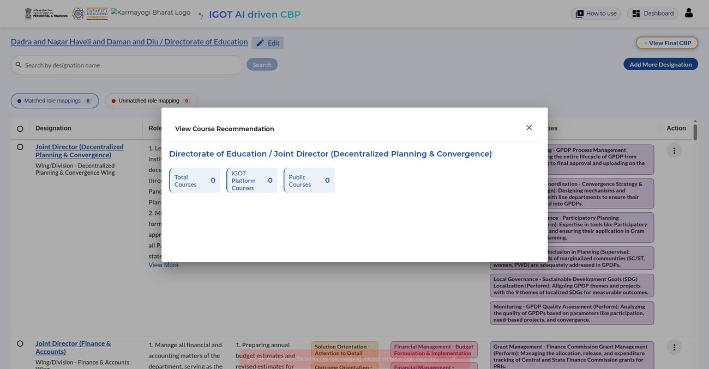

### Step 14 · Download combined CBP and courses (CBP author)

**What the user does**

- Tap **View Final CBP** to review all role mappings with their courses.
- Export as a PDF, or as a spreadsheet: the guide says CSV, while the screen
  and the app's own help text say **Download as Excel**.

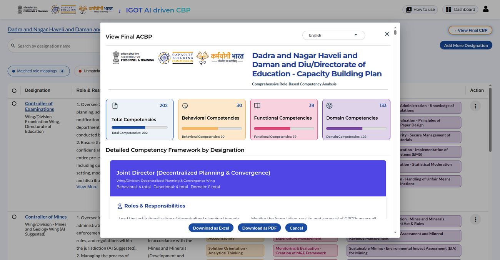

### Step 15 · Download in multiple languages (CBP author)

**What the user does**

- In the **View Final CBP** pop-up open the Language dropdown.
- Pick the preferred language and download.

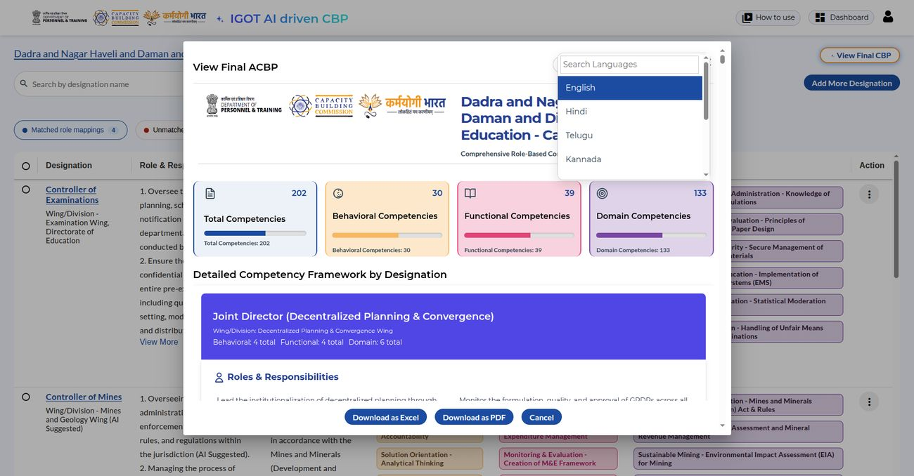

### Step 16 · Finalise and download the CBP (CBP author)

**What the user does**

- Download the Final CBP with all designations and competency mappings.
- Download the Final Course Recommendations alongside it.
- Save as PDF for records and official submission, after the Competent
  Authority has reviewed and cleared everything.

### Step 17 · Review role mapping approval requests (MDO Portal) (MDO Admin / Leader)

**What the user does**

- Log in to the MDO Admin Portal and open **AI CBP Requests** from the left
  navigation.
- The dashboard lists each request with Request ID, Request Name, Submitted
  By, Submitted On and a live status badge; search or filter by Pending,
  Approved or Rejected.
- Tap **View** to open the review screen: submitted role mappings, mapped
  competencies and linked course recommendations side by side.
- **Approve**: pick a training plan and a target completion date and
  confirm; the mapping is marked Approved and Published to iGOT.
- **Reject**: enter the mandatory reason so the Nodal Officer knows what to
  fix.
- **View Non Matching Designations** (top right) lists the designations the
  author flagged as unmatched with their SPV approval status.
- Both actions email the Nodal Officer and update the status at once.

### Step 18 · Approve new designation requests (SPV Portal) (SPV Admin)

**What the user does**

- Log in to the SPV Admin Portal and open **Manage Designation Approval
  Requests**.
- Switch between the Pending, Approved and Rejected tabs, each with a live
  count.
- Narrow the list with search, the Division/Wing filter (Apex, Directorate,
  District, Block, Field) or the Organisation filter.
- Each row shows Created On, Designation Name, Organisation, Division,
  Requested By and Email.
- **Approve** (green tick): the designation is added to the iGOT Designation
  Master and the requester's unmatched row moves to Matched Role Mapping.
- **Reject** (red cross): give a clear reason so the MDO can resubmit if
  needed.
- Only SPV Admins can act; actions are logged and the requester is emailed.

### Dos and Don'ts (All users)

**What the user does**

- **Do:** upload only official, publicly available PDFs under 25 MB each;
  guard login credentials; treat the AI draft as a starting point; blend
  AI-suggested courses with hand-picked ones; keep every competency within
  the KCM framework; save and securely store the final CBP and course
  recommendations; double-check before Send for Approval, because submitted
  role mappings lock.
- **Never:** upload confidential, classified or sensitive documents; treat
  AI output as final without the Competent Authority's review; add
  competencies outside KCM without proper approval; share login credentials
  with colleagues or outsiders; upload files that are too large, corrupted
  or not text-searchable.

### Next steps (All users)

**What the user does**

- Pull together guidelines, toolkits, annual reports and Work Allocation
  Orders before starting.
- Generate the department-wise CBP, review every mapping carefully and get
  formal sign-off from the Competent Authority.
- Roll out the approved CBP by creating and assigning designation-wise
  MyiGOT training plans for the team.
- Identify remaining competency gaps and plan new course development to
  close them.

### Where the guide and the code differ

| Topic | The guide says | The code shows |
|---|---|---|
| File size | Each PDF under 25 MB | A separate, larger configurable per-file cap, plus 10 files per upload |
| Hierarchy screen | Rearranged with dropdowns | The reorder call is verified; the earlier docs described drag-and-drop |
| MDO approval | Approve role mapping by role mapping | One publish call over the request's pending items, each reported separately |
| SPV reject reason | A clear reason is expected | The comment is optional in the service |
| Spreadsheet export | Final CBP exportable as PDF or CSV | The screen offers Download as Excel and Download as PDF; PDF routes exist in `cbp-ai-service`, no spreadsheet route does |
| Division/Wing filter | Filter on the SPV list | Search covers wing/division text; no dedicated filter parameter found |

## Document journeys (`cbp-ai-service`, author-facing)

### UC-1 · Upload source documents

A CBP author uploads up to 10 PDFs at a time for their
state-center/department, tagged by type (`Work Allocation Order`,
`Annual Reports`, `Other Document`). Duplicate `(scope, filename, uploader)`
combinations are rejected; each file is stored (local disk or GCS, per
`DOCUMENT_STORAGE_TYPE`) and gets its own `Document` row with
`summary_status = NOT_STARTED`.

- API: `POST /v1/files` — `src/api/v1/document_routes.py:51`
- Confirmed from the client side: `cbp-ai-ui`'s `uploadDocument()`
  (`shared.service.ts:757-787`) targets this same path, though its
  `FormData`-building logic is dead code in the shell — the actual request
  body is built inside the private `@sunbird-cb/cbp-ai` library (not
  traceable from this repo).

### UC-2 · Summarize a document

Summarization is not automatic on upload — it's a separate, idempotent
call. A background task reads the PDF bytes and sends them to Gemini
(`GEMINI_PRO_MODEL_NAME`) with a single generic summarization prompt (not
type-specific — the same prompt runs for a Work Allocation Order or an
annual report).

- API: `POST /v1/files/{file_id}/summary` — `src/api/v1/document_routes.py:303`
- **Non-obvious mechanism**: `document_type = "Work Allocation Order"` is
  just a label on the `Document` row; there is no WAO-specific extraction
  logic anywhere in the current codebase — a WAO-tagged file is summarized
  by the exact same code path as any other document type.
- Confirmed from the client side: `cbp-ai-ui`'s `triggerFileSummary()`
  (`shared.service.ts:817-828`) targets this same path, consistent with it
  being an explicit, user/UI-triggered job rather than an automatic one.

### UC-3 · Build a meta-summary across several documents

A user can request one synthesized summary spanning several already-summarized
documents that share a state-center/department scope.

- API: `POST /v1/meta-summaries` — `src/api/v1/meta_summary_routes.py:106`
- **Known bug**: if a referenced document isn't already `COMPLETED`, the
  handler tries to regenerate its summary by calling
  `_run_document_summary(doc.file_id)` **without `await` and without
  scheduling it as a background task** (`meta_summary_routes.py:47,49`) — the
  coroutine is created and immediately discarded, the document's summary
  never actually regenerates, and the whole meta-summary batch is marked
  `FAILED`. In practice: every input document must already have a
  `COMPLETED` summary before requesting a meta-summary.

## Role mapping journeys (`cbp-ai-service`)

### UC-4 · Generate role mappings from uploaded documents

The author triggers generation for a state-center(+department); a
placeholder `IN_PROGRESS` row is created immediately (locking that scope
against a second concurrent generation) and a background task does the real
work. Three versions coexist with materially different behavior:

- **v1** (`POST /v1/role-mapping/generate`, `src/api/v1/role_mappings.py:150`):
  single Gemini call, sourced from a dedicated `state_center_data` table's
  ACBP/work-allocation summaries (uploaded via a separate legacy endpoint,
  UC-9); on a prior failure it auto-deletes and retries.
- **v2** (`POST /v2/role-mapping/generate`, `src/api/v2/role_mappings.py:151`):
  single Gemini call, sourced from the generic `documents` table (all
  summarized document types concatenated, undifferentiated); same
  auto-retry-on-failure behavior as v1.
- **v3** (`POST /v3/role-mapping/generate`, `src/api/v3/role_mappings.py:163`):
  a three-pass pipeline — extract the designation hierarchy first (Work
  Allocation Order summaries only), generate FRAC competencies per
  designation batch in parallel, then reconcile every Behavioral/Functional
  competency against a fixed competency taxonomy
  (`data/withidentifier_competencies.json`), dropping anything that can't be
  resolved. Unlike v1/v2, an exception here propagates to a real `FAILED`
  status with the actual error message, a prior `FAILED` state is **not**
  auto-retried (returns `FAILED` as-is), and successful generation
  automatically kicks off iGOT designation matching (UC-5) for every new
  designation.
- Confirmed from the client side: `cbp-ai-ui`'s `generateRoleMapping()`
  (`shared.service.ts:298-361`) calls `v3/role-mapping/generate` specifically
  — the shipped UI drives the three-pass pipeline, not v1/v2. A second,
  separate streaming client (`role-mapping.service.ts:175-292`, `POST
  .../v1/role-mapping/generate_stream` via raw `fetch()`, parsing
  `start`/`chunk`/`end` SSE-style events) exists in the same repo but has no
  visible caller in `cbp-ai-ui` itself — it is either dead code or invoked
  only from inside the private `@sunbird-cb/cbp-ai` library, which this
  trace cannot see. `cbp-ai-service` v3's own generate endpoint is a
  single blocking POST, not a stream — whether that separate
  `generate_stream` route exists in `cbp-ai-service` was not indepedently
  re-verified in this pass.

### UC-5 · Reconcile a designation against iGOT's designation master

Each role mapping's free-text designation name gets resolved to an iGOT
designation ID via two strategies run in sequence: an **exact match**
(proxied through iGOT's own `/api/designation/search`, matched
case-insensitively — not a local DB lookup) and, for names that don't match
exactly, a **semantic match** (Gemini `gemini-embedding-2` embeddings,
Redis-cached indefinitely, nearest neighbor via pgvector cosine distance
against a `designation_embeddings` table populated offline).

- API: `POST /v1/role-mapping/match-designations` — manual call, v1 only
  (`src/api/v1/role_mappings.py:329`)
- Automatic, fire-and-forget, immediately after v3 generation
  (`src/api/v3/role_mappings.py:115-143`) — v1 and v2 have no such
  automatic step.
- Confirmed from the client side: `cbp-ai-ui`'s `getMatchedRoleMapping()`
  (`shared.service.ts:945-951`) targets this same v1 endpoint — meaning the
  shipped UI can trigger a manual re-match even though its generation call
  is v3 (which already auto-matches on success).
- **Discrepancy found**: the acceptance threshold for the semantic match is
  documented in two places as `0.92` (`.env.example:26`, and the matcher's
  own docstrings) but defaults to `0.93` in the Pydantic settings field
  (`src/core/configs.py:35`) — the effective value depends on which `.env`
  is actually deployed. Still present at the current traced commit.

### UC-6 · Escalate an unmatched designation to an SPV admin

If a designation has no iGOT match, the author can submit it for naming
approval to SPV Admins (looked up via iGOT user-search and emailed a link).

- API: `POST /v1/designation-approval/create` — `src/api/v1/designation_approval.py:29`
- **Resolved by cross-repo trace**: the original single-repo trace of
  `cbp-ai-service` alone found no approve/reject endpoint anywhere and
  flagged `actioned_by` as a column nothing writes to. Both are wrong once
  `ai-cbp-mdo-service` is in view — see UC-25/UC-26.

### UC-7 · Add one designation manually

A single new designation can be added outside the bulk-generation flow;
v2's version additionally reconciles the generated competencies against the
same KCM taxonomy used by v3's third pass — specifically, it calls v3's own
`reconcile_role_mappings_with_kcm` function (`src/api/v2/role_mappings.py:377`),
so both versions are validated against whatever file v3 currently loads
(`data/withidentifier_competencies.json`, not the `data/competencies.json`
file v2 uses for its own initial Gemini generation call).

- APIs: `POST /v1/role-mapping/add-designation`, `POST /v2/role-mapping/add-designation`
- Confirmed from the client side: `cbp-ai-ui`'s `addDesignation()`
  (`shared.service.ts:492-498`) calls the **v2** endpoint specifically.

### UC-8 · Reorder, search, edit, delete role mappings

Standard CRUD plus a drag-and-drop reorder — all v1-only; v2 and v3 expose
no equivalent routes, so any UI built against v2/v3-generated data must fall
back to v1's endpoints for everything except generation itself.

- APIs: `PUT /v1/role-mapping/reorder`, `POST /v1/role-mapping/search`,
  `GET`/`PUT`/`DELETE /v1/role-mapping/{id}`
- Confirmed from the client side: `cbp-ai-ui` calls the v1 reorder endpoint
  as `updateDesignationHierarchy()` (`shared.service.ts:897-903`), backing
  the profile-menu "Update Designation Hierarchy" drawer — direct evidence
  that a v3-generated role mapping is edited through v1's routes, exactly as
  this asymmetry predicts.

### UC-9 · Upload documents the legacy way (v1 role-mapping source only)

A separate, older upload path feeds v1 generation specifically: one ACBP
plan PDF and one Work Allocation Order PDF per state-center/department,
summarized via a hardcoded WAO-focused prompt distinct from the generic
document summarizer.

- API: `POST /v1/state-center-data/upload_documents_background` — `src/api/v1/state_center_data.py:81`

## Course and plan journeys (`cbp-ai-service`)

### UC-10 · Generate AI course recommendations

For a completed role mapping, a background job builds five search queries
(general + separate functional/behavioral competency queries), embeds them,
runs four parallel searches over a pgvector-backed course table (a 40%
keyword-embedding / 20% description-embedding / 40% combined-embedding
weighted hybrid score, plus keyword and competency-type bonuses), then
sends the merged candidate pool to Gemini for relevancy scoring and
reranking. Only courses scoring ≥80 relevancy survive into the stored
result.

- API: `POST /v1/course-recommendations/generate` — `src/api/v1/course_recommendation.py:598`
- **Non-obvious mechanism**: this runs as an in-process FastAPI
  `BackgroundTasks` job, not a task queue — there is no Celery/RQ worker
  anywhere in this repo despite a CRUD docstring mentioning one as a design
  note.
- Confirmed from the client side: `cbp-ai-ui`'s `getRecommendedCourse()`
  (`shared.service.ts:409-418`) posts `{role_mapping_id}` to this same path
  — no polling wrapper exists in the shell around this call, consistent
  with it being a blocking request/response from the UI's perspective (the
  actual wait-state UX, if any, is inside the private library).

### UC-11 · Curate course suggestions straight from iGOT

Independent of the AI recommendation, a user can search iGOT's own content
catalog and save a plain list of course identifiers against a role mapping
— no scoring, no AI involvement.

- APIs: `POST /v1/course/suggestions`, `POST /v1/course/suggestions/save`
- Confirmed from the client side: `cbp-ai-ui`'s `getIGOTSuggestedCourses()`
  (`shared.service.ts:451-474`) calls a **hardcoded absolute**
  `https://<PORTAL_HOST>/api/content/v1/search` instead of
  going through `cbp-ai-service`'s own `/course/suggestions` proxy — i.e.
  the shipped UI bypasses this endpoint for the search step and only uses
  `cbp-ai-service` to *save* the chosen identifiers
  (`saveSuggestedCourse()`, `shared.service.ts:484-490`).

### UC-12 · Add a fully manual course

A user can add an external course (e.g. a non-iGOT platform link) by hand,
with its own relevancy/rationale/competency tags — entirely independent of
both the AI pipeline and iGOT's catalog.

- API: `POST /v1/user-added-courses`
- Confirmed from the client side: `cbp-ai-ui`'s `addUserCourse()`
  (`shared.service.ts:560-566`) targets this same path.

### UC-13 · Build the CBP Plan

The author picks course identifiers; the save handler resolves each one
against, in order, the latest recommendation's filtered list, then a live
iGOT content search (tagging these with a fixed relevancy of 90), then the
user-added-courses table — concatenating all three into one plan. Creating
a CBP Plan requires a recommendation to already exist for that role
mapping; there is no draft/submitted/approved status on the plan record
itself (at the `cbp-ai-service` level — see UC-16 for how that status
question is actually answered once a plan is submitted).

- API: `POST /v1/cbp-plan/save` — `src/api/v1/cbp_plan.py:63`
- Confirmed from the client side: `cbp-ai-ui`'s `saveCourse()`
  (`shared.service.ts:428-434`) targets this same path.

### UC-14 · Send CBP plans for approval

A batch of completed role mappings (each with a saved CBP plan) is bundled
into one approval request; each is snapshotted into its own
`ApprovalRequestItem` (a frozen copy of the role/competency/plan data, not a
live reference), and the assigned MDO admin is emailed a link into a
separate MDO-facing review portal (the UI for which is not in this trace —
only the backend it drives, `ai-cbp-mdo-service`, is).

- API: `POST /v1/approval-requests/send` — `src/api/v1/approval_requests.py:45`
- Confirmed from the client side: `cbp-ai-ui`'s `saveApprovalRequest()`
  (`shared.service.ts:961-967`) targets this path; a companion
  `searchPublicmdo()` call (`shared.service.ts:969-975`, hitting
  `/v1/approval-requests/mdo-admins`) is how the author picks which MDO
  admin to route the request to. These two calls are the **only** place in
  any of the three repos where a client visibly reaches toward
  `ai-cbp-mdo-service`'s domain — and even here, it does so through
  `cbp-ai-service`'s own gateway, not by calling `ai-cbp-mdo-service`
  directly.

### UC-15 · Revoke a pending approval request

Only while the request is still `PENDING` — reverts it to `DRAFT`.

- API: `POST /v1/approval-requests/revoke` — `src/api/v1/approval_requests.py:344`
- Confirmed from the client side: `cbp-ai-ui`'s `revokeApprovalRequest()`
  (`shared.service.ts:985-991`) targets this path. Note `ai-cbp-mdo-service`
  never reads or writes the `revoked_at` column it mirrors on
  `ApprovalRequestRead` (`ai-cbp-mdo-service:src/models/mdo_approval.py:63`)
  — revocation is entirely a `cbp-ai-service`-side concept the MDO service
  is unaware of.

## MDO approval journeys (`ai-cbp-mdo-service`, MDO Admin / MDO Leader)

`cbp-ai-service` creates `ApprovalRequest`/`ApprovalRequestItem` rows and
stops. Everything below is `ai-cbp-mdo-service` reading and mutating those
same rows — there is no API call from one service to the other; see
[HLD](hld.md) for the shared-database mechanism.

### UC-16 · List and review assigned approval requests

An MDO admin lists requests scoped to their own id (`mdo_id`, taken from the
JWT `sub` claim) — never another admin's queue — and can open one to see
every designation item inside it.

- APIs: `GET /v1/mdo/approval-requests/list`,
  `GET /v1/mdo/approval-requests/read/{request_id}` —
  `ai-cbp-mdo-service:src/api/v1/mdo_approval.py:38,82`
- Role required: `MDO_ADMIN` or `MDO_LEADER` (`core/auth.py` `require_role`);
  both roles see an identical, `mdo_id`-scoped slice — there is no broader
  view for `MDO_LEADER`.

### UC-17 · Approve and publish a CBP plan

The admin approves a request; the service row-locks it (`SELECT ... FOR
UPDATE`, scoped to `id` AND `mdo_id`) and, for every item still `PENDING`,
extracts course identifiers from its snapshotted `cbp_plan_data` and calls
iGOT's own `POST /api/cbplan/v2/create` then `POST /api/cbplan/v2/publish`
on the admin's behalf. An item with no extractable course data fails
locally without ever calling iGOT. The parent request is marked `APPROVED`
as soon as **at least one** item succeeds — even if others failed; if
**every** item fails, the whole call returns `502` and the request is left
`PENDING`, untouched.

- API: `POST /v1/mdo/approval-requests/publish` —
  `ai-cbp-mdo-service:src/api/v1/mdo_approval.py:114`,
  `controller/mdo_approval.py:143-231`
- A background task then emails the original requester (looked up via the
  mirrored `users` table) with the outcome.
- **Non-obvious mechanism**: this is a per-item, partial-success operation,
  not an all-or-nothing transaction — a request with 5 designations can end
  up `APPROVED` with 3 published and 2 individually `FAILED`.

### UC-18 · Retry a failed publish item

A single previously-`FAILED` item can be retried without touching the rest
of the request, reusing the plan name/due date stored on its own audit row
at the time of the original attempt.

- API: `POST /v1/mdo/approval-requests/publish/retry` —
  `ai-cbp-mdo-service:src/api/v1/mdo_approval.py:167`

### UC-19 · Reject a request, or one item

An entire `PENDING` request can be rejected with a required 1–500 character
comment, moving every item to `REJECTED`. A single item can also be
rejected on its own; the parent request's status is then **recomputed** from
the remaining items (`REJECTED` if none are left pending and none were
approved; `APPROVED` if none are left pending and at least one was approved;
otherwise still `PENDING`) rather than being set directly.

- APIs: `POST /v1/mdo/approval-requests/reject`,
  `POST /v1/mdo/approval-requests/items/reject` —
  `ai-cbp-mdo-service:src/api/v1/mdo_approval.py:199,249`

### UC-20 · Edit an item, or its course list, before deciding

While the parent request is `PENDING`, an admin can edit a `PENDING` item's
designation/role fields, or add/remove a course from its snapshotted CBP
plan data (searching iGOT content directly for the add).

- APIs: `PUT /v1/mdo/approval-requests/items/update`,
  `POST /v1/mdo/approval-requests/course/add`,
  `POST /v1/mdo/approval-requests/course/remove` —
  `ai-cbp-mdo-service:src/api/v1/mdo_approval.py:311,375,446`
- **Edge case found**: `items/update` additionally requires the *item
  itself* to be `PENDING`; `course/add`/`course/remove` check only the
  *parent request's* status — an item already `APPROVED`/`REJECTED`/`FAILED`
  can still have courses added or removed as long as the request overall is
  still `PENDING`. Also, a course add always appends to the **first** CBP
  plan record in `cbp_plan_data` even when multiple records exist
  (`crud/mdo_approval_request.py:505`).

## SPV designation-approval journeys (`ai-cbp-mdo-service`, SPV Admin)

### UC-21 · List designation-naming requests

Unlike the MDO queue, this list is global — visible to `SPV_ADMIN`,
`MDO_ADMIN`, or `MDO_LEADER` alike — though only `SPV_ADMIN` can act on one.

- API: `GET /v1/designation/approval-requests/list` —
  `ai-cbp-mdo-service:src/api/v1/designation_approval.py:27`

### UC-22 · Approve a designation name

The service calls iGOT's `POST /api/designation/create` **first**; only on
success does it mark the request `APPROVED` and stamp `actioned_by` with
the approver's id — the DB record is left untouched on iGOT failure. An
iGOT response reporting the designation as "Already Present" is still
treated as a successful approval (with a different confirmation message),
even though no `designation_id` is returned in that branch.

- API: `POST /v1/designation/approval-requests/approve` —
  `ai-cbp-mdo-service:src/api/v1/designation_approval.py:71`,
  `controller/designation_approval.py:55-122`
- Role required: `SPV_ADMIN` only.
- **Resolved by cross-repo trace**: `cbp-ai-service`'s own
  `DesignationApproval.actioned_by` column, flagged in a single-repo trace
  as "never written by any traced code path," **is** written here — by a
  different service, against the same `designation_approvals` table
  (`ai-cbp-mdo-service:src/models/designation_approval.py` vs.
  `cbp-ai-service:src/models/designation_approval.py` — same table name, no
  ORM-level cross-check between the two schemas beyond that).

### UC-23 · Reject a designation name

Sets the request to `REJECTED` with an optional comment and `actioned_by`;
no iGOT call is made.

- API: `POST /v1/designation/approval-requests/reject` —
  `ai-cbp-mdo-service:src/api/v1/designation_approval.py:119`
- Role required: `SPV_ADMIN` only.

## Client-facing journeys not traceable from source (`cbp-ai-ui`)

### UC-24 · The step-by-step author wizard

The screens a CBP author actually sees for ministry/department selection,
document management, role-mapping review/edit, the designation-hierarchy
drag-drop editor, course-recommendation review, and the final CBP/ACBP
review-and-export are **not implemented in `cbp-ai-ui`** — they ship inside
a private npm library, `@sunbird-cb/cbp-ai` (version `0.1.117`,
`cbp-ai-ui:package.json:22`), lazy-loaded at the `/ai` route
(`app-routing.module.ts:24-29`). None of this library's source is present in
any of the three traced repos. The richest available description of the
intended flow is the shell's own in-app Help Sidebar content
(`cbp-ai-ui:src/app/components/help-sidebar/help-sidebar.component.ts:48-228`),
which documents (as user-facing help text, not verified UI behavior): login
→ select ministry/department → manage documents → generate an initial CBP
draft → edit designation hierarchy → edit the CBP → add designations
manually → generate course recommendations → suggest additional courses
from iGOT → view/download a course list per designation → download the
combined CBP/ACBP → download in one of several languages.

## Operator journeys (offline `bulk_scripts/` in `cbp-ai-service`)

### UC-25 · Bulk-onboard a state/ministry

A human operator runs a fixed six-stage pipeline from a jumphost, in order,
each stage its own standalone script reading an input Excel/CSV and writing
an outcome CSV: copy source documents into scope → summarize them →
generate v3 role mappings (a reduced two-pass version) → recommend courses
and save CBP plans → submit for approval (⚠️ **not safe to re-run** — no
dedup check, re-running duplicates requests and emails) → publish approved
plans to iGOT via the external CB-ext-course-service's `aicbp/create` +
`aicbp/publish` APIs (needs a live SSO token and, from outside the cluster,
a `kubectl port-forward`).

- Scripts: `bulk_scripts/batch_copy_all_documents.py`,
  `batch_document_summary.py`, `batch_rolemapping_generate.py`,
  `batch_generate_and_save_cbp_plan.py`, `batch_send_approval_requests.py`,
  `bulk_training_plan_approval.py`
- **Discrepancy worth flagging**: this script's publish call targets
  `{CB_EXT_COURSE_SERVICE_URL}/cbplan/v2/aicbp/{create,publish}` — a
  differently-named, separately-configured base URL and path from the
  `{KB_BASE_URL}/api/cbplan/v2/{create,publish}` calls
  `ai-cbp-mdo-service`'s live API makes for the same conceptual action (see
  UC-17). Whether these are the same physical service under two names, or
  genuinely two different downstream systems, is **not verifiable** from
  either repo's source alone.

### UC-26 · Re-match or hand-correct after the fact

Separate one-off tools: re-run designation matching for a list of role
mappings (`match_igot_designation.py`), bulk add/remove courses on an
existing recommendation or CBP plan
(`bulk_update_courses_by_role_mapping.py`), or clone a role mapping's FRAC
content to a new scope (`copy_role_mapping_by_designation.py`).

## Edge cases

| Situation | Behaviour |
|---|---|
| Meta-summary requested over a non-`COMPLETED` document | Silently fails to regenerate it (missing `await`) and marks the whole batch `FAILED` |
| Designation similarity threshold | Config default (`0.93`) disagrees with documented value (`0.92`) — effective value is whichever `.env` is actually deployed |
| v1/v2/v3 role-mapping endpoint surface | Not a superset — v2 has no search/reorder/match/CRUD routes, v3 has no routes beyond `generate` at all; a UI must call v1 for everything except generation, and `cbp-ai-ui` does exactly that |
| `ApprovalRequest` status `APPROVED`/`REJECTED` | Never assigned by `cbp-ai-service`'s own live API — assigned by `ai-cbp-mdo-service`'s publish/reject endpoints, and mirrored by the offline `bulk_training_plan_approval.py` script against a possibly-different downstream publish target (see UC-25) |
| `DesignationApproval.actioned_by` | Never written by `cbp-ai-service`'s own code; written by `ai-cbp-mdo-service`'s approve/reject endpoints against the same table |
| MDO publish: some items fail, some succeed | Parent request still marked `APPROVED`; failed items sit `FAILED` until individually retried — no bulk retry endpoint exists |
| MDO publish: every item fails | Whole call returns `502`; the parent request is left `PENDING`, not moved at all |
| MDO item mutation asymmetry | `items/update` requires the target item to be `PENDING`; `course/add`/`course/remove` only check the parent request's status, not the item's own |
| MDO course add with multiple CBP-plan records | Always appended to the first record in `cbp_plan_data`, never a later one |
| SPV designation approval, iGOT reports "Already Present" | Still recorded as an approved request (different confirmation message), with no `designation_id` captured |
| Course added to a CBP plan from iGOT search or a suggestion (not the AI recommendation) | Stamped with a fixed relevancy of 90 (`DEFAULT_RELEVANCY_SCORE` — the same setting name and default exist independently in both `cbp-ai-service` and `ai-cbp-mdo-service`) |
| `cbp-ai-ui`'s "Suggest Course from iGOT" search | Bypasses `cbp-ai-service`'s own `/course/suggestions` proxy entirely, calling a hardcoded `https://<PORTAL_HOST>/api/content/v1/search` directly, even in non-production builds |
| `cbp-ai-ui` dashboard route | `routeToDashboard()` exists and is wired to a route, but the UI button that would call it is commented out in the template — effectively unreachable from the running app |

> **Verification boundary:** use cases above are traced to `cbp-ai-service`
> (`origin/cbrelease-4.8.39`, `70d7175`), `ai-cbp-mdo-service`
> (`origin/cbrelease-4.8.39`, `88040de`), and `cbp-ai-ui`
> (`origin/cbrelease-4.8.39`, `15a3b9a`). Two things remain genuinely outside
> this trace even with all three repos attached: the MDO/SPV admin's own
> frontend (whatever application actually renders `ai-cbp-mdo-service`'s API
> — not found in any of the three repos), and the CBP author's actual
> step-by-step wizard screens, which ship inside the private
> `@sunbird-cb/cbp-ai` library rather than `cbp-ai-ui` itself. Attaching
> either would close the remaining gap.
