# AI Tutor — Context Diagrams

Context diagrams for the AI Tutor on the iGOT Learner Portal: the full journey, then each of the 12 steps with its components, decisions, outcomes and contract, and the cross-cutting rules shared by all steps.

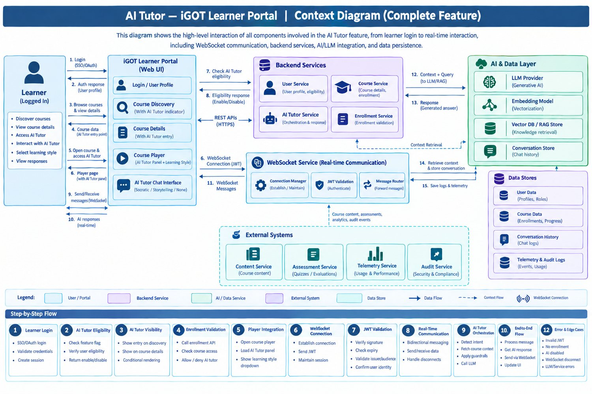

## Step 1 — Learner Login to iGOT Portal

Context flow for identity establishment and authenticated portal access.

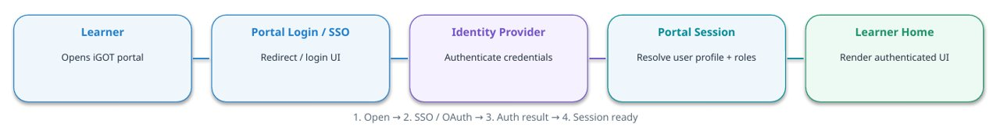

*1. Open → 2. SSO / OAuth → 3. Auth result → 4. Session ready*

**Inputs**

- Browser request
- Identity-provider session
- User identity / roles

**Validation**

- Authentication succeeded?
- Session valid and not expired?
- Map stable subject to learner ID

**Outcome**

- Success → show learner home
- Failure → show login/error state
- Do not expose protected tutor APIs before login

**API / CONTRACT**

Existing portal SSO flow; illustrative protected call: GET /api/user/profile → userId, roles, sessionStatus.

## Step 2 — AI Tutor Eligibility

Context flow to decide whether this authenticated learner can see/use AI Tutor.

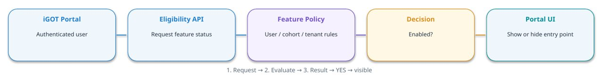

*1. Request → 2. Evaluate → 3. Result → YES → visible*

**Inputs**

- Authenticated subject
- Tenant / cohort if applicable
- Optional course scope

**Rules**

- Server-side feature flag
- Default-deny if config missing
- Re-check on session creation

**Branches**

- YES → show AI Tutor CTA
- NO → standard portal only
- Error → fail closed; log correlation ID

**API / CONTRACT**

Illustrative: GET /api/ai-tutor/eligibility?courseId={id} → {enabled, allowedStyles}.

## Step 3 — AI Tutor Visibility in Discovery & Course Page

Context flow for conditionally rendering the AI Tutor entry point.

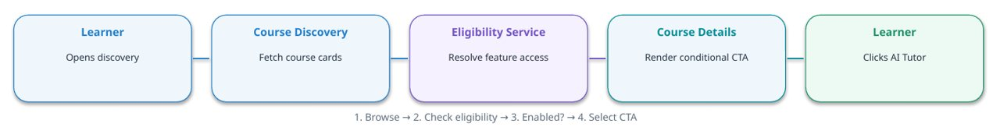

*1. Browse → 2. Check eligibility → 3. Enabled? → 4. Select CTA*

**UI behavior**

- Preserve existing discovery flow
- Show CTA only when enabled
- Pass courseId for navigation

**Fallback**

- Disabled → hide CTA
- Eligibility timeout → hide/retry
- Client flag is not authorization

**Outcome**

- AI Tutor CTA on eligible course cards/details
- Direct API access still requires backend authorization

**API / CONTRACT**

Illustrative parallel reads: GET /api/courses and GET /api/ai-tutor/eligibility?courseId={id}.

## Step 4 — Enrollment Validation

Context flow to enforce course access before entering the player or creating a tutor session.

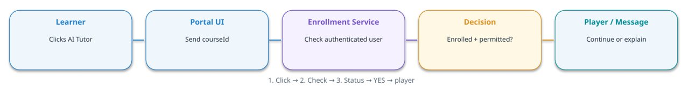

*1. Click → 2. Check → 3. Status → YES → player*

**Validation**

- Use server-authenticated user ID
- Check enrollment and course status
- Check any prerequisite/access policy

**YES branch**

- Navigate to player
- Player re-checks access
- Create session only after authorization

**NO / error**

- Not enrolled → enrollment message
- Forbidden → access denied
- Timeout → retry; never assume enrolled

**API / CONTRACT**

Illustrative: GET /api/enrollments/{courseId}/status → {status:"ENROLLED"}.

## Step 5 — Player Integration & Learning Style

Context flow for loading course content and the AI Tutor panel.

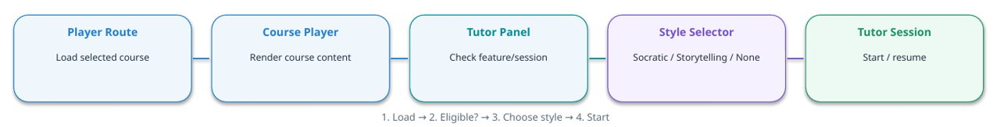

*1. Load → 2. Eligible? → 3. Choose style → 4. Start*

**UI components**

- Tutor chat transcript + input
- Connection state and retry
- Responsive panel/tab layout

**Style behavior**

- SOCRATIC → guiding questions
- STORYTELLING → narrative examples
- NONE → neutral teaching style

**Access/lifecycle**

- Require valid course access
- Bind session to user + course
- Clear sensitive state on logout

**API / CONTRACT**

Illustrative: POST /api/ai-tutor/sessions {courseId, learningStyle} → {sessionId, websocketUrl}.

## Step 6 — Establish WebSocket Connection

Context flow for opening the real-time channel with a short-lived credential.

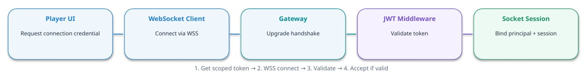

*1. Get scoped token → 2. WSS connect → 3. Validate → 4. Accept if valid*

**Secure setup**

- Use WSS outside local development
- Prefer secure handshake/cookie pattern
- Avoid long-lived tokens in URL/logs

**Connection state**

- CONNECTING → AUTHENTICATING → CONNECTED
- Invalid token → reject/close
- Heartbeat + bounded reconnect

**Authorization**

- Bind socket to verified subject
- Bind course/session scope
- No chat messages before auth completes

**API / CONTRACT**

Illustrative: wss://{host}/ws/ai-tutor. Token transport must match browser/gateway capabilities.

## Step 7 — Backend JWT Validation

Context flow for validating the token and authorizing the requested tutor session.

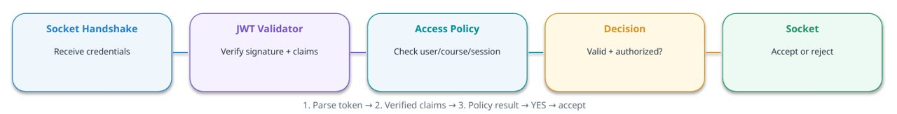

*1. Parse token → 2. Verified claims → 3. Policy result → YES → accept*

**JWT checks**

- Signature / trusted issuer keys
- exp and nbf
- issuer, audience, subject

**Authorization checks**

- Tutor feature enabled
- Enrollment still valid
- Session belongs to this learner/course

**Failure handling**

- Invalid → reject handshake
- Forbidden → deny operation
- Never log raw JWT or secrets

**API / CONTRACT**

Application convention example: 4401 unauthenticated; 4403 forbidden, subject to gateway support.

## Step 8 — Real-Time WebSocket Communication

Context flow for bidirectional, correlated learner/tutor messages.

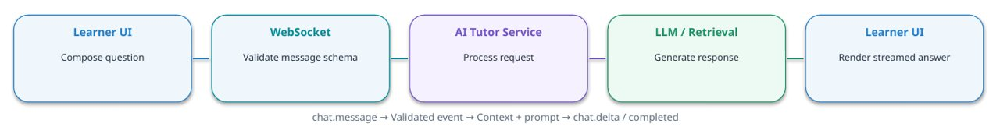

**Client message**

- type + requestId
- sessionId + message
- learningStyle enum

**Server events**

- chat.accepted
- chat.delta (stream chunks)
- chat.completed / chat.error

**Reliability**

- Deduplicate requestId
- Bound message size and rate
- Handle reconnect/in-flight status

**API / CONTRACT**

Example: {"type":"chat.message","requestId":"uuid","sessionId":"...","message":"Explain this","learningStyle":"SOCRATIC"}.

## Step 9 — AI Tutor Orchestration & Context Retrieval

Context flow for grounded answer generation using approved course content.

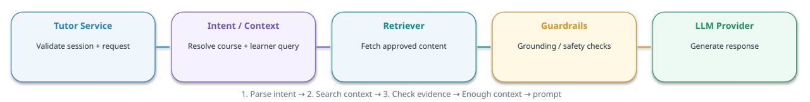

*1. Parse intent → 2. Search context → 3. Check evidence → Enough context → prompt*

**Context inputs**

- Course/module content
- Current course position if allowed
- Relevant conversation history

**Decision**

- Enough trusted context → answer with sources
- Insufficient context → clarify/retrieve more
- Conflicting evidence → disclose uncertainty

**Controls**

- Prompt-injection defense
- Timeouts, quotas and circuit breaker
- PII minimization and output safety

**API / CONTRACT**

Conceptual internal calls: retrieveApprovedContent(query, courseId), getProgress(userId, courseId), generate(prompt).

## Step 10 — Data Persistence & Observability

Context flow for conversation continuity, audit and service-health monitoring.

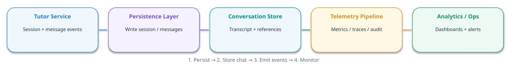

*1. Persist → 2. Store chat → 3. Emit events → 4. Monitor*

**Data entities**

- TutorSession: user/course/style/status
- ConversationMessage: role/content/time/requestId
- TutorEvent: latency/outcome/traceId

**Privacy controls**

- Encryption in transit/at rest
- Retention and deletion policy
- Role-restricted conversation access

**Observability**

- Socket connection/error rates
- First-token and end-to-end latency
- Retrieval quality, model cost and safety events

**API / CONTRACT**

Conceptual internal operations: saveSession, appendMessage, emitTelemetry; analytics should not block chat.

## Step 11 — End-to-End Response Flow

Context flow from send action through authentication, orchestration, streaming and UI rendering.

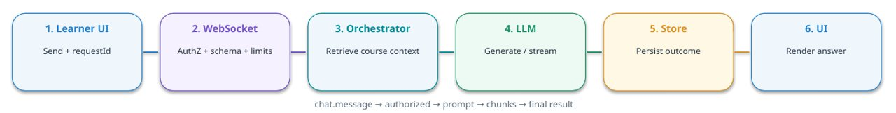

**Sequence rules**

- Acknowledge request promptly
- Persist user message per policy
- Correlate logs with requestId/traceId

**Failure path**

- Emit chat.error on failure
- Retry only bounded/idempotent operations
- Do not claim unsaved messages were saved

**Client experience**

- Pending/streaming indicator
- Verified source references
- Reconnect restores consistent transcript

## Step 12 — Error & Edge Cases

Context flow for safe rejection, bounded retries and clear recovery behavior.

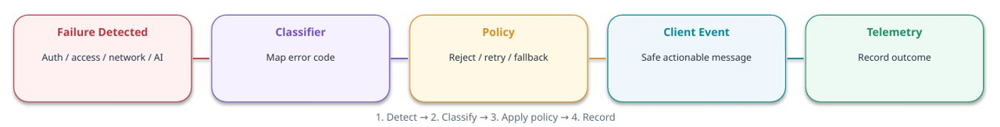

*1. Detect → 2. Classify → 3. Apply policy → 4. Record*

**Authentication/access**

- Invalid JWT → reject connection
- Not enrolled → enrollment guidance
- Tutor disabled → deny direct access

**Connectivity/AI**

- Disconnect → re-auth + backoff
- Rate limit → retry-after guidance
- LLM timeout → bounded retry/fallback

**Data/security**

- Malformed/oversized payload → reject
- No stack traces or secrets to client
- Store failure → documented degraded mode

**API / CONTRACT**

Error event: {"type":"chat.error","requestId":"...","code":"MODEL_TIMEOUT","message":"Please try again.","retryable":true}.

## Cross-Cutting Context — Security, Contracts & Data

Shared rules used by all 12 steps.

**REST boundary**

- Use existing portal auth conventions
- Validate courseId/sessionId server-side
- Stable status codes + correlation IDs
- Never trust client userId/feature flag

**WebSocket contract**

- chat.message: requestId/sessionId/message/style
- chat.accepted: requestId
- chat.delta: sequence + content
- chat.completed: answer + verified citations
- chat.error: code + retryable

**Security baseline**

- WSS only; short-lived credentials
- Verify signature, exp/nbf, iss/aud, subject
- Authorize learner ↔ course ↔ session
- Rate-limit connections and messages
- Redact tokens and secrets

**Proposed data entities**

- TutorSession
- ConversationMessage
- TutorEvent / Audit
- Course and enrollment references
- Retention/deletion metadata

**Operational metrics**

- Connection success/failure
- First-token + end-to-end latency
- Model errors and provider cost
- Retrieval/citation quality
- Safety and authorization denials

**Repository validation gate**

- Portal routes and components
- Existing login/session mechanism
- Course and enrollment APIs
- Player extension points
- Deployment/gateway WebSocket support
