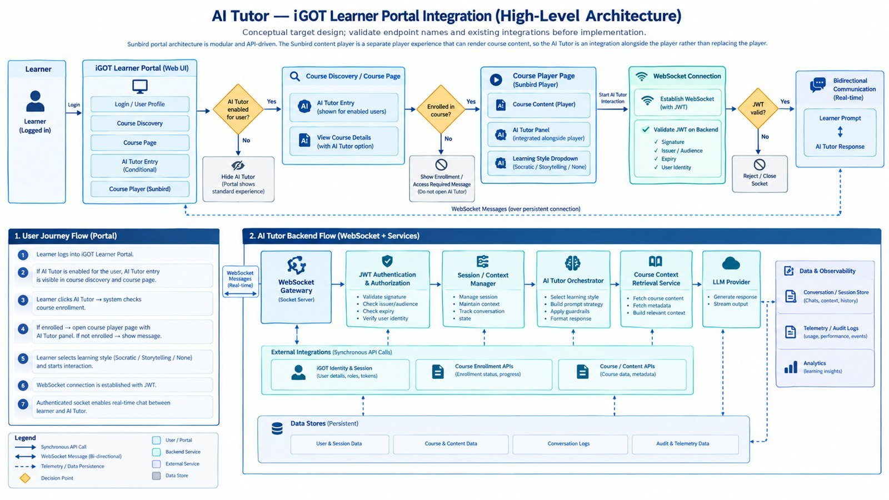

# AI Tutor — High-Level Design

## 1. Purpose and scope

The AI Tutor is a RAG-based conversational assistant embedded in the iGOT Learner Portal. It answers course-specific questions for enrolled learners, in the learning style they choose (Socratic, Storytelling or None), over an authenticated real-time WebSocket connection. This page describes the architecture at component level. Step-by-step mechanics are in the [LLD](lld.md), the flows in the [Context Diagrams](context-diagram.md), requirements in the [SRS](srs.md) and the detailed design in the [SDD](sdd.md).

**In scope:** the portal entry points and player panel, the eligibility and enrollment checks, the WebSocket gateway with JWT authentication, session and context management, the tutor orchestrator, course-context retrieval, the LLM provider and the data and telemetry stores.

**Out of scope:** the internals of the iGOT identity, enrollment and content APIs the tutor calls.

## 2. Architecture overview

*Figure 1. High-level architecture of the AI Tutor on the iGOT Learner Portal.*

Figure 1 has two parts. The top row is the learner journey through the portal; the lower band is the backend flow behind the WebSocket.

A signed-in **Learner** uses the **iGOT Learner Portal (Web UI)**. A first decision checks whether the AI Tutor is enabled for the user: if not, the entry point is hidden and the portal shows its standard experience. If enabled, the **AI Tutor entry** appears in **Course Discovery / Course Page**. A second decision checks whether the learner is enrolled in the course: if not, an enrollment or access-required message is shown and the tutor is not opened. If enrolled, the learner reaches the **Course Player Page**, where the **AI Tutor panel** sits alongside the player with a **learning-style dropdown** (Socratic / Storytelling / None).

Starting an interaction opens a **WebSocket connection**. The backend validates the JWT (signature, issuer and audience, expiry, user identity); if it is invalid the socket is rejected and closed. If valid, learner prompts and tutor responses flow in both directions in real time.

## 3. Layers and components

### 3.1 Learner and portal (presentation)

| Component | Role |
|---|---|
| Login / User Profile | Existing iGOT sign-in and session; supplies the learner identity. |
| Course Discovery and Course Page | Show the AI Tutor entry only to users for whom it is enabled. |
| Course Player (Sunbird) | The existing player; the AI Tutor is added beside it and does not replace it. |
| AI Tutor panel | Transcript, input box, style dropdown, connection status and safe error messages. |

### 3.2 WebSocket Gateway

The socket server that terminates the real-time connection. It applies connection and message limits and hands authenticated traffic to the backend services.

### 3.3 JWT Authentication & Authorization

Validates the signature, issuer and audience, expiry and user identity before any application message is accepted, then checks that the learner may use the tutor for this course and session.

### 3.4 Session / Context Manager

Manages the session, keeps the conversation context and tracks conversation state for the learner and course.

### 3.5 AI Tutor Orchestrator

Selects the learning style, builds the prompt strategy, applies guardrails and formats the response.

### 3.6 Course Context Retrieval Service

Fetches course content and metadata and builds the relevant context for each question, limited to content the learner is authorised to see.

### 3.7 LLM Provider

Generates the response and streams the output back through the orchestrator.

### 3.8 External integrations (synchronous API calls)

| Integration | Provides |
|---|---|
| iGOT Identity & Session | User details, roles and tokens. |
| Course Enrollment APIs | Enrollment status and progress. |
| Course / Content APIs | Course data and metadata. |

### 3.9 Data stores and observability

| Store | Holds |
|---|---|
| User & Session Data | Learner and tutor-session records. |
| Course & Content Data | Course content and metadata used for retrieval. |
| Conversation Logs | Chats, context and history. |
| Audit & Telemetry Data | Usage, performance and events; feeds analytics and learning insights. |

## 4. End-to-end flow

1. The learner logs into the iGOT Learner Portal.
2. If the AI Tutor is enabled for the user, the entry is visible in course discovery and on the course page.
3. The learner clicks AI Tutor and the system checks course enrollment.
4. If enrolled, the course player page opens with the AI Tutor panel; if not, a message is shown.
5. The learner selects a learning style (Socratic / Storytelling / None) and starts the interaction.
6. A WebSocket connection is established with a JWT.
7. The authenticated socket enables real-time chat between the learner and the AI Tutor. For each message the gateway authenticates, the session manager supplies context, the orchestrator selects the style and builds the prompt, retrieval adds course context, the LLM generates the answer, and the response is streamed back while conversation, telemetry and audit data are persisted.

## 5. Interfaces

| Interface | Protocol | Purpose |
|---|---|---|
| Learner to portal and tutor APIs | HTTPS, REST + JSON | Eligibility, enrollment validation and session creation. |
| Learner to WebSocket Gateway | WSS | Real-time chat messages and streamed answers. |
| Tutor backend to platform | HTTPS (service to service) | Identity, enrollment and content lookups. |
| Tutor backend to LLM provider | HTTPS | Answer generation, with server-side credentials. |

## 6. Key design decisions

| Decision | Rationale |
|---|---|
| Backend is authoritative for eligibility and enrollment | UI visibility is a convenience, never an authorization boundary. |
| Authenticate the socket before any chat message | No message is processed on an unauthenticated connection. |
| Fail closed for access | Unknown eligibility or enrollment status never grants access. |
| Reuse existing platform services | The tutor adds adapters instead of duplicating identity, course or enrollment systems. |
| Provider abstraction | The model and retrieval integrations sit behind internal interfaces. |
| Tutor failure is isolated | A failure in the AI Tutor must not break course discovery or playback. |
| Independently switchable | The feature can be configured, observed and disabled on its own. |

## 7. Quality attributes

| Attribute | Approach |
|---|---|
| Security | WSS only, short-lived credentials, per-session authorization, rate limits and token redaction in logs. |
| Privacy | Store only what is needed, restrict transcript access, separate telemetry from conversation content. |
| Performance | Bounded model and retrieval timeouts; streaming of answers; measurable first-token and end-to-end latency. |
| Reliability | Bounded retries, reconnect with backoff, stable error codes and a documented degraded mode. |
| Observability | Structured logs, metrics and traces with correlation IDs, and dashboards for errors, latency, active sockets and cost. |
| Scalability | Shared session state across instances and per-user concurrency limits. |

## 8. Deployment view

For a first release the tutor API, WebSocket handler and orchestration can be modules in one deployable backend, with their interfaces kept separate in code, and split into independent services only when scale or ownership requires it. Traffic reaches the tutor through the existing portal gateway: REST for eligibility and sessions, and a WebSocket-capable gateway for chat. A feature flag and kill switch allow new tutor sessions to be disabled without affecting the portal or the course player.
