# AI Tutor — Low-Level Design

Step-by-step low-level design of the AI Tutor on the iGOT Learner Portal: the flow, frontend and backend responsibilities, decisions and API / message contract for each of the 12 steps, followed by the shared contracts, data model, service boundaries and production-readiness requirements. For the architecture see the [HLD](hld.md).

## Step 1 — Learner Login to iGOT Portal

Establish authenticated learner identity and portal session before rendering protected experiences.

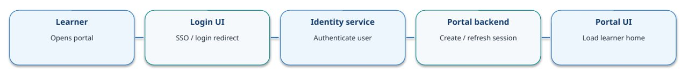

**Frontend responsibilities**

- Redirect unauthenticated users to the portal's configured identity flow
- Do not store long-lived credentials in browser storage
- Load profile only after authentication succeeds

**Backend responsibilities**

- Validate identity-provider result / session
- Resolve stable learner identifier and roles
- Issue or renew portal session according to existing iGOT pattern

**Decision & outcomes**

- Valid session → show dashboard and continue
- Invalid/expired session → redirect to login
- Identity provider unavailable → show safe retry message

**API / Message Contract**

Existing portal login/SSO flow (exact endpoint is repository/config dependent). Example protected call: GET /api/user/profile → 200 { userId, roles, sessionStatus }.

**Acceptance / Validation**

Acceptance: anonymous users cannot call protected AI Tutor APIs; learner identity is consistent across portal, enrollment and tutor services.

## Step 2 — Check AI Tutor Eligibility

Determine whether the feature is enabled for this learner (and optionally tenant/cohort/course).

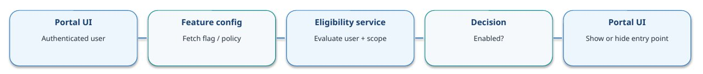

**Inputs**

- Authenticated learner ID and role
- Tenant / organization and cohort, if applicable
- Course or rollout scope, if feature is scoped

**Evaluation**

- Prefer server-side entitlement/feature-flag decision
- Apply default-deny if configuration is missing
- Cache briefly only if invalidation and user scoping are safe

**Yes / No**

- YES → return enabled=true and allowed scopes
- NO → omit AI Tutor entry point; standard portal remains
- Error → fail closed and log correlation ID

**API / Message Contract**

Illustrative: GET /api/ai-tutor/eligibility?courseId={id} → 200 { enabled: true, allowedStyles: [SOCRATIC, STORYTELLING, NONE] }. Final route is to be agreed.

**Acceptance / Validation**

Do not trust a client-provided userId or enabled flag. Backend re-checks eligibility when creating a tutor session.

## Step 3 — Show AI Tutor in Discovery & Course Page

Render an AI Tutor entry point only for eligible users, without breaking existing course discovery.

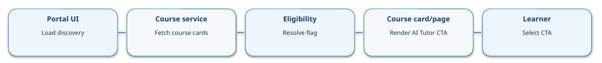

**Frontend behavior**

- Keep existing course listing and details behavior unchanged
- Show CTA/badge only when eligibility response is enabled
- Pass courseId through navigation; never pass authorization as a trusted client flag

**Data contract**

- Course card: courseId, title, status, optional tutorAvailability
- Eligibility response: enabled, permitted styles, optional message

**Fallback**

- Disabled → hide CTA
- Eligibility timeout → hide CTA or show retry according to product choice
- Do not expose tutor entry point to unauthenticated users

**API / Message Contract**

Illustrative parallel reads: GET /api/courses?query=... and GET /api/ai-tutor/eligibility?courseId={id}. Use the portal's actual course discovery contract where available.

**Acceptance / Validation**

CTA visibility is a UX control, not a security boundary; backend must repeat all access checks.

## Step 4 — Click AI Tutor & Validate Enrollment

Before opening the player with tutor enabled, confirm the learner can access the selected course.

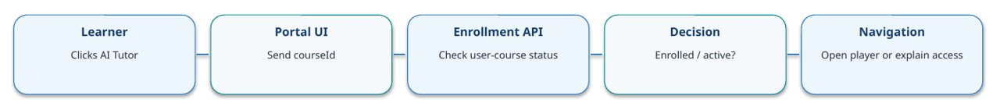

**Request**

- Authenticated session supplies learner identity
- Request contains courseId; avoid trusting learnerId from browser
- Check enrollment status and any course access rules

**YES branch**

- Navigate to the course player
- Include courseId and optional launch context
- Player/backend validates course access again

**NO / error branch**

- Not enrolled → show enrollment-required message and course action
- Forbidden → show access denied
- Timeout/5xx → show retry; do not assume enrollment

**API / Message Contract**

Illustrative: GET /api/enrollments/{courseId}/status → 200 { status: "ENROLLED" }. Expected outcomes: 401 unauthenticated, 403 forbidden, 404 unknown course, 5xx dependency error.

**Acceptance / Validation**

Acceptance: an enrolled learner can open the player; a non-enrolled learner cannot establish an AI Tutor session for that course.

## Step 5 — Player Page with AI Tutor Panel

Add a tutor panel alongside course content and capture the learner's preferred teaching style.

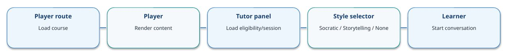

**UI layout**

- Preserve the existing Sunbird player and course navigation
- Place AI Tutor panel as a side panel or responsive tab
- Show connection status, transcript, input, send action and retry state

**Learning style**

- SOCRATIC: ask guiding questions
- STORYTELLING: explain using narrative/examples
- NONE: default neutral teaching style
- Validate allowed enum on client and server

**Lifecycle**

- Create or resume session only after course access passes
- Associate session with userId + courseId
- Clear sensitive UI state on logout / user switch

**API / Message Contract**

Illustrative: POST /api/ai-tutor/sessions { courseId, learningStyle: "SOCRATIC" } → { sessionId, websocketUrl, tokenStrategy }. Prefer existing portal token/session mechanism.

**Acceptance / Validation**

Accessibility: keyboard support, labels, focus management and screen-reader status announcements. Mobile layout must not block course controls.

## Step 6 — Establish JWT-Authenticated WebSocket

Open a persistent connection and authenticate it before accepting chat messages.

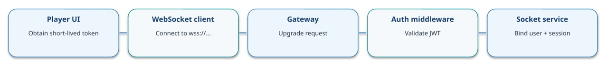

**Connection setup**

- Use WSS in all non-local environments
- Prefer secure cookie or short-lived, scoped token; avoid long-lived tokens in URLs/logs
- If browser constraints require token-in-message, accept no application messages until auth succeeds

**Token checks**

- Signature against trusted keys / JWKS
- exp and nbf; issuer and audience
- Subject/user identity, scopes and session/course binding

**State machine**

- CONNECTING → AUTHENTICATING → CONNECTED
- Failure → REJECTED / close
- Heartbeat ping/pong; reconnect with bounded exponential backoff

**API / Message Contract**

Illustrative socket: wss://{host}/ws/ai-tutor. If token is passed in a query parameter, it may leak through logs; prefer an approved secure handshake pattern. Exact implementation depends on gateway/browser support.

**Acceptance / Validation**

Never trust userId/courseId claimed in a message without checking them against the authenticated principal and session.

## Step 7 — Backend JWT Validation

Enforce authentication and authorization at connection time and for sensitive message operations.

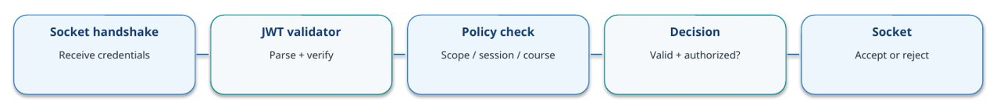

**Authentication checks**

- Verify cryptographic signature using trusted issuer keys
- Check expiration, not-before, issuer and audience
- Reject malformed tokens and unsupported algorithms

**Authorization checks**

- Map subject to the authenticated learner
- Confirm AI Tutor permission and course enrollment
- Confirm session belongs to this learner and course

**Failure behavior**

- Unauthorized handshake → close / HTTP 401 or 403 where supported
- Invalid message/session → error event; close for repeated abuse
- Never log raw JWTs or secrets

**API / Message Contract**

Suggested close/error mapping: 4401 unauthenticated, 4403 forbidden (application convention; confirm gateway support). Record reason internally, return safe client message.

**Acceptance / Validation**

Revalidate or terminate active sockets on token expiry/revocation where required. Rate-limit handshake attempts.

## Step 8 — Real-Time WebSocket Communication

Exchange versioned, correlated messages over the authenticated socket.

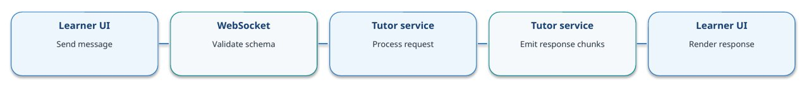

**Client message**

- type: "chat.message"
- requestId, sessionId, message, learningStyle
- Optional course position / content reference; validate size and shape

**Server events**

- chat.accepted → requestId
- chat.delta → streamed text chunk
- chat.completed → final response + citations
- chat.error → code + safe message

**Reliability**

- Use requestId for correlation and deduplication
- Set message-size and per-user rate limits
- Handle reconnect and in-flight request status explicitly

**API / Message Contract**

Example: {"type":"chat.message","requestId":"uuid","sessionId":"...","message":"Explain this concept","learningStyle":"SOCRATIC"}. Server events are illustrative contracts.

**Acceptance / Validation**

Acceptance: only authenticated session owner can send/receive; duplicate request handling and maximum payload limits are tested.

## Step 9 — AI Tutor Orchestration & Context Retrieval

Build a grounded prompt from course context, learner context and selected teaching style.

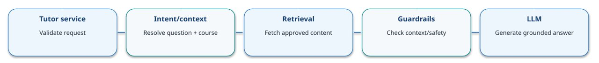

**Orchestration pipeline**

- Validate session, course and message
- Resolve intent and current course/module context
- Retrieve only authorized course material and metadata
- Build prompt with learning style and relevant history
- Call model; stream output; attach source references

**Grounding decision**

- Enough trusted context? YES → generate grounded answer
- NO → retrieve more or ask learner a clarifying question
- If sources conflict, say so; do not fabricate citations

**Controls**

- Prompt-injection defenses for retrieved content
- PII minimization, output filtering and timeout budgets
- Model/provider abstraction, retries and circuit breaker

**API / Message Contract**

Internal service calls are conceptual: getCourseContext(courseId, query), getLearnerProgress(userId, courseId), retrieveApprovedContent(query), generate(prompt).

**Acceptance / Validation**

Measure answer groundedness, citation correctness, latency, refusal quality and cost per conversation.

## Step 10 — Persistence, Telemetry & Audit

Persist only the data needed for session continuity, learning analytics and operational governance.

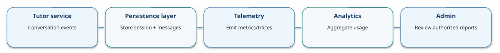

**Data entities**

- TutorSession: sessionId, userId, courseId, status, style, createdAt
- ConversationMessage: messageId, sessionId, role, content/reference, timestamp
- TutorEvent: eventId, eventType, latency, outcome, traceId

**Controls**

- Retention and deletion policies; encryption in transit/at rest
- Restrict access to conversation content; audit administrative reads
- Avoid tokens, secrets and unnecessary personal data in logs

**Observability**

- Connection success/failure and active sockets
- First-token and end-to-end latency, model errors, token/cost usage
- Retrieval hit rate, citation coverage, safety events

**API / Message Contract**

Illustrative internal writes: saveSession(...), appendMessage(...), emitTelemetry(...). Use asynchronous events where safe so analytics does not block responses.

**Acceptance / Validation**

Define data owner, retention period, access roles and deletion workflow before production launch.

## Step 11 — End-to-End Response Flow

Coordinate the complete request lifecycle from the learner's send action to a rendered, sourced answer.

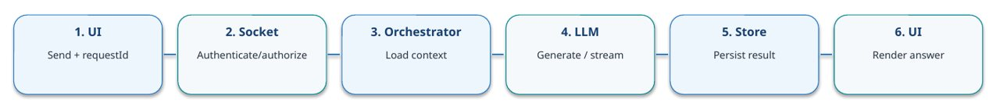

**Sequence**

- Client sends chat.message with requestId and sessionId
- Socket validates principal, schema, session and rate limit
- Orchestrator retrieves course context and constructs prompt
- LLM emits chunks; service sends chat.delta events
- Final response/citations are persisted and chat.completed is sent

**Ordering and resilience**

- Send chat.accepted before lengthy processing
- Persist user message before or alongside generation
- Use idempotency key for retries; track request status
- Return a final failure event if model generation fails

**UI behavior**

- Show pending/streaming state and cancel option if supported
- Render citations as links/labels only when verified
- Keep transcript consistent after reconnect

**API / Message Contract**

Event order example: chat.accepted → chat.delta* → chat.completed. Error alternative: chat.accepted → chat.error. Define whether cancellation and resume are supported.

**Acceptance / Validation**

Trace each request across gateway, orchestrator, retrieval and model with a shared correlation ID.

## Step 12 — Error & Edge-Case Handling

Provide safe, actionable behavior for expected failures without leaking internals.

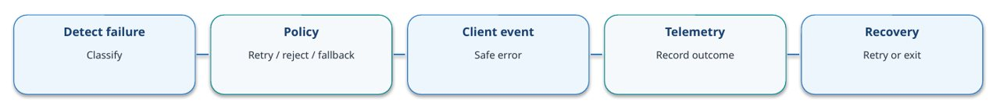

**Authentication / access**

- Invalid or expired JWT → reject/close; refresh token through approved flow
- Not enrolled → explain enrollment requirement
- Tutor disabled → hide entry point and reject direct API/socket access

**Connectivity / model**

- Socket loss → reconnect with backoff and re-authenticate
- Rate limited → retry-after guidance
- LLM timeout/provider error → bounded retry then fallback message

**Data / security**

- Malformed payload → validation error
- Oversized message → reject and count abuse signal
- Persistence failure → apply documented degraded mode; never claim a message was saved if it was not

**API / Message Contract**

Suggested error envelope: { type: "chat.error", requestId, code, message, retryable }. Never return stack traces, internal prompts, provider credentials or raw exception details.

**Acceptance / Validation**

Test invalid JWT, revoked access, enrollment race, disconnect mid-stream, duplicate send, LLM timeout, retrieval empty, and store unavailable.

## Cross-Cutting Contract — REST, WebSocket & Security

Illustrative contracts to guide implementation; align names and token flow with existing iGOT/Sunbird conventions.

**REST API conventions**

- Use existing portal base path, auth and error format
- Validate courseId and sessionId server-side
- Return stable status codes and correlation/request IDs
- Document timeout, pagination and retry behavior
- Do not trust userId or feature flags from browser

**WebSocket event contract**

- chat.message: requestId, sessionId, message, learningStyle
- chat.accepted: requestId, status
- chat.delta: requestId, sequence, content
- chat.completed: requestId, answer, citations
- chat.error: requestId, code, message, retryable

**Security controls**

- WSS only; short-lived, scoped credentials
- Verify JWT signature, exp/nbf, iss/aud, subject
- Authorize learner ↔ course ↔ session relationship
- Rate-limit connections and messages; bound payload size
- Redact tokens and sensitive content from logs

**Example WebSocket client message**

```json
{"type":"chat.message","requestId":"<uuid>","sessionId":"<session-id>","message":"Explain this concept","learningStyle":"SOCRATIC"}
```

**Example completion event**

```json
{"type":"chat.completed","requestId":"<uuid>","answer":"...","citations":[{"title":"...","contentRef":"..."}]}
```

**Example error event**

```json
{"type":"chat.error","requestId":"<uuid>","code":"MODEL_TIMEOUT","message":"Please try again.","retryable":true}
```

## Proposed Data Model & Service Boundaries

Keep the MVP small; reuse platform services and persistence patterns where appropriate.

**TutorSession**

- sessionId (UUID)
- userId (platform subject)
- courseId / optional content item
- learningStyle enum
- status, createdAt, updatedAt
- lastActivityAt / expiry

**ConversationMessage**

- messageId and requestId
- sessionId and role
- content or secure content reference
- createdAt, sequence, status
- citation references / model metadata
- retention and deletion metadata

**TutorEvent / Audit**

- eventId, eventType, timestamp
- principal / course / session refs
- latency, outcome, error code
- traceId / correlationId
- access-controlled audit fields
- No raw JWTs or provider secrets

**Boundary principle**

Portal owns learner identity and course enrollment truth; AI Tutor owns tutoring session lifecycle, orchestration and conversation-specific behavior. Confirm source-of-truth boundaries before implementation.

## Production Readiness — Non-Functional Requirements

Define measurable targets with the platform team before setting service-level objectives.

**Availability & performance**

- Set targets for connection success and response latency
- Bound model/retrieval timeouts and retries
- Use horizontal scaling and shared session state if multi-instance
- Configure WebSocket idle timeout / heartbeat

**Security & privacy**

- Threat-model token transport and WebSocket lifecycle
- Enforce authorization on every session/action
- Encryption in transit and at rest
- Retention, deletion and admin access audit

**Operations & quality**

- Dashboards for errors, latency, active sockets and cost
- Structured logs with correlation IDs
- Load tests for concurrent long-lived connections
- Golden-set evaluation for grounding and citation quality

**Go-live checklist**

Feature flag + rollback • JWT rotation/expiry behavior • rate limits • provider quotas • incident alerts • accessibility • browser/network compatibility • backup/retention • privacy review • course-context quality evaluation

**Repository validation gate**

Before implementation, inspect existing portal routes, auth/session patterns, course discovery components, player integration points, enrollment APIs, backend conventions and deployment topology. Replace illustrative endpoint names with verified contracts.
