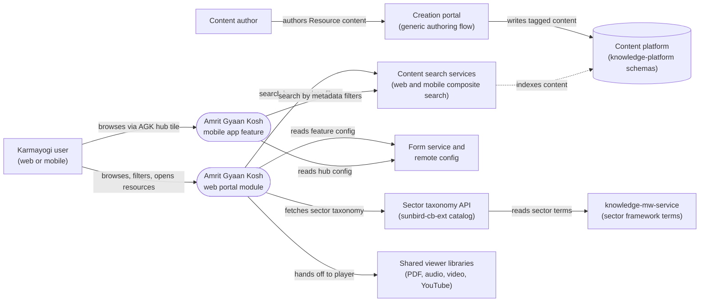

# Amrit Gyaan Kosh — Context Diagram

## System boundary

Amrit Gyaan Kosh has no backend service of its own. Inside the feature are the two
independent client implementations: the web portal module (`GyaanKarmayogiModule`) and the
mobile app feature (`gyaan_karmayogi`). Outside it are the people who browse and author
content, the generic content search services both clients call, the sector taxonomy API,
the form and remote-config sources, and the content platform schemas that define the
tagged metadata fields.

## Diagram

## Elements

| Element | Role | Detailed in |
|---|---|---|
| Amrit Gyaan Kosh web portal module | Landing, filter panel, view-all grid and mime-type-dispatching player | [hld.md](hld.md) |
| Amrit Gyaan Kosh mobile app feature | Native landing, filter, view-all and resource details screens | [hld.md](hld.md) |
| Karmayogi user | Any logged-in user; browses, filters and opens resources | [use-cases.md](use-cases.md) |
| Content author | Creates Resource-type content through the generic flow; no AGK-specific screen | [index.md](index.md) |
| Content search services | Generic search both clients call; implementation not in the traced repos | [apis.md](apis.md) |
| Sector taxonomy API (`sunbird-cb-ext`) | Sector and sub-sector listing for filter options | [apis.md](apis.md) |
| knowledge-mw-service | Framework term API behind the sector taxonomy | [hld.md](hld.md) |
| Form service and remote config | Feature enablement, tenant and hub configuration, CBC org id | [hld.md](hld.md) |
| Creation portal | Generic authoring of Resource content with the AGK metadata fields | [hld.md](hld.md) |
| Content platform (`knowledge-platform`) | Schema fields `resourceCategory`, `sectorDetails_v1`, `contextSDGs`, `contextStateOrUTs`, `contextYear` | [hld.md](hld.md) |
| Shared viewer libraries | Render PDF, audio, video and YouTube; not AGK-specific | [lld.md](lld.md) |

> **Verification boundary:** elements and interactions come from the feature's own pages
> (index, use cases, APIs, HLD), spot-checked against the workspace repos for the portal
> route and spotlight deep-links. The search services are drawn as one external box because
> their implementation was not found in the traced repos, and the dashed indexing link is
> inferred from the HLD. The taxonomy call is shown for the web portal only, as the feature
> docs describe it. Not re-verified: the knowledge-mw-service term API, viewer library
> internals, and the form/remote-config payload contents.
