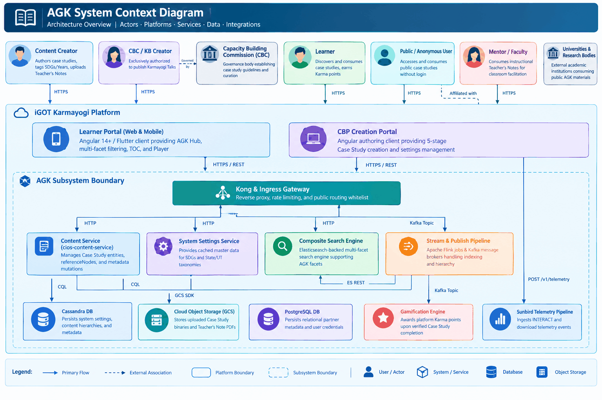
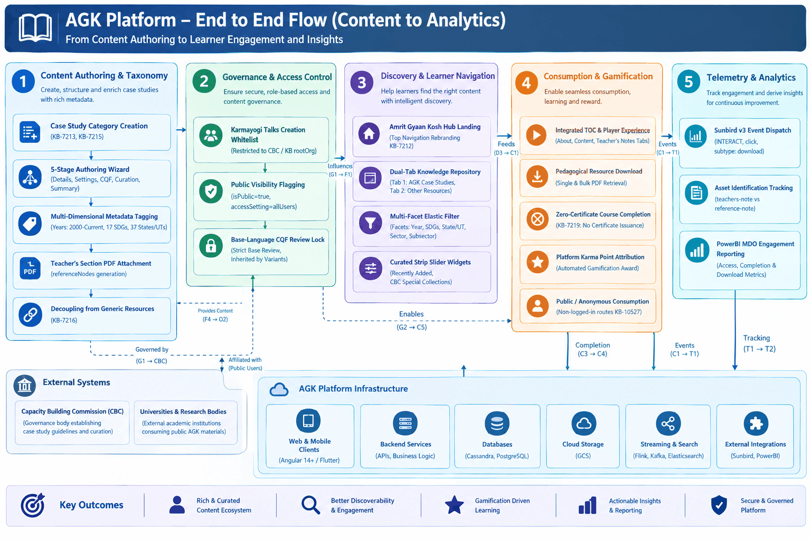
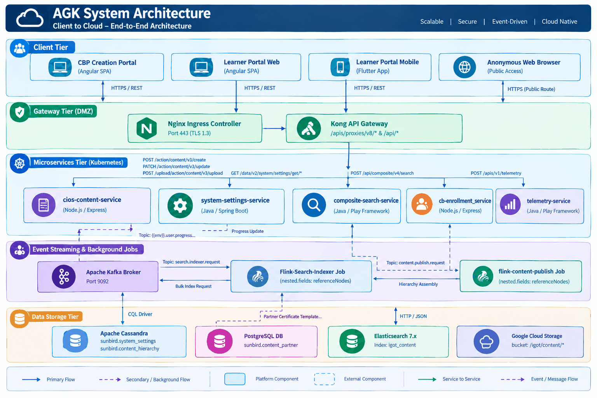
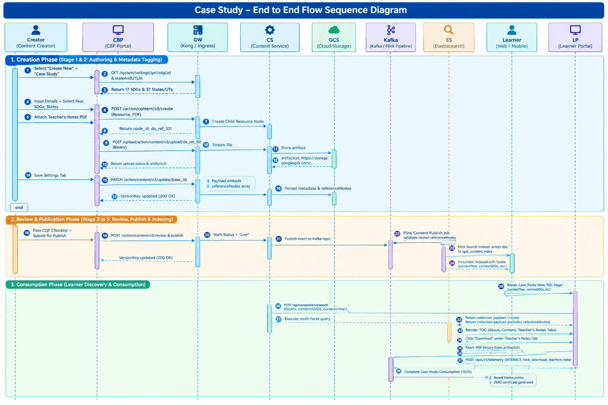
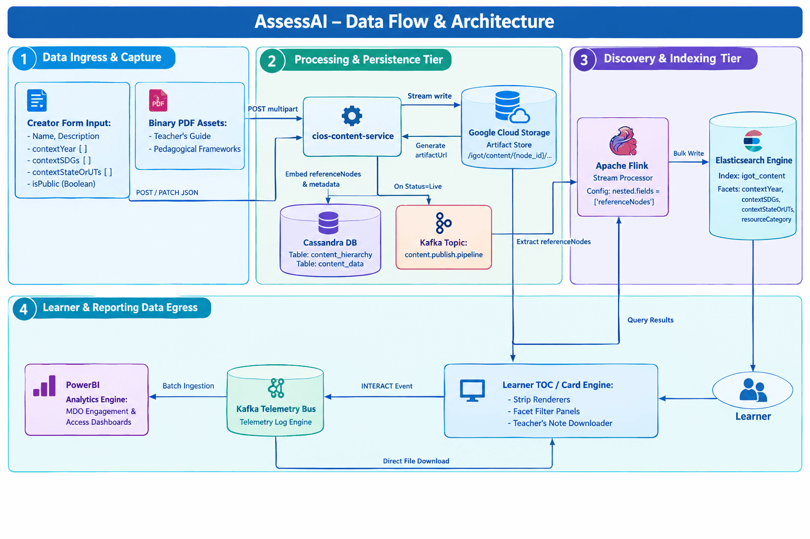

# Amrit Gyan Kosh (AGK) — High-Level Design (HLD)

## 1. Architecture Overview

### 1.1 Architectural Scope & Objectives

The **Amrit Gyan Kosh (AGK)** module introduces a specialized, scalable knowledge ecosystem within the iGOT Karmayogi digital learning platform. It transitions the legacy "Gyaan Karmayogi" feature into an enterprise-grade digital repository for **Case Studies** and **Knowledge Resources**.

The primary architectural drivers are:

1. **Decoupled Category Architecture:** Segregating Case Studies from generic PDF resources into first-class collection entities with their own lifecycle, self-curation, and review pipelines.
2. **Multi-Dimensional Knowledge Graph Tagging:** Enhancing content metadata with 17 Sustainable Development Goals (SDGs), 37 States/UTs + Pan India, and historical chronological tags (Years 2000–Current).
3. **Instructional Asset Composition** (`referenceNodes`): Enabling hierarchical attachment of pedagogical guides ("Teacher’s Notes") directly within collection metadata without bloating course syllabus structures.
4. **Frictionless Public & Anonymous Ingestion:** Supporting unauthenticated public discovery and consumption for academic institutions, universities, and administrative bodies.
5. **CQF-Preserving Multilingual Adaptation:** Reusing verified Base-Language Content Quality Framework (CQF) approvals while permitting localized contextual adaptation of titles, descriptions, and pedagogical notes.

### 1.2 Architecture Principles

- **Evidence-Based Design:** Architecture components, APIs, topics, and schemas are strictly derived from live deployment manifests and production configs.
- **Loose Coupling via Asynchronous Streaming:** Search index synchronization and publication lifecycle events are driven by Apache Kafka and Apache Flink stream pipelines, isolating the authoring engine from search infrastructure.
- **Schema Evolution with Backward Compatibility:** Case Studies leverage Sunbird collection structures with additive metadata attributes (`contextYear`, `contextSDGs`, `contextStateOrUTs`, `referenceNodes`), preserving runtime compatibility with existing mobile and web player engines.
- **Defense-in-Depth Security:** Clear separation of trust boundaries between unauthenticated public access paths, standard authenticated learner spaces, and privileged creator/publisher roles.

## 2. Complete Mermaid Context Diagrams

### Diagram 1: AGK System Context Diagram

*This diagram defines the high-level boundary of the AGK system, identifying external actors, client applications, core platform boundaries, and upstream/downstream integrations.*

### Diagram 2: AGK Functional Context Diagram

*This diagram decomposes the high-level business functions into functional capability groups across Authoring, Governance, Discovery, Consumption, and Multilingual processing.*

### Diagram 3: AGK Integration Context Diagram

*This diagram illustrates the physical integration topography, identifying concrete network protocols, API paths, message queues, and external system connectors.*

### Diagram 4: AGK End-to-End Interaction Diagram

*This sequence diagram models the temporal interaction across actors and systems for the end-to-end authoring, ingestion, and learner consumption lifecycle.*

### Diagram 5: AGK Data Flow Context Diagram

*This diagram tracks the lifecycle, mutation, persistence, and indexing flow of AGK data entities across storage engines.*

## 3. Logical Architecture & Component Responsibilities

The logical architecture of AGK is partitioned into five functional tiers:

### 3.1 Client Tier

- **CBP Creation Portal** (`sunbird-cb-creationportal`):
  - *Technology:* Angular 14+, TypeScript, Node.js (BFF).
  - *Responsibilities:* Hosts the 5-stage Case Study creation wizard; queries System Settings for dynamic metadata dropdowns; manages reference PDF uploads; provides CQF self-curation forms.

- **Learner Portal** (`sunbird-cb-portal`):
  - *Technology:* Angular 14+, Angular Material, TypeScript, Node.js.
  - *Responsibilities:* Renders the rebranded "Amrit Gyaan Kosh" Hub; displays curated sliders and dual content tabs ("AGK Case Studies", "Other Resources"); renders multi-facet filter panels; executes composite search queries; renders the 3-tab TOC layout (*About*, *Content*, *Teacher's Notes*).

- **Mobile Client** (`karmayogi-mobile`):
  - *Technology:* Flutter, Dart.
  - *Responsibilities:* Mobile-optimized consumption of AGK cards, TOC pages, PDF document viewing, and native file download handling.

### 3.2 Gateway & Authentication Tier

- **Ingress Controller (Nginx):**
  - *Responsibilities:* TLS termination (HTTPS); reverse proxying; routing static vs API traffic; managing path-based CORS rules.

- **API Gateway (Kong):**
  - *Responsibilities:* Request validation; session enforcement via `connect.sid` cookie; routing `/apis/proxies/v8/*` to downstream services; whitelisting public routes (`/action/content/v3/read/*`) to allow unauthenticated public consumption (Jira `KB-10527`).

### 3.3 Core Application Services

- **Content Service** (`cios-content-service`):
  - *Technology:* Node.js, Express, Sunbird Content Core.
  - *Responsibilities:* Manages content CRUD operations (`/action/content/v3/create`, `/update`, `/read`); handles binary upload streams to Google Cloud Storage; assembles parent-child relationships between Case Studies and `referenceNodes`; enforces organization-level authorization rules (e.g., restricting "Karmayogi Talks" to CBC/KB).

- **System Settings Service:**
  - *Technology:* Java, Spring Boot / Cassandra Driver.
  - *Responsibilities:* Exposes cached, read-only system configuration masters for `sdgList` (17 items) and `stateAndUTList` (37 items) over `/apis/proxies/v8/data/v2/system/settings/get/*`.

- **Composite Search Engine:**
  - *Technology:* Java, Play Framework, Elasticsearch 7.x.
  - *Responsibilities:* Executes high-performance search queries (`/api/composite/v4/search`) with complex aggregations across AGK facets (`contextYear`, `contextSDGs`, `contextStateOrUTs`, `resourceCategory`).

- **Enrollment & Progress Service** (`cb-enrollment_service`):
  - *Technology:* Node.js, Express.
  - *Responsibilities:* Tracks learner progress through case study components; emits progress updates to Kafka (`user.progress.send.from.partner`); enforces the Zero-Certificate rule by bypassing certificate template generation.

### 3.4 Data & Stream Processing Tier

- **Apache Kafka:** Centralized message broker handling streaming events for content publication (`content.publish.request`), search re-indexing (`search.indexer.request`), and learner progress.
- **Apache Flink (**`Flink-Search-Indexer` & `flink-content-publish`): High-throughput stream processors. Updated with `nested.fields = ["referenceNodes"]` to extract child PDF resources and index them directly inside Elasticsearch documents.
- **Datastores:**
  - *Apache Cassandra (*`sunbird` keyspace): Primary NoSQL store for `system_settings`, collection hierarchies, and mutable metadata.
  - *PostgreSQL (*`sunbird` database): Relational store for partner credentials and system configuration.
  - *Elasticsearch (*`igot_content` index): Distributed search and analytics engine powering AGK Hub filtering.
  - *Google Cloud Storage (GCS):* Encrypted object storage hosting PDF binaries and reference artifacts.

## 4. Component Responsibilities & Failure Modes

| Component Name | Primary Responsibilities | Consumed Interfaces | Exposed Interfaces | Failure Impact & Recovery Strategy |
|---|---|---|---|---|
| `CBP Portal` | Case study authoring, metadata form validation, PDF file attachment | System Settings API, Content APIs, Upload APIs | Web Client UI | **Failure:** Creator blocked from publishing. **Recovery:** Local draft cached in browser local storage; re-sync on reconnect. |
| `cios-content-service` | Content CRUD, metadata validation, `referenceNodes` assembly | Cassandra CQL, GCS SDK, Kafka Producer | `POST /content/v3/create` `PATCH /content/v3/update` `POST /upload/...` | **Failure:** Content mutation unavailable. **Recovery:** Pod auto-restart by Kubernetes; transactions protected by Cassandra versionKeys. |
| `system-settings-service` | Serves static lists for SDGs and States/UTs | Cassandra (`sunbird.system_settings`) | `GET /system/settings/get/{key}` | **Failure:** Dropdowns fail to load. **Recovery:** In-memory caching on API Gateway / Redis fallback. |
| `Composite Search` | Real-time multi-facet queries and strip aggregation | Elasticsearch REST API | `POST /api/composite/v4/search` | **Failure:** AGK Hub displays empty states. **Recovery:** Read-replica query fallback; circuit breaker enabled on Kong. |
| `Flink-Search-Indexer` | Consumes publish stream, extracts `referenceNodes`, indexes in ES | Kafka Consumer, Elasticsearch Bulk API | Internal Kafka Stream | **Failure:** Published case studies delayed from appearing in search. **Recovery:** Flink checkpoint restart from Kafka offset; zero data loss. |

## 5. End-to-End Architectural Workflows

### 5.1 Case Study Authoring & Publishing Workflow

1. **Creation Initialization:** Creator opens CBP Portal `My Content > Create New > Case Study`.
2. **Master Data Fetch:** Client invokes `/apis/proxies/v8/data/v2/system/settings/get/sdgList` and `/stateAndUTList`. Data is cached in client memory.
3. **Draft Mutation:** Creator enters title, description, and selects applicable Year(s), SDG(s), and State/UT(s).
4. **Instructional Asset Upload:**
  - Creator uploads a Teacher’s Guide PDF in the "Teacher’s Section".
  - Client calls `POST /action/content/v3/create` with `primaryCategory = "Learning Resource"` and `resourceCategory = "Reference Resource"`.
  - Client uploads the PDF binary via `POST /upload/action/content/v3/upload/{node_id}`.
  - Service streams the binary to GCS and returns `artifactUrl`.

5. **Metadata Assembly:** Client patches the parent Case Study via `PATCH /action/content/v3/update/{case_id}`, embedding the child asset inside the `referenceNodes` array.
6. **Publishing & Indexing:**
  - Publisher approves the Case Study. Status transitions to `Live`.
  - Content Service publishes an event to Kafka.
  - `flink-content-publish` validates hierarchy completeness.
  - `Flink-Search-Indexer` reads `nested.fields = ["referenceNodes"]` and writes the document to Elasticsearch with all facet fields.

### 5.2 Discovery & Multi-Facet Filtering Workflow

1. **Hub Navigation:** Learner accesses the Learner Portal. The top navigation bar displays "Amrit Gyaan Kosh".
2. **Hub Initialization:** The portal calls `POST /api/composite/v4/search` with default filters: `status: ["Live"]`, `primaryCategory: ["Case Study"]`, requesting facets for `contextYear`, `contextSDGs`, `contextStateOrUTs`, `sectorName`.
3. **Filter Application:** The learner selects facets (e.g., *Year: 2023*, *SDG: SDG 3*, *State: Odisha*).
4. **Dynamic Search Execution:** Client issues a POST request with the selected facet criteria. Elasticsearch evaluates the boolean filter query and returns matching case study cards within seconds.

### 5.3 Consumption & Gamification Workflow

1. **TOC Rendering:** Learner clicks a case study card. Client invokes `GET /action/content/v3/read/{id}`.
2. **Resource Display:** Client renders the 3-tab TOC layout (*About*, *Content*, *Teacher's Notes*).
3. **Instructional Download:** Learner clicks "Download" under the Teacher’s Notes tab. The asset is fetched directly from Google Cloud Storage (`artifactUrl`). An `INTERACT` telemetry event (`subtype: download`, `id: teachers-note`) is emitted.
4. **Completion & Rewards:**
  - Learner finishes consuming all content items in the case study collection.
  - Portal emits completion telemetry to `{{env}}.user.progress.send.from.partner`.
  - Gamification service awards platform Karma points.
  - **Zero Certificate Gate:** The certificate generation worker checks `primaryCategory == "Case Study"` and suppresses certificate issuance.

## 6. Data Architecture & Consistency Model

### 6.1 Data Ownership & Lifecycles

- **System Settings:** Owned by Platform Admin; stored in Cassandra; lifecycle is static/immutable across operational releases.
- **Case Study Collections:** Owned by Authoring MDO / CBC; stored in Cassandra `content_hierarchy`; lifecycle: `Draft` `Review` `Live` `Retired`.
- **Pedagogical Resources** (`referenceNodes`): Owned by parent Case Study; stored in GCS (binary) and Cassandra/Elasticsearch (metadata); lifecycle tightly bound to parent Case Study.

### 6.2 Consistency Strategy

- **Read-After-Write Consistency:** Strong consistency in Cassandra via `LOCAL_QUORUM` during authoring and curation.
- **Search Consistency:** Eventual consistency between Cassandra and Elasticsearch via Kafka/Flink. SLA for index appearance following publish event is seconds.

## 8. Deployment & Streaming Topology

In accordance with the **Sprint 19.1 Deployment Manifest** (`TES/230653971`):

### 8.1 Service Release Alignments

- **CBP Portal:** Branch `cbrelease-4.8.19.1`, Deployment Tag `cbrelease-4.8.19.1_RC2`
- **Learner Portal:** Branch `cbrelease-4.8.19.1`, Deployment Tag `cbrelease-4.8.19.1_RC1`
- **Content Service** (`cios-content-service`): Branch `cbrelease-4.8.19.1`, Deployment Tag `cbrelease-4.8.19_RC9`
- **Enrollment Service** (`cb-enrollment_service`): Branch `cbrelease-4.8.19.1`, Deployment Tag `cbrelease-4.8.19_RC9`
- **Search Service:** Branch `cbrelease-4.8.18`, Deployment Tag `cbrelease-4.8.18_RC2`
- **Flink Jobs (**`Flink-Search-Indexer`, `flink-content-publish`): Deployment Tag `cbrelease-4.8.20_RC2`

### 8.2 Stream Topology Configuration

- **Kafka Topic:** `{{env}}.user.progress.send.from.partner`
  - *Partitions:* 6
  - *Replication Factor:* 3
  - *Consumer Group:* `user.progress.send.from.partner`

- **Flink Indexer Parameters:**
  - `nested.fields = ["referenceNodes"]`

## 9. Architecture Decision Records (ADRs)

| ADR ID | Decision Summary | Technical Rationale | Trade-offs & Consequences |
|---|---|---|---|
| **ADR-AGK-01** | **Embed** `referenceNodes` in Collection Metadata | Enables single-roundtrip retrieval of Teacher's Notes during TOC load without issuing extra hierarchy traversal queries. | Requires Flink stream indexer jobs to parse nested arrays into Elasticsearch. |
| **ADR-AGK-02** | **Cassandra Storage for SDG & State Lists** | Decouples taxonomic master data from relational schemas; leverages cached Cassandra keys for high-throughput reads. | Updating master entries requires executing CQL scripts or deployment jobs. |
| **ADR-AGK-03** | **Zero-Certificate Rule Enforcement** | Distinguishes analytical case studies from formal accredited courses, preserving platform accreditation integrity. | Requires suppressing invocation of the certificate generation pipeline for `primaryCategory == "Case Study"`. |
| **ADR-AGK-04** | **Public Route Whitelisting for Case Studies** | Opens AGK content to universities and research institutions without mandating government SSO login. | Requires caching and rate limiting on Nginx/Kong to prevent scrapers from impacting database performance. |
| **ADR-AGK-05** | **Base-Language CQF Inheritance** | Accelerates multi-language publishing by avoiding redundant pedagogical reviews for translated variants. | Mandates strict immutability of structural metadata (`contextYear`, `contextSDGs`, `contextStateOrUTs`). |

## 10. Architectural Risks, Constraints & Validation Register

| Risk / Item ID | Category | Description | Severity | Mitigation / Resolution Strategy |
|---|---|---|---|---|
| **RSK-AGK-01** | Scalability | Heavy unauthenticated traffic to public case studies impacting core learner APIs. | Medium | Implement aggressive edge caching on Nginx / Cloud CDN for public GET requests. |
| **RSK-AGK-02** | Data Consistency | Stale search indices if Flink jobs fail or drop nested `referenceNodes`. | High | Monitor Flink consumer lag on Kafka; enable Dead Letter Queues (DLQ) and Flink checkpointing. |
| **VAL-AGK-01** | Requirement | Ambiguity in Teacher's Notes visibility: Mentor-only restriction vs. open learner download. | Low | **Architecture Recommendation:** Make Teacher’s Notes downloadable by all authenticated learners while retaining mentor-specific pedagogical tags. |
| **VAL-AGK-02** | Master Data | Static upper bound of Year dropdown (configured up to 2024 in deployment scripts). | Low | Implement a scheduled CQL patch or client-side dynamic evaluation of `currentYear` up to 2026+. |
