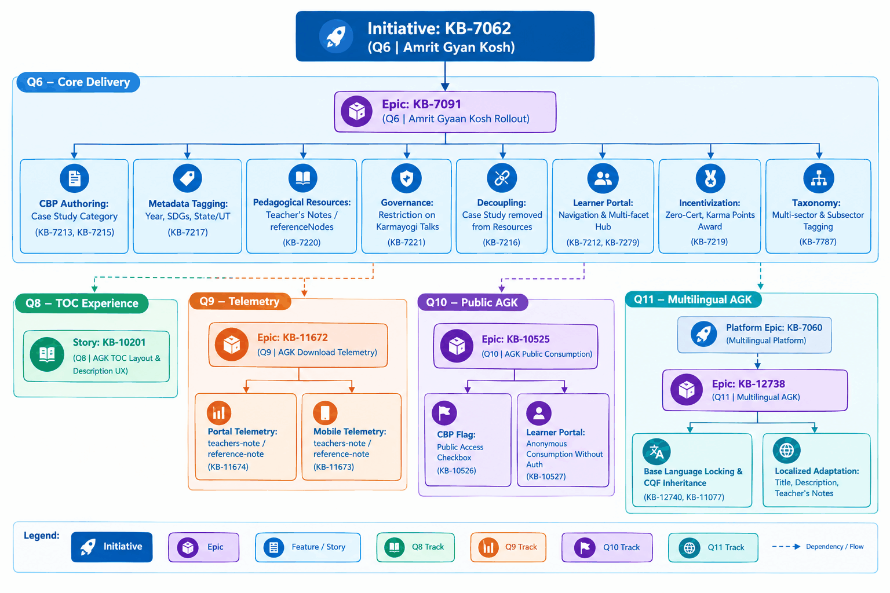
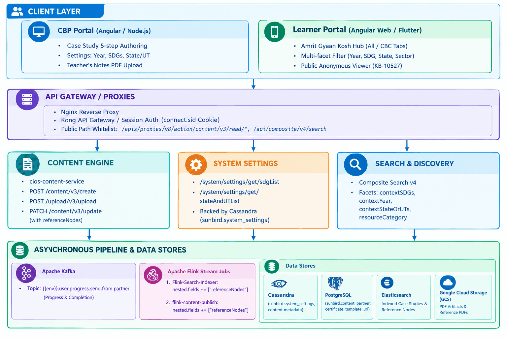

## 1. Project Scope & Objectives

### 1.1 Objective

The **Amrit Gyan Kosh (AGK)** initiative on the iGOT Karmayogi platform aims to transform and elevate knowledge sharing across Government Ministries, Departments, and Organizations (MDOs) and the Capacity Building Commission (CBC). It introduces a dedicated repository and learning category for **Case Studies** and **Knowledge Resources** (formerly under "Gyaan Karmayogi"), complete with multi-dimensional contextual tagging (Years 2000–current, 17 Sustainable Development Goals [SDGs], 37 States/UTs & Pan India), instructional resources ("Teacher’s Notes" / reference nodes), curated sector taxonomies, non-logged-in public access, and multilingual enablement.

### 1.2 Boundary & Lifecycle

The overall initiative spans across multiple release cycles (Quarter 6 through Quarter 11+):

- **Core Rollout (Q6 / Sprint 19 & 19.1):** Rebranding of Gyaan Karmayogi Amrit Gyaan Kosh; introduction of "Case Study" as a primary category in CBP Portal; decoupling case studies from generic resources; restricting "Karmayogi Talks" to CBC/KB; introduction of `referenceNodes` (Teacher’s Notes); metadata enrichment (Year, SDGs, State/UT); consumption experience on Learner Portal (Web & Mobile); Karma point allocation without standard course completion certificates.
- **TOC Experience Hardening (Q8):** Overhaul of the Table of Contents (TOC) layout for long descriptions.
- **Telemetry & Tracking (Q9):** Event emission for Teacher’s Notes and reference asset downloads across Web and Mobile.
- **Public & Unauthenticated Consumption (Q10 / Sprint 31):** Allowing non-logged-in public users (universities, research bodies, citizens) to discover and consume AGK case studies without authentication or enrollment.
- **Multilingual AGK (Q11):** Enabling base-language authoring with locked shared metadata and localized contextual adaptations (Titles, Descriptions, Teacher’s Notes) under unified Content Quality Framework (CQF) rules.

## 2. Source Inventory & Accessibility Assessment

### 2.1 Jira Tickets Scope

| Ticket Key | Issue Type | Summary | Current Status | Accessibility & Content Notes |
|---|---|---|---|---|
| [KB-7060: Q8\| Multilingual Content Creation and curation](https://karmayogibharat.atlassian.net/browse/KB-7060)[Prod Deployed](https://karmayogibharat.atlassian.net/browse/KB-7060) | Epic | Q8 \| Multilingual Content Creation and curation | Prod Deployed | Fully accessible. Governs platform-wide multilingual architecture. |
| [KB-7062: Q6 \| Amrit Gyan Kosh](https://karmayogibharat.atlassian.net/browse/KB-7062) (Open) | Initiative | Q6 \| Amrit Gyan Kosh | Open | Fully accessible. Root initiative for AGK rollout. |
| [KB-7091: Q6 \| Amrit Gyaan Kosh](https://karmayogibharat.atlassian.net/browse/KB-7091)[KB Review](https://karmayogibharat.atlassian.net/browse/KB-7091) | Epic | Q6 \| Amrit Gyaan Kosh | KB Review | Fully accessible. Core Q6 delivery epic containing child stories KB-7212 to KB-7221, KB-7787. |
| [KB-10201: Q8 \| Ad-Hoc \| Updating the TOC experience of standalone resource/Amrit gyan kosh](https://karmayogibharat.atlassian.net/browse/KB-10201)[Prod Deployed](https://karmayogibharat.atlassian.net/browse/KB-10201) | Story | Q8 \| Ad-Hoc \| Updating the TOC experience of standalone resource/Amrit gyan kosh | Prod Deployed | Fully accessible. Focuses on TOC scrolling UX for lengthy descriptions. |
| [KB-10525: Q10 \| Ad-Hoc \| AGK for public](https://karmayogibharat.atlassian.net/browse/KB-10525)[KB Review](https://karmayogibharat.atlassian.net/browse/KB-10525) | Epic | Q10 \| Ad-Hoc \| AGK for public | KB Review | Fully accessible. Problem statement: opening AGK to universities and external bodies. |
| [KB-10526: Q10 \| Ad-Hoc \| AGK creation check](https://karmayogibharat.atlassian.net/browse/KB-10526)[QA Deployed](https://karmayogibharat.atlassian.net/browse/KB-10526) | Story | Q10 \| Ad-Hoc \| AGK creation check | QA Deployed | Fully accessible. Access control / public visibility flag during creation. |
| [KB-10527: Q10 \| Ad-Hoc \| AGK consumption by non-logged users](https://karmayogibharat.atlassian.net/browse/KB-10527)[QA Deployed](https://karmayogibharat.atlassian.net/browse/KB-10527) | Story | Q10 \| Ad-Hoc \| AGK consumption by non-logged users | QA Deployed | Fully accessible. Anonymous learner journey and public consumption. |
| [KB-11672: Q9 \| Ad-Hoc \| add telemetry for AGK resource download](https://karmayogibharat.atlassian.net/browse/KB-11672) (Open) | Epic | Q9 \| Ad-Hoc \| add telemetry for AGK resource download | Open | Fully accessible. Telemetry requirements for Web & Mobile download events. |
| [KB-12738: Q11 \| Feature Enhancements \| Multi-Lingual AGK](https://karmayogibharat.atlassian.net/browse/KB-12738) (Open) | Epic | Q11 \| Feature Enhancements \| Multi-Lingual AGK | Open | Fully accessible. AGK-specific multilingual authoring and CQF inheritance. |
| [KB-12740: Q11 \| Feature Enhancements \| Multi-Lingual AGK](https://karmayogibharat.atlassian.net/browse/KB-12740) (Open) | Story | Q11 \| Feature Enhancements \| Multi-Lingual AGK | Open | Fully accessible. Child story defining base-language lock and metadata immutability. |

### 2.2 Confluence References Scope & Quality Audit

| Reference ID | Confluence Document Title | Space / Page URL | Status & Quality Assessment |
|---|---|---|---|
| **BRD Ref 1** | [KB-7062 \| BRD \| AGK](https://karmayogibharat.atlassian.net/wiki/spaces/TPT/pages/258899974/KB-7062+BRD+AGK) | `TPT / 258899974` | ⚠️ **Template Shell Only**. Contains empty placeholder sections (`<Purpose Here>`, `<Business Drivers Here>`) and an embedded screenshot. Actual business requirements were migrated into SRS and Jira stories. |
| **BRD Ref 2** | [AGK Sector Mapping](https://karmayogibharat.atlassian.net/wiki/spaces/~6023c38698875800688faaac/pages/237404280/AGK+Sector+Mapping) | `~6023c386 / 237404280` | ✅ **Authoritative Production Data**. Contains complete sector-to-subsector mappings, category groupings (Best Practices, Others, Events, Policies and Acts), and attached document `Sector and Subsector Tags.docx`. |
| **BRD Ref 3** | [KB-7060 \| Q8 \| BRD\| Multilingual Content Creation \|](https://karmayogibharat.atlassian.net/wiki/x/EADnFQ) | `TPT / 367460368` (via shortlink `EADnFQ`) | ✅ **Complete & Authoritative**. Details BRD rules `MUL_CON_CRE_BR1` through `MUL_CON_CRE_BR11`, defining course/module hierarchy, language review workflows, and certificate policies. |
| **BRD Ref 4** | [KB-7060 \| Q8 \| FRS\| Multilingual Content creation](https://karmayogibharat.atlassian.net/wiki/x/WgAJFg) | `TPT / 369688666` (via shortlink `WgAJFg`) | ✅ **Complete & Authoritative**. Detailed Functional Requirements Specification mapping BR1–BR11 to FR IDs `MUL_CON_CRE_BR1_FR1` through `MUL_CON_CRE_BR11_FR1`. |
| **SRS Ref 1** | [SRS - Amrit Gyan Kosh](https://karmayogibharat.atlassian.net/wiki/spaces/TES/pages/235044867/SRS+-+Amrit+Gyan+Kosh) | `TES / 235044867` | ✅ **Primary Authoritative SRS**. Complete functional specifications, wireframes, actor roles, NFRs (25,000 concurrency, 3-5s SLA), and traceability to KB-7212 through KB-7279. |
| **SRS Ref 2** | [SRS - Multilingual Content Creation and curation](https://karmayogibharat.atlassian.net/wiki/spaces/TES/pages/480575492/SRS+-+Multilingual+Content+Creation+and+curation) | `TES / 480575492` | ⚠️ **Hybrid/Draft Document**. Functional consumption and authoring rules are well-detailed, but several non-functional and introduction sections contain unedited boilerplate copied from Discussion Hub / NPS specs. |
| **Tech Ref 1** | [Sprint 19 - Amrit Gyan Kosh - Enhancements](https://karmayogibharat.atlassian.net/wiki/spaces/TES/pages/221675560/Sprint+19+-+Amrit+Gyan+Kosh+-+Enhancements) | `TES / 221675560` | 🌟 **High-Value Technical Evidence**. Full data models for `contextYear`, `contextSDGs`, `contextStateOrUTs`, `referenceNodes`, and verified curl request/response contracts for Search, System Settings, Content Create/Upload/Read/Update. |
| **Tech Ref 2** | [Sprint 19.1 Deployment guide - AGK feature](https://karmayogibharat.atlassian.net/wiki/spaces/TES/pages/230653971/Sprint+19.1+Deployment+guide+-+AGK+feature) | `TES / 230653971` | 🌟 **High-Value Deployment Evidence**. Cassandra table `sunbird.system_settings` DDL/inserts; Kafka topic configuration; Form API payload schemas for CBP and Learner portals; Flink pipeline configurations (`nested.fields`); service release branches and image tags. |

## 3. AGK Feature Hierarchy & Decomposition

## 4. Feature Matrix & Source Cross-Reference

| Feature / Capability | Jira Ticket(s) | Business Reference | SRS Reference | Architecture / Implementation Reference | Dependency | Verification Status |
|---|---|---|---|---|---|---|
| **Rebranding to Amrit Gyaan Kosh** | [KB-7212: Q6 \| Amrit Gyaan Kosh l Rename Gyaan Karmayogi to Amrit Gyaan Kosh](https://karmayogibharat.atlassian.net/browse/KB-7212)[Prod Deployed](https://karmayogibharat.atlassian.net/browse/KB-7212) | SRS - Amrit Gyan Kosh §6.2.1 | SRS §6.2.1 | Deployment Guide (Learner Portal config) | None | Verified (Prod Deployed) |
| **Case Study Primary Category** | [KB-7213: Q6 \| Amrit Gyaan Kosh l Add New Category "Case Study"](https://karmayogibharat.atlassian.net/browse/KB-7213)[Prod Deployed](https://karmayogibharat.atlassian.net/browse/KB-7213), [KB-7215: Q6 \| Amrit Gyaan Kosh l Case Study Creation Flow](https://karmayogibharat.atlassian.net/browse/KB-7215)[Prod Deployed](https://karmayogibharat.atlassian.net/browse/KB-7215) | SRS §6.1.1, §6.1.2 | SRS §6.1.1, §6.1.2 | `sunbird-cb-creationportal` (CBP), Form API config | User role: Content Creator | Verified (Prod Deployed) |
| **Enhanced Metadata Tagging (Year, SDG, State/UT)** | [KB-7217: Q6 \| Amrit Gyaan Kosh l Enhanced Metadata Tagging](https://karmayogibharat.atlassian.net/browse/KB-7217)[Prod Deployed](https://karmayogibharat.atlassian.net/browse/KB-7217) | SRS §6.1.3 | SRS §6.1.3 | Cassandra `sunbird.system_settings`, Proxy APIs `/sdgList`, `/stateAndUTList` | Content service, Cassandra DB | Verified (Prod Deployed) |
| **Teacher’s Notes / Reference Nodes** | [KB-7220: Q6 \| Amrit Gyaan Kosh l Teacher’s Section in Case Studies](https://karmayogibharat.atlassian.net/browse/KB-7220)[Prod Deployed](https://karmayogibharat.atlassian.net/browse/KB-7220) | SRS §6.1.4 | SRS §6.1.4 | `referenceNodes` in Collection Meta, Flink Indexer `nested.fields` | Storage service, Flink jobs | Verified (Prod Deployed) |
| **Karmayogi Talks Creation Restriction** | [KB-7221: Q6 \| Amrit Gyaan Kosh l Restriction on Karmayogi Talks Creation](https://karmayogibharat.atlassian.net/browse/KB-7221)[Prod Deployed](https://karmayogibharat.atlassian.net/browse/KB-7221) | SRS §6.1.5 | SRS §6.1.5 | CBP Form Config (`resourceCategory.Karmayogi Talks`) | Org check: CBC / KB only | Verified (Prod Deployed) |
| **Resource Creation Flow Decoupling** | [KB-7216: Q6 \| Amrit Gyaan Kosh l Modification to Existing Resources - Remove Case Study Creation Flow](https://karmayogibharat.atlassian.net/browse/KB-7216)[Prod Deployed](https://karmayogibharat.atlassian.net/browse/KB-7216) | SRS §6.1.6 | SRS §6.1.6 | CBP Portal form schema | Form config service | Verified (Prod Deployed) |
| **Learner Portal AGK Hub & Multi-facet Filter** | [https://karmayogibharat.atlassian.net/browse/KB-7279](https://karmayogibharat.atlassian.net/browse/KB-7279)[Can't find link](https://karmayogibharat.atlassian.net/browse/KB-7279) | SRS §6.2.2 | SRS §6.2.2 | Composite Search `/api/composite/v4/search`, Portal strip config | Elasticsearch indexer | Verified (Prod Deployed) |
| **Zero Certificate & Karma Points Award** | [KB-7219: Q6 \| Amrit Gyaan Kosh l Case Study Accessibility & Certificates](https://karmayogibharat.atlassian.net/browse/KB-7219)[Prod Deployed](https://karmayogibharat.atlassian.net/browse/KB-7219) | SRS §6.2.3 | SRS §6.2.3 | `cb-enrollment_service`, Kafka topic `user.progress...` | Badge/Karma engine | Verified (Prod Deployed) |
| **Multi-Sector & Subsector Tagging** | [KB-7787: Q6 \| Amrit Gyan Kosh \| Creator should have option to choose multi sector and subsectors](https://karmayogibharat.atlassian.net/browse/KB-7787) (Open) | [AGK Sector Mapping](https://karmayogibharat.atlassian.net/wiki/spaces/~6023c38698875800688faaac/pages/237404280/AGK+Sector+Mapping) | TBD | Taxonomy service (`cbrelease-4.8.18`) | Taxonomy master | Partially Verified (Story Open) |
| **TOC Experience Hardening** | [KB-10201: Q8 \| Ad-Hoc \| Updating the TOC experience of standalone resource/Amrit gyan kosh](https://karmayogibharat.atlassian.net/browse/KB-10201)[Prod Deployed](https://karmayogibharat.atlassian.net/browse/KB-10201) | Jira description | N/A | Learner Portal Angular UI component | Learner Web | Verified (Prod Deployed) |
| **Public & Anonymous AGK** **Consumption** | [KB-10525: Q10 \| Ad-Hoc \| AGK for public](https://karmayogibharat.atlassian.net/browse/KB-10525)[KB Review](https://karmayogibharat.atlassian.net/browse/KB-10525), [KB-10526: Q10 \| Ad-Hoc \| AGK creation](https://karmayogibharat.atlassian.net/browse/KB-10526)[check](https://karmayogibharat.atlassian.net/browse/KB-10526)[QA Deployed](https://karmayogibharat.atlassian.net/browse/KB-10526), [KB-10527: Q10 \| Ad-Hoc \| AGK consumption by non-logged users](https://karmayogibharat.atlassian.net/browse/KB-10527)[QA Deployed](https://karmayogibharat.atlassian.net/browse/KB-10527) | Confluence [AGK for](https://karmayogibharat.atlassian.net/wiki/spaces/KQAS/pages/622297096/AGK+for+Public)[Public](https://karmayogibharat.atlassian.net/wiki/spaces/KQAS/pages/622297096/AGK+for+Public) | N/A | Public routes `/app/amrit-gyaan-kosh/*`, proxy gateway bypassing session check | Static web / Nginx | Verified (QA Deployed) |
| **Download Telemetry (Portal & Mobile)** | [KB-11672: Q9 \| Ad-Hoc \| add telemetry for AGK resource download](https://karmayogibharat.atlassian.net/browse/KB-11672) (Open), [KB-11673: Add telemetry for AGK resource download in mobile](https://karmayogibharat.atlassian.net/browse/KB-11673)[Grooming Completed](https://karmayogibharat.atlassian.net/browse/KB-11673), [KB-11674: Add telemetry for AGK resource download in portal](https://karmayogibharat.atlassian.net/browse/KB-11674)[To Do](https://karmayogibharat.atlassian.net/browse/KB-11674) | Confluence [Telemetry Design](https://karmayogibharat.atlassian.net/wiki/spaces/TES/pages/53051595/Telemetry+Design) | N/A | Telemetry pipeline (Sunbird v3 spec, `INTERACT`, subtype `download`) | Telemetry Flink / Kafka | Partially Verified (Groomed / Open) |
| **Multilingual AGK Resources** | [KB-12738: Q11 \| Feature Enhancements \| Multi-Lingual AGK](https://karmayogibharat.atlassian.net/browse/KB-12738) (Open), [KB-12740: Q11 \| Feature Enhancements \| Multi-Lingual AGK](https://karmayogibharat.atlassian.net/browse/KB-12740) (Open), [KB-11077: Q8 \| Multilingual Content Creation \| Creation of AGK Resources in multiple languages](https://karmayogibharat.atlassian.net/browse/KB-11077) (Open) | BRD [KB-7060 \| Q8 \| BRD\| Multilingual Content Creation \|](https://karmayogibharat.atlassian.net/wiki/x/EADnFQ), FRS [KB-7060 \| Q8 \| FRS\| Multilingual Content creation](https://karmayogibharat.atlassian.net/wiki/x/WgAJFg) | SRS Multilingual §3.3 | Content service multilingual endpoints, Cassandra content relations | Base language Live version | Partially Verified (Stories Open) |

## 5. Verified Technical Components & Integrations

Based on the verified configuration in **Sprint 19.1 Deployment Guide** (`TES/230653971`) and **Sprint 19 Enhancements** (`TES/221675560`):

## 6. Functional & Non-Functional Requirements Inventory

### 6.1 Functional Requirements Inventory

1. **Category Management** (`AGK-FR-CAT`): Add "Case Study" as a 1st-class content entity in CBP Portal alongside Course, Program, Assessment, and Resource.
2. **Authoring Lifecycle** (`AGK-FR-LIFE`): 5-step creation process: Details Settings Quality (CQF) Self-Curation Summary.
3. **Multi-tag Taxonomy** (`AGK-FR-META`):
  - **Year:** Multiple selection from 2000 to Current Year.
  - **SDGs:** Multiple selection from 17 UN Sustainable Development Goals.
  - **State/UT:** Multiple selection from 36 States/UTs + "Pan India".

4. **Instructional Materials** (`AGK-FR-NOTE`): Content creators can upload one or more PDF documents under the "Teacher's Section" (`referenceNodes`), intended for Mentor consumption.
5. **Role Governance** (`AGK-FR-GOV`):
  - Only users from **Competency Building Commission (CBC)** and **Karmayogi Bharat (KB)** can publish "Karmayogi Talks".
  - Case study creation decoupled from generic PDF/Resource creation.

6. **Learner Discovery & Hub** (`AGK-FR-DISC`): Rebranded AGK Hub displaying dual content tabs: "AGK Case Studies" and "Other Resources" (or CBC-curated vs All), with multi-facet filtering.
7. **Consumption & Rewards** (`AGK-FR-ENG`): Case studies do not issue formal completion certificates, but consumption awards designated platform Karma points.
8. **Public Access** (`AGK-FR-PUB`): Flagging case studies for public visibility allowing unauthenticated users to access, read, and download materials without logging in.
9. **Telemetry Emission** (`AGK-FR-TEL`): Emitting standard Sunbird v3 `INTERACT` events (`subtype: download`, `id: teachers-note` or `reference-note`) upon resource download.
10. **Multilingual Adaptation** (`AGK-FR-ML`): Base language is authored, reviewed against CQF, and published first. Subsequent languages inherit CQF and lock structural metadata (`SDGs`, `State/UT`, `Year`, `resourceCategory`), permitting localization only of Titles, Descriptions, and Teacher’s Notes.

### 6.2 Non-Functional Requirements Inventory (from SRS §9)

- **Concurrency & Scalability:** Accommodate **25,000 concurrent users** in Production across Portal and Mobile (80% peak load distributed across Login, Profile, Course/AGK consumption; 20% on Help & Resources).
- **Response Time / SLA:** Average page and search response time between **3 to 5 seconds**.
- **Security & Vulnerabilities:** OWASP Top 10 compliance; role-based access control (RBAC); encrypted transmission (HTTPS / TLS); audit trails for administrative database operations; DMZ / firewall hosting.
- **Database & Integrity:** Centralized PostgreSQL and Cassandra persistence; transactional safeguards against corruption during system failure; RTO of **8 hours** for business-critical services.
- **Portability:** Web support for modern Chrome (v118+), Firefox (v122+), and modern evergreen browsers; Mobile support for Android (v13+) and iOS (v17+).

## 7. Preliminary Requirement Traceability Register

| Requirement ID | Requirement Description | Req Type | Source Reference | Source Req ID / Ticket | Related Feature | Architecture Component | API / Integration Contract | Validation Status | Open Questions |
|---|---|---|---|---|---|---|---|---|---|
| **AGK-REQ-001** | Rename "Gyaan Karmayogi" to "Amrit Gyaan Kosh" across portals | Functional | SRS §6.2.1 | [KB-7212: Q6 \| Amrit Gyaan Kosh l Rename Gyaan Karmayogi to Amrit Gyaan Kosh](https://karmayogibharat.atlassian.net/browse/KB-7212)[Prod Deployed](https://karmayogibharat.atlassian.net/browse/KB-7212) | Hub Rebranding | Learner Portal UI | Form Config (`subType: knowledge-``resource`) | Verified | None |
| **AGK-REQ-002** | Add "Case Study" as primary content category in CBP | Functional | SRS §6.1.1 | [KB-7213: Q6 \| Amrit Gyaan Kosh l Add New Category "Case Study"](https://karmayogibharat.atlassian.net/browse/KB-7213)[Prod Deployed](https://karmayogibharat.atlassian.net/browse/KB-7213) | CBP Category | CBP Creation Portal | `primaryCategory: "Case Study"` | Verified | None |
| **AGK-REQ-003** | Support 5-step creation flow for Case Studies | Functional | SRS §6.1.2 | [KB-7215: Q6 \| Amrit Gyaan Kosh l Case Study Creation Flow](https://karmayogibharat.atlassian.net/browse/KB-7215)[Prod Deployed](https://karmayogibharat.atlassian.net/browse/KB-7215) | Authoring Workflow | CBP Creation Portal | `POST /action/content/v3/create` | Verified | None |
| **AGK-REQ-004** | Remove "Case Study" option from generic Resource creation | Business Rule | SRS §6.1.6 | [KB-7216: Q6 \| Amrit Gyaan Kosh l Modification to Existing Resources - Remove Case Study Creation Flow](https://karmayogibharat.atlassian.net/browse/KB-7216)[Prod Deployed](https://karmayogibharat.atlassian.net/browse/KB-7216) | Decoupling | CBP Creation Portal | Form Config (`cbp-portal`) | Verified | None |
| **AGK-REQ-005** | Tag metadata with Year (2000–current, multi-select) | Functional | SRS §6.1.3 | [KB-7217: Q6 \| Amrit Gyaan Kosh l Enhanced Metadata Tagging](https://karmayogibharat.atlassian.net/browse/KB-7217)[Prod Deployed](https://karmayogibharat.atlassian.net/browse/KB-7217) | Metadata Tagging | Content Service / Cassandra | `contextYear: Array[String]` | Verified | Is upper bound dynamic or hardcoded? |
| **AGK-REQ-006** | Tag metadata with 17 SDGs (multi-select) | Functional | SRS §6.1.3 | [KB-7217: Q6 \| Amrit Gyaan Kosh l Enhanced Metadata Tagging](https://karmayogibharat.atlassian.net/browse/KB-7217)[Prod Deployed](https://karmayogibharat.atlassian.net/browse/KB-7217) | Metadata Tagging | Cassandra `system_settings` | `GET /system/settings/get/sdgList` | Verified | None |
| **AGK-REQ-007** | Tag metadata with 37 States/UTs + Pan India | Functional | SRS §6.1.3 | [KB-7217: Q6 \| Amrit Gyaan Kosh l Enhanced Metadata Tagging](https://karmayogibharat.atlassian.net/browse/KB-7217)[Prod Deployed](https://karmayogibharat.atlassian.net/browse/KB-7217) | Metadata Tagging | Cassandra `system_settings` | `GET /system/settings/get/stateAndUTList` | Verified | None |
| **AGK-REQ-008** | Upload PDF documents under Teacher's Section | Functional | SRS §6.1.4 | [KB-7220: Q6 \| Amrit Gyaan Kosh l Teacher’s Section in Case Studies](https://karmayogibharat.atlassian.net/browse/KB-7220)[Prod Deployed](https://karmayogibharat.atlassian.net/browse/KB-7220) | Teacher's Notes | Content Service / GCS | `referenceNodes: Array[Object]` | Verified | Can non-mentors view teacher notes? |
| **AGK-REQ-009** | Restrict Karmayogi Talks creation to KB & CBC orgs | Business Rule | SRS §6.1.5 | [KB-7221: Q6 \| Amrit Gyaan Kosh l Restriction on Karmayogi Talks Creation](https://karmayogibharat.atlassian.net/browse/KB-7221)[Prod Deployed](https://karmayogibharat.atlassian.net/browse/KB-7221) | Access Governance | CBP Creation Portal | Org validation on `rootOrgId` / `organisation` | Verified | None |
| **AGK-REQ-010** | Award Karma points without generating course certificate | Business Rule | SRS §6.2.3 | [KB-7219: Q6 \| Amrit Gyaan Kosh l Case Study Accessibility & Certificates](https://karmayogibharat.atlassian.net/browse/KB-7219)[Prod Deployed](https://karmayogibharat.atlassian.net/browse/KB-7219) | Certification/Points | `cb-enrollment_service` | Kafka `user.progress...` | Verified | Exact Karma point formula? |
| **AGK-REQ-011** | Enable multi-facet filtering on Learner AGK Hub | Functional | SRS §6.2.2 | [https://karmayogibharat.atlassian.net/browse/KB-7279](https://karmayogibharat.atlassian.net/browse/KB-7279)[Can't find link](https://karmayogibharat.atlassian.net/browse/KB-7279) | Discovery & Search | Search Service / ES | `POST /api/composite/v4/search` | Verified | None |
| **AGK-REQ-012** | Multi-sector and sub-sector categorization | Functional | Sector Mapping | [KB-7787: Q6 \| Amrit Gyan Kosh \| Creator should have option to choose multi sector and subsectors](https://karmayogibharat.atlassian.net/browse/KB-7787) (Open) | Taxonomy | Taxonomy Service | Facets: `sectorName`, `subSectorName` | Partially Verified | Ticket KB-7787 still Open |
| **AGK-REQ-013** | Allow unauthenticated public consumption of AGK items | Functional | Confluence (AGK Public) | [KB-10525: Q10 \| Ad-Hoc \| AGK for public](https://karmayogibharat.atlassian.net/browse/KB-10525)[KB Review](https://karmayogibharat.atlassian.net/browse/KB-10525), [KB-10527: Q10 \| Ad-Hoc \| AGK consumption by non-logged users](https://karmayogibharat.atlassian.net/browse/KB-10527)[QA Deployed](https://karmayogibharat.atlassian.net/browse/KB-10527) | Public Access | Proxy Gateway / Nginx | Public route whitelist | Verified | Anonymous tracking vs rate limits? |
| **AGK-REQ-014** | Add Public flag / checkbox during Case Study creation | Functional | Jira KB-10526 | [KB-10526: Q10 \| Ad-Hoc \| AGK creation check](https://karmayogibharat.atlassian.net/browse/KB-10526)[QA Deployed](https://karmayogibharat.atlassian.net/browse/KB-10526) | Public Access | CBP Portal | Content meta field `isPublic` / `accessSetting` | Verified | None |
| **AGK-REQ-015** | Emit telemetry on downloading Teacher's Notes (Portal) | Non-Functional | Confluence (Telemetry) | [KB-11672: Q9 \| Ad-Hoc \| add telemetry for AGK resource download](https://karmayogibharat.atlassian.net/browse/KB-11672) (Open), [KB-11674: Add telemetry for AGK resource download in portal](https://karmayogibharat.atlassian.net/browse/KB-11674)[To Do](https://karmayogibharat.atlassian.net/browse/KB-11674) | Telemetry | Learner Portal Web | Telemetry `INTERACT` (subtype: `download`) | Partially Verified | Ticket in To Do |
| **AGK-REQ-016** | Emit telemetry on downloading Teacher's Notes (Mobile) | Non-Functional | Confluence (Telemetry) | [KB-11672: Q9 \| Ad-Hoc \| add telemetry for AGK resource download](https://karmayogibharat.atlassian.net/browse/KB-11672) (Open), [KB-11673: Add telemetry for AGK resource download in mobile](https://karmayogibharat.atlassian.net/browse/KB-11673)[Grooming Completed](https://karmayogibharat.atlassian.net/browse/KB-11673) | Telemetry | Mobile App (Flutter) | Telemetry `INTERACT` (subtype: `download`) | Partially Verified | Ticket in Grooming |
| **AGK-REQ-017** | Multilingual base version creation and CQF inheritance | Functional | BRD/FRS KB-7060 | [KB-12738: Q11 \| Feature Enhancements \| Multi-Lingual AGK](https://karmayogibharat.atlassian.net/browse/KB-12738) (Open), [KB-12740: Q11 \| Feature Enhancements \| Multi-Lingual AGK](https://karmayogibharat.atlassian.net/browse/KB-12740) (Open) | Multilingual AGK | Content Service | Base language review lock | Partially Verified | Epic & Story Open |
| **AGK-REQ-018** | High Concurrency SLA: 25,000 active concurrent users | Non-Functional | SRS §9.2, §9.5 | Platform NFR | Infrastructure / Nginx | Load Balancer / Kubernetes | Needs Validation | Production load test report |  |

## 8. Identified Gaps, Conflicting Evidence & Open Questions

### 8.1 Gaps & Incomplete References

1. **Empty BRD Template** (`KB-7062 | BRD | AGK`): The dedicated BRD Confluence page (`TPT / 258899974`) was created with empty template headings (`<Purpose of the Document Here>`). Fortunately, the functional requirements were captured in detail inside **SRS - Amrit Gyan Kosh** (`TES / 235044867`) and corresponding Jira tickets.
2. **Boilerplate Text in Multilingual SRS** (`TES / 480575492`): The introduction and scope of the Multilingual SRS erroneously reference "Discussion Hub with Communities" and "NPS", indicating copy-paste from earlier specs. The core multilingual course flows, however, are clearly articulated and verified against BRD/FRS `KB-7060`.
3. **CBP Portal Behaviour for Uploading Reference PDFs marked "TBD":** In `Sprint 19 - Amrit Gyan Kosh - Enhancements` (`TES/221675560`), section 3 ("CBP Portal - Behaviour of adding reference pdf files") is marked "TBD". However, the exact curl API requests and payload structures (`referenceNodes` array under `PATCH /action/content/v3/update`) are fully documented in the same page.

### 8.2 Ambiguities & Open Questions for Stakeholder Validation

1. **Teacher’s Notes Visibility & Role Access:** Jira story `KB-7220` states: *"Only mentors should access the Teacher’s section."* However, `SRS - Amrit Gyan Kosh` §6.2.2 states: *"Able to see the teacher’s note tab under TOC page and able to download all the teacher’s note"* by learners, and public ticket `KB-10527` permits public non-logged-in users to consume case study reference notes. 👉 **Action for Reviewer:** Confirm whether Teacher’s Notes are restricted exclusively to Mentors or publicly accessible to all learners.
2. **Dynamic vs. Configured Year Range:** The system settings in Cassandra and form configs show years hardcoded as 2000–2024. Does the UI dynamically evaluate `currentYear` (e.g., 2026) or rely on periodic Cassandra/Form configuration updates?
3. **Karma Point Calculation Rule:** Story `KB-7219` specifies that completing an AGK case study awards Karma points with zero certificates. The exact point allocation mechanism (fixed per case study vs. duration-weighted) is not detailed in the SRS.
