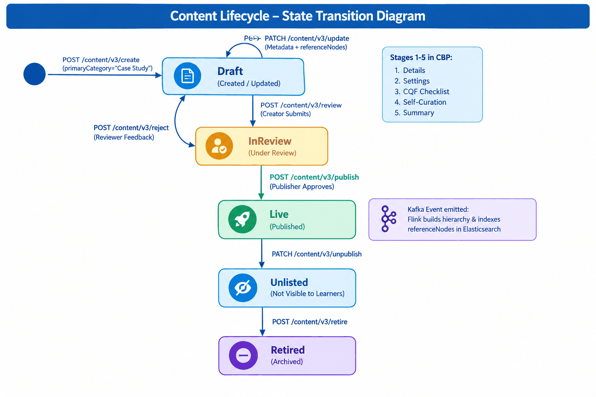

# Amrit Gyan Kosh (AGK) — Low-Level Design (LLD)

| Attribute | Details |
|---|---|
| Document Identifier | `AGK-DOC-LLD` |
| Version | 1.0 |
| Status | Approved for Implementation |
| Audience | Backend Engineers, Frontend Developers, DevOps/SRE, QA Engineers |

**Target Services & Repositories:**

- `cios-content-service` (Branch: `cbrelease-4.8.19.1`)
- `sunbird-cb-creationportal` (Branch: `cbrelease-4.8.19.1`)
- `sunbird-cb-portal` (Branch: `cbrelease-4.8.19.1`)
- `cb-enrollment_service` (Branch: `cbrelease-4.8.19.1`)
- `Flink-Search-Indexer` & `flink-content-publish` (Tag: `cbrelease-4.8.20_RC2`)

## 1. Feature-Level Design & State Machines

### 1.1 Feature Overview & Preconditions

The Low-Level Design defines the concrete internal controllers, handlers, schemas, data validation rules, database tables, and API payloads governing Amrit Gyan Kosh (AGK).

| Feature Module | Scope & Requirements Covered | Component / Handlers Involved | Preconditions |
|---|---|---|---|
| **Case Study Authoring** | `AGK-FR-001`, `AGK-FR-002`, `AGK-FR-004` | `ContentCreateController`, `ContentUpdateController`, `SystemSettingsController` | Creator authenticated with `CONTENT_CREATOR` role in CBP Portal. |
| **Teacher’s Notes Attachment** | `AGK-FR-005` | `ContentUploadController`, `ReferenceNodesAssembler` | Parent Case Study draft exists; uploaded artifact is valid PDF. |
| **Creation Decoupling & Governance** | `AGK-FR-003`, `AGK-FR-006` | `FormConfigService`, `RoleValidationInterceptor` | User `rootOrgId` equals CBC (`Competency Building Commission`) or KB for Karmayogi Talks. |
| **Discovery & Search Aggregation** | `AGK-FR-007`, `AGK-FR-008` | `CompositeSearchController`, `ElasticQueryBuilder` | Published Case Studies indexed in Elasticsearch with facets. |
| **Learner TOC & Zero-Cert Rewards** | `AGK-FR-009`, `AGK-FR-010` | `ContentReadController`, `EnrollmentProgressHandler`, `KafkaProgressProducer` | Learner enrolled (or unauthenticated visitor for public items). |
| **Public Unauthenticated Access** | `AGK-FR-011` | `GatewayAuthBypassFilter`, `PublicContentProxy` | Target Case Study has `isPublic: true` and `status: "Live"`. |
| **Multilingual Metadata Lock** | `AGK-FR-012` | `MultilingualContentController`, `CQFInheritanceValidator` | Base language version published (`Live`); CQF approved. |

### 1.2 Case Study Lifecycle State Machine

The Case Study entity follows a deterministic state machine managed by `cios-content-service`:



## 2. Component & Module Design

### 2.1 Backend Module Hierarchy (`cios-content-service`)

#### Detailed Handler Specifications

##### 1. `ContentCreateController.createContent(req, res)`

- **Module:** `app/controllers/ContentController.js`
- **Purpose:** Handles initial creation of Case Studies and child Reference Resources.
- **Invocation Sequence:**
  - `AuthInterceptor.validateSession(req)`
  - `RoleValidationInterceptor.checkCategoryPermissions(req.body.request.content)`
  - Generate unique Sunbird ID: `do_{timestamp}_{randomHash}` (e.g., `do_114185114804264960120`)
  - Inject default fields: `visibility: "Default"`, `status: "Draft"`, `framework: "igot"`
  - Generate initial `versionKey = String(Date.now())`
  - Insert into Cassandra `sunbird.content_data`
  - Return HTTP `200 OK` with `node_id` and `versionKey`.

##### 2. `ReferenceNodeService.attachReferenceNodes(parentContentId, referencePayload, currentVersionKey)`

- **Module:** `app/services/ReferenceNodeService.js`
- **Purpose:** Assembles and validates instructional PDF nodes (`referenceNodes`) attached to the Case Study.
- **Validation Logic:**
  - Validates that each element in `referenceNodes` contains mandatory fields: `identifier`, `artifactUrl`, `mimeType: "application/pdf"`, `audience`.
  - Verifies that `parentContent.versionKey == currentVersionKey` (Optimistic Concurrency Lock).
  - Serializes `referenceNodes` as a JSON array of objects within the collection metadata.

### 2.2 Client-Side Module Design (`sunbird-cb-creationportal` & `portal`)

#### 1. CBP Settings Form Component (`CaseStudySettingsComponent`)

- **Path:** `src/app/routes/authoring/case-study/case-study-settings.component.ts`
- **Responsibilities:**
  - Subscribes to `SystemSettingsService.getSdgList()` and `SystemSettingsService.getStateAndUTList()`.
  - Renders Angular Material multi-select chips for `contextSDGs` and `contextStateOrUTs`.
  - Renders Year multi-select populated from `FormConfigService` (years: 2000–current).
  - Renders "Teacher's Section" file upload widget restricted to `.pdf` MIME types.

#### 2. Learner Hub Facet Filter Component (`KnowledgeResourceFilterComponent`)

- **Path:** `src/app/routes/public/knowledge-resource/knowledge-resource-filter.component.ts`
- **Responsibilities:**
  - Binds selected filter options into the composite search query structure:

```ts
interface AGKSearchFilters {
  status: string[];
  primaryCategory: string[];
  contextYear?: string[];
  contextSDGs?: string[];
  contextStateOrUTs?: string[];
  sectorName?: string[];
}
```

- Dispatches debounced search requests to `/api/composite/v4/search`.

## 3. API-Level Design & Concrete Contracts

### 3.1 Content Creation API (`POST /apis/proxies/v8/action/content/v3/create`)

- **Consumer:** `sunbird-cb-creationportal`
- **Provider:** `cios-content-service`
- **Headers:**
  - `Content-Type: application/json`
  - `Cookie: connect.sid={{sessionCookie}}`

- **Request Schema:**

```json
{
  "$schema": "http://json-schema.org/draft-07/schema#",
  "type": "object",
  "required": [
    "request"
  ],
  "properties": {
    "request": {
      "type": "object",
      "required": [
        "content"
      ],
      "properties": {
        "content": {
          "type": "object",
          "required": [
            "name",
            "contentType",
            "primaryCategory",
            "mimeType",
            "framework"
          ],
          "properties": {
            "name": {
              "type": "string",
              "minLength": 3,
              "maxLength": 250
            },
            "contentType": {
              "type": "string",
              "enum": [
                "Resource",
                "Collection"
              ]
            },
            "primaryCategory": {
              "type": "string",
              "enum": [
                "Case Study",
                "Learning Resource"
              ]
            },
            "resourceCategory": {
              "type": "string"
            },
            "mimeType": {
              "type": "string",
              "enum": [
                "application/pdf",
                "application/vnd.ekstep.content-collection",
                "text/x-url"
              ]
            },
            "framework": {
              "type": "string",
              "enum": [
                "igot"
              ]
            },
            "description": {
              "type": "string"
            },
            "isExternal": {
              "type": "boolean",
              "default": false
            },
            "language": {
              "type": "array",
              "items": {
                "type": "string"
              },
              "default": [
                "English"
              ]
            }
          }
        }
      }
    }
  }
}
```

- **Sample Request (Case Study Parent):**

```json
{
  "request": {
    "content": {
      "name": "Inclusive Public Service Delivery Case Study",
      "contentType": "Resource",
      "primaryCategory": "Case Study",
      "mimeType": "application/vnd.ekstep.content-collection",
      "framework": "igot",
      "description": "Analysis of citizen-centric reforms in urban governance.",
      "language": [
        "English"
      ]
    }
  }
}
```

- **Sample Response (HTTP 200 OK):**

```json
{
  "id": "api.content.create",
  "ver": "3.0",
  "ts": "2026-10-26T05:20:10ZZ",
  "params": {
    "resmsgid": "842d2915-44fc-456a-83fd-dca56bf760f3",
    "status": "successful"
  },
  "responseCode": "OK",
  "result": {
    "identifier": "do_114185114804264960120",
    "node_id": "do_114185114804264960120",
    "versionKey": "1731581397010"
  }
}
```

### 3.2 Binary Upload API (`POST /apis/proxies/v8/upload/action/content/v3/upload/{node_id}`)

- **Consumer:** `sunbird-cb-creationportal`
- **Provider:** `cios-content-service` (via `CloudStorageService`)
- **Headers:** `Content-Type: multipart/form-data`, `Cookie: connect.sid={{sessionCookie}}`
- **Form Parameters:** `data` (Binary file content, `.pdf`, max 100MB)
- **Sample Response (HTTP 200 OK):**

```json
{
  "id": "api.content.upload",
  "ver": "3.0",
  "ts": "2026-10-26T05:22:15ZZ",
  "params": {
    "resmsgid": "642d2915-44fc-456a-83fd-dca56bf760f3",
    "status": "successful"
  },
  "responseCode": "OK",
  "result": {
    "identifier": "do_114185114804264960120",
    "artifactUrl": "https://storage.googleapis.com/<BUCKET>/content/do_114185114804264960120/artifact/sample_teachers_note.pdf",
    "content_url": "https://storage.googleapis.com/<BUCKET>/content/do_114185114804264960120/artifact/sample_teachers_note.pdf",
    "node_id": "do_114185114804264960120",
    "versionKey": "1731581581399"
  }
}
```

### 3.3 Case Study Metadata & Reference Nodes Update API (`PATCH /apis/proxies/v8/action/content/v3/update/{content_id}`)

- **Consumer:** `sunbird-cb-creationportal`
- **Provider:** `cios-content-service`
- **Request Schema:**

```json
{
  "$schema": "http://json-schema.org/draft-07/schema#",
  "type": "object",
  "required": [
    "request"
  ],
  "properties": {
    "request": {
      "type": "object",
      "required": [
        "content"
      ],
      "properties": {
        "content": {
          "type": "object",
          "required": [
            "versionKey"
          ],
          "properties": {
            "versionKey": {
              "type": "string"
            },
            "contextYear": {
              "type": "array",
              "items": {
                "type": "string"
              }
            },
            "contextSDGs": {
              "type": "array",
              "items": {
                "type": "string"
              }
            },
            "contextStateOrUTs": {
              "type": "array",
              "items": {
                "type": "string"
              }
            },
            "isPublic": {
              "type": "boolean"
            },
            "referenceNodes": {
              "type": "array",
              "items": {
                "type": "object",
                "required": [
                  "identifier",
                  "name",
                  "mimeType",
                  "artifactUrl",
                  "audience"
                ],
                "properties": {
                  "identifier": {
                    "type": "string"
                  },
                  "name": {
                    "type": "string"
                  },
                  "primaryCategory": {
                    "type": "string",
                    "default": "Learning Resource"
                  },
                  "resourceCategory": {
                    "type": "string",
                    "default": "Reference Resource"
                  },
                  "mimeType": {
                    "type": "string",
                    "enum": [
                      "application/pdf"
                    ]
                  },
                  "artifactUrl": {
                    "type": "string",
                    "format": "uri"
                  },
                  "downloadUrl": {
                    "type": "string",
                    "format": "uri"
                  },
                  "audience": {
                    "type": "array",
                    "items": {
                      "type": "string"
                    }
                  },
                  "version": {
                    "type": "integer"
                  },
                  "versionKey": {
                    "type": "string"
                  }
                }
              }
            }
          }
        }
      }
    }
  }
}
```

- **Sample Request Payload:**

```json
{
  "request": {
    "content": {
      "versionKey": "1731564201044",
      "contextYear": [
        "2022",
        "2023"
      ],
      "contextSDGs": [
        "SDG 3: Good Health and Well-being",
        "SDG 11: Sustainable Cities and Communities"
      ],
      "contextStateOrUTs": [
        "Pan India",
        "Karnataka"
      ],
      "isPublic": true,
      "referenceNodes": [
        {
          "channel": "0138043201608089602",
          "organisation": [
            "Competency Building Commission"
          ],
          "source": "CBC",
          "mimeType": "application/pdf",
          "primaryCategory": "Learning Resource",
          "resourceCategory": "Reference Resource",
          "artifactUrl": "https://storage.googleapis.com/<BUCKET>/content/do_1141843912879144961107/artifact/teachers_note.pdf",
          "downloadUrl": "https://<PORTAL_HOST>/content-store/content/do_1141843912879144961107/artifact/teachers_note.pdf",
          "identifier": "do_1141843912879144961107",
          "audience": [
            "Teacher",
            "Mentor"
          ],
          "version": 1,
          "name": "Pedagogical Guide for Case Study",
          "versionKey": "1731493234871"
        }
      ]
    }
  }
}
```

- **Sample Response (HTTP 200 OK):**

```json
{
  "id": "api.v3.update",
  "ver": "1.0",
  "ts": "2026-10-26T05:25:30.112Z",
  "params": {
    "resmsgid": "784c7180-a26f-11ef-84c9-55784f866a56",
    "status": "successful"
  },
  "responseCode": "OK",
  "result": {
    "content_id": "do_114184986771152896112",
    "versionKey": "1731578511467"
  }
}
```

### 3.4 Master Data Retrieval API (`GET /apis/proxies/v8/data/v2/system/settings/get/{field}`)

- **Endpoints:**
  - `GET /apis/proxies/v8/data/v2/system/settings/get/sdgList`
  - `GET /apis/proxies/v8/data/v2/system/settings/get/stateAndUTList`

- **Response Contract** (`sdgList`):

```json
{
  "id": "api.system.settings.get.sdgList",
  "ver": "v2",
  "responseCode": "OK",
  "result": {
    "response": {
      "id": "sdgList",
      "field": "sdgList",
      "value": [
        {
          "index": 1,
          "name": "SDG 1: No Poverty",
          "displayName": "SDG 1: No Poverty"
        },
        {
          "index": 2,
          "name": "SDG 2: Zero Hunger",
          "displayName": "SDG 2: Zero Hunger"
        },
        {
          "index": 3,
          "name": "SDG 3: Good Health and Well-being",
          "displayName": "SDG 3: Good Health and Well-being"
        },
        {
          "index": 4,
          "name": "SDG 4: Quality Education",
          "displayName": "SDG 4: Quality Education"
        },
        {
          "index": 5,
          "name": "SDG 5: Gender Equality",
          "displayName": "SDG 5: Gender Equality"
        },
        {
          "index": 6,
          "name": "SDG 6: Clean Water and Sanitation",
          "displayName": "SDG 6: Clean Water and Sanitation"
        },
        {
          "index": 7,
          "name": "SDG 7: Affordable and Clean Energy",
          "displayName": "SDG 7: Affordable and Clean Energy"
        },
        {
          "index": 8,
          "name": "SDG 8: Decent Work and Economic Growth",
          "displayName": "SDG 8: Decent Work and Economic Growth"
        },
        {
          "index": 9,
          "name": "SDG 9: Industry, Innovation, and Infrastructure",
          "displayName": "SDG 9: Industry, Innovation, and Infrastructure"
        },
        {
          "index": 10,
          "name": "SDG 10: Reduced Inequality",
          "displayName": "SDG 10: Reduced Inequality"
        },
        {
          "index": 11,
          "name": "SDG 11: Sustainable Cities and Communities",
          "displayName": "SDG 11: Sustainable Cities and Communities"
        },
        {
          "index": 12,
          "name": "SDG 12: Responsible Consumption and Production",
          "displayName": "SDG 12: Responsible Consumption and Production"
        },
        {
          "index": 13,
          "name": "SDG 13: Climate Action",
          "displayName": "SDG 13: Climate Action"
        },
        {
          "index": 14,
          "name": "SDG 14: Life Below Water",
          "displayName": "SDG 14: Life Below Water"
        },
        {
          "index": 15,
          "name": "SDG 15: Life on Land",
          "displayName": "SDG 15: Life on Land"
        },
        {
          "index": 16,
          "name": "SDG 16: Peace, Justice, and Strong Institutions",
          "displayName": "SDG 16: Peace, Justice, and Strong Institutions"
        },
        {
          "index": 17,
          "name": "SDG 17: Partnerships for the Goals",
          "displayName": "SDG 17: Partnerships for the Goals"
        }
      ]
    }
  }
}
```

### 3.5 Composite Search API (`POST /api/composite/v4/search`)

- **Consumer:** `sunbird-cb-portal` (Learner Web & Mobile)
- **Provider:** `composite-search-service`
- **Request Payload with Facets:**

```json
{
  "request": {
    "filters": {
      "status": [
        "Live"
      ],
      "primaryCategory": [
        "Case Study"
      ],
      "contextYear": [
        "2023"
      ],
      "contextSDGs": [
        "SDG 3: Good Health and Well-being"
      ],
      "contextStateOrUTs": [
        "Pan India"
      ]
    },
    "facets": [
      "resourceCategory",
      "sectorName",
      "subSectorName",
      "contextStateOrUTs",
      "contextYear",
      "contextSDGs",
      "courseCategory"
    ],
    "sort_by": {
      "lastUpdatedOn": "desc"
    },
    "offset": 0,
    "limit": 20
  }
}
```

- **Sample Response (HTTP 200 OK):**

```json
{
  "id": "api.composite.search",
  "ver": "v4",
  "ts": "2026-10-26T05:30:00ZZ",
  "params": {
    "resmsgid": "992bdee0-a275-11ef-84c9-55784f866a56",
    "status": "successful"
  },
  "responseCode": "OK",
  "result": {
    "count": 1,
    "content": [
      {
        "identifier": "do_114184986771152896112",
        "name": "Inclusive Public Service Delivery Case Study",
        "primaryCategory": "Case Study",
        "resourceCategory": "Reference Resource",
        "contextYear": [
          "2023"
        ],
        "contextSDGs": [
          "SDG 3: Good Health and Well-being"
        ],
        "contextStateOrUTs": [
          "Pan India"
        ],
        "status": "Live",
        "appIcon": "https://storage.googleapis.com/<BUCKET>/content/do_114184986771152896112/artifact/thumb.png",
        "posterImage": "https://storage.googleapis.com/<BUCKET>/content/do_114184986771152896112/artifact/poster.png",
        "organisation": [
          "Competency Building Commission"
        ],
        "lastUpdatedOn": "2026-10-20T10:00:00.000+0000"
      }
    ],
    "facets": [
      {
        "name": "contextSDGs",
        "values": [
          {
            "name": "SDG 3: Good Health and Well-being",
            "count": 12
          },
          {
            "name": "SDG 11: Sustainable Cities and Communities",
            "count": 8
          }
        ]
      },
      {
        "name": "contextYear",
        "values": [
          {
            "name": "2023",
            "count": 15
          },
          {
            "name": "2024",
            "count": 9
          }
        ]
      }
    ]
  }
}
```

## 4. Physical Data Model & Storage Specs

### 4.1 Apache Cassandra (Keyspace: `sunbird`)

#### 1. System Settings Table (`sunbird.system_settings`)

```sql
CREATE TABLE IF NOT EXISTS sunbird.system_settings (
    id    text,
    field text,
    value text,
    PRIMARY KEY (id)
) WITH comment = 'Stores dynamic master lists for AGK SDGs and State/UT values';
```

#### 2. Content Hierarchy Table (`sunbird.content_hierarchy`)

```sql
CREATE TABLE IF NOT EXISTS sunbird.content_hierarchy (
    identifier text,
    hierarchy  text,
    PRIMARY KEY (identifier)
) WITH comment = 'Stores serialized JSON collection hierarchy tree including referenceNodes';
```

#### 3. Content Data Table (`sunbird.content_data`)

```sql
CREATE TABLE IF NOT EXISTS sunbird.content_data (
    content_id      text,
    body            text,
    version_key     text,
    last_updated_on timestamp,
    PRIMARY KEY (content_id)
);
```

### 4.2 PostgreSQL Database (`sunbird`)

#### Table: `public.content_partner`

Governs partner certificates and accreditation hooks.

```sql
ALTER TABLE public.content_partner RENAME COLUMN trasform_certificate_json TO certificate_template_url;
ALTER TABLE public.content_partner ALTER COLUMN certificate_template_url SET DATA TYPE varchar(255);
```

### 4.3 Elasticsearch Index Mapping (`igot_content`)

Snippet of Elasticsearch 7.x schema for AGK facets:

```json
{
  "mappings": {
    "properties": {
      "identifier": {
        "type": "keyword"
      },
      "primaryCategory": {
        "type": "keyword"
      },
      "resourceCategory": {
        "type": "keyword"
      },
      "contextYear": {
        "type": "keyword"
      },
      "contextSDGs": {
        "type": "keyword"
      },
      "contextStateOrUTs": {
        "type": "keyword"
      },
      "sectorName": {
        "type": "keyword"
      },
      "subSectorName": {
        "type": "keyword"
      },
      "isPublic": {
        "type": "boolean"
      },
      "referenceNodes": {
        "type": "nested",
        "properties": {
          "identifier": {
            "type": "keyword"
          },
          "name": {
            "type": "text"
          },
          "artifactUrl": {
            "type": "keyword",
            "index": false
          },
          "mimeType": {
            "type": "keyword"
          },
          "audience": {
            "type": "keyword"
          }
        }
      }
    }
  }
}
```

## 5. Concrete Error Codes & Exception Contracts

All errors returned by `cios-content-service` adhere to standard Sunbird envelope specifications:

```json
{
  "id": "api.error",
  "ver": "1.0",
  "ts": "2026-10-26T05:35:00ZZ",
  "params": {
    "resmsgid": "b1e60560-a27b-11ef-84c9-55784f866a56",
    "msgid": null,
    "status": "failed",
    "err": "ERR_INVALID_VERSION_KEY",
    "errmsg": "Invalid versionKey provided. Content has been modified concurrently."
  },
  "responseCode": "CLIENT_ERROR",
  "result": {}
}
```

| HTTP Status | Error Identifier (`err`) | Error Message (`errmsg`) | Root Cause & Resolution |
|---|---|---|---|
| **400** | `ERR_INVALID_VERSION_KEY` | "Invalid versionKey provided." | Optimistic lock collision. Client must re-fetch via `/read` and re-apply changes. |
| **400** | `ERR_INVALID_METADATA_FORMAT` | "contextSDGs must be an array of strings." | Payload schema validation failed in `ContentUpdateController`. |
| **403** | `ERR_UNAUTHORIZED_CATEGORY` | "Creating Karmayogi Talks is restricted to CBC and KB." | User's `rootOrgId` is not affiliated with CBC/KB. Request rejected by `RoleValidationInterceptor`. |
| **404** | `ERR_CONTENT_NOT_FOUND` | "No content found for identifier: {id}." | Target content node does not exist in Cassandra. |
| **413** | `ERR_FILE_SIZE_EXCEEDED` | "Uploaded file exceeds maximum limit of 100MB." | Attached Teacher's Note binary exceeds allowable size. |
| **500** | `ERR_KAFKA_PUBLISH_FAILED` | "Unable to dispatch publish event to Kafka." | Flink pipeline publisher failed. Content service retries up to 3 times before returning 500. |

## 6. Testing Considerations & Verification Scenarios

### 6.1 Unit & Integration Test Matrix

| Test ID | Test Target | Scenario Description | Expected Outcome | SRS Req Mapping |
|---|---|---|---|---|
| **UT-AGK-01** | `RoleValidationInterceptor` | User from Dept of Agriculture attempts `primaryCategory = "Karmayogi Talks"`. | Throws `403 ERR_UNAUTHORIZED_CATEGORY`. | `AGK-FR-006` |
| **UT-AGK-02** | `ReferenceNodeService` | Attach valid PDF to `referenceNodes` during update. | Serializes object with `artifactUrl` and updates `versionKey`. | `AGK-FR-005` |
| **UT-AGK-03** | `SystemSettingsController` | Fetch `sdgList` from Cassandra. | Returns HTTP 200 with 17 distinct SDGs. | `AGK-FR-004` |
| **IT-AGK-01** | `ContentPublishPipeline` | Publish Case Study containing `referenceNodes`. | Kafka event processed by Flink; ES index contains nested referenceNodes. | `AGK-FR-005` |
| **IT-AGK-02** | `CompositeSearch` | Query ES with `contextYear = ["2023"]` and `contextSDGs = ["SDG 3"]`. | Returns HTTP 200 with matching case studies and dynamic facet counts. | `AGK-FR-008` |
| **IT-AGK-03** | `EnrollmentService` | Complete 100% of an AGK Case Study. | Progress marks complete, Karma points awarded, **zero** certificate generated. | `AGK-FR-009` |
| **IT-AGK-04** | `PublicAccessProxy` | Unauthenticated GET request to public case study read API. | Bypasses session auth and returns 200 OK. | `AGK-FR-011` |

## 7. Concrete Deployment Configurations

### 7.1 Flink Streaming Configurations

- **Job:** `Flink-Search-Indexer`
- **File:** `flink-configuration.yaml`

```yaml
taskmanager.numberOfTaskSlots: 4
parallelism.default: 2
kafka.consumer.topic: "prod.search.indexer.request"
nested.fields: "referenceNodes"
elasticsearch.hosts: "http://elasticsearch:9200"
elasticsearch.index: "igot_content"
```

### 7.2 Form Configuration API Payload (`cbp-portal`)

CURL executed during release deployment:

```bash
curl --location 'https://<PORTAL_HOST>/apis/v1/form/create' \
  --header 'Content-Type: application/json' \
  --header 'Cookie: connect.sid={{adminSession}}' \
  --data '{
  "request": {
    "type": "cbp-portal",
    "subType": "cbp-v1",
    "action": "cbp-configuration",
    "component": "cbp",
    "rootOrgId": "*",
    "data": {
      "resourceCategory": [
        {
          "name": "Case study",
          "value": "Case study",
          "enabledFor": [
            "PDF",
            "Link"
          ]
        },
        {
          "name": "Karmayogi Talks",
          "value": "Karmayogi Talks",
          "enabledFor": [
            "Youtube"
          ]
        },
        {
          "name": "Best Practices",
          "value": "Best Practices",
          "enabledFor": [
            "PDF",
            "Link"
          ]
        },
        {
          "name": "Policies and Acts",
          "value": "Policies and Acts",
          "enabledFor": [
            "PDF",
            "Link"
          ]
        }
      ]
    }
  }
}'
```

## 8. Open Implementation Items for Engineering Sign-Off

1. **Upper Bound for Year Validation:**
  - *Observation:* The form config payload hardcodes years up to `2024`.
  - *Resolution:* The frontend `CaseStudySettingsComponent` shall calculate dynamic years:

```ts
const currentYear = new Date().getFullYear();
const years = Array.from({ length: currentYear - 2000 + 1 }, (_, i) => String(2000 + i));
```

1. **Download Telemetry Mobile Parity** (`KB-11673`):
  - *Action:* Verify Flutter download service emits `INTERACT` events identical to portal web specifications (`eid: "INTERACT"`, `subtype: "download"`, `id: "teachers-note"`).
