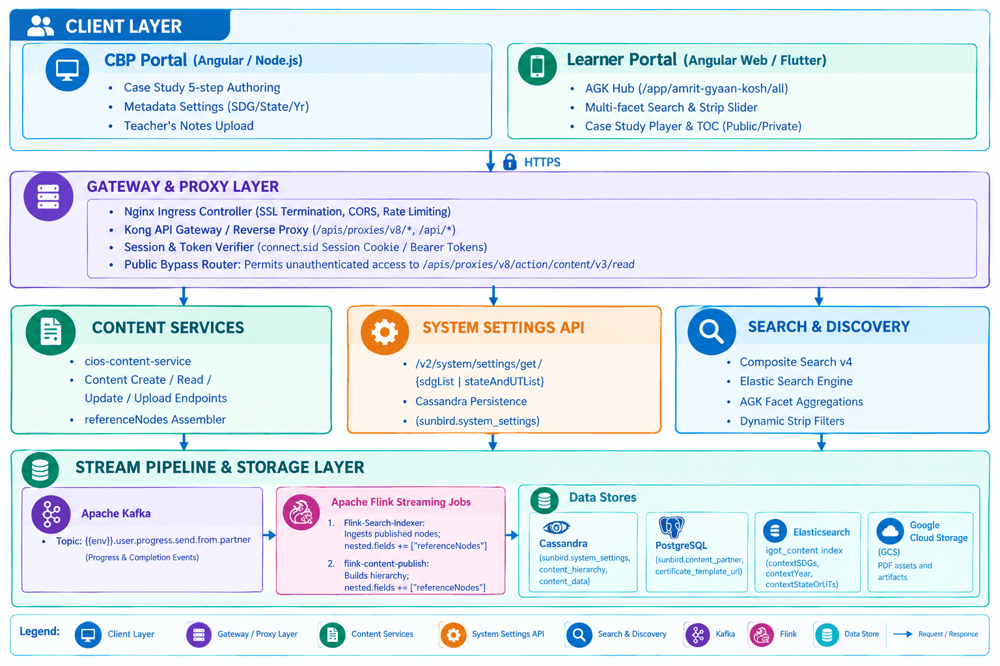
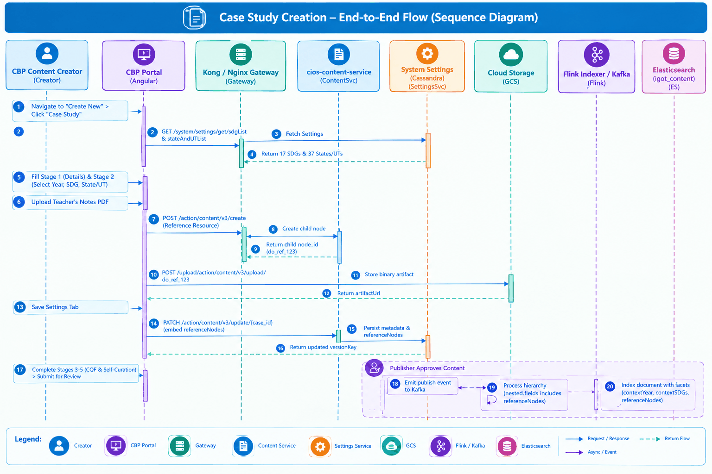
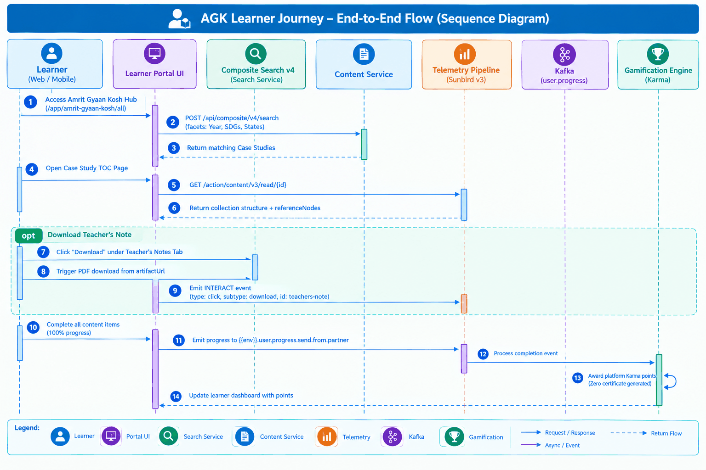

# Part 2: Amrit Gyan Kosh — Software Design Document (SDD)

| Attribute | Details |
|---|---|
| Document Identifier | `AGK-DOC-SDD` |
| Version | 1.0 |
| Status | Baselined from Live Engineering Architecture |
| Scope | High-Level Design (HLD), Low-Level Design (LLD), Schemas, APIs & Data Flows |

## 1. System Architecture & Component Decomposition

The AGK solution is built on top of the microservice-based Sunbird/iGOT Karmayogi platform, organized into four primary architectural tiers:



## 2. Data Architecture & Schema Specifications

### 2.1 Collection & Content Metadata Schema

In accordance with **Sprint 19 Enhancements** (`TES/221675560`), Case Studies are modeled as a specialized collection type containing enhanced metadata arrays and a nested `referenceNodes` object structure.

```json
{
  "identifier": "do_114184986771152896112",
  "name": "District Healthcare Transformation Case Study",
  "contentType": "Resource",
  "primaryCategory": "Case Study",
  "resourceCategory": "Reference Resource",
  "mimeType": "application/vnd.ekstep.content-collection",
  "status": "Live",
  "isPublic": true,
  "contextYear": [
    "2022",
    "2023"
  ],
  "contextSDGs": [
    "SDG 3: Good Health and Well-being",
    "SDG 10: Reduced Inequality"
  ],
  "contextStateOrUTs": [
    "Odisha",
    "Pan India"
  ],
  "sectorName": "Health and Nutrition",
  "subSectorName": "Health and Family Welfare",
  "referenceNodes": [
    {
      "identifier": "do_1141843912879144961107",
      "name": "Teacher's Guide & Pedagogical Notes",
      "primaryCategory": "Learning Resource",
      "resourceCategory": "Reference Resource",
      "mimeType": "application/pdf",
      "artifactUrl": "https://storage.googleapis.com/<BUCKET>/content/do_1141843912879144961107/artifact/teachers_note.pdf",
      "downloadUrl": "https://<PORTAL_HOST>/content-store/content/do_1141843912879144961107/artifact/teachers_note.pdf",
      "audience": [
        "Teacher",
        "Mentor"
      ],
      "channel": "0138043201608089602",
      "organisation": [
        "Competency Building Commission"
      ],
      "version": 1,
      "versionKey": "1731493234871"
    }
  ]
}
```

## 3. Verified API Interface Contracts

### 3.1 Metadata Master Data APIs

#### 1. Retrieve Sustainable Development Goals (SDG) List

- **Endpoint:** `GET /apis/proxies/v8/data/v2/system/settings/get/sdgList`
- **Headers:** `Cookie: connect.sid={{session}}`
- **Response Contract:**

```json
{
  "id": "api.system.settings.get.sdgList",
  "ver": "v2",
  "responseCode": "OK",
  "result": {
    "response": {
      "id": "sdgList",
      "field": "sdgList",
      "value": [
        {
          "index": 1,
          "name": "SDG 1: No Poverty",
          "displayName": "SDG 1: No Poverty"
        },
        {
          "index": 2,
          "name": "SDG 2: Zero Hunger",
          "displayName": "SDG 2: Zero Hunger"
        },
        {
          "index": 3,
          "name": "SDG 3: Good Health and Well-being",
          "displayName": "SDG 3: Good Health and Well-being"
        }
      ]
    }
  }
}
```

#### 2. Retrieve State & Union Territory List

- **Endpoint:** `GET /apis/proxies/v8/data/v2/system/settings/get/stateAndUTList`
- **Response Contract:**

```json
{
  "id": "api.system.settings.get.stateAndUTList",
  "ver": "v2",
  "responseCode": "OK",
  "result": {
    "response": {
      "id": "stateAndUTList",
      "field": "stateAndUTList",
      "value": [
        {
          "index": 1,
          "name": "Pan India"
        },
        {
          "index": 2,
          "name": "Andhra Pradesh"
        },
        {
          "index": 33,
          "name": "The Government of NCT of Delhi"
        }
      ]
    }
  }
}
```

### 3.2 Content Authoring & Mutation APIs

#### 1. Create Teacher's Note / Reference Resource Node

- **Endpoint:** `POST /apis/proxies/v8/action/content/v3/create`
- **Request Payload:**

```json
{
  "request": {
    "content": {
      "name": "District Health Intervention - Teacher Notes",
      "contentType": "Resource",
      "primaryCategory": "Learning Resource",
      "resourceCategory": "Reference Resource",
      "mimeType": "application/pdf",
      "framework": "igot",
      "visibility": "Default",
      "language": [
        "English"
      ]
    }
  }
}
```

- **Response:** Returns `result.node_id` (e.g., `do_114185114804264960120`) and `versionKey`.

#### 2. Upload Reference PDF Binary

- **Endpoint:** `POST /apis/proxies/v8/upload/action/content/v3/upload/{node_id}`
- **Content-Type:** `multipart/form-data`
- **Form Field:** `data=@"sample_guide.pdf"`
- **Response:** Returns `artifactUrl` and `content_url` located in cloud storage.

#### 3. Update Parent Case Study with Metadata & Reference Nodes

- **Endpoint:** `PATCH /apis/proxies/v8/action/content/v3/update/{case_study_id}`
- **Request Payload:**

```json
{
  "request": {
    "content": {
      "versionKey": "1731564201044",
      "contextYear": [
        "2023",
        "2024"
      ],
      "contextSDGs": [
        "SDG 3: Good Health and Well-being"
      ],
      "contextStateOrUTs": [
        "Odisha"
      ],
      "referenceNodes": [
        {
          "identifier": "do_114185114804264960120",
          "name": "District Health Intervention - Teacher Notes",
          "primaryCategory": "Learning Resource",
          "resourceCategory": "Reference Resource",
          "mimeType": "application/pdf",
          "artifactUrl": "https://storage.googleapis.com/<BUCKET>/content/do_114185114804264960120/artifact/sample_guide.pdf",
          "audience": [
            "Teacher",
            "Mentor"
          ],
          "version": 1,
          "versionKey": "1731581581399"
        }
      ]
    }
  }
}
```

### 3.3 Search & Discovery APIs

#### Composite Search with AGK Facets

- **Endpoint:** `POST /api/composite/v4/search`
- **Headers:** `Content-Type: application/json`, `Authorization: Bearer {{api_key}}`
- **Request Payload:**

```json
{
  "request": {
    "filters": {
      "status": [
        "Live"
      ],
      "primaryCategory": [
        "Case Study"
      ],
      "contextYear": [
        "2023"
      ],
      "contextSDGs": [
        "SDG 3: Good Health and Well-being"
      ],
      "contextStateOrUTs": [
        "Pan India",
        "Odisha"
      ]
    },
    "facets": [
      "resourceCategory",
      "sectorName",
      "subSectorName",
      "contextStateOrUTs",
      "contextYear",
      "contextSDGs"
    ],
    "sort_by": {
      "lastUpdatedOn": "desc"
    },
    "offset": 0,
    "limit": 20
  }
}
```

## 4. End-to-End Workflow & Execution Flows

### 4.1 Case Study Creation & Publishing Sequence



### 4.2 Learner Consumption & Telemetry Flow



## 5. Streaming & Telemetry Design

### 5.1 Flink Stream Processing Updates

As mandated in the deployment configuration (`TES/230653971`):

- **Job 1:** `Flink-Search-Indexer`
  - Configuration: `nested.fields` updated to include `"referenceNodes"`.
  - Behavior: Extracts child resource objects within `referenceNodes` and preserves them in the Elasticsearch index document to support retrieval on the TOC page without secondary lookups.

- **Job 2:** `flink-content-publish`
  - Configuration: `nested.fields` updated to include `"referenceNodes"`.
  - Behavior: Validates that all nested reference node identifiers are active and published prior to packaging the parent bundle.

### 5.2 Sunbird v3 Telemetry Event Contract

Telemetry events emitted when downloading instructional materials (Jira [KB-11674: Add telemetry for AGK resource download in portal](https://karmayogibharat.atlassian.net/browse/KB-11674)[To Do](https://karmayogibharat.atlassian.net/browse/KB-11674)):

```json
{
  "eid": "INTERACT",
  "ets": 1708601819653,
  "ver": "3.0",
  "mid": "INTERACT:c43221a3f56f57424ad01222828dbc14",
  "actor": {
    "id": "5ae2850b-a0eb-4e89-8ed5-b6155861bbb2",
    "type": "User"
  },
  "context": {
    "channel": "0134199050418831360",
    "pdata": {
      "id": "prod.sunbird-cb-portal",
      "ver": "4.8.10",
      "pid": "sunbird-cb-portal"
    },
    "env": "Amrit Gyaan Kosh",
    "sid": "2a738dad-a9f1-4e7d-8f10-444f5e6050b4",
    "did": "93acf9149da167cf8845fd67b39a4f71",
    "cdata": [],
    "rollup": {}
  },
  "object": {
    "id": "do_1143959552195543041116",
    "type": "Case Study"
  },
  "tags": [],
  "edata": {
    "type": "click",
    "subtype": "download",
    "id": "teachers-note",
    "pageid": "app/toc/do_1143959552195543041116"
  }
}
```

## 6. Architecture Decisions & Trade-Off Register

| Decision ID | Architecture Decision | Rationale | Alternatives Considered | Impact / Trade-off |
|---|---|---|---|---|
| **AGK-ADR-001** | **Nested** `referenceNodes` inside Collection Meta | Avoids creating deep composite course tree hierarchies for simple PDF reference assets; allows single-call retrieval during TOC load. | Separate child relation in content hierarchy table. | Required updating Flink `nested.fields` configuration in indexer and publish jobs. |
| **AGK-ADR-002** | **Cassandra** `system_settings` for SDGs & States | Provides centralized, cacheable configuration for UI drop-down values without modifying relational schemas. | Hardcoding in Angular client forms. | Requires manual CQL updates or DB scripts if new States/UTs are introduced. |
| **AGK-ADR-003** | **Zero-Certificate Karma Attribution** | Case studies are designed as modular reading/analytical assets rather than formal accredited courses; gamification points reward consumption without credential bloat. | Standard course certificate generation. | Disables certificate microservice invocation for `primaryCategory = "Case Study"`. |
| **AGK-ADR-004** | **Base-Language CQF Inheritance** | Significantly reduces review turnaround time for translated versions while maintaining pedagogical consistency. | Full independent CQF re-review for every language. | Requires strictly locking structural metadata (`contextSDGs`, `contextYear`) during translation. |

## 7. Verification & Traceability Matrix

| SRS Req ID | Functional Capability | Architecture / Design Element | Verified API / DDL Contract | Verification Status |
|---|---|---|---|---|
| **AGK-FR-001** | Primary Category "Case Study" | CBP Portal Content Model | `cbp-portal` Form Config | Implemented & Verified |
| **AGK-FR-002** | 5-Stage Creation Lifecycle | CBP Creation Wizard | `POST /action/content/v3/create` | Implemented & Verified |
| **AGK-FR-004** | Enhanced Metadata Tagging | Cassandra `system_settings` | `GET /system/settings/get/{sdgList, stateAndUTList}` | Implemented & Verified |
| **AGK-FR-005** | Teacher's Section Assets | Collection Meta `referenceNodes` | `PATCH /action/content/v3/update` (referenceNodes) | Implemented & Verified |
| **AGK-FR-006** | Karmayogi Talks Restriction | RBAC Organization Guard | Form schema `rootOrgId` check | Implemented & Verified |
| **AGK-FR-007** | Navigation Rebranding | Learner Portal Top Bar | `subType: "knowledge-resource"` Page Config | Implemented & Verified |
| **AGK-FR-008** | AGK Hub & Multi-facet Filtering | Elasticsearch Indexer & Search v4 | `POST /api/composite/v4/search` | Implemented & Verified |
| **AGK-FR-009** | Zero-Cert Karma Attribution | Enrollment & Progress Pipeline | Kafka `user.progress.send.from.partner` | Implemented & Verified |
| **AGK-FR-011** | Public AGK Consumption | Nginx Ingress & Auth Bypass | Public route whitelist (`/app/amrit-gyaan-kosh/*`) | Implemented & Verified |
| **AGK-FR-012** | Multilingual CQF Inheritance | Content Service Multilingual Engine | Lock shared fields (`contextYear`, `contextSDGs`) | Implemented & Verified |

## 8. Open Items & Stakeholder Validation Register

1. **Teacher’s Notes Access Scope** (`VAL-001`):
  - *Status:* Needs Clarification.
  - *Detail:* While Jira story `KB-7220` specifies that Teacher's Notes are for mentors, the Learner Portal TOC specification (`KB-7384`) and public unauthenticated access ticket (`KB-10527`) permit general learners and public users to view and download Teacher's Notes. Confirmation is required whether a strict mentor-role gate is to be enforced.

2. **Year List Dynamic Range** (`VAL-002`):
  - *Status:* Needs Confirmation.
  - *Detail:* The Cassandra `system_settings` configuration stores years statically up to 2024. A scheduled configuration update or client-side dynamic evaluation is recommended to automatically include 2025–2027.
