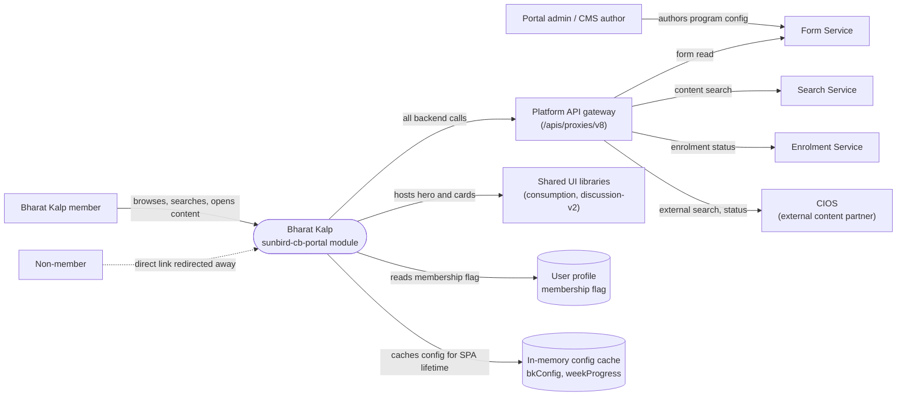

# Bharat Kalp — Context Diagram

## System boundary

Inside the feature is the Bharat Kalp module of the portal SPA: the landing page, the
"see all" content browser, the membership guard and the cached configuration reader.
There is no Bharat Kalp backend. Outside it are the members and non-members who use
it, the portal admin who authors the program configuration, the platform gateway, the
Form, Search and Enrolment services, the external content-partner (CIOS) service, and
the shared UI libraries that render the hero, community cards and content cards.

## Diagram

## Elements

| Element | Role | Detailed in |
|---|---|---|
| Bharat Kalp (`sunbird-cb-portal` module) | Central system: landing page, see-all browser, guard, config service; no backend of its own | [hld.md](hld.md) |
| Bharat Kalp member | Sees entry points, browses the weekly library, joins communities, opens content | [use-cases.md](use-cases.md) |
| Non-member | Sees no entry points; a direct link redirects to page-not-found | [use-cases.md](use-cases.md) |
| Portal admin / CMS author | Authors the `bkConfig`, `sectionList` and `weekProgress` JSON; outside this repo | [index.md](index.md) |
| Platform API gateway | Single path for every backend call the feature makes | [apis.md](apis.md) |
| Form Service | Returns the program configuration | [apis.md](apis.md) |
| Search Service | Returns internal content metadata for the configured ids | [apis.md](apis.md) |
| Enrolment Service | Returns the member's enrolment and completion status | [apis.md](apis.md) |
| CIOS (external content partner) | Supplies external course metadata and per-item enrolment status | [apis.md](apis.md) |
| Shared UI libraries | Render the program hero, community cards and content cards; released independently | [hld.md](hld.md) |
| User profile | Holds the single membership flag read at the entry points and the route guard | [lld.md](lld.md) |
| In-memory config cache | Holds the program configuration for the SPA's lifetime | [lld.md](lld.md) |

> **Verification boundary:** elements and interactions come from the feature's own pages
> (index, use cases, APIs, HLD), spot-checked against the Bharat Kalp route module,
> form service and see-all component in `sunbird-cb-portal`. Not analysed from source:
> the Form, Search, Enrolment and CIOS services, the shared UI libraries, and the
> admin authoring path, which are inferred from the requests the portal sends. The
> routing of the CIOS calls through the gateway and the user profile as the origin of
> the membership flag are taken from the docs rather than traced end to end.
