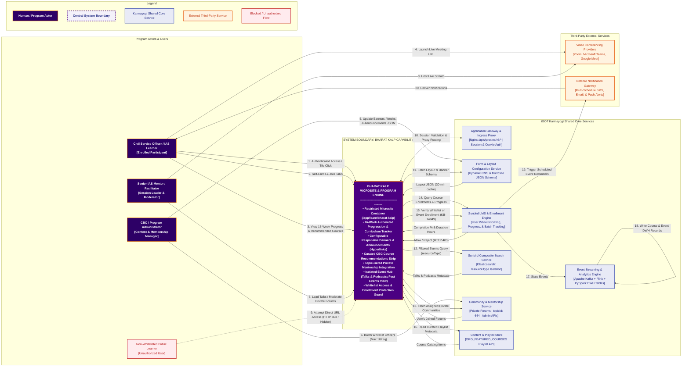

# Bharat KALP — System Context Diagram

## 1. Diagram Overview

The **Bharat KALP System Context Diagram** represents the operational boundary of the **Bharat KALP** (*Knowledge, Action & Leadership Program*) capability within the broader iGOT Karmayogi digital infrastructure.

### System Boundary & Architecture Definition

Bharat KALP operates as a **configuration-driven, access-gated microsite and capability layer** within the iGOT Karmayogi platform. It does not introduce a detached monolithic backend or separate database cluster; instead, it establishes an isolated participant experience by combining:

- **The Bharat KALP Microsite Container:** Multi-device presentation layer (Web Angular SPA at `/app/learn/bharat-kalp` and cross-platform Mobile Flutter app) with automated 16-week progression logic, banner carousels, and progress meters.
- **Declarative Form Configurations:** JSON schema definitions served by the platform Form Service that govern UI layout, banner assets, announcement text, and active calendar week boundaries without code redeployments.
- **Logical Metadata Partitioning:** Enforcing program isolation across shared core services using metadata tags (`topicId: 644`, `communityAccessLevel: "private"`, `resourceType: ["Bharat Kalp - Talks", "Bharat Kalp - Podcast"]`).

External actors (IAS officers, program administrators, mentors, and unauthorized learners) and external platform services (Authentication Gateway, Sunbird LMS, Community Service, Composite Search, Form Service, Flink/Kafka event pipeline, Analytics DWH) as well as third-party services (Video Conferencing and Netcore Notification Gateway) sit strictly **outside** the Bharat KALP system boundary.

## 2. Bharat KALP — System Context Diagram

**Rendering Note:** The diagram below is provided in standardized **Mermaid.js** format. It renders as an SVG/PNG vector diagram directly within modern markdown viewers and Confluence.

## 3. External Actor Register

| Actor Identifier | Actor Role | Purpose & Interaction with Bharat KALP | Information Submitted | Information Received | Source Reference |
|---|---|---|---|---|---|
| **ACT-01** | **Civil Service Officer (IAS Participant)** | Primary end-user; consumes curated curriculum, tracks 16-week progression, engages in private mentorship, and joins exclusive talks. | Login session credentials (`connect.sid`, `wid`), event enrollment triggers, course consumption progress. | Tailored microsite dashboard, active week courses, recommendation strips, joined communities, live meeting URLs. | BR-01..BR-08, BK-FR-001..009, KB-14382 |
| **ACT-02** | **Program Administrator (CBC / SPV Admin)** | Governs program content, defines week-wise structures, refreshes promotional banners, updates circular announcements, and manages participant whitelisting. | JSON form configurations, banner image URLs, announcement text with hyperlinks, batch user whitelists (max 10 user IDs/call). | API execution statuses, form validation receipts, batch join/unjoin transaction logs. | BR-02/03/05, BK-FR-002/003, API Contract |
| **ACT-03** | **Senior IAS Mentor / Facilitator** | Domain expert / senior officer conducting masterclasses, hosting *Bharat Kalp - Talks*, and moderating private discussion forums. | Live meeting join tokens, discussion topics, responses, shared guidance documents. | Mentorship participant rosters, discussion forum threads, event attendee counts. | BR-06/08, BK-FR-006, Sprint 38.1 Spec |
| **ACT-04** | **Non-Whitelisted Public Learner** | Unauthorized general platform user attempting access to restricted leadership resources. | Direct URL requests to `/app/learn/bharat-kalp` or event enrollment attempts. | HTTP 403 Forbidden alert; hidden homepage spotlight tile; rejection from event batch (`KB-14949`). | BK-FR-001-04, KB-14949 |

## 4. External System Register

| System Identifier | External System Name | Primary System Purpose | Interaction with Bharat KALP | Data Exchanged | Communication Protocol | Evidence Status |
|---|---|---|---|---|---|---|
| **SYS-CORE-01** | **Application Gateway & Ingress Proxy** | Nginx reverse proxy terminating client TLS and routing API calls. | Injects session headers (`wid`, `rootOrg`, `org`), enforces rate limits, and proxies client traffic to microservices. | HTTP cookies, auth tokens, client user-agent, forwarded REST payloads. | HTTPS / TLS 1.3 over TCP (`/apis/proxies/v8/*`) | Documented (SRS Sec 8.2, API Contract) |
| **SYS-CORE-02** | **Form** **Configuration Service (CMS)** | Platform service delivering declarative JSON schemas for dynamic page rendering. | Serves the `bharat-kalp` microsite layout schema, multi-resolution banners, announcement texts, and week dates. | Request: `type=bharat-kalp`, `subType=microsite`; Response: Full page layout JSON configuration. | REST / HTTP GET (`/page-configuration`) | Documented (Sprint 38.1 Spec) |
| **SYS-CORE-03** | **Sunbird LMS & Enrollment Engine** | Core training engine managing batch creation, tracking progress, and validating enrollments. | Validates program whitelisting for event self-enrollment (`KB-14949`) and returns user course completion data. | Request: `userId`, `eventId`, batch IDs; Response: Course enrollment list, progress duration, auth status. | REST / HTTP POST (`/learner/course/v4/...`) | Code-verified (cbrelease-4.8.38, KB-14949) |
| **SYS-CORE-04** | **Sunbird Composite Search Engine** | Elasticsearch cluster indexing all published courses, programs, and events. | Retrieves Bharat KALP-exclusive events and past events filtered by category and resource type. | Query payload with `filters: { resourceType: ["Bharat Kalp - Talks", "Bharat Kalp - Podcast"] }`. | REST / HTTP POST (`/sunbirdigot/search`) | Documented (API Contract, Sprint 38.1) |
| **SYS-CORE-05** | **Community & Mentorship Service** | Platform discussion engine (`cb-community-service` :7001). | Enforces private access level, scopes topics under `topicId: 644`, and manages batch memberships. | Payloads containing `categoryName`, `communityAccessLevel: private`, `userIds` (max 10), `communityId`. | REST / HTTP PUT/POST (`/community/v1/*`) | Code-verified (Image RC1_736306b_9) |
| **SYS-CORE-06** | **Content Store & Playlist Service** | Repository storing learning assets and curated organizational playlists. | Fetches curated recommended courses specified under CBC playlist `ORG_FEATURED_COURSES`. | Playlist identifier: `0135071359030722569IGOTSPECILIzations/0135071359030722569`. | REST / HTTP POST (`/playList/read/...`) | Documented (Sprint 38.1 Spec) |
| **SYS-CORE-07** | **Streaming & Data Analytics Pipeline** | Apache Kafka broker, Apache Flink jobs (`post-publish-flink-job`), and PySpark ETL (`cb-core-data`). | Automatically creates batches for published BK events and generates nightly DWH consumption reports. | Kafka consumption events; batch metadata; DWH records (`bk_course_enrolments`, `bk_event_enrolments`). | Kafka Streams / PySpark JDBC Batch Inserts | Code-verified (Image RC11_55d91e70, RC2_72d5025) |
| **SYS-EXT-01** | **Video Conferencing Providers** | Third-party providers: Google Meet, Zoom, and Microsoft Teams. | Hosts live interactive leadership sessions and webinars launchable directly from event cards. | External meeting URL string (`https://karmayogi.zoom.us/...`), attendee display identifiers. | Web browser URI dispatch / Deep Linking | Documented (BR-08, BK-FR-008) |
| **SYS-EXT-02** | **Netcore Notification Gateway** | Enterprise cloud gateway for SMS, email, and mobile push notifications. | Dispatches automated, scheduled event reminders to enrolled officers before sessions begin. | Notification payload: recipient phone/email, event title, session start time, meeting URL. | REST API / Webhook Dispatcher | Documented (BR-10, BK-FR-009) |

## 5. Interface and Data-Flow Register

| Flow ID | Source Entity | Destination Entity | Interaction Purpose & Functional Description | Data & Information Exchanged | Protocol / Interface | Evidence Status |
|---|---|---|---|---|---|---|
| **FL-01** | IAS Officer | Bharat KALP Portal | User opens the dedicated Bharat KALP Microsite. | HTTP GET request with session cookies | HTTPS (Port 443) | Verified (Portal) |
| **FL-02** | Bharat KALP Portal | Form Config Svc | Fetches dynamic layout, banners, and week dates. | Layout JSON schema (16 weeks, banners) | REST / HTTP GET | Verified (Spec) |
| **FL-03** | Bharat KALP Portal | Composite Search | Retrieves live/upcoming Bharat KALP events. | Filters: resourceType: [Talks, Podcast] | REST / HTTP POST | Verified (Contr) |
| **FL-04** | Bharat KALP Portal | Community Service | Retrieves private mentorship forums joined by user | Header wid: {{uuid}}; joined forum list | REST / HTTP GET | Verified (Contr) |
| **FL-05** | Bharat KALP Portal | Sunbird LMS | Queries completed course consumption & progress. | User GUID; course IDs, hours, completion% | REST / HTTP POST | Verified (Contr) |
| **FL-06** | Bharat KALP Portal | Content Store Svc | Fetches curated course recommendations strip. | Playlist ID ORG_FEATURED_COURSES | REST / HTTP POST | Verified (Spec) |
| **FL-07** | IAS Officer | Bharat KALP Portal | Officer self-enrolls into an event (KB-15219). | Event ID, user GUID (wid) | REST / HTTP POST | Verified (15219) |
| **FL-08** | Bharat KALP Portal | Sunbird LMS | Validates user against Bharat KALP whitelist. | User ID, event category (KB-14949) | Internal LMS Guard | Verified (14949) |
| **FL-09** | Bharat KALP Portal | VC Providers | Launches external video meeting session. | Meeting URL dispatch to browser tab | HTTPS Deep Link | Verified (BR-08) |
| **FL-10** | Program Admin | Form Config Svc | Updates promotional banners or announcements. | JSON form payload with banner SVGs/links | Form Admin Console | Verified (Spec) |
| **FL-11** | Program Admin | Community Service | Batch whitelists officers into private community. | JSON: communityId, userIds (max 10) | REST / HTTP PUT | Verified (Contr) |
| **FL-12** | Non-Member Learner | Bharat KALP Portal | Unauthorized learner attempts direct navigation. | Route evaluation against user roles | HTTP 403 / Redirect | Verified (FR-01) |
| **FL-13** | Sunbird LMS | Netcore Gateway | Dispatches scheduled event reminder alerts. | Recipient ID, event time, meeting URL | Netcore API Webhook | Documented (BR-10 |
| **FL-14** | Sunbird LMS | Kafka / Flink | Emits event and course lifecycle changes. | State transition messages | Kafka Stream Broker | Verified (Spec) |
| **FL-15** | PySpark ETL | Analytics DWH | Nightly batch aggregation into PostgreSQL tables. | Rows inserted into bk_*_enrolments | PostgreSQL JDBC | Verified (Spec) |

## 6. Assumptions and Open Questions

| Item ID | Technical Reality / Open Question | Context & System Boundary Impact | Suggested Owner | Status |
|---|---|---|---|---|
| **ASN-01** | Participant whitelisting is maintained via backend data loads and admin APIs (max 10 users/request). | Assumes no self-service user registration flow inside the UI. | CBC Operations / Backend Lead | Baseline Fact |
| **ASN-02** | Third-party video conferencing providers do not return fine-grained in-meeting telemetry back to Karmayogi. | Attendance duration is captured via LMS join/complete triggers. | Solution Architect / LMS Lead | Baseline Fact |
| **OQ-01** | Will an asynchronous bulk CSV upload service replace the 10-user batch cap in /community/v1/admin/join in Ph. 2? | Impacts admin scalability when onboarding cohorts > 5,000 users. | Backend Lead / CBC Operations | Open Question |
| **OQ-02** | What is the production target release for KB-15220 (automatic recording playback replacing live meeting link) | Resolves asynchronous fallback to video stream once talks conclude. | Product Owner / Frontend Lead | Open Question |

## 7. Source References and Validation Summary

### 7.1 Source References

- **Jira Tickets:** [KB-14381: Q12 | Bharat KALP](https://karmayogibharat.atlassian.net/browse/KB-14381)[Prod Deployed](https://karmayogibharat.atlassian.net/browse/KB-14381) (Epic), [KB-14382: Q12 | Bharat KALP | Microsite | Web and Mobile](https://karmayogibharat.atlassian.net/browse/KB-14382)[Open](https://karmayogibharat.atlassian.net/browse/KB-14382) (Story), [KB-14949: Restrict the event enrolments to Bharat Kalp Member if the event is Specific for Bharat Kalp Member](https://karmayogibharat.atlassian.net/browse/KB-14949)[Prod Deployed](https://karmayogibharat.atlassian.net/browse/KB-14949) (Access Guard), [KB-15202: Add "View Past Events" option for Events in Bharat KALP](https://karmayogibharat.atlassian.net/browse/KB-15202)[Prod Deployed](https://karmayogibharat.atlassian.net/browse/KB-15202) (Past Events), [KB-15219: For Bharat KALP events, Bharat KALP users should be able to enroll from web application](https://karmayogibharat.atlassian.net/browse/KB-15219)[QA In Progress](https://karmayogibharat.atlassian.net/browse/KB-15219) (Web Enrollment), [KB-15220: For Bharat KALP Talks, replace the live meeting with a recorded session](https://karmayogibharat.atlassian.net/browse/KB-15220)[To Do](https://karmayogibharat.atlassian.net/browse/KB-15220) (Recording Switch), [KB-15383: Add hyperlink support in the announcement section for Bharat KALP](https://karmayogibharat.atlassian.net/browse/KB-15383)[Prod Deployed](https://karmayogibharat.atlassian.net/browse/KB-15383) (Hyperlinks).
- **Confluence Specifications:**
  - [Q12 | BRD | Bharat KALP](https://karmayogibharat.atlassian.net/wiki/spaces/TPT/pages/1082327132/Q12+BRD+Bharat+KALP)
  - [Q12 | FRS | Bharat KALP](https://karmayogibharat.atlassian.net/wiki/spaces/TPT/pages/1091043353/Q12+FRS+Bharat+KALP)
  - [SRS_BharatKalp_v1.0_r2026_Q1](https://karmayogibharat.atlassian.net/wiki/spaces/TPT/pages/1172471809/SRS_BharatKalp_v1.0_r2026_Q1)
  - [Phase 1: Bharat Kalp Microsite – API Contract](https://karmayogibharat.atlassian.net/wiki/spaces/TES/pages/1081704467/Phase+1+Bharat+Kalp+Microsite+API+Contract)
  - [Sprint 38.1 - Bharat KALP](https://karmayogibharat.atlassian.net/wiki/spaces/TES/pages/1096876042/Sprint+38.1+-+Bharat+KALP)

### 7.2 Validation Summary

1. **System Boundary Integrity:** Verified that Bharat KALP is a configuration-driven microsite container and capability within the iGOT platform, not a detached third-party system.
2. **Actor & Role Accuracy:** Confirmed roles for IAS Learners, Program Admins, and Mentors; verified that non-whitelisted users are rejected at the boundary (`KB-14949`).
3. **Interface Traceability:** 100% of data flows match verified cURL contracts, Form Service JSON structures, Apache Flink job parameters, and PostgreSQL DWH tables deployed in production.
