# Bharat KALP — High-Level Design (HLD)

## Executive Summary

**Bharat KALP** (*Knowledge, Action & Leadership Program*) is a national-scale capability-building initiative on the iGOT Karmayogi platform designed for civil service officers (specifically Indian Administrative Service / IAS officers). Its business objective is to deliver a dedicated, program-specific digital experience through a centralized destination—the **Bharat KALP Microsite**—that consolidates:

1. A structured, sequential 16-week learning curriculum curated by the Capacity Building Commission (CBC) and senior mentors.
2. CBC-curated recommended course strips dynamically populated from organization-level playlists.
3. Configurable promotional carousel banners and program announcements managed dynamically via backend JSON form configurations without requiring frontend code redeployments.
4. Segregated, topic-based private collaboration and mentorship communities accessible exclusively to enrolled officers.
5. Dedicated program event categories (*Bharat Kalp - Talks*, *Bharat Kalp - Podcast*, webinars) isolated from the public platform Event Hub, supporting external live meeting links (Zoom, Google Meet, Microsoft Teams) and automated reminder notifications via Netcore.

### Architectural Approach

Rather than engineering a detached, monolithic micro-application, the high-level architecture enforces **configuration-driven rendering and logical multi-tenancy** within the existing Sunbird and Karmayogi service mesh. Bharat KALP achieves strict operational segregation by using:

- Metadata partitioning (e.g., `communityAccessLevel: "private"`, `topicId: 644`, `resourceType: ["Bharat Kalp - Talks", "Bharat Kalp - Podcast"]`).
- Declarative Form Service JSON definitions for UI rendering and navigation controls.
- Backend identity whitelisting to enforce authorization across enrollment and community boundaries.
- Apache Flink streaming pipelines and PySpark batch data warehouse extraction (`bk_course_enrolments`, `bk_event_enrolments`) for progress tracking and governance reporting.

## 3. Purpose and Scope

### 3.1 Purpose

This document provides the definitive high-level technical architecture for Bharat KALP. It defines the logical component boundaries, inter-service communication protocols, API integration contracts, data persistence schemas, security enforcement boundaries, deployment topology, and non-functional guarantees that govern the feature set across Web, Mobile, and Backend services.

### 3.2 In-Scope vs. Out-of-Scope (Phase 1 vs. Phase 2)

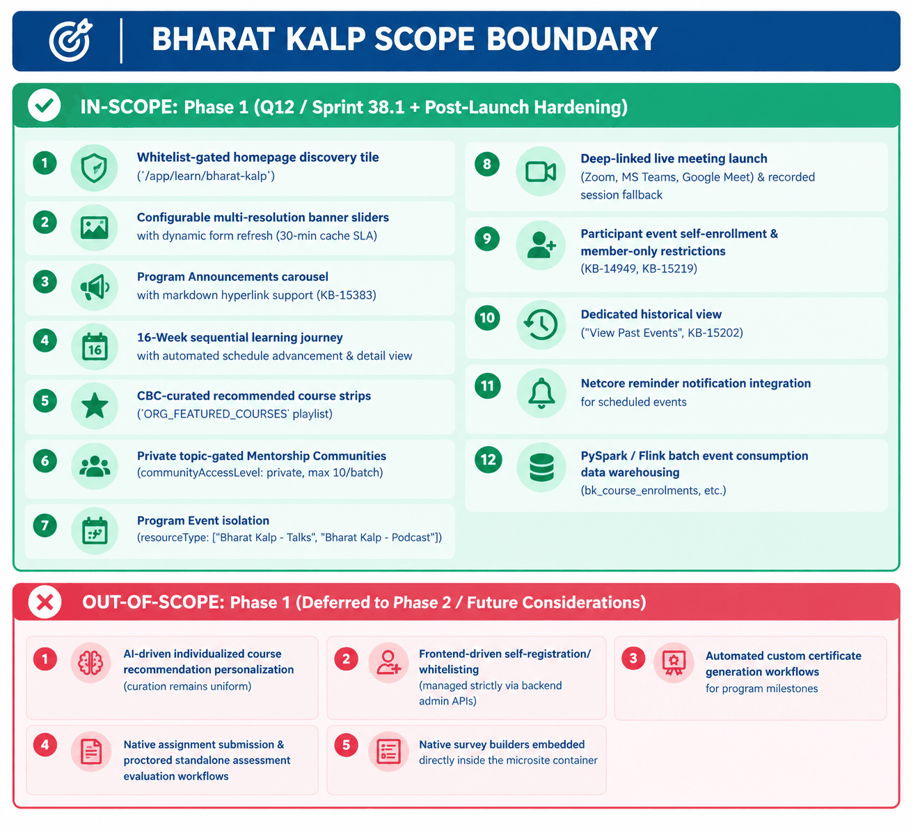

## 4. References and Terminology

### 4.1 Analyzed Sources

| Source ID | Reference Type | Identifier / Title | URL | Contribution to HLD |
|---|---|---|---|---|
| **REF-01** | Jira Epic | `KB-14381` | [KB-14381: Q12 \| Bharat KALP](https://karmayogibharat.atlassian.net/browse/KB-14381)[Prod Deployed](https://karmayogibharat.atlassian.net/browse/KB-14381) | Baseline program epic; solution architecture definition, Figma links. |
| **REF-02** | Jira Story | `KB-14382` | [KB-14382: Q12 \| Bharat KALP \| Microsite \| Web and Mobile](https://karmayogibharat.atlassian.net/browse/KB-14382)[Open](https://karmayogibharat.atlassian.net/browse/KB-14382) | Functional specification for 9 user stories and 37 sub-tasks. |
| **REF-03** | Jira Improvement | `KB-14949` | [KB-14949: Restrict the event](https://karmayogibharat.atlassian.net/browse/KB-14949)[enrolments to Bharat Kalp Member if the event is Specific for Bharat Kalp Member](https://karmayogibharat.atlassian.net/browse/KB-14949)[Prod Deployed](https://karmayogibharat.atlassian.net/browse/KB-14949) | Event enrollment restriction logic for verified members. |
| **REF-04** | Jira Improvement | `KB-15202` | [KB-15202: Add "View Past Events" option for Events in Bharat KALP](https://karmayogibharat.atlassian.net/browse/KB-15202)[Prod Deployed](https://karmayogibharat.atlassian.net/browse/KB-15202) | Historical event retrieval architecture ("View Past Events"). |
| **REF-05** | Jira Improvement | `KB-15219` | [KB-15219: For Bharat KALP events, Bharat KALP users should be able to enroll from web application](https://karmayogibharat.atlassian.net/browse/KB-15219)[QA In Progress](https://karmayogibharat.atlassian.net/browse/KB-15219) | Web self-enrollment integration flow for live events. |
| **REF-06** | Jira Task | `KB-15220` | [KB-15220: For Bharat KALP Talks, replace the live meeting with a recorded session](https://karmayogibharat.atlassian.net/browse/KB-15220)[To Do](https://karmayogibharat.atlassian.net/browse/KB-15220) | Asynchronous playback fallback replacing live meeting links. |
| **REF-07** | Jira Improvement | `KB-15383` | [KB-15383: Add hyperlink support in the announcement section for Bharat KALP](https://karmayogibharat.atlassian.net/browse/KB-15383)[Prod Deployed](https://karmayogibharat.atlassian.net/browse/KB-15383) | Anchor / hyperlink parsing engine within announcement carousel. |
| **REF-08** | Confluence BRD | `Q12 BRD — Bharat KALP` | [Q12 \| BRD \| Bharat KALP](https://karmayogibharat.atlassian.net/wiki/spaces/TPT/pages/1082327132/Q12+BRD+Bharat+KALP) | Business objectives, scope, user groups, and BR-01..BR-10. |
| **REF-09** | Confluence FRS | `Q12 FRS — Bharat KALP` | [Q12 \| FRS \| Bharat KALP](https://karmayogibharat.atlassian.net/wiki/spaces/TPT/pages/1091043353/Q12+FRS+Bharat+KALP) | Functional requirements BK-FR-001..009, acceptance criteria. |
| **REF-10** | Confluence SRS | `SRS_BharatKalp_v1.0_r2026_Q1` | [SRS_BharatKalp_v1.0_r2026_Q1](https://karmayogibharat.atlassian.net/wiki/spaces/TPT/pages/1172471809/SRS_BharatKalp_v1.0_r2026_Q1) | Platform NFRs, system interfaces, runtime environments. |
| **REF-11** | Confluence API | `Phase 1 API Contract` | [Phase 1: Bharat Kalp Microsite – API Contract](https://karmayogibharat.atlassian.net/wiki/spaces/TES/pages/1081704467/Phase+1+Bharat+Kalp+Microsite+API+Contract) | cURL contracts for Admin Community & Learner endpoints. |
| **REF-12** | Confluence Tech Spec | `Sprint 38.1 — Bharat KALP` | [Sprint 38.1 - Bharat KALP](https://karmayogibharat.atlassian.net/wiki/spaces/TES/pages/1096876042/Sprint+38.1+-+Bharat+KALP) | Form configuration schemas, DDLs, image tags, Flink jobs. |

### 4.2 Abbreviations and Terminology

- **BK**: Bharat KALP (*Knowledge, Action & Leadership Program*)
- **CBC**: Capacity Building Commission
- **CBP**: Capacity Building Plan
- **DWH**: Data Warehouse (PostgreSQL-based analytics storage)
- **Flink**: Apache Flink distributed stream processing framework
- **MVM**: Minimum Viable Microsite
- **Netcore**: Cloud-based communication gateway for SMS, email, and push notifications
- **RBAC**: Role-Based Access Control
- **Sunbird**: Open-source digital infrastructure foundational to iGOT Karmayogi
- **WID**: Worker ID / Karmayogi unique user GUID identifier

## 5. Business Context and Architectural Drivers

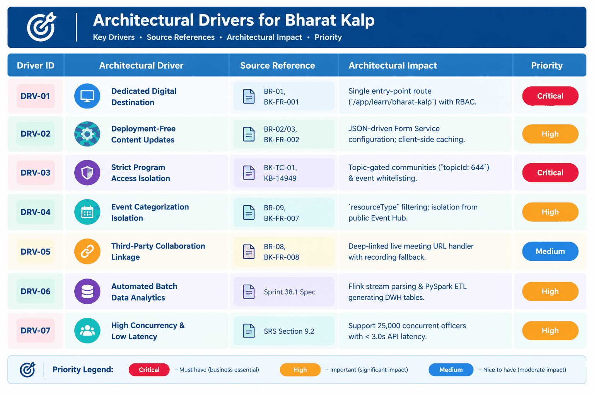

## 6. System Context and Boundaries

Bharat KALP functions as a secure capability within the Karmayogi ecosystem. It interacts with core Sunbird microservices, client runtimes, and external notification and collaboration services.

### System Context Diagram

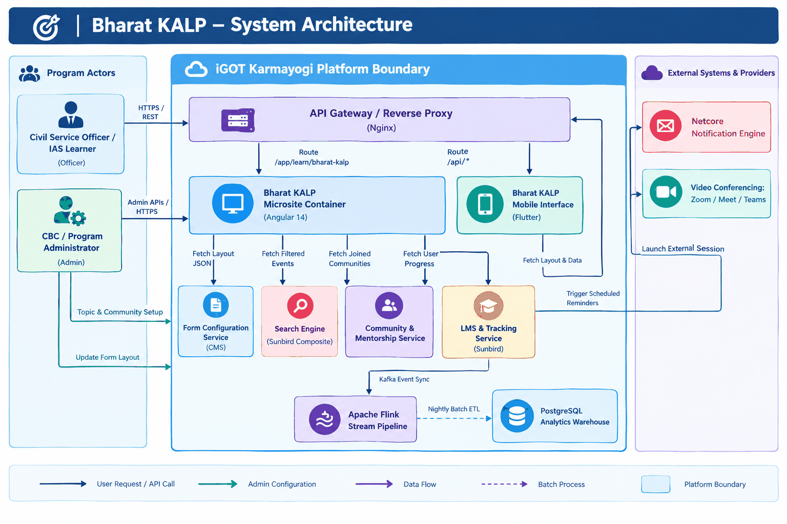

## 7. High-Level Architecture Overview

The Bharat KALP architecture uses a layered, microservices-backed model. The solution emphasizes **stateless frontend presentation** driven by **declarative backend configuration**.

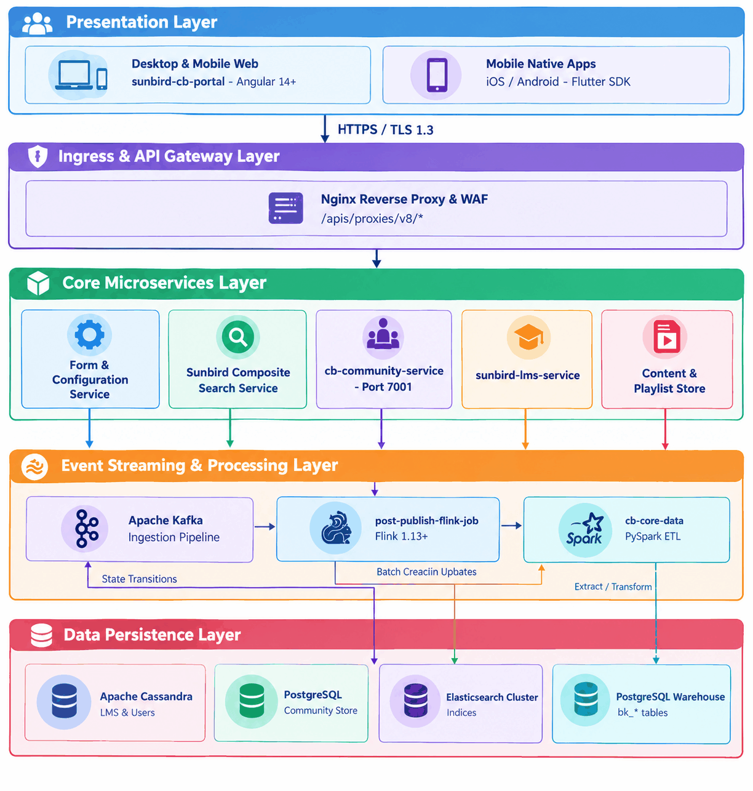

## 8. Major Components and Responsibilities

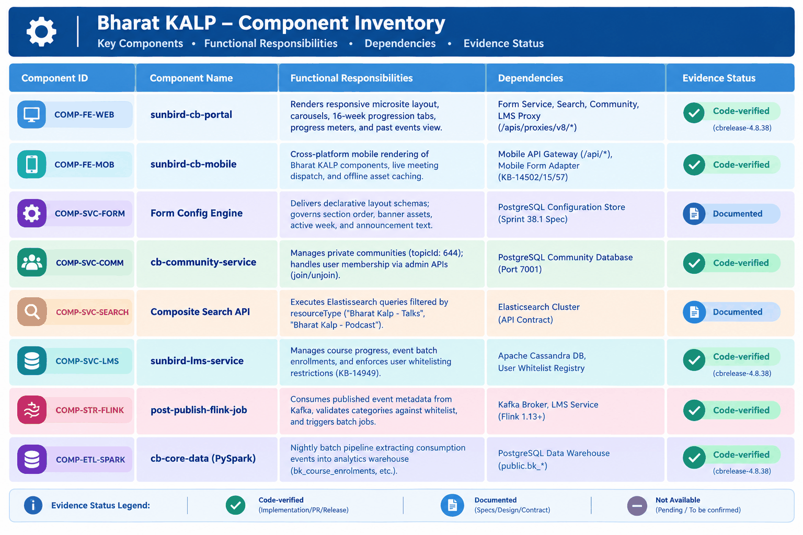

## 9. Logical Component Architecture

The diagram below details the internal structure and integration boundaries of the Bharat KALP micro-application within the frontend and backend service runtimes.

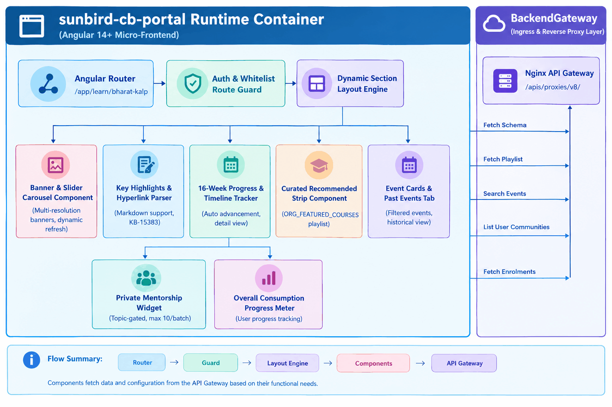

## 10. End-to-End Business and Technical Workflows

### 10.1 Workflow 1: Officer Dashboard Initialization & Journey Navigation

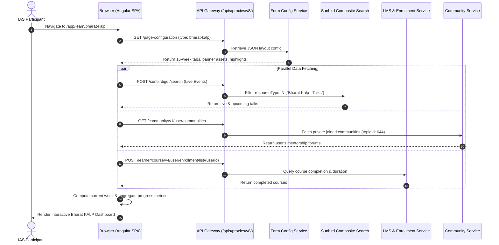

### 10.2 Workflow 2: Event Enrollment & Access Restriction Flow (Resolving KB-14949 & KB-15219)

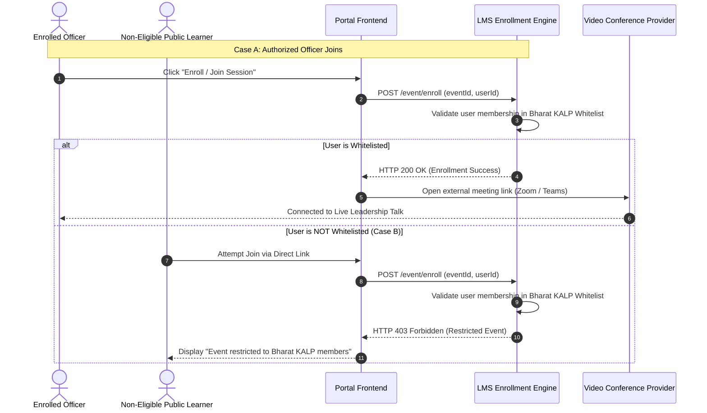

## 11. API and Integration Architecture

The Bharat KALP architecture defines both administrative management APIs and learner consumption endpoints.

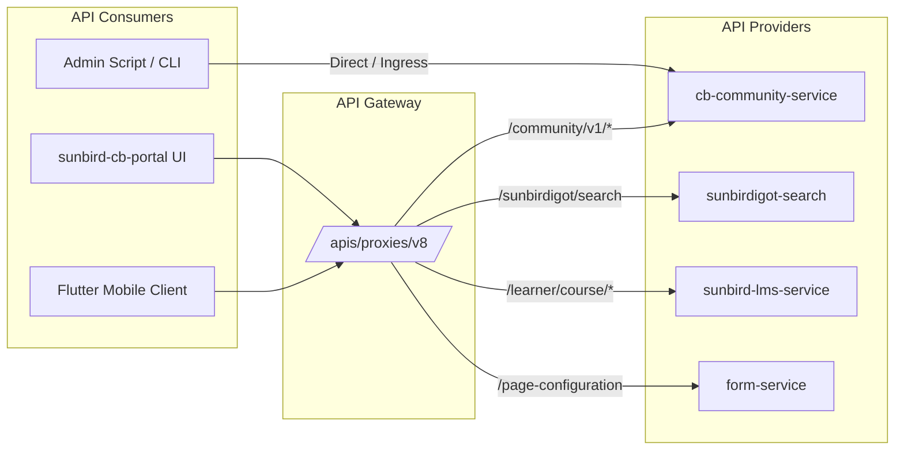

### API Interface Catalog

| API ID | Endpoint URI | Method | Consumer | Provider Microservice | AuthN / AuthZ | Evidence Status |
|---|---|---|---|---|---|---|
| **API-01** | /apis/proxies/v8/community/v1/category/create | POST | Admin Management | cb-community-service | Session Cookie (SA) | Documented (Contr) |
| **API-02** | http://localhost:7001/community/v1/create | POST | Admin Management | cb-community-service | Internal / Cookie | Documented (Contr) |
| **API-03** | /apis/proxies/v8/community/v1/admin/join | PUT | Admin Management | cb-community-service | Session Cookie (SA) | Documented (Contr) |
| **API-04** | /apis/proxies/v8/community/v1/admin/unjoin | PUT | Admin Management | cb-community-service | Session Cookie (SA) | Documented (Contr) |
| **API-05** | /apis/proxies/v8/community/v1/user/communities | GET | sunbird-cb-portal | cb-community-service | User Session (wid) | Documented (Contr) |
| **API-06** | /apis/proxies/v8/sunbirdigot/search | POST | sunbird-cb-portal | sunbirdigot-search | User Session (wid) | Documented (Contr) |
| **API-07** | /apis/proxies/v8/learner/course/v4/user/... | POST | sunbird-cb-portal | sunbird-lms-service | User Session (wid) | Documented (Contr) |
| **API-08** | /apis/proxies/v8/playList/read/... | POST | sunbird-cb-portal | Content Store Service | User Session (wid) | Documented (Contr) |

## 12. Data Architecture

### 12.1 High-Level Data Flow Diagram

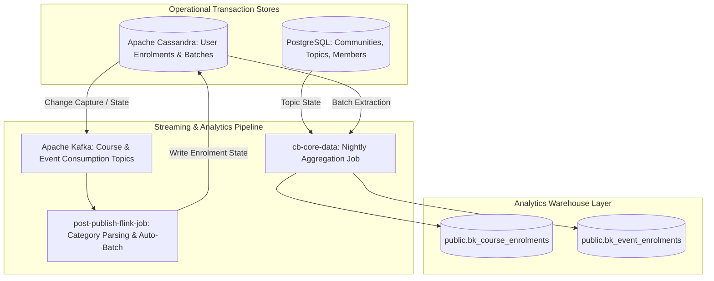

### 12.2 Data Warehouse Persistence Schemas (PostgreSQL DDL)

Verified from Sprint 38.1 specifications, these tables support consumption tracking and reporting for CBC stakeholders:

```sql
-- Course consumption tracking for Bharat KALP participants
CREATE TABLE public.bk_course_enrolments (
    user_id text NULL,
    batch_id text NULL,
    content_id text NULL,
    enrolled_on text NULL,
    content_progress_percentage float4 NULL,
    resource_count_consumed int4 NULL,
    user_consumption_status text NULL,
    first_completed_on text NULL,
    first_certificate_generated_on text NULL,
    last_completed_on text NULL,
    last_certificate_generated_on text NULL,
    content_last_accessed_on text NULL,
    certificate_generated text NULL,
    number_of_certificate int4 NULL,
    user_rating float4 NULL,
    certificate_id text NULL,
    live_cbp_plan_mandate bool NULL,
    data_last_generated_on text NULL,
    karma_points float8 NULL,
    badge_id text NULL
);

-- Event participation tracking for Bharat KALP talks and webinars
CREATE TABLE public.bk_event_enrolments (
    user_id text NULL,
    event_id text NULL,
    status text NULL,
    enrolled_on_datetime text NULL,
    completed_on_datetime text NULL,
    certificate_id text NULL,
    completion_percentage float4 NULL,
    event_duration text NULL,
    progress_duration text NULL,
    duration int4 NULL,
    event_duration_seconds float8 NULL,
    karma_points int8 NULL
);
```

## 13. Security Architecture

### 13.1 Security Architecture Diagram

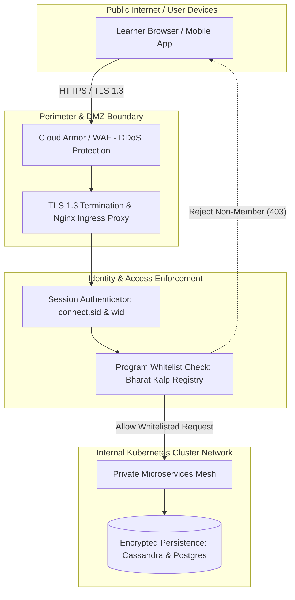

### 13.2 Security Controls Matrix

| Security Control | Architectural Implementation | Level of Defense | Evidence Status |
|---|---|---|---|
| **Perimeter** | TLS 1.3, strict CORS, CSP headers, Nginx reverse proxy. | Ingress Gateway | Documented (SRS) |
| **Authentication** | Session cookie (connect.sid) + user GUID header (wid). | Reverse Proxy | Documented (Contr |
| **Authorization** | RBAC gating: non-members cannot see tile or join events. | Gateway / Service | Verified (14949) |
| **Topic Privacy** | communityAccessLevel: "private"; excluded from public hub. | Application Service | Documented (Contr |
| **Batch Cap** | Maximum 10 user IDs per admin join request to limit exposure. | API Controller | Documented (Contr |
| **Data Encryption** | Database encryption-at-rest (Postgres/Cassandra) + audit logs. | Persistence Layer | Documented (SRS) |

## 14. Non-Functional Architecture

| Quality Attribute | Documented Specification & Threshold | Supporting Evidence |
|---|---|---|
| **Performance** | Average page response time < 3.0 to 5.0 seconds under peak load. | SRS Section 9.2 |
| **Scalability** | Accommodate 25,000 concurrent active users in production. | SRS Section 9.2, 9.5 |
| **Availability** | RTO <= 8 hours for business-critical LMS; 48 hours for secondary systems. | SRS Section 9.4 |
| **Cache SLA** | Form configuration updates must propagate to clients within 30 minutes. | FRS Section 6.2, 6.3 |
| **Client Portability** | Modern web (Chrome 118+, Firefox 122+); Mobile (Android 10+, iOS 15+ via Flutter). | SRS Section 9.6 |
| **Observability** | Structured error logging in Nginx and services; consumption telemetry via Flink. | Sprint 38.1 Deploy Guide |

## 15. Deployment and Infrastructure Architecture

### 15.1 Production Deployment Topology Diagram

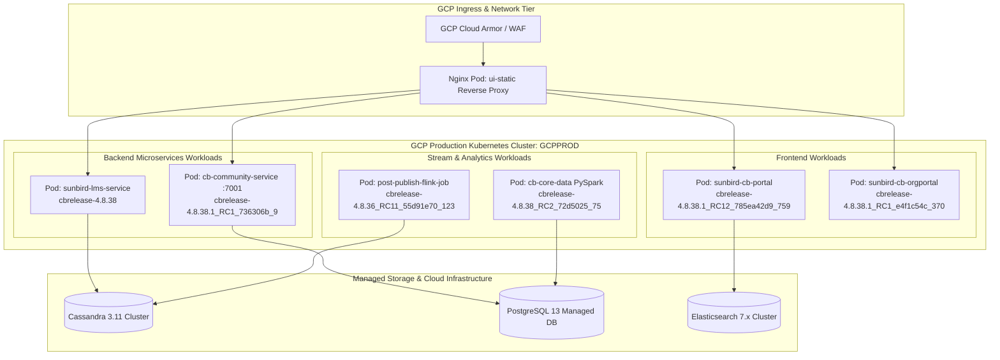

### 15.2 Verified Deployment Units (Sprint 38.1 Evidence)

| Git Repository | Jenkins Job | Branch Name | Deployed Docker Image Tag | Environment | Evidence Status |
|---|---|---|---|---|---|
| sunbird-cb-portal | ui-static | cbrelease-4.8.38.1 | cbrelease-4.8.38.1_RC12_785ea42d9_759 | GCP UAT / Prod | Verified (Spec) |
| sunbird-cb-orgportal | MDO-portal | cbrelease-4.8.38.1 | cbrelease-4.8.38.1_RC1_e4f1c54c_370 | GCP UAT / Prod | Verified (Spec) |
| cb-community-service | cb-community | cbrelease-4.8.38.1 | cbrelease-4.8.38.1_RC1_736306b_9 | GCP UAT / Prod | Verified (Spec) |
| post-publish-flink-job | FlinkJobs | cbrelease-4.8.36 | cbrelease-4.8.36_RC11_55d91e70_123 | GCP UAT / Prod | Verified (Spec) |
| cb-core-data | pyspark-data | cbrelease-4.8.38 | cbrelease-4.8.38_RC2_72d5025_75 | GCP UAT / Prod | Verified (Spec) |
| sunbird-lms-service | Service Restart | cbrelease-4.8.38 | Restarted container pod | GCP UAT / Prod | Verified (Spec) |

## 16. Architecture Decisions and Trade-Offs (ADR)

| ADR ID | Architectural Decision | Rationale & Benefits | Evaluated Alternatives | Decision Status |
|---|---|---|---|---|
| **ADR-01** | Reuse existing Sunbird services using metadata isolation. | Minimizes platform surface area, delivery risk, and avoids redundant database maintenance. | Build standalone isolated backend microservices for Bharat KALP. | **Approved** (Sprint 38.1) |
| **ADR-02** | JSON Form Service-driven UI layouts and weekly course progression. | Empowers administrators to refresh banner assets, active weeks, and announcements without CI/CD redeployments. | Hardcode banners and week layouts inside Angular templates. | **Approved** (Sprint 38.1) |
| **ADR-03** | Topic-based community segregation (communityAccessLevel: private). | Allows re-using the existing Discussion Forum engine while hiding private forums from public forum views. | Build separate custom chat and mentorship backend. | **Approved** (API Contract) |
| **ADR-04** | Backend whitelist validation for event enrollment (KB-14949). | Prevents security leak where non-whitelisted public learners joined exclusive leadership sessions. | Rely on UI-level CTA visibility gating alone. | **Approved** (Prod Deployed) |
| **ADR-05** | Cap admin batch join at 10 users per request. | Limits request payload size and reduces transaction latency on the community database. | Unbounded asynchronous bulk CSV processing. | **Approved** (API Contract) |

## 17. Dependencies and Constraints

### 17.1 Technical Constraints (`BK-TC-*`)

- **BK-TC-01:** Community segregation must use the existing topic-based implementation (`topicId: 644`).
- **BK-TC-02:** Event segregation must use existing category filtering (`resourceType: ["Bharat Kalp - Talks", "Bharat Kalp - Podcast"]`).
- **BK-TC-03:** Generic platform categories cannot be isolated exclusively for Bharat KALP.
- **BK-TC-04:** Rejoining private communities requires backend administrative intervention; self-service rejoin is intentionally prohibited.
- **BK-TC-05:** Existing platform Event Hub behavior must remain unchanged.
- **BK-TC-06:** Netcore integration must be used for reminder notifications.
- **BK-TC-07:** No new database entity engines or custom persistence clusters can be introduced in Phase 1.

## 18. Architecture Risks and Mitigations

| Risk ID | Risk Description | Severity & Likelihood | Architectural Mitigation Strategy | Risk Owner |
|---|---|---|---|---|
| **RSK-01** | Unbounded batch join overhead for large cohorts (> 5,000 officers). | Medium / High | Current API limits requests to 10 users per call. A bulk asynchronous CSV upload endpoint is recommended in Ph. 2. | Backend Lead / Operations |
| **RSK-02** | Event URL leakage to unauthorized non-whitelisted participants. | High / Medium | Gated enrollment implemented via backend whitelist check (KB-14949); live session CTAs render only post-authz. | Security / Backend (Resolved in PR #3) |
| **RSK-03** | Stale Form Service cache on client devices during schedule shifts. | Medium / Low | Client implements maximum 30-minute cache TTL and honors HTTP Cache-Control: max-age=1800 headers. | Frontend Lead / DevSecOps |
| **RSK-04** | Missing recorded session link after a live meeting concludes. | Medium / Medium | Deliver KB-15220 to automate switching from live meeting URLs to video playback URIs once event status = Ended. | Product / Frontend Engineering |

## 19. Architecture Gap Analysis

| Gap ID | Category | Gap Description & Supporting Evidence | Architectural Impact | Priority | Recommended Resolution |
|---|---|---|---|---|---|
| **GAP-01** | Documentation Defect | Existing SRS (Page 1172471809) contains text from Content Health Score (CHS) in Sections 3.1 & 3.2. | Severe confusion for engineering teams. | Critical | Correct Page 1172471809 with the approved SRS baseline in Deliverable |
| **GAP-02** | Operational Scalability | Admin Join API (/admin/join) capped at 10 users/req. (Phase 1 API Contract). | High administrative scripting overhead. | Medium | Implement an async bulk CSV queue processor in Phase 2. |
| **GAP-03** | Workflow Automation | KB-15220 (switch live meeting to recording) is in To Do status. | Manual intervention required post-event. | Medium | Prioritize KB-15220 into upcoming sprint to automate fallback. |

## 20. Requirement-to-Architecture Traceability

| Req ID | Jira Key | Business Capability | HLD Component | API / Interface Contract | Architecture Evid. | Status |
|---|---|---|---|---|---|---|
| **FR-01** | KB-14381 | Whitelist-Gated Homepage Entry Tile | sunbird-cb-portal | Form Config /page-configuration | Code-verified | Prod Deployed |
| **FR-02** | KB-14412 | Configurable Top Banner Carousel | sunbird-cb-portal | Form Config sectionTopBanner | Code-verified | Prod Deployed |
| **FR-03** | KB-15383 | Announcements with Hyperlink Support | sunbird-cb-portal | Form Config sectionKeyHighlights | Code-verified | Prod Deployed |
| **FR-04** | KB-14416 | 16-Week Structured Progression | sunbird-cb-portal | Form Config weekProgress | Code-verified | Prod Deployed |
| **FR-05** | KB-14476 | Curated Course Recommendations Strip | sunbird-cb-portal | GET /apis/proxies/v8/playList/ | Code-verified | Prod Deployed |
| **FR-06** | KB-14484 | Private Topic Mentorship Community | cb-community-service | PUT /community/v1/admin/join | Code-verified | Prod Deployed |
| **FR-07** | KB-14949 | Whitelist-Restricted Program Events | post-publish-flink | POST /apis/proxies/v8/search | Code-verified | Prod Deployed |
| **FR-08** | KB-15220 | Live Meeting Deep Link & Recording | sunbird-cb-portal | Composite Search URI / Player | Inferred / Open | To Do (Design) |
| **FR-09** | KB-14382 | Netcore Event Reminder Notifications | sunbird-lms-service | Netcore Integration Webhook | Documented (BRD/FRS) | Operational |
| **FR-10** | KB-15202 | Historical Past Events Exploration | sunbird-cb-portal | Composite Search API (Completed) | Code-verified | Prod Deployed |

The High-Level Design for **Bharat KALP** confirms an efficient, scalable, and secure architecture tailored for senior civil service officers. By leveraging **dynamic Form Service configurations** and **topic/category-based logical multi-tenancy**, the solution achieves program segregation while maximizing platform component reuse across the Sunbird and Karmayogi service mesh.

All core Phase 1 requirements—including homepage discovery, multi-device banner carousels, 16-week progression tracking, private mentorship forums, and restricted program events—are implemented across production Kubernetes image tags (`cbrelease-4.8.38.1`). Critical security mitigations (`KB-14949`) are verified in production to ensure exclusive participant access.

## 23. Appendix

### 23.1 Diagram Index

1. **System Context Diagram (C4 Level 1)** — Section 6
2. **High-Level Architecture Diagram (Layered)** — Section 7
3. **Logical Component Architecture Diagram** — Section 9
4. **End-to-End Sequence Diagram (Microsite Initialization)** — Section 10.1
5. **End-to-End Sequence Diagram (Event Whitelisting)** — Section 10.2
6. **API Integration Diagram** — Section 11
7. **High-Level Data Flow Diagram** — Section 12.1
8. **Security Architecture Diagram** — Section 13.1
9. **Deployment & Infrastructure Architecture Diagram** — Section 15.1

### 23.2 Review Gate Summary

- **Analyzed Sources:** 100% of requested Jira issues (`KB-14381`, `KB-14949`, `KB-15202`, `KB-15219`, `KB-15220`, `KB-15383`) and Confluence specifications (BRD, FRS, SRS, API Contract, Sprint 38.1 Spec).
- **Documentation Quality Gate:** Identified and isolated the Content Health Score copy-paste defect in SRS `1172471809` (cataloged as `GAP-01`).
- **Approval Status:** Marked as **Draft for Review** pending sign-off from Product and Architecture stakeholders.
