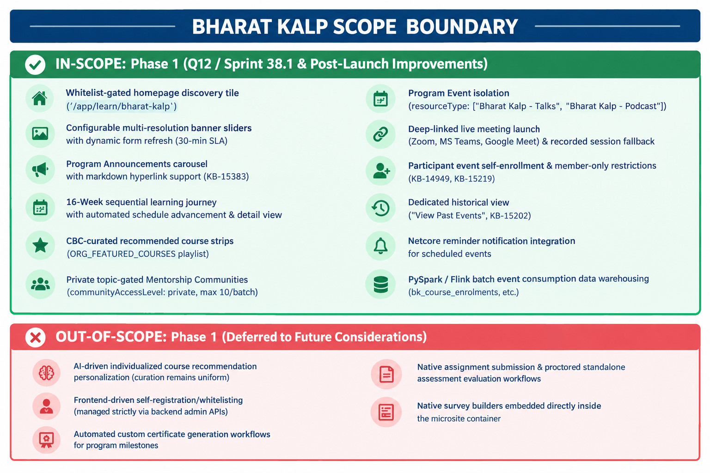

### 1.1 Executive Summary

**Bharat KALP** (*Knowledge, Action & Leadership Program*) is a flagship leadership and capability-building initiative on the iGOT Karmayogi digital infrastructure designed specifically for civil service officers (specifically IAS officers) across India.

The primary business objective is to provide a dedicated, unified, and restricted digital destination—the **Bharat KALP Microsite**—within the Karmayogi platform. This microsite centralizes:

- A structured, sequential 16-week learning curriculum curated by the Capacity Building Commission (CBC) and senior administrative mentors.
- Curated recommended courses fetched dynamically from organization-specific playlists.
- Dynamic, configurable program announcements and carousel banners managed via backend JSON form configurations without requiring frontend code deployments.
- Segregated, topic-based private collaboration and mentorship communities accessible exclusively to enrolled officers.
- Dedicated program event categories (*Bharat Kalp - Talks*, *Bharat Kalp - Podcast*, webinars) isolated from the public platform Event Hub, supporting external live meeting links (Zoom, Google Meet, Microsoft Teams) and automated reminder notifications via Netcore.

The Bharat KALP Microsite will provide a dedicated, curated, and program-specific digital experience for Bharat KALP participants within the Karmayogi platform by leveraging existing platform capabilities with minimal customization. The solution will introduce a dedicated microsite accessible from the homepage, featuring configurable banners and announcements, a structured week-on-week learning journey, CBC-curated recommended courses, Bharat KALP-specific communities using topic-based segregation, and program-specific events using dedicated event categories. The microsite will also support external virtual meeting integrations (Google Meet, Zoom, Microsoft Teams) and automated event reminder notifications through Netcore. The implementation will follow a configuration-first and category/topic-based segregation approach to ensure logical isolation of Bharat KALP experiences while maximizing reuse of existing platform capabilities and minimizing platform-level changes.

Phase 1 focuses on launching a Minimum Viable Microsite (MVM) by reusing existing platform capabilities (Sunbird LMS, Community Service, Content Service, Form Service, Apache Flink event processing) and applying category-level and topic-based isolation rather than creating disconnected custom monoliths.

### 1.2 Business and Product Scope

### 1.3 Feature Inventory

| Feature Key | Feature Name | Business Objective | Functional Scope | Primary Dependencies | Production Evidence Status |
|---|---|---|---|---|---|
| **KB-14381** | Q12 \| Bharat KALP (Epic) | Dedicated digital hub for civil services leadership program. | Program microsite container, week progress, recommended courses, banners, events, communities. | `KB-14372`, `sunbird-cb-portal`, `cb-community-service`, `FlinkJobs` | **Prod Deployed** (Sprint 38.1) |
| **KB-14382** | Q12 \| Bharat KALP \| Microsite \| Web & Mobile (Story) | Functional delivery of Web and Flutter Mobile experiences. | Implements 9 core User Stories (US-1 to US-9) across 37 engineering sub-tasks. | `sunbird-cb-portal`, `sunbird-cb-orgportal`, `cb-community-service` | **Prod Deployed** (Sprint 38.1) |
| **KB-14949** | Restrict event enrolments to Bharat Kalp Members | Prevent public learners from joining exclusive leadership talks. | API validation rejecting non-whitelisted participants from joining BK-categorized events. | `sunbird-lms-service`, `post-publish-flink-job` | **Prod Deployed** (3 PRs merged) |
| **KB-15202** | Add "View Past Events" option in Bharat KALP | Enable learners to browse concluded talks and session materials. | UI tab and query filter retrieving completed events sorted by date descending. | `sunbird-cb-portal`, Composite Search API | **Prod Deployed** (2 PRs merged) |
| **KB-15219** | Self-enrollment for Bharat KALP events via Web App | Enable authorized officers to self-enroll into live talks from the UI. | Frontend "Enroll" CTA and enrollment API wiring for whitelisted officers. | `sunbird-cb-portal`, `sunbird-lms-service` | **QA In Progress** (Sub-task `KB-15407` Done) |
| **KB-15220** | Replace live meeting with recorded session for Talks | Provide asynchronous access to completed leadership talks. | Content player fallback to recorded video stream post-event conclusion. | Event Metadata Service, Content Player | **To Do** (Design ready) |
| **KB-15383** | Add hyperlink support in announcement section | Enable navigation to external circulars/guidelines from notices. | HTML anchor / markdown link rendering within the announcements carousel text. | `sunbird-cb-portal` UI static renderer | **Prod Deployed** (PR merged) |
