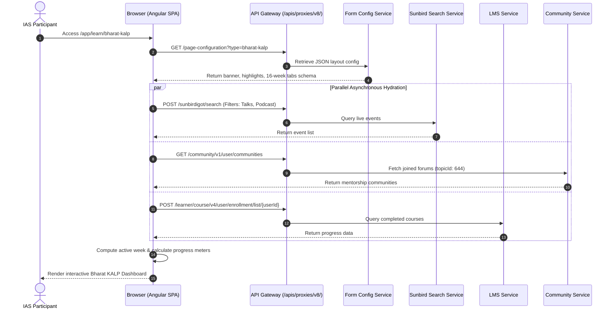
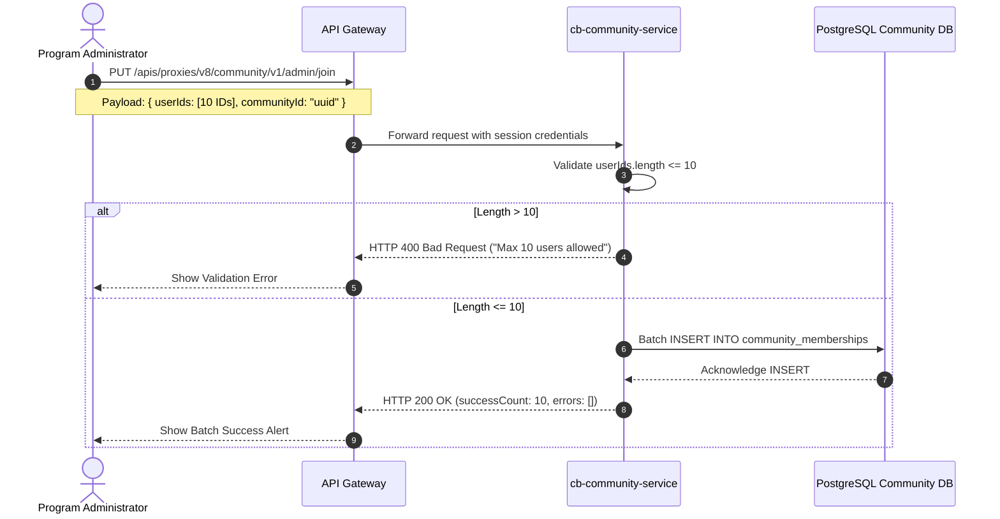

# Bharat KALP — Low-Level Design (LLD)

## 1. Detailed Component Inventory

| Component Identifier | Repository & Package Path | Responsibilities & Execution Scope | Technical Dependencies |
|---|---|---|---|
| **BK-FE-ROUTER** | sunbird-cb-portal src/app/routes/learn-routing | Route registration (/app/learn/bharat-kalp), route guard authentication, eligibility whitelisting evaluation, and sub-path navigation. | Angular Router, UserPreferenceService |
| **BK-FE-CONTAINER** | sunbird-cb-portal project/ws/app/src/lib/routes | Layout container executing multi-section rendering, form config subscription, skeleton loader states, and responsive breakpoint coordination (xs..xxl). | WsWidgetResolverModule, ConfigurationsService |
| **BK-FE-WEEK-MGR** | sunbird-cb-portal .../components/week-progress | Computes 16-week calendar progression, active week selection, tab toggles, completion percentage calculation, and deep-linking to detailed listing. | DatePipe, SearchService Subtasks KB-14416/17/70/71 |
| **BK-FE-HIGHLIGHTS** | sunbird-cb-portal .../components/key-highlights | Announcement carousel renderer with markdown hyperlink parsing and sanitization (KB-15383). | DomSanitizer, MatCarouselModule |
| **BK-MOB-CONTAINER** | sunbird-cb-mobile lib/features/bharat_kalp/ | Flutter container widget rendering mobile-first layout (mobileKeys order: weekProgress, myprogress, events, contentStrips, mentorship). | Flutter SDK (Dart), Subtasks KB-14502/15/57 |
| **BK-API-COMMUNITY** | cb-community-service src/controllers/community.js | Express/Node.js REST controller enforcing communityAccessLevel: "private", managing topicId: 644, and executing batch user join/unjoin operations. | PostgreSQL DB, Image RC1_736306b_9 |
| **BK-API-PROXY** | sunbird-cb-portal src/proxy/proxies-v8.route.js | Reverse proxy gateway terminating /apis/proxies/v8/*, injecting session headers (wid, rootOrg, org), and validating user cookie state. | Node.js Proxy Middleware, connect.sid Session Store |
| **BK-SVC-LMS** | sunbird-lms-service Java / Akka HTTP Core | Enforces enrollment whitelisting (KB-14949), provides user course progress, and manages event batch mappings. | Apache Cassandra, Image cbrelease-4.8.38 |
| **BK-STREAM-FLINK** | post-publish-flink-job KnowledgePlatform/FlinkJobs | Flink streaming job consuming Kafka events and enforcing batch creation for "Bharat Kalp - Talks" and "Bharat Kalp - Podcast". | Apache Kafka, Image RC11_55d91e70_123 |
| **BK-ETL-SPARK** | cb-core-data pyspark-data/jobs/kalp.py | PySpark batch pipeline executing nightly ETL into PostgreSQL reporting tables (public.bk_course_enrolments, public.bk_event_enrolments). | PostgreSQL Warehouse, Image RC2_72d5025_75 |

## 3. Frontend Architecture and UI Component Design

### 3.1 Routing and Navigation Guard

- **Web Route:** `/app/learn/bharat-kalp`
- **Route Definition:**
  ```ts
  {
    path: 'bharat-kalp',
    component: BharatKalpContainerComponent,
    canActivate: [AuthGuard, BharatKalpAccessGuard],
    data: { pageType: 'microsite', pageKey: 'bharat-kalp' }
  }
  ```
- **Guard Logic** (`BharatKalpAccessGuard`):
  - Inspect user session payload from `ConfigurationsService.userProfile`.
  - Verify if the officer has the `BHARAT_KALP_MEMBER` role or belongs to the whitelisted organizational root `<ROOT_ORG_ID>`.
  - If unauthorized, redirect to `/app/home` with an alert notification: *"Access restricted to authorized Bharat KALP participants"*.

### 3.2 Responsive Layout Engine & Breakpoints

The presentation layer is governed by the Form Service JSON schema, adapting dynamically across desktop and mobile devices:

**Desktop Layout Structure (Colspan 12 Grid)**

| Section | Content |
|---|---|
| [Section 1] `sectionTopBanner` (Colspan 12) | Multi-resolution Carousel (xs..xxl) |
| [Section 2] `sectionKeyHighlights` (Colspan 12) | Announcements Carousel with Hyperlinks |
| [Section 3: Left Column] (Colspan 8) | `weekProgress`: 16-Week Tracker & Active Week Card<br>`contentStrips`: Recommended Courses (Playlist API)<br>`mentorship`: Private Communities (topicId: 644) |
| [Section 3: Right Column] (4) | `myprogress`: Learning Progress<br>`events`: Filtered Talks & Podcasts (with "View Past Events") |

**Mobile Layout Structure (Sequential Stack via `mobileKeys`):** 1. `weekProgress` → 2. `myprogress` → 3. `events` → 4. `contentStrips` → 5. `mentorship`

## 4. Backend Design and API Controller Specifications

### 4.1 Admin Controller: Community & Category Management (`cb-community-service`)

#### API-BK-01: Admin Create Category (Topic)

- **Endpoint:** `POST /apis/proxies/v8/community/v1/category/create`
- **Controller Handler:** `CategoryController.createCategory(req, res)`
- **Authentication:** Session Cookie (`connect.sid`); caller must have `COMMUNITY_ADMIN` role.
- **Request Schema:**
  ```json
  {
    "categoryName": "Bharat Kalp",
    "description": "Bharat Kalp Leadership Program Topic"
  }
  ```
- **Response Schema (200 OK):**
  ```json
  {
    "id": "api.community.category.create",
    "ver": "1.0",
    "ts": "2026-06-23T12:58:59.000Z",
    "params": {
      "resmsgid": "uuid",
      "status": "successful"
    },
    "result": {
      "topicId": 644,
      "categoryName": "Bharat Kalp",
      "status": "CREATED"
    }
  }
  ```

#### API-BK-02: Admin Create Private Community

- **Endpoint:** `POST http://localhost:7001/community/v1/create`
- **Controller Handler:** `CommunityController.createCommunity(req, res)`
- **Preconditions:** Category `topicId: 644` must exist.
- **Request Schema:**
  ```json
  {
    "communityName": "Bharat Kalp Leadership Cohort 1",
    "description": "Exclusive mentorship forum for IAS Officers",
    "topicName": "Bharat Kalp",
    "topicId": 644,
    "communityAccessLevel": "private",
    "countOfPeopleJoined": 0,
    "countOfPeopleLiked": 0,
    "communityGuideLines": "<p>Confidential discussion forum for Bharat KALP participants.</p>",
    "competencies_v6": [
      {
        "competencyAreaIdentifier": "kcmfinal_fw_competencyarea_5ed3587a-2a9b-4e3c-8852-8ffcff5c70b2",
        "competencyAreaName": "Behavioural",
        "competencyThemeIdentifier": "kcmfinal_fw_theme_00611299-a3a7-4079-bec6-f7aba0b89588",
        "competencyThemeName": "Communication",
        "competencySubThemeIdentifier": "kcmfinal_fw_subtheme_17e3ab30-b15a-4345-9540-157d144c3d73",
        "competencySubThemeName": "Verbal & Non-Verbal Fluency"
      }
    ],
    "orgId": "01359132123730739281",
    "orgName": "Ministry of Personnel, Public Grievances and Pensions",
    "createdUserId": "ca0ff837-de7c-4cc9-9651-f9afa99318db",
    "moderators": [
      {
        "moderatorId": "c1cc5165-6a69-4b75-8a96-3afd2f9af79e",
        "moderatorName": "Senior IAS Mentor",
        "moderatorEmail": "mentor.kalp@nic.in"
      }
    ]
  }
  ```
- **Response Schema (200 OK):**
  ```json
  {
    "result": {
      "communityId": "572bb9ba-b716-4ff4-ad2d-d7340541e3f4",
      "communityAccessLevel": "private",
      "status": "DRAFT"
    }
  }
  ```

#### API-BK-03: Admin Batch Join Users to Private Community

- **Endpoint:** `PUT /apis/proxies/v8/community/v1/admin/join`
- **Controller Handler:** `CommunityMembershipController.adminJoinUsers(req, res)`
- **Validation Rules:**
  - `userIds` array length must be between 1 and 10 (`userIds.length <= 10`).
  - `communityId` must reference a valid community with `communityAccessLevel == "private"`.

- **Request Schema:**
  ```json
  {
    "userIds": [
      "ca0ff837-de7c-4cc9-9651-f9afa99318db",
      "da03c8a1-6cfd-46e6-96a9-3e25899ebc83"
    ],
    "communityId": "572bb9ba-b716-4ff4-ad2d-d7340541e3f4"
  }
  ```
- **Response Schema (200 OK - Supports Partial Success):**
  ```json
  {
    "id": "api.community.admin.join",
    "ver": "1.0",
    "result": {
      "successCount": 2,
      "failedCount": 0,
      "successfulUsers": [
        "ca0ff837-de7c-4cc9-9651-f9afa99318db",
        "da03c8a1-6cfd-46e6-96a9-3e25899ebc83"
      ],
      "errors": []
    }
  }
  ```
- **Error Response (400 Bad Request):**
  ```json
  {
    "id": "api.community.admin.join",
    "params": {
      "status": "failed",
      "errmsg": "Validation error: Cannot process more than 10 users in a single request"
    }
  }
  ```

### 4.2 Learner Controller: Event & Progress Queries

#### API-BK-04: Learner Composite Search for Bharat KALP Events

- **Endpoint:** `POST /apis/proxies/v8/sunbirdigot/search`
- **Headers:** `wid: ca0ff837-de7c-4cc9-9651-f9afa99318db`, `rootOrg: igot`, `org: dopt`, `locale: en`
- **Request Schema:**
  ```json
  {
    "locale": [
      "en"
    ],
    "query": "",
    "request": {
      "query": "",
      "filters": {
        "status": [
          "Live"
        ],
        "contentType": "Event",
        "category": "Event",
        "resourceType": [
          "Bharat Kalp - Talks",
          "Bharat Kalp - Podcast"
        ]
      },
      "facets": [
        "sourceName",
        "resourceType"
      ],
      "sort_by": {
        "startDate": "desc"
      },
      "limit": 9,
      "offset": 0
    }
  }
  ```
- **Response Schema (200 OK):**
  ```json
  {
    "id": "api.sunbirdigot.search",
    "ver": "1.0",
    "result": {
      "count": 2,
      "content": [
        {
          "identifier": "do_114389102837489201",
          "name": "Bharat KALP Leadership Talk: Governance in Action",
          "contentType": "Event",
          "resourceType": "Bharat Kalp - Talks",
          "status": "Live",
          "startDate": "2026-08-20T10:00:00.000Z",
          "endDate": "2026-08-20T11:30:00.000Z",
          "onlineProvider": "Zoom",
          "meetingLink": "https://karmayogi.zoom.us/j/98127391823",
          "posterImage": "https://<PORTAL_HOST>/content-store/events/banner.svg"
        }
      ]
    }
  }
  ```

#### API-BK-05: Learner Completed Course Progress

- **Endpoint:** `POST /apis/proxies/v8/learner/course/v4/user/enrollment/list/{userId}`
- **Request Schema:**
  ```json
  {
    "request": {
      "retiredCoursesEnabled": false,
      "status": "Completed"
    }
  }
  ```
- **Response Schema (200 OK):**
  ```json
  {
    "id": "api.user.enrollment.list",
    "result": {
      "courses": [
        {
          "courseId": "do_11457435272997273613506",
          "courseName": "Foundations of Public Governance",
          "completionPercentage": 100,
          "status": 2,
          "completedOn": "2026-07-10T14:22:10.000Z",
          "issuedCertificates": [
            {
              "identifier": "cert_9812738192"
            }
          ]
        }
      ]
    }
  }
  ```

## 5. Data Model and Persistence Architecture

### 5.1 Relational Schemas (PostgreSQL Data Warehouse DDL)

Verified from the Sprint 38.1 production deployment guide, these schemas support data extraction by `cb-core-data` (PySpark):

```sql
-- 1. Table: public.bk_course_enrolments
-- Tracks course progress, completion timestamps, and certificates for Bharat KALP participants
DROP TABLE IF EXISTS public.bk_course_enrolments;
CREATE TABLE public.bk_course_enrolments (
    user_id text NULL,
    batch_id text NULL,
    content_id text NULL,
    enrolled_on text NULL,
    content_progress_percentage float4 NULL,
    resource_count_consumed int4 NULL,
    user_consumption_status text NULL,
    first_completed_on text NULL,
    first_certificate_generated_on text NULL,
    last_completed_on text NULL,
    last_certificate_generated_on text NULL,
    content_last_accessed_on text NULL,
    certificate_generated text NULL,
    number_of_certificate int4 NULL,
    user_rating float4 NULL,
    certificate_id text NULL,
    live_cbp_plan_mandate bool NULL,
    data_last_generated_on text NULL,
    karma_points float8 NULL,
    badge_id text NULL
);
CREATE INDEX idx_bk_course_enrol_user ON public.bk_course_enrolments(user_id);
CREATE INDEX idx_bk_course_enrol_content ON public.bk_course_enrolments(content_id);

-- 2. Table: public.bk_event_enrolments
-- Tracks attendance, session durations, and participation for Bharat KALP Talks & Podcasts
DROP TABLE IF EXISTS public.bk_event_enrolments;
CREATE TABLE public.bk_event_enrolments (
    user_id text NULL,
    event_id text NULL,
    status text NULL,
    enrolled_on_datetime text NULL,
    completed_on_datetime text NULL,
    certificate_id text NULL,
    completion_percentage float4 NULL,
    event_duration text NULL,
    progress_duration text NULL,
    duration int4 NULL,
    event_duration_seconds float8 NULL,
    karma_points int8 NULL
);
CREATE INDEX idx_bk_event_enrol_user ON public.bk_event_enrolments(user_id);
CREATE INDEX idx_bk_event_enrol_event ON public.bk_event_enrolments(event_id);
```

## 6. Detailed Processing Logic

### 6.1 Logic 1: 16-Week Progression & Active Week Auto-Calculation

Executed by `BK-FE-WEEK-MGR` inside `sunbird-cb-portal`:

```ts
function calculateActiveWeek(bkConfig: { totalWeeks: number; startDate: string; endDate: string }): number {
  const parseDate = (dStr: string) => {
    // Format: "DD-MM-YYYY"
    const [day, month, year] = dStr.split('-').map(Number);
    return new Date(year, month - 1, day);
  };

  const programStart = parseDate(bkConfig.startDate);
  const now = new Date();

  // Pre-program check
  if (now < programStart) {
    return 1;
  }

  // Calculate elapsed calendar weeks
  const elapsedMs = now.getTime() - programStart.getTime();
  const elapsedDays = Math.floor(elapsedMs / (1000 * 60 * 60 * 24));
  const currentWeekIndex = Math.floor(elapsedDays / 7) + 1;

  // Upper boundary clamp
  if (currentWeekIndex > bkConfig.totalWeeks) {
    return bkConfig.totalWeeks;
  }
  return currentWeekIndex;
}
```

### 6.2 Logic 2: Member-Only Event Enrollment Validation (Resolving KB-14949)

Executed by `sunbird-lms-service` upon enrollment request:

```java
public EnrollmentResponse validateAndEnrollParticipant(String eventId, String userId) {
    EventMetadata event = eventRepository.findById(eventId);

    // Check if event belongs to isolated Bharat KALP categories
    if ("Bharat Kalp - Talks".equals(event.getResourceType()) || "Bharat Kalp - Podcast".equals(event.getResourceType())) {
        boolean isWhitelisted = whitelistRepository.isUserEnrolledInProgram(userId, "BHARAT_KALP");
        if (!isWhitelisted) {
            log.warn("Security violation: Non-Bharat Kalp user {} attempted to enroll in event {}", userId, eventId);
            throw new AccessDeniedException("FORBIDDEN: Event restricted exclusively to Bharat KALP members");
        }
    }

    // Proceed with standard LMS batch enrollment
    return lmsBatchService.enrollUser(event.getBatchId(), userId);
}
```

## 7. End-to-End Sequence Flows

### 7.1 Sequence 1: Initial Page Load & Multi-Section Data Hydration



### 7.2 Sequence 2: Admin Whitelisting of Officers to Private Community



## 8. Configuration and Environment Dependencies

### 8.1 Apache Flink Configuration (`post-publish-flink-job`)

Configured in `cbrelease-4.8.36_devops` values:

```properties
# Category whitelist for automated batch creation on publish
batchCreation.event.categories = ["Karmayogi Saptah", "Karmayogi Talks", "Rajya Karmayogi Saptah", "Webinar", "Samuhik Charcha", "Sadhana Saptah", "Samuhik Charha - NLW 2026", "Bharat Kalp - Talks", "Bharat Kalp - Podcast"]
```

### 8.2 MDO Event Creation Form Config (`sunbird-cb-orgportal`)

```json
{
  "mdoEventCategories": {
    "record": [
      "Webinar",
      "Karmayogi Talks",
      "Karmayogi Saptah",
      "Sadhana Saptah",
      "Samuhik Charcha - NLW 2026",
      "Bharat Kalp - Talks",
      "Bharat Kalp - Podcast"
    ],
    "live": [
      "Samuhik Charcha",
      "Bharat Kalp - Talks",
      "Bharat Kalp - Podcast"
    ]
  }
}
```

### 8.3 Homepage Entry Point Form Config

```json
{
  "notification": [
    {
      "enabled": true,
      "key": "bharat-kalp",
      "title": "Bharat kalp",
      "bannerUrl": "https://<PORTAL_HOST>/content-store/orgStore/<ROOT_ORG_ID>/1782804361805_bharat_kalp_card_v4%201.svg",
      "startDate": "01-06-2026",
      "endDate": "30-07-2026",
      "routerLink": "/app/learn/bharat-kalp"
    }
  ]
}
```

## 9. Test Design Considerations

| Test Category | Target Component | Verified Scenario & Assertion Criteria |
|---|---|---|
| **Unit Test** | BK-FE-WEEK-MGR | Verify active week calculates correctly across week transitions and boundaries. |
| **Unit Test** | BK-FE-HIGHLIGHTS | Verify markdown anchor tags [Text](URL) render securely without XSS injection. |
| **API Test** | API-BK-03 Admin Join | Assert HTTP 400 is returned when userIds.length > 10. |
| **Security Test** | BK-SVC-LMS | Assert HTTP 403 Forbidden when non-whitelisted user attempts to enroll (14949) |
| **Integration Test** | BK-STREAM-FLINK | Publish event with category "Bharat Kalp - Talks"; assert batch auto-created. |
| **E2E Test** | sunbird-cb-portal | Officer logs in -> clicks tile -> validates active week -> launches session URL |

## 10. Traceability Matrix

| Req ID | Jira Key | Functional Capability | Frontend Component | Backend API / Persistence | Status |
|---|---|---|---|---|---|
| **FR-01** | KB-14381 | Whitelist-Gated Homepage Entry Tile | BK-FE-ROUTER | Form Config Notification | Prod Deployed |
| **FR-02** | KB-14412 | Configurable Top Banner Carousel | BK-FE-CONTAINER | sectionTopBanner Config | Prod Deployed |
| **FR-03** | KB-15383 | Announcements with Hyperlink Support | BK-FE-HIGHLIGHTS | sectionKeyHighlights Conf | Prod Deployed |
| **FR-04** | KB-14416 | 16-Week Structured Progression | BK-FE-WEEK-MGR | weekProgress JSON Config | Prod Deployed |
| **FR-05** | KB-14476 | Curated Course Recommendations | Course Strip Comp | /apis/proxies/v8/playList/ | Prod Deployed |
| **FR-06** | KB-14484 | Private Mentorship Communities | Mentorship Widget | /community/v1/admin/join | Prod Deployed |
| **FR-07** | KB-14949 | Whitelist-Restricted Program Events | Events Widget | LMS Whitelist Validator | Prod Deployed |
| **FR-08** | KB-15220 | Live Meeting Deep Link & Fallback | Event Card Comp | Composite Search Event URI | To Do (Design) |
| **FR-09** | KB-14382 | Netcore Event Reminder Notifications | Notification Adapter | Netcore Webhook Dispatcher | Operational |
| **FR-10** | KB-15202 | Historical Past Events Tab View | Events Widget | Search API (status: Ended) | Prod Deployed |

## 11. Review Gate & Status

- **Document Status:** `Draft for Review`
- **Implementation Evidence:** Verified against production image tags (`cbrelease-4.8.38.1_RC12_785ea42d9_759`, `cbrelease-4.8.38.1_RC1_736306b_9`, `cbrelease-4.8.36_RC11_55d91e70_123`) and merged GitHub pull requests.
