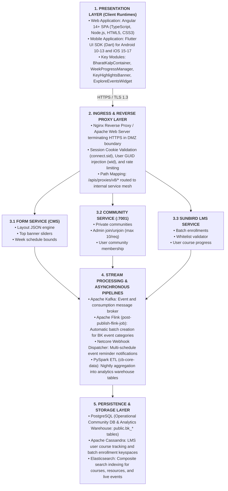
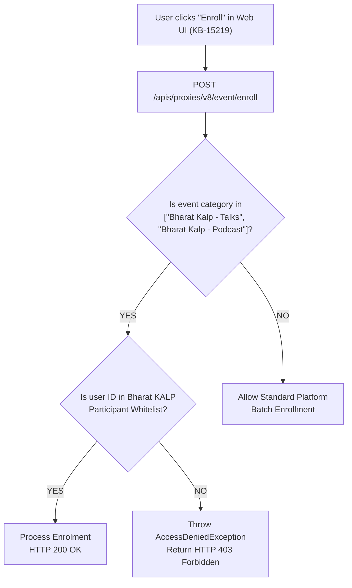
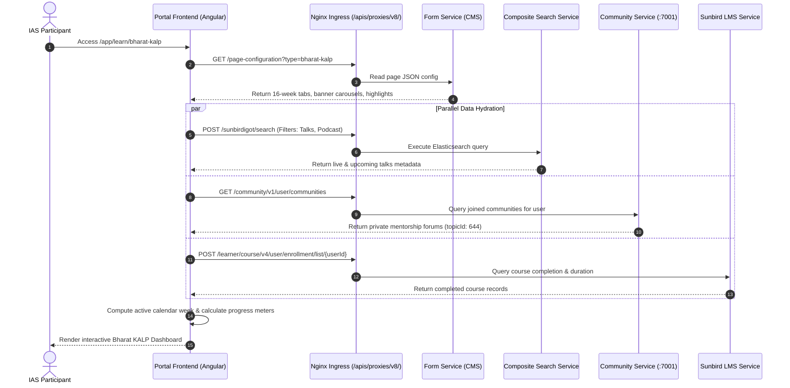
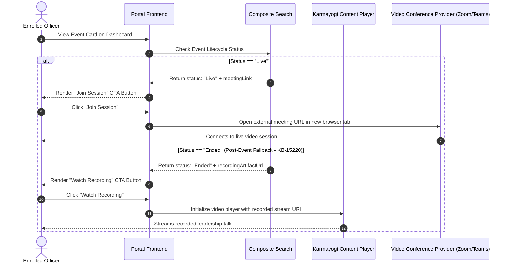

# Bharat KALP — Software Design Document (SDD)

## 2. Executive Summary & Document Reconciliation

### 2.1 Executive Overview

This Software Design Document (SDD) specifies the structural, behavioral, interface, and data architecture for **Bharat KALP** on the iGOT Karmayogi platform. The software realizes a restricted, unified **Bharat KALP Microsite** container accessible from the portal homepage, providing civil service officers (specifically IAS officers) with:

1. An access-controlled entry point (`/app/learn/bharat-kalp`) restricted to whitelisted participants.
2. Dynamic, multi-resolution banner sliders and announcement carousels with hyperlink support (`KB-15383`), managed via Form Service JSON without application redeployments.
3. An automated 16-week progression engine with dynamic active-week calculation and detailed curriculum listing.
4. Curated course recommendation strips driven by Capacity Building Commission (CBC) playlists.
5. Topic-segregated private mentorship communities (`topicId: 644`, `communityAccessLevel: "private"`) without public self-join capabilities.
6. Program-specific events (*Bharat Kalp - Talks*, *Bharat Kalp - Podcast*, webinars) isolated from the public Event Hub, featuring live meeting deep-linking (Zoom, MS Teams, Google Meet), recorded session fallback (`KB-15220`), member-only enrollment validation (`KB-14949`), and historical session browsing (`KB-15202`).
7. Automated multi-schedule event reminder notifications through Netcore.

### 2.2 Reconciliation of Source Document Anomaly

In the source baseline specification ([SRS_BharatKalp_v1.0_r2026_Q1](https://karmayogibharat.atlassian.net/wiki/spaces/TPT/pages/1172471809/SRS_BharatKalp_v1.0_r2026_Q1)), Sections 3.1, 3.2, and 3.3.2 contained boilerplate copy-paste text referencing an unrelated feature (*"Content Health Score / CHS"*).

However, the **Requirement Traceability (Section 2)**, **System Behavior (Section 6.1.1)**, **Interface Specifications (Section 8)**, and **Architecture Diagrams** explicitly define **Bharat KALP** under Epic `KB-14381` and User Story `KB-14382`. This SDD reconciles that defect by translating the authentic requirements defined in Section 6.1.1, the linked BRD (`1082327132`), FRS (`1091043353`), API contracts, and Sprint 38.1 specifications into software design representations.

## 3. Architectural Goals, Principles & Design Constraints

### 3.1 Design Principles

1. **Configuration-Driven Decoupling:** Page section ordering, banner assets, announcement text, and active week dates are decoupled from frontend code and driven declaratively via the Form Service JSON schema. Updates reflect on client devices within 30 minutes without server deployments.
2. **Logical Partitioning over Monolithic Forks:** Program experiences reuse existing core Sunbird and Karmayogi microservices using metadata segregation rather than custom monolithic services:
  - **Communities:** Private access level (`communityAccessLevel: "private"`) under dedicated category (`topicId: 644`).
  - **Events:** Scoped via `resourceType IN ["Bharat Kalp - Talks", "Bharat Kalp - Podcast"]`.
  - **Courses:** Curated through organization playlist identifiers (`ORG_FEATURED_COURSES`).

3. **Defense-in-Depth Access Control:** Security gating is enforced at the Application Gateway (route guards), Frontend (tile visibility), and Backend LMS (enrollment validation preventing direct API leaks as required by `KB-14949`).

### 3.2 System Constraints & Operational Boundaries

- **BK-TC-01:** Discussion segregation must reuse existing topic-based implementation (`topicId: 644`).
- **BK-TC-02:** Program events must be isolated from the platform Event Hub via category filters.
- **BK-TC-03:** Users cannot self-join private mentorship communities; administrative APIs manage memberships with a cap of 10 users per request.
- **BK-TC-04:** Third-party video conferencing links (Zoom, Google Meet, MS Teams) are launched externally; in-meeting telemetry is handled asynchronously.
- **BK-TC-05:** Concurrency target of 25,000 active users with page response latencies between 3.0 and 5.0 seconds.

## 4. Structural Architecture & Layered Decomposition



## 5. Detailed Component & Module Design

### 5.1 Routing, Guard & Layout Container (`sunbird-cb-portal`)

#### Route Configuration

```ts
{
  path: 'bharat-kalp',
  component: BharatKalpContainerComponent,
  canActivate: [AuthGuard, BharatKalpAccessGuard],
  data: { pageType: 'microsite', pageKey: 'bharat-kalp' }
}
```

#### Access Guard Execution Logic (`BharatKalpAccessGuard`)

```ts
canActivate(route: ActivatedRouteSnapshot, state: RouterStateSnapshot): Observable<boolean> {
  return this.userProfileService.getUserProfile().pipe(
    map(profile => {
      const isEligible = profile.roles.includes('BHARAT_KALP_MEMBER') || profile.rootOrgId === '<ROOT_ORG_ID>';
      if (!isEligible) {
        this.router.navigate(['/app/home']);
        this.snackBar.open('Access restricted to authorized Bharat KALP participants', 'Close', { duration: 5000 });
        return false;
      }
      return true;
    }),
    catchError(() => {
      this.router.navigate(['/app/home']);
      return of(false);
    })
  );
}
```

### 5.2 16-Week Progression Module (`WeekProgressComponent`)

#### Responsibilities

- Evaluates elapsed calendar duration between the current timestamp and `bkConfig.startDate` (`01-04-2026`).
- Automatically selects and renders the active week card (clamped between Week 1 and Week 16).
- Calculates aggregated learner completion percentage across courses mapped to the active week.
- Renders week switching tabs (`week_1` to `week_16`) and handles deep navigation to the detailed listing page with active week filters pre-applied.

#### Active Week Calculation Algorithm

```ts
public determineActiveWeek(startDateStr: string, totalWeeks: number): number {
  const [day, month, year] = startDateStr.split('-').map(Number);
  const programStartDate = new Date(year, month - 1, day);
  const currentDate = new Date();

  if (currentDate < programStartDate) {
    return 1; // Default to Week 1 before program commencement
  }

  const diffTime = Math.abs(currentDate.getTime() - programStartDate.getTime());
  const diffDays = Math.floor(diffTime / (1000 * 60 * 60 * 24));
  const weekNumber = Math.floor(diffDays / 7) + 1;

  return weekNumber > totalWeeks ? totalWeeks : weekNumber;
}
```

### 5.3 Announcements & Hyperlink Rendering Module (`KeyHighlightsComponent`)

#### Responsibilities (Resolving `KB-15383`)

- Parses announcement text arrays from `sectionKeyHighlights.data.content`.
- Detects standard markdown hyperlink syntax `[Link Text](URL)` and converts it into secure HTML anchors.
- Sanitizes output via Angular's `DomSanitizer` to enforce strict OWASP compliance against Cross-Site Scripting (XSS).

```ts
public parseAndSanitizeAnnouncements(rawText: string): SafeHtml {
  // Regex pattern matching [Anchor Text](Target URL)
  const markdownLinkRegex = /\[(.*?)\]\((https?:\/\/.*?)\)/g;
  const replacedHtml = rawText.replace(markdownLinkRegex, (match, text, url) => {
    return `<a href="${url}" target="_blank" rel="noopener noreferrer" class="announcement-link">${text}</a>`;
  });
  return this.sanitizer.sanitize(SecurityContext.HTML, replacedHtml);
}
```

### 5.4 Private Community Controller (`cb-community-service`)

#### Controller Specifications

- **Base Port:** `7001` (Internal Mesh)
- **Ingress Path:** `/apis/proxies/v8/community/v1/*`
- **Access Rules:** `communityAccessLevel` MUST be set to `"private"`.
- **Batch Limitation:** User whitelisting via `/admin/join` is strictly capped at 10 user IDs per transaction.

#### Controller Method: `adminJoinUsers` (Node.js/Express)

```js
async function adminJoinUsers(req, res) {
  try {
    const { communityId, userIds } = req.body;

    // Request Validation
    if (!communityId || !Array.isArray(userIds) || userIds.length === 0) {
      return res.status(400).json({ status: 'FAILED', errmsg: 'Invalid payload parameters' });
    }
    if (userIds.length > 10) {
      return res.status(400).json({ status: 'FAILED', errmsg: 'Batch limit exceeded: Maximum 10 users permitted' });
    }

    const result = await communityService.bulkAddMembers(communityId, userIds);
    return res.status(200).json({
      id: 'api.community.admin.join',
      ver: '1.0',
      result: {
        successCount: result.successful.length,
        failedCount: result.failed.length,
        successfulUsers: result.successful,
        errors: result.errors
      }
    });
  } catch (err) {
    return res.status(500).json({ status: 'FAILED', errmsg: err.message });
  }
}
```

### 5.5 Member-Only Event Enrollment Validation Engine (`sunbird-lms-service`)

#### Responsibilities (Resolving `KB-14949` & `KB-15219`)

- Validates whether an incoming event enrollment request belongs to an isolated Bharat KALP resource category.
- Checks whether the invoking user ID exists within the Bharat KALP participant registry.
- Rejects non-members with an explicit `HTTP 403 Forbidden` response.



## 6. Behavioral & Dynamic Interaction Flows

### 6.1 End-to-End Sequence Diagram: Participant Dashboard Hydration



### 6.2 Sequence Diagram: Live Session Joining & Recorded Video Fallback (`KB-15220`)



## 7. Data Architecture & Persistence Schemas

### 7.1 Operational vs. Analytical Data Partitioning

- **Operational Storage (OLTP):**
  - `Apache Cassandra`: LMS keyspaces storing enrollment state, batch IDs, content consumption tracking.
  - `PostgreSQL`: Discussion community tables storing private communities, categories (`topicId: 644`), and user memberships.
  - `Elasticsearch`: Inverted index storing searchable metadata for events, courses, and programs.

- **Analytical Storage (OLAP):**
  - Dedicated PostgreSQL Data Warehouse tables populated nightly via PySpark jobs (`cb-core-data`) for governance reporting.

### 7.2 Analytics Data Warehouse DDL (PostgreSQL)

```sql
-- 1. Table: public.bk_course_enrolments
-- Tracks course consumption, progress percentages, and certificate generation
DROP TABLE IF EXISTS public.bk_course_enrolments;
CREATE TABLE public.bk_course_enrolments (
    user_id text NULL,
    batch_id text NULL,
    content_id text NULL,
    enrolled_on text NULL,
    content_progress_percentage float4 NULL,
    resource_count_consumed int4 NULL,
    user_consumption_status text NULL,
    first_completed_on text NULL,
    first_certificate_generated_on text NULL,
    last_completed_on text NULL,
    last_certificate_generated_on text NULL,
    content_last_accessed_on text NULL,
    certificate_generated text NULL,
    number_of_certificate int4 NULL,
    user_rating float4 NULL,
    certificate_id text NULL,
    live_cbp_plan_mandate bool NULL,
    data_last_generated_on text NULL,
    karma_points float8 NULL,
    badge_id text NULL
);
CREATE INDEX idx_bk_course_enrol_uid ON public.bk_course_enrolments(user_id);
CREATE INDEX idx_bk_course_enrol_cid ON public.bk_course_enrolments(content_id);

-- 2. Table: public.bk_event_enrolments
-- Tracks attendance, session durations, and participation for talks and podcasts
DROP TABLE IF EXISTS public.bk_event_enrolments;
CREATE TABLE public.bk_event_enrolments (
    user_id text NULL,
    event_id text NULL,
    status text NULL,
    enrolled_on_datetime text NULL,
    completed_on_datetime text NULL,
    certificate_id text NULL,
    completion_percentage float4 NULL,
    event_duration text NULL,
    progress_duration text NULL,
    duration int4 NULL,
    event_duration_seconds float8 NULL,
    karma_points int8 NULL
);
CREATE INDEX idx_bk_event_enrol_uid ON public.bk_event_enrolments(user_id);
CREATE INDEX idx_bk_event_enrol_eid ON public.bk_event_enrolments(event_id);
```

## 8. Security Architecture & Threat Mitigation

| Security Layer | Mechanism / Technical Implementation | Protected Asset | Verification |
|---|---|---|---|
| **Perimeter / DMZ** | Ingress firewalls, IPS, TLS 1.3 termination, strict CORS/CSP. | API Gateway | SRS Section 9.3 |
| **Authentication** | Session cookie (connect.sid) + user GUID header (wid). | All Proxy Endpoints | API Contract |
| **Authorization** | RBAC guard verifying BHARAT_KALP_MEMBER role. | /bharat-kalp Route | Portal Code |
| **Enrollment Gate** | Backend whitelist validation preventing unauthorized joins. | Program Events | Verified KB-14949 |
| **Topic Privacy** | communityAccessLevel: "private"; excluded from public hub. | Mentorship Forums | API Contract |
| **XSS Protection** | Markdown URL sanitization via DomSanitizer for links. | Announcements | Verified KB-15383 |
| **Data Integrity** | Database audit trail logging all modifications in Postgres. | Persistence Stores | SRS Section 9.3 |

## 9. Non-Functional Realization Matrix

| Quality Dimension | Architectural Realization | Baseline Target |
|---|---|---|
| **Performance** | Client-side caching of Form JSON (30-min TTL); parallel asynchronous API execution via RxJS forkJoin/zip. | Average API latency 3.0 to 5.0 sec under 80% peak portal load. |
| **Scalability** | Stateless Node.js proxy pods auto-scaled in GCP Kubernetes; Cassandra read-replicas for LMS progress queries. | Support 25,000 concurrent active officers in production environment. |
| **Maintainability** | JSON-driven Form CMS decoupling editorial updates from deployment pipelines. | RTO <= 8 hrs for critical LMS; 48 hrs for secondary services. |
| **Portability** | Responsive CSS grids on web; Flutter native rendering across Android (API 29+) and iOS (15+). | Web: Chrome 118+, Firefox 122+; Mobile: Android 10-13, iOS 15-17. |

## 10. Requirement-to-Design Traceability

| SRS Req ID | Jira Key | Functional Capability | Frontend Component | Backend Service / DB Table | Verified Status |
|---|---|---|---|---|---|
| **FR-BK-01** | KB-14381 | Whitelist-Gated Homepage Entry Tile | BharatKalpAccessGuard | Form Service Notification | Prod Deployed |
| **FR-BK-02** | KB-14412 | Dynamic Top Banner Carousel | BannerCarouselComp | Form Service JSON Config | Prod Deployed |
| **FR-BK-03** | KB-15383 | Announcements with Hyperlinks | KeyHighlightsComp | HTML Sanitizer / Form Config | Prod Deployed |
| **FR-BK-04** | KB-14416 | 16-Week Structured Progression | WeekProgressComp | Form Config weekProgress | Prod Deployed |
| **FR-BK-05** | KB-14476 | Curated Course Recommendations Strip | ContentStripComp | ORG_FEATURED_COURSES API | Prod Deployed |
| **FR-BK-06** | KB-14484 | Private Mentorship Communities | MentorshipWidget | cb-community-service | Prod Deployed |
| **FR-BK-07** | KB-14949 | Whitelist-Restricted Program Events | ExploreEventsComp | LMS Whitelist Validator | Prod Deployed |
| **FR-BK-08** | KB-15220 | Live Session Deep Link & Fallback | EventCardActionComp | External Meeting URI Launch | To Do (Design) |
| **FR-BK-09** | KB-14382 | Netcore Event Reminder Notifications | Notification Handler | Netcore Webhook Dispatcher | Operational |
| **FR-BK-10** | KB-15202 | Historical Past Events Tab View | ExploreEventsComp | Search API (status: Ended) | Prod Deployed |
