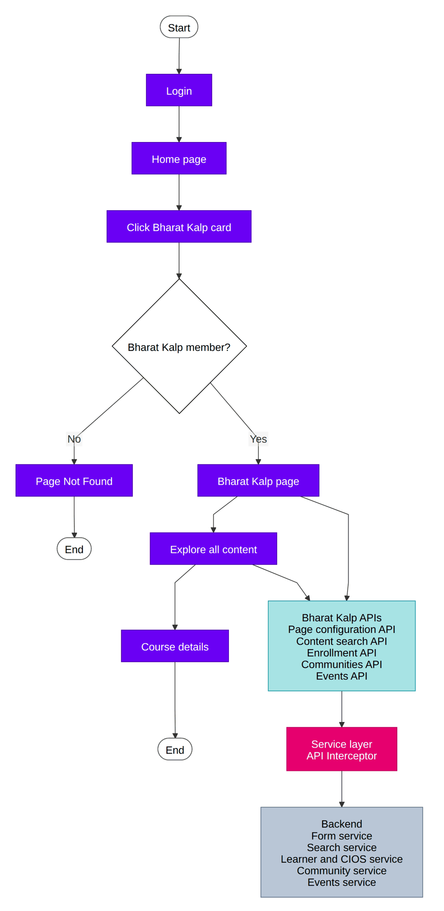

# Bharat KALP — Software Requirements Specification (SRS)

## 1. ACRONYMS and Abbreviations

| **S.no** | **Term** | **Abbreviation** |
|---|---|---|
| 1 | CP | Content Portal |
| 2 | iGOT | Integrated Government Online Training |
| 3 | UI/UX | User interface/User experience |
| 4 | MDO | Ministry, Department, or Organization |

## 2. REQUIREMENT TRACEABILITY

|  |  |  |  |  |
|---|---|---|---|---|
| **Q12\| Bharat Kalp** | [Q12 \| BRD \| Bharat KALP](https://karmayogibharat.atlassian.net/wiki/spaces/TPT/pages/1082327132) | [Q12 \| FRS \| Bharat KALP](https://karmayogibharat.atlassian.net/wiki/spaces/TPT/pages/1091043353) |  | [KB-14382: Q12 \| Bharat KALP \| Microsite \| Web and Mobile](https://karmayogibharat.atlassian.net/browse/KB-14382)[Open](https://karmayogibharat.atlassian.net/browse/KB-14382) |

## 3. INTRODUCTION

### 3.1 PURPOSE

The Content Health Score (CHS) initiative introduces a standardized, data-driven framework to measure and improve course quality across the iGOT platform. Each course is assigned a score from 0–100 based on a combination of static content quality metrics and dynamic learner engagement indicators. The solution enables continuous monitoring, proactive quality management, and transparent quality signals for learners. Providers gain access to actionable insights, root-cause diagnostics, and trend analysis to improve their content systematically. Learners can make informed enrollment decisions using color-coded quality badges and detailed health indicators. SPV administrators receive platform-wide quality dashboards, intelligent alerts, and prioritized intervention recommendations. The system reduces manual oversight, improves governance efficiency, and supports quality-based content curation. Automated monthly score recalculation ensures quality signals remain current and relevant. Remediation activities can be tracked from identification through resolution. Overall, CHS creates a transparent ecosystem that drives continuous content quality improvement and enhances the learner experience.

### 3.2 SCOPE

The Content Health Score (CHS) initiative introduces a standardized, data-driven framework to measure and improve course quality across the iGOT platform. Each course is assigned a score from 0–100, comprising a Static Score (50 points) based on AI-evaluated content quality metrics and a Dynamic Score (50 points) derived from learner engagement and performance indicators. The Static Score is calculated within five working days of publication, while the Dynamic Score is refreshed monthly using metrics such as completion rate, drop-off rate, learner ratings, sentiment, and time spent versus expected duration. Courses are categorized using color-coded quality indicators: Green (70–100), Amber (40–69), and Red (0–39). Learners can view these quality signals before enrollment, enabling informed learning choices. Content providers receive detailed score breakdowns, trend analysis, and actionable recommendations to improve course quality. SPV administrators gain access to platform-wide quality dashboards, provider rankings, and automated alerts for declining course performance. The system enables proactive interventions, quality-based content curation, and remediation tracking. Monthly recalculation ensures scores remain accurate and reflective of current learner experiences. Overall, CHS establishes a transparent quality ecosystem that drives continuous improvement and enhances learner trust and engagement.

### 3.3 OVERVIEW

### 3.3.1 SYSTEM PERSPECTIVE

  **3.3.2 LIMITATIONS**

The **Content Health Score** feature, in its current phase, operates within defined functional, technical, and governance boundaries. The overall limitations are outlined below:

- **Dependence on Learner Data:** Dynamic scores rely on learner engagement and feedback data. Newly published courses or courses with low enrollments may not have sufficient data to generate reliable quality scores.
- **Monthly Refresh Cycle:** Dynamic metrics are updated monthly, which means recent improvements or quality issues may not be reflected immediately in the Content Health Score.
- **AI Assessment Constraints:** Static scores are based on AI-driven analysis and may not fully capture subject-matter accuracy, pedagogical effectiveness, or contextual relevance of the content.
- **Learner Behavior Variability:** Completion rates, ratings, and engagement metrics can be influenced by external factors such as mandatory enrollments, learner motivation, or organizational requirements, which may not always reflect actual content quality.
- **Potential Rating Bias:** Learner ratings and feedback can be subjective and may be affected by individual preferences, expectations, or isolated experiences.
- **Score Interpretation Challenges:** A single aggregated score may not fully represent all dimensions of content quality, and courses with similar scores may have different underlying strengths and weaknesses.
- **Limited Historical Data for New Courses:** Newly launched courses may initially receive scores based primarily on static metrics until sufficient learner interaction data becomes available.
- **Content-Type Variations:** Certain quality indicators may not be equally applicable across different content formats such as videos, assessments, webinars, blended programs, or reference materials.
- **No Direct Learning Outcome Measurement:** The score primarily measures content quality and learner engagement but does not directly assess knowledge transfer, skill acquisition, or workplace performance improvement.
- **Risk of Score Optimization:** Providers may focus on improving metrics that influence the score rather than addressing broader learning and instructional design objectives.

## 5. USER TYPES & CHARACTERISTICS

The following user types are identified with respect to the iGoT Karmayogi process:

| **Role** | **Function** |
|---|---|
| Learner |  |

## 6. System Behavior

### 6.1 Notification Engine | WEB

**6.1.1 Q12 | Content Health Score | Static & Dynamic Indicators**

| **User story Link** | [KB-14382: Q12 \| Bharat KALP \| Microsite \| Web and Mobile](https://karmayogibharat.atlassian.net/browse/KB-14382)[Open](https://karmayogibharat.atlassian.net/browse/KB-14382) |
|---|---|
| **Epic name** | Q12 \| Bharath kalp |
| **Use story Title** | Q12 \| Bharat KALP \| Microsite \| Web and Mobile |
| **Primary Usage** | 1. Provides an exclusive entry point on the homepage for eligible learners to access dedicated Bharat KALP experiences. 2. Delivers configurable promotional banners and announcement updates managed dynamically by administrators. 3. Guides learners through a structured, week-on-week course curriculum with automated weekly progression, week-based filtering, and progress tracking. 4. Recommends a curated set of courses tailored for Bharat KALP participants. 5. Enables learners to view and participate in dedicated Bharat KALP topic-based communities to which they have been assigned. 6. Provides discovery and access to dedicated Bharat KALP events such as talks, webinars, and podcasts. 7. Allows learners to join live interactive sessions directly via external video conferencing platforms (e.g., Google Meet, Zoom, Microsoft Teams). 8. Delivers automated event reminder notifications to learners for upcoming sessions. |
| **Actors** | Bharat Kalp member |
| **Pre-Conditions** | A valid role is required for the user. |
| **Dependencies** | No |
| **Trigger** | 1. Login into CB portal 2. User navigates to the section **Inspotlight >ClickOn Bharatkalp** |
| **Basic behaviour** | 1. **Restricted Homepage Entry**: Displays an exclusive Bharat KALP tile on the homepage only for eligible, whitelisted learners to navigate to the microsite. 2. **Admin-Configured Banners & Announcements**: Renders promotional banners and announcements managed via backend configuration forms without code deployments, reflecting changes within 30 minutes. 3. **Scheduled Week-on-Week Progression**: Shows a uniform, week-by-week curriculum that defaults to the current active week and auto-advances based on the configured schedule. 4. **Curated Recommended Courses**: Displays a fixed, CBC-curated set of recommended courses fetched via existing catalog APIs, identical for all participants. 5. **Pre-Assigned Community Topics**: Shows dedicated Bharat KALP communities that users are pre-enrolled into from the backend, with options to participate or leave (no self-join). 6. **Dedicated Events & Live Joining**: Lists Bharat KALP–exclusive talks, webinars, and podcasts, allowing learners to join live sessions directly via external video meeting links (Google Meet, Zoom, MS Teams). |
| **Alternate behaviour** | N/A |
| **Business Rule / Validations** |  |
| **Exceptions / Alerts** | N/A |
| **Post Conditions** | N/A |
| **Frequency of Use** | 30% |
| **External linkages** | N/A |
| **API Reference** |  |
| **Issues** | N/A |

## 7. References

| **Document Name** | **Document Version Number** | **Release date** |
|---|---|---|
| RFP Document | V1.1 | 06-Jul-2026 |
| BRD Document | V1.1 | 06-Jul-2026 |
| FRS Document | V1.1 | 06-Jul-2026 |

## 8. Specific Requirements

### 8.1 EXTERNAL INTERFACES

There are no external interfaces.

### 8.2 SYSTEM INTERFACE

Nginx will be used as a web server. The user inputs data via the web server using HTML forms. The actual program that will perform the operations is written in Java/J2EE 1.8

### 8.2.1 USER INTERFACE

The user interface shall be implemented using software packages like Java applet, MS Frontpage, Enterprise Java beans, etc on the following languages

| **Language** | **Description** |
|---|---|
| Angular | Angular is a TypeScript-based free and open-source single-page web application framework run on Node.js. |
| JavaScript | JavaScript is a light weight, object oriented, cross platform scripting language, will mainly be used within the webpages |
| HTML5 | HTML5 is the fifth revision of the HTML standard. |
| CSS | Cascading style sheets define style rules in a separate CSS file |

**8.2.1 USER INTERFACE** | **MOBILE**

| **Language** | **Description** |
|---|---|
| Dart | Dart is a general-purpose programming language that can be used for a wide range of applications, including web development, server-side programming, and mobile app development. Flutter, on the other hand, is a UI SDK specifically designed for building high-performance, cross-platform mobile apps. |

### 8.2.2 SOFTWARE INTERFACE

Server-side: An Apache web server will accept all requests from the client and forward it accordingly. A database will be hosted centrally using PostgreS and Teradata.

Client-side: A Windows/Linux OS which is capable of running a modern web browser that supports JavaScript and HTML5 will be used

Client-side-Mobile: An Android/iOS device

### 8.2.3 COMMUNICATION INTERFACES

The system shall use the HTTPS protocol(s) and TCP/IP protocol suite for communication over the intranet. The user must have an SSL certificate licensing registered web browser.

### 8.2.4 OPERATIONS

Recommended browsers for the system are Chrome, Firefox, and Internet Explorer 8 or higher.

| **Mozilla Version** | **Chrome Version** | **IE** **Version** |
|---|---|---|
| Version 122+ | Version 118+ | Version 11 |

| **Android Version** | **iOS Version** |
|---|---|
| Version 13 & below | Version 17 & below |

The system shall have operations to protect the database from being corrupted or accidentally altered during a system failure.

## 9. Non-Functional Requirements

### 9.1 USABILITY REQUIREMENTS

The user interface of Karmayogi Bharat shall provide a very intuitive and simple interface to the user so that the user can easily navigate through pages.

### 9.2 PERFORMANCE REQUIREMENTS

Response Time: Average response time shall be less than 3-5 seconds (Note: No SLA is defined in the RFP. However as per industry standard every page’s average response time should be between of 3 to 5 seconds)

Capacity: The system will be able to accommodate 25000 concurrent users in Production env.

| **Applications** | **Business Transaction** | **User Distribution**  **(%age of peak load)** | **Total Users Expected in Production env.** |
|---|---|---|---|
| Portal | Login, Registration, User Profile Views, Course consumption | 80% | 25000 |
| Help, Resources, Feedback | 20% |  |  |
| Mobile | AI based recommendation | 90% of total application features | 25000 |

### 9.3 SECURITY

The application will store data that are critical concerning security. Adequate safety measures are to be incorporated during the development stage to prevent vulnerabilities and build a secure code for these services.

The following security considerations are to be made:

**User Level Security: -**

Restricted areas of the application shall be accessible through pre-defined user access rights.

**Database Level Security:**

Database security should provide different layers of database users with overall control of the database security administrator, only authorized database administration users with assigned privileges shall be allowed to access the database. A separate audit trail should be maintained for any direct modification, deletion, and addition in Postgres and Teradata database in database structure or records. Users, even the database administrator should not be allowed to tamper with the audit log.

**Network Level Security:**

Network traffic shall be encrypted using SSL & secured connectivity between the ITD office and the data center where the application will be hosted.

**Infrastructure Level Security:**

Application infrastructure shall be hosted in a DMZ & firewall and IPS shall be installed to detect malicious activities.

The portal should also be tested against the[OWASP 2017 top 10 list](https://www.owasp.org/index.php/Category:OWASP_Top_Ten_Project)of security vulnerabilities.

<Refer to the security guidelines document >

### 9.4 MAINTAINABILITY

Maintainability is defined as the ease with which the software system and components can be modified to correct faults and improve performance or other attributes. It is envisaged that KB shall have a high degree of maintainability. RTO shall be 8 hours for business-critical systems and 48 hours for other systems

### 9.5 SCALABILITY

Scalability is the capability of the system and the underlying components to handle a growing amount of work, or its potential to be enlarged to accommodate that growth. It will be able to accommodate 25000 concurrent users in the Production environment.

| **Applications** | **Business Transaction** | **User Distribution**  **(%age of peak load)** | **Total Users Expected in Production env.** |
|---|---|---|---|
| Portal | Login, Registration, User Profile Views, Course consumption | 80% | 25000 |
| Help, Resources, Feedback | 20% |  |  |
| Mobile | AI based recommendation | 90% of total application features | 25000 |

### 9.6 PORTABILITY MOBILE

#### MOBILE

Upon the introduction of the Content Health Score, the system portability remains constant

| **Android Version** | **iOS Version** |
|---|---|
| Version 13 & below | Version 17 & below |

#### WEB:

Upon the introduction of the Learner Passbook, the system portability remains constant, The application and introduced feature are Windows/Linux-based and should be compatible with other systems. Apache, Java/Scala/J2EE and Postgres and programs are practically independent of the OS-system which they communicate with. The end-user part is fully portable and any system using any web browser should be able to use the features of the application.

| **Mozilla Version** | **Chrome Version** | **IE Version** |
|---|---|---|
| Version 122+ | Version 118+ | Version 11 |
