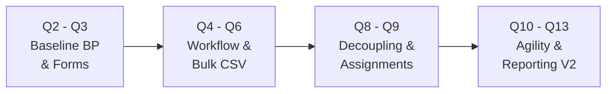
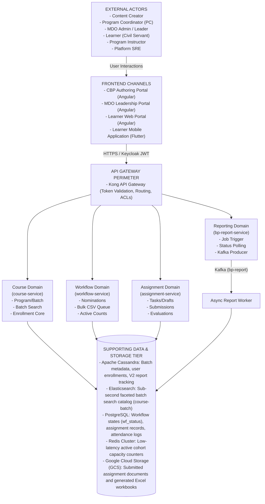

# Blended Program — System Context Document

## 1. Context and Evolution Summary

The **Blended Program (BP)** evolved from a basic authored learning construct in Q2 into a multi-channel, workflow-driven, analytics-enabled learning program by Q13. Over time, the platform expanded in four dimensions:

1. **From Simple Program Creation to Agile Batch Operations:** Direct publishing (bypassing the Content Quality Framework in Q9) and same-day batch execution/cloning (Q12).
2. **From Open Enrollment to Approval-Based Cohort Management:** Integration with `workflow-service` for multi-state queues (`SEND_FOR_PC_APPROVAL`), bulk CSV processing, and Redis active capacity tracking.
3. **From Pure Digital Consumption to Interactive Delivery:** Introduction of the dedicated `assignment-service` for task authoring, learner document submissions via Google Cloud Storage (GCS), and qualitative grading.
4. **From Basic Exports to Asynchronous Multi-Source Reporting:** Kafka-driven reporting workers aggregating operational state across Apache Cassandra, PostgreSQL, and Elasticsearch.

| Release Band | Evolution Focus | Context Impact | Primary Systems Added or Strengthened |
|---|---|---|---|
| **Q2–Q3** | Program & Batch Foundation | Established authoring, batch creation, and basic enrollment context | CBP Portal, `course-service`, Apache Cassandra |
| **Q4–Q6** | Workflow & Nomination Controls | Added coordinator approval, profile customization, and bulk processing actors | `workflow-service`, PostgreSQL, Redis |
| **Q8–Q9** | Publishing Simplification & Assignments | Expanded creator and learner touchpoints beyond course consumption | `assignment-service`, GCS integration |
| **Q10–Q11** | Cross-Channel Delivery | Strengthened mobile, instructor, and media access context | `cloud-storage-proxy`, search indexing, Mobile App |
| **Q12–Q13** | Operational Agility & Reporting | Added asynchronous reporting and faster batch lifecycle operations | `bp-report-service`, Kafka, Async Report Worker |

## 2. System Context Diagram

## 3. Context Entities & Operational Stakeholders

| Entity | Role in System | Key Interactions | Primary Operational Tasks |
|---|---|---|---|
| **Content Creator** | Designs and publishes the program container | Uses CBP Authoring Portal with `course-service` | Create metadata, map competencies, structure curriculum, trigger direct publish. |
| **Program Coordinator** | Manages cohorts and cohort participation | Uses CBP and MDO Portals with `course-service` & `workflow-service` | Create batches, assign instructors, manage schedules, approve nominations, clone cohorts. |
| **MDO Admin / Leader** | Oversees departmental training | Uses MDO Leadership Portal with `workflow-service` & `bp-report-service` | Nominate officers, review cohort participation, request asynchronous reports. |
| **Learner (Civil Servant)** | Consumes the Blended Program | Uses Learner Web & Mobile Portals with course, workflow, and assignment flows | Discover batches, enroll/scan QR, attend sessions, consume TOC, submit assignments. |
| **Program Instructor** | Delivers instruction and qualitative scoring | Uses web interfaces with `assignment-service` | Upload assignment tasks, review student submissions, submit marks and feedback. |
| **Platform SRE** | Maintains system reliability and consistency | Operates data recovery, re-indexing, and monitoring tools | Monitor Akka indexing lag, evict stale Redis counters, audit Kafka DLQs. |

## 4. Frontend Channels & Access Boundaries

| Channel | Primary Users | Primary Purpose | Key Backend Dependencies |
|---|---|---|---|
| **CBP Authoring Portal** | Content Creator, Program Coordinator | Program setup, batch creation, scheduling, direct publishing | `course-service`, `workflow-service` |
| **MDO Leadership Portal** | MDO Admin, Program Coordinator | Approval queues, cohort oversight, report initiation | `workflow-service`, `bp-report-service` |
| **Learner Web Portal** | Learner, Instructor | Discovery, enrollment, structured TOC navigation, assignment access | `course-service`, `workflow-service`, `assignment-service` |
| **Learner Mobile App** | Learner | On-premise QR attendance, mobile TOC consumption, assignment uploads | `course-service`, `workflow-service`, `assignment-service`, storage proxy |

## 5. Backend Service Boundaries & Responsibilities

| Service | Functional Boundary | Inbound Triggers | External Dependencies |
|---|---|---|---|
| **Kong API Gateway** | Perimeter security, authentication, and routing | All frontend channels | Keycloak JWT verification, service routing rules |
| **course-service** | Program metadata, batch lifecycle, search synchronization, enrollment states | Gateway routes (`/v1/course/batch/*`) | Apache Cassandra, Elasticsearch |
| **workflow-service** | Nominations, approvals, multi-state workflows, bulk CSV parsing | Gateway routes (`/workflow/blendedprogram/*`) | PostgreSQL, Redis, Apache Cassandra |
| **assignment-service** | Assignment creation, submission drafts, final lock, evaluation | Gateway routes (`/api/assignment/v1/*`) | PostgreSQL, `cloud-storage-proxy`, GCS |
| **bp-report-service** | Asynchronous analytical export orchestration and status polling | Gateway routes (`/bp/v1/*`, `/bp/v2/*`) | Apache Cassandra, Kafka (`bp-report`) |
| **Async Report Worker** | Background multi-store join engine generating multi-tab workbooks | Kafka topic `bp-report` | Cassandra, PostgreSQL, Elasticsearch, GCS |

## 6. End-to-End Creation and Consumption Context Workflows

### 6.1 Creation Context

- **Program Authoring:** Content Creator defines program metadata, competencies, and links prerequisite courses.
- **Direct Publishing:** Under Q9 rules, transitions directly from Draft to Live without passing through the CQF review board.
- **Batch Setup:** Program Coordinator configures cohort dates, access modes (`open` vs `invite-only`), target MDOs, instructors, and session resources.
- **Agile Batch Operations:** By Q12–Q13, supports same-day scheduling () and inactive batch cloning.

### 6.2 Consumption Context

- **Cohort Admission:** Learner initiates self-enrollment (or scans an on-premise QR code), or an MDO Admin submits a nomination. Requests are resolved individually or via bulk CSV approvals.
- **TOC Discovery:** The learner accesses the interactive curriculum navigator on Web or Mobile.
- **Multi-Format Media:** The player renders self-paced modules, video streams, PDFs, PPT slide decks, and external session links.
- **Interactive Assignments:** The **Assignments** tab appears when tasks exist. Learners upload solutions (, PDF/DOCX) to GCS and submit for grading.
- **Evaluation & Completion:** Instructors record numerical marks and textual comments. The system evaluates mandatory modules and terminal criteria, updating `user_enrolments.status = 2` and issuing digital certificates.
- **Analytical Insights:** Administrators trigger asynchronous report generation, producing downloadable 6-sheet Excel workbooks from multi-store joins.

## 7. Operational Tasks & Cross-Cutting Boundaries

| Operational Area | Trigger Actor | Frontend Touchpoint | Backend Execution Path | Primary System Outcome |
|---|---|---|---|---|
| **Program Creation** | Content Creator | CBP Authoring Portal | Gateway `course-service` Cassandra / ES | Program is created and published |
| **Batch Setup** | Program Coordinator | CBP Authoring Portal | Gateway `course-service` Cassandra ES sync | Cohort is available for enrollment |
| **Enrollment & Nominations** | Learner or PC | Web / Mobile / MDO Portal | Gateway `workflow-service` Postgres / Redis / Cassandra | Participant is approved, rejected, or queued |
| **Content Consumption** | Learner | Web Portal / Mobile App | Gateway `course-service` / `assignment-service` | Learner consumes curriculum items |
| **Assignment Submission** | Learner | Web Portal / Mobile App | Gateway `assignment-service` Storage Proxy GCS | Artifact is stored and locked for review |
| **Assignment Evaluation** | Instructor | Instructor Interface | Gateway `assignment-service` PostgreSQL | Marks and comments are recorded |
| **Report Generation** | MDO Admin / PC | MDO Leadership Portal | Gateway `bp-report-service` Kafka Worker GCS | Asynchronous multi-tab export produced |
