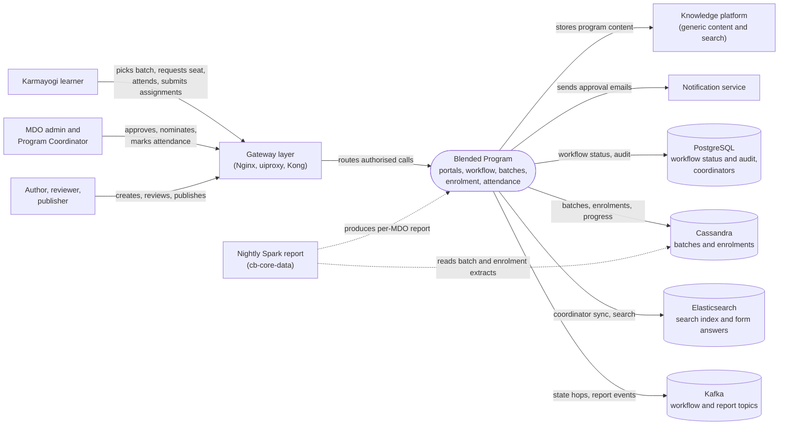

# Blended Program — Context Diagram

## System boundary

Blended Program is a content-model overlay plus an approval workflow, not a service of its
own. Inside the feature are the program page and authoring screens, the approval state
machine in the workflow service, and the Blended-Program-aware batch, enrolment, attendance
and reporting logic in the course service and `sunbird-cb-ext`. Outside it are the people
who learn, approve and coordinate, the gateway layer in front of the services, the generic
content platform, the stores, the notification service and the nightly Spark report.

## Diagram

## Elements

| Element | Role | Detailed in |
|---|---|---|
| Blended Program | Central feature: program page, Creation Portal, workflow approvals, batch and enrolment actors, attendance, QR, reports | [hld.md](hld.md) |
| Karmayogi learner | Picks a batch, requests a seat, withdraws, learns, attends, submits assignments | [use-cases.md](use-cases.md) |
| MDO admin and Program Coordinator | Approve requests, nominate learners, mark attendance, pull reports | [use-cases.md](use-cases.md) |
| Author, reviewer, publisher | Build the program and move it through review to publish | [use-cases.md](use-cases.md) |
| Gateway layer (Nginx, uiproxy, Kong) | Route map in front of the services | [apis.md](apis.md) |
| Knowledge platform | Generic content lifecycle and search; the program is an ordinary course collection | [hld.md](hld.md) |
| Notification service | Delivers approval and attendance emails | [hld.md](hld.md) |
| Nightly Spark report (`cb-core-data`) | Produces the Blended Program report per MDO / provider and a warehouse table | [hld.md](hld.md) |
| PostgreSQL | Workflow status and audit rows, Program Coordinator records | [lld.md](lld.md) |
| Cassandra | Batches, enrolments, progress and lookup tables | [lld.md](lld.md) |
| Elasticsearch | Coordinator-scoped search index and form answers | [lld.md](lld.md) |
| Kafka | Carries workflow state hops, report and coordinator-sync events | [hld.md](hld.md) |

> **Verification boundary:** elements and interactions are taken from the feature's index,
> use-cases and HLD pages. They have not been re-checked against the APIs and LLD pages or
> against source for this diagram, so the "Detailed in" links are pointers, not proof.
> The workflow, course service, `sunbird-cb-ext` and the portals are collapsed into one
> central node. Neo4j, Redis batch counters, the config service and the forms and
> assignment services are omitted for legibility; the forms and assignment services are
> not attached to the analysis. The notification service and the uiproxy are documented
> as supporting context, not pinned commits.
