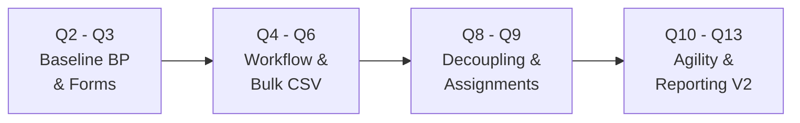
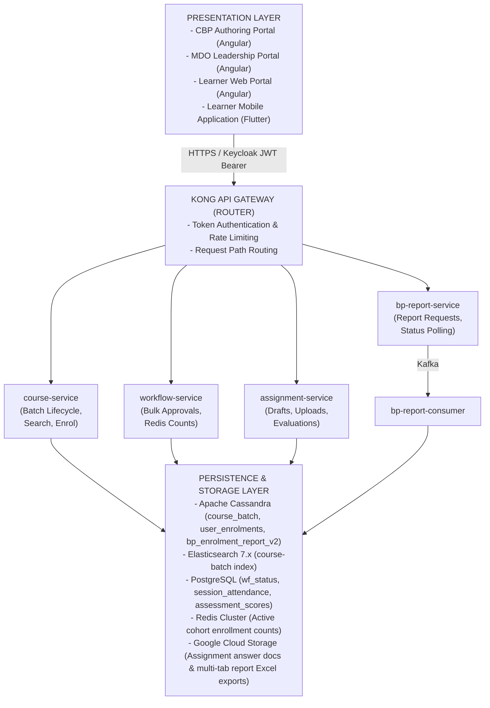
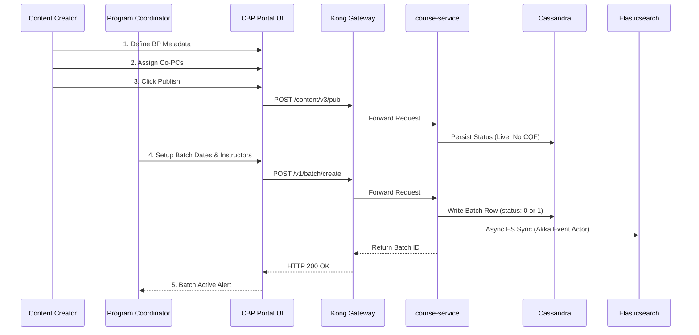
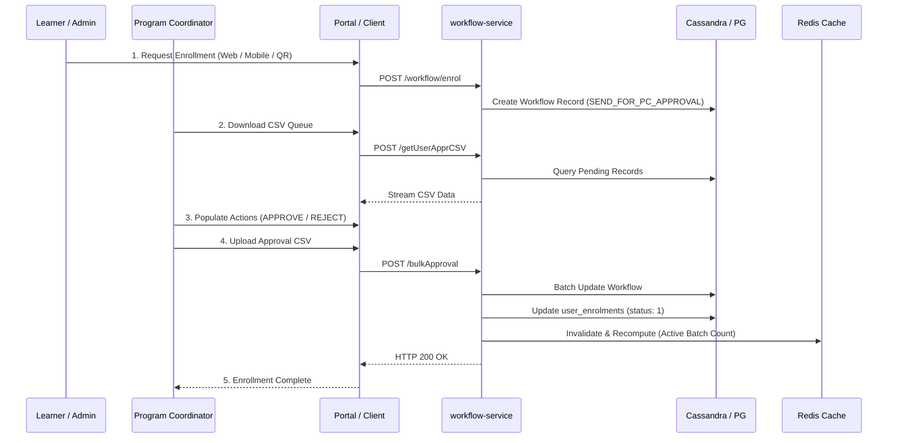
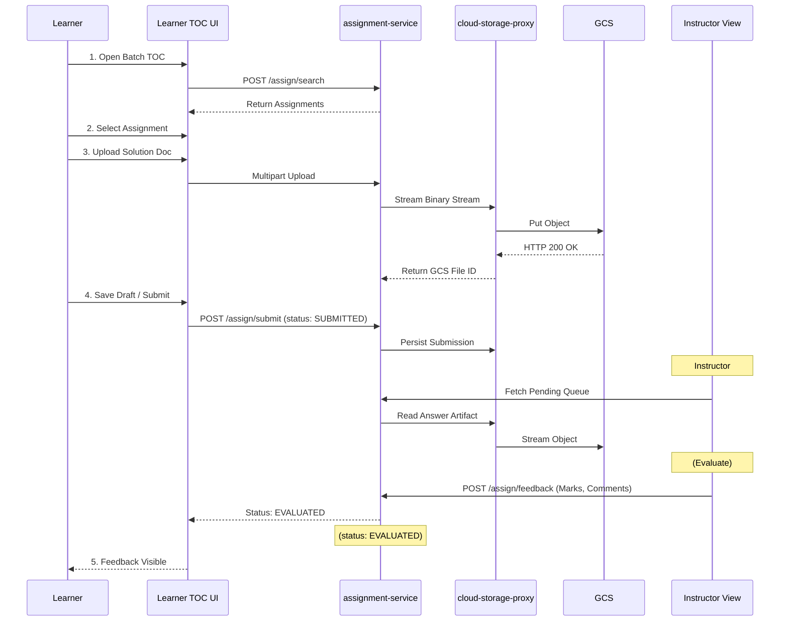
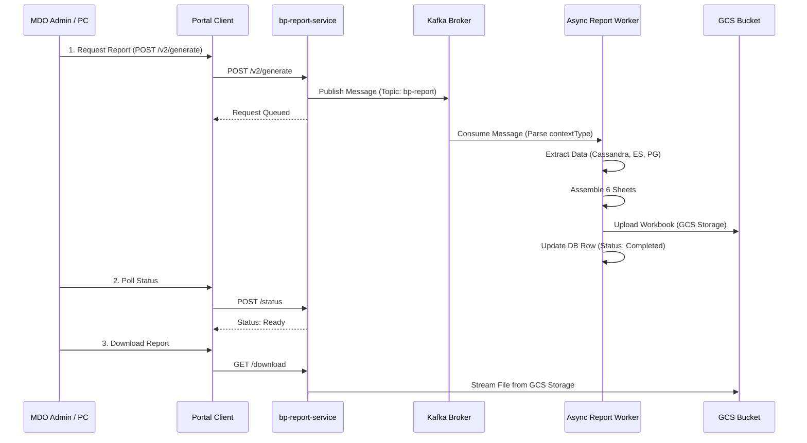
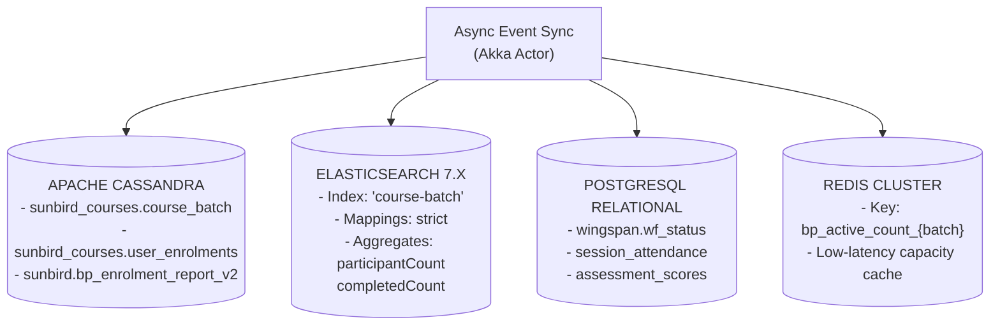
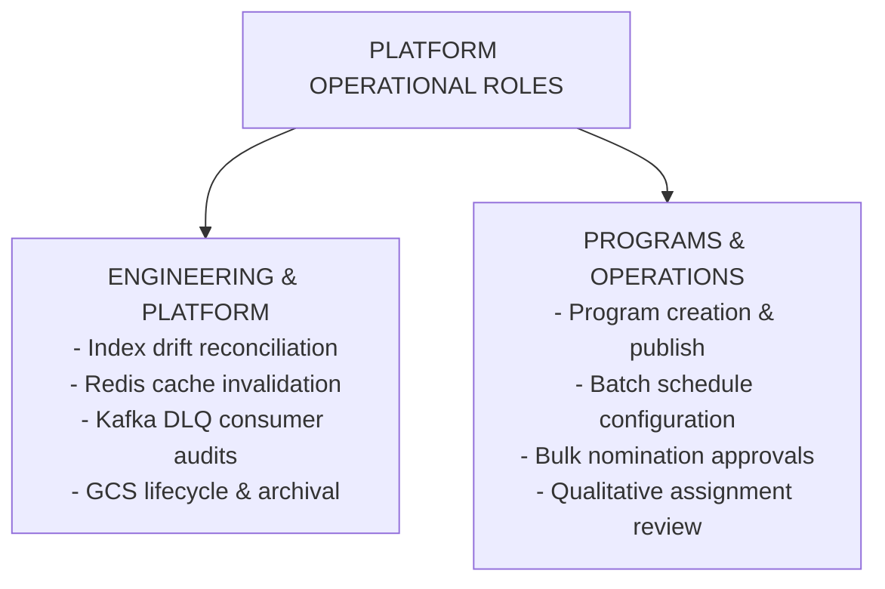

# Blended Program — High-Level Design (HLD)

## 1. Executive Summary & Architecture Drivers

### 1.1 Executive Summary

The **Blended Program (BP)** bridges asynchronous digital learning and synchronous, instructor-led cohort interactions. Architecturally, the platform strictly separates the **program structure** (parent container holding metadata, curriculum, and competencies) from the **batch execution** (runtime instances with distinct schedules, capacities, instructors, access rules, and target MDOs).

Between **Q2 and Q13**, the Blended Program evolved from a monolithic batch enrollment structure into a decoupled, event-driven, multi-portal training ecosystem.

**ARCHITECTURAL OBJECTIVES**

| 1. Structural Decoupling | 2. Operational Agility | 3. Asynchronous Isolation |
|---|---|---|
| Program container (1) to runtime cohorts (N) with independent governance. | Same-day batch execution, cloning, session editing, and direct publishing. | Multi-store analytical joins and report exports offloaded via Kafka event workers. |

### 1.2 Key Architecture Drivers

- **Multi-Tenancy & Decentralization:** Delegating batch management from central creators to multiple Program Coordinators (PCs) across MDOs.
- **Low-Latency Catalog Search:** Delivering sub-second faceted queries across thousands of live batches via Elasticsearch.
- **Polyglot Persistence:** Balancing transactional write integrity (Cassandra, PostgreSQL), sub-second search (Elasticsearch), low-latency caching (Redis), and large binary object storage (GCS).
- **Workload Isolation:** Preventing heavy analytical joins (joining Cassandra, PostgreSQL, and Elasticsearch) from degrading interactive learner or authoring APIs.

## 2. Chronological Evolution Overview (Q2 to Q13)

| Phase | Strategic Epics | Architectural Milestones | Frontend & User Impact | Backend & Infrastructure Impact |
|---|---|---|---|---|
| **Q2–Q3** | `KB-268`, `KB-``334`, `KB-325`, `KBE-7` | Baseline container and batch model; dynamic form links for registration. | Initial batch creation and learner discovery strips. | Initialized `sunbird_courses.course_batch` in Cassandra; baseline batch-level CSV reports (`KB-688`). |
| **Q4–Q6** | `KB-6962`, `KB-7848` | Enterprise enrollment delegation; multi-state workflow integration. | Custom profile field collection (`KB-7028`); bulk approval/rejection UI. | Delegated enrollment state transitions to `workflow-service`; introduced `wingspan.wf_status` in PostgreSQL and bulk CSV processors (`KB-7850`). |
| **Q8–Q9** | `KB-11078`, `KB-9984`, `KB-10855` | Authoring streamlining; dedicated assignment microservice. | Bypassed Content Quality Framework (CQF); in-batch assignment and grading views. | Bypassed CQF review gate (`KB-11083`); launched `/api/assignment/v1/*` microservice (`KB-11071`); refactored Elasticsearch mappings (`KB-9984`). |
| **Q10–Q11** | `KB-11808`, `KB-12360`, `KB-13490` | Cross-MDO scale and multi-asset ingestion. | Cross-departmental instructor assignment; mobile and web assignment submission. | Ingestion of multi-format media via cloud storage proxies; Cassandra read-path query optimization. |
| **Q12–Q13** | `KB-13948`, `KB-13937`, `KB-13972`, `KB-14289` | Runtime operational agility; analytical isolation; progress refinement. | Same-day batch creation and execution; inactive batch cloning; multi-tab Excel reports. | Deployed `bp_enrolment_report_v2` table in Cassandra (`KB-14010`); integrated Kafka `bp-report` multi-source worker; decoupled optional pre-assessments (`KB-15810`). |

## 3. High-Level System Architecture and Component Topology

### Component Responsibilities

| Component | Responsibility Domain | Primary Communication Interfaces | Persistence Store |
|---|---|---|---|
| **Kong API Gateway** | Perimeter security, JWT validation, rate limiting, and reverse proxy routing. | External HTTPS Internal REST | N/A (Stateless / Redis) |
| **course-service** | Manages program containers, batch CRUD, search indexing, and enrollment state machine. | REST APIs (`/v1/course/batch/*`) | Cassandra (`course_batch`, `user_enrolments`), Elasticsearch |
| **workflow-service** | Handles nomination queues, approval transitions, CSV batch processing, and Redis count caching. | REST APIs (`/workflow/blendedprogram/*`) | PostgreSQL (`wf_status`), Redis |
| **assignment-service** | Manages assignment prompts, student drafts, terminal submissions, and instructor scoring. | REST APIs (`/api/assignment/v1/*`) | PostgreSQL, Google Cloud Storage |
| **bp-report-service** | Asynchronous report job orchestration, status polling, and export delivery. | REST APIs (`/bp/v1/*`, `/bp/v2/*`), Kafka Producer | Cassandra (`bp_enrolment_report_v2`), Kafka topic `bp-report` |
| **bp-report-consumer** | Background worker executing multi-store joins across Cassandra, Postgres, and ES to build Excel workbooks. | Kafka Consumer, Cloud Storage Client | Google Cloud Storage (GCS) |

## 4. End-to-End Functional Workflows: Frontend to Backend

### 4.1 Program Authoring & Batch Creation Lifecycle

1. **Program Definition:** Content Creator configures program metadata, attached modules, and maps authorized Program Coordinators across MDOs.
2. **Publishing Transition:** Content Publisher triggers publishing. The program transitions directly from `Draft` to `Live` without entering the legacy CQF review queue.
3. **Cohort Provisioning:** Program Coordinator defines batch dates, mode (`open`/`invite-only`), instructor accounts, and session assets. Under Q12 rules, same-day scheduling () is validated and accepted.
4. **Data Persistence:** `course-service` writes the batch row to Cassandra `sunbird_courses.course_batch` and emits an Akka event that indexes the batch into Elasticsearch `course-batch`.

### 4.2 Learner Enrollment, Nomination & Bulk Approval Lifecycle

1. **Request Ingestion:** The civil servant discovers the batch on Web or Mobile and requests enrollment (or scans an on-premise QR code).
2. **Workflow Enqueueing:** The request persists in PostgreSQL `wingspan.wf_status` with status `SEND_FOR_PC_APPROVAL`.
3. **Bulk Coordinator Processing:** The PC downloads the pending candidate queue as a CSV via `POST /workflow/blendedprogram/getUserApprovalDataInCsv`, marks the decision (`APPROVED` or `REJECTED`), and re-uploads the file via `POST /workflow/blendedprogram/bulkApprovalDataFromCsv/{courseId}`.
4. **Activation & Cache Eviction:** Approved learners are committed to Cassandra `user_enrolments` (`status: 1`). The service invalidates the Redis key `bp_active_count_{batchId}` and writes the recomputed active count.

### 4.3 Learner Consumption, Assignment Submission & Grading

1. **Contextual TOC Presentation:** The Web/Mobile TOC queries `assignment-service`. The **Assignments** tab renders dynamically if published tasks exist for the cohort.
2. **Draft & File Ingestion:** The learner selects the assignment, uploads a solution document (, PDF/DOCX) via `cloud-storage-proxy`, and saves progress using `PUT /api/assignment/v1/submitDraft`.
3. **Final Submission:** The learner finalizes the submission via `POST /api/assignment/v1/submit`, locking the record (`status: SUBMITTED`).
4. **Qualitative Grading:** The instructor inspects the submitted document, enters numerical marks and comments via `POST /api/assignment/v1/feedback`, and updates the submission to `EVALUATED`.

### 4.4 Analytics, Reporting & Warehousing Pipeline

1. **Job Queuing:** An administrator triggers report generation via `POST /bp/v2/generate/report`. The service publishes an event to Kafka topic `bp-report` and inserts an initial record into Cassandra `sunbird.bp_enrolment_report_v2` with `status: "PROCESSING"`.
2. **Multi-Store Aggregation:** The background worker consumes the event and joins records across:
  - **Apache Cassandra:** Batch metadata, enrollment records, completion timestamps.
  - **PostgreSQL:** Session attendance logs, assessment scores.
  - **Elasticsearch / User Registry:** Officer profile data (Designation, Ministry, Cadre, Email).

3. **Storage & Delivery:** The worker builds a 6-sheet Excel workbook, uploads it to GCS, and updates the Cassandra row with the download link and `status: "COMPLETED"`. The client polls `/bp/v1/bpreport/status` and downloads the file.

## 5. Polyglot Data Model Architecture

### 5.1 Storage Layer Allocation

| Data Store | Schema / Index Entity | Access Pattern | Architectural Rationale |
|---|---|---|---|
| **Cassandra** | `sunbird_courses.course_batch` | Point reads/writes by `(courseid, batchid)` | High-throughput write path; high-scale enrollment records. |
| **Cassandra** | `sunbird.bp_enrolment_report_v2` | Point lookups by `(orgid, courseid, batchid, reportrequester, contexttype)` | Resolves primary key collisions during multi-context concurrent reporting. |
| **Elasticsearch** | `course-batch` index | Text search, faceted filtering, sorting | Sub-second catalog queries; handles range queries on dates and status. |
| **PostgreSQL** | `wingspan.wf_status` | Relational transactions, state updates | Strict transactional consistency for multi-step approval workflows. |
| **Redis** | In-memory key-value | Read-heavy lookups () | Protects transactional stores from high-frequency batch capacity checks. |
| **GCS** | Object storage buckets | Binary streaming (upload/download) | Isolates multi-megabyte files (PDFs, PPTs, Excel reports) from database rows. |

## 6. Operational Tasks & Platform Ownership

- **Platform Engineering Tasks:**
  - **Elasticsearch Sync Monitoring:** Monitoring lag in Akka actor event publishers to maintain eventual consistency between Cassandra and Elasticsearch.
  - **Cache Management:** Evicting stale Redis capacity keys (`bp_active_count_*`) upon manual database updates or bulk enrollment changes.
  - **Asynchronous Queue Auditing:** Monitoring dead-letter queues (DLQ) for failed `bp-report` Kafka events and re-triggering stuck report generations.

- **Program Operations Tasks:**
  - **Authoring & Publishing:** Managing program structure, competency mapping, and direct publisher sign-off.
  - **Batch Management:** Setting up cohort schedules, cloning inactive batches, assigning instructors, and managing capacity.
  - **Candidate Governance:** Reviewing and executing bulk enrollment approvals via CSV within designated service-level agreements.

## 7. Cross-Cutting Concerns & System Quality Attributes

### 7.1 Security & Role-Based Access Control (RBAC)

- **API Perimeter:** Kong API Gateway validates Keycloak JWT bearer tokens for every incoming request.
- **Granular Scope Enforcement:**
  - `BP_CONTENT_CREATOR`: Author and publish program definitions; map Program Coordinators.
  - `BP_PROGRAM_COORDINATOR`: Create and modify batches, allocate instructors, upload/download bulk approval CSVs.
  - `BP_PROGRAM_TRAINER` / `MENTOR`: Create assignments, grade student submissions, provide feedback.
  - `LEARNER`: Self-enroll, access TOC, submit assignment drafts, download completion certificates.

### 7.2 Scalability & Performance Guardrails

- **Search Pagination Clamping:** Query offsets in Elasticsearch are clamped at to prevent deep-pagination memory exhaustion.
- **Bulk Operation Batching:** Bulk CSV approval uploads parse files asynchronously, executing database writes in chunks of 50 to avoid connection pool starvation.
- **Report Generation Offloading:** Large multi-tab report generations are routed through Kafka topics, isolating analytical queries from runtime transactional APIs.

## 8. Summary Traceability Matrix (Q2 to Q13)

| Requirement / Milestone | Design Architecture Solution | Primary Service | Primary Storage Component | Traceable Jira Reference |
|---|---|---|---|---|
| **Configurable Registration Forms** | Form linking engine integrated with program authoring | `course-service` | Cassandra / Dynamic Forms | `KB-334`, `KB-336` |
| **Multi-PC Delegation** | Multi-account mapping in batch mentor lists | `course-service` | Cassandra `course_batch` | `KB-11078` |
| **Direct Publishing (No CQF)** | Bypassed CQF review board; direct Publisher transition | `content-service` | Neo4j / Cassandra | `KB-11083` |
| **Bulk CSV Approval Pipeline** | Multi-state workflow queue with CSV ingestion | `workflow-service` | PostgreSQL `wf_status` | `KB-7848`, `KB-7850` |
| **Assignment Lifecycle Microservice** | Dedicated CRUD, draft submission, and evaluation APIs | `assignment-service` | PostgreSQL, GCS | `KB-11071`, `KB-11563` |
| **Same-Day Batch Scheduling** | Date validation relaxing | `course-service` | Cassandra, Elasticsearch | `KB-13937`, `KB-14008` |
| **Inactive Batch Cloning** | Deep-copying session templates into new draft cohorts | `course-service` | Cassandra, Elasticsearch | `KB-13991` |
| **Asynchronous Reporting V2** | Kafka-driven multi-store worker building 6-sheet Excel workbooks | `bp-report-service` | Cassandra `bp_enrolment_report_v2`, GCS | `KB-13972`, `KB-14010` |
| **Pre-Assessment Decoupling** | Excluded optional pre-assessments from terminal progress calculations | `course-service` | Terminal Progress Logic | `KB-15810` |
