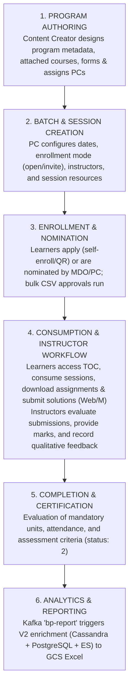
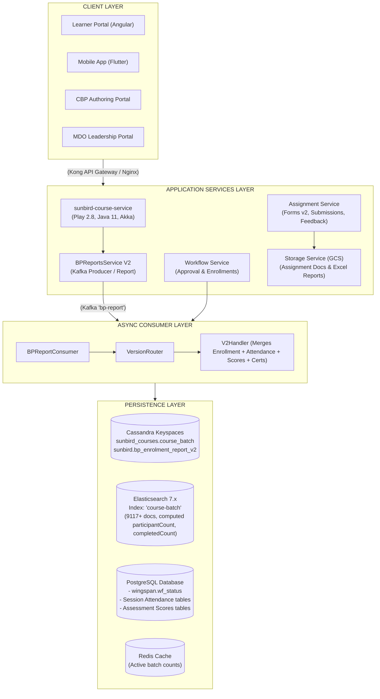

## 1. Executive Summary

The **Blended Program** on the iGOT Karmayogi Platform bridges asynchronous self-paced digital learning with synchronous, cohort-based, instructor-led offline/live interactions. Unlike standalone courses, a Blended Program functions as a **parent container** governing one or more executable **Program Batches**. Each batch enforces strict cohort dates, enrollment quotas, instructor/mentor assignments, registration workflows, session resources, post-batch assignments, evaluations, and comprehensive consumption reporting.

The capability evolved across major platform increments:

- **Foundation (Q2–Q6):** Configurable enrollment forms, reporting foundations, and workflow-based bulk approval/rejection.
- **Maturity & Governance (Q9):** Multiple Program Coordinators (PCs), batch- and session-level resource editing before start date, removal of the Content Quality Framework (CQF) publishing bottleneck, instructor onboarding, and assignment authoring/evaluation workflows.
- **Operational Agility (Q12):** Same-day batch creation, enrollment, and nomination; multi-format support (PDF/PPT); cross-MDO instructors/PCs; inactive batch cloning; and batch-wise/program-level report extensions.
- **Architectural Refinements:** Dual-table Cassandra report partitioning (`bp_enrolment_report` & `bp_enrolment_report_v2`), Elasticsearch mapping optimizations on `course-batch`, Redis-backed active enrollment counters, and asynchronous Kafka-driven report generation pipelines (`bp-report`).

## 2. Business Context and Objectives

Standalone digital courses lack the pedagogical depth and organizational oversight required for high-stakes civil service training. The Blended Program addresses these operational needs:

1. **Administrative Delegation:** Decentralizes batch operations by permitting Content Creators to onboard multiple Program Coordinators across MDOs.
2. **Cohort & Session Agility:** Allows Program Coordinators to edit session schedules and add reference materials (PDFs, DOCs, PPTs, external links) up to the session start time.
3. **Streamlined Publishing:** Removes administrative bottlenecks by allowing direct Content Creator Content Publisher transitions without intermediate SPV/CQF gates.
4. **Interactive Assessment:** Enables instructors to administer bespoke post-batch assignments that learners complete and submit for manual qualitative scoring and feedback.
5. **Multi-Store Analytical Visibility:** Delivers real-time and near-real-time batch metrics, attendance tracking, and downloadable multi-tab audit reports for SPV, MDO Leaders, and Program Coordinators.

## 3. End-to-End Functional Lifecycle



### Stage 1: Program Creation & Publishing

- **Actors:** Content Creator, Content Publisher.
- **Surface:** Content/CBP Portal.
- **Actions:** Creator inputs program metadata (title, overview, competencies, attached courses/modules). Additional Program Coordinators are assigned across MDOs. Under Q9 improvements, the legacy CQF step is bypassed, allowing direct review and publication to production.

### Stage 2: Batch & Session Management

- **Actors:** Program Coordinator (PC).
- **Surface:** CBP Portal (Batch Management).
- **Actions:** Batches are created via `POST /v1/course/batch/create` with attributes including `startDate`, `endDate`, `enrollmentEndDate`, `enrollmentType` (`open` or `invite-only`), and `createdFor` (target MDOs). Coordinators attach instructors (`mentors`) and session-level resources (PDF/PPT/links). In Q12, same-day batch creation and inactive batch cloning were enabled. Soft deletion (`POST /v1/course/batch/delete`) marks the batch deleted, invalidates enrollments, and notifies learners.

### Stage 3: Learner Enrollment & Approval Workflows

- **Self-Enrollment:** Learner discovers an open batch on Web/Mobile and requests enrollment or scans a physical/digital session QR code (`enableqr`).
- **Nomination:** MDO Admins, MDO Leaders, or PCs nominate civil servants into batches.
- **Bulk Governance:** Admins export pending requests via `POST /workflow/blendedprogram/getUserApprovalDataInCsv`, update the `action` column (`approve`/`reject`), and upload via `POST /workflow/blendedprogram/bulkApprovalDataFromCsv/{courseId}`.
- **Active Count Monitoring:** Active batch counts are queried via `POST /workflow/blendedprogram/enrol/status/count/details`, backed by Redis caching.

### Stage 4: Learner Consumption & Instructor Delivery

- **TOC Discovery:** Enrolled learners access the batch Table of Contents (TOC). If active assignments exist, an **Assignments** tab appears.
- **Assignment Authoring:** Instructors upload assignment prompts via `POST /api/assignment/v1/create` (`batchId`, `courseId`, `assignmentUrl`, `description`).
- **Learner Submission:** Learners download assignment files, preview work, and submit solutions (single submission, max 5 MB, PDF/DOC/DOCX) via `PUT /api/assignment/v1/submitDraft` or `POST /api/assignment/v1/submit`. Uploaded files are routed to cloud storage (`/api/storage/v1/bp/assignment/answer/...`).
- **Evaluation:** Instructors review files via `GET /api/assignment/v1/getAnswerById` and submit scoring and qualitative comments via `POST /api/assignment/v1/feedback` (`status: "Evaluated"`, `totalMarks`, `instructorFeedback`).

### Stage 5: Completion & Certification

- **Criteria Evaluation:** Completion requires consuming mandatory components and achieving a terminal enrollment state (`status: 2`).
- **Certificate Issuance:** Batches carry `cert_templates` configured with SVG layouts, signatories, criteria, and notification email templates. Certificates are automatically issued and linked to the user's profile upon completion.

### Stage 6: Analytics, Reporting & Data Warehousing

- **Report Request:** MDO Admins/PCs initiate asynchronous reports via `POST /bp/v1/generate/report` (standard) or `POST /bp/v2/generate/report` (enriched).
- **Kafka Pipeline:** Publishes an event to Kafka topic `bp-report`. The consumer reads the `version` attribute:
  - `v1`: Fetches enrollment and basic completion.
  - `v2`: Enriches records with PostgreSQL session attendance, assessment scores, user registry metadata, and form responses into a 6-sheet Excel workbook uploaded to Google Cloud Storage (GCS).

- **Download:** Clients poll `POST /bp/v1/bpreport/status` and download the completed file via `GET /bp/v1/bpreport/download/...`.

## 4. Stakeholder & Portal Responsibility Matrix

| Role | Portal / Surface | Program Authoring | Batch Setup & Edit | Enrollment & Approvals | Attendance & Sessions | Assignment & Grading | Reporting & Analytics |
|---|---|---|---|---|---|---|---|
| **Content** **Creator** | CBP Portal | **Owner** | View | N/A | N/A | N/A | View |
| **Content Publisher** | CBP Portal | **Approver** | N/A | N/A | N/A | N/A | N/A |
| **Program Coordinator (PC)** | CBP Portal | Assignee | **Owner** | **Approver (Bulk CSV)** | **Manager** | View | **Generator (Batch)** |
| **Instructor / Mentor** | Instructor View | N/A | View | N/A | Marker | **Owner (Author/Grade)** | View |
| **Learner** | Web / Mobile App | N/A | N/A | Enrollee / Applicant | Attendee | **Submitter** | View Profile / Cert |
| **MDO Admin / Leader** | MDO Portal | N/A | N/A | Nominator / Approver | Viewer | N/A | **Generator (Org-wide)** |
| **SPV Admin** | Admin Console | Governance | Governance | Platform Oversight | N/A | N/A | **Exhaust Consumer** |

## 5. Technical Architecture & Microservice Decomposition



### Component Details

1. **sunbird-course-service:** Akka actor-based core handling batch lifecycle, Cassandra persistence, and asynchronous indexing into Elasticsearch.
2. **Elasticsearch** (`course-batch`): High-speed search engine supporting pagination, text search (`all_fields`), existence filters, and pre-computed aggregation fields (`participantCount`, `completedCount`). Dynamic mapping is strictly disabled.
3. **Workflow Service:** Manages multi-state enrollment requests (`SEND_FOR_PC_APPROVAL`, `APPROVED`, `REJECTED`) and provides bulk CSV processing.
4. **Assignment Service** (`forms-service`): Backs assignment distribution, learner draft saves, final submissions, and qualitative feedback loops.
5. **Report Generation Engine:** Kafka-driven asynchronous worker. Uses `bp_enrolment_report_v2` partitioned by `(orgid, courseid, batchid, reportrequester, contexttype)` to prevent primary key collisions when generating multi-context reports.

## 6. Comprehensive API Reference Matrix

| Domain | Method | API Endpoint | Description | Consuming Portal | Data Store Impact |
|---|---|---|---|---|---|
| **Batch** | `POST` | `/v1/course/batch/search` | Query batches with filters, sorting, and pagination | CBP / Learner | Reads ES `course-batch` |
| **Batch** | `GET` | `/v1/course/batch/read/{batchId}` | Read single batch including Cassandra-only fields | CBP / MDO | Reads `sunbird_courses.``course_batch` |
| **Batch** | `POST` | `/v1/course/batch/create` | Create batch with dates, enrollment type, mentors | CBP Portal | Writes Cassandra; syncs ES |
| **Batch** | `PATCH` | `/v1/course/batch/update` | Update mutable batch metadata | CBP Portal | Updates Cassandra; syncs ES |
| **Batch** | `POST` | `/v1/course/batch/delete` | Soft-deletes batch; invalidates user enrollments | CBP Portal | Updates batch & enrollment state |
| **Batch** | `POST` | `/v1/batch/participants/list` | Returns enrolled user IDs and profile info | CBP / MDO | Reads Cassandra enrollment index |
| **Workflow** | `POST` | `/workflow/blendedprogram/getUserApprovalDataInCsv` | Download CSV template of pending enrollment requests | MDO / CBP | Reads `wingspan.wf_status` |
| **Workflow** | `POST` | `/workflow/blendedprogram/bulkApprovalDataFromCsv/{id}` | Upload processed CSV for bulk approval/rejection | CBP Portal | Updates workflow & batch states |
| **Workflow** | `POST` | `/workflow/blendedprogram/enrol/status/count/details` | Batch-wise active enrollment counts | Admin / Reports | Reads DB; uses Redis cache |
| **Assignment** | `POST` | `/api/assignment/v1/create` | Instructor creates assignment for batch | CBP (Instructor) | Stores assignment object |
| **Assignment** | `POST` | `/api/assignment/v1/search` | Filter assignments by `batchId` | Learner / PC | Reads assignment store |
| **Assignment** | `PUT` | `/api/assignment/v1/submitDraft` | Learner saves work as draft | Learner (Web/M) | Saves draft submission |
| **Assignment** | `POST` | `/api/assignment/v1/submit` | Learner finalizes assignment submission | Learner (Web/M) | Status updated to `SUBMITTED` |
| **Assignment** | `POST` | `/api/assignment/v1/feedback` | Instructor submits marks and textual feedback | CBP (Instructor) | Status updated to `EVALUATED` |
| **Assignment** | `GET` | `/api/assignment/v1/getAnswerById` | Fetch submitted assignment answers & feedback | Learner / PC | Reads submission & evaluation |
| **Storage** | `POST` | `/api/storage/v1/bp/assignment/answer/...` | Multipart file upload for assignment answers | Learner (Web/M) | Saves PDF/DOCX to GCS |
| **Storage** | `GET` | `/api/storage/v1/bp/assignment/answer/read/file` | Retrieve uploaded learner assignment file | Instructor / PC | Streams file from GCS |
| **Reports** | `POST` | `/bp/v1/generate/report` | Legacy/standard batch enrollment report | MDO / CBP | Writes `bp_enrolment_report`; Kafka v1 |
| **Reports** | `POST` | `/bp/v2/generate/report` | Comprehensive Blended Program report | MDO / CBP | Writes `bp_enrolment_report_v2`; Kafka v2 |
| **Reports** | `POST` | `/bp/v1/bpreport/status` | Poll asynchronous report generation status | MDO / CBP | Reads report status table |
| **Reports** | `GET` | `/bp/v1/bpreport/download/{org}/{c}/{b}/{f}` | Download generated Excel report file | MDO / CBP | Streams Excel artifact from GCS |
| **Consumption** | `POST` | `/apis/proxies/v8/bp/v1/generate/consumption/report` | Trigger async consumption report | MDO / CBP | Triggers background processing |
| **Consumption** | `POST` | `/apis/proxies/v8/bp/v1/consumption/report/status` | Poll consumption report status | MDO / CBP | Reads consumption job state |
| **Consumption** | `GET` | `/apis/proxies/v8/bp/v1/bp/v1/consumption/.../download` | Download completed consumption report | MDO / CBP | Streams consumption report |

## 7. Data Models & Storage Architecture

### 7.1 Cassandra Batch Table (`sunbird_courses.course_batch`)

```sql
PRIMARY KEY (courseid, batchid) CLUSTERING ORDER BY (batchid ASC);
```

- **Indexed / Synced to ES:** `batchId`, `courseId`, `name`, `description`, `status` (0=Upcoming, 1=Ongoing, 2=Completed), `enrollmentType` (`open`/`invite-only`), `startDate`, `endDate`, `enrollmentEndDate`, `createdDate`, `updatedDate`, `createdBy`, `mentors`, `createdFor`, `cert_templates`.
- **Cassandra-Only Fields:** `batch_attributes`, `batch_location_details`, `enableqr`, `tandc`. *(Must be accessed via direct read API, not search).*

### 7.2 Cassandra Report Table Evolution (`sunbird.bp_enrolment_report_v2`)

Cassandra's primary keys are immutable; adding `contextType` as a regular column would cause rows to overwrite each other due to Cassandra's upsert model. Thus, a dedicated table was introduced:

```sql
CREATE TABLE sunbird.bp_enrolment_report_v2 (
    orgid text,
    courseid text,
    batchid text,
    reportrequester text,
    contexttype text,
    approveduser int,
    createdby text,
    downloadlink text,
    filename text,
    lastreportgeneratedon timestamp,
    pendinguser int,
    rejecteduser int,
    status text,
    surveyid text,
    PRIMARY KEY (orgid, courseid, batchid, reportrequester, contexttype)
) WITH CLUSTERING ORDER BY (courseid ASC, batchid ASC, reportrequester ASC, contexttype ASC);
```

### 7.3 Elasticsearch `course-batch` Index Nuances

- **Date Sorting:** Date fields (`startDate`, `endDate`, `enrollmentEndDate`) are proper ES date types and sorted directly (`{"startDate": "desc"}`). String timestamp fields (`createdDate`, `updatedDate`) and textual names (`name`, `courseId`) must use `.raw` (`{"createdDate.raw": "desc"}`, `{"name.raw": "asc"}`).
- **Computed Fields:** `participantCount` and `completedCount` are populated from asynchronous joins across enrollment tables.

## 8. Business Logic & Calculation Rules

| Metric / Calculation | Business Definition | Technical Formula / Source | Discrepancies / Gaps |
|---|---|---|---|
| **Active Enrollment Count** | Current active civil servants admitted into a specific cohort | . Cached in Redis per batch ID. | Redis cache eviction delays can cause transient count mismatches. |
| **Batch Completion Metric** | Number of participants who satisfied program requirements | Precomputed `completedCount` in Elasticsearch derived from `user_enrolments.status = 2`. | Exact weighting of assignments vs offline sessions is not centralized in docs. |
| **Certificate Eligibility** | Condition under which a digital certificate is triggered | Configured in `cert_templates.criteria`: `{"enrollment": {"status": 2}}`. | Hard-coded to course completion; conditional attendance thresholds require manual verification. |
| **Assignment Evaluation** | Qualitative assessment of learner submissions | Scored via `/api/assignment/v1/feedback`: assigns `totalMarks`, `instructorFeedback`, and moves status to `EVALUATED`. | Resubmission rules upon failed evaluation are not explicitly documented. |
| **Batch Sorting Ceiling** | Maximum records accessible via search pagination | Hard limit: . Exceeding values are clamped. | Requires consumers to narrow queries using date/status filters. |

## 9. Gap Analysis: Documentation vs. Implementation

| Gap ID | Area | Documented Expectation | Observed Implementation Evidence | Severity | Recommended Mitigation |
|---|---|---|---|---|---|
| **GAP-01** | **Attendance Engine** | Automated QR scan attendance marking impacting completion | Attendance is referenced in V2 reporting, but direct attendance mark/sync APIs are absent in core specs | **High** | Publish dedicated Attendance Service API contracts and Cassandra/Postgres schema mappings. |
| **GAP-02** | **Completion Formula** | Granular multi-component completion formulas (offline attendance + online modules + assignment) | System relies on binary Sunbird status `enrollment.status = 2` | **Medium** | Formally document how external LMS events roll up into terminal enrollment status `2`. |
| **GAP-03** | **Program Authoring APIs** | End-to-end CRUD REST contracts for parent program creation | Specifications document batch APIs thoroughly, but omit parent program creation payloads | **Medium** | Document `/action/content/v3/create` schemas for `contentType: Blended Program`. |
| **GAP-04** | **Async** **Indexing Lag** | Instantaneous batch discovery following creation | Cassandra writes sync asynchronously to Elasticsearch via Akka actors | **Low** | Document eventual consistency SLA (typically 1–3s) for UI polling after batch creation. |

## 10. Verification & Reference Matrix

### Key Confluence Technical Documents

- [Blended Program Batch Details](https://karmayogibharat.atlassian.net/wiki/spaces/TES/pages/1157595153/Blended+Program+Batch+Details) — Cassandra schema, Elasticsearch mapping, sorting syntax, and batch CRUD.
- [Blended Program Enhancements - Batch Wise Reports Tech Design](https://karmayogibharat.atlassian.net/wiki/spaces/TES/pages/1042677779/Blended+Program+Enhancements+-+Batch+Wise+Reports+Tech+Design) — V1 vs V2 report generation, Kafka topic architecture, and multi-source enrichment.
- [Blended Program Enhancements - Batch Wise Reports - Generate Report Api Enhancement](https://karmayogibharat.atlassian.net/wiki/spaces/TES/pages/1061355521/Blended+Program+Enhancements+-+Batch+Wise+Reports+-+Generate+Report+Api+Enhancement) — Analysis of Cassandra primary key immutability and `bp_enrolment_report_v2` DDL.
- [Blended Program Enhancements - Active Batch Enrollments Tech Design](https://karmayogibharat.atlassian.net/wiki/spaces/TES/pages/1045889027/Blended+Program+Enhancements+-+Active+Batch+Enrollments+Tech+Design) — `POST /workflow/blendedprogram/enrol/status/count/details` and Redis caching strategy.
- [Sprint 30 API contract Details For Blended Program Enhancements](https://karmayogibharat.atlassian.net/wiki/spaces/TES/pages/495419480/Sprint+30+API+contract+Details+For+Blended+Program+Enhancements) — Assignment creation, submission, evaluation, and GCS file persistence contracts.
- [SRS - Q9 l Blended Program Enhancements](https://karmayogibharat.atlassian.net/wiki/spaces/TES/pages/504430593/SRS+-+Q9+l+Blended+Program+Enhancements) — Functional requirements, multi-PC allocation, session resource editing, and CQF removal.
- [Q12 | Blended Program Enhancements](https://karmayogibharat.atlassian.net/wiki/spaces/TPT/pages/972423178/Q12+Blended+Program+Enhancements) — Same-day batch operations, inactive batch cloning, PPT/PDF support, and cross-MDO roles.
- [Blended program delete batch API](https://karmayogibharat.atlassian.net/wiki/spaces/TES/pages/478380033/Blended+program+delete+batch+API) — Soft deletion semantics and user notification triggers.
- [API Documentation: Blended Program Bulk Upload Approval/Rejection](https://karmayogibharat.atlassian.net/wiki/spaces/TES/pages/381780108/API+Documentation+Blended+Program+Bulk+Upload+Approval+Rejection) — CSV-based bulk approval workflows.

### Verified Jira Deliverables

- **Epics & Foundations:** `KB-13948` (Q12 Enhancements), `KB-11078` (Q9 Coordinator/Creator Enhancements), `KB-10855` (Q10 Instructor/Learner Enhancements), `KB-334` (Configurable Forms), `KB-325` (Reports Foundation).
- **Batch & Authoring:** `KB-13937` (Batch Enhancements), `KB-14008` (Same-Day Batch BE), `KB-13996` (Same-Day Batch FE), `KB-13991` (Batch Cloning), `KB-11079` (Batch Editing), `KB-11080` (Session Editing), `KB-11561` (Delete Batch API), `KB-11083` (CQF Removal).
- **Enrollment & Workflow:** `KB-15880` (Learner Re-enrollment), `KB-15722` (Trainer Nominations), `KB-15664` (Learners List), `KB-14898` / `KB-14899` (Self-Enrollment & QR Code Generation), `KB-7850` (Bulk Approval API).
- **Consumption & Assignments:** `KB-13947` (Learner TOC), `KB-11071` (Assignment Creation BE), `KB-10860` (Assignment Consumption), `KB-11563` (Assignment Submission), `KB-11739` (GCS File Upload), `KB-15810` (Pre-Assessment Progress Decoupling).
- **Reporting & Analytics:** `KB-13972` (Batch-wise Reports), `KB-14010` (BE Reports), `KB-13995` (Report UI/API), `KB-688` (Exhaustive Reports), `KB-775` / `KB-10977` (PySpark Pipeline).
