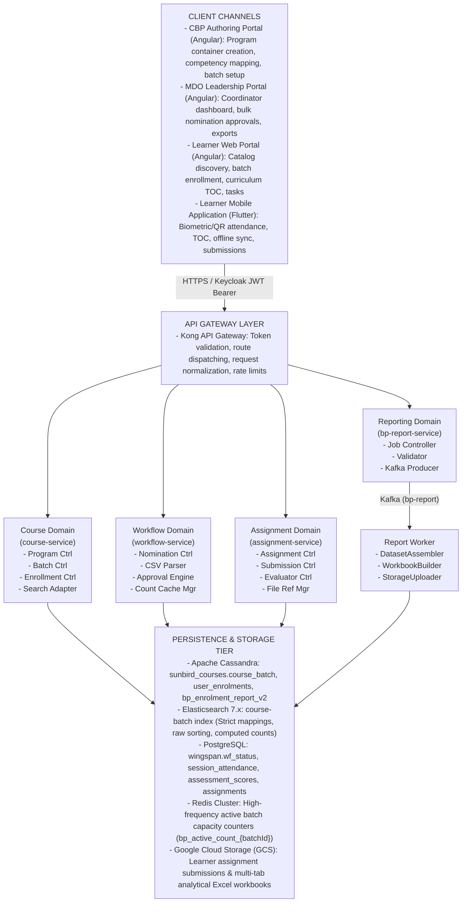
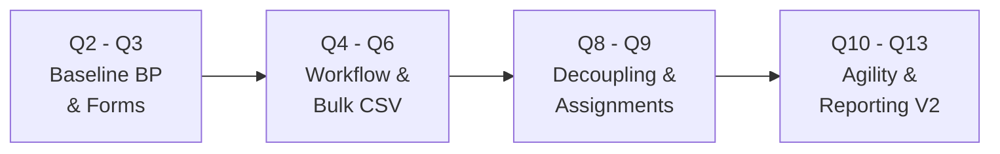
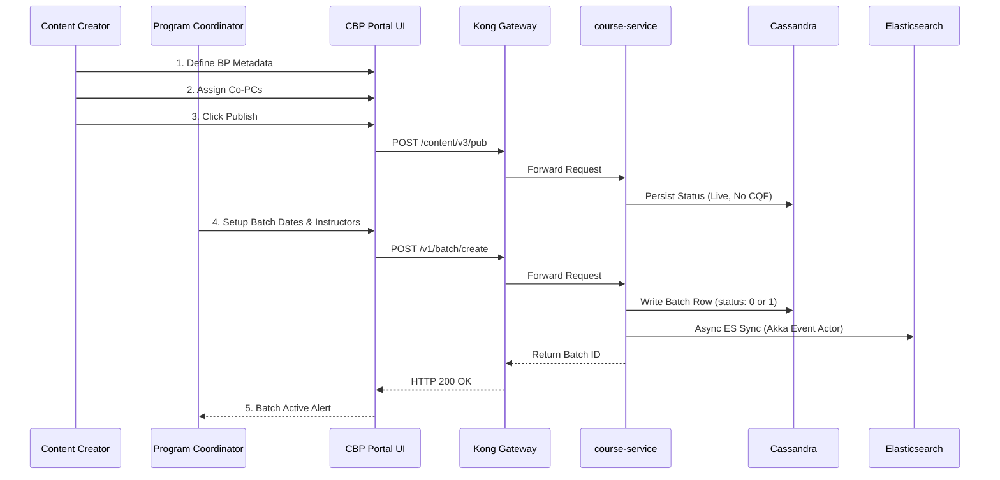
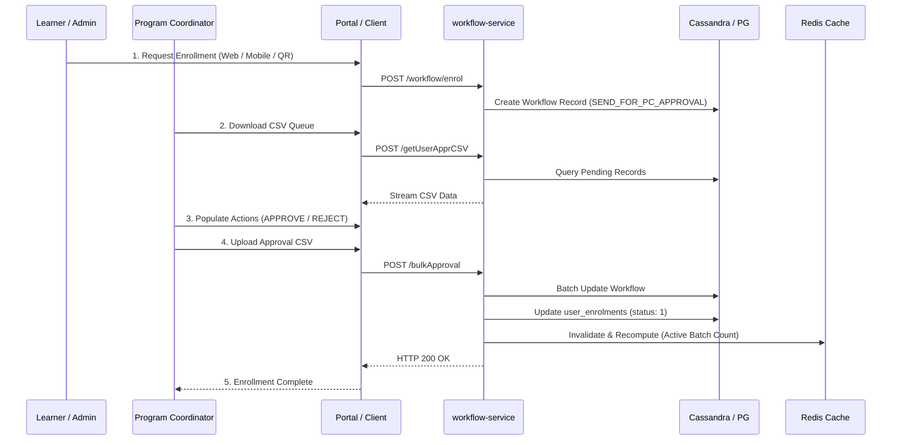
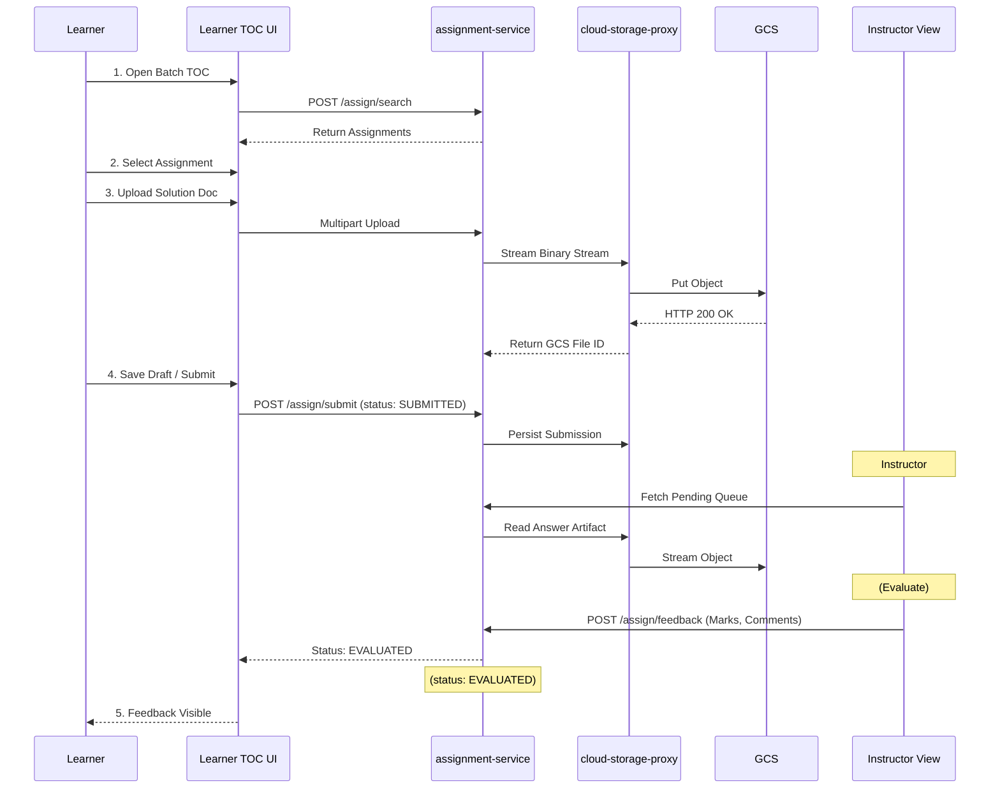
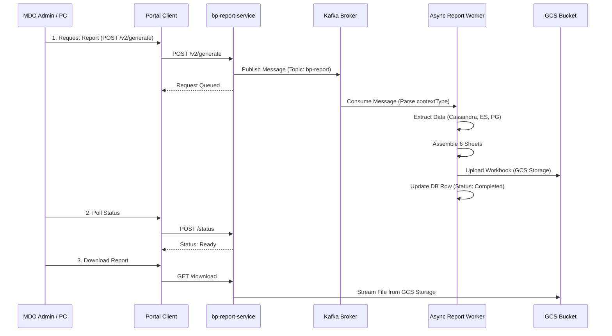
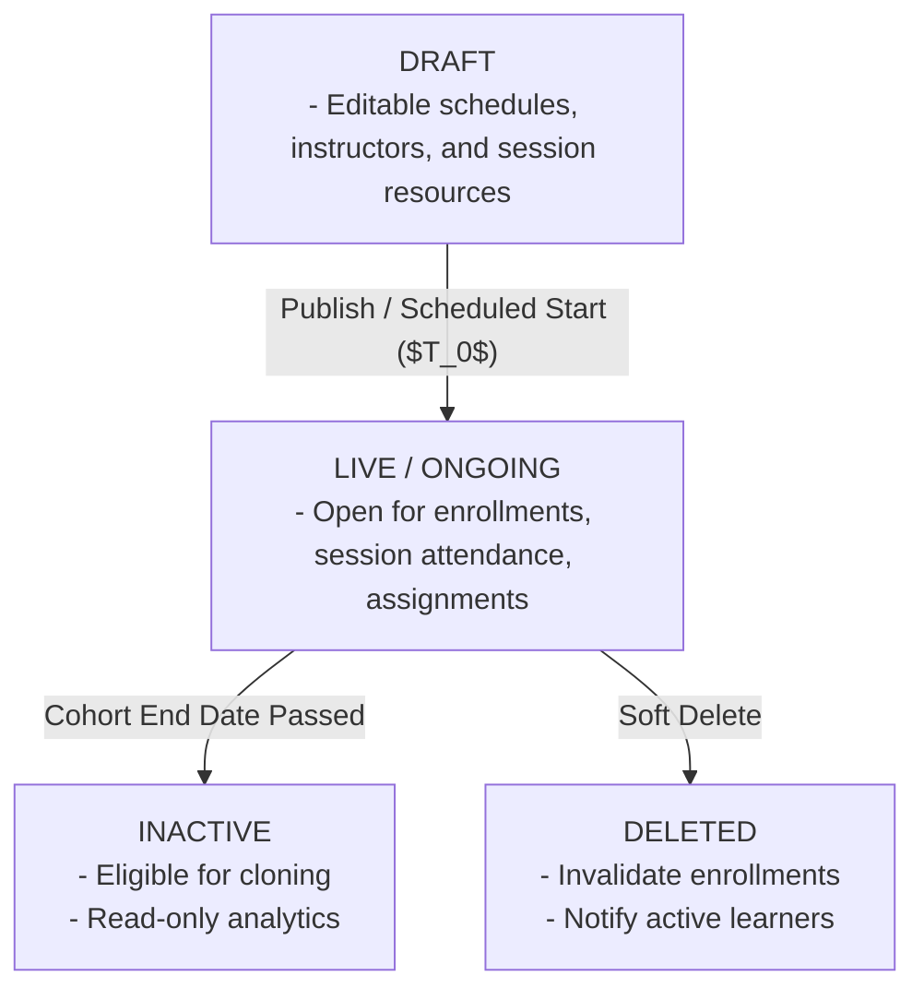
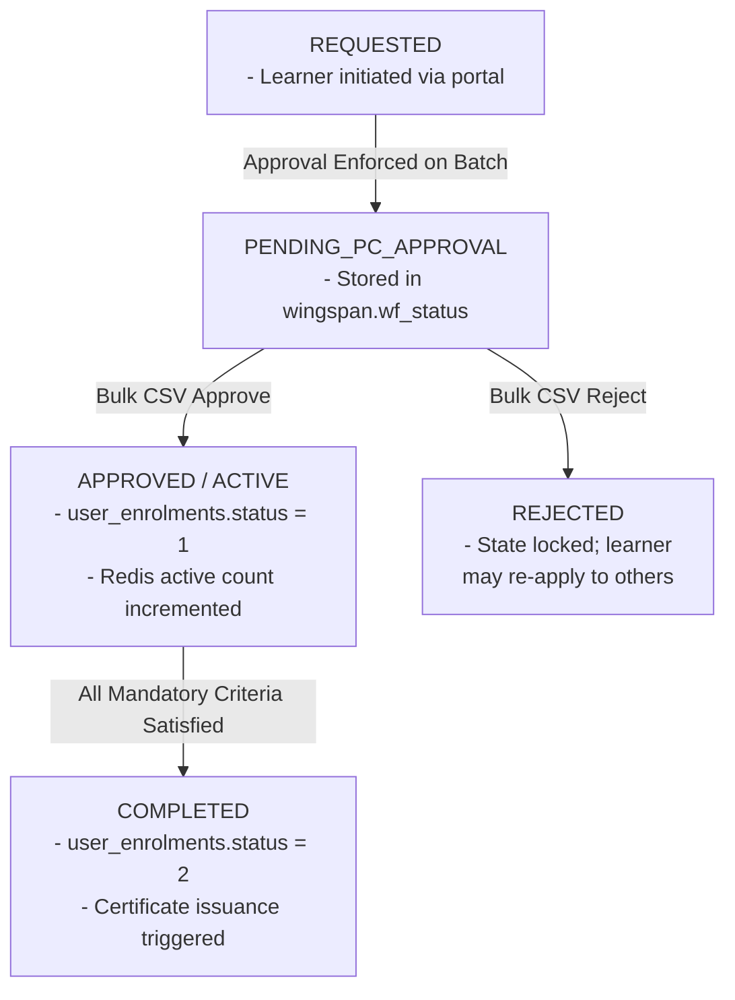
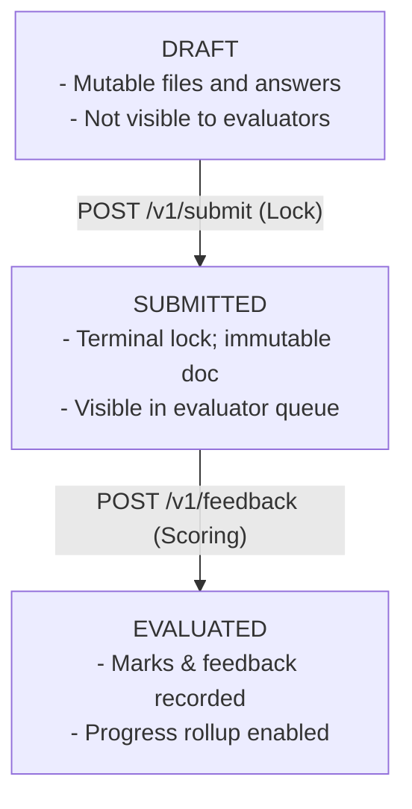

# Blended Program — Low-Level Design (LLD)

## 1. System Decomposition & Module Organization

The Blended Program implementation is organized into four client channels, an API gateway perimeter, four core backend service domains, an asynchronous worker layer, and a polyglot persistence tier.

## 2. Evolution Summary by Release Band (Q2 to Q13)

| Release Band | Functional Scope | Architectural & Design Impact | Core Modules Involved |
|---|---|---|---|
| **Q2–Q3** | Baseline Blended Program container; linked registration forms; basic CSV reports. | Established structural separation between parent program container and runtime batches. | CBP Portal, `course-service`, Cassandra |
| **Q4–Q6** | Nomination pipelines; bulk approval/rejection CSVs; custom profile field capture. | Relational workflow state introduced; delegated enrollment transitions to coordinator queues. | `workflow-service`, PostgreSQL, Redis |
| **Q8–Q9** | Direct publishing (CQF bypass); dedicated assignment microservice; multi-PC allocation. | Removed authoring review bottlenecks; decoupled assignment evaluation into a dedicated service. | `content-service`, `assignment-service`, GCS |
| **Q10–Q11** | Cross-MDO instructor allocation; mobile and web assignment delivery; asset proxying. | Multi-format media streaming via storage proxies; Cassandra read-path query optimization. | `cloud-storage-proxy`, Elasticsearch, Mobile App |
| **Q12–Q13** | Same-day batch lifecycle; batch cloning; asynchronous V2 reporting; pre-assessment decoupling. | Operational agility relaxed date constraints; dedicated Cassandra V2 report table isolated analytics. | `bp-report-service`, Kafka consumer, Cassandra |

## 3. End-to-End Frontend-to-Backend Flow Diagrams

### 3.1 Program Creation and Direct Publishing Flow

Content Creators author program metadata and competency mappings. The workflow transitions directly from Draft to Live, eliminating intermediate review bottlenecks.

### 3.2 Learner Enrollment, Nomination & Bulk CSV Approval Flow

Enforces cohort capacity limits and supports both direct nominations and bulk CSV approval workflows.

### 3.3 Learner Consumption, Assignment Submission & Grading Flow

Learners interact with the batch curriculum, submit drafts, finalize submissions, and receive graded evaluations.

### 3.4 Asynchronous Analytics & Multi-Tab Report Generation Flow

Isolates multi-store joins across Cassandra, PostgreSQL, and Elasticsearch from the transactional runtime path.

## 4. State Machines & Lifecycle Transitions

### 4.1 Program Batch Lifecycle State Machine

### 4.2 Learner Enrollment State Machine

### 4.3 Assignment Submission State Machine

## 5. Persistence Entities & Data Dictionaries

### 5.1 Apache Cassandra: Batch Table (`sunbird_courses.course_batch`)

- **Primary Key:** `(courseid, batchid)` with `CLUSTERING ORDER BY (batchid ASC)`
- **Operational Attributes:**
  - `status` *(int)*: `0` (Upcoming), `1` (Ongoing), `2` (Completed), `3` (Soft Deleted)
  - `enrollmenttype` *(text)*: `open` or `invite-only`
  - `startdate`, `enddate`, `enrollmentenddate` *(text)*: ISO formatted dates (`YYYY-MM-DD`)
  - `mentors` *(list<text>)*: Instructor account IDs
  - `createdfor` *(list<text>)*: Permitted target MDO IDs
  - `cert_templates` *(map<text, frozen<map<text, text>>>)*: Certificate SVG layout, signatories, and issuance criteria
  - `batch_attributes` *(map<text, text>)*: Dynamic batch properties
  - `enableqr` *(boolean)*: QR-code self-enrollment toggle

### 5.2 Apache Cassandra: Reporting V2 Table (`sunbird.bp_enrolment_report_v2`)

- **Primary Key:** `(orgid, courseid, batchid, reportrequester, contexttype)` with `CLUSTERING ORDER BY (courseid ASC, batchid ASC, reportrequester ASC, contexttype ASC)`
- **Operational Attributes:**
  - `contexttype` *(text)*: Disambiguates concurrent export scopes, preventing primary key collisions in Cassandra's upsert model
  - `approveduser`, `pendinguser`, `rejecteduser` *(int)*: Aggregated participant metrics
  - `downloadlink` *(text)*: Signed GCS download URL
  - `status` *(text)*: `SUBMITTED`, `PROCESSING`, `COMPLETED`, `FAILED`

### 5.3 PostgreSQL Relational Schemas

- **Workflow Table** (`wingspan.wf_status`):
  - `request_id` *(UUID, PK)*, `course_id` *(varchar)*, `batch_id` *(varchar)*, `user_id` *(varchar)*
  - `current_state` *(varchar)*: `SEND_FOR_PC_APPROVAL`, `APPROVED`, `REJECTED`
  - `actor_id` *(varchar)*, `updated_on` *(timestamp)*

- **Assignment Submissions Table** (`assignment_submissions`):
  - `submission_id` *(UUID, PK)*, `assignment_id` *(varchar)*, `batch_id` *(varchar)*, `user_id` *(varchar)*
  - `status` *(varchar)*: `DRAFT`, `SUBMITTED`, `EVALUATED`
  - `file_ref_id` *(varchar)*: GCS object reference
  - `marks_awarded` *(numeric)*, `evaluator_feedback` *(text)*

## 6. Algorithmic Guardrails & Business Calculations

### 6.1 Real-Time Cohort Fill Rate Calculation

To avoid database connection starvation, capacity validations evaluate against cached counters before initiating enrollment: $$\text{AvailableCapacity}(B) = \text{MaxCapacity}(B) - \text{ActiveEnrollmentCount}(B)$$ Where $\text{ActiveEnrollmentCount}(B)$ is pulled directly from the Redis key `bp_active_count_{batchId}`. If $\text{AvailableCapacity}(B) \le 0$, self-enrollment requests fail fast with HTTP 409 (`BATCH_CAPACITY_EXCEEDED`).

### 6.2 Terminal Completion Rollup Condition

A learner achieves terminal program completion (`user_enrolments.status = 2`) when all mandatory cohort criteria are met: $$\text{IsComplete}(u, P, B) \iff \left( \forall m \in \text{MandatoryModules}(P), , \text{Progress}(u, m) = 100% \right) \land \left( \forall a \in \text{MandatoryAssignments}(B), , \text{Status}(u, a) = \text{EVALUATED} \right)$$

- Optional pre-assessments (decoupled in Q13 via `KB-15810`) are excluded from this evaluation.

### 6.3 Deep Search Pagination Clamping

To prevent Elasticsearch cluster memory exhaustion, search pagination is bounded: $$\text{MaxAccessibleOffset} = 10,000 - \text{limit}$$ Requests exceeding this boundary are clamped, requiring callers to narrow search filters (e.g., date ranges, MDO identifiers).

## 7. Operational Tasks & Engineering Playbook

| Domain | Responsible Actor | Primary System Touchpoints | Operational Action & Recovery Strategy |
|---|---|---|---|
| **Program Setup** | Content Creator / Publisher | CBP Portal, `course-service` | Design program hierarchy, map competencies, trigger direct publish. |
| **Batch Operations** | Program Coordinator | CBP Portal, `course-service`, ES | Configure schedules, clone inactive batches, attach session materials. |
| **Bulk Approvals** | Program Coordinator | `workflow-service`, PostgreSQL, Redis | Download pending candidates CSV, apply decisions, upload manifest. |
| **Assignment Lifecycle** | Instructor / Learner | `assignment-service`, GCS proxy | Distribute tasks, upload answers ($\le 5\text{ MB}$), record feedback. |
| **Analytical Exports** | MDO Admin / PC | `bp-report-service`, Kafka, GCS | Request multi-tab export; poll `/status` until download URL resolves. |
| **Index Reconciliation** | Platform SRE | Kafka consumer, Elasticsearch | Monitor lag; execute re-index scripts on document drift. |
| **Cache Recovery** | Platform SRE | Redis cluster | Invalidate and rebuild `bp_active_count_*` on manual DB updates. |
