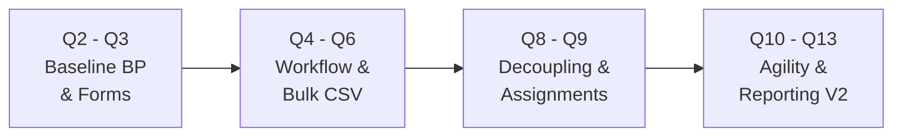
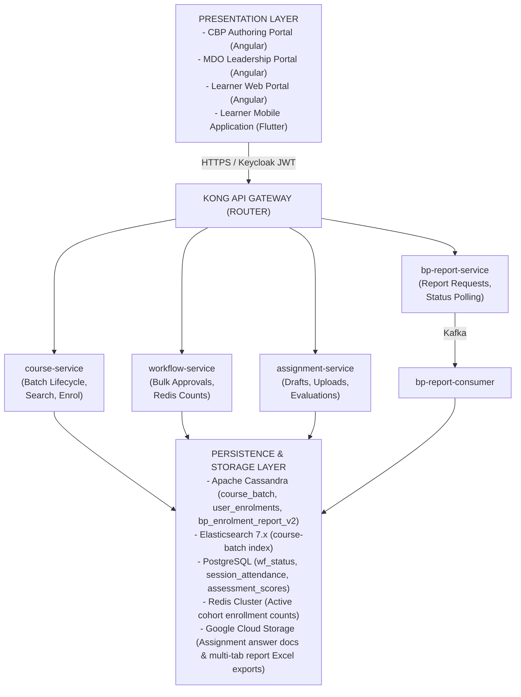
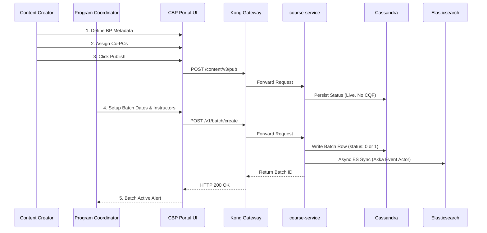
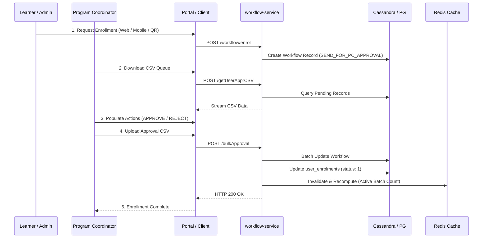
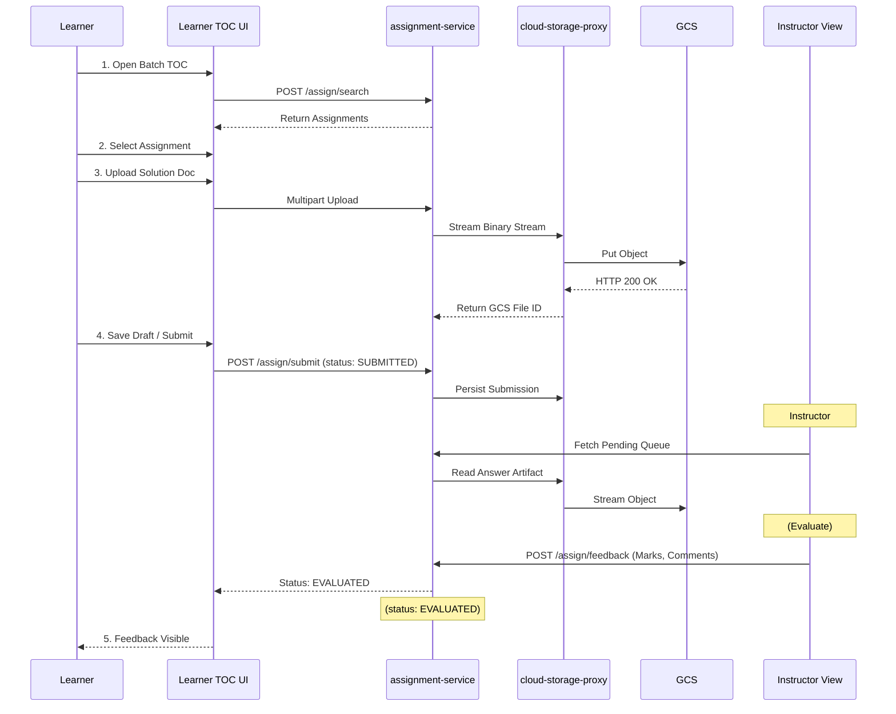
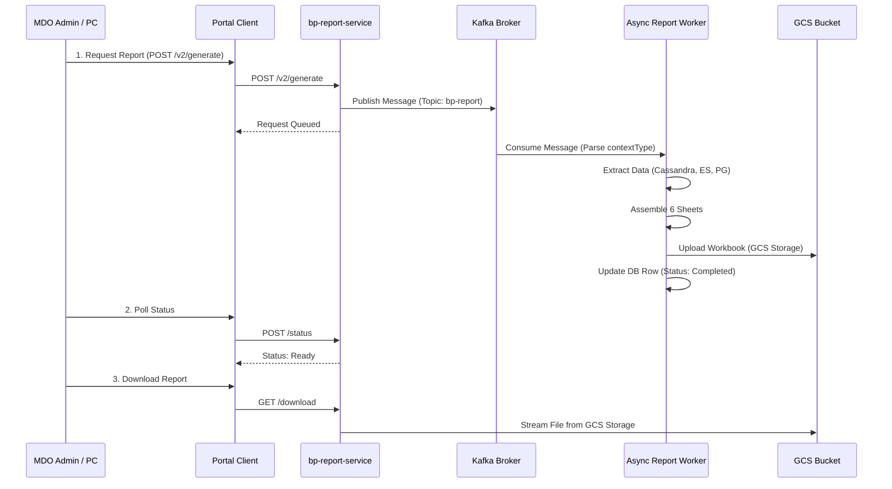
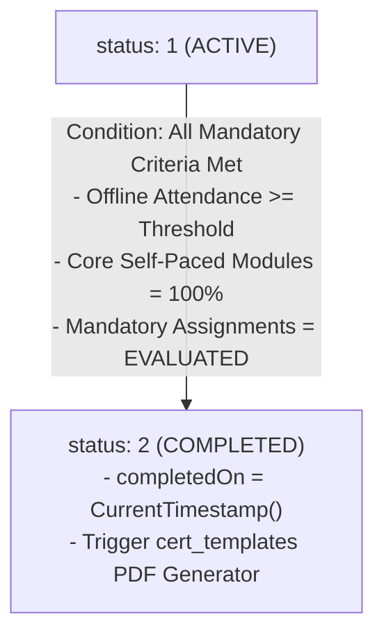

# Blended Program — Software Design Document (SDD)

## 1. System Overview and Architectural Objectives

### 1.1 Purpose

This Software Design Document (SDD) translates the functional and operational requirements of the **Blended Program (BP)** into an engineering blueprint. It details how the architecture evolved chronologically from **Q2 through Q13**, moving from a monolithic batch enrollment structure to a decoupled, event-driven microservice ecosystem.

### 1.2 Key Architectural Tenets

1. **Separation of Structure vs. Runtime:** The parent program metadata container (`do_id`) is strictly decoupled from its executable runtime cohorts (`batchId`). A single program can support multiple independent, concurrently running batches with distinct instructors, schedules, access rules, and target MDOs.
2. **Polyglot Persistence:**
  - **Apache Cassandra:** High-throughput operational store for batch metadata and immutable learner enrollment records.
  - **Elasticsearch (7.x):** Sub-second query engine for batch catalogs, full-text search, and faceted filtering (`course-batch` index).
  - **PostgreSQL:** Relational store managing multi-state workflow approvals (`wingspan.wf_status`), session attendance logs, and assessment scores.
  - **Redis:** Low-latency caching layer for high-frequency operational metrics (e.g., active batch capacity counts).
  - **Google Cloud Storage (GCS):** Object storage for learner assignment submissions and asynchronous analytical workbooks.

3. **Decoupled Asynchronous Processing:** Heavy multi-store joins and workbook generation pipelines are offloaded to Kafka-driven background workers, isolating transactional APIs from analytical workloads.

## 2. Chronological Design Evolution (Q2 to Q13)



- **Q2–Q3 (Foundational Model):** Monolithic batch execution model in `sunbird-course-service`. Introduction of dynamic form links for program registration and batch-level CSV reporting (`KB-334`, `KB-325`).
- **Q4–Q6 (Workflow Integration):** Delegation of enrollment requests to `workflow-service`. Introduction of multi-state enrollment pipelines (`SEND_FOR_PC_APPROVAL`, `APPROVED`, `REJECTED`) and bulk CSV upload handlers (`KB-7028`, `KB-7850`).
- **Q8–Q9 (Operational Maturity & Decoupling):**
  - Bypassing the Content Quality Framework (CQF) gate (`KB-11083`) for direct Creator Publisher approval.
  - Introduction of the `/api/assignment/v1/*` microservice (`KB-11071`) enabling instructor assignment distribution and qualitative scoring.
  - Removal of index duplication in Elasticsearch (`KB-9984`).

- **Q10–Q11 (Cross-MDO Scalability):** Cross-organization instructor onboarding (`KB-11793`) and multi-format asset delivery (PDF, video, and assignment file ingestion via GCS).
- **Q12–Q13 (Agile Batching & Analytical Depth):**
  - Same-day batch lifecycle execution (`KB-14008`), inactive batch cloning (`KB-13991`), and soft-deletion cascades (`KB-11561`).
  - Dedicated Cassandra table `sunbird.bp_enrolment_report_v2` (`KB-14010`) to eliminate primary key collision during multi-context reporting.
  - Decoupling optional pre-assessment scores from completion percentage rollups (`KB-15810`).
  - Removal of redundant Neo4j graph synchronizations for cohort batches (`KB-15716`).

## 3. Component Decomposition and System Topology



## 4. End-to-End Frontend to Backend Interaction Flows

### 4.1 Program and Batch Creation Lifecycle



1. **Authoring:** Content Creator designs the program container, maps competencies, attaches syllabus modules, and assigns Program Coordinators across MDOs.
2. **Publishing:** The creator triggers publication. Under Q9 rules, this transitions directly to live state without going through the CQF review board.
3. **Cohort Provisioning:** The Program Coordinator configures batch dates (`startDate`, `endDate`, `enrollmentEndDate`), enrollment model (`open` vs `invite-only`), target MDOs (`createdFor`), and session resources.
4. **Persistence & Search Propagation:** `course-service` writes the record to `sunbird_courses.course_batch`. An internal Akka actor extracts the mutable record, transforms text fields into `.raw` variants, computes aggregation fields (`participantCount = 0`), and indexes the document into Elasticsearch.

### 4.2 Learner Enrollment, Nomination, and Bulk Approval Flow



1. **Initiation:** Learners initiate self-enrollment (via Web, Mobile, or QR scan) or are nominated by MDO Admins.
2. **State Queuing:** If the cohort enforces coordinator approval, the request enters PostgreSQL `wingspan.wf_status` with state `SEND_FOR_PC_APPROVAL`.
3. **Bulk Resolution:** The PC pulls pending requests via `POST /workflow/blendedprogram/getUserApprovalDataInCsv`, modifies the status column, and uploads the manifest via `POST /workflow/blendedprogram/bulkApprovalDataFromCsv/{courseId}`.
4. **Activation & Caching:** The workflow updates `user_enrolments` to `status: 1` (Active/Enrolled). It then invalidates the Redis cache key `bp_active_count_{batchId}` and writes the recomputed active count.

### 4.3 Learner Consumption, Assignment Submission, and Evaluation



1. **Context-Aware TOC Rendering:** The Web/Mobile TOC queries published batch assignments. The **Assignments** tab renders if assignments are present.
2. **Secure Upload:** The learner selects an assignment, attaches a file (, PDF/DOCX), and sends it to `cloud-storage-proxy`. The proxy streams the file to GCS and returns a persistent file reference.
3. **Draft & Submission:** The learner iteratively updates drafts via `PUT /api/assignment/v1/submitDraft` before finalizing with `POST /api/assignment/v1/submit`.
4. **Grading Pipeline:** The assigned instructor reviews the document, enters marks and qualitative feedback via `POST /api/assignment/v1/feedback`, and transitions the record to `EVALUATED`.

### 4.4 Analytics, Reporting, and Warehousing Pipeline



1. **Job Queuing:** An administrator triggers report generation via `POST /bp/v2/generate/report`. The service publishes an event to Kafka topic `bp-report` and inserts an initial record into Cassandra `sunbird.bp_enrolment_report_v2` with `status: "PROCESSING"`.
2. **Multi-Source Enrichment:** The background worker consumes the event and joins records across:
  - **Cassandra:** Batch metadata, enrollment dates, completion records.
  - **PostgreSQL:** Session attendance logs, assessment scores.
  - **Elasticsearch / User Registry:** Officer profile data (Ministry, Cadre, Designation).

3. **Storage & Delivery:** The worker builds a 6-sheet Excel workbook, uploads it to GCS, and updates the Cassandra row with the download link and `status: "COMPLETED"`. The client polls `/bp/v1/bpreport/status` and downloads the file.

## 5. Detailed Data Design and Entity Schemas

### 5.1 Apache Cassandra: Core Batch Table

```sql
CREATE TABLE sunbird_courses.course_batch (
    courseid text,
    batchid text,
    name text,
    description text,
    status int,  -- 0: Upcoming, 1: Ongoing, 2: Completed, 3: Deleted
    enrollmenttype text,  -- open / invite-only
    startdate text,  -- YYYY-MM-DD
    enddate text,  -- YYYY-MM-DD
    enrollmentenddate text,  -- YYYY-MM-DD
    createddate text,
    updateddate text,
    createdby text,
    mentors list<text>,  -- Instructor Account IDs createdfor list<text>,
    -- Target MDO IDs cert_templates map<text, frozen<map<text, text>>>, batch_attributes map<text, text>,
    -- Dynamic metadata
    batch_location_details text,  -- Physical/hybrid location schema
    enableqr boolean,
    -- QR code enrollment flag
    tandc boolean,
    PRIMARY KEY (courseid, batchid)
) WITH CLUSTERING ORDER BY (batchid ASC);
```

### 5.2 Apache Cassandra: Reporting V2 Table

```sql
CREATE TABLE sunbird.bp_enrolment_report_v2 (
    orgid text,
    courseid text,
    batchid text,
    reportrequester text,
    contexttype text,
    -- Prevents primary key collisions
    approveduser int,
    pendinguser int,
    rejecteduser int,
    createdby text,
    downloadlink text,
    filename text,
    lastreportgeneratedon timestamp,
    status text,  -- SUBMITTED, PROCESSING, COMPLETED, FAILED
    surveyid text,
    PRIMARY KEY (orgid, courseid, batchid, reportrequester, contexttype)
) WITH CLUSTERING ORDER BY (courseid ASC, batchid ASC, reportrequester ASC, contexttype ASC);
```

### 5.3 Elasticsearch: `course-batch` Index Mapping Nuances

```json
{
  "mappings": {
    "dynamic": "strict",
    "properties": {
      "batchId": {
        "type": "keyword"
      },
      "courseId": {
        "type": "keyword"
      },
      "name": {
        "type": "text",
        "fields": {
          "raw": {
            "type": "keyword"
          }
        }
      },
      "status": {
        "type": "integer"
      },
      "enrollmentType": {
        "type": "keyword"
      },
      "startDate": {
        "type": "date",
        "format": "yyyy-MM-dd"
      },
      "endDate": {
        "type": "date",
        "format": "yyyy-MM-dd"
      },
      "enrollmentEndDate": {
        "type": "date",
        "format": "yyyy-MM-dd"
      },
      "createdDate": {
        "type": "text",
        "fields": {
          "raw": {
            "type": "keyword"
          }
        }
      },
      "participantCount": {
        "type": "integer"
      },
      "completedCount": {
        "type": "integer"
      },
      "mentors": {
        "type": "keyword"
      },
      "createdFor": {
        "type": "keyword"
      }
    }
  }
}
```

## 6. Comprehensive API Interface Specifications

| Endpoint Identifier | Method | Request Path | Primary Purpose | Producer Service | Key Payload Attributes |
|---|---|---|---|---|---|
| **API-BAT-01** | `POST` | `/v1/course/batch/create` | Cohort batch creation | `course-service` | `name`, `startDate`, `endDate`, `enrollmentType`, `createdFor`, `mentors` |
| **API-BAT-02** | `PATCH` | `/v1/course/batch/update` | Update cohort metadata | `course-service` | `batchId`, `courseId`, `name`, `mentors`, `sessionDetails` |
| **API-BAT-03** | `POST` | `/v1/course/batch/delete` | Soft delete batch | `course-service` | `batchId`, `courseId` |
| **API-BAT-04** | `POST` | `/v1/course/batch/search` | Paginated catalog queries | `course-service` | `filters`, `sort_by`, `offset`, `limit` ( ceiling) |
| **API-WF-01** | `POST` | `/workflow/blendedprogram/getUserApprovalDataInCsv` | Fetch approval CSV queue | `workflow-service` | `batchId`, `courseId`, `requesterOrgId` |
| **API-WF-02** | `POST` | `/workflow/blendedprogram/``bulkApprovalDataFromCsv/{id}` | Upload approval manifest | `workflow-service` | Multipart CSV with `action` (`APPROVE` / `REJECT`) |
| **API-WF-03** | `POST` | `/workflow/blendedprogram/enrol/status/count/details` | Active enrollment metrics | `workflow-service` | `batchIdList` returns Redis-backed counts |
| **API-ASN-01** | `POST` | `/api/assignment/v1/create` | Create batch assignment | `assignment-service` | `batchId`, `courseId`, `title`, `assignmentUrl`, `totalMarks` |
| **API-ASN-02** | `PUT` | `/api/assignment/v1/submitDraft` | Save uncommitted solution | `assignment-service` | `assignmentId`, `batchId`, `answerUrl`, `status: DRAFT` |
| **API-ASN-03** | `POST` | `/api/assignment/v1/submit` | Terminal assignment submit | `assignment-service` | `assignmentId`, `batchId`, `answerUrl`, `status: SUBMITTED` |
| **API-ASN-04** | `POST` | `/api/assignment/v1/feedback` | Grade and comment | `assignment-service` | `submissionId`, `totalMarks`, `instructorFeedback`, `status: EVALUATED` |
| **API-REP-01** | `POST` | `/bp/v2/generate/report` | Trigger async V2 export | `bp-report-service` | `courseId`, `batchId`, `contextType`, `reportRequester` |
| **API-REP-02** | `POST` | `/bp/v1/bpreport/status` | Poll export progress | `bp-report-service` | `courseId`, `batchId` returns status & download link |

## 7. Business Logic, Calculations, and Algorithmic Guardrails

### 7.1 Real-Time Cohort Fill Rate Validation

Before activating an enrollment request, the system evaluates cohort capacity constraints:<br><br>Where is queried from the Redis key `bp_active_count_{batchId}`. If , self-enrollment attempts are blocked with HTTP 409 (`BATCH_FULL_ERROR`).

### 7.2 Program Completion State Machine

Terminal program completion is governed by the state transition of `user_enrolments.status`:



Optional pre-assessments (decoupled in Q13 via `KB-15810`) do not prevent progress progression from `status: 1` to `status: 2`.

## 8. Non-Functional Engineering Constraints and Mitigations

| Dimension | Engineering Constraint | Implementation Mitigation |
|---|---|---|
| **Search Pagination** | Deep pagination crashes ES clusters (). | Gateway clamps queries; clients use strict date filters (`startDate >= YYYY-MM-DD`). |
| **Cassandra Schema Immutability** | Primary keys cannot be altered; multi-context reports overwrite rows. | Created `bp_enrolment_report_v2` using compound clustering key `(orgid, courseid, batchid, reportrequester, contexttype)`. |
| **Bulk Approval Load** | 1,000-user CSV processing can exhaust database thread pools. | Upload manifests parse asynchronously, issuing batch CQL/SQL writes in chunks of 50. |
| **Assignment Storage Limits** | File binaries bloat relational tables and increase backup overhead. | Application services stream file binaries to GCS via proxy, storing only URI identifiers in PostgreSQL. |
| **Eventual Consistency Lag** | Asynchronous Akka actor indexing introduces a 1–3s latency before new batches appear in search. | UI displays an immediate optimistic toast alert and polls batch detail APIs by primary key before refreshing search tables. |

## 9. Design Gap Analysis & Recommended Engineering Enhancements

| Reference ID | Architecture Component | Identified Gap | Production Impact | Recommended Mitigation |
|---|---|---|---|---|
| **GAP-DES-01** | **Attendance Engine** | Attendance logs exist in PostgreSQL, but direct REST contracts for session scanning are unmapped. | High risk of uncoordinated attendance implementations across mobile and web clients. | Publish formal OpenAPI specs and data dictionary for the Attendance Service. |
| **GAP-DES-02** | **Assignment Resubmissions** | No state machine rule governing resubmission workflows when a submission is graded as failing. | Learners receiving unsatisfactory marks cannot resubmit revised artifacts. | Introduce assignment lifecycle state `RE_SUBMIT_REQUESTED` in `assignment-service`. |
| **GAP-DES-03** | **Authoring Schema Uniformity** | Batch-level APIs are standardized; parent program creation JSON schemas are not centralized. | Creator validation logic can drift between portals and core services. | Publish JSON schema definition for parent program ingestion under `/action/content/v3/create`. |
