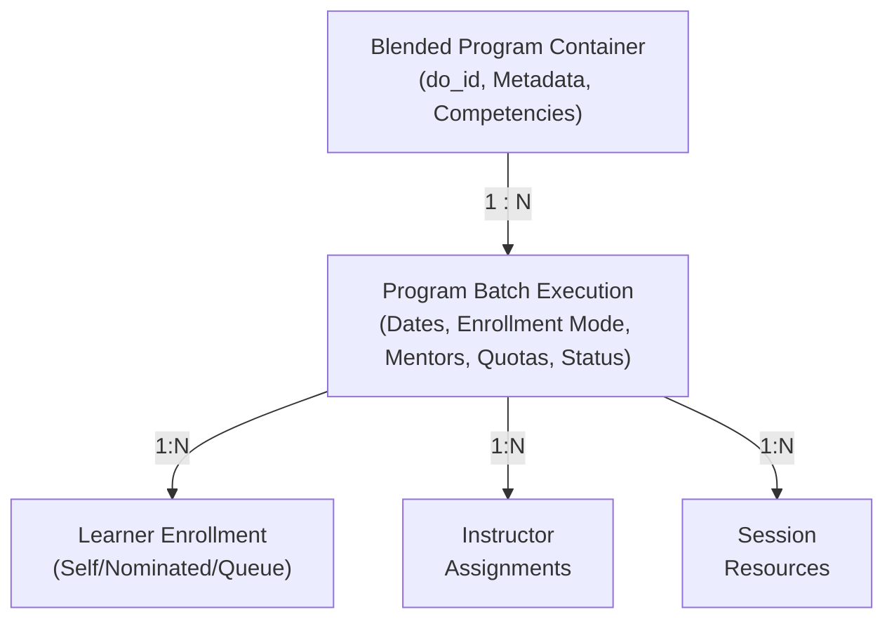
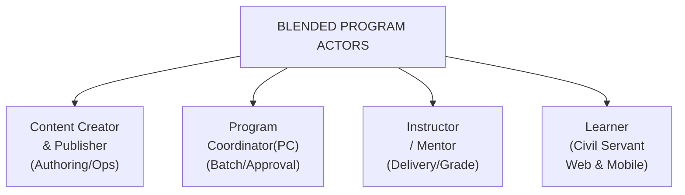
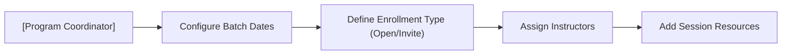
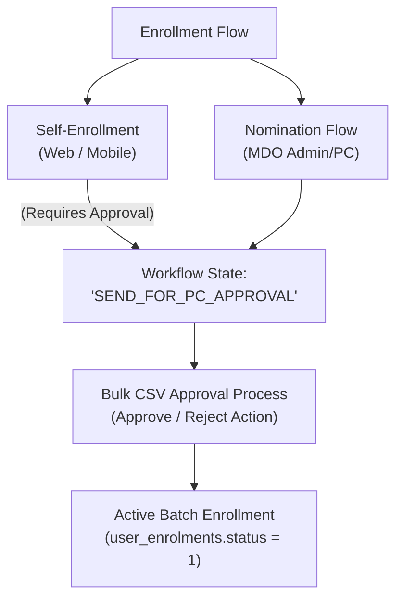
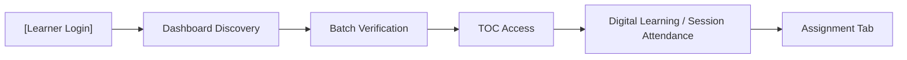
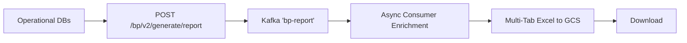

# Blended Program — Software Requirements Specification (SRS)

## 1. Introduction

### 1.1 Purpose

This Software Requirements Specification (SRS) defines the end-to-end functional, technical, non-functional, interface, and data requirements for the **Blended Program** capability on the iGOT Karmayogi Platform. It tracks the chronological evolution of the feature from **Q2 through Q13**, documenting how the system matured from a monolithic batch enrollment module into an agile, multi-portal, multi-role training ecosystem.

### 1.2 Scope

- **In Scope:**
  - **Authoring & Program Creation:** Program container configuration, competencies, attached courses/modules, and multi-PC assignment.
  - **Batch Lifecycle Operations:** Scheduling, operational constraints, same-day batching, cloning, and soft deletion.
  - **Learner Onboarding & Approvals:** Self-enrollment, nomination by Ministry/Department/Organization (MDO) Admins/Leaders, QR-code enrollment, and bulk CSV approvals.
  - **Learner Consumption:** Web and Mobile Table of Contents (TOC), multi-asset consumption (PDF, PPT, HTML, Video), and offline session attendance.
  - **Instructor Delivery:** In-batch assignment distribution, submission draft management, file uploads to cloud storage, and qualitative grading/feedback loops.
  - **Progress & Certification:** Pre-assessment decoupling, progress rollup into terminal enrollment states (`status = 2`), and SVG certificate template rendering.
  - **Analytics & Data Warehousing:** Transactional persistence across Apache Cassandra, Elasticsearch, and PostgreSQL; Kafka-driven asynchronous batch reports; and PySpark data warehousing pipelines.

- **Out of Scope:** Standalone asynchronous course authoring (unless inherited as embedded modules within a Blended Program).

### 1.3 Definitions, Acronyms, and Abbreviations

- **BP:** Blended Program (a hybrid learning program containing self-paced modules and scheduled cohort sessions).
- **CBP Portal:** Capacity Building Program Portal (the authoring surface used by Content Creators and Program Coordinators).
- **CQF:** Content Quality Framework (an administrative review workflow bypassed in Q9 for BPs).
- **MDO:** Ministry, Department, or Organization.
- **PC:** Program Coordinator (batch administrator responsible for schedule, instructor assignment, and nominations).
- **TOC:** Table of Contents (the learner's interactive curriculum navigator).
- **GCS:** Google Cloud Storage (object store for assignment assets and generated Excel reports).
- **Neo4j:** Graph database storing relational platform entities (bypassed for BP batch synchronizations in later releases).

### 1.4 References

1. **Confluence PRDs & Architecture Specifications:**
  - [Blended Program Batch Details](https://karmayogibharat.atlassian.net/wiki/spaces/TES/pages/1157595153/Blended+Program+Batch+Details) (`sunbird_courses.course_batch` & ES index mappings)
  - [Blended Program Enhancements - Batch Wise Reports Tech Design](https://karmayogibharat.atlassian.net/wiki/spaces/TES/pages/1042677779/Blended+Program+Enhancements+-+Batch+Wise+Reports+Tech+Design) (Kafka routing & multi-store aggregation)
  - [Blended Program Enhancements - Batch Wise Reports - Generate Report Api Enhancement](https://karmayogibharat.atlassian.net/wiki/spaces/TES/pages/1061355521/Blended+Program+Enhancements+-+Batch+Wise+Reports+-+Generate+Report+Api+Enhancement) (`bp_enrolment_report_v2` DDL)
  - [Blended Program Enhancements - Active Batch Enrollments Tech Design](https://karmayogibharat.atlassian.net/wiki/spaces/TES/pages/1045889027/Blended+Program+Enhancements+-+Active+Batch+Enrollments+Tech+Design) & [Active Batch Enrollments count API For Blended Program](https://karmayogibharat.atlassian.net/wiki/spaces/TES/pages/1045889036/Active+Batch+Enrollments+count+API+For+Blended+Program) (Redis caching layer)
  - [Sprint 30 API contract Details For Blended Program Enhancements](https://karmayogibharat.atlassian.net/wiki/spaces/TES/pages/495419480/Sprint+30+API+contract+Details+For+Blended+Program+Enhancements) (Assignment CRUD & Evaluation APIs)
  - [SRS - Q9 l Blended Program Enhancements](https://karmayogibharat.atlassian.net/wiki/spaces/TES/pages/504430593/SRS+-+Q9+l+Blended+Program+Enhancements) (Functional requirements for session editing & multi-PC)
  - [Q12 | Blended Program Enhancements](https://karmayogibharat.atlassian.net/wiki/spaces/TPT/pages/972423178/Q12+Blended+Program+Enhancements) (Same-day batching, PPT attachments, batch cloning)
  - [API Documentation: Blended Program Bulk Upload Approval/Rejection](https://karmayogibharat.atlassian.net/wiki/spaces/TES/pages/381780108/API+Documentation+Blended+Program+Bulk+Upload+Approval+Rejection)
  - [Blended program delete batch API](https://karmayogibharat.atlassian.net/wiki/spaces/TES/pages/478380033/Blended+program+delete+batch+API)

## 2. Overall Description

### 2.1 Product Perspective & Context

The Blended Program functions as a higher-order container within the iGOT Karmayogi learning core. Standalone courses allow immediate enrollment and automated digital consumption. In contrast, a Blended Program requires an operational runtime—a **Batch**—to execute.

### 2.2 User Classes and Roles

1. **Content Creator:** Authors program structure, attaches competencies and course assets, and maps authorized Program Coordinators.
2. **Content Publisher:** Reviews and transitions programs from `Draft` to `Live` (bypassing CQF gates).
3. **Program Coordinator (PC):** Orchestrates batch creation, dates, session metadata, instructor attachments, and executes bulk enrollment approvals/rejections.
4. **Program Instructor / Mentor:** Conducts physical or digital sessions, uploads batch assignments, and evaluates submitted student coursework.
5. **Learner (Civil Servant):** Discovers programs, requests enrollment, consumes curriculum via Web/Mobile TOC, submits assignment files, and receives verified certificates.
6. **MDO Admin / Leader:** Nominates departmental officers, tracks organizational progress, and extracts aggregate compliance reports.
7. **SPV Administrator:** High-level platform governance and cross-departmental data exhaust consumption.

### 2.3 General Design Constraints

1. **Primary Key Immutability (Cassandra):** In Apache Cassandra, partition/clustering keys cannot be altered. Reporting schemas (`bp_enrolment_report_v2`) must isolate distinct requester/context executions to prevent record overwrites.
2. **Elasticsearch Indexing Lag:** Elasticsearch updates asynchronously via Akka actor event publishers. Queries must allow for eventual consistency (typically 1–3 seconds).
3. **Strict Query Clamping:** Search pagination offsets are capped at `offset + limit <= 10,000`. Deep pagination requires explicit date/status range bounding.
4. **File Size Limits:** Learner assignment submissions are restricted to single-file uploads () in `.pdf`, `.doc`, or `.docx` formats.

## 3. Chronological Feature Evolution (Q2 to Q13)

| Quarter Range | Strategic Epic | Business Objective | Functional Capabilities Introduced | Architectural & Backend Changes | Status |
|---|---|---|---|---|---|
| **Q2 – Q3** | `KB-268`, `KB-334`, `KB-325`, `KBE-7` | Foundational hybrid learning support | Configurable dynamic registration forms (`KB-336`); baseline batch-wise CSV reports (`KB-688`); basic enrollment state engine. | Initialized `sunbird_courses.course_batch`; baseline Cassandra table for SPV reports. | **Delivered** |
| **Q4 – Q6** | `KB-6962`, `KB-7848` | Enterprise enrollment management | User profile field customization during batch enrollment (`KB-7028`); bulk approval/rejection via CSV (`KB-7850`). | Integrated `WorkflowService` with CSV parsing engines; multi-state workflow tracking (`wingspan.wf_status`). | **Delivered** |
| **Q8** | `KB-8998`, `KB-8997`, `KB-8999` | Creator & Coordinator decoupling | Formalized pre-requisite enforcement (`KB-9604`); preliminary batch editing capabilities. | Decoupled course metadata sync pipelines from batch execution constraints. | **Delivered** |
| **Q9** | `KB-11078`, `KB-9984`, `KB-10855` | Operational maturity & governance | Multi-PC assignment; session-level resource editing (`KB-11080`); direct publishing (CQF removal via `KB-11083`); instructor assignments (`KB-11071`). | Refactored Elasticsearch mapping to prevent index overload; introduced `/api/assignment/v1/*` microservice. | **Delivered** |
| **Q10 – Q11** | `KB-11808`, `KB-12360`, `KB-13490` | Instructor onboarding & cross-MDO scale | Cross-MDO instructor allocation (`KB-11793`); learner assignment consumption on Web & Mobile (`KB-10860`); batch end-date overrides. | Integrated cloud storage APIs (`/api/storage/v1/bp/assignment/*`); optimized Cassandra data read paths. | **Delivered** |
| **Q12** | `KB-13948`, `KB-13937`, `KB-13972` | Agile batching & analytical depth | Same-day batch creation, enrollment, and execution (`KB-14008`); inactive batch cloning (`KB-13991`); multi-tab enriched reports (`KB-14010`). | Deployed `bp_enrolment_report_v2`; Kafka `bp-report` multi-source enrichment pipeline; Redis active count caching. | **Delivered** |
| **Q13** | `KB-14289`, `KB-15048`, `KB-15099` | Ecosystem stabilization & alignment | Decoupling optional pre-assessments from progress calculations (`KB-15810`); re-enrollment logic refinement (`KB-15880`). | Neo4j synchronization bypass for blended cohorts (`KB-15716`); enhanced TOC progress synchronization APIs. | **Delivered** |

## 4. System Features and Functional Requirements

### 4.1 Program Authoring & Configuration

- **REQ-BP-CR-01 (Program Entity Creation):** The system shall allow authorized Content Creators to create a Blended Program container containing title, description, thumbnail, duration, competencies, and parent department mappings.
- **REQ-BP-CR-02 (Multi-PC Assignment):** The system shall permit the primary creator to designate multiple Program Coordinators across any registered platform MDO.
- **REQ-BP-CR-03 (Direct Publishing):** As established in Q9 (`KB-11083`), the publishing workflow shall transition directly from `Content Creator` to `Content Publisher` without triggering the legacy Content Quality Framework (CQF) gate.
- **REQ-BP-CR-04 (Content Module Linking):** The system shall allow linking of self-paced courses, standalone assessments, and offline session definitions within the program's hierarchy.

### 4.2 Batch Creation & Lifecycle Operations

- **REQ-BP-BAT-01 (Batch Initialization):** Program Coordinators shall create cohorts via `POST /v1/course/batch/create` with mandatory parameters: `name`, `startDate`, `endDate`, `enrollmentEndDate`, `enrollmentType` (`open` | `invite-only`), and `createdFor` (permitted MDO IDs).
- **REQ-BP-BAT-02 (Same-Day Operations):** As delivered in Q12 (`KB-14008`), the system shall permit `startDate`, `endDate`, and `enrollmentEndDate` to share the current calendar date ().
- **REQ-BP-BAT-03 (Cloning Inactive Batches):** Program Coordinators shall be able to clone archived/inactive batches (`KB-13991`), copying session structure and resource definitions into a new draft cohort.
- **REQ-BP-BAT-04 (Pre-Start Session Editing):** Coordinators shall be able to modify session schedules, offline locations, instructor allocations, and reference materials up until the specific session's `startTime`.
- **REQ-BP-BAT-05 (Soft Deletion):** Upon invoking `POST /v1/course/batch/delete`, the system shall mark the batch as deleted, disallow subsequent enrollments, invalidate active sessions, and issue notifications to enrolled learners (`KB-11561`).

### 4.3 Learner Enrollment, Nomination & Approvals

- **REQ-BP-ENR-01 (Self-Enrollment):** Eligible learners shall request admission into open batches. If the batch enforces approval, the state transitions to `SEND_FOR_PC_APPROVAL`.
- **REQ-BP-ENR-02 (Administrative Nomination):** MDO Admins and PCs shall directly nominate departmental civil servants into cohorts, bypassing preliminary learner requests.
- **REQ-BP-ENR-03 (QR-Code Registration):** When `enableqr: true` is configured on the batch, the system shall generate a unique cryptographic QR code enabling rapid on-premise enrollment scanning.
- **REQ-BP-ENR-04 (Bulk CSV Approval / Rejection):**
  - The PC downloads pending candidates using `POST /workflow/blendedprogram/getUserApprovalDataInCsv`.
  - The PC populates the `action` column (`APPROVED` or `REJECTED`).
  - The PC uploads the manifest via `POST /workflow/blendedprogram/bulkApprovalDataFromCsv/{courseId}`.

- **REQ-BP-ENR-05 (Re-Enrollment Rules):** As established in Q13 (`KB-15880`), learners who previously enrolled in a batch that concluded with an incomplete state shall be permitted to enroll in subsequent batches of the same program.
- **REQ-BP-ENR-06 (Active Count Telemetry):** The system shall serve real-time batch enrollment counts via `POST /workflow/blendedprogram/enrol/status/count/details`, backed by Redis caching.

### 4.4 Learner Consumption & Table of Contents (TOC)

- **REQ-BP-CON-01 (Curriculum Rendering):** Enrolled learners with approved status shall access the interactive TOC across Web and Mobile surfaces.
- **REQ-BP-CON-02 (Multi-Asset Presentation):** The TOC shall natively render SCORM modules, video streams, PDFs, PPT slide decks (`KB-13992`), and external interactive meeting links.
- **REQ-BP-CON-03 (Dynamic Assignments Tab):** The TOC shall dynamically render a dedicated **Assignments** tab if and only if the active batch contains published instructor assignments.

### 4.5 Instructor Delivery & Qualitative Grading

- **REQ-BP-INS-01 (Assignment Authoring):** Mentors mapped to a batch shall create assignments using `POST /api/assignment/v1/create` specifying title, instructions, attachments, submission deadlines, and maximum score.
- **REQ-BP-INS-02 (Draft & Final Submissions):** Learners shall save iterative progress via `PUT /api/assignment/v1/submitDraft` and commit terminal submissions via `POST /api/assignment/v1/submit`.
- **REQ-BP-INS-03 (Secure Cloud Persistence):** Learner assets shall be stored via multipart streaming to `/api/storage/v1/bp/assignment/answer/upload`, returning immutable GCS identifiers.
- **REQ-BP-INS-04 (Qualitative Evaluation):** Instructors shall inspect submitted artifacts via `GET /api/assignment/v1/getAnswerById` and record grades and comments via `POST /api/assignment/v1/feedback` (`status: "EVALUATED"`).

### 4.6 Progress Calculation, Completion & Certification

- **REQ-BP-EVAL-01 (Decoupled Pre-Assessments):** As delivered in Q13 (`KB-15810`), results obtained in "Optional Pre-Assessments" shall be excluded from batch completion percentages and certificate issuance triggers.
- **REQ-BP-EVAL-02 (Terminal Completion):** Completion requires completing all mandatory course components, satisfying attendance criteria, and achieving an evaluation status on required assignments, moving `user_enrolments.status` to `2` (Completed).
- **REQ-BP-EVAL-03 (Automated Certificate Dispatch):** Upon achieving `status = 2`, the system shall parse the batch's `cert_templates` object, populate dynamic SVG tokens (Learner Name, Course Name, Completion Date, Issuing Authority Signatures), generate a signed PDF, and publish the event to the user's verifiable profile registry.

### 4.7 Analytics, Reporting & Data Warehousing

- **REQ-BP-REP-01 (Asynchronous Multi-Source Pipeline):** Invocation of `POST /bp/v2/generate/report` shall emit an event to the Kafka topic `bp-report`.
- **REQ-BP-REP-02 (V2 Multi-Store Joins):** The asynchronous worker shall aggregate operational data across three distinct stores:
  - **Apache Cassandra:** Batch metadata, enrollment records, completion timestamps.
  - **PostgreSQL:** Session attendance logs and assessment marks.
  - **Elasticsearch / User Registry:** Officer profile data (Designation, Ministry, Cadre, Email).

- **REQ-BP-REP-03 (Cassandra V2 Schema Isolation):** Report metadata shall persist in `sunbird.bp_enrolment_report_v2` partitioned by `(orgid, courseid, batchid, reportrequester, contexttype)` to eliminate row overwrites.
- **REQ-BP-REP-04 (Workbook Export):** The final report shall be generated as an Excel workbook containing up to six dedicated sheets (Summary, Enrollments, Attendance, Assignments, Assessments, and Survey Results) stored in GCS.

## 5. External Interface Requirements

### 5.1 User Interfaces

- **CBP Authoring Interface:** Desktop-first Angular application optimized for course tree building, form design, and batch scheduling.
- **MDO Leadership Portal:** Web console displaying cohort fill rates, pending nomination queues, and downloadable batch analytics.
- **Learner Experience:** Responsive Web interface and Flutter-based Android/iOS mobile application providing offline-first content caching, biometric attendance scanning, and document previewers.

### 5.2 Software & Microservice Interfaces

```mermaid
flowchart LR
    ROOT["API INTEGRATION TOPOLOGY"]
    ROOT --> S1["sunbird-course-service (Port 9000)"]
    S1 --> E1["POST /v1/course/batch/create<br/>PATCH /v1/course/batch/update<br/>POST /v1/course/batch/delete<br/>POST /v1/course/batch/search"]
    ROOT --> S2["workflow-service (Port 8080)"]
    S2 --> E2["POST /workflow/blendedprogram/getUserApprovalDataInCsv<br/>POST /workflow/blendedprogram/bulkApprovalDataFromCsv/{id}<br/>POST /workflow/blendedprogram/enrol/status/count/details"]
    ROOT --> S3["assignment-service / forms-service (Port 8082)"]
    S3 --> E3["POST /api/assignment/v1/create<br/>POST /api/assignment/v1/submitDraft<br/>POST /api/assignment/v1/submit<br/>POST /api/assignment/v1/feedback"]
    ROOT --> S4["bp-reports-service (Port 8085)"]
    S4 --> E4["POST /bp/v1/generate/report<br/>POST /bp/v2/generate/report<br/>POST /bp/v1/bpreport/status<br/>GET /bp/v1/bpreport/download/{org}/{c}/{b}/{f}"]
    ROOT --> S5["cloud-storage-proxy (Port 8088)"]
    S5 --> E5["POST /api/storage/v1/bp/assignment/answer/upload<br/>GET /api/storage/v1/bp/assignment/answer/read/file"]
```

## 6. Non-Functional & System Quality Attributes

### 6.1 Performance Requirements

- **Batch Search Latency:** 95% of queries to `POST /v1/course/batch/search` shall execute in for page sizes , backed by Elasticsearch inverted indexes.
- **Active Count Response:** Queries to `/workflow/blendedprogram/enrol/status/count/details` shall return in under cache-hit conditions in Redis.
- **Batch Operation Throughput:** The bulk approval engine shall process manifests of up to 1,000 learners in without dropping database connections.

### 6.2 Reliability & Fault Tolerance

- **Decoupled Asynchronous Reporting:** Report processing failures inside Kafka consumers shall employ an exponential backoff retry mechanism (max 3 attempts) and log terminal failures to dead-letter queues (DLQ) without impacting learner consumption or authoring APIs.
- **Persistence Redundancy:** Operational batch and enrollment states in Cassandra shall use a replication factor of across availability zones.

### 6.3 Security & Role-Based Access Control (RBAC)

- **Access Control Enforcement:** Kong API Gateway shall validate Keycloak JWT bearer tokens on all mutating endpoints.
- **Tenant Isolation:** Program Coordinators shall only view and approve candidates whose organization mappings match the coordinator's administrative domain or explicitly delegated cross-MDO scopes.

## 7. Business Logic & Calculation Formulas

### 7.1 Active Cohort Enrollment Metric

- **Storage:** Evaluated from `wingspan.wf_status` / Cassandra `user_enrolments` and cached in Redis with key `bp_active_count_{batchId}`.

### 7.2 Terminal Program Completion Condition

- Upon evaluation, the user's enrollment record is updated:

### 7.3 Batch Search Pagination Clamping

- If , the system rejects the query with HTTP 400 or clamps the offset to enforce cluster stability.

## 8. Requirements Traceability Matrix (RTM)

| Requirement ID | Functional Area | Source Reference (Jira / Confluence) | Implementing Service | Primary API / Data Contract | Verification Method |
|---|---|---|---|---|---|
| **REQ-BP-CR-02** | Authoring | `KB-11078`, `SRS - Q9` | `course-service` | `/action/content/v3/create` | Test Case: Multi-PC allocation |
| **REQ-BP-CR-03** | Governance | `KB-11083`, `SRS - Q9` | `content-service` | Direct transition to Publisher | Code Audit: Bypass CQF step |
| **REQ-BP-BAT-02** | Operations | `KB-13937`, `KB-14008`, `Q12 PRD` | `course-service` | `POST /v1/course/batch/create` | Test Case: Same-day start/end dates |
| **REQ-BP-BAT-03** | Operations | `KB-13991`, `Q12 PRD` | `course-service` | `POST /v1/course/batch/copy` | Integration Test: Clone inactive batch |
| **REQ-BP-BAT-05** | Operations | `KB-11561`, Confluence 478380033 | `course-service` | `POST /v1/course/batch/delete` | Integration Test: Soft-delete cascade |
| **REQ-BP-ENR-04** | Enrollment | `KB-7848`, `KB-7850`, Confluence 381780108 | `workflow-service` | `/workflow/blendedprogram/bulkApproval...` | Load Test: 1,000 record CSV upload |
| **REQ-BP-ENR-05** | Enrollment | `KB-15880`, `KB-15664` | `course-service` | Cassandra enrollment check | Regression Test: Incomplete batch re-enroll |
| **REQ-BP-INS-01** | Delivery | `KB-11071`, Confluence 495419480 | `assignment-service` | `POST /api/assignment/v1/create` | API Contract Verification |
| **REQ-BP-INS-04** | Delivery | `KB-11563`, Confluence 495419480 | `assignment-service` | `POST /api/assignment/v1/feedback` | Test Case: Scoring & feedback submission |
| **REQ-BP-EVAL-01** | Progress | `KB-15810` | `course-service` | Terminal progress calculator | Test Case: Pre-assessment score exclusion |
| **REQ-BP-REP-02** | Analytics | `KB-13972`, `KB-14010`, Confluence 1042677779 | `bp-reports-service` | `POST /bp/v2/generate/report` | End-to-End Test: Multi-tab GCS Excel |
| **REQ-BP-REP-03** | Analytics | Confluence 1061355521 | Apache Cassandra | `sunbird.bp_enrolment_report_v2` | Schema Inspection: Primary key isolation |

## 9. Gap Analysis: Documentation vs. Implementation

| Gap ID | Functional Domain | Documented Requirement | Observed Implementation Evidence | Severity | Engineering Recommendation |
|---|---|---|---|---|---|
| **GAP-01** | **Attendance Subsystem** | Automated physical QR code attendance scanning updating completion formulas | Mentions in V2 reporting and PRDs, but explicit REST attendance marking APIs are absent in core specs | **High** | Publish formal API contracts and schema mappings for the dedicated Attendance Service. |
| **GAP-02** | **Completion Weighting** | Granular weightings across attendance, in-class tasks, and online quizzes | System defaults to binary completion: `user_enrolments.status = 2` | **Medium** | Formally document how external LMS and offline session events aggregate into terminal status `2`. |
| **GAP-03** | **Parent Authoring CRUD** | End-to-end REST contracts for creating the parent Blended Program container | Batch-level APIs are extensively documented; parent program JSON payloads are not centralized | **Medium** | Publish the formal JSON schema for `/action/content/v3/create` when `contentType = "Blended Program"`. |
| **GAP-04** | **Re-attempt Workflows** | Rules governing learner resubmission after failed assignment grading | Draft saves and initial submissions are supported; post-evaluation resubmission flows lack explicit rules | **Low** | Specify whether instructors can revert an assignment from `EVALUATED` back to `RE_SUBMIT`. |
