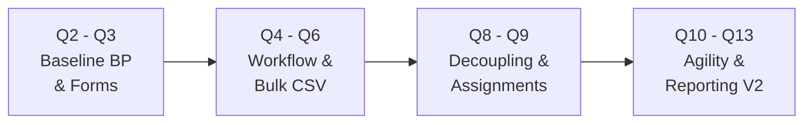
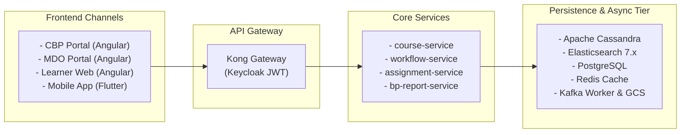

# Blended Program — Generic Use Cases

## 1. Executive Summary & Evolution Overview

The **Blended Program (BP)** on the iGOT Karmayogi Platform bridges asynchronous self-paced digital learning with synchronous, cohort-based, instructor-led offline/live interactions. The feature evolved across distinct platform increments:

- **Q2–Q3 (Foundational BP & Forms):** Structural separation of parent program metadata (`do_id`) from executable batches (`batchId`), dynamic registration forms, and basic CSV reporting (`KB-334`, `KB-325`).
- **Q4–Q6 (Workflow & Bulk Controls):** Delegation of enrollment requests to `workflow-service`, multi-state queues (`SEND_FOR_PC_APPROVAL`), and bulk CSV approval/rejection (`KB-7028`, `KB-7850`).
- **Q8–Q9 (Authoring Simplification & Assignments):** Removal of the Content Quality Framework (CQF) publishing bottleneck (`KB-11083`), multi-Program Coordinator (PC) allocation, and introduction of the dedicated `/api/assignment/v1/*` microservice (`KB-11071`).
- **Q10–Q11 (Cross-MDO Delivery):** Cross-organization instructor onboarding (`KB-11793`), mobile TOC alignment, and multi-format asset delivery via Google Cloud Storage (GCS).
- **Q12–Q13 (Operational Agility & Asynchronous Reporting):** Same-day batch execution (`KB-14008`), inactive batch cloning (`KB-13991`), Kafka-driven multi-source reporting (`bp_enrolment_report_v2`), and decoupling optional pre-assessments from terminal progress (`KB-15810`).

## 2. Actors & System Touchpoints Matrix

| Actor / System Component | Role Classification | Primary Touchpoints | Core Responsibilities |
|---|---|---|---|
| **Content Creator** | Business Author | CBP Authoring Portal, `course-service` | Design program hierarchy, map competencies, link courses, assign Program Coordinators. |
| **Content Publisher** | Publishing Authority | CBP Authoring Portal, `content-service` | Review program definitions and execute direct publishing to production (bypassing CQF). |
| **Program Coordinator (PC)** | Batch Administrator | CBP Portal, MDO Portal, `workflow-service` | Configure batch schedules, assign instructors, process bulk enrollment CSVs, clone cohorts. |
| **Program Instructor / Mentor** | Delivery & Evaluation | Web Interface, `assignment-service` | Create batch assignments, review student submissions, provide marks and qualitative feedback. |
| **Learner (Civil Servant)** | Program Consumer | Learner Web Portal, Mobile App (Flutter) | Discover programs, self-enroll/scan QR, attend sessions, submit assignments, receive certificates. |
| **MDO Admin / Leader** | Departmental Oversight | MDO Leadership Portal, `bp-report-service` | Nominate officers, monitor departmental participation, request asynchronous analytics reports. |
| **Platform SRE / Ops** | Reliability & Support | Monitoring Stack, Kafka, Redis, ES | Reconcile search indexing lag, manage Redis cache eviction, audit report dead-letter queues. |

## 3. End-to-End Frontend-to-Backend Operating Model

1. **Authoring Path:** CBP Portal Kong API Gateway `course-service` Cassandra (`course_batch`) Asynchronous Akka sync to Elasticsearch (`course-batch`).
2. **Approval Path:** MDO/CBP Portal Kong `workflow-service` PostgreSQL (`wingspan.wf_status`) Cassandra (`user_enrolments`) Redis cache invalidation (`bp_active_count_{batchId}`).
3. **Assignment Path:** Learner Web/Mobile Kong `assignment-service` Storage Proxy GCS (file binary) + PostgreSQL (submission metadata) Instructor grading.
4. **Reporting Path:** MDO Portal Kong `bp-report-service` Kafka topic `bp-report` Async Report Worker (joins Cassandra, PG, and ES) GCS Excel export.

## 4. Master Generic Use Cases

### 4.1 Program Authoring & Batch Operations (Creation Domain)

| Use Case ID | Use Case Name | Primary Actor | Trigger & Preconditions | Core Flow (Frontend to Backend) | Expected Outcome & Data Impact |
|---|---|---|---|---|---|
| **UC-BP-01** | **Create Blended Program Shell** | Content Creator | Need to introduce a hybrid curriculum. | 1. Creator inputs program metadata, competencies, and attached courses in CBP Portal. 2. UI invokes `POST /action/content/v3/create`. 3. Service persists program container in draft state. | Program container (`do_id`) is created in Draft state. |
| **UC-BP-02** | **Direct Program Publishing** | Content Creator / Publisher | Program shell and syllabus are complete. | 1. Creator reviews content and triggers publish. 2. UI invokes `POST /action/content/v3/publish`. 3. Under Q9 rules (`KB-11083`), CQF is bypassed; status moves directly to `Live`. | Program becomes discoverable for batch creation and scheduling. |
| **UC-BP-03** | **Create Program Batch** | Program Coordinator | Program is live; cohort schedule defined. | 1. PC defines dates, enrollment mode (`open`/`invite-only`), target MDOs, and mentors. 2. UI calls `POST /v1/course/batch/create`. 3. `course-service` writes Cassandra row and emits Akka event to sync ES. | Batch is created (`status: 0` or `1`) and indexed in Elasticsearch. |
| **UC-BP-04** | **Same-Day Batch Execution** | Program Coordinator | Ad-hoc or emergency cohort required immediately. | 1. PC configures . 2. System validates relaxed Q12 date constraints (`KB-14008`). 3. `course-service` activates batch immediately. | Cohort becomes instantly active for same-day enrollment and completion. |
| **UC-BP-05** | **Clone Inactive Batch** | Program Coordinator | Repetitive cohort structure needed. | 1. PC selects archived cohort and clicks Clone. 2. UI invokes `POST /v1/course/batch/copy` (`KB-13991`). 3. Backend deep-copies session structure into a new draft batch. | New draft cohort initialized with pre-filled session templates. |
| **UC-BP-06** | **Batch Soft Deletion** | Program Coordinator | Cohort canceled before execution. | 1. PC invokes delete batch in CBP Portal. 2. UI calls `POST /v1/course/batch/delete` (`KB-11561`). 3. System marks batch deleted, invalidates enrollments, and notifies learners. | Batch is removed from catalog; active enrollment states invalidated. |

### 4.2 Enrollment, Nominations & Cohort Management (Onboarding Domain)

| Use Case ID | Use Case Name | Primary Actor | Trigger & Preconditions | Core Flow (Frontend to Backend) | Expected Outcome & Data Impact |
|---|---|---|---|---|---|
| **UC-BP-07** | **Learner Self-Enrollment** | Learner (Civil Servant) | Open cohort discovered on Web or Mobile. | 1. Learner clicks Enroll. 2. System verifies active capacity via Redis (`bp_active_count_{batchI``d}`). 3. If approval required, state transitions to `SEND_FOR_PC_APPROVAL` in PostgreSQL. | Learner is queued for coordinator approval or enrolled directly. |
| **UC-BP-08** | **QR-Code Batch Registration** | Learner (Civil Servant) | Physical or digital session QR presented. | 1. Learner scans QR via mobile app. 2. App calls enrollment API with cryptographic batch payload. 3. Backend validates eligibility and registers participation. | Rapid on-premise onboarding without manual search friction. |
| **UC-BP-09** | **Administrative Nomination** | MDO Admin / Leader | Department selects officers for training. | 1. Admin selects batch and uploads officer identifiers in MDO Portal. 2. UI calls `POST /workflow/blendedprogram/nominate`. 3. System enqueues nominations in PostgreSQL `wf_status`. | Officers are added to the batch nomination roster. |
| **UC-BP-10** | **Bulk CSV Approval / Rejection** | Program Coordinator | Pending candidates require cohort admission. | 1. PC downloads CSV via `POST /getUserApprovalDataInCsv`. 2. PC sets action column (`APPROVE`/`REJECT`). 3. PC uploads manifest via `POST /bulkApprovalDataFromCs``v/{id}` (`KB-7850`). | Approved learners move to `user_enrolments.status = 1`; Redis count updated. |
| **UC-BP-11** | **Incomplete Batch Re-Enrollment** | Learner (Civil Servant) | Prior cohort ended with incomplete status. | 1. Learner applies to a new batch of the same program. 2. Backend executes Q13 re-enrollment check (`KB-15880`). 3. Previous incomplete state is preserved; new batch enrollment is activated. | Learner can complete the program in a subsequent cohort. |
| **UC-BP-12** | **Record Session Attendance** | Learner / Coordinator | Live physical or virtual session conducted. | 1. Attendance marked via QR scan or coordinator console. 2. Service logs attendance in PostgreSQL `session_attendance`. 3. Records linked to learner and batch ID for reporting. | Session attendance stored for completion logic and V2 report exports. |

### 4.3 Learner Consumption & Instructor Delivery (Consumption Domain)

| Use Case ID | Use Case Name | Primary Actor | Trigger & Preconditions | Core Flow (Frontend to Backend) | Expected Outcome & Data Impact |
|---|---|---|---|---|---|
| **UC-BP-13** | **Access Program TOC** | Learner (Civil Servant) | Enrollment status is active (`status: 1`). | 1. Learner opens batch on Web or Mobile. 2. UI queries `course-service` and `assignment-service`. 3. System renders curriculum outline, session resources, and Assignments tab. | Learner accesses all learning assets and scheduled session links. |
| **UC-BP-14** | **Multi-Format Asset Consumption** | Learner (Civil Servant) | Learner navigates modules in TOC. | 1. Learner selects video, PDF, or PPT resource (`KB-13992`). 2. Storage proxy streams asset binary to client player. 3. Telemetry records consumption duration and component progress. | Digital module progress advances towards completion. |
| **UC-BP-15** | **Author Batch Assignment** | Program Instructor | Batch requires evaluative practical task. | 1. Instructor accesses batch in CBP Portal. 2. UI calls `POST /api/assignment/v1/create` (`KB-11071`). 3. Details (title, instructions, max marks, deadline) persist in database. | Assignment is published and visible under learner TOC Assignments tab. |
| **UC-BP-16** | **Save Assignment Draft** | Learner (Civil Servant) | Learner prepares uncommitted work. | 1. Learner uploads document (, PDF/DOCX) via storage proxy. 2. File stored in GCS; file URI returned. 3. UI calls `PUT /api/assignment/v1/submitDraft` (`status: DRAFT`). | Work-in-progress is securely saved without evaluator visibility. |
| **UC-BP-17** | **Final Assignment Submission** | Learner (Civil Servant) | Assignment completed and ready for grading. | 1. Learner reviews draft and clicks Submit. 2. UI calls `POST /api/assignment/v1/submit`. 3. Status locked to `SUBMITTED`; queued in instructor evaluation view. | Terminal submission locked; visible in instructor grading queue. |
| **UC-BP-18** | **Qualitative Grading & Feedback** | Program Instructor | Submissions pending in evaluation queue. | 1. Instructor inspects submitted artifact via GCS reader. 2. Instructor enters numerical score and qualitative remarks. 3. UI calls `POST /api/assignment/v1/feedback` (`status: EVALUATED`). | Evaluation is recorded; learner views feedback; criteria rollup enabled. |
| **UC-BP-19** | **Program Completion & Certification** | Learner / Platform System | Mandatory criteria fulfilled. | 1. System verifies attendance, digital modules, and evaluated assignments. 2. Optional pre-assessments excluded per Q13 (`KB-15810`). 3. `user_enrolments.status` moves to `2`; certificate engine dispatches PDF. | Learner is marked Complete; verifiable digital certificate issued. |

### 4.4 Analytics, Reporting & Data Warehousing (Insights Domain)

| Use Case ID | Use Case Name | Primary Actor | Trigger & Preconditions | Core Flow (Frontend to Backend) | Expected Outcome & Data Impact |
|---|---|---|---|---|---|
| **UC-BP-20** | **Request Asynchronous V2 Report** | MDO Admin / PC | Batch audit or compliance report required. | 1. Admin triggers export in MDO Portal. 2. UI calls `POST /bp/v2/generate/report` (`KB-14010`). 3. Event published to Kafka `bp-report`; Cassandra V2 row set to `PROCESSING`. | Report job queued asynchronously without blocking portal session. |
| **UC-BP-21** | **Execute Multi-Store Join** | Async Report Worker | Message received on Kafka topic `bp-report`. | 1. Worker reads payload and queries Cassandra, PostgreSQL, and Elasticsearch. 2. Joins enrollment records, attendance logs, scores, and officer designations. 3. Assembles 6-sheet Excel workbook and uploads to GCS. | Multi-tab analytical workbook generated and stored in cloud storage. |
| **UC-BP-22** | **Poll Status & Download Report** | MDO Admin / PC | Prior report request submitted. | 1. UI polls `POST /bp/v1/bpreport/status`. 2. When status equals `COMPLETED`, UI renders download button. 3. Client streams signed file via `GET /bp/v1/bpreport/download/...`. | Secure delivery of comprehensive analytical workbook to administrator. |

### 4.5 Platform Operations & Maintenance (SRE Domain)

| Use Case ID | Use Case Name | Primary Actor | Trigger & Preconditions | Core Flow (Frontend to Backend) | Expected Outcome & Data Impact |
|---|---|---|---|---|---|
| **UC-BP-23** | **Elasticsearch Index Drift Reconciliation** | Platform SRE | Search catalog shows missing or stale batches. | 1. SRE identifies lag in Akka actor event publishers. 2. SRE triggers batch re-indexing script. 3. Records re-read from Cassandra `course_batch` and re-indexed into ES. | Catalog consistency restored ( eventual consistency). |
| **UC-BP-24** | **Redis Active Count Cache Eviction** | Platform SRE | Discrepancy detected in active cohort counts. | 1. Database discrepancy identified in `wf_status` vs Redis key. 2. SRE issues eviction command on `bp_active_count_{batchId}`. 3. Next read recomputes count from DB and repopulates cache. | Cache integrity restored; prevents incorrect cohort capacity rejections. |
| **UC-BP-25** | **Recover Failed Report Jobs (DLQ)** | Platform SRE | Analytical export stalled in `PROCESSING` state. | 1. SRE audits Kafka Dead-Letter Queue (DLQ). 2. Resolves transient timeout or database lock issue. 3. Replays message to topic `bp-report`. | Stalled report job completes; Cassandra status updated to `COMPLETED`. |

## 5. Quarter-Wise Evolution Matrix of Use Cases

| Release Band | Creation & Batch Capabilities | Enrollment & Governance Capabilities | Consumption & Delivery Capabilities | Analytics & Operations Capabilities |
|---|---|---|---|---|
| **Q2–Q3** | `UC-BP-01`, `UC-BP-03` (Baseline program and batch setup) | `UC-BP-07` (Direct self-enrollment) | `UC-BP-13`, `UC-BP-14` (Basic TOC navigation) | Baseline batch CSV export (`KB-688`) |
| **Q4–Q6** | Basic batch metadata editing | `UC-BP-09`, `UC-BP-10` (MDO nominations, bulk CSV approvals) | Self-paced digital learning modules | Relational workflow tracking (`wingspan.wf_status`) |
| **Q8–Q9** | `UC-BP-02` (Direct publishing, CQF bypass) | Multi-PC batch delegation | `UC-BP-15`, `UC-BP-16`, `UC-BP-17`, `UC-BP-18` (Assignments) | Elasticsearch mapping refactoring (`KB-9984`) |
| **Q10–Q11** | Cross-MDO instructor setup | `UC-BP-08` (Mobile / QR code attendance paths) | Mobile TOC parity, GCS asset streaming | Cassandra read query optimization |
| **Q12–Q13** | `UC-BP-04`, `UC-BP-05`, `UC-BP-06` (Same-day batching, cloning) | `UC-BP-11`, `UC-BP-12` (Re-enrollment, Redis capacity) | `UC-BP-19` (Decoupled pre-assessments, certificate sync) | `UC-BP-20`, `UC-BP-21`, `UC-BP-22` (Asynchronous V2 reporting) |

## 6. Cross-Cutting Engineering Guardrails

1. **Authentication & Authorization:** Kong Gateway validates Keycloak JWT tokens on all requests. Roles (`BP_CONTENT_CREATOR`, `BP_PROGRAM_COORDINATOR`, `BP_PROGRAM_TRAINER`, `LEARNER`) are enforced per route.
2. **Search Clamping:** Catalog queries enforce to prevent cluster memory exhaustion.
3. **Storage Governance:** Assignment answer uploads are capped at single files (, PDF/DOCX) streamed directly to GCS via proxy.
4. **Primary Key Isolation:** Cassandra reporting tables use compound keys `(orgid, courseid, batchid, reportrequester, contexttype)` to eliminate row overwrites in multi-context environments.
