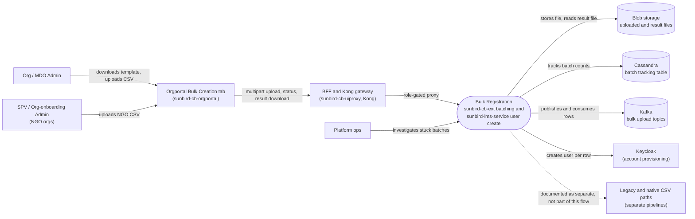

# Bulk Registration — Context Diagram

## System boundary

Inside the feature is the live pipeline that turns one uploaded CSV into many user
accounts: the orgportal Bulk Creation tab, the CSV parsing and batch tracking in
`sunbird-cb-ext`, its Kafka consumers, and the single-user create endpoints in
`sunbird-lms-service` that they call once per row. Outside it are the admins who upload,
the uiproxy and Kong gateway layer, OTP verification, the stores and queue it relies on,
and two further implementations of CSV user upload (a native lms-service pipeline and a
legacy tenant-admin path) that the HLD documents separately.

## Diagram

## Elements

| Element | Role | Detailed in |
|---|---|---|
| Bulk Registration (`sunbird-cb-ext` and `sunbird-lms-service`) | Central system: CSV parsing, batch tracking, Kafka hand-off, one HTTP create call per row | [hld.md](hld.md) |
| Org / MDO Admin | Uploads a CSV of new government users for their department | [use-cases.md](use-cases.md) |
| SPV / Org-onboarding Admin | Uploads a CSV of NGO/volunteer users for an NGO-typed org | [use-cases.md](use-cases.md) |
| Platform ops | Investigates stuck batches across the pipelines | [index.md](index.md) |
| Orgportal Bulk Creation tab (`sunbird-cb-orgportal`) | Template download, admin OTP gate, upload, status refresh, result download | [use-cases.md](use-cases.md) |
| uiproxy and Kong | Multipart proxy with role allow-list; routes to the batching service | [apis.md](apis.md) |
| Kafka | Carries each batch from the upload handler to the per-row consumers | [hld.md](hld.md) |
| Cassandra | Batch-level tracking rows read by the status list | [hld.md](hld.md) |
| Blob storage | Holds uploaded CSVs and downloadable result files | [apis.md](apis.md) |
| Keycloak | Account provisioning for created users; whether it fires on this path is flagged as an open question | [hld.md](hld.md) |
| Legacy and native CSV paths | Other implementations of CSV user upload, documented as separate pipelines | [hld.md](hld.md) |

> **Verification boundary:** elements and interactions come from the feature's own pages
> (index, use cases, APIs, HLD). In the source workspace, only the uiproxy multipart
> route registration for the bulkupload paths was spot-checked in `sunbird-cb-uiproxy`;
> the Kafka topic and `bulkcreate` handler names in `sunbird-cb-ext` and
> `sunbird-lms-service` could not be re-found in the checked-out refs and are taken from
> the pages as written. The dashed link to the other pipelines is documentary only. Not
> re-verified: the Keycloak provisioning step for CSV-created users, the exact per-row
> request body, and Kong route settings.
