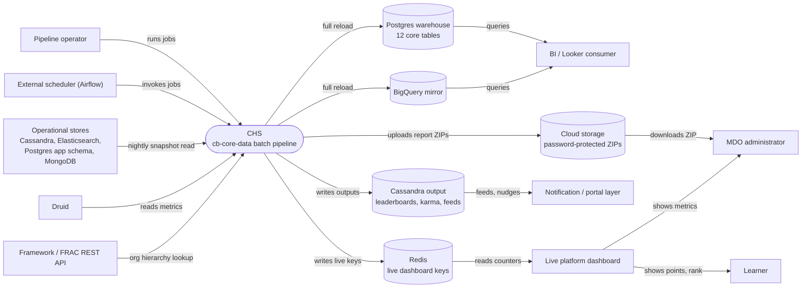

# CHS — Context Diagram

## System boundary

Inside the feature is the `cb-core-data` nightly batch pipeline: the extract, prejoin and ~46
Stage 2 jobs that compute reports, warehouse tables, live-dashboard cache entries and
gamification outputs. Outside it are the operational stores it reads (Cassandra,
Elasticsearch, Postgres app schema, MongoDB, Druid, the FRAC API), the stores it writes to,
the external scheduler that invokes it, and every person who consumes its output; no
Karmayogi ever calls the pipeline directly.

## Diagram

## Elements

| Element | Role | Detailed in |
|---|---|---|
| CHS (`cb-core-data`) | Central system: nightly extract, prejoin and ~46 report/warehouse/cache jobs | [hld.md](hld.md) |
| MDO administrator | Downloads per-org compliance ZIPs and views org dashboard metrics | [use-cases.md](use-cases.md) |
| BI / Looker consumer | Queries the warehouse tables or their BigQuery mirror | [use-cases.md](use-cases.md) |
| Learner | Never touches the pipeline; sees karma, badges, ranks and streaks it computes | [use-cases.md](use-cases.md) |
| Pipeline operator | Runs jobs and the orchestrated core chain | [operations-manual.md](operations-manual.md) |
| External scheduler (Airflow) | Invokes jobs; configuration lives outside the repository | [hld.md](hld.md), [operations-manual.md](operations-manual.md) |
| Operational stores (Cassandra, Elasticsearch, Postgres app schema, MongoDB) | Source data read by extract | [apis.md](apis.md) |
| Druid | Metrics source for several Stage 2 jobs | [apis.md](apis.md) |
| Framework / FRAC REST API | The one REST call: org hierarchy | [apis.md](apis.md) |
| Postgres warehouse / BigQuery mirror | BI tables, rebuilt by full truncate-and-reload | [apis.md](apis.md) |
| Redis | Live dashboard keys, profile snapshots | [apis.md](apis.md) |
| Cloud storage | Password-protected per-org report ZIPs | [apis.md](apis.md) |
| Cassandra output | Leaderboards, karma ledger, notification feeds | [apis.md](apis.md) |
| Notification / portal layer | Delivers feeds and nudges | [use-cases.md](use-cases.md) |
| Live platform dashboard | Reads Redis keys for near-real-time counters | [use-cases.md](use-cases.md) |

> **Verification boundary:** every element and interaction is taken from the feature's own
> pages (HLD, APIs, use cases), which were read from the `cb-core-data` repository. Not
> re-verified against source for this diagram: the external Airflow scheduler, and the exact
> downstream path from Redis/Cassandra to the notification layer and dashboard, which live
> outside this repository. Kafka output is omitted as not functionally active in this branch.
