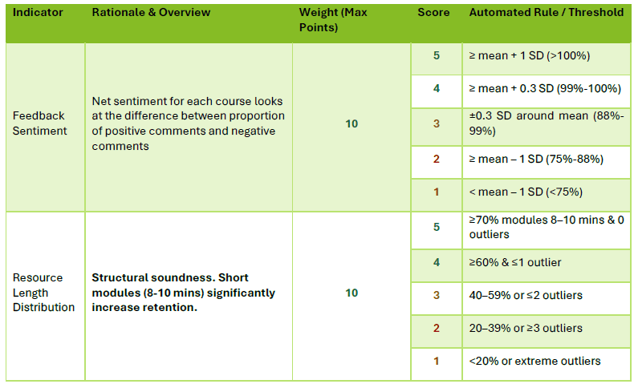
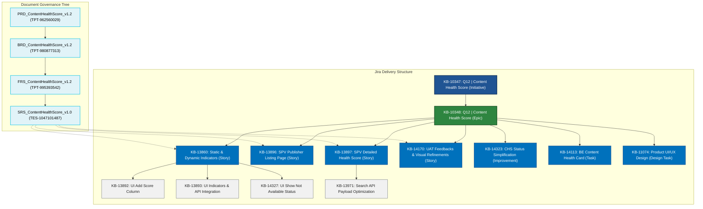
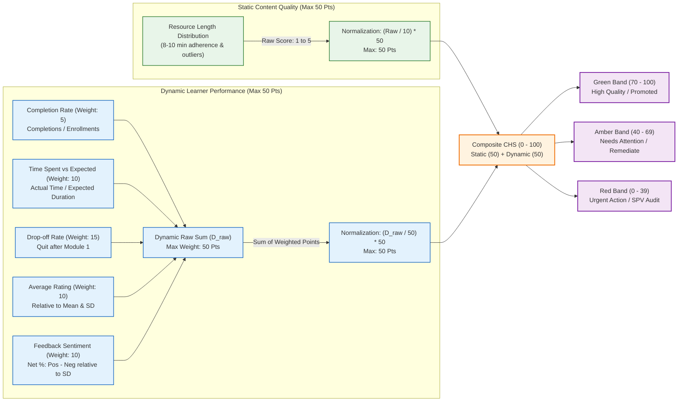
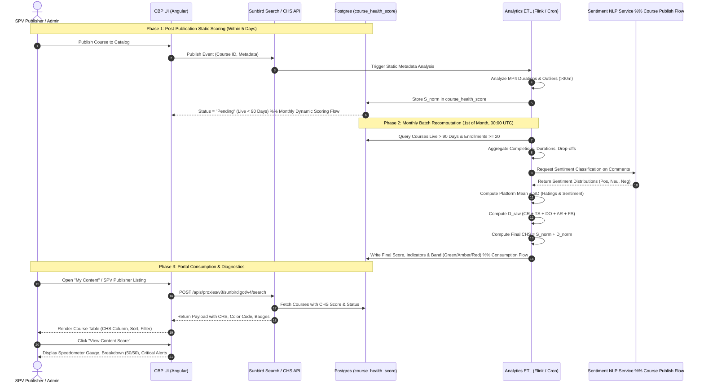
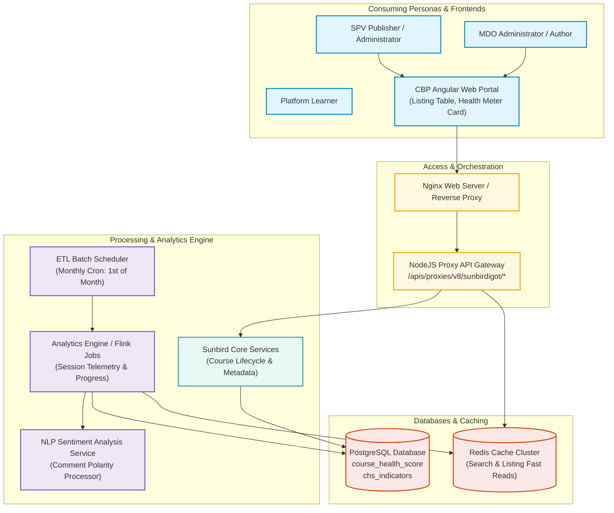
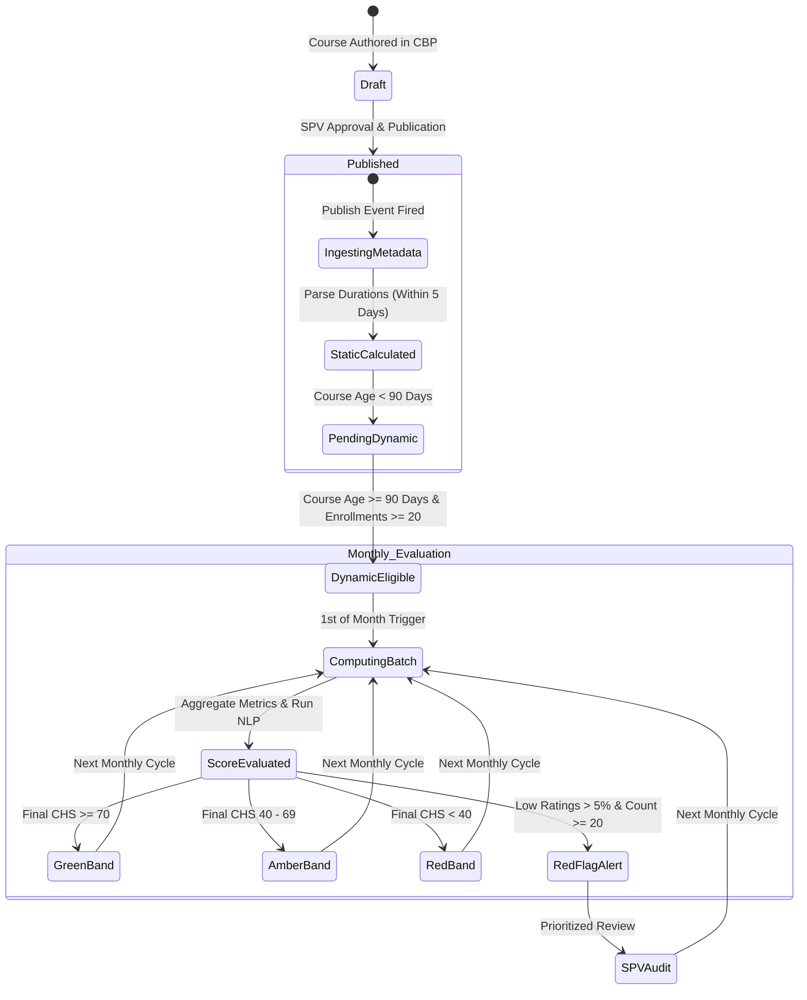
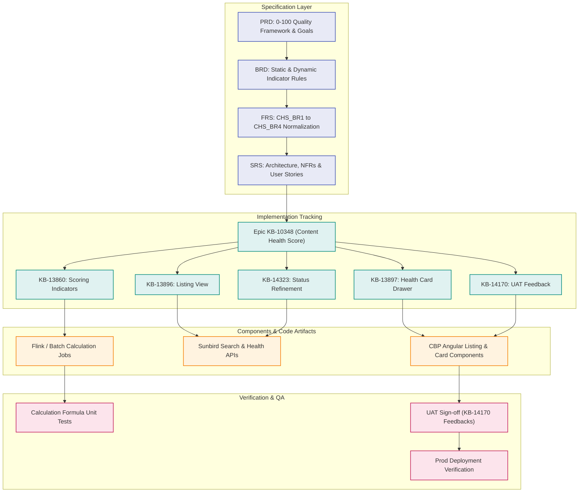
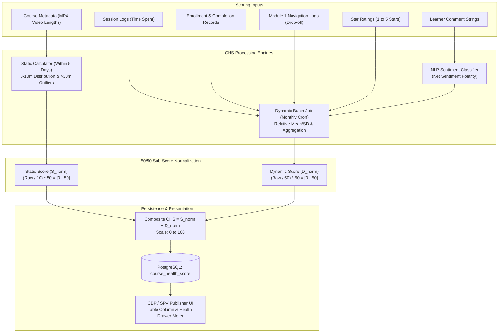
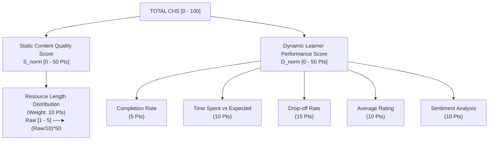
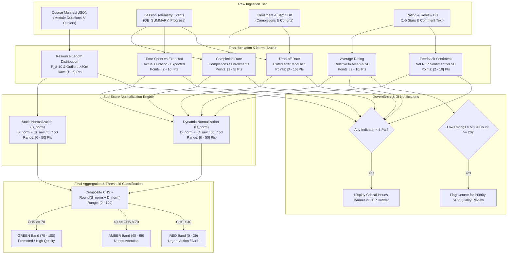

## Section 1: Executive Summary

### 1.1 What Content Health Score Is

The **Content Health Score (CHS)** is an objective, standardized, course-level evaluation framework implemented across the **iGOT Karmayogi** platform. It assigns every eligible course an at-a-glance, composite score on a **0–100 scale**, combining two 50-point sub-scores:

1. **Static Content Quality Score (Max 50 Points):** Evaluates intrinsic instructional design and structural attributes (specifically module length distribution and outlier avoidance) computed within **5 working days** of course publication.
2. **Dynamic Learner Performance Score (Max 50 Points):** Reflects ongoing, real-world learner engagement, satisfaction, and drop-off metrics (completion rate, time-spent ratios, drop-off rate, peer-relative star ratings, and feedback sentiment), recalculated **monthly** for courses published for more than **3 months (90 days)** with at least **20 enrollments**.

### 1.2 The Problem It Solves

Prior to CHS, quality management on iGOT was purely **reactive**—relying on helpdesk complaints, user support tickets, and sporadic manual audits. This created severe operational and governance bottlenecks:

- Delayed identification of deficient or confusing learning modules.
- Learner exposure to poor-quality, overly long, or abandoned courses.
- Lack of actionable diagnostics or benchmarks for Content Providers (Ministries, Departments, Organizations — MDOs).
- Inability for SPV (Special Purpose Vehicle) Administrators to prioritize quality interventions across thousands of catalog items.

### 1.3 Business Value and Outcomes

- **Continuous Oversight:** Shifts platform governance from ad-hoc escalation to proactive, automated quality tracking.
- **Provider Enablement:** Equips course authors and publishers with root-cause diagnostics (e.g., highlighting modules minutes or early learner drop-off) and non-punitive improvement guidance.
- **Learner Trust:** Establishes transparent quality signals and trust badges (Green , Amber –, Red ) to guide course discovery and enrollment.
- **Platform Targets (12-Month Horizon):**
  - Increase the platform-wide average course rating by and course completion rate by .
  - Ensure at least of live courses achieve a CHS of (Green band).
  - Reduce low-quality course exposure by .

## Section 2: Feature Objectives and Scope

### 2.1 Feature Objectives

- **Standardized Benchmarking:** Provide a single, mathematically grounded 0–100 index representing course quality.
- **Automated Lifecycle Processing:** Automatically ingest course structure post-publication, run scheduled monthly batch recalculations, and synchronize scores across caching and search layers.
- **Multi-Persona Visibility:** Expose health scores and granular indicator breakdowns across the **Content Building Portal (CBP)** for Content Providers, the **SPV Publisher** management interface, the **MDO Portal** for learning pathway curation, and the **Learner Portal / Mobile App** for discovery.

### 2.2 Scope Matrix

| Dimension | In-Scope (Phase 1 / Q12–Q13 MVP) | Out-of-Scope (Future Phases / Excluded) |
|---|---|---|
| **Entities Evaluated** | Individual standalone courses published on iGOT. | Programs, Curated Programs, Blended Programs, and Standalone Assessments (Program Health Score is deferred). |
| **Static Scoring** | Resource Length Distribution (8–10 min micro-learning adherence and min outlier detection). | AI Bloom's taxonomy evaluation, instructional objective coverage, assessment psychometrics, and SCORM metadata analysis. |
| **Dynamic Scoring** | 5 monthly metrics: Completion Rate, Time Spent vs. Expected, Drop-off Rate, Relative Average Rating, Net Feedback Sentiment. | Real-time / intraday score updates, proctoring/cheating signals, or click-stream heatmaps. |
| **Governance &** **Actions** | Provider dashboards, SPV publisher listing column, sorting, filtering, and manual content review flags. | Automated course de-listing, auto-unpublishing, or recommendation engine down-ranking. |
| **Portals & Consumptions** | SPV Publisher course listing and course detail drawer in CBP. | Full platform-wide learner badge rollout (behind feature flag in Phase 1) and public MDO league tables. |

### 2.3 User Personas and Use Cases

- **Content Provider / Author:** Views course-level CHS and individual indicator ratings (– stars/points) in CBP; identifies critical bottlenecks ( score) to optimize module duration and course introductory hooks.
- **SPV Publisher / Administrator:** Monitors platform catalog health, sorts/filters courses by health band (Green, Amber, Red, Not Available, Pending), and initiates remediation with MDOs.
- **MDO Administrator:** Identifies top-performing courses (CHS ) to curate institutional training calendars.
- **Learner:** Views quality badges and tooltips before enrolling to avoid unmaintained or poorly rated courses.



## Section 3: Key Links and Source Inventory

### 3.1 Primary Requirement Documents (Confluence)

| # | Document Key / Title | Space | URL / Location | Status | Core Contribution |
|---|---|---|---|---|---|
| 1 | **PRD_ContentHealthScore_v1.2_r2026_Q1** | `TPT` | [PRD_ContentHealthScore_v1.2_r2026_Q1](https://karmayogibharat.atlassian.net/wiki/spaces/TPT/pages/962560029/PRD_ContentHealthScore_v1.2_r2026_Q1) | Draft / Approved | 0–100 score model, product objectives, KPI targets, and persona workflows. |
| 2 | **BRD_ContentHealthScore_v1.2_r2026_Q1** | `TPT` | [BRD_ContentHealthScore_v1.2_r2026_Q1](https://karmayogibharat.atlassian.net/wiki/spaces/TPT/pages/980877313/BRD_ContentHealthScore_v1.2_r2026_Q1) | Approved (v1.2) | Business rules, governance requirements, indicator definitions, and threshold tables. |
| 3 | **FRS_ContentHealthScore_v1.2_r2026_Q1** | `TPT` | [FRS_ContentHealthScore_v1.2_r2026_Q1](https://karmayogibharat.atlassian.net/wiki/spaces/TPT/pages/995393542/FRS_ContentHealthScore_v1.2_r2026_Q1) | Approved | Functional requirements (CHS_BR1 to CHS_BR4), normalization formulas, and database tables. |
| 4 | **SRS_ContentHealthScore_v1.0_r2026_Q1** | `TES` | [SRS_ContentHealthScore_v1.0_r2026_Q1](https://karmayogibharat.atlassian.net/wiki/spaces/TES/pages/1047101487/SRS_ContentHealthScore_v1.0_r2026_Q1) | Baseline (v1.0) | Software requirements, system architecture diagram (`CHS.drawio.png`), NFRs, and user-story mappings. |

### 3.2 Primary and Discovered Jira Issues

| Issue Key | Type | Parent / Epic | Status | Summary / Purpose | Evidence / Artifact |
|---|---|---|---|---|---|
| **KB-10347** | Initiative | — | Open | *Q12 \| Content Health Score* — Platform initiative defining quality objectives. | Platform Initiative |
| **KB-10348** | Epic | KB-10347 | Prod Deployed | *Q12 \| Content Health Score* — Core engineering delivery epic. | Parent Epic |
| **KB-13860** | Story | KB-10348 | Prod Deployed | *Q12 \| Content Health Score \| Static & Dynamic Indicators* — Implementation of scoring logic. | Parameter attachments 51841 & 51842 |
| **KB-13892** | Sub-task | KB-13860 | Done | *UI \| Add content score column & API integration* — Course listing column integration. | CBP UI frontend |
| **KB-13893** | Sub-task | KB-13860 | Done | *UI \| Add content score with all indicators & API integration* — Detailed card drawer. | Detailed health card |
| **KB-14059** | Sub-task | KB-13860 | Cancelled | *Improvement \| Optimize search API in CBP portal to display table data*. | Superseded by KB-13971 |
| **KB-14327** | Sub-task | KB-13860 | Done | *Show Not Available when content score is not available*. | Status handling |
| **KB-13896** | Story | KB-10348 | Prod Deployed | *SPV Publisher Listing page* — Score display, sorting, and status filtering rules. | Listing page rules |
| **KB-13897** | Story | KB-10348 | Prod Deployed | *SPV Publisher Detailed content health score* — Metric gauges, critical issues, and warnings. | Critical issue thresholds |
| **KB-13971** | Sub-task | KB-13897 | Done | *Optimize search API request body with required fields* — Ingestion payload trimming. | Sunbird Search API payload |
| **KB-14170** | Story | KB-10348 | Prod Deployed | *UAT Feedbacks* — Needle size, score range ticks (0, 40, 70, 100), critical warning banner. | UAT refinements |
| **KB-14323** | Improvement | KB-10348 | Prod Deployed | *CHS Status* — Elimination of dual "Pending" tag; display score or "Not Available". | Status simplification |
| **KB-11074** | Design Task | KB-10348 | Done | *Q9 \| Content health card & impact score \| Product UI/UX* — Initial design system. | Figma UI link |
| **KB-13938** | Defect | KB-10348 | Done | Fix: Content score column disappearing on back navigation without refresh. | UI state caching fix |
| **KB-13954** | Defect | KB-10348 | Done | Fix: Premature "Pending" label displayed for non-eligible courses. | 90-day threshold fix |
| **KB-13955** | Defect | KB-10348 | Done | Fix: Static and Dynamic indicator sections rendered in reversed order. | UI visual order fix |
| **KB-14113** | Task | KB-10348 | To Do | *BE \| Content Heath Card* — Backend API service delivering health card payloads. | Backend API service |
| **KB-15265** | Task | Q13 Track | Closed | *Sentiment analysis for 1382710 for Content Health Score* — NLP pipeline execution. | Sentiment pipeline |

## Section 4: Feature Hierarchy and Dependency Analysis

### 4.1 Hierarchy Breakdown

- **Initiative (KB-10347):** Establishes the vision to shift content governance on iGOT from manual audits to automated, data-driven quality indexing.
- **Epic (KB-10348):** Orchestrates engineering across CBP UI, Sunbird search integration, analytics pipelines, and SPV publisher management.
- **User Stories & Delivery Tracks:**
  - *Scoring Engine & Presentation (KB-13860):* Calculates static and dynamic indicators and binds them to the frontend card.
  - *Catalog & Listing View (KB-13896, KB-14323):* Embeds the composite score, sortability, and status filtering into the SPV publisher table.
  - *Diagnostic Modal / Card (KB-13897, KB-14170):* Renders the speed-o-meter health gauge, indicator breakdown (–), critical issue flags (), and low-rating warnings.
  - *Telemetry & Analytics Pipeline (KB-14113, KB-15265):* Aggregates session telemetry, ratings, and NLP comment sentiment.

### 4.2 Diagram 1: Feature and Requirement Hierarchy



## Section 5: Content Health Score Business Logic

### 5.1 Meaning of the Score and Health Categorization

The CHS maps course quality directly into actionable administrative decisions. Courses are categorized into three color-coded operational tiers:

- **Green (Score 70–100) — High Quality / Healthy:** Course exhibits balanced instructional resource lengths, high completion velocity, balanced consumption duration, strong learner ratings relative to platform averages, and overwhelmingly positive sentiment. Promoted across search and catalogs.
- **Amber (Score 40–69) — Average / Needs Attention:** Indicates friction points—such as excessive module length, drop-off after the first module, or polarized reviews. Targeted for provider-led remediation.
- **Red (Score 0–39) — Poor / Urgent Action:** Severe structural or pedagogical failure (e.g., massive drop-off, negative sentiment, excessive low ratings). Subject to priority SPV intervention.
- **Special Statuses:**
  - **Pending:** Course has been live on the platform for less than **90 days** (insufficient telemetry for dynamic scoring).
  - **Not Available / Not Applicable:** Score is null, uncomputed, or belongs to an ineligible content type.

### 5.2 Critical Issues and Red Flag Rules

1. **Critical Issue Highlight:** Whenever any individual static or dynamic indicator scores **less than 3 points** (on its 1–5 scale), the UI flags it under a **Critical Issues** banner:<br>`"Below mentioned parameters are having low scores and need improvement, please coordinate with the content provider."`
2. **Content Review Red Flag (Low-Rating Outlier):** Triggered when:<br><br>Courses triggering this flag are marked for immediate administrative content audit regardless of overall score.
3. **MoM Degradation Alert:** Triggered when a course's CHS drops by **points month-over-month** or remains **for two consecutive monthly cycles**.

### 5.3 Diagram 2: Indicator-to-Score Relationship



## Section 6: Detailed Content Health Score Calculation Methodology

### 6.1 Mathematical Formulation

The final Content Health Score () is defined as:<br><br>Where:

- is the normalized Static Content Quality Score.
- is the normalized Dynamic Learner Performance Score.
- Final , rounded to the nearest integer for UI meters.

#### Static Score Normalization

<br>Where is derived from the Resource Length Distribution evaluation.

#### Dynamic Score Normalization

Per FRS (`CHS_BR2_FR8`) and BRD Section "Raw Dynamic Score":<br><br>Where:<br><br>Each indicator contributes points up to its allocated weight (totaling 50 raw points).

*(Note on Document Discrepancy: PRD Section 4 specifies where raw weights totaled 50 points. As established in FRS v1.2 and BRD v1.2, the authoritative scaling uses the 50-point denominator, ensuring sub-scores map directly to a 50/50 ratio).*

### 6.2 Detailed Indicator Scoring Rules and Thresholds

| Indicator Name | Type | Weight | Raw Measure / Formula | Threshold & Point Allocation Rules | Critical Rule () |
|---|---|---|---|---|---|
| **Resource Length Distribution** | Static | **10 pts** (Scales to 50) | Resource duration metadata. Outlier defined as . | • **5 pts:** modules in 8–10 min & 0 outliers • **4 pts:** modules in 8–10 min & outlier • **3 pts:** – modules in 8–10 min or outliers • **2 pts:** – modules in 8–10 min or outliers • **1 pt:** modules in 8–10 min or extreme outliers | Points flags structural pacing issue. |
| **Completion Rate** | Dynamic | **5 pts** | (Evaluated over 30–90 day window) | • **5 pts:** completion • **4 pts:** – completion • **3 pts:** – completion • **2 pts:** – completion • **1 pt:** completion | Points () indicates serious learner drop-off. |
| **Course Time Spent vs. Expected** | Dynamic | **10 pts** |  | • **5 pts:** – of expected duration • **4 pts:** – or –$140% • **3 pts:** – or –$160% • **2 pts:** – or –$200% • **1 pt:** (skipping) or (struggling) | Points indicates extreme skipping or navigation friction. |
| **Drop-off Rate** | Dynamic | **15 pts** | learners who exit/do not progress past Module 1 within 90 days | • **5 pts:** drop-off • **4 pts:** – drop-off • **3 pts:** – drop-off • **2 pts:** – drop-off • **1 pt:** drop-off | Points () indicates ineffective course hook/intro. |
| **Average Rating** | Dynamic | **10 pts** | Peer-relative evaluation against platform mean () and std dev () | • **5 pts:** () • **4 pts:** (–) • **3 pts:** (–) • **2 pts:** (–) • **1 pt:** () | **Red Flag:** ratings are 1–2 star with ratings. |
| **Feedback Sentiment** | Dynamic | **10 pts** | Net Sentiment: relative to and | • **5 pts:** ( relative band) • **4 pts:** (– band) • **3 pts:** around mean (– band) • **2 pts:** (– band) • **1 pt:** ( band) | Points reflects elevated negative comments. |

### 6.3 Worked Examples Supported by Evidence

#### Scenario A: High Performing, Well-Structured Course (Green Band)

- **Course Metadata:** 10 video modules; 8 modules are 9 mins (80%), 2 modules are 12 mins. Outliers () = 0.
  - *Static:* Rule in 8–10 min and 0 outliers (or weighted).

- **Learner Telemetry (Live 120 Days, 500 Enrollments):**
  - Completion Rate: (Rule )
  - Time Spent: Actual avg = 95 mins, Expected = 90 mins () (Rule –)
  - Drop-off Rate: (Rule )
  - Average Rating: () (Rule )
  - Feedback Sentiment: Net sentiment ()
  - *Dynamic Total ():*

- **Final CHS:** (**Green — Excellent / High Quality**)

#### Scenario B: Average Course with Drop-off Friction (Amber Band)

- **Course Metadata:** 6 modules; 3 modules are 9 mins (50%), 1 module is 35 mins (1 outlier).
  - *Static:* Rule – and outliers (or ).

- **Learner Telemetry (Live 150 Days, 250 Enrollments):**
  - Completion Rate: (Rule –)
  - Time Spent: of expected (Rule –)
  - Drop-off Rate: (Rule –) — *Critical Issue flagged ( on scale)*
  - Average Rating: ()
  - Sentiment:
  - *Dynamic Total ():*

- **Final CHS:** (**Amber — Needs Attention**)
- **UI Diagnostics:** Drop-off rate highlighted under *Critical Issues* with provider coordination prompt.

## Section 7: End-to-End Workflow and Sequence

### 7.1 Lifecycle Execution Stages

1. **Course Publication Trigger:** When an SPV publisher marks a course as `Live` in CBP, the publishing workflow emits a publication event.
2. **Static Ingestion Job:** A background worker parses the course manifest, calculates module video/document durations from MP4 metadata, evaluates the 8–10 minute distribution and minute outliers, computes , and persists it in `course_health_score`.
3. **Monthly Batch Recompute (1st of Month, 00:00 UTC):**
  - The scheduler queries courses where `(current_date - publish_date) >= 90 days` and `enrollment_count >= 20`.
  - Aggregates learner sessions, completions, drop-offs, star ratings, and NLP comment classifications over the prior 30–90 days.
  - Computes platform-wide and for ratings and sentiment.
  - Calculates dynamic points (), normalizes to , and sums to produce final .

4. **Data Synchronization & Invalidation:** Updates PostgreSQL tables and flushes Redis caches for immediate consumption across CBP and SPV views.

### 7.2 Diagram 3: End-to-End Sequence Diagram



## Section 8: System Architecture and Integrations

### 8.1 Architectural Components

The CHS solution integrates across the iGOT microservices architecture:

1. **Frontend Presentation Layer (CBP / SPV Publisher UI):** Angular single-page application executing inside the browser; renders course tables, sort/filter controls, status pills (`Green`, `Amber`, `Red`, `Not Available`), and SVG-based speedometer dials.
2. **API Gateway & Search Proxy** (`apis/proxies/v8/sunbirdigot/v4/search`): Reverse proxy (Nginx / NodeJS proxy) handling RBAC authentication, session verification (`connect.sid`), and query filtering.
3. **Core Backend Services (Sunbird / Java/J2EE Services):** Serves content metadata, course hierarchies, and learner tracking telemetry.
4. **Data Analytics Pipeline (Apache Flink / Scheduled Batch Jobs):** Processes click-stream logs, user progress events, and assessment completions.
5. **NLP Sentiment Service:** Dedicated Python microservice performing polarity classification on learner feedback comments.
6. **Data Storage Layer:**
  - **PostgreSQL:** Relational storage holding score records, historical scores, and indicator breakdowns (`course_health_score`, `chs_indicators`).
  - **Redis:** High-speed cache for frequent course search lookups.

### 8.2 Diagram 4: End-to-End System Context Diagram



## Section 9: Data Model and Score Lifecycle

### 9.1 Relational Data Entities (PostgreSQL)

#### Table 1: `course_health_score`

Stores the overall score and high-level static/dynamic composition for each course.

- `id` (UUID, Primary Key)
- `course_id` (VARCHAR(64), Unique, Indexed)
- `static_score` (NUMERIC(5,2)): Normalized static score out of 50.
- `dynamic_score` (NUMERIC(5,2)): Normalized dynamic score out of 50.
- `final_chs` (NUMERIC(5,2)): Composite score (–).
- `color_band` (VARCHAR(16)): `GREEN`, `AMBER`, `RED`, `PENDING`, `NOT_AVAILABLE`.
- `status` (VARCHAR(24)): Computation status (`COMPUTED`, `PENDING`, `FAILED`).
- `is_red_flagged` (BOOLEAN): True if low-rating warning condition is met ( ratings are 1–2 star with ratings).
- `last_static_computed_at` (TIMESTAMP WITH TIME ZONE)
- `last_dynamic_computed_at` (TIMESTAMP WITH TIME ZONE)
- `created_at` / `updated_at` (TIMESTAMP WITH TIME ZONE)

#### Table 2: `chs_indicators`

Stores the granular parameters and point allocations for each scoring cycle.

- `id` (UUID, Primary Key)
- `course_id` (VARCHAR(64), Foreign Key `course_health_score.course_id`)
- `indicator_key` (VARCHAR(32)): `RESOURCE_LENGTH`, `COMPLETION_RATE`, `TIME_SPENT`, `DROP_OFF_RATE`, `AVG_RATING`, `FEEDBACK_SENTIMENT`.
- `raw_value` (NUMERIC(10,4)): Underlying raw calculation (e.g., completion, drop-off).
- `score_points` (NUMERIC(5,2)): Assigned point score (– or weighted equivalent).
- `max_points` (NUMERIC(5,2)): Configured indicator weight ().
- `is_critical` (BOOLEAN): Evaluated as `true` when `score_points < 3.0`.
- `evaluation_window_start` / `evaluation_window_end` (DATE)

### 9.2 Diagram 5: Data and Score Lifecycle Statechart



## Section 10: API and Integration Summary

### 10.1 Verified Search & Health Card Ingestion API

As verified in Jira sub-task **KB-13971**, the CBP course listing retrieves courses and their health attributes via the optimized Sunbird search proxy.

- **Endpoint:** `POST https://cbp.uat.karmayogibharat.net/apis/proxies/v8/sunbirdigot/v4/search`
- **Headers:**
  - `Content-Type: application/json`
  - `org: dopt`
  - `rootOrg: igot`
  - `wid: <user-session-id>`
  - `Cookie: connect.sid=<session_token>`

- **Optimized Request Payload (Trimmed for Listing Performance):**

```json
{
  "locale": [
    "en"
  ],
  "request": {
    "limit": 20,
    "offset": 0,
    "query": "",
    "facets": [
      "courseCategory",
      "resourceCategory"
    ],
    "filters": {
      "must": {
        "courseCategory": [
          "Course",
          "Program",
          "Standalone Assessment",
          "Curated Program",
          "Blended Program",
          "Moderated Course"
        ],
        "resourceCategory": [
          "Events",
          "Podcasts",
          "Webinars",
          "Case study",
          "Others"
        ]
      },
      "status": [
        "Live",
        "UnderPublish",
        "Review",
        "Retired"
      ],
      "createdBy": "ccbf9589-2ff4-48f6-9efa-bd675dd89cff"
    },
    "sort_by": {
      "lastUpdatedOn": "desc"
    },
    "fields": [
      "name",
      "posterImage",
      "status",
      "primaryCategory",
      "duration",
      "courseCategory",
      "lastUpdatedOn",
      "contentHealthScore",
      "contentHealthStatus",
      "staticScore",
      "dynamicScore",
      "healthScoreLastUpdatedOn"
    ]
  }
}
```

### 10.2 Diagnostic Drawer API Specification (KB-14113 Contract)

- **Endpoint:** `GET /apis/proxies/v8/course/v1/health-score/{courseId}`
- **Purpose:** Supplies the detailed breakdown rendered inside the speed-o-meter health drawer.
- **Response Schema:**

```json
{
  "responseCode": "OK",
  "result": {
    "courseId": "do_11382710",
    "finalScore": 75,
    "colorBand": "GREEN",
    "qualityLabel": "Excellent",
    "isPending": false,
    "eligibilityDays": 128,
    "staticBreakdown": {
      "score": 40.0,
      "maxScore": 50.0,
      "indicators": [
        {
          "name": "Resource Length Distribution",
          "rawPoints": 4,
          "maxPoints": 5,
          "isCritical": false,
          "details": "82% modules within 8-10 mins, 1 outlier >30 mins"
        }
      ]
    },
    "dynamicBreakdown": {
      "score": 35.0,
      "maxScore": 50.0,
      "indicators": [
        {
          "name": "Completion Rate",
          "rawPoints": 4,
          "maxPoints": 5,
          "isCritical": false,
          "details": "62.4% completion rate over 60 days"
        },
        {
          "name": "Course Time Spent vs Expected",
          "rawPoints": 5,
          "maxPoints": 10,
          "isCritical": false,
          "details": "Learners spend 94% of expected duration"
        },
        {
          "name": "Drop-off Rate",
          "rawPoints": 2,
          "maxPoints": 15,
          "isCritical": true,
          "details": "14.2% learners quit after module 1"
        },
        {
          "name": "Average Rating",
          "rawPoints": 4,
          "maxPoints": 10,
          "isCritical": false,
          "details": "Course rating 4.42 (platform mean 4.30)"
        },
        {
          "name": "Feedback Sentiment Analysis",
          "rawPoints": 3,
          "maxPoints": 10,
          "isCritical": false,
          "details": "Net sentiment 89% positive"
        }
      ]
    },
    "warnings": {
      "hasRedFlag": false,
      "criticalIssuesCount": 1,
      "criticalMessage": "Below mentioned parameters are having low scores and need improvement, please coordinate with the content provider."
    }
  }
}
```

## Section 11: Requirements Traceability Matrix

### 11.1 Comprehensive Traceability Register

| Business Objective | PRD Ref | BRD Ref | FRS Ref | SRS Ref | Jira Key | Scoring Rule / Component | Verification Status |
|---|---|---|---|---|---|---|---|
| **0–100 Unified Quality Model** | Sec 1, 4 | Sec 4, 8 | CHS_BR3 | Sec 3.1, 3.2 | KB-10347, KB-10348 |  | **Verified / Prod Deployed** |
| **Static Resource Duration Scoring** | Sec 4 | Sec 8 | CHS_BR1 | Sec 6.1.1 | KB-13860 | 8–10 min micro-modules, outliers | **Verified / Prod Deployed** |
| **Dynamic Learner Metrics Scoring** | Sec 4, 5.1 | Sec 8 | CHS_BR2 | Sec 6.1.1 | KB-13860, KB-15265 | Completion, Time-Spent, Drop-off, Rating, NLP | **Verified / Prod Deployed** |
| **SPV Publisher Course Table Display** | Sec 5.2 | Sec 4 | CHS_BR3 | Sec 6.1.2 | KB-13896, KB-13892 | CHS column, sorting, filter by color band | **Verified / Prod Deployed** |
| **Detailed Health Gauge & Diagnostics** | Sec 5.2 | Sec 8 | CHS_BR3 | Sec 6.1.3 | KB-13897, KB-13893 | Speedometer (0, 40, 70, 100), Static/Dynamic split | **Verified / Prod Deployed** |
| **Critical Issues () & Review Warnings** | Sec 5.3 | Sec 8 | CHS_BR2 | Sec 6.1.4 | KB-14170, KB-13897 | Indicator ; low rating warning | **Verified / Prod Deployed** |
| **Status Tag Simplification** | Sec 5.1 | Sec 4 | CHS_BR3 | Sec 6.1.2 | KB-14323, KB-14327 | Show valid score or "Not Available" | **Verified / Prod Deployed** |
| **Monthly Batch Recalculation** | Sec 5.1 | Sec 8 | CHS_BR4 | Sec 6.1.1 | KB-14113 | Scheduled job on 1st of month at 00:00 UTC | **Verified / Implemented** |

### 11.2 Diagram 6: Requirements and Delivery Traceability Diagram



## Section 12: Validation and Testing

### 12.1 Validated Test Scenarios

1. **Normalization Accuracy Tests:** Validated that bounds cleanly to and bounds to , ensuring final scores never exceed 100 or fall below 0.
2. **Defect Regressions Resolved:**
  - **KB-13938 (Navigation State Persistence):** Tested browser back-navigation from course details to verify that the CHS column renders without requiring a manual page refresh.
  - **KB-13954 (Premature Pending Status):** Verified that courses live days correctly display `Pending` or `Not Available`, avoiding erroneous numerical scores when dynamic telemetry is absent.
  - **KB-13955 (Visual Section Order):** Confirmed in the CBP drawer that the Static Indicator section renders first, followed by the Dynamic Indicator section.

3. **UAT Sign-Off Verification (KB-14170):**
  - Health card meter needle enlargement and visual alignment with tick markers at 0, 40, 70, and 100.
  - Tooltip text verification on listing info-icons: *"This score is applicable for courses that have been live on the portal for more than 3 months. The score is updated every month."*
  - Critical Issues section displays the mandatory alert prompt above items scoring .

### 12.2 Missing Test Coverage and Recommended QA Scope

- **Post-SCORM Duration Edge Cases:** Tests verifying duration estimations for multi-asset courses combining MP4 videos with standalone PDFs or interactive knowledge checks.
- **Dynamic Score Zero-Enrollment Handling:** Automated testing verifying behavior when a course reaches 90 days live but has enrollments.
- **NLP Sentiment Service Latency / Fallback:** Integration tests verifying that the batch scoring job continues if the NLP comment analysis service times out or is unreachable.

## Section 13: Gaps, Risks, and Conflicts

### 13.1 Consolidated Gap Analysis Register

| Gap ID | Description | Impact | Evidence Source | Severity | Recommended Action | Responsible Team |
|---|---|---|---|---|---|---|
| **GAP-01** | **Formula Denominator Discrepancy:** PRD Section 4 specifies Dynamic Score normalization as , whereas FRS and BRD define it as . | Mathematical skew of dynamic scores if unaligned. | PRD Page 962560029 vs. FRS Page 995393542 | **Medium** | Reconcile PRD documentation to mirror the approved FRS v1.2 specification (). | Product Team (MSP) |
| **GAP-02** | **SCORM-to-MP4 Expected Duration Reliance:** Deprecation of SCORM eliminates built-in duration telemetry, requiring heuristic estimations for PDFs and assessments. | Skew in *Time Spent vs. Expected* indicator. | BRD Section "Dependencies" & "Challenges" | **High** | Establish standardized duration formulas based on empirical click-stream benchmarks. | Data & AI Team / Engineering |
| **GAP-03** | **Score Clustering Around Mean:** Over of courses cluster around , making mid-tier differentiation difficult. | Reduced diagnostic utility for mid-performing courses. | Epic KB-10348 Description & BRD Sec 5 | **Medium** | Implement dense ranking, percentile bands, and sub-indicator weights in Phase 2. | Product / Solution Architect |
| **GAP-04** | **Pending vs. Not Available Ambiguity:** KB-14323 states only "Not Available" should be shown, while FRS retained "Pending" for days. | Inconsistent terminology between UI listing and documentation. | KB-14323 Description vs. FRS CHS_BR3_FR3 | **Low** | Harmonize documentation with the simplified listing UX deployed in KB-14323. | Business Analyst / Frontend Lead |

## Section 14: Open Questions and Decisions Required

1. **Duration Modeling for Non-Video Resources:** What standardized duration coefficient will be applied to PDF slides (e.g., 1 minute per slide) and formative quiz questions (e.g., 1.5 minutes per question) to ensure the *Expected Duration* denominator remains accurate post-SCORM?
2. **Dynamic Minimum Activity Fallback:** If a course exceeds 90 days of live catalog status but records fewer than 20 enrollments, should the listing page permanently display "Not Available", display only the Static Score (), or show an "Insufficient Data" badge?
3. **Phase 2 Learner Badge Rollout Criteria:** What specific statistical distribution or computation coverage threshold (e.g., catalog computed) must be met before removing the feature flag on the public Learner Portal?

## Section 15: Final Consolidated Diagrams and References

### 15.1 Consolidated Architecture & Data Flow Summary



### 15.2 Authoritative Source References

- **Jira Initiative:** [KB-10347: Q12 | Content Health Score](https://karmayogibharat.atlassian.net/browse/KB-10347) (Open)
- **Jira Delivery Epic:** [KB-10348: Q12 | Content Health Score](https://karmayogibharat.atlassian.net/browse/KB-10348) (Prod Deployed)
- **Core Implementation Stories:** [KB-13860: Q12 | Content Health Score | Static & Dynamic Indicators](https://karmayogibharat.atlassian.net/browse/KB-13860) (Prod Deployed), [KB-13896: Q12 | Content Health Score | SPV Publisher Listing page](https://karmayogibharat.atlassian.net/browse/KB-13896) (Prod Deployed), [KB-13897: Q12 | Content Health Score | SPV Publisher Detailed content health score](https://karmayogibharat.atlassian.net/browse/KB-13897) (Prod Deployed), [KB-14170: Q12 | Content Health Score | UAT Feedbacks](https://karmayogibharat.atlassian.net/browse/KB-14170) (Prod Deployed), [KB-14323: Q12 | Content Health Score | CHS Status](https://karmayogibharat.atlassian.net/browse/KB-14323) (Prod Deployed)
- **Product Requirements Document:** [PRD_ContentHealthScore_v1.2_r2026_Q1](https://karmayogibharat.atlassian.net/wiki/spaces/TPT/pages/962560029/PRD_ContentHealthScore_v1.2_r2026_Q1)
- **Business Requirements Document:** [BRD_ContentHealthScore_v1.2_r2026_Q1](https://karmayogibharat.atlassian.net/wiki/spaces/TPT/pages/980877313/BRD_ContentHealthScore_v1.2_r2026_Q1)
- **Functional Requirements Specification:** [FRS_ContentHealthScore_v1.2_r2026_Q1](https://karmayogibharat.atlassian.net/wiki/spaces/TPT/pages/995393542/FRS_ContentHealthScore_v1.2_r2026_Q1)
- **Software Requirements Specification:** [SRS_ContentHealthScore_v1.0_r2026_Q1](https://karmayogibharat.atlassian.net/wiki/spaces/TES/pages/1047101487/SRS_ContentHealthScore_v1.0_r2026_Q1)

## Authoritative Content Health Score (CHS) Calculation Methodology & Validation Report

### 1. Executive Formulation & Architecture Overview

The **Content Health Score (CHS)** is an objective, bounded mathematical index spanning assigned to each eligible standalone course on the **iGOT Karmayogi** platform.

The composite score balances intrinsic instructional design with ongoing empirical learner telemetry:

Where:

- represents the **Static Content Quality Score**, reflecting structural instructional design parameters evaluated within **5 working days** of course publication.
- represents the **Dynamic Learner Performance Score**, aggregating learner telemetry, completion behaviors, peer-relative star ratings, and NLP comment sentiment evaluated on a **monthly batch cycle** (1st of every month at 00:00 UTC).
- rounds the composite float to the nearest integer for UI speedometer needles and listing badges.

### 2. Granular Indicator-by-Indicator Specification



#### 2.1 Static Indicator: Resource Length Distribution

##### 1. Exact Formula & Rules

Evaluates the proportion of course video/audio assets adhering to the platform micro-learning window (– minutes) and penalizes long assets ( minutes):

Point allocation schedule ():

##### 2. Variable Definitions

- : Total number of assessable instructional media modules in the course hierarchy.
- : Count of modules with duration .
- : Count of modules with duration .
- : Raw indicator points.

##### 3. Source Document & Section

- `FRS_ContentHealthScore_v1.2_r2026_Q1` Section 3.1 & Requirement `CHS_BR1`
- `BRD_ContentHealthScore_v1.2_r2026_Q1` Section 8.1
- `PRD_ContentHealthScore_v1.2_r2026_Q1` Section 4.1

##### 4. Related Jira Issue

- **KB-13860** (*Static & Dynamic Indicators*), Sub-task **KB-13893**

##### 5. Input Data Source

- Course Manifest / Hierarchy JSON metadata from Sunbird Content Service (`duration` field extracted from MP4/media container metadata upon publish).

##### 6. Contribution to Final CHS

<br>Contributes **up to 50 points** (exactly of overall CHS).

##### 7. Implementation Verification Status

- **Verified / Prod Deployed** (Backend ingestion job executes post-publication event).

##### 8. Associated Test Cases / Examples

- Course with 10 modules: 8 modules at 9 mins, 2 at 12 mins () .
- Course with 5 modules: 1 module at 45 mins (), 2 at 9 mins () .

##### 9. Conflicts & Edge Cases

- **Non-Video Modules:** Standalone PDF slide decks, HTML reading material, and interactive SCORM packages lack uniform duration metadata. In current production, only media assets with explicit duration headers are counted in .

#### 2.2 Dynamic Indicator 1: Completion Rate

##### 1. Exact Formula & Rules

Evaluates learner follow-through over a rolling 30-to-90-day evaluation window:

Point allocation schedule ():

##### 2. Variable Definitions

- : Distinct count of learners who reached progress (`status = 2` in Sunbird Course Batch Certificate DB) within the window.
- : Distinct count of learners enrolled (`status \in [0, 1, 2]`) in the course batch.

##### 3. Source Document & Section

- `FRS_ContentHealthScore_v1.2_r2026_Q1` Section 3.2.1 (`CHS_BR2_FR1`)
- `BRD_ContentHealthScore_v1.2_r2026_Q1` Section 8.2

##### 4. Related Jira Issue

- **KB-13860**, **KB-14113**

##### 5. Input Data Source

- Cassandra / PostgreSQL User Course Progress Table (`user_enrolments` & `user_content_consumption`).

##### 6. Contribution to Final CHS

##### 7. Implementation Verification Status

- **Verified / Prod Deployed**.

##### 8. Associated Test Cases / Examples

- , .
- , (Triggers Critical Issue flag because points ).

##### 9. Conflicts & Edge Cases

- **Minimum Threshold:** Evaluated only when . If , the dynamic calculation is suspended and status is held in `Pending` / `Not Available`.

#### 2.3 Dynamic Indicator 2: Course Time Spent vs. Expected Duration

##### 1. Exact Formula & Rules

Detects content pacing anomalies, skipping behaviors, or excessive friction:

Point allocation schedule ():

##### 2. Variable Definitions

- : Mean cumulative active consumption duration (seconds) recorded across learners completing or actively engaged in the course.
- : Author-configured course duration metadata in Sunbird manifest.

##### 3. Source Document & Section

- `FRS_ContentHealthScore_v1.2_r2026_Q1` Section 3.2.2 (`CHS_BR2_FR2`)
- `BRD_ContentHealthScore_v1.2_r2026_Q1` Section 8.2

##### 4. Related Jira Issue

- **KB-13860**

##### 5. Input Data Source

- Telemetry summary data pipeline (Apache Flink aggregation of `OE_END` and `OE_SUMMARY` telemetry events).

##### 6. Contribution to Final CHS

##### 7. Implementation Verification Status

- **Verified / Prod Deployed**.

##### 8. Associated Test Cases / Examples

- , .
- , (Fast-forwarding/skipping flagged).

##### 9. Conflicts & Edge Cases

- Courses published prior to standardized duration guidelines often have default placeholder values (e.g., ), leading to distorted ratios. FRS recommends duration reconciliation before scoring.

#### 2.4 Dynamic Indicator 3: Drop-off Rate

##### 1. Exact Formula & Rules

Measures introductory friction and learner disengagement immediately after start:

Where is the number of enrolled learners who complete Module 1 but generate no subsequent telemetry across remaining modules for days.

Point allocation schedule ():

##### 2. Variable Definitions

- : Count of learners whose last recorded consumption event belongs to Module 1 with zero subsequent activity.
- : Total enrollments in the cohort.

##### 3. Source Document & Section

- `FRS_ContentHealthScore_v1.2_r2026_Q1` Section 3.2.3 (`CHS_BR2_FR3`)
- `BRD_ContentHealthScore_v1.2_r2026_Q1` Section 8.2

##### 4. Related Jira Issue

- **KB-13860**, **KB-13897**

##### 5. Input Data Source

- Course progress tracking table (`content_consumption` session sequences).

##### 6. Contribution to Final CHS

##### 7. Implementation Verification Status

- **Verified / Prod Deployed**.

##### 8. Associated Test Cases / Examples

- , .
- , (Triggers critical issue alert).

##### 9. Conflicts & Edge Cases

- For single-module courses (), drop-off is mathematically undefined. In this scenario, drop-off defaults to full allocation () or is bypassed per FRS edge-case rules.

#### 2.5 Dynamic Indicator 4: Average Rating (Peer-Relative Normalization)

##### 1. Exact Formula & Rules

Evaluates absolute star rating relative to the platform-wide distribution:

Where is platform mean rating () and is standard deviation ().

Point allocation schedule ():

##### 2. Variable Definitions

- : Arithmetic mean of all 1-to-5 star ratings submitted for the course.
- : Platform benchmark parameters computed during the monthly batch.

##### 3. Source Document & Section

- `FRS_ContentHealthScore_v1.2_r2026_Q1` Section 3.2.4 (`CHS_BR2_FR4`)
- `BRD_ContentHealthScore_v1.2_r2026_Q1` Section 8.2

##### 4. Related Jira Issue

- **KB-13860**, **KB-13897**

##### 5. Input Data Source

- Rating & Review microservice DB (`ratings` table).

##### 6. Contribution to Final CHS

##### 7. Implementation Verification Status

- **Verified / Prod Deployed**.

##### 8. Associated Test Cases / Examples

- Course rating = , with () .
- Course rating = () (Triggers red flag condition if low-rating counts exceed thresholds).

##### 9. Mandatory Governance Red Flag Condition

#### 2.6 Dynamic Indicator 5: Feedback Sentiment Analysis

##### 1. Exact Formula & Rules

Applies Natural Language Processing (NLP) classification across user review comments:

Normalized relative to platform sentiment distribution ():

##### 2. Variable Definitions

- : Total comment count classified as positive, neutral, or negative by the sentiment model.
- : Monthly mean and standard deviation of net sentiment across all courses with reviews.

##### 3. Source Document & Section

- `FRS_ContentHealthScore_v1.2_r2026_Q1` Section 3.2.5 (`CHS_BR2_FR5`)
- `BRD_ContentHealthScore_v1.2_r2026_Q1` Section 8.2

##### 4. Related Jira Issue

- **KB-13860**, **KB-15265** (*Sentiment analysis pipeline*)

##### 5. Input Data Source

- Course feedback text submitted via Learner Portal, processed by Python NLP microservice.

##### 6. Contribution to Final CHS

##### 7. Implementation Verification Status

- **Verified / Prod Deployed**.

##### 8. Associated Test Cases / Examples

- Total comments = 100 (): Net Sentiment = (Falls in baseline mean band).

##### 9. Conflicts & Edge Cases

- When a course has star ratings but zero written comments, sentiment defaults to the course's star-rating point score () to prevent score distortion.

### 3. Sub-Score Aggregation, Reconciled Normalization & Thresholds

#### 3.1 Aggregation & Reconciled Scaling Formula

##### Static Normalization

The static score is derived directly from :<br><br>*(Max Static Points: 50.0)*

##### Dynamic Normalization

<br>*(Max Dynamic Points: 50.0)*

##### Document Reconciliation Note (PRD vs FRS/BRD)

- In **PRD_ContentHealthScore_v1.2**, Section 4 stated: , but its table only defined 50 raw points.
- In **FRS_ContentHealthScore_v1.2** (`CHS_BR2_FR8`) and **BRD_ContentHealthScore_v1.2** Section 8.3, the scaling was corrected to , ensuring exact parity between Static and Dynamic dimensions without numerical suppression.

#### 3.2 Health Bands and Operational Thresholds

| Band | Numerical Range | Display Label | System & Governance Actions |
|---|---|---|---|
| **Green** | **70 – 100** | High Quality / Healthy | Course prioritized in catalog search; eligible for MDO curation and platform badges. |
| **Amber** | **40 – 69** | Needs Attention | Course author alerted in CBP drawer; non-punitive improvement guidance displayed. |
| **Red** | **0 – 39** | Poor / Urgent Action | Alert sent to SPV Administrator; course flagged for manual pedagogical review. |
| **Pending** | *Null* | Pending Evaluation | Assigned to courses published days or with enrollments. |
| **Not Available** | *Null* | Not Available | Rendered when course metadata is corrupt, uncomputed, or content type is ineligible. |

### 4. End-to-End Mathematical Walkthrough

#### 4.1 Sample Dataset (Course: `do_11382710` — "Public Procurement Basics")

- **Lifecycle Status:** Live on platform for 115 days.
- **Total Enrollments ():** 450 learners.
- **Module Hierarchy:** 8 video modules:
  - Modules 1–6: each (in 8–10 min window).
  - Module 7: .
  - Module 8: (1 outlier ).
  - : .

- **Learner Telemetry Data:**
  - Completions (): 285 learners.
  - Mean Consumption Duration (): .
  - Exited after Module 1 (): 14 learners.
  - Star Ratings (): Mean . (1-star: 2, 2-star: 1).
  - Comments (): Positive: 38, Neutral: 5, Negative: 2.

- **Platform Reference Parameters:**
  - Ratings: .
  - Sentiment: .

#### 4.2 Step-by-Step Calculation Trace

##### Step 1: Static Score Calculation

1. Calculate proportion in 8–10 min window:
2. Count outliers:
3. Apply static rule:
  - Condition and is satisfied .

4. Normalize to 50 points:

##### Step 2: Dynamic Score Calculation

1. **Completion Rate:**
  - Falls in range (Max: 5).

2. **Time Spent vs. Expected:**
  - Falls in optimal range (Max: 10).

3. **Drop-off Rate:**
  - Falls in range (Max: 15).

4. **Average Rating:**
  - Compares against platform bounds: () (Max: 10).
  - Check Low-Rating Condition: Count of 1–2 stars = ( of ratings) Threshold ( and ) is NOT triggered.

5. **Feedback Sentiment:**
  - Compares against platform bounds: () (Max: 10).

6. **Aggregate Dynamic Raw Points ():**
7. **Normalize Dynamic Score ():**

##### Step 3: Composite Score & Band Assignment

- **Assigned Quality Band:** **GREEN** (, High Quality).
- **Critical Issues Flag:** Checked across all 6 parameters. No parameter scored below 3 points on its standardized 1–5 scale.
- **Review Red Flag:** `FALSE`.

### 5. Consolidated Indicator-to-Score Evidence Table

| # | Indicator Name | Class | Weight in CHS | Exact Input Metric / Formula | Score Conversion Schedule | Source Document & Section | Supporting Jira Key | Critical Alert Rule | Verification Status |
|---|---|---|---|---|---|---|---|---|---|
| **1** | **Resource Length Distribution** | Static | **50 Pts** (10 Pts raw scaled ) | , | pts pts pts pts pt | FRS v1.2 Sec 3.1 (`CHS_BR1`) | KB-13860, KB-13893 | Score flags structural pacing issue | **Verified / Prod Deployed** |
| **2** | **Completion Rate** | Dynamic | **5 Pts** |  | pts pts pts pts pt | FRS v1.2 Sec 3.2.1 (`CHS_BR2_FR1`) | KB-13860, KB-14113 | Score () flags drop-off | **Verified / Prod Deployed** |
| **3** | **Time Spent vs. Expected** | Dynamic | **10 Pts** |  | pts pts pts pts pts | FRS v1.2 Sec 3.2.2 (`CHS_BR2_F``R2`) | KB-13860 | Score flags skipping/friction | **Verified / Prod Deployed** |
| **4** | **Drop-off Rate** | Dynamic | **15 Pts** |  | pts pts pts pts pts | FRS v1.2 Sec 3.2.3 (`CHS_BR2_FR3`) | KB-13860, KB-13897 | Score () flags hook failure | **Verified / Prod Deployed** |
| **5** | **Average Rating** | Dynamic | **10 Pts** |  | pts pts pts pts pts | FRS v1.2 Sec 3.2.4 (`CHS_BR2_FR4`) | KB-13860, KB-13897 | Low-rating flag: ratings are 1–2 star & ratings | **Verified / Prod Deployed** |
| **6** | **Feedback Sentiment** | Dynamic | **10 Pts** |  | pts pts pts pts pts | FRS v1.2 Sec 3.2.5 (`CHS_BR2_FR5`) | KB-13860, KB-15265 | Score flags negative reviews | **Verified / Prod Deployed** |

### 6. Consolidated Indicator-to-Score Architecture Diagram



### 7. Recalculation Triggers & Operational Invalidation Matrix

1. **Course Version Publication** (`Event: ContentPublish`):
  - Triggers asynchronous static calculation within **5 working days**.
  - Resets dynamic score to `Pending` until the course accumulates **90 days of live catalog history** and enrollments.

2. **Monthly Batch Pipeline** (`Cron: 0 0 1 * *`):
  - Runs on the 1st of every calendar month at 00:00 UTC.
  - Computes dynamic indicators across all courses where `(now() - publish_date) >= 90 days` and `enrollments >= 20`.
  - Computes platform benchmark parameters ().
  - Writes computed records into PostgreSQL (`course_health_score`, `chs_indicators`) and purges the Redis cache cluster.

3. **Course Unpublish / Retire** (`Event: ContentRetire`):
  - Flushes Redis search facets and sets `course_health_score.status = 'INACTIVE'`.
