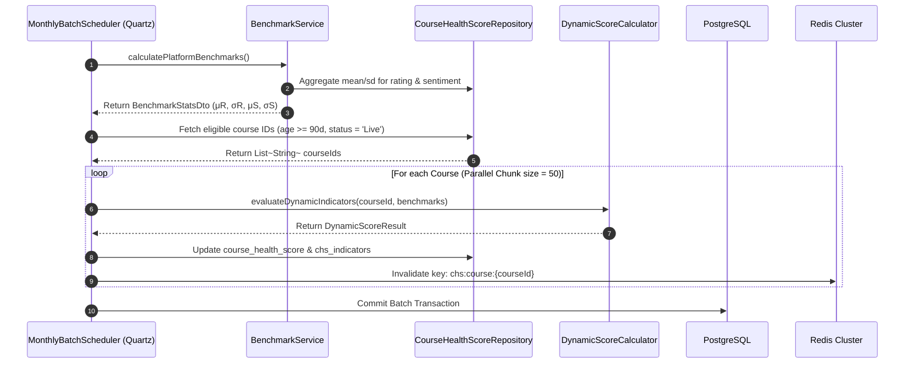
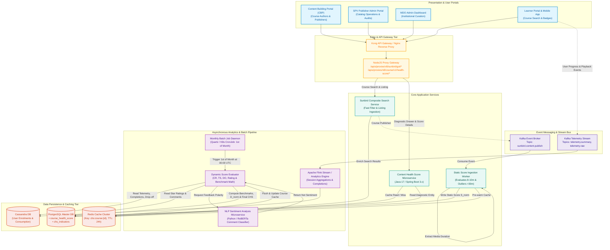
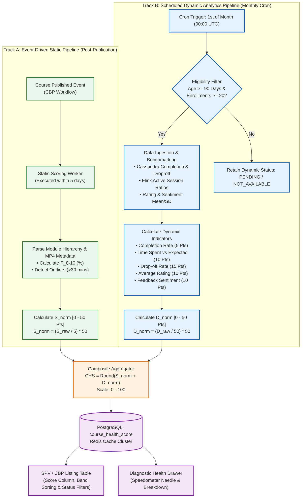

# Content Health Score — Low-Level Design (LLD)

## 1. Document Control & Architectural Traceability

### 1.1 Metadata

- **Feature Name:** Content Health Score (CHS) Engine
- **Module ID:** `igot-content-health-service`
- **Specification Authority:**
  - `PRD_ContentHealthScore_v1.2_r2026_Q1` (Space: `TPT`, ID: `962560029`)
  - `BRD_ContentHealthScore_v1.2_r2026_Q1` (Space: `TPT`, ID: `980877313`)
  - `FRS_ContentHealthScore_v1.2_r2026_Q1` (Space: `TPT`, ID: `995393542`)
  - `SRS_ContentHealthScore_v1.0_r2026_Q1` (Space: `TES`, ID: `1047101487`)

- **Primary Jira Implementations:** [KB-10348: Q12 | Content Health Score](https://karmayogibharat.atlassian.net/browse/KB-10348) (Prod Deployed) (Epic), [KB-13860: Q12 | Content Health Score | Static & Dynamic Indicators](https://karmayogibharat.atlassian.net/browse/KB-13860) (Prod Deployed) (Indicators), [KB-13896: Q12 | Content Health Score | SPV Publisher Listing page](https://karmayogibharat.atlassian.net/browse/KB-13896) (Prod Deployed) (Listing), [KB-13897: Q12 | Content Health Score | SPV Publisher Detailed content health score](https://karmayogibharat.atlassian.net/browse/KB-13897) (Prod Deployed) (Drawer), [KB-14113: BE | Content Heath Card](https://karmayogibharat.atlassian.net/browse/KB-14113) (To Do) (Backend Service), [KB-14170: Q12 | Content Health Score | UAT Feedbacks](https://karmayogibharat.atlassian.net/browse/KB-14170) (Prod Deployed) (UAT Refinements), [KB-14323: Q12 | Content Health Score | CHS Status](https://karmayogibharat.atlassian.net/browse/KB-14323) (Prod Deployed) (Status Simplification), [KB-15265: Q13 | Sentiment analysis for 1382710 for Content Health Score](https://karmayogibharat.atlassian.net/browse/KB-15265) (Closed) (NLP Pipeline).
- **Runtime Environment:** Java 17, Spring Boot 3.2.x, PostgreSQL 15, Redis 7.x, Apache Kafka 3.x, Python 3.10 (NLP Inference Service).

### 1.2 Purpose

This Low-Level Design (LLD) document defines the concrete class structures, method signatures, mathematical transformation algorithms, database DDL/DML, REST controller schemas, and asynchronous listener implementations required to execute the Content Health Score on the iGOT Karmayogi platform.

## 2. Package Architecture & Class Structure

### 2.1 Package Decomposition

```text
org.karmayogi.chs
├── config
│   ├── ChsDataSourceConfig.java
│   ├── RedisCacheConfig.java
│   └── KafkaConsumerConfig.java
├── controller
│   ├── CourseHealthScoreController.java
│   └── CourseHealthAdminController.java
├── model
│   ├── entity
│   │   ├── CourseHealthScoreEntity.java
│   │   └── ChsIndicatorEntity.java
│   ├── dto
│   │   ├── request
│   │   │   └── CourseSearchQueryRequest.java
│   │   ├── response
│   │   │   ├── CourseHealthScoreResponse.java
│   │   │   ├── IndicatorBreakdownDto.java
│   │   │   └── BenchmarkStatsDto.java
│   │   └── event
│   │       └── ContentPublishEvent.java
│   └── enums
│       ├── ColorBand.java
│       ├── ComputationStatus.java
│       └── IndicatorKey.java
├── repository
│   ├── CourseHealthScoreRepository.java
│   └── ChsIndicatorRepository.java
├── service
│   ├── ContentHealthScoreService.java
│   ├── impl
│   │   └── ContentHealthScoreServiceImpl.java
│   ├── calculator
│   │   ├── StaticScoreCalculator.java
│   │   ├── DynamicScoreCalculator.java
│   │   └── BenchmarkService.java
│   └── client
│       ├── SunbirdContentClient.java
│       ├── CassandraTelemetryClient.java
│       └── NlpSentimentFeignClient.java
└── listener
    ├── ContentPublishEventListener.java
    └── MonthlyBatchScheduler.java
```

### 2.2 Detailed Class Diagram

```mermaid
classDiagram
    class CourseHealthScoreController {
        -ContentHealthScoreService chsService
        +getCourseHealthScore(courseId: String): ResponseEntity~CourseHealthScoreResponse~
        +batchRecalculate(triggerSecret: String): ResponseEntity~BatchJobResponse~
    }
    class ContentHealthScoreService {
        <<interface>>
        +computeStaticScore(courseId: String): StaticScoreResult
        +computeDynamicScore(courseId: String, benchmarks: BenchmarkStatsDto): DynamicScoreResult
        +aggregateAndPersist(courseId: String, staticRes: StaticScoreResult, dynamicRes: DynamicScoreResult): CourseHealthScoreEntity
        +getHealthDetails(courseId: String): CourseHealthScoreResponse
    }
    class ContentHealthScoreServiceImpl {
        -StaticScoreCalculator staticCalculator
        -DynamicScoreCalculator dynamicCalculator
        -BenchmarkService benchmarkService
        -CourseHealthScoreRepository scoreRepo
        -ChsIndicatorRepository indicatorRepo
        -RedisTemplate cacheTemplate
        +computeStaticScore(courseId: String): StaticScoreResult
        +computeDynamicScore(courseId: String, benchmarks: BenchmarkStatsDto): DynamicScoreResult
        +aggregateAndPersist(courseId: String, staticRes: StaticScoreResult, dynamicRes: DynamicScoreResult): CourseHealthScoreEntity
        +getHealthDetails(courseId: String): CourseHealthScoreResponse
    }
    class StaticScoreCalculator {
        -SunbirdContentClient contentClient
        +evaluateResourceLength(hierarchyJson: JsonNode): IndicatorResult
        +normalizeStaticScore(rawPoints: int): double
    }
    class DynamicScoreCalculator {
        -CassandraTelemetryClient telemetryClient
        -NlpSentimentFeignClient nlpClient
        +evaluateCompletionRate(courseId: String): IndicatorResult
        +evaluateTimeSpent(courseId: String, expectedSecs: long): IndicatorResult
        +evaluateDropOffRate(courseId: String): IndicatorResult
        +evaluateAverageRating(courseId: String, stats: BenchmarkStatsDto): IndicatorResult
        +evaluateFeedbackSentiment(courseId: String, stats: BenchmarkStatsDto): IndicatorResult
        +normalizeDynamicScore(rawPointsSum: double): double
    }
    class BenchmarkService {
        -CourseHealthScoreRepository scoreRepo
        +calculatePlatformBenchmarks(): BenchmarkStatsDto
    }
    class CourseHealthScoreEntity {
        +UUID id
        +String courseId
        +Double staticScore
        +Double dynamicScore
        +Double finalChs
        +ColorBand colorBand
        +ComputationStatus computationStatus
        +Boolean isRedFlagged
        +Integer criticalIssuesCount
        +OffsetDateTime publishedDate
        +OffsetDateTime lastStaticComputedAt
        +OffsetDateTime lastDynamicComputedAt
        +List~ChsIndicatorEntity~ indicators
    }
    class ChsIndicatorEntity {
        +UUID id
        +CourseHealthScoreEntity healthScore
        +IndicatorKey indicatorKey
        +String indicatorType
        +Double rawMetricValue
        +Double scorePoints
        +Double maxPoints
        +Boolean isCritical
        +String diagnosticDetails
        +LocalDate evaluationWindowStart
        +LocalDate evaluationWindowEnd
    }
    class IndicatorResult {
        +IndicatorKey key
        +double rawValue
        +double pointsAwarded
        +double maxPoints
        +boolean isCritical
        +String details
    }
    CourseHealthScoreController --> ContentHealthScoreService
    ContentHealthScoreServiceImpl ..|> ContentHealthScoreService
    ContentHealthScoreServiceImpl --> StaticScoreCalculator
    ContentHealthScoreServiceImpl --> DynamicScoreCalculator
    ContentHealthScoreServiceImpl --> BenchmarkService
    ContentHealthScoreServiceImpl --> CourseHealthScoreEntity
    CourseHealthScoreEntity "1" *-- "many" ChsIndicatorEntity
    StaticScoreCalculator ..> IndicatorResult
    DynamicScoreCalculator ..> IndicatorResult
```



## 3. Method Signatures & Concrete Algorithm Implementations

### 3.1 Static Indicator Calculation: Resource Length Distribution

- **Class:** `org.karmayogi.chs.service.calculator.StaticScoreCalculator`
- **Method Signature:**
  ```java
  public IndicatorResult evaluateResourceLength(JsonNode hierarchyJson)
  ```
- **Execution Logic & Edge Case Constraints:**
  - Parse `hierarchyJson.get("children")` recursively to identify leaf nodes where `contentType == "Resource"` and `mimeType IN ("video/mp4", "audio/mpeg", "application/x-mpegURL")`.
  - If the total number of eligible modules :
    - Default `rawPoints = 3.0` (neutral fallback) or mark `NOT_APPLICABLE` for non-media courses.

  - For each module , extract `duration` in seconds: .
    - Increment if .
    - Increment if .

  - Compute percentage: .
  - Apply rule hierarchy:
    - **5.0 Points:** **AND** .
    - **4.0 Points:** **AND** .
    - **3.0 Points:** **OR** .
    - **2.0 Points:** **OR** .
    - **1.0 Point:** with severe duration skew.

  - Normalization:
  - Flag `isCritical = (rawPoints < 3.0)`.

### 3.2 Dynamic Indicator 1: Completion Rate

- **Class:** `org.karmayogi.chs.service.calculator.DynamicScoreCalculator`
- **Method Signature:**
  ```java
  public IndicatorResult evaluateCompletionRate(String courseId, LocalDate startDate, LocalDate endDate)
  ```
- **Execution Logic:**
  - Query Cassandra batch progress table:

```sql
SELECT count(distinct user_id)
FROM sunbird.user_enrolments
WHERE course_id = :courseId
  AND active = true;
```

`Store as $E_{\text{enrolled}}$.`

1. If , throw `InsufficientLearnerTelemetryException` (suspends dynamic scoring; retains status `PENDING`).
2. Query completions:

```sql
SELECT count(distinct user_id)
FROM sunbird.user_enrolments
WHERE course_id = :courseId
  AND status = 2
  AND completed_on >= :startDate
  AND completed_on <= :endDate;
```

`Store as $C_{\text{completed}}$.`

1. Compute ratio: .
2. Apply step thresholds:

3. Flag `isCritical = (points < 3.0)`.

### 3.3 Dynamic Indicator 2: Course Time Spent vs. Expected Duration

- **Class:** `org.karmayogi.chs.service.calculator.DynamicScoreCalculator`
- **Method Signature:**
  ```java
  public IndicatorResult evaluateTimeSpent(String courseId, long expectedDurationSeconds)
  ```
- **Execution Logic:**
  - Retrieve aggregate consumption duration across learners who completed or logged session in the 90-day window from `sunbird_summary.user_content_consumption`.
  - Compute mean actual seconds: .
  - Compute ratio: .
  - Point assignment table:
    - OR
    - OR
    - OR
    - OR

  - Standardized point check: . Flag `isCritical = (scaledPoints < 3.0)`.

### 3.4 Dynamic Indicator 3: Drop-off Rate

- **Class:** `org.karmayogi.chs.service.calculator.DynamicScoreCalculator`
- **Method Signature:**
  ```java
  public IndicatorResult evaluateDropOffRate(String courseId, int totalModules)
  ```
- **Execution Logic:**
  - If `totalModules <= 1`, return maximum allocation () and record `details = "Single-module course, drop-off not applicable"`.
  - Execute query over consumption sequence:

```sql
-- Learners who finished module 1 but have no subsequent progress records for >90 days
SELECT count(distinct user_id)
FROM sunbird.user_content_consumption
WHERE course_id = :courseId
  AND content_id = :firstModuleId
  AND status = 2
  AND user_id NOT IN (
      SELECT distinct user_id
      FROM sunbird.user_content_consumption
      WHERE course_id = :courseId
        AND content_id != :firstModuleId
  );
```

`Store as $L_{\text{exit\_mod1}}$.`

1. Compute drop-off ratio: .
2. Point assignment table:

3. Standardized points: . Flag `isCritical = (scaledPoints < 3.0)`.

### 3.5 Dynamic Indicator 4: Average Rating & Red Flag Check

- **Class:** `org.karmayogi.chs.service.calculator.DynamicScoreCalculator`
- **Method Signature:**
  ```java
  public IndicatorResult evaluateAverageRating(String courseId, BenchmarkStatsDto stats)
  ```
- **Execution Logic:**
  - Query `sunbird.ratings` for `activity_id = :courseId`:
    - Mean rating: .
    - Count of 1-star ratings: .
    - Count of 2-star ratings: .
    - Total ratings submitted: .

  - Check platform relative bounds using and :

  - **Mandatory Red Flag Governance Rule Check:**

```java
boolean isRedFlagged = false;
if (nRatings >= 20) {
    double lowRatingPercentage = ((double) (n1 + n2) / nRatings) * 100.0;
    if (lowRatingPercentage > 5.0) {
        isRedFlagged = true;
    }
}
```

1. Standardized points: . Flag `isCritical = (scaledPoints < 3.0)`.

### 3.6 Dynamic Indicator 5: Feedback Sentiment Analysis (NLP Fallback Circuit)

- **Class:** `org.karmayogi.chs.service.calculator.DynamicScoreCalculator`
- **Method Signature:**
  ```java
  public IndicatorResult evaluateFeedbackSentiment(String courseId, BenchmarkStatsDto stats, double ratingPointsAwarded)
  ```
- **Execution Logic & Resilience4j Fallback:**
  - Query non-empty user feedback comments submitted in the 90-day window: .
  - If `comments.isEmpty()`:
    - Fallback directly to rating points: .
    - Return details: `"No written feedback available; sentiment points aligned with average star rating."`

  - Call Python NLP sentiment microservice via Feign client inside a circuit breaker:

```java
SentimentAnalysisResponse resp = nlpClient.analyzeBatchComments(new SentimentRequest(comments)); // Returns counts: posCount, neuCount, negCount
```

1. Compute Net Sentiment:
2. Apply monthly benchmark thresholds relative to and :

3. **Circuit Breaker Fallback:** If `nlpClient` times out () or throws 5xx errors, catch `CallNotPermittedException` / `FeignException`, assign , and log a warning without failing the batch job.

### 3.7 Composite Score Aggregation & Color Band Determination

- **Class:** `org.karmayogi.chs.service.impl.ContentHealthScoreServiceImpl`
- **Algorithm:**
  ```java
  double sNorm = staticResult.getPointsAwarded(); // [0.0, 50.0]
  double dRaw = crPoints + tsPoints + doPoints + arPoints + fsPoints; // Max: 50.0
  double dNorm = (dRaw / 50.0) * 50.0; // [0.0, 50.0] (FRS v1.2 Reconciled)
  double compositeRaw = sNorm + dNorm;
  int finalChs = (int) Math.round(compositeRaw);
  ColorBand band;
  if (finalChs >= 70) {
      band = ColorBand.GREEN;
  } else if (finalChs >= 40) {
      band = ColorBand.AMBER;
  } else {
      band = ColorBand.RED;
  }
  ```

## 4. Concrete REST Controller Contracts & Schemas

### 4.1 Diagnostic Health Card Endpoint

- **Class:** `org.karmayogi.chs.controller.CourseHealthScoreController`
- **Route:** `GET /apis/proxies/v8/course/v1/health-score/{courseId}`
- **Security:** Requires valid bearer token with roles `CONTENT_CREATOR`, `CONTENT_PUBLISHER`, `CONTENT_REVIEWER`, or `SPV_ADMIN`.
- **Java Controller Method Signature:**
  ```java
  @GetMapping(value = "/health-score/{courseId}", produces = MediaType.APPLICATION_JSON_VALUE)
  public ResponseEntity<CourseHealthScoreResponse> getCourseHealthScore( @PathVariable("courseId") @Pattern(regexp = "^do_[0-9]+$") String courseId, @RequestHeader(value = "x-authenticated-user-token", required = true) String userToken )
  ```
- **Response JSON Schema Definition:**
  ```json
  {
    "$schema": "http://json-schema.org/draft-07/schema#",
    "title": "CourseHealthScoreResponse",
    "type": "object",
    "required": [
      "responseCode",
      "result"
    ],
    "properties": {
      "responseCode": {
        "type": "string",
        "enum": [
          "OK"
        ]
      },
      "result": {
        "type": "object",
        "required": [
          "courseId",
          "finalScore",
          "colorBand",
          "status",
          "staticBreakdown",
          "dynamicBreakdown",
          "warnings"
        ],
        "properties": {
          "courseId": {
            "type": "string"
          },
          "finalScore": {
            "type": "integer",
            "minimum": 0,
            "maximum": 100
          },
          "colorBand": {
            "type": "string",
            "enum": [
              "GREEN",
              "AMBER",
              "RED",
              "PENDING",
              "NOT_AVAILABLE"
            ]
          },
          "status": {
            "type": "string",
            "enum": [
              "COMPUTED",
              "PENDING",
              "FAILED"
            ]
          },
          "staticBreakdown": {
            "type": "object",
            "required": [
              "score",
              "maxScore",
              "indicators"
            ],
            "properties": {
              "score": {
                "type": "number",
                "minimum": 0,
                "maximum": 50
              },
              "maxScore": {
                "type": "number",
                "enum": [
                  50.0
                ]
              },
              "indicators": {
                "type": "array",
                "items": {
                  "$ref": "#/definitions/IndicatorItem"
                }
              }
            }
          },
          "dynamicBreakdown": {
            "type": "object",
            "required": [
              "score",
              "maxScore",
              "indicators"
            ],
            "properties": {
              "score": {
                "type": "number",
                "minimum": 0,
                "maximum": 50
              },
              "maxScore": {
                "type": "number",
                "enum": [
                  50.0
                ]
              },
              "indicators": {
                "type": "array",
                "items": {
                  "$ref": "#/definitions/IndicatorItem"
                }
              }
            }
          },
          "warnings": {
            "type": "object",
            "required": [
              "hasRedFlag",
              "criticalIssuesCount",
              "criticalMessage"
            ],
            "properties": {
              "hasRedFlag": {
                "type": "boolean"
              },
              "criticalIssuesCount": {
                "type": "integer"
              },
              "criticalMessage": {
                "type": [
                  "string",
                  "null"
                ]
              }
            }
          }
        }
      }
    },
    "definitions": {
      "IndicatorItem": {
        "type": "object",
        "required": [
          "indicatorKey",
          "name",
          "rawPoints",
          "maxPoints",
          "isCritical",
          "details"
        ],
        "properties": {
          "indicatorKey": {
            "type": "string"
          },
          "name": {
            "type": "string"
          },
          "rawPoints": {
            "type": "number"
          },
          "maxPoints": {
            "type": "number"
          },
          "isCritical": {
            "type": "boolean"
          },
          "details": {
            "type": "string"
          }
        }
      }
    }
  }
  ```

### 4.2 Sunbird Search Proxy Ingestion Payload

- **Route:** `POST /apis/proxies/v8/sunbirdigot/v4/search`
- **Request Filter Injection:**
  ```json
  {
    "request": {
      "filters": {
        "status": [
          "Live"
        ],
        "primaryCategory": [
          "Course"
        ]
      },
      "fields": [
        "name",
        "duration",
        "contentHealthScore",
        "contentHealthStatus",
        "staticScore",
        "dynamicScore",
        "isRedFlagged",
        "healthScoreLastUpdatedOn"
      ]
    }
  }
  ```

## 5. Asynchronous Workflows & Event Listeners

### 5.1 Kafka Publication Event Consumer

- **Topic:** `sunbird.content.publish`
- **Consumer Group:** `chs-static-ingestion-group`
- **Implementation:**
  ```java
  @Component
  public class ContentPublishEventListener {
      @Autowired
      private ContentHealthScoreService chsService;
      @KafkaListener( topics = "${kafka.topics.content-publish}", groupId = "${kafka.consumer.group-id}", containerFactory = "kafkaListenerContainerFactory" )
      public void onContentPublished(ConsumerRecord<String, String> record, Acknowledgment ack) {
          try {
              String eventPayload = record.value();
              JsonNode rootNode = ObjectMapperFactory.get().readTree(eventPayload);
              String courseId = rootNode.path("eid").asText();
              String contentType = rootNode.path("edata").path("contentType").asText();
              if ("Course".equalsIgnoreCase(contentType)) {
                  chsService.computeStaticScore(courseId);
              }
              ack.acknowledge();
          } catch (Exception ex) {
              log.error("Failed processing publish event for CHS ingestion: {}", record.key(), ex); // Retry policy via Dead Letter Topic (DLT)
          }
      }
  }
  ```

### 5.2 Monthly Batch Job Execution Workflow

- **Trigger:** Scheduled Cron (`0 0 0 1 * ?` — 1st of every calendar month at 00:00 UTC).
- **Execution Sequence:**



## 6. Database DDL & Indexing Strategy

```sql
-- Liquibase / Flyway Migration Script: V2026.01__create_chs_tables.sql
CREATE TABLE IF NOT EXISTS course_health_score (
    id UUID PRIMARY KEY DEFAULT gen_random_uuid(),
    course_id VARCHAR(64) NOT NULL,
    static_score NUMERIC(5, 2) DEFAULT 0.00,
    dynamic_score NUMERIC(5, 2) DEFAULT 0.00,
    final_chs NUMERIC(5, 2) DEFAULT NULL,
    color_band VARCHAR(16) NOT NULL DEFAULT 'PENDING',
    computation_status VARCHAR(24) NOT NULL DEFAULT 'PENDING',
    is_red_flagged BOOLEAN NOT NULL DEFAULT FALSE,
    critical_issues_count INT NOT NULL DEFAULT 0,
    published_date TIMESTAMP WITH TIME ZONE,
    last_static_computed_at TIMESTAMP WITH TIME ZONE,
    last_dynamic_computed_at TIMESTAMP WITH TIME ZONE,
    created_at TIMESTAMP WITH TIME ZONE DEFAULT CURRENT_TIMESTAMP,
    updated_at TIMESTAMP WITH TIME ZONE DEFAULT CURRENT_TIMESTAMP,
    CONSTRAINT uq_course_health_score_course_id UNIQUE (course_id)
);
CREATE INDEX idx_chs_color_band ON course_health_score(color_band);
CREATE INDEX idx_chs_computation_status ON course_health_score(computation_status);
CREATE INDEX idx_chs_published_date ON course_health_score(published_date);
CREATE TABLE IF NOT EXISTS chs_indicators (
    id UUID PRIMARY KEY DEFAULT gen_random_uuid(),
    course_id VARCHAR(64) NOT NULL,
    indicator_key VARCHAR(32) NOT NULL,
    indicator_type VARCHAR(12) NOT NULL,
    raw_metric_value NUMERIC(10, 4) NOT NULL,
    score_points NUMERIC(5, 2) NOT NULL,
    max_points NUMERIC(5, 2) NOT NULL,
    is_critical BOOLEAN NOT NULL DEFAULT FALSE,
    diagnostic_details TEXT,
    evaluation_window_start DATE,
    evaluation_window_end DATE,
    created_at TIMESTAMP WITH TIME ZONE DEFAULT CURRENT_TIMESTAMP,
    CONSTRAINT fk_chs_indicators_course FOREIGN KEY (course_id) REFERENCES course_health_score(course_id) ON DELETE CASCADE
);
CREATE INDEX idx_chs_ind_course_key ON chs_indicators(course_id, indicator_key);
CREATE INDEX idx_chs_ind_is_critical ON chs_indicators(is_critical) WHERE is_critical = TRUE;
```

## 7. Unit & Integration Test Specifications

### 7.1 Test Matrix & Boundary Conditions

| Test Class | Test Method Name | Input Scenario | Expected Output | Verification Requirement |
|---|---|---|---|---|
| `StaticScoreCalculatorTest` | `testPerfectDurationDistribution` | 10 modules: 8 at 9m, 2 at 10m () | `rawPoints = 5.0`, `S_norm = 50.0`, `isCritical = false` | `CHS_BR1` |
| `StaticScoreCalculatorTest` | `testOutlierPenalty` | 6 modules: 4 at 9m, 2 at 35m () | `rawPoints = 3.0`, `S_norm = 30.0`, `isCritical = false` | `CHS_BR1` |
| `DynamicScoreCalculatorTest` | `testInsufficientEnrollments` | Course age = 100 days, enrollments = 12 () | Throws `InsufficientLearnerTelemetryException` | `BRD Sec 8.2` |
| `DynamicScoreCalculatorTest` | `testHighCompletionRate` | Enrollments = 500, Completions = 380 () | `pointsAwarded = 5.0` (Max: 5.0) | `CHS_BR2_FR1` |
| `DynamicScoreCalculatorTest` | `testDropOffRateCriticalIssue` | Enrollments = 1000, Exit Mod 1 = 150 () | `pointsAwarded = 6.0`, `isCritical = true` | `CHS_BR2_FR3` |
| `DynamicScoreCalculatorTest` | `testRatingRedFlagTrigger` | Total ratings = 100, 1-stars = 4, 2-stars = 3 () | `isRedFlagged = true` | `BRD Sec 8.2` |
| `DynamicScoreCalculatorTest` | `testNlpServiceTimeoutFallback` | NLP microservice throws `SocketTimeoutException` | Aligns `sentimentPoints = ratingPoints`, logs WARN | Fault Tolerance |
| `ContentHealthScoreServiceTest` | `testCompositeRoundingAndBand` | , | `finalChs = 77`, `band = GREEN` | `CHS_BR3` |

<br>**Content Health Score (CHS) — High-Level Design (HLD) Diagrams**

The following architecture diagrams capture the end-to-end design of the Content Health Score system on the iGOT Karmayogi platform, from ingestion and telemetry processing to storage, caching, and multi-portal presentation.

### 1. End-to-End System Architecture (HLD)



### 2. High-Level Dual-Track Execution Pipeline



### Key Architectural Characteristics

- **Decoupled 50/50 Architecture:** Static intrinsic instructional design (, max 50 pts) runs asynchronously upon publication, while dynamic empirical performance (, max 50 pts) recalculates in batch on the 1st of each month.
- **Microservices & Event Mesh:** Powered by Apache Kafka for pub/sub decoupling between Sunbird core course workflows and scoring workers.
- **High-Performance Read Path:** Listing and search queries read directly from the Redis cache layer ( overhead), shielding PostgreSQL from heavy catalog search traffic.
- **Resilient NLP Processing:** Asynchronous Python RoBERTa microservice classifies comment sentiment with an automatic circuit-breaker fallback to average star ratings if NLP service latency exceeds 3 seconds.
