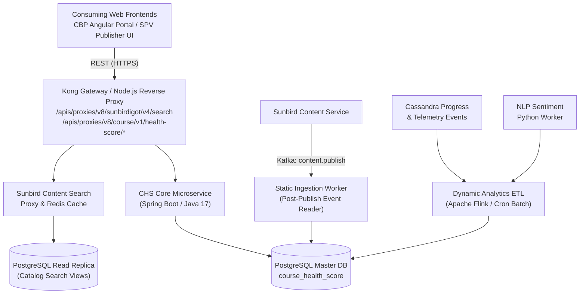
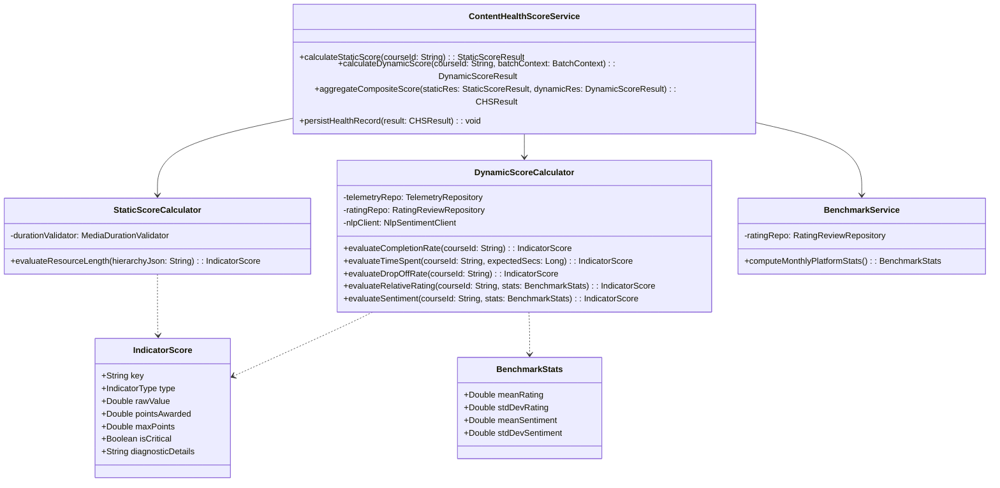
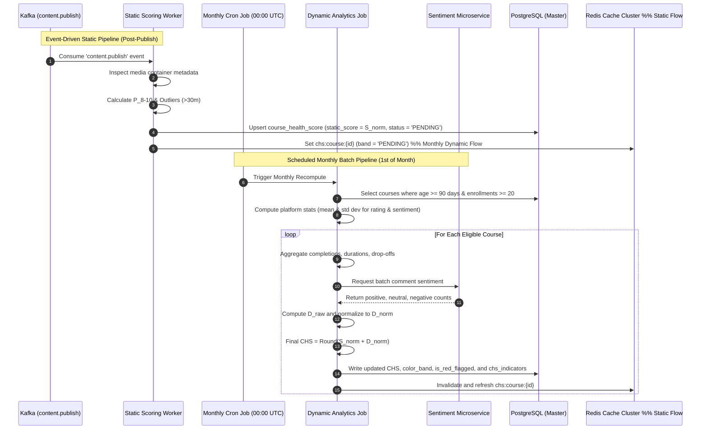

# Content Health Score — Software Design Description (SDD)

## 1. System Identification & Architectural Rationale

### 1.1 Identification & Scope

This Software Design Description (SDD) provides the canonical engineering blueprint for the **Content Health Score (CHS)** engine within the **iGOT Karmayogi** platform. It translates requirements from `PRD_ContentHealthScore_v1.2_r2026_Q1` (TPT), `BRD_ContentHealthScore_v1.2_r2026_Q1` (TPT), `FRS_ContentHealthScore_v1.2_r2026_Q1` (TPT), and `SRS_ContentHealthScore_v1.0_r2026_Q1` (TES) into executable software structures, database entities, asynchronous worker jobs, and API contracts.

### 1.2 Architectural Style & Strategy

The CHS engine adopts an **Asynchronous Pipeline & Hexagonal (Ports & Adapters) Service Architecture**:

- **Decoupled Calculation Pipeline:** Computation of the 50-point **Static Content Quality Score** () is event-driven (triggered on course publication and completed within 5 working days). Computation of the 50-point **Dynamic Learner Performance Score** () is batch-scheduled (executing monthly via distributed workers).
- **Read/Write Segregation (CQRS Pattern):** Heavy telemetry aggregation and NLP inferencing write to an analytical schema in PostgreSQL (`course_health_score`). Course discovery and catalog listing reads are served through Redis caching and indexed directly into the Sunbird Composite Search index.
- **Fail-Safe Degradation:** If dynamic telemetry or the NLP sentiment service is unreachable or below sample thresholds ( enrollments or days live), the engine maintains explicit state (`Pending` or `Not Available`) without polluting catalog search or blocking publisher workflows.

## 2. Component Decomposition & System Architecture



### 2.1 Major System Components & Responsibilities

| Component ID | Subsystem Name | Tech Stack | Primary Responsibilities |
|---|---|---|---|
| **COMP-01** | **CHS Ingestion & Orchestration** **Service** | Java 17 / Spring Boot | Consumes publication lifecycle events (`content.publish`), parses course hierarchies, and schedules static analysis tasks. |
| **COMP-02** | **Static Scoring Engine** | Java Worker / Apache Tika | Extracts media container durations (MP4/audio metadata), evaluates 8–10 minute distributions and minute outliers, computes . |
| **COMP-03** | **Dynamic Telemetry Aggregator** | Apache Flink / PySpark | Processes click-stream sessions (`OE_SUMMARY`, `OE_END`), aggregates completions, drops-offs, and relative time spent over 30–90 day rolling windows. |
| **COMP-04** | **NLP Sentiment Analysis Microservice** | Python 3.10 / FastAPI / RoBERTa | Consumes course feedback review strings, strips PII, computes sentiment polarity distributions (), and calculates net sentiment. |
| **COMP-05** | **Batch Scheduling & Benchmark Daemon** | Quartz Scheduler / K8s CronJob | Triggers monthly recomputation (1st of month at 00:00 UTC), derives platform benchmark parameters (), calculates and final . |
| **COMP-06** | **CHS API & Gateway Adapter** | Node.js Proxy / Express | Exposes course listing queries with embedded CHS facets, serves diagnostic drawer payloads, and handles session token validation (`connect.sid`). |

## 3. Data Design & Persistence Schema

### 3.1 Relational Schema (PostgreSQL)

```sql
-- Core Table: Overall Course Health Score Record
CREATE TABLE IF NOT EXISTS course_health_score (
    id UUID PRIMARY KEY DEFAULT gen_random_uuid(),
    course_id VARCHAR(64) NOT NULL UNIQUE,
    static_score NUMERIC(5, 2) DEFAULT 0.00,
    dynamic_score NUMERIC(5, 2) DEFAULT 0.00,
    final_chs NUMERIC(5, 2) DEFAULT NULL,
    color_band VARCHAR(16) NOT NULL DEFAULT 'PENDING',  -- 'GREEN', 'AMBER', 'RED', 'PENDING', 'NOT_AVAILABLE'
    computation_status VARCHAR(24) NOT NULL DEFAULT 'PENDING',  -- 'COMPUTED', 'PENDING', 'FAILED', 'INACTIVE'
    is_red_flagged BOOLEAN NOT NULL DEFAULT FALSE,
    critical_issues_count INT NOT NULL DEFAULT 0,
    published_date TIMESTAMP WITH TIME ZONE,
    last_static_computed_at TIMESTAMP WITH TIME ZONE,
    last_dynamic_computed_at TIMESTAMP WITH TIME ZONE,
    created_at TIMESTAMP WITH TIME ZONE DEFAULT CURRENT_TIMESTAMP,
    updated_at TIMESTAMP WITH TIME ZONE DEFAULT CURRENT_TIMESTAMP
);
CREATE INDEX idx_chs_course_id ON course_health_score (course_id);
CREATE INDEX idx_chs_color_band ON course_health_score (color_band);
CREATE INDEX idx_chs_status ON course_health_score (computation_status);

-- Detail Table: Indicator-Level Audit & Diagnostics
CREATE TABLE IF NOT EXISTS chs_indicators (
    id UUID PRIMARY KEY DEFAULT gen_random_uuid(),
    course_id VARCHAR(64) NOT NULL REFERENCES course_health_score(course_id) ON DELETE CASCADE,
    indicator_key VARCHAR(32) NOT NULL,  -- 'RESOURCE_LENGTH', 'COMPLETION_RATE', 'TIME_SPENT', 'DROP_OFF_RATE', 'AVG_RATING', 'FEEDBACK_SENTIMENT'
    indicator_type VARCHAR(12) NOT NULL,  -- 'STATIC', 'DYNAMIC'
    raw_metric_value NUMERIC(10, 4) NOT NULL,  -- e.g., 74.2% completion, 1.8% drop-off
    score_points NUMERIC(5, 2) NOT NULL,  -- Points awarded (e.g., 4.0 out of 5.0)
    max_points NUMERIC(5, 2) NOT NULL,  -- Maximum points possible (5.0, 10.0, 15.0)
    is_critical BOOLEAN NOT NULL DEFAULT FALSE,  -- Evaluated as TRUE if standardized points < 3.0
    diagnostic_details TEXT,
    evaluation_window_start DATE,
    evaluation_window_end DATE,
    created_at TIMESTAMP WITH TIME ZONE DEFAULT CURRENT_TIMESTAMP
);
CREATE INDEX idx_chs_indicators_course_key ON chs_indicators (course_id, indicator_key);
```

### 3.2 Redis Caching Schema

- **Key Pattern:** `chs:course:{courseId}`
- **TTL:** 86,400 seconds (24 hours) with automatic cache invalidation upon batch recompute.
- **Data Structure:** Hashes containing:
  - `score`: integer string (e.g., `"78"`)
  - `band`: `"GREEN"` | `"AMBER"` | `"RED"` | `"PENDING"` | `"NOT_AVAILABLE"`
  - `static`: `"40.0"`
  - `dynamic`: `"38.0"`
  - `redFlag`: `"0"` | `"1"`

## 4. Class Design & Low-Level Architecture



## 5. Interface & API Design

### 5.1 Search Proxy Query Contract (Course Listing)

- **Method & Route:** `POST /apis/proxies/v8/sunbirdigot/v4/search`
- **Consumer:** CBP Publisher Course Listing Table (`KB-13896`, `KB-13971`)
- **Query Request Filter:**

```json
{
  "request": {
    "filters": {
      "status": [
        "Live"
      ],
      "courseCategory": [
        "Course"
      ]
    },
    "fields": [
      "name",
      "posterImage",
      "duration",
      "contentHealthScore",
      "contentHealthStatus",
      "staticScore",
      "dynamicScore",
      "healthScoreLastUpdatedOn"
    ]
  }
}
```

- **Response Record:**

```json
{
  "identifier": "do_11382710",
  "name": "Basics of Public Procurement",
  "contentHealthScore": 78,
  "contentHealthStatus": "GREEN",
  "staticScore": 40.0,
  "dynamicScore": 38.0,
  "isRedFlagged": false
}
```

### 5.2 Diagnostic Drawer Breakdown Contract

- **Method & Route:** `GET /apis/proxies/v8/course/v1/health-score/{courseId}`
- **Consumer:** Speed-o-meter Health Drawer (`KB-13897`, `KB-14170`)
- **Response Schema:**

```json
{
  "responseCode": "OK",
  "result": {
    "courseId": "do_11382710",
    "finalScore": 78,
    "colorBand": "GREEN",
    "status": "COMPUTED",
    "staticBreakdown": {
      "score": 40.0,
      "maxScore": 50.0,
      "indicators": [
        {
          "name": "Resource Length Distribution",
          "rawPoints": 4,
          "maxPoints": 5,
          "isCritical": false,
          "details": "75.0% modules in 8-10 min window, 1 outlier >30 min"
        }
      ]
    },
    "dynamicBreakdown": {
      "score": 38.0,
      "maxScore": 50.0,
      "indicators": [
        {
          "name": "Completion Rate",
          "rawPoints": 4,
          "maxPoints": 5,
          "isCritical": false,
          "details": "63.3% completion rate"
        },
        {
          "name": "Course Time Spent vs Expected",
          "rawPoints": 10,
          "maxPoints": 10,
          "isCritical": false,
          "details": "89.8% of expected duration spent"
        },
        {
          "name": "Drop-off Rate",
          "rawPoints": 12,
          "maxPoints": 15,
          "isCritical": false,
          "details": "3.1% learners exited after module 1"
        },
        {
          "name": "Average Rating",
          "rawPoints": 8,
          "maxPoints": 10,
          "isCritical": false,
          "details": "Rating 4.48 vs platform mean 4.30"
        },
        {
          "name": "Feedback Sentiment Analysis",
          "rawPoints": 4,
          "maxPoints": 10,
          "isCritical": false,
          "details": "Net sentiment +80.0%"
        }
      ]
    },
    "warnings": {
      "hasRedFlag": false,
      "criticalIssuesCount": 0,
      "criticalMessage": null
    }
  }
}
```

## 6. Control Flow & Asynchronous Execution Logic



## 7. Non-Functional Engineering Design

### 7.1 Performance & Scalability Targets

- **Catalog Search Latency:** CHS facet ingestion adds overhead to the Sunbird proxy response by leveraging Redis hash lookups.
- **Batch Processing Throughput:** The monthly batch calculation processes over 5,000 active courses within a **4-hour maintenance window** using multi-threaded Apache Flink tasks.
- **Concurrency:** Diagnostic drawer endpoints handle up to peak load across SPV and MDO administrative traffic.

### 7.2 Fault Tolerance & Resilience

- **NLP Service Timeout Circuit Breaker:** Wrapped in a Resilience4j circuit breaker ( timeout). If NLP fails or times out, the sentiment indicator falls back to the course's star-rating score (), logging a non-blocking warning.
- **Idempotency:** All batch upserts into `course_health_score` use `ON CONFLICT (course_id) DO UPDATE` to guarantee idempotent execution upon pipeline retries.

### 7.3 Security & Multi-Tenancy (RBAC)

- Access to diagnostic breakdown drawers is restricted to authenticated users holding `CONTENT_CREATOR`, `CONTENT_PUBLISHER`, `CONTENT_REVIEWER`, or `SPV_ADMIN` roles.
- Course ratings and feedback strings are sanitized and stripped of user PII before ingestion by the NLP sentiment worker.

## 8. Requirements Traceability to Implementation Artifacts

| Requirement Ref | Architectural Element | Implemented In Class / Service | Test Harness Verification |
|---|---|---|---|
| **CHS_BR1** (Static Duration) | `StaticScoreCalculator` | `org.karmayogi.chs.service.StaticScoreCalculator` | `StaticScoreCalculatorTest.java` (Validates 8–10m window & outliers) |
| **CHS_BR2_FR1** (Completion) | `DynamicScoreCalculator` | `org.karmayogi.chs.service.DynamicScoreCalculator` | `DynamicScoreCalculatorTest.java` (Validates 50–70% boundary conditions) |
| **CHS_BR2_FR2** (Time Spent) | `DynamicScoreCalculator` | `org.karmayogi.chs.service.DynamicScoreCalculator` | `DynamicScoreCalculatorTest.java` (Validates 80–120% ratio rules) |
| **CHS_BR2_FR3** (Drop-off) | `DynamicScoreCalculator` | `org.karmayogi.chs.service.DynamicScoreCalculator` | `DynamicScoreCalculatorTest.java` (Validates 2–5% boundary steps) |
| **CHS_BR2_FR4** (Rating) | `BenchmarkService` | `org.karmayogi.chs.service.BenchmarkService` | `BenchmarkServiceTest.java` (Validates and red flag rules) |
| **CHS_BR2_FR5** (Sentiment) | `NlpSentimentClient` | `org.karmayogi.chs.client.NlpSentimentClient` | `NlpSentimentClientTest.java` (Validates comment sentiment aggregation) |
| **CHS_BR3** (Aggregation) | `ContentHealthScoreService` | `org.karmayogi.chs.service.ContentHealthScoreService` | `ContentHealthScoreServiceTest.java` (Validates bounds) |
